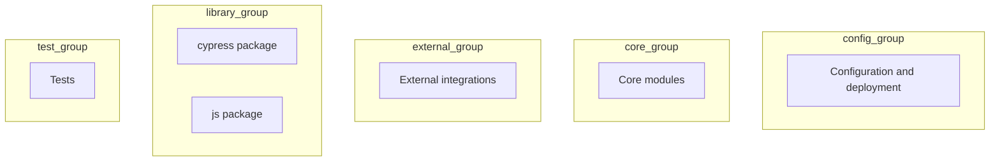

# Architecture report: snapappointments/bootstrap-select

> Automated static analysis. **Observed** = directly seen in files/imports/AST; **Inferred** = interpretation from that evidence. Repository code was not executed.

## 1. Repository at a glance

| Item | Value |
| --- | --- |
| Repository | snapappointments/bootstrap-select |
| Description | :rocket: The jQuery plugin that brings select elements into the 21st century with intuitive multiselection, searching, and much more. |
| Language | JavaScript |
| Stars | 9807 |
| Licence | MIT |
| Analysed commit / branch | 939e94b14a34759e193f616b753e0a33081cc0c5 / main |
| Framework(s) | None detected |
| Files analysed | 95 |
| Components | 6 |

## 2. Architecture in one minute

snapappointments/bootstrap-select - :rocket: The jQuery plugin that brings select elements into the 21st century with intuitive multiselection, searching, and much more.. This repository was analysed statically from 95 file(s) (0 Python). Detected technologies (observed from imports/manifests): GitHub Actions. Files are grouped into 6 component(s): Configuration and deployment, Core modules, cypress package, External integrations, js package, Tests. Findings below distinguish observed facts from inferred interpretation.

## 3. High-level block diagram

## 4. Main components

### Configuration and deployment (`config`)

- **Kind:** config
- **Status:** Observed
- **Confidence:** 0.85
- **Responsibility:** Groups 5 file(s) under configuration and deployment (observed from repository paths and static analysis).
- **Paths:** `bower.json`, `composer.json`, `cypress.json`, `js/.eslintrc.json`, `package.json`
- **Evidence:** [bower.json](https://github.com/snapappointments/bootstrap-select/blob/939e94b14a34759e193f616b753e0a33081cc0c5/bower.json); [composer.json](https://github.com/snapappointments/bootstrap-select/blob/939e94b14a34759e193f616b753e0a33081cc0c5/composer.json); [cypress.json](https://github.com/snapappointments/bootstrap-select/blob/939e94b14a34759e193f616b753e0a33081cc0c5/cypress.json); [js/.eslintrc.json](https://github.com/snapappointments/bootstrap-select/blob/939e94b14a34759e193f616b753e0a33081cc0c5/js/.eslintrc.json); [package.json](https://github.com/snapappointments/bootstrap-select/blob/939e94b14a34759e193f616b753e0a33081cc0c5/package.json)

### Core modules (`core`)

- **Kind:** core
- **Status:** Observed
- **Confidence:** 0.85
- **Responsibility:** Groups 1 file(s) under core modules (observed from repository paths and static analysis).
- **Paths:** `Gruntfile.js`
- **Evidence:** [Gruntfile.js](https://github.com/snapappointments/bootstrap-select/blob/939e94b14a34759e193f616b753e0a33081cc0c5/Gruntfile.js)

### cypress package (`cypress`)

- **Kind:** library
- **Status:** Observed
- **Confidence:** 0.85
- **Responsibility:** Groups 3 file(s) under cypress package (observed from repository paths and static analysis).
- **Paths:** `cypress/plugins/index.js`, `cypress/support/commands.js`, `cypress/support/index.js`
- **Evidence:** [cypress/plugins/index.js](https://github.com/snapappointments/bootstrap-select/blob/939e94b14a34759e193f616b753e0a33081cc0c5/cypress/plugins/index.js); [cypress/support/commands.js](https://github.com/snapappointments/bootstrap-select/blob/939e94b14a34759e193f616b753e0a33081cc0c5/cypress/support/commands.js); [cypress/support/index.js](https://github.com/snapappointments/bootstrap-select/blob/939e94b14a34759e193f616b753e0a33081cc0c5/cypress/support/index.js)

### External integrations (`external_integrations`)

- **Kind:** external
- **Status:** Observed
- **Confidence:** 0.85
- **Responsibility:** Groups 2 file(s) under external integrations (observed from repository paths and static analysis).
- **Paths:** `cypress/integration/basic.spec.js`, `cypress/integration/max-options.spec.js`
- **Evidence:** [cypress/integration/basic.spec.js](https://github.com/snapappointments/bootstrap-select/blob/939e94b14a34759e193f616b753e0a33081cc0c5/cypress/integration/basic.spec.js); [cypress/integration/max-options.spec.js](https://github.com/snapappointments/bootstrap-select/blob/939e94b14a34759e193f616b753e0a33081cc0c5/cypress/integration/max-options.spec.js)

### js package (`js`)

- **Kind:** library
- **Status:** Observed
- **Confidence:** 0.85
- **Responsibility:** Groups 44 file(s) under js package (observed from repository paths and static analysis).
- **Paths:** `js/bootstrap-select.js`, `js/i18n/defaults-am_ET.js`, `js/i18n/defaults-ar_AR.js`, `js/i18n/defaults-bg_BG.js`, `js/i18n/defaults-cs_CZ.js`, `js/i18n/defaults-da_DK.js`, `js/i18n/defaults-de_DE.js`, `js/i18n/defaults-en_US.js`, `js/i18n/defaults-es_CL.js`, `js/i18n/defaults-es_ES.js`, `js/i18n/defaults-et_EE.js`, `js/i18n/defaults-eu.js`, `js/i18n/defaults-fa_IR.js`, `js/i18n/defaults-fi_FI.js`, `js/i18n/defaults-fr_FR.js`, `js/i18n/defaults-hr_HR.js`, `js/i18n/defaults-hu_HU.js`, `js/i18n/defaults-id_ID.js`, `js/i18n/defaults-it_IT.js`, `js/i18n/defaults-ja_JP.js`, `js/i18n/defaults-kh_KM.js`, `js/i18n/defaults-ko_KR.js`, `js/i18n/defaults-lt_LT.js`, `js/i18n/defaults-lv_LV.js`, `js/i18n/defaults-nb_NO.js`, `js/i18n/defaults-nl_NL.js`, `js/i18n/defaults-pl_PL.js`, `js/i18n/defaults-pt_BR.js`, `js/i18n/defaults-pt_PT.js`, `js/i18n/defaults-ro_RO.js`, `js/i18n/defaults-ru_RU.js`, `js/i18n/defaults-sk_SK.js`, `js/i18n/defaults-sl_SI.js`, `js/i18n/defaults-sr_SP.js`, `js/i18n/defaults-sv_SE.js`, `js/i18n/defaults-th_TH.js`, `js/i18n/defaults-tk_TK.js`, `js/i18n/defaults-tr_TR.js`, `js/i18n/defaults-ua_UA.js`, `js/i18n/defaults-vi_VN.js`, `js/i18n/defaults-zh_CN.js`, `js/i18n/defaults-zh_TW.js`, `js/umd-intro.js`, `js/umd-outro.js`
- **Evidence:** [js/bootstrap-select.js](https://github.com/snapappointments/bootstrap-select/blob/939e94b14a34759e193f616b753e0a33081cc0c5/js/bootstrap-select.js); [js/i18n/defaults-am_ET.js](https://github.com/snapappointments/bootstrap-select/blob/939e94b14a34759e193f616b753e0a33081cc0c5/js/i18n/defaults-am_ET.js); [js/i18n/defaults-ar_AR.js](https://github.com/snapappointments/bootstrap-select/blob/939e94b14a34759e193f616b753e0a33081cc0c5/js/i18n/defaults-ar_AR.js); [js/i18n/defaults-bg_BG.js](https://github.com/snapappointments/bootstrap-select/blob/939e94b14a34759e193f616b753e0a33081cc0c5/js/i18n/defaults-bg_BG.js); [js/i18n/defaults-cs_CZ.js](https://github.com/snapappointments/bootstrap-select/blob/939e94b14a34759e193f616b753e0a33081cc0c5/js/i18n/defaults-cs_CZ.js); [js/i18n/defaults-da_DK.js](https://github.com/snapappointments/bootstrap-select/blob/939e94b14a34759e193f616b753e0a33081cc0c5/js/i18n/defaults-da_DK.js); [js/i18n/defaults-de_DE.js](https://github.com/snapappointments/bootstrap-select/blob/939e94b14a34759e193f616b753e0a33081cc0c5/js/i18n/defaults-de_DE.js); [js/i18n/defaults-en_US.js](https://github.com/snapappointments/bootstrap-select/blob/939e94b14a34759e193f616b753e0a33081cc0c5/js/i18n/defaults-en_US.js)

### Tests (`tests`)

- **Kind:** test
- **Status:** Observed
- **Confidence:** 0.85
- **Responsibility:** Groups 4 file(s) under tests (observed from repository paths and static analysis).
- **Paths:** `tests/bootstrap4.html`, `tests/bootstrap5.html`, `tests/index.html`, `tests/main.js`
- **Evidence:** [tests/bootstrap4.html](https://github.com/snapappointments/bootstrap-select/blob/939e94b14a34759e193f616b753e0a33081cc0c5/tests/bootstrap4.html); [tests/bootstrap5.html](https://github.com/snapappointments/bootstrap-select/blob/939e94b14a34759e193f616b753e0a33081cc0c5/tests/bootstrap5.html); [tests/index.html](https://github.com/snapappointments/bootstrap-select/blob/939e94b14a34759e193f616b753e0a33081cc0c5/tests/index.html); [tests/main.js](https://github.com/snapappointments/bootstrap-select/blob/939e94b14a34759e193f616b753e0a33081cc0c5/tests/main.js)

## 5. Execution flow

**Observed** entry point(s):

- [cypress/plugins/index.js](https://github.com/snapappointments/bootstrap-select/blob/939e94b14a34759e193f616b753e0a33081cc0c5/cypress/plugins/index.js)
- [cypress/support/index.js](https://github.com/snapappointments/bootstrap-select/blob/939e94b14a34759e193f616b753e0a33081cc0c5/cypress/support/index.js)

Representative flow (derived from observed entry points and the import graph; steps beyond the entry point are **Inferred**):

1. Execution starts at an observed entry point listed above, if present.
2. No internal import relationships between components were observed.

## 6. Project structure

### `(root)`

- `.eslintignore` - other (31 bytes)
- `.gitignore` - other (154 bytes)
- `CHANGELOG.md` - docs (38270 bytes)
- `CONTRIBUTING.md` - docs (5301 bytes)
- `Gruntfile.js` - source, JavaScript (6705 bytes)
- `LICENSE` - docs (1093 bytes)
- `README.md` - docs (6044 bytes)
- `bower.json` - config (1226 bytes)
- `composer.json` - config (846 bytes)
- `cypress.json` - config (3 bytes)
- `package.json` - manifest (1904 bytes)

### `.github`

- `.github/FUNDING.yml` - config (66 bytes)
- `.github/ISSUE_TEMPLATE/bug_report.md` - docs (846 bytes)
- `.github/ISSUE_TEMPLATE/feature_request.md` - docs (595 bytes)
- `.github/PULL_REQUEST_TEMPLATE.md` - docs (38 bytes)
- `.github/move.yml` - config (536 bytes)
- `.github/workflows/cypress.yml` - ci, YAML (361 bytes)
- `.github/workflows/linting.yml` - ci, YAML (465 bytes)
- `.github/workflows/publishing.yml` - ci, YAML (963 bytes)

### `cypress`

- `cypress/integration/basic.spec.js` - source, JavaScript (4423 bytes)
- `cypress/integration/max-options.spec.js` - source, JavaScript (3158 bytes)
- `cypress/plugins/index.js` - source, JavaScript (761 bytes)
- `cypress/support/commands.js` - source, JavaScript (714 bytes)
- `cypress/support/index.js` - source, JavaScript (670 bytes)

### `docs`

- `docs/custom_theme/ajax/libs/highlight.js/9.15.6/js/highlight.pack.js` - docs (22971 bytes)
- `docs/custom_theme/css/base.css` - docs (1974 bytes)
- `docs/custom_theme/js/base.js` - docs (2578 bytes)
- `docs/custom_theme/main.html` - docs (5564 bytes)
- `docs/custom_theme/nav.html` - docs (2316 bytes)
- `docs/custom_theme/toc.html` - docs (614 bytes)
- `docs/docs/css/custom.css` - docs (5765 bytes)
- `docs/docs/examples.md` - docs (25512 bytes)
- `docs/docs/index.md` - docs (3468 bytes)
- `docs/docs/methods.md` - docs (5892 bytes)
- `docs/docs/options.md` - docs (17340 bytes)
- `docs/docs/playground/3/index.html` - docs (302 bytes)
- `docs/docs/playground/5/index.html` - docs (302 bytes)
- `docs/docs/playground/index.html` - docs (299 bytes)
- `docs/docs/playground/plnkrOpener.js` - docs (2430 bytes)
- `docs/mkdocs.yml` - config (651 bytes)

### `js`

- `js/.eslintrc.json` - config (6092 bytes)
- `js/bootstrap-select.js` - source, JavaScript (127662 bytes)
- `js/i18n/defaults-am_ET.js` - source, JavaScript (1027 bytes)
- `js/i18n/defaults-ar_AR.js` - source, JavaScript (1076 bytes)
- `js/i18n/defaults-bg_BG.js` - source, JavaScript (1064 bytes)
- `js/i18n/defaults-cs_CZ.js` - source, JavaScript (569 bytes)
- `js/i18n/defaults-da_DK.js` - source, JavaScript (790 bytes)
- `js/i18n/defaults-de_DE.js` - source, JavaScript (849 bytes)
- `js/i18n/defaults-en_US.js` - source, JavaScript (782 bytes)
- `js/i18n/defaults-es_CL.js` - source, JavaScript (551 bytes)
- `js/i18n/defaults-es_ES.js` - source, JavaScript (551 bytes)
- `js/i18n/defaults-et_EE.js` - source, JavaScript (666 bytes)
- `js/i18n/defaults-eu.js` - source, JavaScript (537 bytes)
- `js/i18n/defaults-fa_IR.js` - source, JavaScript (634 bytes)
- `js/i18n/defaults-fi_FI.js` - source, JavaScript (803 bytes)
- `js/i18n/defaults-fr_FR.js` - source, JavaScript (861 bytes)
- `js/i18n/defaults-hr_HR.js` - source, JavaScript (853 bytes)
- `js/i18n/defaults-hu_HU.js` - source, JavaScript (631 bytes)
- `js/i18n/defaults-id_ID.js` - source, JavaScript (524 bytes)
- `js/i18n/defaults-it_IT.js` - source, JavaScript (722 bytes)
- `js/i18n/defaults-ja_JP.js` - source, JavaScript (663 bytes)
- `js/i18n/defaults-kh_KM.js` - source, JavaScript (1218 bytes)
- `js/i18n/defaults-ko_KR.js` - source, JavaScript (693 bytes)
- `js/i18n/defaults-lt_LT.js` - source, JavaScript (876 bytes)
- `js/i18n/defaults-lv_LV.js` - source, JavaScript (859 bytes)
- `js/i18n/defaults-nb_NO.js` - source, JavaScript (807 bytes)
- `js/i18n/defaults-nl_NL.js` - source, JavaScript (597 bytes)
- `js/i18n/defaults-pl_PL.js` - source, JavaScript (557 bytes)
- `js/i18n/defaults-pt_BR.js` - source, JavaScript (622 bytes)
- `js/i18n/defaults-pt_PT.js` - source, JavaScript (629 bytes)
- `js/i18n/defaults-ro_RO.js` - source, JavaScript (642 bytes)
- `js/i18n/defaults-ru_RU.js` - source, JavaScript (726 bytes)
- `js/i18n/defaults-sk_SK.js` - source, JavaScript (574 bytes)
- `js/i18n/defaults-sl_SI.js` - source, JavaScript (596 bytes)
- `js/i18n/defaults-sr_SP.js` - source, JavaScript (830 bytes)
- `js/i18n/defaults-sv_SE.js` - source, JavaScript (693 bytes)
- `js/i18n/defaults-th_TH.js` - source, JavaScript (821 bytes)
- `js/i18n/defaults-tk_TK.js` - source, JavaScript (932 bytes)
- `js/i18n/defaults-tr_TR.js` - source, JavaScript (913 bytes)
- `js/i18n/defaults-ua_UA.js` - source, JavaScript (681 bytes)
- `js/i18n/defaults-vi_VN.js` - source, JavaScript (681 bytes)
- `js/i18n/defaults-zh_CN.js` - source, JavaScript (511 bytes)
- `js/i18n/defaults-zh_TW.js` - source, JavaScript (521 bytes)
- `js/umd-intro.js` - source, JavaScript (612 bytes)
- `js/umd-outro.js` - source, JavaScript (6 bytes)

### `less`

- `less/bootstrap-select.less` - other (9868 bytes)
- `less/variables.less` - other (472 bytes)

### `nuget`

- `nuget/MyGet.ps1` - other (1016 bytes)
- `nuget/bootstrap-select.nuspec` - other (1238 bytes)

### `sass`

- `sass/bootstrap-select.scss` - other (10321 bytes)
- `sass/variables.scss` - other (562 bytes)

### `tests`

- `tests/bootstrap4.html` - test (11209 bytes)
- `tests/bootstrap5.html` - test (11631 bytes)
- `tests/index.html` - test (839 bytes)
- `tests/main.js` - test, JavaScript (1304 bytes)

## 7. Key dependencies and integrations

| Name | Category | Status | Confidence | Evidence |
| --- | --- | --- | --- | --- |
| GitHub Actions | ci | Observed | 0.90 | [.github/workflows/cypress.yml](https://github.com/snapappointments/bootstrap-select/blob/939e94b14a34759e193f616b753e0a33081cc0c5/.github/workflows/cypress.yml); [.github/workflows/linting.yml](https://github.com/snapappointments/bootstrap-select/blob/939e94b14a34759e193f616b753e0a33081cc0c5/.github/workflows/linting.yml); [.github/workflows/publishing.yml](https://github.com/snapappointments/bootstrap-select/blob/939e94b14a34759e193f616b753e0a33081cc0c5/.github/workflows/publishing.yml) |

## 8. Data and state

No database, cache, queue, or persistent-state usage was observed in the analysed files. State handling, if any, may be in-memory or in files that were not analysed.

## 9. Configuration and deployment clues

- `.github/FUNDING.yml` (config)
- `.github/move.yml` (config)
- `.github/workflows/cypress.yml` (ci)
- `.github/workflows/linting.yml` (ci)
- `.github/workflows/publishing.yml` (ci)
- `bower.json` (config)
- `composer.json` (config)
- `cypress.json` (config)
- `docs/mkdocs.yml` (config)
- `js/.eslintrc.json` (config)
- `package.json` (manifest)

## 10. Design observations

- Tests are present alongside source code (Observed from test file paths).
- External integrations appear isolated behind a boundary component (Inferred from imports/paths).

These observations are interpretations (**Inferred**) of the observed structure, not guarantees about runtime design.

## 11. Limitations and unknowns

- Static analysis only: repository code was not executed, installed, or imported at runtime.
- Components and relationships are inferred from file paths, imports, and AST structure; runtime behaviour, dynamic imports, and reflection may not be visible.
- 44 file(s) were skipped during inventory (1 x generated/minified file excluded; 43 x vendored/generated directory excluded).
- No clear application entry point was observed in the analysed files.
- Repository text was treated as untrusted data; no instructions found in repository files were followed, and likely secret values were redacted/excluded.
- JavaScript and TypeScript files were inventoried from paths and package manifests. They were not parsed with a full language AST, and repository code was not executed.

## 12. Source references

- [.github/workflows/cypress.yml](https://github.com/snapappointments/bootstrap-select/blob/939e94b14a34759e193f616b753e0a33081cc0c5/.github/workflows/cypress.yml)
- [.github/workflows/linting.yml](https://github.com/snapappointments/bootstrap-select/blob/939e94b14a34759e193f616b753e0a33081cc0c5/.github/workflows/linting.yml)
- [.github/workflows/publishing.yml](https://github.com/snapappointments/bootstrap-select/blob/939e94b14a34759e193f616b753e0a33081cc0c5/.github/workflows/publishing.yml)
- [Gruntfile.js](https://github.com/snapappointments/bootstrap-select/blob/939e94b14a34759e193f616b753e0a33081cc0c5/Gruntfile.js)
- [bower.json](https://github.com/snapappointments/bootstrap-select/blob/939e94b14a34759e193f616b753e0a33081cc0c5/bower.json)
- [composer.json](https://github.com/snapappointments/bootstrap-select/blob/939e94b14a34759e193f616b753e0a33081cc0c5/composer.json)
- [cypress.json](https://github.com/snapappointments/bootstrap-select/blob/939e94b14a34759e193f616b753e0a33081cc0c5/cypress.json)
- [cypress/integration/basic.spec.js](https://github.com/snapappointments/bootstrap-select/blob/939e94b14a34759e193f616b753e0a33081cc0c5/cypress/integration/basic.spec.js)
- [cypress/integration/max-options.spec.js](https://github.com/snapappointments/bootstrap-select/blob/939e94b14a34759e193f616b753e0a33081cc0c5/cypress/integration/max-options.spec.js)
- [cypress/plugins/index.js](https://github.com/snapappointments/bootstrap-select/blob/939e94b14a34759e193f616b753e0a33081cc0c5/cypress/plugins/index.js)
- [cypress/support/commands.js](https://github.com/snapappointments/bootstrap-select/blob/939e94b14a34759e193f616b753e0a33081cc0c5/cypress/support/commands.js)
- [cypress/support/index.js](https://github.com/snapappointments/bootstrap-select/blob/939e94b14a34759e193f616b753e0a33081cc0c5/cypress/support/index.js)
- [js/.eslintrc.json](https://github.com/snapappointments/bootstrap-select/blob/939e94b14a34759e193f616b753e0a33081cc0c5/js/.eslintrc.json)
- [js/bootstrap-select.js](https://github.com/snapappointments/bootstrap-select/blob/939e94b14a34759e193f616b753e0a33081cc0c5/js/bootstrap-select.js)
- [js/i18n/defaults-am_ET.js](https://github.com/snapappointments/bootstrap-select/blob/939e94b14a34759e193f616b753e0a33081cc0c5/js/i18n/defaults-am_ET.js)
- [js/i18n/defaults-ar_AR.js](https://github.com/snapappointments/bootstrap-select/blob/939e94b14a34759e193f616b753e0a33081cc0c5/js/i18n/defaults-ar_AR.js)
- [js/i18n/defaults-bg_BG.js](https://github.com/snapappointments/bootstrap-select/blob/939e94b14a34759e193f616b753e0a33081cc0c5/js/i18n/defaults-bg_BG.js)
- [js/i18n/defaults-cs_CZ.js](https://github.com/snapappointments/bootstrap-select/blob/939e94b14a34759e193f616b753e0a33081cc0c5/js/i18n/defaults-cs_CZ.js)
- [js/i18n/defaults-da_DK.js](https://github.com/snapappointments/bootstrap-select/blob/939e94b14a34759e193f616b753e0a33081cc0c5/js/i18n/defaults-da_DK.js)
- [js/i18n/defaults-de_DE.js](https://github.com/snapappointments/bootstrap-select/blob/939e94b14a34759e193f616b753e0a33081cc0c5/js/i18n/defaults-de_DE.js)
- [js/i18n/defaults-en_US.js](https://github.com/snapappointments/bootstrap-select/blob/939e94b14a34759e193f616b753e0a33081cc0c5/js/i18n/defaults-en_US.js)
- [package.json](https://github.com/snapappointments/bootstrap-select/blob/939e94b14a34759e193f616b753e0a33081cc0c5/package.json)
- [tests/bootstrap4.html](https://github.com/snapappointments/bootstrap-select/blob/939e94b14a34759e193f616b753e0a33081cc0c5/tests/bootstrap4.html)
- [tests/bootstrap5.html](https://github.com/snapappointments/bootstrap-select/blob/939e94b14a34759e193f616b753e0a33081cc0c5/tests/bootstrap5.html)
- [tests/index.html](https://github.com/snapappointments/bootstrap-select/blob/939e94b14a34759e193f616b753e0a33081cc0c5/tests/index.html)
- [tests/main.js](https://github.com/snapappointments/bootstrap-select/blob/939e94b14a34759e193f616b753e0a33081cc0c5/tests/main.js)
