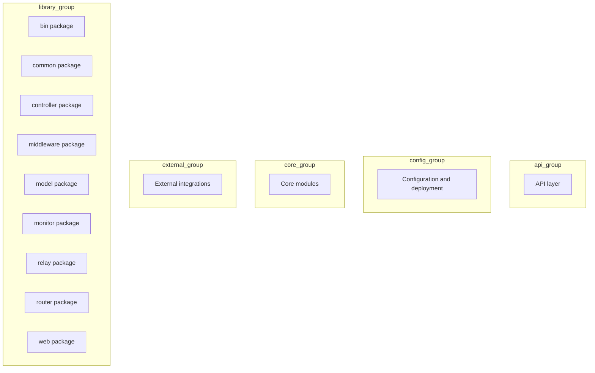

# Architecture report: songquanpeng/one-api

> Automated static analysis. **Observed** = directly seen in files/imports/AST; **Inferred** = interpretation from that evidence. Repository code was not executed.

## 1. Repository at a glance

| Item | Value |
| --- | --- |
| Repository | songquanpeng/one-api |
| Description | LLM API 管理 & 分发系统，支持 OpenAI、Azure、Anthropic Claude、Google Gemini、DeepSeek、字节豆包、ChatGLM、文心一言、讯飞星火、通义千问、360 智脑、腾讯混元等主流模型，统一 API 适配，可用于 key 管理与二次分发。单可执行文件，提供 Docker 镜像，一键部署，开箱即用。LLM API management & key redistribution system, unifying multiple providers under a single API. Single binary, Docker-ready,… |
| Language | JavaScript |
| Stars | 37434 |
| Licence | MIT |
| Analysed commit / branch | 8df4a2670b98266bd287c698243fff327d9748cf / main |
| Framework(s) | React |
| Files analysed | 552 |
| Components | 13 |

## 2. Architecture in one minute

songquanpeng/one-api - LLM API 管理 & 分发系统，支持 OpenAI、Azure、Anthropic Claude、Google Gemini、DeepSeek、字节豆包、ChatGLM、文心一言、讯飞星火、通义千问、360 智脑、腾讯混元等主流模型，统一 API 适配，可用于 key 管理与二次分发。单可执行文件，提供 Docker 镜像，一键部署，开箱即用。LLM API management & key…. This repository was analysed statically from 552 file(s) (0 Python). Detected technologies (observed from imports/manifests): GitHub Actions, MySQL, Redis, React, axios, React Router. Files are grouped into 13 component(s): API layer, bin package, common package, Configuration and deployment, controller package, Core modules, External integrations, middleware package. Findings below distinguish observed facts from inferred interpretation.

## 3. High-level block diagram

## 4. Main components

### API layer (`api_layer`)

- **Kind:** api
- **Status:** Observed
- **Confidence:** 0.85
- **Responsibility:** Groups 59 file(s) under api layer (observed from repository paths and static analysis).
- **Paths:** `web/berry/src/routes/MainRoutes.js`, `web/berry/src/routes/OtherRoutes.js`, `web/berry/src/routes/index.js`, `web/berry/src/views/About/index.js`, `web/berry/src/views/Authentication/Auth/ForgetPassword.js`, `web/berry/src/views/Authentication/Auth/GitHubOAuth.js`, `web/berry/src/views/Authentication/Auth/LarkOAuth.js`, `web/berry/src/views/Authentication/Auth/Login.js`, `web/berry/src/views/Authentication/Auth/OidcOAuth.js`, `web/berry/src/views/Authentication/Auth/Register.js`, `web/berry/src/views/Authentication/Auth/ResetPassword.js`, `web/berry/src/views/Authentication/AuthCardWrapper.js`, `web/berry/src/views/Authentication/AuthForms/AuthLogin.js`, `web/berry/src/views/Authentication/AuthForms/AuthRegister.js`, `web/berry/src/views/Authentication/AuthForms/ForgetPasswordForm.js`, `web/berry/src/views/Authentication/AuthForms/ResetPasswordForm.js`, `web/berry/src/views/Authentication/AuthForms/WechatModal.js`, `web/berry/src/views/Authentication/AuthWrapper.js`, `web/berry/src/views/Channel/component/EditModal.js`, `web/berry/src/views/Channel/component/GroupLabel.js`, `web/berry/src/views/Channel/component/NameLabel.js`, `web/berry/src/views/Channel/component/ResponseTimeLabel.js`, `web/berry/src/views/Channel/component/TableHead.js`, `web/berry/src/views/Channel/component/TableRow.js`, `web/berry/src/views/Channel/index.js`, `web/berry/src/views/Channel/type/Config.js`, `web/berry/src/views/Dashboard/component/StatisticalBarChart.js`, `web/berry/src/views/Dashboard/component/StatisticalCard.js`, `web/berry/src/views/Dashboard/component/StatisticalLineChartCard.js`, `web/berry/src/views/Dashboard/index.js`, `web/berry/src/views/Error/index.js`, `web/berry/src/views/Home/baseIndex.js`, `web/berry/src/views/Home/index.js`, `web/berry/src/views/Log/component/TableHead.js`, `web/berry/src/views/Log/component/TableRow.js`, `web/berry/src/views/Log/component/TableToolBar.js`, `web/berry/src/views/Log/index.js`, `web/berry/src/views/Log/type/LogType.js`, `web/berry/src/views/Profile/component/EmailModal.js`, `web/berry/src/views/Profile/index.js`, `web/berry/src/views/Redemption/component/EditModal.js`, `web/berry/src/views/Redemption/component/TableHead.js`, `web/berry/src/views/Redemption/component/TableRow.js`, `web/berry/src/views/Redemption/index.js`, `web/berry/src/views/Setting/component/OperationSetting.js`, `web/berry/src/views/Setting/component/OtherSetting.js`, `web/berry/src/views/Setting/component/SystemSetting.js`, `web/berry/src/views/Setting/index.js`, `web/berry/src/views/Token/component/EditModal.js`, `web/berry/src/views/Token/component/TableHead.js`, `web/berry/src/views/Token/component/TableRow.js`, `web/berry/src/views/Token/index.js`, `web/berry/src/views/Topup/component/InviteCard.js`, `web/berry/src/views/Topup/component/TopupCard.js`, `web/berry/src/views/Topup/index.js`, `web/berry/src/views/User/component/EditModal.js`, `web/berry/src/views/User/component/TableHead.js`, `web/berry/src/views/User/component/TableRow.js`, `web/berry/src/views/User/index.js`
- **Evidence:** [web/berry/src/routes/MainRoutes.js](https://github.com/songquanpeng/one-api/blob/8df4a2670b98266bd287c698243fff327d9748cf/web/berry/src/routes/MainRoutes.js); [web/berry/src/routes/OtherRoutes.js](https://github.com/songquanpeng/one-api/blob/8df4a2670b98266bd287c698243fff327d9748cf/web/berry/src/routes/OtherRoutes.js); [web/berry/src/routes/index.js](https://github.com/songquanpeng/one-api/blob/8df4a2670b98266bd287c698243fff327d9748cf/web/berry/src/routes/index.js); [web/berry/src/views/About/index.js](https://github.com/songquanpeng/one-api/blob/8df4a2670b98266bd287c698243fff327d9748cf/web/berry/src/views/About/index.js); [web/berry/src/views/Authentication/Auth/ForgetPassword.js](https://github.com/songquanpeng/one-api/blob/8df4a2670b98266bd287c698243fff327d9748cf/web/berry/src/views/Authentication/Auth/ForgetPassword.js); [web/berry/src/views/Authentication/Auth/GitHubOAuth.js](https://github.com/songquanpeng/one-api/blob/8df4a2670b98266bd287c698243fff327d9748cf/web/berry/src/views/Authentication/Auth/GitHubOAuth.js); [web/berry/src/views/Authentication/Auth/LarkOAuth.js](https://github.com/songquanpeng/one-api/blob/8df4a2670b98266bd287c698243fff327d9748cf/web/berry/src/views/Authentication/Auth/LarkOAuth.js); [web/berry/src/views/Authentication/Auth/Login.js](https://github.com/songquanpeng/one-api/blob/8df4a2670b98266bd287c698243fff327d9748cf/web/berry/src/views/Authentication/Auth/Login.js)

### bin package (`bin`)

- **Kind:** library
- **Status:** Observed
- **Confidence:** 0.85
- **Responsibility:** Groups 1 file(s) under bin package (observed from repository paths and static analysis).
- **Paths:** `bin/time_test.sh`
- **Evidence:** [bin/time_test.sh](https://github.com/songquanpeng/one-api/blob/8df4a2670b98266bd287c698243fff327d9748cf/bin/time_test.sh)

### common package (`common`)

- **Kind:** library
- **Status:** Observed
- **Confidence:** 0.85
- **Responsibility:** Groups 33 file(s) under common package (observed from repository paths and static analysis).
- **Paths:** `common/blacklist/main.go`, `common/constants.go`, `common/conv/any.go`, `common/crypto.go`, `common/ctxkey/key.go`, `common/custom-event.go`, `common/database.go`, `common/embed-file-system.go`, `common/env/helper.go`, `common/gin.go`, `common/helper/helper.go`, `common/helper/key.go`, `common/helper/time.go`, `common/i18n/i18n.go`, `common/image/image.go`, `common/image/image_test.go`, `common/init.go`, `common/logger/constants.go`, `common/logger/logger.go`, `common/message/email.go`, `common/message/main.go`, `common/message/message-pusher.go`, `common/message/template.go`, `common/network/ip.go`, `common/network/ip_test.go`, `common/random/main.go`, `common/rate-limit.go`, `common/redis.go`, `common/render/render.go`, `common/utils.go`, `common/utils/array.go`, `common/validate.go`, `common/verification.go`
- **Evidence:** [common/blacklist/main.go](https://github.com/songquanpeng/one-api/blob/8df4a2670b98266bd287c698243fff327d9748cf/common/blacklist/main.go); [common/constants.go](https://github.com/songquanpeng/one-api/blob/8df4a2670b98266bd287c698243fff327d9748cf/common/constants.go); [common/conv/any.go](https://github.com/songquanpeng/one-api/blob/8df4a2670b98266bd287c698243fff327d9748cf/common/conv/any.go); [common/crypto.go](https://github.com/songquanpeng/one-api/blob/8df4a2670b98266bd287c698243fff327d9748cf/common/crypto.go); [common/ctxkey/key.go](https://github.com/songquanpeng/one-api/blob/8df4a2670b98266bd287c698243fff327d9748cf/common/ctxkey/key.go); [common/custom-event.go](https://github.com/songquanpeng/one-api/blob/8df4a2670b98266bd287c698243fff327d9748cf/common/custom-event.go); [common/database.go](https://github.com/songquanpeng/one-api/blob/8df4a2670b98266bd287c698243fff327d9748cf/common/database.go); [common/embed-file-system.go](https://github.com/songquanpeng/one-api/blob/8df4a2670b98266bd287c698243fff327d9748cf/common/embed-file-system.go)

### Configuration and deployment (`config`)

- **Kind:** config
- **Status:** Observed
- **Confidence:** 0.85
- **Responsibility:** Groups 14 file(s) under configuration and deployment (observed from repository paths and static analysis).
- **Paths:** `Dockerfile`, `common/config/config.go`, `common/i18n/locales/en.json`, `common/i18n/locales/zh-CN.json`, `docker-compose.yml`, `go.mod`, `web/air/package.json`, `web/air/vercel.json`, `web/berry/jsconfig.json`, `web/berry/package.json`, `web/default/package.json`, `web/default/src/locales/en/translation.json`, `web/default/src/locales/zh/translation.json`, `web/default/vercel.json`
- **Evidence:** [Dockerfile](https://github.com/songquanpeng/one-api/blob/8df4a2670b98266bd287c698243fff327d9748cf/Dockerfile); [common/config/config.go](https://github.com/songquanpeng/one-api/blob/8df4a2670b98266bd287c698243fff327d9748cf/common/config/config.go); [common/i18n/locales/en.json](https://github.com/songquanpeng/one-api/blob/8df4a2670b98266bd287c698243fff327d9748cf/common/i18n/locales/en.json); [common/i18n/locales/zh-CN.json](https://github.com/songquanpeng/one-api/blob/8df4a2670b98266bd287c698243fff327d9748cf/common/i18n/locales/zh-CN.json); [docker-compose.yml](https://github.com/songquanpeng/one-api/blob/8df4a2670b98266bd287c698243fff327d9748cf/docker-compose.yml); [go.mod](https://github.com/songquanpeng/one-api/blob/8df4a2670b98266bd287c698243fff327d9748cf/go.mod); [web/air/package.json](https://github.com/songquanpeng/one-api/blob/8df4a2670b98266bd287c698243fff327d9748cf/web/air/package.json); [web/air/vercel.json](https://github.com/songquanpeng/one-api/blob/8df4a2670b98266bd287c698243fff327d9748cf/web/air/vercel.json)

### controller package (`controller`)

- **Kind:** library
- **Status:** Observed
- **Confidence:** 0.85
- **Responsibility:** Groups 17 file(s) under controller package (observed from repository paths and static analysis).
- **Paths:** `controller/auth/github.go`, `controller/auth/lark.go`, `controller/auth/oidc.go`, `controller/auth/wechat.go`, `controller/billing.go`, `controller/channel-billing.go`, `controller/channel-test.go`, `controller/channel.go`, `controller/group.go`, `controller/log.go`, `controller/misc.go`, `controller/model.go`, `controller/option.go`, `controller/redemption.go`, `controller/relay.go`, `controller/token.go`, `controller/user.go`
- **Evidence:** [controller/auth/github.go](https://github.com/songquanpeng/one-api/blob/8df4a2670b98266bd287c698243fff327d9748cf/controller/auth/github.go); [controller/auth/lark.go](https://github.com/songquanpeng/one-api/blob/8df4a2670b98266bd287c698243fff327d9748cf/controller/auth/lark.go); [controller/auth/oidc.go](https://github.com/songquanpeng/one-api/blob/8df4a2670b98266bd287c698243fff327d9748cf/controller/auth/oidc.go); [controller/auth/wechat.go](https://github.com/songquanpeng/one-api/blob/8df4a2670b98266bd287c698243fff327d9748cf/controller/auth/wechat.go); [controller/billing.go](https://github.com/songquanpeng/one-api/blob/8df4a2670b98266bd287c698243fff327d9748cf/controller/billing.go); [controller/channel-billing.go](https://github.com/songquanpeng/one-api/blob/8df4a2670b98266bd287c698243fff327d9748cf/controller/channel-billing.go); [controller/channel-test.go](https://github.com/songquanpeng/one-api/blob/8df4a2670b98266bd287c698243fff327d9748cf/controller/channel-test.go); [controller/channel.go](https://github.com/songquanpeng/one-api/blob/8df4a2670b98266bd287c698243fff327d9748cf/controller/channel.go)

### Core modules (`core`)

- **Kind:** core
- **Status:** Observed
- **Confidence:** 0.85
- **Responsibility:** Groups 1 file(s) under core modules (observed from repository paths and static analysis).
- **Paths:** `main.go`
- **Evidence:** [main.go](https://github.com/songquanpeng/one-api/blob/8df4a2670b98266bd287c698243fff327d9748cf/main.go)

### External integrations (`external_integrations`)

- **Kind:** external
- **Status:** Observed
- **Confidence:** 0.85
- **Responsibility:** Groups 1 file(s) under external integrations (observed from repository paths and static analysis).
- **Paths:** `common/client/init.go`
- **Evidence:** [common/client/init.go](https://github.com/songquanpeng/one-api/blob/8df4a2670b98266bd287c698243fff327d9748cf/common/client/init.go)

### middleware package (`middleware`)

- **Kind:** library
- **Status:** Observed
- **Confidence:** 0.85
- **Responsibility:** Groups 12 file(s) under middleware package (observed from repository paths and static analysis).
- **Paths:** `middleware/auth.go`, `middleware/cache.go`, `middleware/cors.go`, `middleware/distributor.go`, `middleware/gzip.go`, `middleware/language.go`, `middleware/logger.go`, `middleware/rate-limit.go`, `middleware/recover.go`, `middleware/request-id.go`, `middleware/turnstile-check.go`, `middleware/utils.go`
- **Evidence:** [middleware/auth.go](https://github.com/songquanpeng/one-api/blob/8df4a2670b98266bd287c698243fff327d9748cf/middleware/auth.go); [middleware/cache.go](https://github.com/songquanpeng/one-api/blob/8df4a2670b98266bd287c698243fff327d9748cf/middleware/cache.go); [middleware/cors.go](https://github.com/songquanpeng/one-api/blob/8df4a2670b98266bd287c698243fff327d9748cf/middleware/cors.go); [middleware/distributor.go](https://github.com/songquanpeng/one-api/blob/8df4a2670b98266bd287c698243fff327d9748cf/middleware/distributor.go); [middleware/gzip.go](https://github.com/songquanpeng/one-api/blob/8df4a2670b98266bd287c698243fff327d9748cf/middleware/gzip.go); [middleware/language.go](https://github.com/songquanpeng/one-api/blob/8df4a2670b98266bd287c698243fff327d9748cf/middleware/language.go); [middleware/logger.go](https://github.com/songquanpeng/one-api/blob/8df4a2670b98266bd287c698243fff327d9748cf/middleware/logger.go); [middleware/rate-limit.go](https://github.com/songquanpeng/one-api/blob/8df4a2670b98266bd287c698243fff327d9748cf/middleware/rate-limit.go)

### model package (`model`)

- **Kind:** library
- **Status:** Observed
- **Confidence:** 0.85
- **Responsibility:** Groups 10 file(s) under model package (observed from repository paths and static analysis).
- **Paths:** `model/ability.go`, `model/cache.go`, `model/channel.go`, `model/log.go`, `model/main.go`, `model/option.go`, `model/redemption.go`, `model/token.go`, `model/user.go`, `model/utils.go`
- **Evidence:** [model/ability.go](https://github.com/songquanpeng/one-api/blob/8df4a2670b98266bd287c698243fff327d9748cf/model/ability.go); [model/cache.go](https://github.com/songquanpeng/one-api/blob/8df4a2670b98266bd287c698243fff327d9748cf/model/cache.go); [model/channel.go](https://github.com/songquanpeng/one-api/blob/8df4a2670b98266bd287c698243fff327d9748cf/model/channel.go); [model/log.go](https://github.com/songquanpeng/one-api/blob/8df4a2670b98266bd287c698243fff327d9748cf/model/log.go); [model/main.go](https://github.com/songquanpeng/one-api/blob/8df4a2670b98266bd287c698243fff327d9748cf/model/main.go); [model/option.go](https://github.com/songquanpeng/one-api/blob/8df4a2670b98266bd287c698243fff327d9748cf/model/option.go); [model/redemption.go](https://github.com/songquanpeng/one-api/blob/8df4a2670b98266bd287c698243fff327d9748cf/model/redemption.go); [model/token.go](https://github.com/songquanpeng/one-api/blob/8df4a2670b98266bd287c698243fff327d9748cf/model/token.go)

### monitor package (`monitor`)

- **Kind:** library
- **Status:** Observed
- **Confidence:** 0.85
- **Responsibility:** Groups 3 file(s) under monitor package (observed from repository paths and static analysis).
- **Paths:** `monitor/channel.go`, `monitor/manage.go`, `monitor/metric.go`
- **Evidence:** [monitor/channel.go](https://github.com/songquanpeng/one-api/blob/8df4a2670b98266bd287c698243fff327d9748cf/monitor/channel.go); [monitor/manage.go](https://github.com/songquanpeng/one-api/blob/8df4a2670b98266bd287c698243fff327d9748cf/monitor/manage.go); [monitor/metric.go](https://github.com/songquanpeng/one-api/blob/8df4a2670b98266bd287c698243fff327d9748cf/monitor/metric.go)

### relay package (`relay`)

- **Kind:** library
- **Status:** Observed
- **Confidence:** 0.85
- **Responsibility:** Groups 152 file(s) under relay package (observed from repository paths and static analysis).
- **Paths:** `relay/adaptor.go`, `relay/adaptor/ai360/constants.go`, `relay/adaptor/aiproxy/adaptor.go`, `relay/adaptor/aiproxy/constants.go`, `relay/adaptor/aiproxy/main.go`, `relay/adaptor/aiproxy/model.go`, `relay/adaptor/ali/adaptor.go`, `relay/adaptor/ali/constants.go`, `relay/adaptor/ali/image.go`, `relay/adaptor/ali/main.go`, `relay/adaptor/ali/model.go`, `relay/adaptor/alibailian/constants.go`, `relay/adaptor/alibailian/main.go`, `relay/adaptor/anthropic/adaptor.go`, `relay/adaptor/anthropic/constants.go`, `relay/adaptor/anthropic/main.go`, `relay/adaptor/anthropic/model.go`, `relay/adaptor/aws/adaptor.go`, `relay/adaptor/aws/claude/adapter.go`, `relay/adaptor/aws/claude/main.go`, `relay/adaptor/aws/claude/model.go`, `relay/adaptor/aws/llama3/adapter.go`, `relay/adaptor/aws/llama3/main.go`, `relay/adaptor/aws/llama3/main_test.go`, `relay/adaptor/aws/llama3/model.go`, `relay/adaptor/aws/registry.go`, `relay/adaptor/aws/utils/adaptor.go`, `relay/adaptor/aws/utils/utils.go`, `relay/adaptor/baichuan/constants.go`, `relay/adaptor/baidu/adaptor.go`, `relay/adaptor/baidu/constants.go`, `relay/adaptor/baidu/main.go`, `relay/adaptor/baidu/model.go`, `relay/adaptor/baiduv2/constants.go`, `relay/adaptor/baiduv2/main.go`, `relay/adaptor/cloudflare/adaptor.go`, `relay/adaptor/cloudflare/constant.go`, `relay/adaptor/cloudflare/main.go`, `relay/adaptor/cloudflare/model.go`, `relay/adaptor/cohere/adaptor.go`, `relay/adaptor/cohere/constant.go`, `relay/adaptor/cohere/main.go`, `relay/adaptor/cohere/model.go`, `relay/adaptor/common.go`, `relay/adaptor/coze/adaptor.go`, `relay/adaptor/coze/constant/contenttype/define.go`, `relay/adaptor/coze/constant/event/define.go`, `relay/adaptor/coze/constant/messagetype/define.go`, `relay/adaptor/coze/constants.go`, `relay/adaptor/coze/helper.go`, `relay/adaptor/coze/main.go`, `relay/adaptor/coze/model.go`, `relay/adaptor/deepl/adaptor.go`, `relay/adaptor/deepl/constants.go`, `relay/adaptor/deepl/helper.go`, `relay/adaptor/deepl/main.go`, `relay/adaptor/deepl/model.go`, `relay/adaptor/deepseek/constants.go`, `relay/adaptor/doubao/constants.go`, `relay/adaptor/doubao/main.go`, `relay/adaptor/gemini/adaptor.go`, `relay/adaptor/gemini/constants.go`, `relay/adaptor/gemini/main.go`, `relay/adaptor/gemini/model.go`, `relay/adaptor/geminiv2/constants.go`, `relay/adaptor/geminiv2/main.go`, `relay/adaptor/groq/constants.go`, `relay/adaptor/interface.go`, `relay/adaptor/lingyiwanwu/constants.go`, `relay/adaptor/minimax/constants.go`, `relay/adaptor/minimax/main.go`, `relay/adaptor/mistral/constants.go`, `relay/adaptor/moonshot/constants.go`, `relay/adaptor/novita/constants.go`, `relay/adaptor/novita/main.go`, `relay/adaptor/ollama/adaptor.go`, `relay/adaptor/ollama/constants.go`, `relay/adaptor/ollama/main.go`, `relay/adaptor/ollama/model.go`, `relay/adaptor/openai/adaptor.go`, `relay/adaptor/openai/compatible.go`, `relay/adaptor/openai/constants.go`, `relay/adaptor/openai/helper.go`, `relay/adaptor/openai/image.go`, `relay/adaptor/openai/main.go`, `relay/adaptor/openai/model.go`, `relay/adaptor/openai/token.go`, `relay/adaptor/openai/util.go`, `relay/adaptor/openrouter/constants.go`, `relay/adaptor/palm/adaptor.go`, `relay/adaptor/palm/constants.go`, `relay/adaptor/palm/model.go`, `relay/adaptor/palm/palm.go`, `relay/adaptor/proxy/adaptor.go`, `relay/adaptor/replicate/adaptor.go`, `relay/adaptor/replicate/chat.go`, `relay/adaptor/replicate/constant.go`, `relay/adaptor/replicate/image.go`, `relay/adaptor/replicate/model.go`, `relay/adaptor/siliconflow/constants.go`, `relay/adaptor/stepfun/constants.go`, `relay/adaptor/tencent/adaptor.go`, `relay/adaptor/tencent/constants.go`, `relay/adaptor/tencent/main.go`, `relay/adaptor/tencent/model.go`, `relay/adaptor/togetherai/constants.go`, `relay/adaptor/vertexai/adaptor.go`, `relay/adaptor/vertexai/claude/adapter.go`, `relay/adaptor/vertexai/claude/model.go`, `relay/adaptor/vertexai/gemini/adapter.go`, `relay/adaptor/vertexai/registry.go`, `relay/adaptor/vertexai/token.go`, `relay/adaptor/xai/constants.go`, `relay/adaptor/xunfei/adaptor.go`, `relay/adaptor/xunfei/constants.go`, `relay/adaptor/xunfei/domain.go`, `relay/adaptor/xunfei/main.go`, `relay/adaptor/xunfei/model.go`, `relay/adaptor/xunfeiv2/constants.go`, `relay/adaptor/zhipu/adaptor.go`, `relay/adaptor/zhipu/constants.go`, `relay/adaptor/zhipu/main.go`, `relay/adaptor/zhipu/model.go`, `relay/adaptor_test.go`, `relay/apitype/define.go`, `relay/billing/billing.go`, `relay/billing/ratio/group.go`, `relay/billing/ratio/image.go`, `relay/billing/ratio/model.go`, `relay/channeltype/define.go`, `relay/channeltype/helper.go`, `relay/channeltype/url.go`, `relay/channeltype/url_test.go`, `relay/constant/common.go`, `relay/constant/finishreason/define.go`, `relay/constant/role/define.go`, `relay/controller/audio.go`, `relay/controller/error.go`, `relay/controller/helper.go`, `relay/controller/image.go`, `relay/controller/proxy.go`, `relay/controller/text.go`, `relay/controller/validator/validation.go`, `relay/meta/relay_meta.go`, `relay/model/constant.go`, `relay/model/general.go`, `relay/model/image.go`, `relay/model/message.go`, `relay/model/misc.go`, `relay/model/tool.go`, `relay/relaymode/define.go`, `relay/relaymode/helper.go`
- **Evidence:** [relay/adaptor.go](https://github.com/songquanpeng/one-api/blob/8df4a2670b98266bd287c698243fff327d9748cf/relay/adaptor.go); [relay/adaptor/ai360/constants.go](https://github.com/songquanpeng/one-api/blob/8df4a2670b98266bd287c698243fff327d9748cf/relay/adaptor/ai360/constants.go); [relay/adaptor/aiproxy/adaptor.go](https://github.com/songquanpeng/one-api/blob/8df4a2670b98266bd287c698243fff327d9748cf/relay/adaptor/aiproxy/adaptor.go); [relay/adaptor/aiproxy/constants.go](https://github.com/songquanpeng/one-api/blob/8df4a2670b98266bd287c698243fff327d9748cf/relay/adaptor/aiproxy/constants.go); [relay/adaptor/aiproxy/main.go](https://github.com/songquanpeng/one-api/blob/8df4a2670b98266bd287c698243fff327d9748cf/relay/adaptor/aiproxy/main.go); [relay/adaptor/aiproxy/model.go](https://github.com/songquanpeng/one-api/blob/8df4a2670b98266bd287c698243fff327d9748cf/relay/adaptor/aiproxy/model.go); [relay/adaptor/ali/adaptor.go](https://github.com/songquanpeng/one-api/blob/8df4a2670b98266bd287c698243fff327d9748cf/relay/adaptor/ali/adaptor.go); [relay/adaptor/ali/constants.go](https://github.com/songquanpeng/one-api/blob/8df4a2670b98266bd287c698243fff327d9748cf/relay/adaptor/ali/constants.go)

### router package (`router`)

- **Kind:** library
- **Status:** Observed
- **Confidence:** 0.85
- **Responsibility:** Groups 5 file(s) under router package (observed from repository paths and static analysis).
- **Paths:** `router/api.go`, `router/dashboard.go`, `router/main.go`, `router/relay.go`, `router/web.go`
- **Evidence:** [router/api.go](https://github.com/songquanpeng/one-api/blob/8df4a2670b98266bd287c698243fff327d9748cf/router/api.go); [router/dashboard.go](https://github.com/songquanpeng/one-api/blob/8df4a2670b98266bd287c698243fff327d9748cf/router/dashboard.go); [router/main.go](https://github.com/songquanpeng/one-api/blob/8df4a2670b98266bd287c698243fff327d9748cf/router/main.go); [router/relay.go](https://github.com/songquanpeng/one-api/blob/8df4a2670b98266bd287c698243fff327d9748cf/router/relay.go); [router/web.go](https://github.com/songquanpeng/one-api/blob/8df4a2670b98266bd287c698243fff327d9748cf/router/web.go)

### web package (`web`)

- **Kind:** library
- **Status:** Observed
- **Confidence:** 0.85
- **Responsibility:** Groups 184 file(s) under web package (observed from repository paths and static analysis).
- **Paths:** `web/air/src/App.js`, `web/air/src/components/ChannelsTable.js`, `web/air/src/components/Footer.js`, `web/air/src/components/GitHubOAuth.js`, `web/air/src/components/HeaderBar.js`, `web/air/src/components/Loading.js`, `web/air/src/components/LoginForm.js`, `web/air/src/components/LogsTable.js`, `web/air/src/components/MjLogsTable.js`, `web/air/src/components/OperationSetting.js`, `web/air/src/components/OtherSetting.js`, `web/air/src/components/PasswordResetConfirm.js`, `web/air/src/components/PasswordResetForm.js`, `web/air/src/components/PersonalSetting.js`, `web/air/src/components/PrivateRoute.js`, `web/air/src/components/RedemptionsTable.js`, `web/air/src/components/RegisterForm.js`, `web/air/src/components/SiderBar.js`, `web/air/src/components/SystemSetting.js`, `web/air/src/components/TokensTable.js`, `web/air/src/components/UsersTable.js`, `web/air/src/components/WeChatIcon.js`, `web/air/src/components/utils.js`, `web/air/src/constants/channel.constants.js`, `web/air/src/constants/common.constant.js`, `web/air/src/constants/index.js`, `web/air/src/constants/toast.constants.js`, `web/air/src/constants/user.constants.js`, `web/air/src/context/Status/index.js`, `web/air/src/context/Status/reducer.js`, `web/air/src/context/User/index.js`, `web/air/src/context/User/reducer.js`, `web/air/src/helpers/api.js`, `web/air/src/helpers/auth-header.js`, `web/air/src/helpers/history.js`, `web/air/src/helpers/index.js`, `web/air/src/helpers/render.js`, `web/air/src/helpers/utils.js`, `web/air/src/index.js`, `web/air/src/pages/About/index.js`, `web/air/src/pages/Channel/EditChannel.js`, `web/air/src/pages/Channel/index.js`, `web/air/src/pages/Chat/index.js`, `web/air/src/pages/Detail/index.js`, `web/air/src/pages/Home/index.js`, `web/air/src/pages/Log/index.js`, `web/air/src/pages/Midjourney/index.js`, `web/air/src/pages/NotFound/index.js`, `web/air/src/pages/Redemption/EditRedemption.js`, `web/air/src/pages/Redemption/index.js`, `web/air/src/pages/Setting/index.js`, `web/air/src/pages/Token/EditToken.js`, `web/air/src/pages/Token/index.js`, `web/air/src/pages/TopUp/index.js`, `web/air/src/pages/User/AddUser.js`, `web/air/src/pages/User/EditUser.js`, `web/air/src/pages/User/index.js`, `web/berry/src/App.js`, `web/berry/src/config.js`, `web/berry/src/constants/ChannelConstants.js`, `web/berry/src/constants/CommonConstants.js`, `web/berry/src/constants/SnackbarConstants.js`, `web/berry/src/constants/index.js`, `web/berry/src/contexts/StatusContext.js`, `web/berry/src/contexts/UserContext.js`, `web/berry/src/hooks/useAuth.js`, `web/berry/src/hooks/useLogin.js`, `web/berry/src/hooks/useRegister.js`, `web/berry/src/hooks/useScriptRef.js`, `web/berry/src/index.js`, `web/berry/src/layout/MainLayout/Header/ProfileSection/index.js`, `web/berry/src/layout/MainLayout/Header/index.js`, `web/berry/src/layout/MainLayout/LogoSection/index.js`, `web/berry/src/layout/MainLayout/Sidebar/MenuCard/index.js`, `web/berry/src/layout/MainLayout/Sidebar/MenuList/NavCollapse/index.js`, `web/berry/src/layout/MainLayout/Sidebar/MenuList/NavGroup/index.js`, `web/berry/src/layout/MainLayout/Sidebar/MenuList/NavItem/index.js`, `web/berry/src/layout/MainLayout/Sidebar/MenuList/index.js`, `web/berry/src/layout/MainLayout/Sidebar/index.js`, `web/berry/src/layout/MainLayout/index.js`, `web/berry/src/layout/MinimalLayout/Header/index.js`, `web/berry/src/layout/MinimalLayout/index.js`, `web/berry/src/layout/NavMotion.js`, `web/berry/src/layout/NavigationScroll.js`, `web/berry/src/menu-items/index.js`, `web/berry/src/menu-items/panel.js`, `web/berry/src/serviceWorker.js`, `web/berry/src/store/accountReducer.js`, `web/berry/src/store/actions.js`, `web/berry/src/store/constant.js`, `web/berry/src/store/customizationReducer.js`, `web/berry/src/store/index.js`, `web/berry/src/store/reducer.js`, `web/berry/src/store/siteInfoReducer.js`, `web/berry/src/themes/compStyleOverride.js`, `web/berry/src/themes/index.js`, `web/berry/src/themes/palette.js`, `web/berry/src/themes/typography.js`, `web/berry/src/ui-component/AdminContainer.js`, `web/berry/src/ui-component/Footer.js`, `web/berry/src/ui-component/Label.js`, `web/berry/src/ui-component/Loadable.js`, `web/berry/src/ui-component/Loader.js`, `web/berry/src/ui-component/Logo.js`, `web/berry/src/ui-component/SvgColor.js`, `web/berry/src/ui-component/Switch.js`, `web/berry/src/ui-component/TableToolBar.js`, `web/berry/src/ui-component/ThemeButton.js`, `web/berry/src/ui-component/cards/CardSecondaryAction.js`, `web/berry/src/ui-component/cards/MainCard.js`, `web/berry/src/ui-component/cards/Skeleton/EarningCard.js`, `web/berry/src/ui-component/cards/Skeleton/ImagePlaceholder.js`, `web/berry/src/ui-component/cards/Skeleton/PopularCard.js`, `web/berry/src/ui-component/cards/Skeleton/ProductPlaceholder.js`, `web/berry/src/ui-component/cards/Skeleton/TotalGrowthBarChart.js`, `web/berry/src/ui-component/cards/Skeleton/TotalIncomeCard.js`, `web/berry/src/ui-component/cards/SubCard.js`, `web/berry/src/ui-component/cards/UserCard.js`, `web/berry/src/ui-component/extended/AnimateButton.js`, `web/berry/src/ui-component/extended/Avatar.js`, `web/berry/src/ui-component/extended/Breadcrumbs.js`, `web/berry/src/ui-component/extended/Transitions.js`, `web/berry/src/utils/api.js`, `web/berry/src/utils/chart.js`, `web/berry/src/utils/common.js`, `web/berry/src/utils/password-strength.js`, `web/berry/src/utils/route-guard/AuthGuard.js`, `web/build.sh`, `web/default/src/App.js`, `web/default/src/components/ChannelsTable.js`, `web/default/src/components/Footer.js`, `web/default/src/components/GitHubOAuth.js`, `web/default/src/components/Header.js`, `web/default/src/components/LarkOAuth.js`, `web/default/src/components/Loading.js`, `web/default/src/components/LoginForm.js`, `web/default/src/components/LogsTable.js`, `web/default/src/components/OperationSetting.js`, `web/default/src/components/OtherSetting.js`, `web/default/src/components/PasswordResetConfirm.js`, `web/default/src/components/PasswordResetForm.js`, `web/default/src/components/PersonalSetting.js`, `web/default/src/components/PrivateRoute.js`, `web/default/src/components/RedemptionsTable.js`, `web/default/src/components/RegisterForm.js`, `web/default/src/components/SystemSetting.js`, `web/default/src/components/TokensTable.js`, `web/default/src/components/UsersTable.js`, `web/default/src/components/utils.js`, `web/default/src/constants/channel.constants.js`, `web/default/src/constants/common.constant.js`, `web/default/src/constants/index.js`, `web/default/src/constants/toast.constants.js`, `web/default/src/constants/user.constants.js`, `web/default/src/context/Status/index.js`, `web/default/src/context/Status/reducer.js`, `web/default/src/context/User/index.js`, `web/default/src/context/User/reducer.js`, `web/default/src/helpers/api.js`, `web/default/src/helpers/auth-header.js`, `web/default/src/helpers/helper.js`, `web/default/src/helpers/history.js`, `web/default/src/helpers/index.js`, `web/default/src/helpers/render.js`, `web/default/src/helpers/utils.js`, `web/default/src/i18n.js`, `web/default/src/index.js`, `web/default/src/pages/About/index.js`, `web/default/src/pages/Channel/EditChannel.js`, `web/default/src/pages/Channel/index.js`, `web/default/src/pages/Chat/index.js`, `web/default/src/pages/Dashboard/index.js`, `web/default/src/pages/Home/index.js`, `web/default/src/pages/Log/index.js`, `web/default/src/pages/NotFound/index.js`, `web/default/src/pages/Redemption/EditRedemption.js`, `web/default/src/pages/Redemption/index.js`, `web/default/src/pages/Setting/index.js`, `web/default/src/pages/Token/EditToken.js`, `web/default/src/pages/Token/index.js`, `web/default/src/pages/TopUp/index.js`, `web/default/src/pages/User/AddUser.js`, `web/default/src/pages/User/EditUser.js`, `web/default/src/pages/User/index.js`
- **Evidence:** [web/air/src/App.js](https://github.com/songquanpeng/one-api/blob/8df4a2670b98266bd287c698243fff327d9748cf/web/air/src/App.js); [web/air/src/components/ChannelsTable.js](https://github.com/songquanpeng/one-api/blob/8df4a2670b98266bd287c698243fff327d9748cf/web/air/src/components/ChannelsTable.js); [web/air/src/components/Footer.js](https://github.com/songquanpeng/one-api/blob/8df4a2670b98266bd287c698243fff327d9748cf/web/air/src/components/Footer.js); [web/air/src/components/GitHubOAuth.js](https://github.com/songquanpeng/one-api/blob/8df4a2670b98266bd287c698243fff327d9748cf/web/air/src/components/GitHubOAuth.js); [web/air/src/components/HeaderBar.js](https://github.com/songquanpeng/one-api/blob/8df4a2670b98266bd287c698243fff327d9748cf/web/air/src/components/HeaderBar.js); [web/air/src/components/Loading.js](https://github.com/songquanpeng/one-api/blob/8df4a2670b98266bd287c698243fff327d9748cf/web/air/src/components/Loading.js); [web/air/src/components/LoginForm.js](https://github.com/songquanpeng/one-api/blob/8df4a2670b98266bd287c698243fff327d9748cf/web/air/src/components/LoginForm.js); [web/air/src/components/LogsTable.js](https://github.com/songquanpeng/one-api/blob/8df4a2670b98266bd287c698243fff327d9748cf/web/air/src/components/LogsTable.js)

## 5. Execution flow

**Observed** entry point(s):

- [web/air/src/App.js](https://github.com/songquanpeng/one-api/blob/8df4a2670b98266bd287c698243fff327d9748cf/web/air/src/App.js)
- [web/air/src/index.js](https://github.com/songquanpeng/one-api/blob/8df4a2670b98266bd287c698243fff327d9748cf/web/air/src/index.js)
- [web/berry/src/App.js](https://github.com/songquanpeng/one-api/blob/8df4a2670b98266bd287c698243fff327d9748cf/web/berry/src/App.js)
- [web/berry/src/index.js](https://github.com/songquanpeng/one-api/blob/8df4a2670b98266bd287c698243fff327d9748cf/web/berry/src/index.js)
- [web/default/src/App.js](https://github.com/songquanpeng/one-api/blob/8df4a2670b98266bd287c698243fff327d9748cf/web/default/src/App.js)
- [web/default/src/index.js](https://github.com/songquanpeng/one-api/blob/8df4a2670b98266bd287c698243fff327d9748cf/web/default/src/index.js)

Representative flow (derived from observed entry points and the import graph; steps beyond the entry point are **Inferred**):

1. Execution starts at an observed entry point listed above, if present.
2. No internal import relationships between components were observed.

## 6. Project structure

### `(root)`

- `.env.example` - config (55 bytes)
- `.gitignore` - other (114 bytes)
- `Dockerfile` - container (1151 bytes)
- `LICENSE` - docs (1065 bytes)
- `README.en.md` - docs (19538 bytes)
- `README.ja.md` - docs (20047 bytes)
- `README.md` - docs (27604 bytes)
- `VERSION` - other (0 bytes)
- `docker-compose.yml` - container (1659 bytes)
- `go.mod` - manifest (4965 bytes)
- `go.sum` - other (29482 bytes)
- `main.go` - source, Go (3438 bytes)
- `one-api.service` - other (514 bytes)
- `pull_request_template.md` - docs (542 bytes)

### `.github`

- `.github/FUNDING.yml` - config (43 bytes)
- `.github/ISSUE_TEMPLATE/bug_report.md` - docs (678 bytes)
- `.github/ISSUE_TEMPLATE/config.yml` - config (292 bytes)
- `.github/ISSUE_TEMPLATE/feature_request.md` - docs (628 bytes)
- `.github/workflows/ci.yml` - ci, YAML (1604 bytes)
- `.github/workflows/docker-image.yml` - ci, YAML (1962 bytes)
- `.github/workflows/linux-release.yml` - ci, YAML (1848 bytes)
- `.github/workflows/macos-release.yml` - ci, YAML (1459 bytes)
- `.github/workflows/windows-release.yml` - ci, YAML (1481 bytes)

### `bin`

- `bin/migration_v0.2-v0.3.sql` - data, SQL (118 bytes)
- `bin/migration_v0.3-v0.4.sql` - data, SQL (464 bytes)
- `bin/time_test.sh` - source, Shell (1248 bytes)

### `common`

- `common/blacklist/main.go` - source, Go (398 bytes)
- `common/client/init.go` - source, Go (1640 bytes)
- `common/config/config.go` - source, Go (4485 bytes)
- `common/constants.go` - source, Go (208 bytes)
- `common/conv/any.go` - source, Go (80 bytes)
- `common/crypto.go` - source, Go (425 bytes)
- `common/ctxkey/key.go` - source, Go (713 bytes)
- `common/custom-event.go` - source, Go (1664 bytes)
- `common/database.go` - source, Go (241 bytes)
- `common/embed-file-system.go` - source, Go (525 bytes)
- `common/env/helper.go` - source, Go (775 bytes)
- `common/gin.go` - source, Go (1335 bytes)
- `common/helper/helper.go` - source, Go (3157 bytes)
- `common/helper/key.go` - source, Go (64 bytes)
- `common/helper/time.go` - source, Go (387 bytes)
- `common/i18n/i18n.go` - source, Go (1358 bytes)
- `common/i18n/locales/en.json` - config (157 bytes)
- `common/i18n/locales/zh-CN.json` - config (155 bytes)
- `common/image/image.go` - source, Go (2357 bytes)
- `common/image/image_test.go` - source, Go (4795 bytes)
- `common/init.go` - source, Go (1547 bytes)
- `common/logger/constants.go` - source, Go (34 bytes)
- `common/logger/logger.go` - source, Go (3559 bytes)
- `common/message/email.go` - source, Go (2959 bytes)
- `common/message/main.go` - source, Go (480 bytes)
- `common/message/message-pusher.go` - source, Go (1135 bytes)
- `common/message/template.go` - source, Go (1218 bytes)
- `common/network/ip.go` - source, Go (1078 bytes)
- `common/network/ip_test.go` - source, Go (389 bytes)
- `common/random/main.go` - source, Go (1272 bytes)
- `common/rate-limit.go` - source, Go (1489 bytes)
- `common/redis.go` - source, Go (2085 bytes)
- `common/render/render.go` - source, Go (614 bytes)
- `common/utils.go` - source, Go (292 bytes)
- `common/utils/array.go` - source, Go (239 bytes)
- `common/validate.go` - source, Go (143 bytes)
- `common/verification.go` - source, Go (1753 bytes)

### `controller`

- `controller/auth/github.go` - source, Go (5636 bytes)
- `controller/auth/lark.go` - source, Go (4702 bytes)
- `controller/auth/oidc.go` - source, Go (5350 bytes)
- `controller/auth/wechat.go` - source, Go (3561 bytes)
- `controller/billing.go` - source, Go (2197 bytes)
- `controller/channel-billing.go` - source, Go (12418 bytes)
- `controller/channel-test.go` - source, Go (9043 bytes)
- `controller/channel.go` - source, Go (3251 bytes)
- `controller/group.go` - source, Go (401 bytes)
- `controller/log.go` - source, Go (4482 bytes)
- `controller/misc.go` - source, Go (7058 bytes)
- `controller/model.go` - source, Go (5822 bytes)
- `controller/option.go` - source, Go (2514 bytes)
- `controller/redemption.go` - source, Go (4089 bytes)
- `controller/relay.go` - source, Go (4659 bytes)
- `controller/token.go` - source, Go (5906 bytes)
- `controller/user.go` - source, Go (17945 bytes)

### `docs`

- `docs/API.md` - docs (1799 bytes)

### `middleware`

- `middleware/auth.go` - source, Go (4405 bytes)
- `middleware/cache.go` - source, Go (293 bytes)
- `middleware/cors.go` - source, Go (355 bytes)
- `middleware/distributor.go` - source, Go (3085 bytes)
- `middleware/gzip.go` - source, Go (544 bytes)
- `middleware/language.go` - source, Go (412 bytes)
- `middleware/logger.go` - source, Go (579 bytes)
- `middleware/rate-limit.go` - source, Go (3231 bytes)
- `middleware/recover.go` - source, Go (1015 bytes)
- `middleware/request-id.go` - source, Go (391 bytes)
- `middleware/turnstile-check.go` - source, Go (1835 bytes)
- `middleware/utils.go` - source, Go (1633 bytes)

### `model`

- `model/ability.go` - source, Go (3327 bytes)
- `model/cache.go` - source, Go (7246 bytes)
- `model/channel.go` - source, Go (6861 bytes)
- `model/log.go` - source, Go (7725 bytes)
- `model/main.go` - source, Go (5455 bytes)
- `model/option.go` - source, Go (9213 bytes)
- `model/redemption.go` - source, Go (3627 bytes)
- `model/token.go` - source, Go (8780 bytes)
- `model/user.go` - source, Go (13595 bytes)
- `model/utils.go` - source, Go (2054 bytes)

### `monitor`

- `monitor/channel.go` - source, Go (2758 bytes)
- `monitor/manage.go` - source, Go (1570 bytes)
- `monitor/metric.go` - source, Go (1684 bytes)

### `relay`

- `relay/adaptor.go` - source, Go (2215 bytes)
- `relay/adaptor/ai360/constants.go` - source, Go (136 bytes)
- `relay/adaptor/aiproxy/adaptor.go` - source, Go (1738 bytes)
- `relay/adaptor/aiproxy/constants.go` - source, Go (156 bytes)
- `relay/adaptor/aiproxy/main.go` - source, Go (5823 bytes)
- `relay/adaptor/aiproxy/model.go` - source, Go (778 bytes)
- `relay/adaptor/ali/adaptor.go` - source, Go (2865 bytes)
- `relay/adaptor/ali/constants.go` - source, Go (2107 bytes)
- `relay/adaptor/ali/image.go` - source, Go (5105 bytes)
- `relay/adaptor/ali/main.go` - source, Go (8245 bytes)
- `relay/adaptor/ali/model.go` - source, Go (4551 bytes)
- `relay/adaptor/alibailian/constants.go` - source, Go (355 bytes)
- `relay/adaptor/alibailian/main.go` - source, Go (524 bytes)
- `relay/adaptor/anthropic/adaptor.go` - source, Go (2126 bytes)
- `relay/adaptor/anthropic/constants.go` - source, Go (331 bytes)
- `relay/adaptor/anthropic/main.go` - source, Go (11598 bytes)
- `relay/adaptor/anthropic/model.go` - source, Go (2790 bytes)
- `relay/adaptor/aws/adaptor.go` - source, Go (2193 bytes)
- `relay/adaptor/aws/claude/adapter.go` - source, Go (1089 bytes)
- `relay/adaptor/aws/claude/main.go` - source, Go (7010 bytes)
- `relay/adaptor/aws/claude/model.go` - source, Go (954 bytes)
- `relay/adaptor/aws/llama3/adapter.go` - source, Go (1018 bytes)
- `relay/adaptor/aws/llama3/main.go` - source, Go (7275 bytes)
- `relay/adaptor/aws/llama3/main_test.go` - source, Go (1291 bytes)
- `relay/adaptor/aws/llama3/model.go` - source, Go (1076 bytes)
- `relay/adaptor/aws/registry.go` - source, Go (733 bytes)
- `relay/adaptor/aws/utils/adaptor.go` - source, Go (1425 bytes)
- `relay/adaptor/aws/utils/utils.go` - source, Go (305 bytes)
- `relay/adaptor/baichuan/constants.go` - source, Go (119 bytes)
- `relay/adaptor/baidu/adaptor.go` - source, Go (3689 bytes)
- `relay/adaptor/baidu/constants.go` - source, Go (340 bytes)
- `relay/adaptor/baidu/main.go` - source, Go (9550 bytes)
- `relay/adaptor/baidu/model.go` - source, Go (1319 bytes)
- `relay/adaptor/baiduv2/constants.go` - source, Go (898 bytes)
- `relay/adaptor/baiduv2/main.go` - source, Go (398 bytes)
- `relay/adaptor/cloudflare/adaptor.go` - source, Go (2971 bytes)
- `relay/adaptor/cloudflare/constant.go` - source, Go (1293 bytes)
- `relay/adaptor/cloudflare/main.go` - source, Go (3389 bytes)
- `relay/adaptor/cloudflare/model.go` - source, Go (489 bytes)
- `relay/adaptor/cohere/adaptor.go` - source, Go (1686 bytes)
- `relay/adaptor/cohere/constant.go` - source, Go (279 bytes)
- `relay/adaptor/cohere/main.go` - source, Go (6523 bytes)
- `relay/adaptor/cohere/model.go` - source, Go (4966 bytes)
- `relay/adaptor/common.go` - source, Go (1445 bytes)
- `relay/adaptor/coze/adaptor.go` - source, Go (2061 bytes)
- `relay/adaptor/coze/constant/contenttype/define.go` - source, Go (46 bytes)
- `relay/adaptor/coze/constant/event/define.go` - source, Go (83 bytes)
- `relay/adaptor/coze/constant/messagetype/define.go` - source, Go (76 bytes)
- `relay/adaptor/coze/constants.go` - source, Go (41 bytes)
- `relay/adaptor/coze/helper.go` - source, Go (202 bytes)
- `relay/adaptor/coze/main.go` - source, Go (5629 bytes)
- `relay/adaptor/coze/model.go` - source, Go (1247 bytes)
- `relay/adaptor/deepl/adaptor.go` - source, Go (1873 bytes)
- `relay/adaptor/deepl/constants.go` - source, Go (145 bytes)
- `relay/adaptor/deepl/helper.go` - source, Go (186 bytes)
- `relay/adaptor/deepl/main.go` - source, Go (4526 bytes)
- `relay/adaptor/deepl/model.go` - source, Go (416 bytes)
- `relay/adaptor/deepseek/constants.go` - source, Go (86 bytes)
- `relay/adaptor/doubao/constants.go` - source, Go (249 bytes)
- `relay/adaptor/doubao/main.go` - source, Go (490 bytes)
- `relay/adaptor/gemini/adaptor.go` - source, Go (2812 bytes)
- `relay/adaptor/gemini/constants.go` - source, Go (1031 bytes)
- `relay/adaptor/gemini/main.go` - source, Go (12707 bytes)
- `relay/adaptor/gemini/model.go` - source, Go (2351 bytes)
- `relay/adaptor/geminiv2/constants.go` - source, Go (453 bytes)
- `relay/adaptor/geminiv2/main.go` - source, Go (319 bytes)
- `relay/adaptor/groq/constants.go` - source, Go (683 bytes)
- `relay/adaptor/interface.go` - source, Go (764 bytes)
- `relay/adaptor/lingyiwanwu/constants.go` - source, Go (148 bytes)
- `relay/adaptor/minimax/constants.go` - source, Go (255 bytes)
- `relay/adaptor/minimax/main.go` - source, Go (384 bytes)
- `relay/adaptor/mistral/constants.go` - source, Go (181 bytes)
- `relay/adaptor/moonshot/constants.go` - source, Go (106 bytes)
- `relay/adaptor/novita/constants.go` - source, Go (521 bytes)
- `relay/adaptor/novita/main.go` - source, Go (374 bytes)
- `relay/adaptor/ollama/adaptor.go` - source, Go (2109 bytes)
- `relay/adaptor/ollama/constants.go` - source, Go (167 bytes)
- `relay/adaptor/ollama/main.go` - source, Go (7988 bytes)
- `relay/adaptor/ollama/model.go` - source, Go (1919 bytes)
- `relay/adaptor/openai/adaptor.go` - source, Go (4934 bytes)
- `relay/adaptor/openai/compatible.go` - source, Go (3056 bytes)
- `relay/adaptor/openai/constants.go` - source, Go (1061 bytes)
- `relay/adaptor/openai/helper.go` - source, Go (1121 bytes)
- `relay/adaptor/openai/image.go` - source, Go (1225 bytes)
- `relay/adaptor/openai/main.go` - source, Go (4823 bytes)
- `relay/adaptor/openai/model.go` - source, Go (4493 bytes)
- `relay/adaptor/openai/token.go` - source, Go (7749 bytes)
- `relay/adaptor/openai/util.go` - source, Go (479 bytes)
- `relay/adaptor/openrouter/constants.go` - source, Go (7429 bytes)
- `relay/adaptor/palm/adaptor.go` - source, Go (1843 bytes)
- `relay/adaptor/palm/constants.go` - source, Go (53 bytes)
- `relay/adaptor/palm/model.go` - source, Go (934 bytes)
- `relay/adaptor/palm/palm.go` - source, Go (5759 bytes)
- `relay/adaptor/proxy/adaptor.go` - source, Go (2345 bytes)
- `relay/adaptor/replicate/adaptor.go` - source, Go (3830 bytes)
- `relay/adaptor/replicate/chat.go` - source, Go (4905 bytes)
- `relay/adaptor/replicate/constant.go` - source, Go (1926 bytes)
- `relay/adaptor/replicate/image.go` - source, Go (5794 bytes)
- `relay/adaptor/replicate/model.go` - source, Go (5559 bytes)
- `relay/adaptor/siliconflow/constants.go` - source, Go (1016 bytes)
- `relay/adaptor/stepfun/constants.go` - source, Go (188 bytes)
- `relay/adaptor/tencent/adaptor.go` - source, Go (2858 bytes)
- `relay/adaptor/tencent/constants.go` - source, Go (166 bytes)
- `relay/adaptor/tencent/main.go` - source, Go (9519 bytes)
- `relay/adaptor/tencent/model.go` - source, Go (4742 bytes)
- `relay/adaptor/togetherai/constants.go` - source, Go (246 bytes)
- `relay/adaptor/vertexai/adaptor.go` - source, Go (2926 bytes)
- `relay/adaptor/vertexai/claude/adapter.go` - source, Go (1590 bytes)
- `relay/adaptor/vertexai/claude/model.go` - source, Go (886 bytes)
- `relay/adaptor/vertexai/gemini/adapter.go` - source, Go (1634 bytes)
- `relay/adaptor/vertexai/registry.go` - source, Go (1258 bytes)
- `relay/adaptor/vertexai/token.go` - source, Go (2135 bytes)
- `relay/adaptor/xai/constants.go` - source, Go (212 bytes)
- `relay/adaptor/xunfei/adaptor.go` - source, Go (2367 bytes)
- `relay/adaptor/xunfei/constants.go` - source, Go (144 bytes)
- `relay/adaptor/xunfei/domain.go` - source, Go (2443 bytes)
- `relay/adaptor/xunfei/main.go` - source, Go (8762 bytes)
- `relay/adaptor/xunfei/model.go` - source, Go (1850 bytes)
- `relay/adaptor/xunfeiv2/constants.go` - source, Go (244 bytes)
- `relay/adaptor/zhipu/adaptor.go` - source, Go (4114 bytes)
- `relay/adaptor/zhipu/constants.go` - source, Go (420 bytes)
- `relay/adaptor/zhipu/main.go` - source, Go (8836 bytes)
- `relay/adaptor/zhipu/model.go` - source, Go (1653 bytes)
- `relay/adaptor_test.go` - source, Go (300 bytes)
- `relay/apitype/define.go` - source, Go (272 bytes)
- `relay/billing/billing.go` - source, Go (1708 bytes)
- `relay/billing/ratio/group.go` - source, Go (844 bytes)
- `relay/billing/ratio/image.go` - source, Go (1511 bytes)
- `relay/billing/ratio/model.go` - source, Go (36722 bytes)
- `relay/channeltype/define.go` - source, Go (536 bytes)
- `relay/channeltype/helper.go` - source, Go (951 bytes)
- `relay/channeltype/url.go` - source, Go (2735 bytes)
- `relay/channeltype/url_test.go` - source, Go (225 bytes)
- `relay/constant/common.go` - source, Go (131 bytes)
- `relay/constant/finishreason/define.go` - source, Go (47 bytes)
- `relay/constant/role/define.go` - source, Go (71 bytes)
- `relay/controller/audio.go` - source, Go (9584 bytes)
- `relay/controller/error.go` - source, Go (2355 bytes)
- `relay/controller/helper.go` - source, Go (6949 bytes)
- `relay/controller/image.go` - source, Go (7535 bytes)
- `relay/controller/proxy.go` - source, Go (1242 bytes)
- `relay/controller/text.go` - source, Go (4078 bytes)
- `relay/controller/validator/validation.go` - source, Go (999 bytes)
- `relay/meta/relay_meta.go` - source, Go (1965 bytes)
- `relay/model/constant.go` - source, Go (133 bytes)
- `relay/model/general.go` - source, Go (3732 bytes)
- `relay/model/image.go` - source, Go (434 bytes)
- `relay/model/message.go` - source, Go (2163 bytes)
- `relay/model/misc.go` - source, Go (728 bytes)
- `relay/model/tool.go` - source, Go (525 bytes)
- `relay/relaymode/define.go` - source, Go (259 bytes)
- `relay/relaymode/helper.go` - source, Go (1037 bytes)

### `router`

- `router/api.go` - source, Go (5560 bytes)
- `router/dashboard.go` - source, Go (731 bytes)
- `router/main.go` - source, Go (803 bytes)
- `router/relay.go` - source, Go (4366 bytes)
- `router/web.go` - source, Go (1022 bytes)

### `web`

- `web/README.md` - docs (2327 bytes)
- `web/THEMES` - other (18 bytes)
- `web/air/.gitignore` - other (343 bytes)
- `web/air/README.md` - docs (583 bytes)
- `web/air/package.json` - manifest (1441 bytes)
- `web/air/public/index.html` - other (613 bytes)
- `web/air/public/robots.txt` - docs (67 bytes)
- `web/air/src/App.js` - source, JavaScript (6454 bytes)
- `web/air/src/components/ChannelsTable.js` - source, JavaScript (22954 bytes)
- `web/air/src/components/Footer.js` - source, JavaScript (1723 bytes)
- `web/air/src/components/GitHubOAuth.js` - source, JavaScript (1881 bytes)
- `web/air/src/components/HeaderBar.js` - source, JavaScript (4903 bytes)
- `web/air/src/components/Loading.js` - source, JavaScript (340 bytes)
- `web/air/src/components/LoginForm.js` - source, JavaScript (9277 bytes)
- `web/air/src/components/LogsTable.js` - source, JavaScript (14067 bytes)
- `web/air/src/components/MjLogsTable.js` - source, JavaScript (14163 bytes)
- `web/air/src/components/OperationSetting.js` - source, JavaScript (14003 bytes)
- `web/air/src/components/OtherSetting.js` - source, JavaScript (7634 bytes)
- `web/air/src/components/PasswordResetConfirm.js` - source, JavaScript (3196 bytes)
- `web/air/src/components/PasswordResetForm.js` - source, JavaScript (3072 bytes)
- `web/air/src/components/PersonalSetting.js` - source, JavaScript (23035 bytes)
- `web/air/src/components/PrivateRoute.js` - source, JavaScript (285 bytes)
- `web/air/src/components/RedemptionsTable.js` - source, JavaScript (11516 bytes)
- `web/air/src/components/RegisterForm.js` - source, JavaScript (5786 bytes)
- `web/air/src/components/SiderBar.js` - source, JavaScript (6466 bytes)
- `web/air/src/components/SystemSetting.js` - source, JavaScript (20373 bytes)
- `web/air/src/components/TokensTable.js` - source, JavaScript (19340 bytes)
- `web/air/src/components/UsersTable.js` - source, JavaScript (11514 bytes)
- `web/air/src/components/WeChatIcon.js` - source, JavaScript (1752 bytes)
- `web/air/src/components/utils.js` - source, JavaScript (527 bytes)
- `web/air/src/constants/channel.constants.js` - source, JavaScript (3049 bytes)
- `web/air/src/constants/common.constant.js` - source, JavaScript (94 bytes)
- `web/air/src/constants/index.js` - source, JavaScript (140 bytes)
- `web/air/src/constants/toast.constants.js` - source, JavaScript (155 bytes)
- `web/air/src/constants/user.constants.js` - source, JavaScript (607 bytes)
- `web/air/src/context/Status/index.js` - source, JavaScript (450 bytes)
- `web/air/src/context/Status/reducer.js` - source, JavaScript (341 bytes)
- `web/air/src/context/User/index.js` - source, JavaScript (439 bytes)
- `web/air/src/context/User/reducer.js` - source, JavaScript (335 bytes)
- `web/air/src/helpers/api.js` - source, JavaScript (282 bytes)
- `web/air/src/helpers/auth-header.js` - source, JavaScript (268 bytes)
- `web/air/src/helpers/history.js` - source, JavaScript (95 bytes)
- `web/air/src/helpers/index.js` - source, JavaScript (105 bytes)
- `web/air/src/helpers/render.js` - source, JavaScript (6452 bytes)
- `web/air/src/helpers/utils.js` - source, JavaScript (5736 bytes)
- `web/air/src/index.css` - other (2200 bytes)
- `web/air/src/index.js` - source, JavaScript (1867 bytes)
- `web/air/src/pages/About/index.js` - source, JavaScript (1653 bytes)
- `web/air/src/pages/Channel/EditChannel.js` - source, JavaScript (28086 bytes)
- `web/air/src/pages/Channel/index.js` - source, JavaScript (413 bytes)
- `web/air/src/pages/Chat/index.js` - source, JavaScript (250 bytes)
- `web/air/src/pages/Detail/index.js` - source, JavaScript (13599 bytes)
- `web/air/src/pages/Home/index.js` - source, JavaScript (4748 bytes)
- `web/air/src/pages/Log/index.js` - source, JavaScript (157 bytes)
- `web/air/src/pages/Midjourney/index.js` - source, JavaScript (173 bytes)
- `web/air/src/pages/NotFound/index.js` - source, JavaScript (287 bytes)
- `web/air/src/pages/Redemption/EditRedemption.js` - source, JavaScript (5688 bytes)
- `web/air/src/pages/Redemption/index.js` - source, JavaScript (417 bytes)
- `web/air/src/pages/Setting/index.js` - source, JavaScript (1469 bytes)
- `web/air/src/pages/Token/EditToken.js` - source, JavaScript (11825 bytes)
- `web/air/src/pages/Token/index.js` - source, JavaScript (360 bytes)
- `web/air/src/pages/TopUp/index.js` - source, JavaScript (12662 bytes)
- `web/air/src/pages/User/AddUser.js` - source, JavaScript (3078 bytes)
- `web/air/src/pages/User/EditUser.js` - source, JavaScript (7375 bytes)
- `web/air/src/pages/User/index.js` - source, JavaScript (368 bytes)
- `web/air/vercel.json` - config (41 bytes)
- `web/berry/.gitignore` - other (343 bytes)
- `web/berry/.prettierrc` - other (137 bytes)
- `web/berry/README.md` - docs (1786 bytes)
- `web/berry/jsconfig.json` - config (160 bytes)
- `web/berry/package.json` - manifest (2178 bytes)
- `web/berry/public/index.html` - other (663 bytes)
- `web/berry/src/App.js` - source, JavaScript (1515 bytes)
- `web/berry/src/assets/images/404.svg` - other (3973 bytes)
- `web/berry/src/assets/images/auth/auth-blue-card.svg` - other (16264 bytes)
- `web/berry/src/assets/images/auth/auth-pattern-dark.svg` - other (2202 bytes)
- `web/berry/src/assets/images/auth/auth-pattern.svg` - other (2472 bytes)
- `web/berry/src/assets/images/auth/auth-purple-card.svg` - other (22856 bytes)
- `web/berry/src/assets/images/auth/auth-signup-white-card.svg` - other (15269 bytes)
- `web/berry/src/assets/images/icons/earning.svg` - other (794 bytes)
- `web/berry/src/assets/images/icons/github.svg` - other (1492 bytes)
- `web/berry/src/assets/images/icons/lark.svg` - other (4371 bytes)
- `web/berry/src/assets/images/icons/oidc.svg` - other (1186 bytes)
- `web/berry/src/assets/images/icons/shape-avatar.svg` - other (302 bytes)
- `web/berry/src/assets/images/icons/social-google.svg` - other (1255 bytes)
- `web/berry/src/assets/images/icons/wechat.svg` - other (1574 bytes)
- `web/berry/src/assets/images/logo-2.svg` - other (4251 bytes)
- `web/berry/src/assets/images/logo-white.svg` - other (4198 bytes)
- `web/berry/src/assets/images/logo.svg` - other (4225 bytes)
- `web/berry/src/assets/images/users/user-round.svg` - other (20354 bytes)
- `web/berry/src/assets/scss/_themes-vars.module.scss` - other (3662 bytes)
- `web/berry/src/assets/scss/fonts.scss` - other (1238 bytes)
- `web/berry/src/assets/scss/style.scss` - other (2433 bytes)
- `web/berry/src/config.js` - source, JavaScript (941 bytes)
- `web/berry/src/constants/ChannelConstants.js` - source, JavaScript (4045 bytes)
- `web/berry/src/constants/CommonConstants.js` - source, JavaScript (94 bytes)
- `web/berry/src/constants/SnackbarConstants.js` - source, JavaScript (1190 bytes)
- `web/berry/src/constants/index.js` - source, JavaScript (108 bytes)
- `web/berry/src/contexts/StatusContext.js` - source, JavaScript (2020 bytes)
- `web/berry/src/contexts/UserContext.js` - source, JavaScript (824 bytes)
- `web/berry/src/hooks/useAuth.js` - source, JavaScript (261 bytes)
- `web/berry/src/hooks/useLogin.js` - source, JavaScript (3714 bytes)
- `web/berry/src/hooks/useRegister.js` - source, JavaScript (1297 bytes)
- `web/berry/src/hooks/useScriptRef.js` - source, JavaScript (339 bytes)
- `web/berry/src/index.js` - source, JavaScript (956 bytes)
- `web/berry/src/layout/MainLayout/Header/ProfileSection/index.js` - source, JavaScript (5325 bytes)
- `web/berry/src/layout/MainLayout/Header/index.js` - source, JavaScript (1826 bytes)
- `web/berry/src/layout/MainLayout/LogoSection/index.js` - source, JavaScript (676 bytes)
- `web/berry/src/layout/MainLayout/Sidebar/MenuCard/index.js` - source, JavaScript (3709 bytes)
- `web/berry/src/layout/MainLayout/Sidebar/MenuList/NavCollapse/index.js` - source, JavaScript (4589 bytes)
- `web/berry/src/layout/MainLayout/Sidebar/MenuList/NavGroup/index.js` - source, JavaScript (1586 bytes)
- `web/berry/src/layout/MainLayout/Sidebar/MenuList/NavItem/index.js` - source, JavaScript (3534 bytes)
- `web/berry/src/layout/MainLayout/Sidebar/MenuList/index.js` - source, JavaScript (932 bytes)
- `web/berry/src/layout/MainLayout/Sidebar/index.js` - source, JavaScript (3063 bytes)
- `web/berry/src/layout/MainLayout/index.js` - source, JavaScript (3132 bytes)
- `web/berry/src/layout/MinimalLayout/Header/index.js` - source, JavaScript (4987 bytes)
- `web/berry/src/layout/MinimalLayout/index.js` - source, JavaScript (1068 bytes)
- `web/berry/src/layout/NavMotion.js` - source, JavaScript (751 bytes)
- `web/berry/src/layout/NavigationScroll.js` - source, JavaScript (580 bytes)
- `web/berry/src/menu-items/index.js` - source, JavaScript (369 bytes)
- `web/berry/src/menu-items/panel.js` - source, JavaScript (2091 bytes)
- `web/berry/src/routes/MainRoutes.js` - source, JavaScript (1662 bytes)
- `web/berry/src/routes/OtherRoutes.js` - source, JavaScript (1859 bytes)
- `web/berry/src/routes/index.js` - source, JavaScript (315 bytes)
- `web/berry/src/serviceWorker.js` - source, JavaScript (4947 bytes)
- `web/berry/src/store/accountReducer.js` - source, JavaScript (445 bytes)
- `web/berry/src/store/actions.js` - source, JavaScript (518 bytes)
- `web/berry/src/store/constant.js` - source, JavaScript (115 bytes)
- `web/berry/src/store/customizationReducer.js` - source, JavaScript (1160 bytes)
- `web/berry/src/store/index.js` - source, JavaScript (255 bytes)
- `web/berry/src/store/reducer.js` - source, JavaScript (462 bytes)
- `web/berry/src/store/siteInfoReducer.js` - source, JavaScript (380 bytes)
- `web/berry/src/themes/compStyleOverride.js` - source, JavaScript (6371 bytes)
- `web/berry/src/themes/index.js` - source, JavaScript (2503 bytes)
- `web/berry/src/themes/palette.js` - source, JavaScript (1961 bytes)
- `web/berry/src/themes/typography.js` - source, JavaScript (3244 bytes)
- `web/berry/src/ui-component/AdminContainer.js` - source, JavaScript (275 bytes)
- `web/berry/src/ui-component/Footer.js` - source, JavaScript (1333 bytes)
- `web/berry/src/ui-component/Label.js` - source, JavaScript (4975 bytes)
- `web/berry/src/ui-component/Loadable.js` - source, JavaScript (345 bytes)
- `web/berry/src/ui-component/Loader.js` - source, JavaScript (454 bytes)
- `web/berry/src/ui-component/Logo.js` - source, JavaScript (762 bytes)
- `web/berry/src/ui-component/SvgColor.js` - source, JavaScript (681 bytes)
- `web/berry/src/ui-component/Switch.js` - source, JavaScript (1198 bytes)
- `web/berry/src/ui-component/TableToolBar.js` - source, JavaScript (1245 bytes)
- `web/berry/src/ui-component/ThemeButton.js` - source, JavaScript (1586 bytes)
- `web/berry/src/ui-component/cards/CardSecondaryAction.js` - source, JavaScript (2108 bytes)
- `web/berry/src/ui-component/cards/MainCard.js` - source, JavaScript (2006 bytes)
- `web/berry/src/ui-component/cards/Skeleton/EarningCard.js` - source, JavaScript (934 bytes)
- `web/berry/src/ui-component/cards/Skeleton/ImagePlaceholder.js` - source, JavaScript (299 bytes)
- `web/berry/src/ui-component/cards/Skeleton/PopularCard.js` - source, JavaScript (6092 bytes)
- `web/berry/src/ui-component/cards/Skeleton/ProductPlaceholder.js` - source, JavaScript (1541 bytes)
- `web/berry/src/ui-component/cards/Skeleton/TotalGrowthBarChart.js` - source, JavaScript (1218 bytes)
- `web/berry/src/ui-component/cards/Skeleton/TotalIncomeCard.js` - source, JavaScript (703 bytes)
- `web/berry/src/ui-component/cards/SubCard.js` - source, JavaScript (2151 bytes)
- `web/berry/src/ui-component/cards/UserCard.js` - source, JavaScript (3372 bytes)
- `web/berry/src/ui-component/extended/AnimateButton.js` - source, JavaScript (2261 bytes)
- `web/berry/src/ui-component/extended/Avatar.js` - source, JavaScript (1739 bytes)
- `web/berry/src/ui-component/extended/Breadcrumbs.js` - source, JavaScript (5723 bytes)
- `web/berry/src/ui-component/extended/Transitions.js` - source, JavaScript (2424 bytes)
- `web/berry/src/utils/api.js` - source, JavaScript (685 bytes)
- `web/berry/src/utils/chart.js` - source, JavaScript (1952 bytes)
- `web/berry/src/utils/common.js` - source, JavaScript (8056 bytes)
- `web/berry/src/utils/password-strength.js` - source, JavaScript (1227 bytes)
- `web/berry/src/utils/route-guard/AuthGuard.js` - source, JavaScript (570 bytes)
- `web/berry/src/views/About/index.js` - source, JavaScript (2055 bytes)
- `web/berry/src/views/Authentication/Auth/ForgetPassword.js` - source, JavaScript (2580 bytes)
- `web/berry/src/views/Authentication/Auth/GitHubOAuth.js` - source, JavaScript (3378 bytes)
- `web/berry/src/views/Authentication/Auth/LarkOAuth.js` - source, JavaScript (3370 bytes)
- `web/berry/src/views/Authentication/Auth/Login.js` - source, JavaScript (2521 bytes)
- `web/berry/src/views/Authentication/Auth/OidcOAuth.js` - source, JavaScript (3368 bytes)
- `web/berry/src/views/Authentication/Auth/Register.js` - source, JavaScript (2670 bytes)
- `web/berry/src/views/Authentication/Auth/ResetPassword.js` - source, JavaScript (2570 bytes)
- `web/berry/src/views/Authentication/AuthCardWrapper.js` - source, JavaScript (700 bytes)
- `web/berry/src/views/Authentication/AuthForms/AuthLogin.js` - source, JavaScript (11434 bytes)
- `web/berry/src/views/Authentication/AuthForms/AuthRegister.js` - source, JavaScript (11611 bytes)
- `web/berry/src/views/Authentication/AuthForms/ForgetPasswordForm.js` - source, JavaScript (5089 bytes)
- `web/berry/src/views/Authentication/AuthForms/ResetPasswordForm.js` - source, JavaScript (1702 bytes)
- `web/berry/src/views/Authentication/AuthForms/WechatModal.js` - source, JavaScript (2377 bytes)
- `web/berry/src/views/Authentication/AuthWrapper.js` - source, JavaScript (878 bytes)
- `web/berry/src/views/Channel/component/EditModal.js` - source, JavaScript (24276 bytes)
- `web/berry/src/views/Channel/component/GroupLabel.js` - source, JavaScript (856 bytes)
- `web/berry/src/views/Channel/component/NameLabel.js` - source, JavaScript (1228 bytes)
- `web/berry/src/views/Channel/component/ResponseTimeLabel.js` - source, JavaScript (1129 bytes)
- `web/berry/src/views/Channel/component/TableHead.js` - source, JavaScript (607 bytes)
- `web/berry/src/views/Channel/component/TableRow.js` - source, JavaScript (7609 bytes)
- `web/berry/src/views/Channel/index.js` - source, JavaScript (9434 bytes)
- `web/berry/src/views/Channel/type/Config.js` - source, JavaScript (5999 bytes)
- `web/berry/src/views/Dashboard/component/StatisticalBarChart.js` - source, JavaScript (3534 bytes)
- `web/berry/src/views/Dashboard/component/StatisticalCard.js` - source, JavaScript (2928 bytes)
- `web/berry/src/views/Dashboard/component/StatisticalLineChartCard.js` - source, JavaScript (3365 bytes)
- `web/berry/src/views/Dashboard/index.js` - source, JavaScript (6705 bytes)
- `web/berry/src/views/Error/index.js` - source, JavaScript (1156 bytes)
- `web/berry/src/views/Home/baseIndex.js` - source, JavaScript (1463 bytes)
- `web/berry/src/views/Home/index.js` - source, JavaScript (2189 bytes)
- `web/berry/src/views/Log/component/TableHead.js` - source, JavaScript (737 bytes)
- `web/berry/src/views/Log/component/TableRow.js` - source, JavaScript (1827 bytes)
- `web/berry/src/views/Log/component/TableToolBar.js` - source, JavaScript (6957 bytes)
- `web/berry/src/views/Log/index.js` - source, JavaScript (5081 bytes)
- `web/berry/src/views/Log/type/LogType.js` - source, JavaScript (374 bytes)
- `web/berry/src/views/Profile/component/EmailModal.js` - source, JavaScript (6424 bytes)
- `web/berry/src/views/Profile/index.js` - source, JavaScript (11880 bytes)
- `web/berry/src/views/Redemption/component/EditModal.js` - source, JavaScript (6355 bytes)
- `web/berry/src/views/Redemption/component/TableHead.js` - source, JavaScript (499 bytes)
- `web/berry/src/views/Redemption/component/TableRow.js` - source, JavaScript (4183 bytes)
- `web/berry/src/views/Redemption/index.js` - source, JavaScript (6496 bytes)
- `web/berry/src/views/Setting/component/OperationSetting.js` - source, JavaScript (18783 bytes)
- `web/berry/src/views/Setting/component/OtherSetting.js` - source, JavaScript (9976 bytes)
- `web/berry/src/views/Setting/component/SystemSetting.js` - source, JavaScript (34926 bytes)
- `web/berry/src/views/Setting/index.js` - source, JavaScript (2917 bytes)
- `web/berry/src/views/Token/component/EditModal.js` - source, JavaScript (12071 bytes)
- `web/berry/src/views/Token/component/TableHead.js` - source, JavaScript (505 bytes)
- `web/berry/src/views/Token/component/TableRow.js` - source, JavaScript (7646 bytes)
- `web/berry/src/views/Token/index.js` - source, JavaScript (6606 bytes)
- `web/berry/src/views/Topup/component/InviteCard.js` - source, JavaScript (2502 bytes)
- `web/berry/src/views/Topup/component/TopupCard.js` - source, JavaScript (3706 bytes)
- `web/berry/src/views/Topup/index.js` - source, JavaScript (759 bytes)
- `web/berry/src/views/User/component/EditModal.js` - source, JavaScript (10127 bytes)
- `web/berry/src/views/User/component/TableHead.js` - source, JavaScript (530 bytes)
- `web/berry/src/views/User/component/TableRow.js` - source, JavaScript (5969 bytes)
- `web/berry/src/views/User/index.js` - source, JavaScript (6361 bytes)
- `web/build.sh` - source, Shell (255 bytes)
- `web/default/.gitignore` - other (343 bytes)
- `web/default/README.md` - docs (583 bytes)
- `web/default/package.json` - manifest (1312 bytes)
- `web/default/public/index.html` - other (635 bytes)
- `web/default/public/robots.txt` - docs (67 bytes)
- `web/default/src/App.js` - source, JavaScript (8157 bytes)
- `web/default/src/components/ChannelsTable.js` - source, JavaScript (22738 bytes)
- `web/default/src/components/Footer.js` - source, JavaScript (1697 bytes)
- `web/default/src/components/GitHubOAuth.js` - source, JavaScript (1881 bytes)
- `web/default/src/components/Header.js` - source, JavaScript (8354 bytes)
- `web/default/src/components/LarkOAuth.js` - source, JavaScript (1873 bytes)
- `web/default/src/components/Loading.js` - source, JavaScript (340 bytes)
- `web/default/src/components/LoginForm.js` - source, JavaScript (9262 bytes)
- `web/default/src/components/LogsTable.js` - source, JavaScript (17608 bytes)
- `web/default/src/components/OperationSetting.js` - source, JavaScript (15363 bytes)
- `web/default/src/components/OtherSetting.js` - source, JavaScript (7958 bytes)
- `web/default/src/components/PasswordResetConfirm.js` - source, JavaScript (4566 bytes)
- `web/default/src/components/PasswordResetForm.js` - source, JavaScript (4739 bytes)
- `web/default/src/components/PersonalSetting.js` - source, JavaScript (13302 bytes)
- `web/default/src/components/PrivateRoute.js` - source, JavaScript (285 bytes)
- `web/default/src/components/RedemptionsTable.js` - source, JavaScript (11371 bytes)
- `web/default/src/components/RegisterForm.js` - source, JavaScript (8134 bytes)
- `web/default/src/components/SystemSetting.js` - source, JavaScript (22784 bytes)
- `web/default/src/components/TokensTable.js` - source, JavaScript (16802 bytes)
- `web/default/src/components/UsersTable.js` - source, JavaScript (13086 bytes)
- `web/default/src/components/utils.js` - source, JavaScript (855 bytes)
- `web/default/src/constants/channel.constants.js` - source, JavaScript (4841 bytes)
- `web/default/src/constants/common.constant.js` - source, JavaScript (94 bytes)
- `web/default/src/constants/index.js` - source, JavaScript (140 bytes)
- `web/default/src/constants/toast.constants.js` - source, JavaScript (157 bytes)
- `web/default/src/constants/user.constants.js` - source, JavaScript (607 bytes)
- `web/default/src/context/Status/index.js` - source, JavaScript (450 bytes)
- `web/default/src/context/Status/reducer.js` - source, JavaScript (341 bytes)
- `web/default/src/context/User/index.js` - source, JavaScript (439 bytes)
- `web/default/src/context/User/reducer.js` - source, JavaScript (335 bytes)
- `web/default/src/helpers/api.js` - source, JavaScript (282 bytes)
- `web/default/src/helpers/auth-header.js` - source, JavaScript (268 bytes)
- `web/default/src/helpers/helper.js` - source, JavaScript (328 bytes)
- `web/default/src/helpers/history.js` - source, JavaScript (95 bytes)
- `web/default/src/helpers/index.js` - source, JavaScript (105 bytes)
- `web/default/src/helpers/render.js` - source, JavaScript (2751 bytes)
- `web/default/src/helpers/utils.js` - source, JavaScript (5498 bytes)
- `web/default/src/i18n.js` - source, JavaScript (649 bytes)
- `web/default/src/images/lark.svg` - other (5571 bytes)
- `web/default/src/index.css` - other (2182 bytes)
- `web/default/src/index.js` - source, JavaScript (976 bytes)
- `web/default/src/locales/en/translation.json` - config (31830 bytes)
- `web/default/src/locales/zh/translation.json` - config (31856 bytes)
- `web/default/src/pages/About/index.js` - source, JavaScript (2162 bytes)
- `web/default/src/pages/Channel/EditChannel.js` - source, JavaScript (23738 bytes)
- `web/default/src/pages/Channel/index.js` - source, JavaScript (542 bytes)
- `web/default/src/pages/Chat/index.js` - source, JavaScript (250 bytes)
- `web/default/src/pages/Dashboard/Dashboard.css` - other (2411 bytes)
- `web/default/src/pages/Dashboard/index.js` - source, JavaScript (14768 bytes)
- `web/default/src/pages/Home/index.js` - source, JavaScript (11929 bytes)
- `web/default/src/pages/Log/index.js` - source, JavaScript (520 bytes)
- `web/default/src/pages/NotFound/index.js` - source, JavaScript (287 bytes)
- `web/default/src/pages/Redemption/EditRedemption.js` - source, JavaScript (4341 bytes)
- `web/default/src/pages/Redemption/index.js` - source, JavaScript (562 bytes)
- `web/default/src/pages/Setting/index.js` - source, JavaScript (1707 bytes)
- `web/default/src/pages/Token/EditToken.js` - source, JavaScript (8996 bytes)
- `web/default/src/pages/Token/index.js` - source, JavaScript (530 bytes)
- `web/default/src/pages/TopUp/index.js` - source, JavaScript (8331 bytes)
- `web/default/src/pages/User/AddUser.js` - source, JavaScript (2549 bytes)
- `web/default/src/pages/User/EditUser.js` - source, JavaScript (6398 bytes)
- `web/default/src/pages/User/index.js` - source, JavaScript (524 bytes)
- `web/default/vercel.json` - config (41 bytes)

## 7. Key dependencies and integrations

| Name | Category | Status | Confidence | Evidence |
| --- | --- | --- | --- | --- |
| GitHub Actions | ci | Observed | 0.90 | [.github/workflows/ci.yml](https://github.com/songquanpeng/one-api/blob/8df4a2670b98266bd287c698243fff327d9748cf/.github/workflows/ci.yml); [.github/workflows/docker-image.yml](https://github.com/songquanpeng/one-api/blob/8df4a2670b98266bd287c698243fff327d9748cf/.github/workflows/docker-image.yml); [.github/workflows/linux-release.yml](https://github.com/songquanpeng/one-api/blob/8df4a2670b98266bd287c698243fff327d9748cf/.github/workflows/linux-release.yml); [.github/workflows/macos-release.yml](https://github.com/songquanpeng/one-api/blob/8df4a2670b98266bd287c698243fff327d9748cf/.github/workflows/macos-release.yml) |
| MySQL | database | Observed | 0.80 | [docker-compose.yml:37](https://github.com/songquanpeng/one-api/blob/8df4a2670b98266bd287c698243fff327d9748cf/docker-compose.yml#L37) |
| Redis | database | Observed | 0.80 | [docker-compose.yml:16](https://github.com/songquanpeng/one-api/blob/8df4a2670b98266bd287c698243fff327d9748cf/docker-compose.yml#L16) |
| React | framework | Observed | 0.90 | [web/air/package.json:2](https://github.com/songquanpeng/one-api/blob/8df4a2670b98266bd287c698243fff327d9748cf/web/air/package.json#L2); [web/air/package.json:15](https://github.com/songquanpeng/one-api/blob/8df4a2670b98266bd287c698243fff327d9748cf/web/air/package.json#L15); [web/berry/package.json:9](https://github.com/songquanpeng/one-api/blob/8df4a2670b98266bd287c698243fff327d9748cf/web/berry/package.json#L9); [web/berry/package.json:31](https://github.com/songquanpeng/one-api/blob/8df4a2670b98266bd287c698243fff327d9748cf/web/berry/package.json#L31) |
| axios | library | Observed | 0.90 | [web/air/package.json:11](https://github.com/songquanpeng/one-api/blob/8df4a2670b98266bd287c698243fff327d9748cf/web/air/package.json#L11); [web/berry/package.json:19](https://github.com/songquanpeng/one-api/blob/8df4a2670b98266bd287c698243fff327d9748cf/web/berry/package.json#L19); [web/default/package.json:6](https://github.com/songquanpeng/one-api/blob/8df4a2670b98266bd287c698243fff327d9748cf/web/default/package.json#L6) |
| React Router | library | Observed | 0.90 | [web/air/package.json:18](https://github.com/songquanpeng/one-api/blob/8df4a2670b98266bd287c698243fff327d9748cf/web/air/package.json#L18); [web/berry/package.json:34](https://github.com/songquanpeng/one-api/blob/8df4a2670b98266bd287c698243fff327d9748cf/web/berry/package.json#L34); [web/berry/package.json:35](https://github.com/songquanpeng/one-api/blob/8df4a2670b98266bd287c698243fff327d9748cf/web/berry/package.json#L35); [web/default/package.json:16](https://github.com/songquanpeng/one-api/blob/8df4a2670b98266bd287c698243fff327d9748cf/web/default/package.json#L16) |
| Redux | library | Observed | 0.85 | [web/berry/package.json:33](https://github.com/songquanpeng/one-api/blob/8df4a2670b98266bd287c698243fff327d9748cf/web/berry/package.json#L33) |
| Docker | tooling | Observed | 0.90 | [.github/workflows/docker-image.yml:1](https://github.com/songquanpeng/one-api/blob/8df4a2670b98266bd287c698243fff327d9748cf/.github/workflows/docker-image.yml#L1); [Dockerfile](https://github.com/songquanpeng/one-api/blob/8df4a2670b98266bd287c698243fff327d9748cf/Dockerfile) |
| Docker Compose | tooling | Observed | 0.85 | [docker-compose.yml](https://github.com/songquanpeng/one-api/blob/8df4a2670b98266bd287c698243fff327d9748cf/docker-compose.yml) |
| TypeScript | tooling | Observed | 0.85 | [web/air/package.json:53](https://github.com/songquanpeng/one-api/blob/8df4a2670b98266bd287c698243fff327d9748cf/web/air/package.json#L53) |

## 8. Data and state

- **MySQL** (Observed, confidence 0.80) - evidence: [docker-compose.yml:37](https://github.com/songquanpeng/one-api/blob/8df4a2670b98266bd287c698243fff327d9748cf/docker-compose.yml#L37)
- **Redis** (Observed, confidence 0.80) - evidence: [docker-compose.yml:16](https://github.com/songquanpeng/one-api/blob/8df4a2670b98266bd287c698243fff327d9748cf/docker-compose.yml#L16)

## 9. Configuration and deployment clues

- `.env.example` (config)
- `.github/FUNDING.yml` (config)
- `.github/ISSUE_TEMPLATE/config.yml` (config)
- `.github/workflows/ci.yml` (ci)
- `.github/workflows/docker-image.yml` (ci)
- `.github/workflows/linux-release.yml` (ci)
- `.github/workflows/macos-release.yml` (ci)
- `.github/workflows/windows-release.yml` (ci)
- `Dockerfile` (container)
- `common/i18n/locales/en.json` (config)
- `common/i18n/locales/zh-CN.json` (config)
- `docker-compose.yml` (container)
- `go.mod` (manifest)
- `web/air/package.json` (manifest)
- `web/air/vercel.json` (config)
- `web/berry/jsconfig.json` (config)
- `web/berry/package.json` (manifest)
- `web/default/package.json` (manifest)
- `web/default/src/locales/en/translation.json` (config)
- `web/default/src/locales/zh/translation.json` (config)
- `web/default/vercel.json` (config)

Environment variable *names* seen in example env files (values never recorded):

- `.env.example`: `DEBUG`, `HTTPS_PROXY`, `PORT`

## 10. Design observations

- An entry/API layer is separated from other code (Inferred from paths and decorators).
- External integrations appear isolated behind a boundary component (Inferred from imports/paths).

These observations are interpretations (**Inferred**) of the observed structure, not guarantees about runtime design.

## 11. Limitations and unknowns

- Static analysis only: repository code was not executed, installed, or imported at runtime.
- Components and relationships are inferred from file paths, imports, and AST structure; runtime behaviour, dynamic imports, and reflection may not be visible.
- 1 file(s) were skipped during inventory (1 x vendored/generated directory excluded).
- No clear application entry point was observed in the analysed files.
- Repository text was treated as untrusted data; no instructions found in repository files were followed, and likely secret values were redacted/excluded.
- JavaScript and TypeScript files were inventoried from paths and package manifests. They were not parsed with a full language AST, and repository code was not executed.

## 12. Source references

- [.github/workflows/ci.yml](https://github.com/songquanpeng/one-api/blob/8df4a2670b98266bd287c698243fff327d9748cf/.github/workflows/ci.yml)
- [.github/workflows/docker-image.yml](https://github.com/songquanpeng/one-api/blob/8df4a2670b98266bd287c698243fff327d9748cf/.github/workflows/docker-image.yml)
- [.github/workflows/docker-image.yml:1](https://github.com/songquanpeng/one-api/blob/8df4a2670b98266bd287c698243fff327d9748cf/.github/workflows/docker-image.yml#L1)
- [.github/workflows/linux-release.yml](https://github.com/songquanpeng/one-api/blob/8df4a2670b98266bd287c698243fff327d9748cf/.github/workflows/linux-release.yml)
- [.github/workflows/macos-release.yml](https://github.com/songquanpeng/one-api/blob/8df4a2670b98266bd287c698243fff327d9748cf/.github/workflows/macos-release.yml)
- [.github/workflows/windows-release.yml](https://github.com/songquanpeng/one-api/blob/8df4a2670b98266bd287c698243fff327d9748cf/.github/workflows/windows-release.yml)
- [Dockerfile](https://github.com/songquanpeng/one-api/blob/8df4a2670b98266bd287c698243fff327d9748cf/Dockerfile)
- [bin/time_test.sh](https://github.com/songquanpeng/one-api/blob/8df4a2670b98266bd287c698243fff327d9748cf/bin/time_test.sh)
- [common/blacklist/main.go](https://github.com/songquanpeng/one-api/blob/8df4a2670b98266bd287c698243fff327d9748cf/common/blacklist/main.go)
- [common/client/init.go](https://github.com/songquanpeng/one-api/blob/8df4a2670b98266bd287c698243fff327d9748cf/common/client/init.go)
- [common/config/config.go](https://github.com/songquanpeng/one-api/blob/8df4a2670b98266bd287c698243fff327d9748cf/common/config/config.go)
- [common/constants.go](https://github.com/songquanpeng/one-api/blob/8df4a2670b98266bd287c698243fff327d9748cf/common/constants.go)
- [common/conv/any.go](https://github.com/songquanpeng/one-api/blob/8df4a2670b98266bd287c698243fff327d9748cf/common/conv/any.go)
- [common/crypto.go](https://github.com/songquanpeng/one-api/blob/8df4a2670b98266bd287c698243fff327d9748cf/common/crypto.go)
- [common/ctxkey/key.go](https://github.com/songquanpeng/one-api/blob/8df4a2670b98266bd287c698243fff327d9748cf/common/ctxkey/key.go)
- [common/custom-event.go](https://github.com/songquanpeng/one-api/blob/8df4a2670b98266bd287c698243fff327d9748cf/common/custom-event.go)
- [common/database.go](https://github.com/songquanpeng/one-api/blob/8df4a2670b98266bd287c698243fff327d9748cf/common/database.go)
- [common/embed-file-system.go](https://github.com/songquanpeng/one-api/blob/8df4a2670b98266bd287c698243fff327d9748cf/common/embed-file-system.go)
- [common/i18n/locales/en.json](https://github.com/songquanpeng/one-api/blob/8df4a2670b98266bd287c698243fff327d9748cf/common/i18n/locales/en.json)
- [common/i18n/locales/zh-CN.json](https://github.com/songquanpeng/one-api/blob/8df4a2670b98266bd287c698243fff327d9748cf/common/i18n/locales/zh-CN.json)
- [controller/auth/github.go](https://github.com/songquanpeng/one-api/blob/8df4a2670b98266bd287c698243fff327d9748cf/controller/auth/github.go)
- [controller/auth/lark.go](https://github.com/songquanpeng/one-api/blob/8df4a2670b98266bd287c698243fff327d9748cf/controller/auth/lark.go)
- [controller/auth/oidc.go](https://github.com/songquanpeng/one-api/blob/8df4a2670b98266bd287c698243fff327d9748cf/controller/auth/oidc.go)
- [controller/auth/wechat.go](https://github.com/songquanpeng/one-api/blob/8df4a2670b98266bd287c698243fff327d9748cf/controller/auth/wechat.go)
- [controller/billing.go](https://github.com/songquanpeng/one-api/blob/8df4a2670b98266bd287c698243fff327d9748cf/controller/billing.go)
- [controller/channel-billing.go](https://github.com/songquanpeng/one-api/blob/8df4a2670b98266bd287c698243fff327d9748cf/controller/channel-billing.go)
- [controller/channel-test.go](https://github.com/songquanpeng/one-api/blob/8df4a2670b98266bd287c698243fff327d9748cf/controller/channel-test.go)
- [controller/channel.go](https://github.com/songquanpeng/one-api/blob/8df4a2670b98266bd287c698243fff327d9748cf/controller/channel.go)
- [docker-compose.yml](https://github.com/songquanpeng/one-api/blob/8df4a2670b98266bd287c698243fff327d9748cf/docker-compose.yml)
- [docker-compose.yml:16](https://github.com/songquanpeng/one-api/blob/8df4a2670b98266bd287c698243fff327d9748cf/docker-compose.yml#L16)
- [docker-compose.yml:37](https://github.com/songquanpeng/one-api/blob/8df4a2670b98266bd287c698243fff327d9748cf/docker-compose.yml#L37)
- [go.mod](https://github.com/songquanpeng/one-api/blob/8df4a2670b98266bd287c698243fff327d9748cf/go.mod)
- [main.go](https://github.com/songquanpeng/one-api/blob/8df4a2670b98266bd287c698243fff327d9748cf/main.go)
- [middleware/auth.go](https://github.com/songquanpeng/one-api/blob/8df4a2670b98266bd287c698243fff327d9748cf/middleware/auth.go)
- [middleware/cache.go](https://github.com/songquanpeng/one-api/blob/8df4a2670b98266bd287c698243fff327d9748cf/middleware/cache.go)
- [middleware/cors.go](https://github.com/songquanpeng/one-api/blob/8df4a2670b98266bd287c698243fff327d9748cf/middleware/cors.go)
- [middleware/distributor.go](https://github.com/songquanpeng/one-api/blob/8df4a2670b98266bd287c698243fff327d9748cf/middleware/distributor.go)
- [middleware/gzip.go](https://github.com/songquanpeng/one-api/blob/8df4a2670b98266bd287c698243fff327d9748cf/middleware/gzip.go)
- [middleware/language.go](https://github.com/songquanpeng/one-api/blob/8df4a2670b98266bd287c698243fff327d9748cf/middleware/language.go)
- [middleware/logger.go](https://github.com/songquanpeng/one-api/blob/8df4a2670b98266bd287c698243fff327d9748cf/middleware/logger.go)
- [middleware/rate-limit.go](https://github.com/songquanpeng/one-api/blob/8df4a2670b98266bd287c698243fff327d9748cf/middleware/rate-limit.go)
- [model/ability.go](https://github.com/songquanpeng/one-api/blob/8df4a2670b98266bd287c698243fff327d9748cf/model/ability.go)
- [model/cache.go](https://github.com/songquanpeng/one-api/blob/8df4a2670b98266bd287c698243fff327d9748cf/model/cache.go)
- [model/channel.go](https://github.com/songquanpeng/one-api/blob/8df4a2670b98266bd287c698243fff327d9748cf/model/channel.go)
- [model/log.go](https://github.com/songquanpeng/one-api/blob/8df4a2670b98266bd287c698243fff327d9748cf/model/log.go)
- [model/main.go](https://github.com/songquanpeng/one-api/blob/8df4a2670b98266bd287c698243fff327d9748cf/model/main.go)
- [model/option.go](https://github.com/songquanpeng/one-api/blob/8df4a2670b98266bd287c698243fff327d9748cf/model/option.go)
- [model/redemption.go](https://github.com/songquanpeng/one-api/blob/8df4a2670b98266bd287c698243fff327d9748cf/model/redemption.go)
- [model/token.go](https://github.com/songquanpeng/one-api/blob/8df4a2670b98266bd287c698243fff327d9748cf/model/token.go)
- [monitor/channel.go](https://github.com/songquanpeng/one-api/blob/8df4a2670b98266bd287c698243fff327d9748cf/monitor/channel.go)
- [monitor/manage.go](https://github.com/songquanpeng/one-api/blob/8df4a2670b98266bd287c698243fff327d9748cf/monitor/manage.go)
- [monitor/metric.go](https://github.com/songquanpeng/one-api/blob/8df4a2670b98266bd287c698243fff327d9748cf/monitor/metric.go)
- [relay/adaptor.go](https://github.com/songquanpeng/one-api/blob/8df4a2670b98266bd287c698243fff327d9748cf/relay/adaptor.go)
- [relay/adaptor/ai360/constants.go](https://github.com/songquanpeng/one-api/blob/8df4a2670b98266bd287c698243fff327d9748cf/relay/adaptor/ai360/constants.go)
- [relay/adaptor/aiproxy/adaptor.go](https://github.com/songquanpeng/one-api/blob/8df4a2670b98266bd287c698243fff327d9748cf/relay/adaptor/aiproxy/adaptor.go)
- [relay/adaptor/aiproxy/constants.go](https://github.com/songquanpeng/one-api/blob/8df4a2670b98266bd287c698243fff327d9748cf/relay/adaptor/aiproxy/constants.go)
- [relay/adaptor/aiproxy/main.go](https://github.com/songquanpeng/one-api/blob/8df4a2670b98266bd287c698243fff327d9748cf/relay/adaptor/aiproxy/main.go)
- [relay/adaptor/aiproxy/model.go](https://github.com/songquanpeng/one-api/blob/8df4a2670b98266bd287c698243fff327d9748cf/relay/adaptor/aiproxy/model.go)
- [relay/adaptor/ali/adaptor.go](https://github.com/songquanpeng/one-api/blob/8df4a2670b98266bd287c698243fff327d9748cf/relay/adaptor/ali/adaptor.go)
- [relay/adaptor/ali/constants.go](https://github.com/songquanpeng/one-api/blob/8df4a2670b98266bd287c698243fff327d9748cf/relay/adaptor/ali/constants.go)
- [router/api.go](https://github.com/songquanpeng/one-api/blob/8df4a2670b98266bd287c698243fff327d9748cf/router/api.go)
- [router/dashboard.go](https://github.com/songquanpeng/one-api/blob/8df4a2670b98266bd287c698243fff327d9748cf/router/dashboard.go)
- [router/main.go](https://github.com/songquanpeng/one-api/blob/8df4a2670b98266bd287c698243fff327d9748cf/router/main.go)
- [router/relay.go](https://github.com/songquanpeng/one-api/blob/8df4a2670b98266bd287c698243fff327d9748cf/router/relay.go)
- [router/web.go](https://github.com/songquanpeng/one-api/blob/8df4a2670b98266bd287c698243fff327d9748cf/router/web.go)
- [web/air/package.json](https://github.com/songquanpeng/one-api/blob/8df4a2670b98266bd287c698243fff327d9748cf/web/air/package.json)
- [web/air/package.json:2](https://github.com/songquanpeng/one-api/blob/8df4a2670b98266bd287c698243fff327d9748cf/web/air/package.json#L2)
- [web/air/package.json:11](https://github.com/songquanpeng/one-api/blob/8df4a2670b98266bd287c698243fff327d9748cf/web/air/package.json#L11)
- [web/air/package.json:15](https://github.com/songquanpeng/one-api/blob/8df4a2670b98266bd287c698243fff327d9748cf/web/air/package.json#L15)
- [web/air/package.json:18](https://github.com/songquanpeng/one-api/blob/8df4a2670b98266bd287c698243fff327d9748cf/web/air/package.json#L18)
- [web/air/package.json:53](https://github.com/songquanpeng/one-api/blob/8df4a2670b98266bd287c698243fff327d9748cf/web/air/package.json#L53)
- [web/air/src/App.js](https://github.com/songquanpeng/one-api/blob/8df4a2670b98266bd287c698243fff327d9748cf/web/air/src/App.js)
- [web/air/src/components/ChannelsTable.js](https://github.com/songquanpeng/one-api/blob/8df4a2670b98266bd287c698243fff327d9748cf/web/air/src/components/ChannelsTable.js)
- [web/air/src/components/Footer.js](https://github.com/songquanpeng/one-api/blob/8df4a2670b98266bd287c698243fff327d9748cf/web/air/src/components/Footer.js)
- [web/air/src/components/GitHubOAuth.js](https://github.com/songquanpeng/one-api/blob/8df4a2670b98266bd287c698243fff327d9748cf/web/air/src/components/GitHubOAuth.js)
- [web/air/src/components/HeaderBar.js](https://github.com/songquanpeng/one-api/blob/8df4a2670b98266bd287c698243fff327d9748cf/web/air/src/components/HeaderBar.js)
- [web/air/src/components/Loading.js](https://github.com/songquanpeng/one-api/blob/8df4a2670b98266bd287c698243fff327d9748cf/web/air/src/components/Loading.js)
- [web/air/src/components/LoginForm.js](https://github.com/songquanpeng/one-api/blob/8df4a2670b98266bd287c698243fff327d9748cf/web/air/src/components/LoginForm.js)
- [web/air/src/components/LogsTable.js](https://github.com/songquanpeng/one-api/blob/8df4a2670b98266bd287c698243fff327d9748cf/web/air/src/components/LogsTable.js)
- [web/air/src/index.js](https://github.com/songquanpeng/one-api/blob/8df4a2670b98266bd287c698243fff327d9748cf/web/air/src/index.js)
- [web/air/vercel.json](https://github.com/songquanpeng/one-api/blob/8df4a2670b98266bd287c698243fff327d9748cf/web/air/vercel.json)
- [web/berry/package.json:9](https://github.com/songquanpeng/one-api/blob/8df4a2670b98266bd287c698243fff327d9748cf/web/berry/package.json#L9)
- [web/berry/package.json:19](https://github.com/songquanpeng/one-api/blob/8df4a2670b98266bd287c698243fff327d9748cf/web/berry/package.json#L19)
- [web/berry/package.json:31](https://github.com/songquanpeng/one-api/blob/8df4a2670b98266bd287c698243fff327d9748cf/web/berry/package.json#L31)
- [web/berry/package.json:33](https://github.com/songquanpeng/one-api/blob/8df4a2670b98266bd287c698243fff327d9748cf/web/berry/package.json#L33)
- [web/berry/package.json:34](https://github.com/songquanpeng/one-api/blob/8df4a2670b98266bd287c698243fff327d9748cf/web/berry/package.json#L34)
- [web/berry/package.json:35](https://github.com/songquanpeng/one-api/blob/8df4a2670b98266bd287c698243fff327d9748cf/web/berry/package.json#L35)
- [web/berry/src/App.js](https://github.com/songquanpeng/one-api/blob/8df4a2670b98266bd287c698243fff327d9748cf/web/berry/src/App.js)
- [web/berry/src/index.js](https://github.com/songquanpeng/one-api/blob/8df4a2670b98266bd287c698243fff327d9748cf/web/berry/src/index.js)
- [web/berry/src/routes/MainRoutes.js](https://github.com/songquanpeng/one-api/blob/8df4a2670b98266bd287c698243fff327d9748cf/web/berry/src/routes/MainRoutes.js)
- [web/berry/src/routes/OtherRoutes.js](https://github.com/songquanpeng/one-api/blob/8df4a2670b98266bd287c698243fff327d9748cf/web/berry/src/routes/OtherRoutes.js)
- [web/berry/src/routes/index.js](https://github.com/songquanpeng/one-api/blob/8df4a2670b98266bd287c698243fff327d9748cf/web/berry/src/routes/index.js)
- [web/berry/src/views/About/index.js](https://github.com/songquanpeng/one-api/blob/8df4a2670b98266bd287c698243fff327d9748cf/web/berry/src/views/About/index.js)
- [web/berry/src/views/Authentication/Auth/ForgetPassword.js](https://github.com/songquanpeng/one-api/blob/8df4a2670b98266bd287c698243fff327d9748cf/web/berry/src/views/Authentication/Auth/ForgetPassword.js)
- [web/berry/src/views/Authentication/Auth/GitHubOAuth.js](https://github.com/songquanpeng/one-api/blob/8df4a2670b98266bd287c698243fff327d9748cf/web/berry/src/views/Authentication/Auth/GitHubOAuth.js)
- [web/berry/src/views/Authentication/Auth/LarkOAuth.js](https://github.com/songquanpeng/one-api/blob/8df4a2670b98266bd287c698243fff327d9748cf/web/berry/src/views/Authentication/Auth/LarkOAuth.js)
- [web/berry/src/views/Authentication/Auth/Login.js](https://github.com/songquanpeng/one-api/blob/8df4a2670b98266bd287c698243fff327d9748cf/web/berry/src/views/Authentication/Auth/Login.js)
- [web/default/package.json:2](https://github.com/songquanpeng/one-api/blob/8df4a2670b98266bd287c698243fff327d9748cf/web/default/package.json#L2)
- [web/default/package.json:6](https://github.com/songquanpeng/one-api/blob/8df4a2670b98266bd287c698243fff327d9748cf/web/default/package.json#L6)
- [web/default/package.json:13](https://github.com/songquanpeng/one-api/blob/8df4a2670b98266bd287c698243fff327d9748cf/web/default/package.json#L13)
- [web/default/package.json:16](https://github.com/songquanpeng/one-api/blob/8df4a2670b98266bd287c698243fff327d9748cf/web/default/package.json#L16)
- [web/default/src/App.js](https://github.com/songquanpeng/one-api/blob/8df4a2670b98266bd287c698243fff327d9748cf/web/default/src/App.js)
- [web/default/src/index.js](https://github.com/songquanpeng/one-api/blob/8df4a2670b98266bd287c698243fff327d9748cf/web/default/src/index.js)
