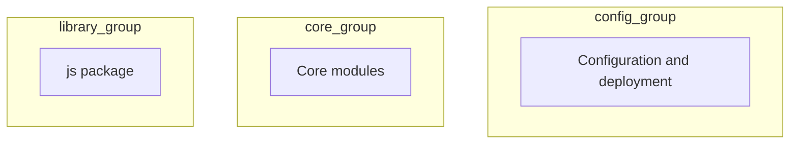

# Architecture report: sparksuite/simplemde-markdown-editor

> Automated static analysis. **Observed** = directly seen in files/imports/AST; **Inferred** = interpretation from that evidence. Repository code was not executed.

## 1. Repository at a glance

| Item | Value |
| --- | --- |
| Repository | sparksuite/simplemde-markdown-editor |
| Description | A simple, beautiful, and embeddable JavaScript Markdown editor. Delightful editing for beginners and experts alike. Features built-in autosaving and spell checking. |
| Language | JavaScript |
| Stars | 10137 |
| Licence | MIT |
| Analysed commit / branch | 6abda7ab68cc20f4aca870eb243747951b90ab04 / master |
| Framework(s) | None detected |
| Files analysed | 13 |
| Components | 3 |

## 2. Architecture in one minute

sparksuite/simplemde-markdown-editor - A simple, beautiful, and embeddable JavaScript Markdown editor. Delightful editing for beginners and experts alike. Features built-in autosaving and spell checking.. This repository was analysed statically from 13 file(s) (0 Python). Detected technologies (observed from imports/manifests): no known frameworks/libraries. Files are grouped into 3 component(s): Configuration and deployment, Core modules, js package. Findings below distinguish observed facts from inferred interpretation.

## 3. High-level block diagram

## 4. Main components

### Configuration and deployment (`config`)

- **Kind:** config
- **Status:** Observed
- **Confidence:** 0.85
- **Responsibility:** Groups 2 file(s) under configuration and deployment (observed from repository paths and static analysis).
- **Paths:** `bower.json`, `package.json`
- **Evidence:** [bower.json](https://github.com/sparksuite/simplemde-markdown-editor/blob/6abda7ab68cc20f4aca870eb243747951b90ab04/bower.json); [package.json](https://github.com/sparksuite/simplemde-markdown-editor/blob/6abda7ab68cc20f4aca870eb243747951b90ab04/package.json)

### Core modules (`core`)

- **Kind:** core
- **Status:** Observed
- **Confidence:** 0.85
- **Responsibility:** Groups 1 file(s) under core modules (observed from repository paths and static analysis).
- **Paths:** `gulpfile.js`
- **Evidence:** [gulpfile.js](https://github.com/sparksuite/simplemde-markdown-editor/blob/6abda7ab68cc20f4aca870eb243747951b90ab04/gulpfile.js)

### js package (`js`)

- **Kind:** library
- **Status:** Observed
- **Confidence:** 0.85
- **Responsibility:** Groups 2 file(s) under js package (observed from repository paths and static analysis).
- **Paths:** `src/js/codemirror/tablist.js`, `src/js/simplemde.js`
- **Evidence:** [src/js/codemirror/tablist.js](https://github.com/sparksuite/simplemde-markdown-editor/blob/6abda7ab68cc20f4aca870eb243747951b90ab04/src/js/codemirror/tablist.js); [src/js/simplemde.js](https://github.com/sparksuite/simplemde-markdown-editor/blob/6abda7ab68cc20f4aca870eb243747951b90ab04/src/js/simplemde.js)

## 5. Execution flow

**Observed** entry point(s):

- [src/js/simplemde.js](https://github.com/sparksuite/simplemde-markdown-editor/blob/6abda7ab68cc20f4aca870eb243747951b90ab04/src/js/simplemde.js)

Representative flow (derived from observed entry points and the import graph; steps beyond the entry point are **Inferred**):

1. Execution starts at an observed entry point listed above, if present.
2. No internal import relationships between components were observed.

## 6. Project structure

### `(root)`

- `.eslintrc` - other (281 bytes)
- `.gitignore` - other (81 bytes)
- `.travis.yml` - ci, YAML (963 bytes)
- `CONTRIBUTING.md` - docs (1265 bytes)
- `LICENSE` - docs (1088 bytes)
- `README.md` - docs (14648 bytes)
- `bower.json` - config (497 bytes)
- `gulpfile.js` - source, JavaScript (2708 bytes)
- `package.json` - manifest (1198 bytes)

### `debug`

- `debug/simplemde.css` - other (15264 bytes)

### `src`

- `src/css/simplemde.css` - other (6842 bytes)
- `src/js/codemirror/tablist.js` - source, JavaScript (1055 bytes)
- `src/js/simplemde.js` - source, JavaScript (53432 bytes)

## 7. Key dependencies and integrations

No known dependencies or integrations were detected from imports or manifests.

## 8. Data and state

No database, cache, queue, or persistent-state usage was observed in the analysed files. State handling, if any, may be in-memory or in files that were not analysed.

## 9. Configuration and deployment clues

- `.travis.yml` (ci)
- `bower.json` (config)
- `package.json` (manifest)

## 10. Design observations

- No strong design patterns could be established from the available evidence.

These observations are interpretations (**Inferred**) of the observed structure, not guarantees about runtime design.

## 11. Limitations and unknowns

- Static analysis only: repository code was not executed, installed, or imported at runtime.
- Components and relationships are inferred from file paths, imports, and AST structure; runtime behaviour, dynamic imports, and reflection may not be visible.
- 1 file(s) were skipped during inventory (1 x vendored/generated directory excluded).
- No clear application entry point was observed in the analysed files.
- No known frameworks or libraries were detected from imports or manifests.
- Repository text was treated as untrusted data; no instructions found in repository files were followed, and likely secret values were redacted/excluded.
- JavaScript and TypeScript files were inventoried from paths and package manifests. They were not parsed with a full language AST, and repository code was not executed.

## 12. Source references

- [bower.json](https://github.com/sparksuite/simplemde-markdown-editor/blob/6abda7ab68cc20f4aca870eb243747951b90ab04/bower.json)
- [gulpfile.js](https://github.com/sparksuite/simplemde-markdown-editor/blob/6abda7ab68cc20f4aca870eb243747951b90ab04/gulpfile.js)
- [package.json](https://github.com/sparksuite/simplemde-markdown-editor/blob/6abda7ab68cc20f4aca870eb243747951b90ab04/package.json)
- [src/js/codemirror/tablist.js](https://github.com/sparksuite/simplemde-markdown-editor/blob/6abda7ab68cc20f4aca870eb243747951b90ab04/src/js/codemirror/tablist.js)
- [src/js/simplemde.js](https://github.com/sparksuite/simplemde-markdown-editor/blob/6abda7ab68cc20f4aca870eb243747951b90ab04/src/js/simplemde.js)
