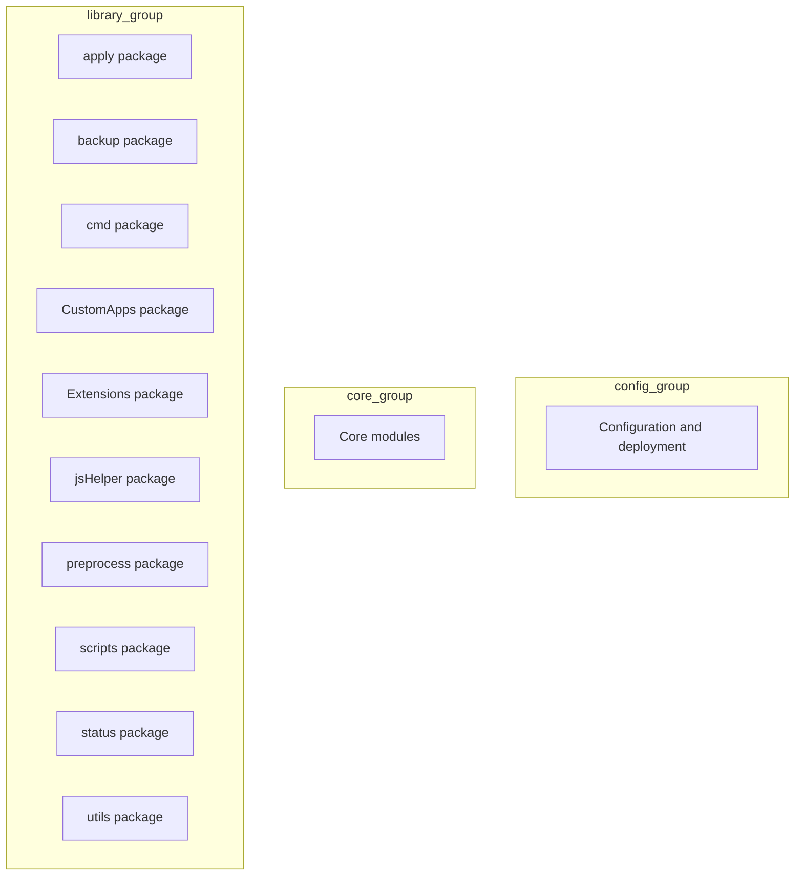

# Architecture report: spicetify/cli

> Automated static analysis. **Observed** = directly seen in files/imports/AST; **Inferred** = interpretation from that evidence. Repository code was not executed.

## 1. Repository at a glance

| Item | Value |
| --- | --- |
| Repository | spicetify/cli |
| Description | Command-line tool to customize Spotify client. Supports Windows, macOS, and Linux. |
| Language | JavaScript |
| Stars | 25510 |
| Licence | LGPL-2.1 |
| Analysed commit / branch | 867df4af012a07f0b9d5c6b4bc8d7c29badb8ca9 / main |
| Framework(s) | None detected |
| Files analysed | 132 |
| Components | 12 |

## 2. Architecture in one minute

spicetify/cli - Command-line tool to customize Spotify client. Supports Windows, macOS, and Linux.. This repository was analysed statically from 132 file(s) (0 Python). Detected technologies (observed from imports/manifests): GitHub Actions. Files are grouped into 12 component(s): apply package, backup package, cmd package, Configuration and deployment, Core modules, CustomApps package, Extensions package, jsHelper package. Findings below distinguish observed facts from inferred interpretation.

## 3. High-level block diagram

## 4. Main components

### apply package (`apply`)

- **Kind:** library
- **Status:** Observed
- **Confidence:** 0.85
- **Responsibility:** Groups 1 file(s) under apply package (observed from repository paths and static analysis).
- **Paths:** `src/apply/apply.go`
- **Evidence:** [src/apply/apply.go](https://github.com/spicetify/cli/blob/867df4af012a07f0b9d5c6b4bc8d7c29badb8ca9/src/apply/apply.go)

### backup package (`backup`)

- **Kind:** library
- **Status:** Observed
- **Confidence:** 0.85
- **Responsibility:** Groups 1 file(s) under backup package (observed from repository paths and static analysis).
- **Paths:** `src/backup/backup.go`
- **Evidence:** [src/backup/backup.go](https://github.com/spicetify/cli/blob/867df4af012a07f0b9d5c6b4bc8d7c29badb8ca9/src/backup/backup.go)

### cmd package (`cmd`)

- **Kind:** library
- **Status:** Observed
- **Confidence:** 0.85
- **Responsibility:** Groups 15 file(s) under cmd package (observed from repository paths and static analysis).
- **Paths:** `src/cmd/apply.go`, `src/cmd/auto.go`, `src/cmd/backup.go`, `src/cmd/block-updates.go`, `src/cmd/cmd.go`, `src/cmd/color.go`, `src/cmd/config-dir.go`, `src/cmd/config.go`, `src/cmd/devtools.go`, `src/cmd/patch.go`, `src/cmd/path.go`, `src/cmd/permissions.go`, `src/cmd/restart.go`, `src/cmd/update.go`, `src/cmd/watch.go`
- **Evidence:** [src/cmd/apply.go](https://github.com/spicetify/cli/blob/867df4af012a07f0b9d5c6b4bc8d7c29badb8ca9/src/cmd/apply.go); [src/cmd/auto.go](https://github.com/spicetify/cli/blob/867df4af012a07f0b9d5c6b4bc8d7c29badb8ca9/src/cmd/auto.go); [src/cmd/backup.go](https://github.com/spicetify/cli/blob/867df4af012a07f0b9d5c6b4bc8d7c29badb8ca9/src/cmd/backup.go); [src/cmd/block-updates.go](https://github.com/spicetify/cli/blob/867df4af012a07f0b9d5c6b4bc8d7c29badb8ca9/src/cmd/block-updates.go); [src/cmd/cmd.go](https://github.com/spicetify/cli/blob/867df4af012a07f0b9d5c6b4bc8d7c29badb8ca9/src/cmd/cmd.go); [src/cmd/color.go](https://github.com/spicetify/cli/blob/867df4af012a07f0b9d5c6b4bc8d7c29badb8ca9/src/cmd/color.go); [src/cmd/config-dir.go](https://github.com/spicetify/cli/blob/867df4af012a07f0b9d5c6b4bc8d7c29badb8ca9/src/cmd/config-dir.go); [src/cmd/config.go](https://github.com/spicetify/cli/blob/867df4af012a07f0b9d5c6b4bc8d7c29badb8ca9/src/cmd/config.go)

### Configuration and deployment (`config`)

- **Kind:** config
- **Status:** Observed
- **Confidence:** 0.85
- **Responsibility:** Groups 8 file(s) under configuration and deployment (observed from repository paths and static analysis).
- **Paths:** `CustomApps/lyrics-plus/manifest.json`, `CustomApps/new-releases/manifest.json`, `CustomApps/reddit/manifest.json`, `Themes/SpicetifyDefault/color.ini`, `go.mod`, `manifest.json`, `package.json`, `pnpm-workspace.yaml`
- **Evidence:** [CustomApps/lyrics-plus/manifest.json](https://github.com/spicetify/cli/blob/867df4af012a07f0b9d5c6b4bc8d7c29badb8ca9/CustomApps/lyrics-plus/manifest.json); [CustomApps/new-releases/manifest.json](https://github.com/spicetify/cli/blob/867df4af012a07f0b9d5c6b4bc8d7c29badb8ca9/CustomApps/new-releases/manifest.json); [CustomApps/reddit/manifest.json](https://github.com/spicetify/cli/blob/867df4af012a07f0b9d5c6b4bc8d7c29badb8ca9/CustomApps/reddit/manifest.json); [Themes/SpicetifyDefault/color.ini](https://github.com/spicetify/cli/blob/867df4af012a07f0b9d5c6b4bc8d7c29badb8ca9/Themes/SpicetifyDefault/color.ini); [go.mod](https://github.com/spicetify/cli/blob/867df4af012a07f0b9d5c6b4bc8d7c29badb8ca9/go.mod); [manifest.json](https://github.com/spicetify/cli/blob/867df4af012a07f0b9d5c6b4bc8d7c29badb8ca9/manifest.json); [package.json](https://github.com/spicetify/cli/blob/867df4af012a07f0b9d5c6b4bc8d7c29badb8ca9/package.json); [pnpm-workspace.yaml](https://github.com/spicetify/cli/blob/867df4af012a07f0b9d5c6b4bc8d7c29badb8ca9/pnpm-workspace.yaml)

### Core modules (`core`)

- **Kind:** core
- **Status:** Observed
- **Confidence:** 0.85
- **Responsibility:** Groups 3 file(s) under core modules (observed from repository paths and static analysis).
- **Paths:** `globals.d.ts`, `install.sh`, `spicetify.go`
- **Evidence:** [globals.d.ts](https://github.com/spicetify/cli/blob/867df4af012a07f0b9d5c6b4bc8d7c29badb8ca9/globals.d.ts); [install.sh](https://github.com/spicetify/cli/blob/867df4af012a07f0b9d5c6b4bc8d7c29badb8ca9/install.sh); [spicetify.go](https://github.com/spicetify/cli/blob/867df4af012a07f0b9d5c6b4bc8d7c29badb8ca9/spicetify.go)

### CustomApps package (`customapps`)

- **Kind:** library
- **Status:** Observed
- **Confidence:** 0.85
- **Responsibility:** Groups 25 file(s) under customapps package (observed from repository paths and static analysis).
- **Paths:** `CustomApps/lyrics-plus/Lyricsfile.js`, `CustomApps/lyrics-plus/OptionsMenu.js`, `CustomApps/lyrics-plus/Pages.js`, `CustomApps/lyrics-plus/PlaybarButton.js`, `CustomApps/lyrics-plus/ProviderGenius.js`, `CustomApps/lyrics-plus/ProviderLRCLIB.js`, `CustomApps/lyrics-plus/ProviderLRCRed.js`, `CustomApps/lyrics-plus/ProviderNetease.js`, `CustomApps/lyrics-plus/Providers.js`, `CustomApps/lyrics-plus/Settings.js`, `CustomApps/lyrics-plus/TabBar.js`, `CustomApps/lyrics-plus/Translator.js`, `CustomApps/lyrics-plus/Utils.js`, `CustomApps/lyrics-plus/index.js`, `CustomApps/new-releases/Card.js`, `CustomApps/new-releases/Icons.js`, `CustomApps/new-releases/Settings.js`, `CustomApps/new-releases/index.js`, `CustomApps/reddit/Card.js`, `CustomApps/reddit/Icons.js`, `CustomApps/reddit/OptionsMenu.js`, `CustomApps/reddit/Settings.js`, `CustomApps/reddit/SortBox.js`, `CustomApps/reddit/TabBar.js`, `CustomApps/reddit/index.js`
- **Evidence:** [CustomApps/lyrics-plus/Lyricsfile.js](https://github.com/spicetify/cli/blob/867df4af012a07f0b9d5c6b4bc8d7c29badb8ca9/CustomApps/lyrics-plus/Lyricsfile.js); [CustomApps/lyrics-plus/OptionsMenu.js](https://github.com/spicetify/cli/blob/867df4af012a07f0b9d5c6b4bc8d7c29badb8ca9/CustomApps/lyrics-plus/OptionsMenu.js); [CustomApps/lyrics-plus/Pages.js](https://github.com/spicetify/cli/blob/867df4af012a07f0b9d5c6b4bc8d7c29badb8ca9/CustomApps/lyrics-plus/Pages.js); [CustomApps/lyrics-plus/PlaybarButton.js](https://github.com/spicetify/cli/blob/867df4af012a07f0b9d5c6b4bc8d7c29badb8ca9/CustomApps/lyrics-plus/PlaybarButton.js); [CustomApps/lyrics-plus/ProviderGenius.js](https://github.com/spicetify/cli/blob/867df4af012a07f0b9d5c6b4bc8d7c29badb8ca9/CustomApps/lyrics-plus/ProviderGenius.js); [CustomApps/lyrics-plus/ProviderLRCLIB.js](https://github.com/spicetify/cli/blob/867df4af012a07f0b9d5c6b4bc8d7c29badb8ca9/CustomApps/lyrics-plus/ProviderLRCLIB.js); [CustomApps/lyrics-plus/ProviderLRCRed.js](https://github.com/spicetify/cli/blob/867df4af012a07f0b9d5c6b4bc8d7c29badb8ca9/CustomApps/lyrics-plus/ProviderLRCRed.js); [CustomApps/lyrics-plus/ProviderNetease.js](https://github.com/spicetify/cli/blob/867df4af012a07f0b9d5c6b4bc8d7c29badb8ca9/CustomApps/lyrics-plus/ProviderNetease.js)

### Extensions package (`extensions`)

- **Kind:** library
- **Status:** Observed
- **Confidence:** 0.85
- **Responsibility:** Groups 10 file(s) under extensions package (observed from repository paths and static analysis).
- **Paths:** `Extensions/autoSkipExplicit.js`, `Extensions/autoSkipVideo.js`, `Extensions/bookmark.js`, `Extensions/fullAppDisplay.js`, `Extensions/keyboardShortcut.js`, `Extensions/loopyLoop.js`, `Extensions/popupLyrics.js`, `Extensions/shuffle+.js`, `Extensions/trashbin.js`, `Extensions/webnowplaying.js`
- **Evidence:** [Extensions/autoSkipExplicit.js](https://github.com/spicetify/cli/blob/867df4af012a07f0b9d5c6b4bc8d7c29badb8ca9/Extensions/autoSkipExplicit.js); [Extensions/autoSkipVideo.js](https://github.com/spicetify/cli/blob/867df4af012a07f0b9d5c6b4bc8d7c29badb8ca9/Extensions/autoSkipVideo.js); [Extensions/bookmark.js](https://github.com/spicetify/cli/blob/867df4af012a07f0b9d5c6b4bc8d7c29badb8ca9/Extensions/bookmark.js); [Extensions/fullAppDisplay.js](https://github.com/spicetify/cli/blob/867df4af012a07f0b9d5c6b4bc8d7c29badb8ca9/Extensions/fullAppDisplay.js); [Extensions/keyboardShortcut.js](https://github.com/spicetify/cli/blob/867df4af012a07f0b9d5c6b4bc8d7c29badb8ca9/Extensions/keyboardShortcut.js); [Extensions/loopyLoop.js](https://github.com/spicetify/cli/blob/867df4af012a07f0b9d5c6b4bc8d7c29badb8ca9/Extensions/loopyLoop.js); [Extensions/popupLyrics.js](https://github.com/spicetify/cli/blob/867df4af012a07f0b9d5c6b4bc8d7c29badb8ca9/Extensions/popupLyrics.js); [Extensions/shuffle+.js](https://github.com/spicetify/cli/blob/867df4af012a07f0b9d5c6b4bc8d7c29badb8ca9/Extensions/shuffle%2B.js)

### jsHelper package (`jshelper`)

- **Kind:** library
- **Status:** Observed
- **Confidence:** 0.85
- **Responsibility:** Groups 30 file(s) under jshelper package (observed from repository paths and static analysis).
- **Paths:** `jsHelper/expFeatures.js`, `jsHelper/homeConfig.js`, `jsHelper/sidebarConfig.js`, `src/jsHelper/spicetifyWrapper/core.js`, `src/jsHelper/spicetifyWrapper/custom-apps.js`, `src/jsHelper/spicetifyWrapper/events.js`, `src/jsHelper/spicetifyWrapper/helpers.js`, `src/jsHelper/spicetifyWrapper/icons.js`, `src/jsHelper/spicetifyWrapper/index.js`, `src/jsHelper/spicetifyWrapper/menus.js`, `src/jsHelper/spicetifyWrapper/platform.js`, `src/jsHelper/spicetifyWrapper/playbar.js`, `src/jsHelper/spicetifyWrapper/player-events.js`, `src/jsHelper/spicetifyWrapper/popup.js`, `src/jsHelper/spicetifyWrapper/shared/async.js`, `src/jsHelper/spicetifyWrapper/shared/string.js`, `src/jsHelper/spicetifyWrapper/topbar.js`, `src/jsHelper/spicetifyWrapper/update.js`, `src/jsHelper/spicetifyWrapper/webpack.js`, `src/jsHelper/spicetifyWrapper/webpack/cards.js`, `src/jsHelper/spicetifyWrapper/webpack/component-resolvers.js`, `src/jsHelper/spicetifyWrapper/webpack/late-components.js`, `src/jsHelper/spicetifyWrapper/webpack/menus.js`, `src/jsHelper/spicetifyWrapper/webpack/module-inventory.js`, `src/jsHelper/spicetifyWrapper/webpack/react-components.js`, `src/jsHelper/spicetifyWrapper/webpack/react-query.js`, `src/jsHelper/spicetifyWrapper/webpack/runtime-resolvers.js`, `src/jsHelper/spicetifyWrapper/webpack/scrollable-container.js`, `src/jsHelper/spicetifyWrapper/webpack/spicetify-bindings.js`, `src/jsHelper/spicetifyWrapper/webpack/uri.js`
- **Evidence:** [jsHelper/expFeatures.js](https://github.com/spicetify/cli/blob/867df4af012a07f0b9d5c6b4bc8d7c29badb8ca9/jsHelper/expFeatures.js); [jsHelper/homeConfig.js](https://github.com/spicetify/cli/blob/867df4af012a07f0b9d5c6b4bc8d7c29badb8ca9/jsHelper/homeConfig.js); [jsHelper/sidebarConfig.js](https://github.com/spicetify/cli/blob/867df4af012a07f0b9d5c6b4bc8d7c29badb8ca9/jsHelper/sidebarConfig.js); [src/jsHelper/spicetifyWrapper/core.js](https://github.com/spicetify/cli/blob/867df4af012a07f0b9d5c6b4bc8d7c29badb8ca9/src/jsHelper/spicetifyWrapper/core.js); [src/jsHelper/spicetifyWrapper/custom-apps.js](https://github.com/spicetify/cli/blob/867df4af012a07f0b9d5c6b4bc8d7c29badb8ca9/src/jsHelper/spicetifyWrapper/custom-apps.js); [src/jsHelper/spicetifyWrapper/events.js](https://github.com/spicetify/cli/blob/867df4af012a07f0b9d5c6b4bc8d7c29badb8ca9/src/jsHelper/spicetifyWrapper/events.js); [src/jsHelper/spicetifyWrapper/helpers.js](https://github.com/spicetify/cli/blob/867df4af012a07f0b9d5c6b4bc8d7c29badb8ca9/src/jsHelper/spicetifyWrapper/helpers.js); [src/jsHelper/spicetifyWrapper/icons.js](https://github.com/spicetify/cli/blob/867df4af012a07f0b9d5c6b4bc8d7c29badb8ca9/src/jsHelper/spicetifyWrapper/icons.js)

### preprocess package (`preprocess`)

- **Kind:** library
- **Status:** Observed
- **Confidence:** 0.85
- **Responsibility:** Groups 1 file(s) under preprocess package (observed from repository paths and static analysis).
- **Paths:** `src/preprocess/preprocess.go`
- **Evidence:** [src/preprocess/preprocess.go](https://github.com/spicetify/cli/blob/867df4af012a07f0b9d5c6b4bc8d7c29badb8ca9/src/preprocess/preprocess.go)

### scripts package (`scripts`)

- **Kind:** library
- **Status:** Observed
- **Confidence:** 0.85
- **Responsibility:** Groups 2 file(s) under scripts package (observed from repository paths and static analysis).
- **Paths:** `scripts/build-wrapper.mjs`, `scripts/update-cssmap.mjs`
- **Evidence:** [scripts/build-wrapper.mjs](https://github.com/spicetify/cli/blob/867df4af012a07f0b9d5c6b4bc8d7c29badb8ca9/scripts/build-wrapper.mjs); [scripts/update-cssmap.mjs](https://github.com/spicetify/cli/blob/867df4af012a07f0b9d5c6b4bc8d7c29badb8ca9/scripts/update-cssmap.mjs)

### status package (`status`)

- **Kind:** library
- **Status:** Observed
- **Confidence:** 0.85
- **Responsibility:** Groups 2 file(s) under status package (observed from repository paths and static analysis).
- **Paths:** `src/status/backup/backup.go`, `src/status/spotify/spotify.go`
- **Evidence:** [src/status/backup/backup.go](https://github.com/spicetify/cli/blob/867df4af012a07f0b9d5c6b4bc8d7c29badb8ca9/src/status/backup/backup.go); [src/status/spotify/spotify.go](https://github.com/spicetify/cli/blob/867df4af012a07f0b9d5c6b4bc8d7c29badb8ca9/src/status/spotify/spotify.go)

### utils package (`utils`)

- **Kind:** library
- **Status:** Observed
- **Confidence:** 0.85
- **Responsibility:** Groups 12 file(s) under utils package (observed from repository paths and static analysis).
- **Paths:** `src/utils/color.go`, `src/utils/config.go`, `src/utils/file-utils.go`, `src/utils/isAdmin/unix.go`, `src/utils/isAdmin/windows.go`, `src/utils/path-utils.go`, `src/utils/print.go`, `src/utils/scanner.go`, `src/utils/show-dir.go`, `src/utils/utils.go`, `src/utils/vcs.go`, `src/utils/watcher.go`
- **Evidence:** [src/utils/color.go](https://github.com/spicetify/cli/blob/867df4af012a07f0b9d5c6b4bc8d7c29badb8ca9/src/utils/color.go); [src/utils/config.go](https://github.com/spicetify/cli/blob/867df4af012a07f0b9d5c6b4bc8d7c29badb8ca9/src/utils/config.go); [src/utils/file-utils.go](https://github.com/spicetify/cli/blob/867df4af012a07f0b9d5c6b4bc8d7c29badb8ca9/src/utils/file-utils.go); [src/utils/isAdmin/unix.go](https://github.com/spicetify/cli/blob/867df4af012a07f0b9d5c6b4bc8d7c29badb8ca9/src/utils/isAdmin/unix.go); [src/utils/isAdmin/windows.go](https://github.com/spicetify/cli/blob/867df4af012a07f0b9d5c6b4bc8d7c29badb8ca9/src/utils/isAdmin/windows.go); [src/utils/path-utils.go](https://github.com/spicetify/cli/blob/867df4af012a07f0b9d5c6b4bc8d7c29badb8ca9/src/utils/path-utils.go); [src/utils/print.go](https://github.com/spicetify/cli/blob/867df4af012a07f0b9d5c6b4bc8d7c29badb8ca9/src/utils/print.go); [src/utils/scanner.go](https://github.com/spicetify/cli/blob/867df4af012a07f0b9d5c6b4bc8d7c29badb8ca9/src/utils/scanner.go)

## 5. Execution flow

**Observed** entry point(s):

- [CustomApps/lyrics-plus/index.js](https://github.com/spicetify/cli/blob/867df4af012a07f0b9d5c6b4bc8d7c29badb8ca9/CustomApps/lyrics-plus/index.js)
- [CustomApps/new-releases/index.js](https://github.com/spicetify/cli/blob/867df4af012a07f0b9d5c6b4bc8d7c29badb8ca9/CustomApps/new-releases/index.js)
- [CustomApps/reddit/index.js](https://github.com/spicetify/cli/blob/867df4af012a07f0b9d5c6b4bc8d7c29badb8ca9/CustomApps/reddit/index.js)
- [src/jsHelper/spicetifyWrapper/index.js](https://github.com/spicetify/cli/blob/867df4af012a07f0b9d5c6b4bc8d7c29badb8ca9/src/jsHelper/spicetifyWrapper/index.js)

Representative flow (derived from observed entry points and the import graph; steps beyond the entry point are **Inferred**):

1. Execution starts at an observed entry point listed above, if present.
2. No internal import relationships between components were observed.

## 6. Project structure

### `(root)`

- `.coderabbit.yaml` - config (52 bytes)
- `.gitignore` - other (205 bytes)
- `.oxfmtrc.json` - config (395 bytes)
- `.oxlintrc.json` - config (969 bytes)
- `CONTRIBUTING.md` - docs (7783 bytes)
- `LICENSE` - docs (26526 bytes)
- `README.md` - docs (1521 bytes)
- `globals.d.ts` - source, TypeScript (62172 bytes)
- `go.mod` - manifest (834 bytes)
- `go.sum` - other (11684 bytes)
- `install.ps1` - other (8307 bytes)
- `install.sh` - source, Shell (5115 bytes)
- `manifest.json` - config (2274 bytes)
- `package.json` - manifest (832 bytes)
- `pnpm-workspace.yaml` - config (135 bytes)
- `spicetify.go` - source, Go (16577 bytes)

### `.github`

- `.github/dependabot.yml` - config (209 bytes)
- `.github/labeler.yml` - config (412 bytes)
- `.github/workflows/build.yml` - ci, YAML (6239 bytes)
- `.github/workflows/labeler.yml` - ci, YAML (310 bytes)
- `.github/workflows/linter.yml` - ci, YAML (717 bytes)
- `.github/workflows/lintpr.yml` - ci, YAML (405 bytes)

### `.vscode`

- `.vscode/extensions.json` - config (104 bytes)
- `.vscode/settings.json` - config (429 bytes)

### `CustomApps`

- `CustomApps/lyrics-plus/Lyricsfile.js` - source, JavaScript (4278 bytes)
- `CustomApps/lyrics-plus/OptionsMenu.js` - source, JavaScript (12426 bytes)
- `CustomApps/lyrics-plus/Pages.js` - source, JavaScript (37221 bytes)
- `CustomApps/lyrics-plus/PlaybarButton.js` - source, JavaScript (1814 bytes)
- `CustomApps/lyrics-plus/ProviderGenius.js` - source, JavaScript (3370 bytes)
- `CustomApps/lyrics-plus/ProviderLRCLIB.js` - source, JavaScript (1688 bytes)
- `CustomApps/lyrics-plus/ProviderLRCRed.js` - source, JavaScript (2696 bytes)
- `CustomApps/lyrics-plus/ProviderNetease.js` - source, JavaScript (6396 bytes)
- `CustomApps/lyrics-plus/Providers.js` - source, JavaScript (3343 bytes)
- `CustomApps/lyrics-plus/README.md` - docs (2331 bytes)
- `CustomApps/lyrics-plus/Settings.js` - source, JavaScript (16297 bytes)
- `CustomApps/lyrics-plus/TabBar.js` - source, JavaScript (5654 bytes)
- `CustomApps/lyrics-plus/Translator.js` - source, JavaScript (5507 bytes)
- `CustomApps/lyrics-plus/Utils.js` - source, JavaScript (26573 bytes)
- `CustomApps/lyrics-plus/index.js` - source, JavaScript (39513 bytes)
- `CustomApps/lyrics-plus/manifest.json` - config (3786 bytes)
- `CustomApps/lyrics-plus/style.css` - other (18747 bytes)
- `CustomApps/new-releases/Card.js` - source, JavaScript (8093 bytes)
- `CustomApps/new-releases/Icons.js` - source, JavaScript (2014 bytes)
- `CustomApps/new-releases/Settings.js` - source, JavaScript (6750 bytes)
- `CustomApps/new-releases/index.js` - source, JavaScript (12830 bytes)
- `CustomApps/new-releases/manifest.json` - config (4947 bytes)
- `CustomApps/new-releases/style.css` - other (4105 bytes)
- `CustomApps/reddit/Card.js` - source, JavaScript (6332 bytes)
- `CustomApps/reddit/Icons.js` - source, JavaScript (2348 bytes)
- `CustomApps/reddit/OptionsMenu.js` - source, JavaScript (2193 bytes)
- `CustomApps/reddit/Settings.js` - source, JavaScript (5098 bytes)
- `CustomApps/reddit/SortBox.js` - source, JavaScript (1467 bytes)
- `CustomApps/reddit/TabBar.js` - source, JavaScript (4684 bytes)
- `CustomApps/reddit/index.js` - source, JavaScript (10783 bytes)
- `CustomApps/reddit/manifest.json` - config (5395 bytes)
- `CustomApps/reddit/style.css` - other (4176 bytes)

### `Extensions`

- `Extensions/autoSkipExplicit.js` - source, JavaScript (945 bytes)
- `Extensions/autoSkipVideo.js` - source, JavaScript (516 bytes)
- `Extensions/bookmark.js` - source, JavaScript (18933 bytes)
- `Extensions/fullAppDisplay.js` - source, JavaScript (27878 bytes)
- `Extensions/keyboardShortcut.js` - source, JavaScript (11449 bytes)
- `Extensions/loopyLoop.js` - source, JavaScript (22660 bytes)
- `Extensions/popupLyrics.js` - source, JavaScript (42572 bytes)
- `Extensions/shuffle+.js` - source, JavaScript (18865 bytes)
- `Extensions/trashbin.js` - source, JavaScript (12630 bytes)
- `Extensions/webnowplaying.js` - source, JavaScript (12379 bytes)

### `Themes`

- `Themes/SpicetifyDefault/color.ini` - config (3922 bytes)
- `Themes/SpicetifyDefault/user.css` - other (4320 bytes)

### `jsHelper`

- `jsHelper/expFeatures.js` - source, JavaScript (13270 bytes)
- `jsHelper/homeConfig.js` - source, JavaScript (7211 bytes)
- `jsHelper/sidebarConfig.js` - source, JavaScript (8858 bytes)

### `scripts`

- `scripts/build-wrapper.mjs` - source, JavaScript (1490 bytes)
- `scripts/update-cssmap.mjs` - source, JavaScript (19843 bytes)

### `src`

- `src/apply/apply.go` - source, Go (19951 bytes)
- `src/backup/backup.go` - source, Go (816 bytes)
- `src/cmd/apply.go` - source, Go (12389 bytes)
- `src/cmd/auto.go` - source, Go (935 bytes)
- `src/cmd/backup.go` - source, Go (5319 bytes)
- `src/cmd/block-updates.go` - source, Go (1883 bytes)
- `src/cmd/cmd.go` - source, Go (8131 bytes)
- `src/cmd/color.go` - source, Go (2795 bytes)
- `src/cmd/config-dir.go` - source, Go (356 bytes)
- `src/cmd/config.go` - source, Go (4943 bytes)
- `src/cmd/devtools.go` - source, Go (2662 bytes)
- `src/cmd/patch.go` - source, Go (3520 bytes)
- `src/cmd/path.go` - source, Go (2857 bytes)
- `src/cmd/permissions.go` - source, Go (993 bytes)
- `src/cmd/restart.go` - source, Go (2736 bytes)
- `src/cmd/update.go` - source, Go (2828 bytes)
- `src/cmd/watch.go` - source, Go (5598 bytes)
- `src/jsHelper/spicetifyWrapper/core.js` - source, JavaScript (8884 bytes)
- `src/jsHelper/spicetifyWrapper/custom-apps.js` - source, JavaScript (5411 bytes)
- `src/jsHelper/spicetifyWrapper/events.js` - source, JavaScript (553 bytes)
- `src/jsHelper/spicetifyWrapper/helpers.js` - source, JavaScript (7091 bytes)
- `src/jsHelper/spicetifyWrapper/icons.js` - source, JavaScript (37258 bytes)
- `src/jsHelper/spicetifyWrapper/index.js` - source, JavaScript (298 bytes)
- `src/jsHelper/spicetifyWrapper/menus.js` - source, JavaScript (9654 bytes)
- `src/jsHelper/spicetifyWrapper/platform.js` - source, JavaScript (7178 bytes)
- `src/jsHelper/spicetifyWrapper/playbar.js` - source, JavaScript (6242 bytes)
- `src/jsHelper/spicetifyWrapper/player-events.js` - source, JavaScript (2728 bytes)
- `src/jsHelper/spicetifyWrapper/popup.js` - source, JavaScript (5456 bytes)
- `src/jsHelper/spicetifyWrapper/shared/async.js` - source, JavaScript (316 bytes)
- `src/jsHelper/spicetifyWrapper/shared/string.js` - source, JavaScript (179 bytes)
- `src/jsHelper/spicetifyWrapper/topbar.js` - source, JavaScript (4688 bytes)
- `src/jsHelper/spicetifyWrapper/update.js` - source, JavaScript (6377 bytes)
- `src/jsHelper/spicetifyWrapper/webpack.js` - source, JavaScript (2921 bytes)
- `src/jsHelper/spicetifyWrapper/webpack/cards.js` - source, JavaScript (2101 bytes)
- `src/jsHelper/spicetifyWrapper/webpack/component-resolvers.js` - source, JavaScript (2433 bytes)
- `src/jsHelper/spicetifyWrapper/webpack/late-components.js` - source, JavaScript (2656 bytes)
- `src/jsHelper/spicetifyWrapper/webpack/menus.js` - source, JavaScript (1282 bytes)
- `src/jsHelper/spicetifyWrapper/webpack/module-inventory.js` - source, JavaScript (2478 bytes)
- `src/jsHelper/spicetifyWrapper/webpack/react-components.js` - source, JavaScript (5671 bytes)
- `src/jsHelper/spicetifyWrapper/webpack/react-query.js` - source, JavaScript (7412 bytes)
- `src/jsHelper/spicetifyWrapper/webpack/runtime-resolvers.js` - source, JavaScript (7503 bytes)
- `src/jsHelper/spicetifyWrapper/webpack/scrollable-container.js` - source, JavaScript (15521 bytes)
- `src/jsHelper/spicetifyWrapper/webpack/spicetify-bindings.js` - source, JavaScript (2985 bytes)
- `src/jsHelper/spicetifyWrapper/webpack/uri.js` - source, JavaScript (7968 bytes)
- `src/preprocess/preprocess.go` - source, Go (41731 bytes)
- `src/status/backup/backup.go` - source, Go (1179 bytes)
- `src/status/spotify/spotify.go` - source, Go (1394 bytes)
- `src/utils/color.go` - source, Go (4139 bytes)
- `src/utils/config.go` - source, Go (7651 bytes)
- `src/utils/file-utils.go` - source, Go (2543 bytes)
- `src/utils/isAdmin/unix.go` - source, Go (180 bytes)
- `src/utils/isAdmin/windows.go` - source, Go (541 bytes)
- `src/utils/path-utils.go` - source, Go (5822 bytes)
- `src/utils/print.go` - source, Go (2096 bytes)
- `src/utils/scanner.go` - source, Go (311 bytes)
- `src/utils/show-dir.go` - source, Go (531 bytes)
- `src/utils/utils.go` - source, Go (9717 bytes)
- `src/utils/vcs.go` - source, Go (638 bytes)
- `src/utils/watcher.go` - source, Go (2620 bytes)

## 7. Key dependencies and integrations

| Name | Category | Status | Confidence | Evidence |
| --- | --- | --- | --- | --- |
| GitHub Actions | ci | Observed | 0.90 | [.github/workflows/build.yml](https://github.com/spicetify/cli/blob/867df4af012a07f0b9d5c6b4bc8d7c29badb8ca9/.github/workflows/build.yml); [.github/workflows/labeler.yml](https://github.com/spicetify/cli/blob/867df4af012a07f0b9d5c6b4bc8d7c29badb8ca9/.github/workflows/labeler.yml); [.github/workflows/linter.yml](https://github.com/spicetify/cli/blob/867df4af012a07f0b9d5c6b4bc8d7c29badb8ca9/.github/workflows/linter.yml); [.github/workflows/lintpr.yml](https://github.com/spicetify/cli/blob/867df4af012a07f0b9d5c6b4bc8d7c29badb8ca9/.github/workflows/lintpr.yml) |

## 8. Data and state

No database, cache, queue, or persistent-state usage was observed in the analysed files. State handling, if any, may be in-memory or in files that were not analysed.

## 9. Configuration and deployment clues

- `.coderabbit.yaml` (config)
- `.github/dependabot.yml` (config)
- `.github/labeler.yml` (config)
- `.github/workflows/build.yml` (ci)
- `.github/workflows/labeler.yml` (ci)
- `.github/workflows/linter.yml` (ci)
- `.github/workflows/lintpr.yml` (ci)
- `.oxfmtrc.json` (config)
- `.oxlintrc.json` (config)
- `.vscode/extensions.json` (config)
- `.vscode/settings.json` (config)
- `CustomApps/lyrics-plus/manifest.json` (config)
- `CustomApps/new-releases/manifest.json` (config)
- `CustomApps/reddit/manifest.json` (config)
- `Themes/SpicetifyDefault/color.ini` (config)
- `go.mod` (manifest)
- `manifest.json` (config)
- `package.json` (manifest)
- `pnpm-workspace.yaml` (config)

## 10. Design observations

- No strong design patterns could be established from the available evidence.

These observations are interpretations (**Inferred**) of the observed structure, not guarantees about runtime design.

## 11. Limitations and unknowns

- Static analysis only: repository code was not executed, installed, or imported at runtime.
- Components and relationships are inferred from file paths, imports, and AST structure; runtime behaviour, dynamic imports, and reflection may not be visible.
- 2 file(s) were skipped during inventory (1 x likely secret file excluded; 1 x lockfile excluded).
- No clear application entry point was observed in the analysed files.
- Repository text was treated as untrusted data; no instructions found in repository files were followed, and likely secret values were redacted/excluded.
- JavaScript and TypeScript files were inventoried from paths and package manifests. They were not parsed with a full language AST, and repository code was not executed.

## 12. Source references

- [.github/workflows/build.yml](https://github.com/spicetify/cli/blob/867df4af012a07f0b9d5c6b4bc8d7c29badb8ca9/.github/workflows/build.yml)
- [.github/workflows/labeler.yml](https://github.com/spicetify/cli/blob/867df4af012a07f0b9d5c6b4bc8d7c29badb8ca9/.github/workflows/labeler.yml)
- [.github/workflows/linter.yml](https://github.com/spicetify/cli/blob/867df4af012a07f0b9d5c6b4bc8d7c29badb8ca9/.github/workflows/linter.yml)
- [.github/workflows/lintpr.yml](https://github.com/spicetify/cli/blob/867df4af012a07f0b9d5c6b4bc8d7c29badb8ca9/.github/workflows/lintpr.yml)
- [CustomApps/lyrics-plus/Lyricsfile.js](https://github.com/spicetify/cli/blob/867df4af012a07f0b9d5c6b4bc8d7c29badb8ca9/CustomApps/lyrics-plus/Lyricsfile.js)
- [CustomApps/lyrics-plus/OptionsMenu.js](https://github.com/spicetify/cli/blob/867df4af012a07f0b9d5c6b4bc8d7c29badb8ca9/CustomApps/lyrics-plus/OptionsMenu.js)
- [CustomApps/lyrics-plus/Pages.js](https://github.com/spicetify/cli/blob/867df4af012a07f0b9d5c6b4bc8d7c29badb8ca9/CustomApps/lyrics-plus/Pages.js)
- [CustomApps/lyrics-plus/PlaybarButton.js](https://github.com/spicetify/cli/blob/867df4af012a07f0b9d5c6b4bc8d7c29badb8ca9/CustomApps/lyrics-plus/PlaybarButton.js)
- [CustomApps/lyrics-plus/ProviderGenius.js](https://github.com/spicetify/cli/blob/867df4af012a07f0b9d5c6b4bc8d7c29badb8ca9/CustomApps/lyrics-plus/ProviderGenius.js)
- [CustomApps/lyrics-plus/ProviderLRCLIB.js](https://github.com/spicetify/cli/blob/867df4af012a07f0b9d5c6b4bc8d7c29badb8ca9/CustomApps/lyrics-plus/ProviderLRCLIB.js)
- [CustomApps/lyrics-plus/ProviderLRCRed.js](https://github.com/spicetify/cli/blob/867df4af012a07f0b9d5c6b4bc8d7c29badb8ca9/CustomApps/lyrics-plus/ProviderLRCRed.js)
- [CustomApps/lyrics-plus/ProviderNetease.js](https://github.com/spicetify/cli/blob/867df4af012a07f0b9d5c6b4bc8d7c29badb8ca9/CustomApps/lyrics-plus/ProviderNetease.js)
- [CustomApps/lyrics-plus/index.js](https://github.com/spicetify/cli/blob/867df4af012a07f0b9d5c6b4bc8d7c29badb8ca9/CustomApps/lyrics-plus/index.js)
- [CustomApps/lyrics-plus/manifest.json](https://github.com/spicetify/cli/blob/867df4af012a07f0b9d5c6b4bc8d7c29badb8ca9/CustomApps/lyrics-plus/manifest.json)
- [CustomApps/new-releases/index.js](https://github.com/spicetify/cli/blob/867df4af012a07f0b9d5c6b4bc8d7c29badb8ca9/CustomApps/new-releases/index.js)
- [CustomApps/new-releases/manifest.json](https://github.com/spicetify/cli/blob/867df4af012a07f0b9d5c6b4bc8d7c29badb8ca9/CustomApps/new-releases/manifest.json)
- [CustomApps/reddit/index.js](https://github.com/spicetify/cli/blob/867df4af012a07f0b9d5c6b4bc8d7c29badb8ca9/CustomApps/reddit/index.js)
- [CustomApps/reddit/manifest.json](https://github.com/spicetify/cli/blob/867df4af012a07f0b9d5c6b4bc8d7c29badb8ca9/CustomApps/reddit/manifest.json)
- [Extensions/autoSkipExplicit.js](https://github.com/spicetify/cli/blob/867df4af012a07f0b9d5c6b4bc8d7c29badb8ca9/Extensions/autoSkipExplicit.js)
- [Extensions/autoSkipVideo.js](https://github.com/spicetify/cli/blob/867df4af012a07f0b9d5c6b4bc8d7c29badb8ca9/Extensions/autoSkipVideo.js)
- [Extensions/bookmark.js](https://github.com/spicetify/cli/blob/867df4af012a07f0b9d5c6b4bc8d7c29badb8ca9/Extensions/bookmark.js)
- [Extensions/fullAppDisplay.js](https://github.com/spicetify/cli/blob/867df4af012a07f0b9d5c6b4bc8d7c29badb8ca9/Extensions/fullAppDisplay.js)
- [Extensions/keyboardShortcut.js](https://github.com/spicetify/cli/blob/867df4af012a07f0b9d5c6b4bc8d7c29badb8ca9/Extensions/keyboardShortcut.js)
- [Extensions/loopyLoop.js](https://github.com/spicetify/cli/blob/867df4af012a07f0b9d5c6b4bc8d7c29badb8ca9/Extensions/loopyLoop.js)
- [Extensions/popupLyrics.js](https://github.com/spicetify/cli/blob/867df4af012a07f0b9d5c6b4bc8d7c29badb8ca9/Extensions/popupLyrics.js)
- [Extensions/shuffle+.js](https://github.com/spicetify/cli/blob/867df4af012a07f0b9d5c6b4bc8d7c29badb8ca9/Extensions/shuffle%2B.js)
- [Themes/SpicetifyDefault/color.ini](https://github.com/spicetify/cli/blob/867df4af012a07f0b9d5c6b4bc8d7c29badb8ca9/Themes/SpicetifyDefault/color.ini)
- [globals.d.ts](https://github.com/spicetify/cli/blob/867df4af012a07f0b9d5c6b4bc8d7c29badb8ca9/globals.d.ts)
- [go.mod](https://github.com/spicetify/cli/blob/867df4af012a07f0b9d5c6b4bc8d7c29badb8ca9/go.mod)
- [install.sh](https://github.com/spicetify/cli/blob/867df4af012a07f0b9d5c6b4bc8d7c29badb8ca9/install.sh)
- [jsHelper/expFeatures.js](https://github.com/spicetify/cli/blob/867df4af012a07f0b9d5c6b4bc8d7c29badb8ca9/jsHelper/expFeatures.js)
- [jsHelper/homeConfig.js](https://github.com/spicetify/cli/blob/867df4af012a07f0b9d5c6b4bc8d7c29badb8ca9/jsHelper/homeConfig.js)
- [jsHelper/sidebarConfig.js](https://github.com/spicetify/cli/blob/867df4af012a07f0b9d5c6b4bc8d7c29badb8ca9/jsHelper/sidebarConfig.js)
- [manifest.json](https://github.com/spicetify/cli/blob/867df4af012a07f0b9d5c6b4bc8d7c29badb8ca9/manifest.json)
- [package.json](https://github.com/spicetify/cli/blob/867df4af012a07f0b9d5c6b4bc8d7c29badb8ca9/package.json)
- [pnpm-workspace.yaml](https://github.com/spicetify/cli/blob/867df4af012a07f0b9d5c6b4bc8d7c29badb8ca9/pnpm-workspace.yaml)
- [scripts/build-wrapper.mjs](https://github.com/spicetify/cli/blob/867df4af012a07f0b9d5c6b4bc8d7c29badb8ca9/scripts/build-wrapper.mjs)
- [scripts/update-cssmap.mjs](https://github.com/spicetify/cli/blob/867df4af012a07f0b9d5c6b4bc8d7c29badb8ca9/scripts/update-cssmap.mjs)
- [spicetify.go](https://github.com/spicetify/cli/blob/867df4af012a07f0b9d5c6b4bc8d7c29badb8ca9/spicetify.go)
- [src/apply/apply.go](https://github.com/spicetify/cli/blob/867df4af012a07f0b9d5c6b4bc8d7c29badb8ca9/src/apply/apply.go)
- [src/backup/backup.go](https://github.com/spicetify/cli/blob/867df4af012a07f0b9d5c6b4bc8d7c29badb8ca9/src/backup/backup.go)
- [src/cmd/apply.go](https://github.com/spicetify/cli/blob/867df4af012a07f0b9d5c6b4bc8d7c29badb8ca9/src/cmd/apply.go)
- [src/cmd/auto.go](https://github.com/spicetify/cli/blob/867df4af012a07f0b9d5c6b4bc8d7c29badb8ca9/src/cmd/auto.go)
- [src/cmd/backup.go](https://github.com/spicetify/cli/blob/867df4af012a07f0b9d5c6b4bc8d7c29badb8ca9/src/cmd/backup.go)
- [src/cmd/block-updates.go](https://github.com/spicetify/cli/blob/867df4af012a07f0b9d5c6b4bc8d7c29badb8ca9/src/cmd/block-updates.go)
- [src/cmd/cmd.go](https://github.com/spicetify/cli/blob/867df4af012a07f0b9d5c6b4bc8d7c29badb8ca9/src/cmd/cmd.go)
- [src/cmd/color.go](https://github.com/spicetify/cli/blob/867df4af012a07f0b9d5c6b4bc8d7c29badb8ca9/src/cmd/color.go)
- [src/cmd/config-dir.go](https://github.com/spicetify/cli/blob/867df4af012a07f0b9d5c6b4bc8d7c29badb8ca9/src/cmd/config-dir.go)
- [src/cmd/config.go](https://github.com/spicetify/cli/blob/867df4af012a07f0b9d5c6b4bc8d7c29badb8ca9/src/cmd/config.go)
- [src/jsHelper/spicetifyWrapper/core.js](https://github.com/spicetify/cli/blob/867df4af012a07f0b9d5c6b4bc8d7c29badb8ca9/src/jsHelper/spicetifyWrapper/core.js)
- [src/jsHelper/spicetifyWrapper/custom-apps.js](https://github.com/spicetify/cli/blob/867df4af012a07f0b9d5c6b4bc8d7c29badb8ca9/src/jsHelper/spicetifyWrapper/custom-apps.js)
- [src/jsHelper/spicetifyWrapper/events.js](https://github.com/spicetify/cli/blob/867df4af012a07f0b9d5c6b4bc8d7c29badb8ca9/src/jsHelper/spicetifyWrapper/events.js)
- [src/jsHelper/spicetifyWrapper/helpers.js](https://github.com/spicetify/cli/blob/867df4af012a07f0b9d5c6b4bc8d7c29badb8ca9/src/jsHelper/spicetifyWrapper/helpers.js)
- [src/jsHelper/spicetifyWrapper/icons.js](https://github.com/spicetify/cli/blob/867df4af012a07f0b9d5c6b4bc8d7c29badb8ca9/src/jsHelper/spicetifyWrapper/icons.js)
- [src/jsHelper/spicetifyWrapper/index.js](https://github.com/spicetify/cli/blob/867df4af012a07f0b9d5c6b4bc8d7c29badb8ca9/src/jsHelper/spicetifyWrapper/index.js)
- [src/preprocess/preprocess.go](https://github.com/spicetify/cli/blob/867df4af012a07f0b9d5c6b4bc8d7c29badb8ca9/src/preprocess/preprocess.go)
- [src/status/backup/backup.go](https://github.com/spicetify/cli/blob/867df4af012a07f0b9d5c6b4bc8d7c29badb8ca9/src/status/backup/backup.go)
- [src/status/spotify/spotify.go](https://github.com/spicetify/cli/blob/867df4af012a07f0b9d5c6b4bc8d7c29badb8ca9/src/status/spotify/spotify.go)
- [src/utils/color.go](https://github.com/spicetify/cli/blob/867df4af012a07f0b9d5c6b4bc8d7c29badb8ca9/src/utils/color.go)
- [src/utils/config.go](https://github.com/spicetify/cli/blob/867df4af012a07f0b9d5c6b4bc8d7c29badb8ca9/src/utils/config.go)
- [src/utils/file-utils.go](https://github.com/spicetify/cli/blob/867df4af012a07f0b9d5c6b4bc8d7c29badb8ca9/src/utils/file-utils.go)
- [src/utils/isAdmin/unix.go](https://github.com/spicetify/cli/blob/867df4af012a07f0b9d5c6b4bc8d7c29badb8ca9/src/utils/isAdmin/unix.go)
- [src/utils/isAdmin/windows.go](https://github.com/spicetify/cli/blob/867df4af012a07f0b9d5c6b4bc8d7c29badb8ca9/src/utils/isAdmin/windows.go)
- [src/utils/path-utils.go](https://github.com/spicetify/cli/blob/867df4af012a07f0b9d5c6b4bc8d7c29badb8ca9/src/utils/path-utils.go)
- [src/utils/print.go](https://github.com/spicetify/cli/blob/867df4af012a07f0b9d5c6b4bc8d7c29badb8ca9/src/utils/print.go)
- [src/utils/scanner.go](https://github.com/spicetify/cli/blob/867df4af012a07f0b9d5c6b4bc8d7c29badb8ca9/src/utils/scanner.go)
