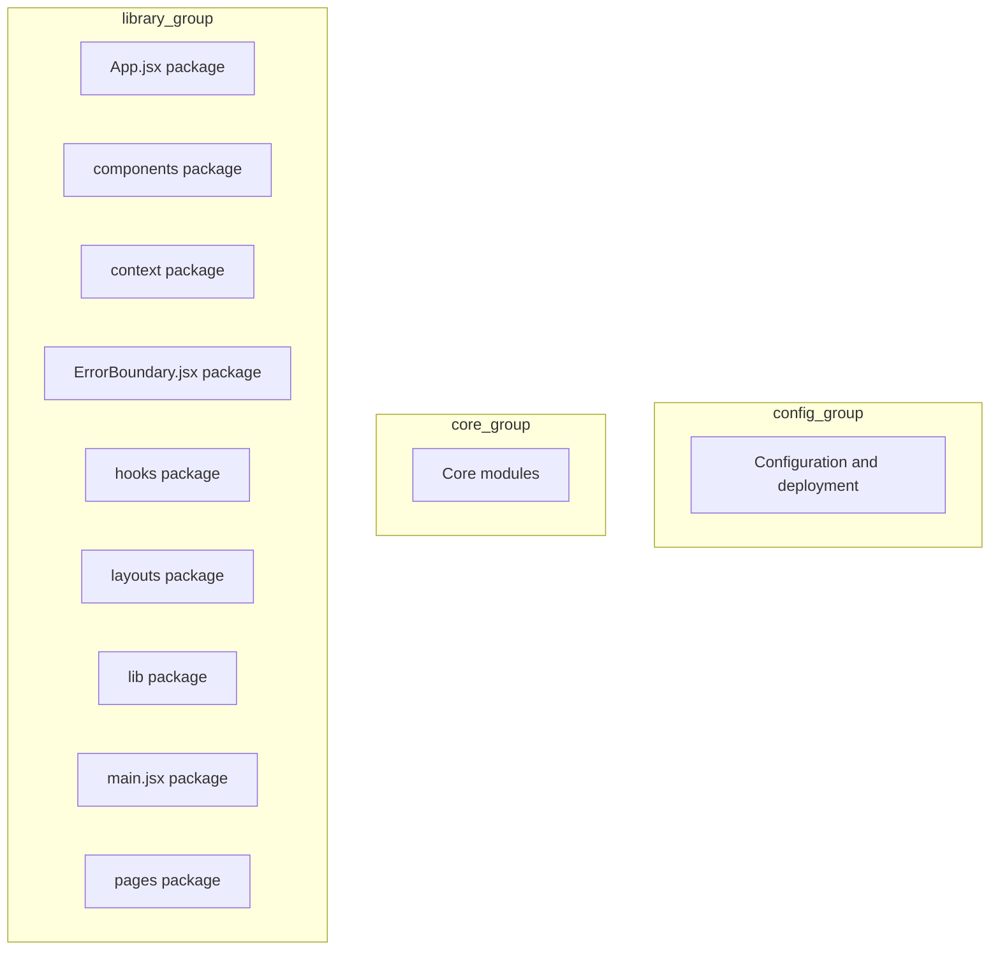

# Architecture report: stackryze/FreeDomains

> Automated static analysis. **Observed** = directly seen in files/imports/AST; **Inferred** = interpretation from that evidence. Repository code was not executed.

## 1. Repository at a glance

| Item | Value |
| --- | --- |
| Repository | stackryze/FreeDomains |
| Description | Stackryze Domains: Free Domain for Everyone, Claim yours today. |
| Language | JavaScript |
| Stars | 14635 |
| Licence | AGPL-3.0 |
| Analysed commit / branch | 2ef23a775dfe06f5d4b1a80e9a28e62f45313827 / main |
| Framework(s) | React |
| Files analysed | 119 |
| Components | 11 |

## 2. Architecture in one minute

stackryze/FreeDomains - Stackryze Domains: Free Domain for Everyone, Claim yours today.. This repository was analysed statically from 119 file(s) (0 Python). Detected technologies (observed from imports/manifests): React, axios, React Router, Tailwind CSS, Docker, Vite. Files are grouped into 11 component(s): App.jsx package, components package, Configuration and deployment, context package, Core modules, ErrorBoundary.jsx package, hooks package, layouts package. Findings below distinguish observed facts from inferred interpretation.

## 3. High-level block diagram

## 4. Main components

### App.jsx package (`app_jsx`)

- **Kind:** library
- **Status:** Observed
- **Confidence:** 0.85
- **Responsibility:** Groups 1 file(s) under app.jsx package (observed from repository paths and static analysis).
- **Paths:** `src/App.jsx`
- **Evidence:** [src/App.jsx](https://github.com/stackryze/FreeDomains/blob/2ef23a775dfe06f5d4b1a80e9a28e62f45313827/src/App.jsx)

### components package (`components`)

- **Kind:** library
- **Status:** Observed
- **Confidence:** 0.85
- **Responsibility:** Groups 65 file(s) under components package (observed from repository paths and static analysis).
- **Paths:** `src/components/IncidentAnnouncement.jsx`, `src/components/domain-extensions.jsx`, `src/components/faq-section.jsx`, `src/components/feature-cards.jsx`, `src/components/footer-section.jsx`, `src/components/header.jsx`, `src/components/hero-section.jsx`, `src/components/live-stats.jsx`, `src/components/mission-section.jsx`, `src/components/network-map-section.jsx`, `src/components/sponsors-section.jsx`, `src/components/theme-provider.jsx`, `src/components/ui/accordion.jsx`, `src/components/ui/alert-dialog.jsx`, `src/components/ui/alert.jsx`, `src/components/ui/aspect-ratio.jsx`, `src/components/ui/avatar.jsx`, `src/components/ui/badge.jsx`, `src/components/ui/breadcrumb.jsx`, `src/components/ui/button.jsx`, `src/components/ui/calendar.jsx`, `src/components/ui/card.jsx`, `src/components/ui/carousel.jsx`, `src/components/ui/chart.jsx`, `src/components/ui/checkbox.jsx`, `src/components/ui/collapsible.jsx`, `src/components/ui/command.jsx`, `src/components/ui/context-menu.jsx`, `src/components/ui/dialog.jsx`, `src/components/ui/dotted-map.jsx`, `src/components/ui/drawer.jsx`, `src/components/ui/dropdown-menu.jsx`, `src/components/ui/form.jsx`, `src/components/ui/hover-card.jsx`, `src/components/ui/input-otp.jsx`, `src/components/ui/input.jsx`, `src/components/ui/label.jsx`, `src/components/ui/marquee.jsx`, `src/components/ui/menubar.jsx`, `src/components/ui/navigation-menu.jsx`, `src/components/ui/pagination.jsx`, `src/components/ui/popover.jsx`, `src/components/ui/progress.jsx`, `src/components/ui/radio-group.jsx`, `src/components/ui/resizable.jsx`, `src/components/ui/scroll-area.jsx`, `src/components/ui/select.jsx`, `src/components/ui/separator.jsx`, `src/components/ui/sheet.jsx`, `src/components/ui/sidebar.jsx`, `src/components/ui/skeleton.jsx`, `src/components/ui/slider.jsx`, `src/components/ui/sonner.jsx`, `src/components/ui/switch.jsx`, `src/components/ui/table.jsx`, `src/components/ui/tabs.jsx`, `src/components/ui/tailwindcss-buttons.jsx`, `src/components/ui/textarea.jsx`, `src/components/ui/toast.jsx`, `src/components/ui/toaster.jsx`, `src/components/ui/toggle-group.jsx`, `src/components/ui/toggle.jsx`, `src/components/ui/tooltip.jsx`, `src/components/ui/use-mobile.jsx`, `src/components/ui/use-toast.js`
- **Evidence:** [src/components/IncidentAnnouncement.jsx](https://github.com/stackryze/FreeDomains/blob/2ef23a775dfe06f5d4b1a80e9a28e62f45313827/src/components/IncidentAnnouncement.jsx); [src/components/domain-extensions.jsx](https://github.com/stackryze/FreeDomains/blob/2ef23a775dfe06f5d4b1a80e9a28e62f45313827/src/components/domain-extensions.jsx); [src/components/faq-section.jsx](https://github.com/stackryze/FreeDomains/blob/2ef23a775dfe06f5d4b1a80e9a28e62f45313827/src/components/faq-section.jsx); [src/components/feature-cards.jsx](https://github.com/stackryze/FreeDomains/blob/2ef23a775dfe06f5d4b1a80e9a28e62f45313827/src/components/feature-cards.jsx); [src/components/footer-section.jsx](https://github.com/stackryze/FreeDomains/blob/2ef23a775dfe06f5d4b1a80e9a28e62f45313827/src/components/footer-section.jsx); [src/components/header.jsx](https://github.com/stackryze/FreeDomains/blob/2ef23a775dfe06f5d4b1a80e9a28e62f45313827/src/components/header.jsx); [src/components/hero-section.jsx](https://github.com/stackryze/FreeDomains/blob/2ef23a775dfe06f5d4b1a80e9a28e62f45313827/src/components/hero-section.jsx); [src/components/live-stats.jsx](https://github.com/stackryze/FreeDomains/blob/2ef23a775dfe06f5d4b1a80e9a28e62f45313827/src/components/live-stats.jsx)

### Configuration and deployment (`config`)

- **Kind:** config
- **Status:** Observed
- **Confidence:** 0.85
- **Responsibility:** Groups 3 file(s) under configuration and deployment (observed from repository paths and static analysis).
- **Paths:** `Dockerfile`, `package.json`, `wrangler.toml`
- **Evidence:** [Dockerfile](https://github.com/stackryze/FreeDomains/blob/2ef23a775dfe06f5d4b1a80e9a28e62f45313827/Dockerfile); [package.json](https://github.com/stackryze/FreeDomains/blob/2ef23a775dfe06f5d4b1a80e9a28e62f45313827/package.json); [wrangler.toml](https://github.com/stackryze/FreeDomains/blob/2ef23a775dfe06f5d4b1a80e9a28e62f45313827/wrangler.toml)

### context package (`context`)

- **Kind:** library
- **Status:** Observed
- **Confidence:** 0.85
- **Responsibility:** Groups 2 file(s) under context package (observed from repository paths and static analysis).
- **Paths:** `src/context/auth-context.jsx`, `src/context/dashboard-context.jsx`
- **Evidence:** [src/context/auth-context.jsx](https://github.com/stackryze/FreeDomains/blob/2ef23a775dfe06f5d4b1a80e9a28e62f45313827/src/context/auth-context.jsx); [src/context/dashboard-context.jsx](https://github.com/stackryze/FreeDomains/blob/2ef23a775dfe06f5d4b1a80e9a28e62f45313827/src/context/dashboard-context.jsx)

### Core modules (`core`)

- **Kind:** core
- **Status:** Observed
- **Confidence:** 0.85
- **Responsibility:** Groups 2 file(s) under core modules (observed from repository paths and static analysis).
- **Paths:** `eslint.config.js`, `vite.config.js`
- **Evidence:** [eslint.config.js](https://github.com/stackryze/FreeDomains/blob/2ef23a775dfe06f5d4b1a80e9a28e62f45313827/eslint.config.js); [vite.config.js](https://github.com/stackryze/FreeDomains/blob/2ef23a775dfe06f5d4b1a80e9a28e62f45313827/vite.config.js)

### ErrorBoundary.jsx package (`errorboundary_jsx`)

- **Kind:** library
- **Status:** Observed
- **Confidence:** 0.85
- **Responsibility:** Groups 1 file(s) under errorboundary.jsx package (observed from repository paths and static analysis).
- **Paths:** `src/ErrorBoundary.jsx`
- **Evidence:** [src/ErrorBoundary.jsx](https://github.com/stackryze/FreeDomains/blob/2ef23a775dfe06f5d4b1a80e9a28e62f45313827/src/ErrorBoundary.jsx)

### hooks package (`hooks`)

- **Kind:** library
- **Status:** Observed
- **Confidence:** 0.85
- **Responsibility:** Groups 2 file(s) under hooks package (observed from repository paths and static analysis).
- **Paths:** `src/hooks/use-mobile.js`, `src/hooks/use-toast.js`
- **Evidence:** [src/hooks/use-mobile.js](https://github.com/stackryze/FreeDomains/blob/2ef23a775dfe06f5d4b1a80e9a28e62f45313827/src/hooks/use-mobile.js); [src/hooks/use-toast.js](https://github.com/stackryze/FreeDomains/blob/2ef23a775dfe06f5d4b1a80e9a28e62f45313827/src/hooks/use-toast.js)

### layouts package (`layouts`)

- **Kind:** library
- **Status:** Observed
- **Confidence:** 0.85
- **Responsibility:** Groups 2 file(s) under layouts package (observed from repository paths and static analysis).
- **Paths:** `src/layouts/DashboardLayout.jsx`, `src/layouts/LegalLayout.jsx`
- **Evidence:** [src/layouts/DashboardLayout.jsx](https://github.com/stackryze/FreeDomains/blob/2ef23a775dfe06f5d4b1a80e9a28e62f45313827/src/layouts/DashboardLayout.jsx); [src/layouts/LegalLayout.jsx](https://github.com/stackryze/FreeDomains/blob/2ef23a775dfe06f5d4b1a80e9a28e62f45313827/src/layouts/LegalLayout.jsx)

### lib package (`lib`)

- **Kind:** library
- **Status:** Observed
- **Confidence:** 0.85
- **Responsibility:** Groups 2 file(s) under lib package (observed from repository paths and static analysis).
- **Paths:** `src/lib/api.js`, `src/lib/utils.js`
- **Evidence:** [src/lib/api.js](https://github.com/stackryze/FreeDomains/blob/2ef23a775dfe06f5d4b1a80e9a28e62f45313827/src/lib/api.js); [src/lib/utils.js](https://github.com/stackryze/FreeDomains/blob/2ef23a775dfe06f5d4b1a80e9a28e62f45313827/src/lib/utils.js)

### main.jsx package (`main_jsx`)

- **Kind:** library
- **Status:** Observed
- **Confidence:** 0.85
- **Responsibility:** Groups 1 file(s) under main.jsx package (observed from repository paths and static analysis).
- **Paths:** `src/main.jsx`
- **Evidence:** [src/main.jsx](https://github.com/stackryze/FreeDomains/blob/2ef23a775dfe06f5d4b1a80e9a28e62f45313827/src/main.jsx)

### pages package (`pages`)

- **Kind:** library
- **Status:** Observed
- **Confidence:** 0.85
- **Responsibility:** Groups 23 file(s) under pages package (observed from repository paths and static analysis).
- **Paths:** `src/pages/About.jsx`, `src/pages/ChangeEmail.jsx`, `src/pages/CompleteProfile.jsx`, `src/pages/Donate.jsx`, `src/pages/Landing.jsx`, `src/pages/Login.jsx`, `src/pages/NotFound.jsx`, `src/pages/Signup.jsx`, `src/pages/VerifyEmail.jsx`, `src/pages/Whois.jsx`, `src/pages/dashboard/DNS.jsx`, `src/pages/dashboard/DomainDetail.jsx`, `src/pages/dashboard/Domains.jsx`, `src/pages/dashboard/Help.jsx`, `src/pages/dashboard/History.jsx`, `src/pages/dashboard/Overview.jsx`, `src/pages/dashboard/Register.jsx`, `src/pages/dashboard/Settings.jsx`, `src/pages/dashboard/VerifyGitHub.jsx`, `src/pages/legal/AUP.jsx`, `src/pages/legal/Abuse.jsx`, `src/pages/legal/Privacy.jsx`, `src/pages/legal/Terms.jsx`
- **Evidence:** [src/pages/About.jsx](https://github.com/stackryze/FreeDomains/blob/2ef23a775dfe06f5d4b1a80e9a28e62f45313827/src/pages/About.jsx); [src/pages/ChangeEmail.jsx](https://github.com/stackryze/FreeDomains/blob/2ef23a775dfe06f5d4b1a80e9a28e62f45313827/src/pages/ChangeEmail.jsx); [src/pages/CompleteProfile.jsx](https://github.com/stackryze/FreeDomains/blob/2ef23a775dfe06f5d4b1a80e9a28e62f45313827/src/pages/CompleteProfile.jsx); [src/pages/Donate.jsx](https://github.com/stackryze/FreeDomains/blob/2ef23a775dfe06f5d4b1a80e9a28e62f45313827/src/pages/Donate.jsx); [src/pages/Landing.jsx](https://github.com/stackryze/FreeDomains/blob/2ef23a775dfe06f5d4b1a80e9a28e62f45313827/src/pages/Landing.jsx); [src/pages/Login.jsx](https://github.com/stackryze/FreeDomains/blob/2ef23a775dfe06f5d4b1a80e9a28e62f45313827/src/pages/Login.jsx); [src/pages/NotFound.jsx](https://github.com/stackryze/FreeDomains/blob/2ef23a775dfe06f5d4b1a80e9a28e62f45313827/src/pages/NotFound.jsx); [src/pages/Signup.jsx](https://github.com/stackryze/FreeDomains/blob/2ef23a775dfe06f5d4b1a80e9a28e62f45313827/src/pages/Signup.jsx)

## 5. Execution flow

**Observed** entry point(s):

- [src/App.jsx](https://github.com/stackryze/FreeDomains/blob/2ef23a775dfe06f5d4b1a80e9a28e62f45313827/src/App.jsx)
- [src/main.jsx](https://github.com/stackryze/FreeDomains/blob/2ef23a775dfe06f5d4b1a80e9a28e62f45313827/src/main.jsx)

Representative flow (derived from observed entry points and the import graph; steps beyond the entry point are **Inferred**):

1. Execution starts at an observed entry point listed above, if present.
2. No internal import relationships between components were observed.

## 6. Project structure

### `(root)`

- `.env.example` - config (270 bytes)
- `.gitignore` - other (322 bytes)
- `.node-version` - other (3 bytes)
- `CODE_OF_CONDUCT.md` - docs (5223 bytes)
- `Dockerfile` - container (738 bytes)
- `LICENSE` - docs (34523 bytes)
- `README.md` - docs (2949 bytes)
- `eslint.config.js` - source, JavaScript (758 bytes)
- `index.html` - other (2883 bytes)
- `package.json` - manifest (3042 bytes)
- `vite.config.js` - source, JavaScript (431 bytes)
- `wrangler.toml` - config (363 bytes)

### `.github`

- `.github/FUNDING.yml` - config (824 bytes)

### `public`

- `public/Cloudflare_Logo.svg` - other (4633 bytes)
- `public/_headers` - other (882 bytes)
- `public/robots.txt` - docs (150 bytes)
- `public/sitemap.xml` - other (1605 bytes)

### `src`

- `src/App.css` - other (606 bytes)
- `src/App.jsx` - source, JavaScript (7476 bytes)
- `src/ErrorBoundary.jsx` - source, JavaScript (1040 bytes)
- `src/assets/react.svg` - other (4126 bytes)
- `src/components/IncidentAnnouncement.jsx` - source, JavaScript (7697 bytes)
- `src/components/domain-extensions.jsx` - source, JavaScript (3624 bytes)
- `src/components/faq-section.jsx` - source, JavaScript (4286 bytes)
- `src/components/feature-cards.jsx` - source, JavaScript (3550 bytes)
- `src/components/footer-section.jsx` - source, JavaScript (6286 bytes)
- `src/components/header.jsx` - source, JavaScript (5012 bytes)
- `src/components/hero-section.jsx` - source, JavaScript (10198 bytes)
- `src/components/live-stats.jsx` - source, JavaScript (3921 bytes)
- `src/components/mission-section.jsx` - source, JavaScript (5769 bytes)
- `src/components/network-map-section.jsx` - source, JavaScript (2852 bytes)
- `src/components/sponsors-section.jsx` - source, JavaScript (2731 bytes)
- `src/components/theme-provider.jsx` - source, JavaScript (214 bytes)
- `src/components/ui/accordion.jsx` - source, JavaScript (1728 bytes)
- `src/components/ui/alert-dialog.jsx` - source, JavaScript (3057 bytes)
- `src/components/ui/alert.jsx` - source, JavaScript (1359 bytes)
- `src/components/ui/aspect-ratio.jsx` - source, JavaScript (225 bytes)
- `src/components/ui/avatar.jsx` - source, JavaScript (843 bytes)
- `src/components/ui/badge.jsx` - source, JavaScript (1428 bytes)
- `src/components/ui/breadcrumb.jsx` - source, JavaScript (1973 bytes)
- `src/components/ui/button.jsx` - source, JavaScript (1900 bytes)
- `src/components/ui/calendar.jsx` - source, JavaScript (6996 bytes)
- `src/components/ui/card.jsx` - source, JavaScript (1610 bytes)
- `src/components/ui/carousel.jsx` - source, JavaScript (4399 bytes)
- `src/components/ui/chart.jsx` - source, JavaScript (7324 bytes)
- `src/components/ui/checkbox.jsx` - source, JavaScript (1108 bytes)
- `src/components/ui/collapsible.jsx` - source, JavaScript (573 bytes)
- `src/components/ui/command.jsx` - source, JavaScript (4037 bytes)
- `src/components/ui/context-menu.jsx` - source, JavaScript (6943 bytes)
- `src/components/ui/dialog.jsx` - source, JavaScript (3263 bytes)
- `src/components/ui/dotted-map.jsx` - source, JavaScript (4259 bytes)
- `src/components/ui/drawer.jsx` - source, JavaScript (3582 bytes)
- `src/components/ui/dropdown-menu.jsx` - source, JavaScript (6981 bytes)
- `src/components/ui/form.jsx` - source, JavaScript (2859 bytes)
- `src/components/ui/hover-card.jsx` - source, JavaScript (1278 bytes)
- `src/components/ui/input-otp.jsx` - source, JavaScript (1981 bytes)
- `src/components/ui/input.jsx` - source, JavaScript (875 bytes)
- `src/components/ui/label.jsx` - source, JavaScript (507 bytes)
- `src/components/ui/marquee.jsx` - source, JavaScript (1223 bytes)
- `src/components/ui/menubar.jsx` - source, JavaScript (7095 bytes)
- `src/components/ui/navigation-menu.jsx` - source, JavaScript (5887 bytes)
- `src/components/ui/pagination.jsx` - source, JavaScript (2174 bytes)
- `src/components/ui/popover.jsx` - source, JavaScript (1343 bytes)
- `src/components/ui/progress.jsx` - source, JavaScript (617 bytes)
- `src/components/ui/radio-group.jsx` - source, JavaScript (1273 bytes)
- `src/components/ui/resizable.jsx` - source, JavaScript (1722 bytes)
- `src/components/ui/scroll-area.jsx` - source, JavaScript (1398 bytes)
- `src/components/ui/select.jsx` - source, JavaScript (5397 bytes)
- `src/components/ui/separator.jsx` - source, JavaScript (587 bytes)
- `src/components/ui/sheet.jsx` - source, JavaScript (3333 bytes)
- `src/components/ui/sidebar.jsx` - source, JavaScript (18491 bytes)
- `src/components/ui/skeleton.jsx` - source, JavaScript (230 bytes)
- `src/components/ui/slider.jsx` - source, JavaScript (1754 bytes)
- `src/components/ui/sonner.jsx` - source, JavaScript (438 bytes)
- `src/components/ui/switch.jsx` - source, JavaScript (1036 bytes)
- `src/components/ui/table.jsx` - source, JavaScript (1993 bytes)
- `src/components/ui/tabs.jsx` - source, JavaScript (1653 bytes)
- `src/components/ui/tailwindcss-buttons.jsx` - source, JavaScript (7567 bytes)
- `src/components/ui/textarea.jsx` - source, JavaScript (670 bytes)
- `src/components/ui/toast.jsx` - source, JavaScript (3919 bytes)
- `src/components/ui/toaster.jsx` - source, JavaScript (713 bytes)
- `src/components/ui/toggle-group.jsx` - source, JavaScript (1568 bytes)
- `src/components/ui/toggle.jsx` - source, JavaScript (1398 bytes)
- `src/components/ui/tooltip.jsx` - source, JavaScript (1573 bytes)
- `src/components/ui/use-mobile.jsx` - source, JavaScript (548 bytes)
- `src/components/ui/use-toast.js` - source, JavaScript (2887 bytes)
- `src/context/auth-context.jsx` - source, JavaScript (1868 bytes)
- `src/context/dashboard-context.jsx` - source, JavaScript (1374 bytes)
- `src/hooks/use-mobile.js` - source, JavaScript (548 bytes)
- `src/hooks/use-toast.js` - source, JavaScript (2927 bytes)
- `src/index.css` - other (6913 bytes)
- `src/layouts/DashboardLayout.jsx` - source, JavaScript (8553 bytes)
- `src/layouts/LegalLayout.jsx` - source, JavaScript (1892 bytes)
- `src/lib/api.js` - source, JavaScript (6466 bytes)
- `src/lib/utils.js` - source, JavaScript (137 bytes)
- `src/main.jsx` - source, JavaScript (500 bytes)
- `src/pages/About.jsx` - source, JavaScript (8529 bytes)
- `src/pages/ChangeEmail.jsx` - source, JavaScript (8218 bytes)
- `src/pages/CompleteProfile.jsx` - source, JavaScript (13693 bytes)
- `src/pages/Donate.jsx` - source, JavaScript (15258 bytes)
- `src/pages/Landing.jsx` - source, JavaScript (3462 bytes)
- `src/pages/Login.jsx` - source, JavaScript (5226 bytes)
- `src/pages/NotFound.jsx` - source, JavaScript (1601 bytes)
- `src/pages/Signup.jsx` - source, JavaScript (2797 bytes)
- `src/pages/VerifyEmail.jsx` - source, JavaScript (11387 bytes)
- `src/pages/Whois.jsx` - source, JavaScript (15091 bytes)
- `src/pages/dashboard/DNS.jsx` - source, JavaScript (6880 bytes)
- `src/pages/dashboard/DomainDetail.jsx` - source, JavaScript (40383 bytes)
- `src/pages/dashboard/Domains.jsx` - source, JavaScript (42682 bytes)
- `src/pages/dashboard/Help.jsx` - source, JavaScript (12126 bytes)
- `src/pages/dashboard/History.jsx` - source, JavaScript (10233 bytes)
- `src/pages/dashboard/Overview.jsx` - source, JavaScript (14964 bytes)
- `src/pages/dashboard/Register.jsx` - source, JavaScript (32762 bytes)
- `src/pages/dashboard/Settings.jsx` - source, JavaScript (17938 bytes)
- `src/pages/dashboard/VerifyGitHub.jsx` - source, JavaScript (606 bytes)
- `src/pages/legal/AUP.jsx` - source, JavaScript (8415 bytes)
- `src/pages/legal/Abuse.jsx` - source, JavaScript (8037 bytes)
- `src/pages/legal/Privacy.jsx` - source, JavaScript (13174 bytes)
- `src/pages/legal/Terms.jsx` - source, JavaScript (12166 bytes)

## 7. Key dependencies and integrations

| Name | Category | Status | Confidence | Evidence |
| --- | --- | --- | --- | --- |
| React | framework | Observed | 0.90 | [package.json:23](https://github.com/stackryze/FreeDomains/blob/2ef23a775dfe06f5d4b1a80e9a28e62f45313827/package.json#L23); [package.json:66](https://github.com/stackryze/FreeDomains/blob/2ef23a775dfe06f5d4b1a80e9a28e62f45313827/package.json#L66) |
| axios | library | Observed | 0.85 | [package.json:54](https://github.com/stackryze/FreeDomains/blob/2ef23a775dfe06f5d4b1a80e9a28e62f45313827/package.json#L54) |
| React Router | library | Observed | 0.85 | [package.json:70](https://github.com/stackryze/FreeDomains/blob/2ef23a775dfe06f5d4b1a80e9a28e62f45313827/package.json#L70) |
| Tailwind CSS | library | Observed | 0.85 | [package.json:53](https://github.com/stackryze/FreeDomains/blob/2ef23a775dfe06f5d4b1a80e9a28e62f45313827/package.json#L53) |
| Docker | tooling | Observed | 0.85 | [Dockerfile](https://github.com/stackryze/FreeDomains/blob/2ef23a775dfe06f5d4b1a80e9a28e62f45313827/Dockerfile) |
| Vite | tooling | Observed | 0.85 | [package.json:12](https://github.com/stackryze/FreeDomains/blob/2ef23a775dfe06f5d4b1a80e9a28e62f45313827/package.json#L12) |

## 8. Data and state

No database, cache, queue, or persistent-state usage was observed in the analysed files. State handling, if any, may be in-memory or in files that were not analysed.

## 9. Configuration and deployment clues

- `.env.example` (config)
- `.github/FUNDING.yml` (config)
- `Dockerfile` (container)
- `package.json` (manifest)
- `wrangler.toml` (config)

Environment variable *names* seen in example env files (values never recorded):

- `.env.example`: `VITE_API_URL`, `VITE_TURNSTILE_SITE_KEY`

## 10. Design observations

- No strong design patterns could be established from the available evidence.

These observations are interpretations (**Inferred**) of the observed structure, not guarantees about runtime design.

## 11. Limitations and unknowns

- Static analysis only: repository code was not executed, installed, or imported at runtime.
- Components and relationships are inferred from file paths, imports, and AST structure; runtime behaviour, dynamic imports, and reflection may not be visible.
- 1 file(s) were skipped during inventory (1 x likely secret file excluded).
- No clear application entry point was observed in the analysed files.
- Repository text was treated as untrusted data; no instructions found in repository files were followed, and likely secret values were redacted/excluded.
- JavaScript and TypeScript files were inventoried from paths and package manifests. They were not parsed with a full language AST, and repository code was not executed.

## 12. Source references

- [Dockerfile](https://github.com/stackryze/FreeDomains/blob/2ef23a775dfe06f5d4b1a80e9a28e62f45313827/Dockerfile)
- [eslint.config.js](https://github.com/stackryze/FreeDomains/blob/2ef23a775dfe06f5d4b1a80e9a28e62f45313827/eslint.config.js)
- [package.json](https://github.com/stackryze/FreeDomains/blob/2ef23a775dfe06f5d4b1a80e9a28e62f45313827/package.json)
- [package.json:12](https://github.com/stackryze/FreeDomains/blob/2ef23a775dfe06f5d4b1a80e9a28e62f45313827/package.json#L12)
- [package.json:23](https://github.com/stackryze/FreeDomains/blob/2ef23a775dfe06f5d4b1a80e9a28e62f45313827/package.json#L23)
- [package.json:53](https://github.com/stackryze/FreeDomains/blob/2ef23a775dfe06f5d4b1a80e9a28e62f45313827/package.json#L53)
- [package.json:54](https://github.com/stackryze/FreeDomains/blob/2ef23a775dfe06f5d4b1a80e9a28e62f45313827/package.json#L54)
- [package.json:66](https://github.com/stackryze/FreeDomains/blob/2ef23a775dfe06f5d4b1a80e9a28e62f45313827/package.json#L66)
- [package.json:70](https://github.com/stackryze/FreeDomains/blob/2ef23a775dfe06f5d4b1a80e9a28e62f45313827/package.json#L70)
- [src/App.jsx](https://github.com/stackryze/FreeDomains/blob/2ef23a775dfe06f5d4b1a80e9a28e62f45313827/src/App.jsx)
- [src/ErrorBoundary.jsx](https://github.com/stackryze/FreeDomains/blob/2ef23a775dfe06f5d4b1a80e9a28e62f45313827/src/ErrorBoundary.jsx)
- [src/components/IncidentAnnouncement.jsx](https://github.com/stackryze/FreeDomains/blob/2ef23a775dfe06f5d4b1a80e9a28e62f45313827/src/components/IncidentAnnouncement.jsx)
- [src/components/domain-extensions.jsx](https://github.com/stackryze/FreeDomains/blob/2ef23a775dfe06f5d4b1a80e9a28e62f45313827/src/components/domain-extensions.jsx)
- [src/components/faq-section.jsx](https://github.com/stackryze/FreeDomains/blob/2ef23a775dfe06f5d4b1a80e9a28e62f45313827/src/components/faq-section.jsx)
- [src/components/feature-cards.jsx](https://github.com/stackryze/FreeDomains/blob/2ef23a775dfe06f5d4b1a80e9a28e62f45313827/src/components/feature-cards.jsx)
- [src/components/footer-section.jsx](https://github.com/stackryze/FreeDomains/blob/2ef23a775dfe06f5d4b1a80e9a28e62f45313827/src/components/footer-section.jsx)
- [src/components/header.jsx](https://github.com/stackryze/FreeDomains/blob/2ef23a775dfe06f5d4b1a80e9a28e62f45313827/src/components/header.jsx)
- [src/components/hero-section.jsx](https://github.com/stackryze/FreeDomains/blob/2ef23a775dfe06f5d4b1a80e9a28e62f45313827/src/components/hero-section.jsx)
- [src/components/live-stats.jsx](https://github.com/stackryze/FreeDomains/blob/2ef23a775dfe06f5d4b1a80e9a28e62f45313827/src/components/live-stats.jsx)
- [src/context/auth-context.jsx](https://github.com/stackryze/FreeDomains/blob/2ef23a775dfe06f5d4b1a80e9a28e62f45313827/src/context/auth-context.jsx)
- [src/context/dashboard-context.jsx](https://github.com/stackryze/FreeDomains/blob/2ef23a775dfe06f5d4b1a80e9a28e62f45313827/src/context/dashboard-context.jsx)
- [src/hooks/use-mobile.js](https://github.com/stackryze/FreeDomains/blob/2ef23a775dfe06f5d4b1a80e9a28e62f45313827/src/hooks/use-mobile.js)
- [src/hooks/use-toast.js](https://github.com/stackryze/FreeDomains/blob/2ef23a775dfe06f5d4b1a80e9a28e62f45313827/src/hooks/use-toast.js)
- [src/layouts/DashboardLayout.jsx](https://github.com/stackryze/FreeDomains/blob/2ef23a775dfe06f5d4b1a80e9a28e62f45313827/src/layouts/DashboardLayout.jsx)
- [src/layouts/LegalLayout.jsx](https://github.com/stackryze/FreeDomains/blob/2ef23a775dfe06f5d4b1a80e9a28e62f45313827/src/layouts/LegalLayout.jsx)
- [src/lib/api.js](https://github.com/stackryze/FreeDomains/blob/2ef23a775dfe06f5d4b1a80e9a28e62f45313827/src/lib/api.js)
- [src/lib/utils.js](https://github.com/stackryze/FreeDomains/blob/2ef23a775dfe06f5d4b1a80e9a28e62f45313827/src/lib/utils.js)
- [src/main.jsx](https://github.com/stackryze/FreeDomains/blob/2ef23a775dfe06f5d4b1a80e9a28e62f45313827/src/main.jsx)
- [src/pages/About.jsx](https://github.com/stackryze/FreeDomains/blob/2ef23a775dfe06f5d4b1a80e9a28e62f45313827/src/pages/About.jsx)
- [src/pages/ChangeEmail.jsx](https://github.com/stackryze/FreeDomains/blob/2ef23a775dfe06f5d4b1a80e9a28e62f45313827/src/pages/ChangeEmail.jsx)
- [src/pages/CompleteProfile.jsx](https://github.com/stackryze/FreeDomains/blob/2ef23a775dfe06f5d4b1a80e9a28e62f45313827/src/pages/CompleteProfile.jsx)
- [src/pages/Donate.jsx](https://github.com/stackryze/FreeDomains/blob/2ef23a775dfe06f5d4b1a80e9a28e62f45313827/src/pages/Donate.jsx)
- [src/pages/Landing.jsx](https://github.com/stackryze/FreeDomains/blob/2ef23a775dfe06f5d4b1a80e9a28e62f45313827/src/pages/Landing.jsx)
- [src/pages/Login.jsx](https://github.com/stackryze/FreeDomains/blob/2ef23a775dfe06f5d4b1a80e9a28e62f45313827/src/pages/Login.jsx)
- [src/pages/NotFound.jsx](https://github.com/stackryze/FreeDomains/blob/2ef23a775dfe06f5d4b1a80e9a28e62f45313827/src/pages/NotFound.jsx)
- [src/pages/Signup.jsx](https://github.com/stackryze/FreeDomains/blob/2ef23a775dfe06f5d4b1a80e9a28e62f45313827/src/pages/Signup.jsx)
- [vite.config.js](https://github.com/stackryze/FreeDomains/blob/2ef23a775dfe06f5d4b1a80e9a28e62f45313827/vite.config.js)
- [wrangler.toml](https://github.com/stackryze/FreeDomains/blob/2ef23a775dfe06f5d4b1a80e9a28e62f45313827/wrangler.toml)
