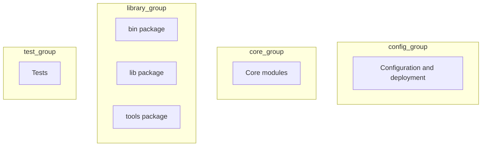

# Architecture report: standard/standard

> Automated static analysis. **Observed** = directly seen in files/imports/AST; **Inferred** = interpretation from that evidence. Repository code was not executed.

## 1. Repository at a glance

| Item | Value |
| --- | --- |
| Repository | standard/standard |
| Description | 🌟 JavaScript Style Guide, with linter & automatic code fixer |
| Language | JavaScript |
| Stars | 29428 |
| Licence | MIT |
| Analysed commit / branch | 753309b21bfd7c98e208e3fb45910ffd1bb95409 / master |
| Framework(s) | None detected |
| Files analysed | 52 |
| Components | 6 |

## 2. Architecture in one minute

standard/standard - 🌟 JavaScript Style Guide, with linter & automatic code fixer. This repository was analysed statically from 52 file(s) (0 Python). Detected technologies (observed from imports/manifests): GitHub Actions. Files are grouped into 6 component(s): bin package, Configuration and deployment, Core modules, lib package, Tests, tools package. Findings below distinguish observed facts from inferred interpretation.

## 3. High-level block diagram

## 4. Main components

### bin package (`bin`)

- **Kind:** library
- **Status:** Observed
- **Confidence:** 0.85
- **Responsibility:** Groups 1 file(s) under bin package (observed from repository paths and static analysis).
- **Paths:** `bin/cmd.cjs`
- **Evidence:** [bin/cmd.cjs](https://github.com/standard/standard/blob/753309b21bfd7c98e208e3fb45910ffd1bb95409/bin/cmd.cjs)

### Configuration and deployment (`config`)

- **Kind:** config
- **Status:** Observed
- **Confidence:** 0.85
- **Responsibility:** Groups 2 file(s) under configuration and deployment (observed from repository paths and static analysis).
- **Paths:** `eslintrc.json`, `package.json`
- **Evidence:** [eslintrc.json](https://github.com/standard/standard/blob/753309b21bfd7c98e208e3fb45910ffd1bb95409/eslintrc.json); [package.json](https://github.com/standard/standard/blob/753309b21bfd7c98e208e3fb45910ffd1bb95409/package.json)

### Core modules (`core`)

- **Kind:** core
- **Status:** Observed
- **Confidence:** 0.85
- **Responsibility:** Groups 1 file(s) under core modules (observed from repository paths and static analysis).
- **Paths:** `index.js`
- **Evidence:** [index.js](https://github.com/standard/standard/blob/753309b21bfd7c98e208e3fb45910ffd1bb95409/index.js)

### lib package (`lib`)

- **Kind:** library
- **Status:** Observed
- **Confidence:** 0.85
- **Responsibility:** Groups 2 file(s) under lib package (observed from repository paths and static analysis).
- **Paths:** `lib/cli.js`, `lib/options.js`
- **Evidence:** [lib/cli.js](https://github.com/standard/standard/blob/753309b21bfd7c98e208e3fb45910ffd1bb95409/lib/cli.js); [lib/options.js](https://github.com/standard/standard/blob/753309b21bfd7c98e208e3fb45910ffd1bb95409/lib/options.js)

### Tests (`tests`)

- **Kind:** test
- **Status:** Observed
- **Confidence:** 0.85
- **Responsibility:** Groups 5 file(s) under tests (observed from repository paths and static analysis).
- **Paths:** `test/api.js`, `test/cmd.js`, `test/external/clone.js`, `test/external/test.json`, `test/validate-config.js`
- **Evidence:** [test/api.js](https://github.com/standard/standard/blob/753309b21bfd7c98e208e3fb45910ffd1bb95409/test/api.js); [test/cmd.js](https://github.com/standard/standard/blob/753309b21bfd7c98e208e3fb45910ffd1bb95409/test/cmd.js); [test/external/clone.js](https://github.com/standard/standard/blob/753309b21bfd7c98e208e3fb45910ffd1bb95409/test/external/clone.js); [test/external/test.json](https://github.com/standard/standard/blob/753309b21bfd7c98e208e3fb45910ffd1bb95409/test/external/test.json); [test/validate-config.js](https://github.com/standard/standard/blob/753309b21bfd7c98e208e3fb45910ffd1bb95409/test/validate-config.js)

### tools package (`tools`)

- **Kind:** library
- **Status:** Observed
- **Confidence:** 0.85
- **Responsibility:** Groups 2 file(s) under tools package (observed from repository paths and static analysis).
- **Paths:** `tools/test-exists.js`, `tools/update-authors.sh`
- **Evidence:** [tools/test-exists.js](https://github.com/standard/standard/blob/753309b21bfd7c98e208e3fb45910ffd1bb95409/tools/test-exists.js); [tools/update-authors.sh](https://github.com/standard/standard/blob/753309b21bfd7c98e208e3fb45910ffd1bb95409/tools/update-authors.sh)

## 5. Execution flow

**Observed** entry point(s):

- [bin/cmd.cjs](https://github.com/standard/standard/blob/753309b21bfd7c98e208e3fb45910ffd1bb95409/bin/cmd.cjs)
- [index.js](https://github.com/standard/standard/blob/753309b21bfd7c98e208e3fb45910ffd1bb95409/index.js)

Representative flow (derived from observed entry points and the import graph; steps beyond the entry point are **Inferred**):

1. Execution starts at an observed entry point listed above, if present.
2. No internal import relationships between components were observed.

## 6. Project structure

### `(root)`

- `.editorconfig` - config (147 bytes)
- `.gitignore` - other (19 bytes)
- `.npmignore` - other (171 bytes)
- `.pre-commit-hooks.yaml` - config (123 bytes)
- `AUTHORS.md` - docs (12580 bytes)
- `CHANGELOG.md` - docs (75648 bytes)
- `LICENSE` - docs (1081 bytes)
- `README.md` - docs (43030 bytes)
- `RULES.md` - docs (34359 bytes)
- `badge.svg` - other (10483 bytes)
- `eslintrc.json` - config (46 bytes)
- `index.js` - source, JavaScript (214 bytes)
- `package.json` - manifest (2116 bytes)
- `sticker.svg` - other (4647 bytes)

### `.github`

- `.github/FUNDING.yml` - config (50 bytes)
- `.github/config.yml` - config (562 bytes)
- `.github/dependabot.yml` - config (524 bytes)
- `.github/no-response.yml` - config (574 bytes)
- `.github/stale.yml` - config (772 bytes)
- `.github/workflows/add-to-project.yaml` - ci, YAML (188 bytes)
- `.github/workflows/old-test.yml` - ci, YAML (810 bytes)
- `.github/workflows/test-external.yml` - ci, YAML (732 bytes)
- `.github/workflows/test-internal.yml` - ci, YAML (893 bytes)

### `bin`

- `bin/cmd.cjs` - source, JavaScript (71 bytes)

### `docs`

- `docs/README-esla.md` - docs (38610 bytes)
- `docs/README-fr.md` - docs (41664 bytes)
- `docs/README-id.md` - docs (41909 bytes)
- `docs/README-iteu.md` - docs (40433 bytes)
- `docs/README-ja.md` - docs (48682 bytes)
- `docs/README-kokr.md` - docs (44260 bytes)
- `docs/README-ptbr.md` - docs (25123 bytes)
- `docs/README-zhcn.md` - docs (36973 bytes)
- `docs/README-zhtw.md` - docs (36880 bytes)
- `docs/RULES-esla.md` - docs (34647 bytes)
- `docs/RULES-fr.md` - docs (35985 bytes)
- `docs/RULES-id.md` - docs (36400 bytes)
- `docs/RULES-iteu.md` - docs (34705 bytes)
- `docs/RULES-ja.md` - docs (36713 bytes)
- `docs/RULES-kokr.md` - docs (37670 bytes)
- `docs/RULES-ptbr.md` - docs (9206 bytes)
- `docs/RULES-zhcn.md` - docs (33340 bytes)
- `docs/RULES-zhtw.md` - docs (33348 bytes)
- `docs/webstorm.md` - docs (3607 bytes)

### `lib`

- `lib/cli.js` - source, JavaScript (87 bytes)
- `lib/options.js` - source, JavaScript (631 bytes)

### `test`

- `test/api.js` - test, JavaScript (513 bytes)
- `test/cmd.js` - test, JavaScript (410 bytes)
- `test/external/clone.js` - test, JavaScript (5280 bytes)
- `test/external/test.json` - test (47557 bytes)
- `test/validate-config.js` - test, JavaScript (558 bytes)

### `tools`

- `tools/test-exists.js` - source, JavaScript (731 bytes)
- `tools/update-authors.sh` - source, Shell (711 bytes)

## 7. Key dependencies and integrations

| Name | Category | Status | Confidence | Evidence |
| --- | --- | --- | --- | --- |
| GitHub Actions | ci | Observed | 0.90 | [.github/workflows/add-to-project.yaml](https://github.com/standard/standard/blob/753309b21bfd7c98e208e3fb45910ffd1bb95409/.github/workflows/add-to-project.yaml); [.github/workflows/old-test.yml](https://github.com/standard/standard/blob/753309b21bfd7c98e208e3fb45910ffd1bb95409/.github/workflows/old-test.yml); [.github/workflows/test-external.yml](https://github.com/standard/standard/blob/753309b21bfd7c98e208e3fb45910ffd1bb95409/.github/workflows/test-external.yml); [.github/workflows/test-internal.yml](https://github.com/standard/standard/blob/753309b21bfd7c98e208e3fb45910ffd1bb95409/.github/workflows/test-internal.yml) |

## 8. Data and state

No database, cache, queue, or persistent-state usage was observed in the analysed files. State handling, if any, may be in-memory or in files that were not analysed.

## 9. Configuration and deployment clues

- `.editorconfig` (config)
- `.github/FUNDING.yml` (config)
- `.github/config.yml` (config)
- `.github/dependabot.yml` (config)
- `.github/no-response.yml` (config)
- `.github/stale.yml` (config)
- `.github/workflows/add-to-project.yaml` (ci)
- `.github/workflows/old-test.yml` (ci)
- `.github/workflows/test-external.yml` (ci)
- `.github/workflows/test-internal.yml` (ci)
- `.pre-commit-hooks.yaml` (config)
- `eslintrc.json` (config)
- `package.json` (manifest)

## 10. Design observations

- Tests are present alongside source code (Observed from test file paths).

These observations are interpretations (**Inferred**) of the observed structure, not guarantees about runtime design.

## 11. Limitations and unknowns

- Static analysis only: repository code was not executed, installed, or imported at runtime.
- Components and relationships are inferred from file paths, imports, and AST structure; runtime behaviour, dynamic imports, and reflection may not be visible.
- 1 file(s) were skipped during inventory (1 x likely secret file excluded).
- No clear application entry point was observed in the analysed files.
- Repository text was treated as untrusted data; no instructions found in repository files were followed, and likely secret values were redacted/excluded.
- JavaScript and TypeScript files were inventoried from paths and package manifests. They were not parsed with a full language AST, and repository code was not executed.

## 12. Source references

- [.github/workflows/add-to-project.yaml](https://github.com/standard/standard/blob/753309b21bfd7c98e208e3fb45910ffd1bb95409/.github/workflows/add-to-project.yaml)
- [.github/workflows/old-test.yml](https://github.com/standard/standard/blob/753309b21bfd7c98e208e3fb45910ffd1bb95409/.github/workflows/old-test.yml)
- [.github/workflows/test-external.yml](https://github.com/standard/standard/blob/753309b21bfd7c98e208e3fb45910ffd1bb95409/.github/workflows/test-external.yml)
- [.github/workflows/test-internal.yml](https://github.com/standard/standard/blob/753309b21bfd7c98e208e3fb45910ffd1bb95409/.github/workflows/test-internal.yml)
- [bin/cmd.cjs](https://github.com/standard/standard/blob/753309b21bfd7c98e208e3fb45910ffd1bb95409/bin/cmd.cjs)
- [eslintrc.json](https://github.com/standard/standard/blob/753309b21bfd7c98e208e3fb45910ffd1bb95409/eslintrc.json)
- [index.js](https://github.com/standard/standard/blob/753309b21bfd7c98e208e3fb45910ffd1bb95409/index.js)
- [lib/cli.js](https://github.com/standard/standard/blob/753309b21bfd7c98e208e3fb45910ffd1bb95409/lib/cli.js)
- [lib/options.js](https://github.com/standard/standard/blob/753309b21bfd7c98e208e3fb45910ffd1bb95409/lib/options.js)
- [package.json](https://github.com/standard/standard/blob/753309b21bfd7c98e208e3fb45910ffd1bb95409/package.json)
- [test/api.js](https://github.com/standard/standard/blob/753309b21bfd7c98e208e3fb45910ffd1bb95409/test/api.js)
- [test/cmd.js](https://github.com/standard/standard/blob/753309b21bfd7c98e208e3fb45910ffd1bb95409/test/cmd.js)
- [test/external/clone.js](https://github.com/standard/standard/blob/753309b21bfd7c98e208e3fb45910ffd1bb95409/test/external/clone.js)
- [test/external/test.json](https://github.com/standard/standard/blob/753309b21bfd7c98e208e3fb45910ffd1bb95409/test/external/test.json)
- [test/validate-config.js](https://github.com/standard/standard/blob/753309b21bfd7c98e208e3fb45910ffd1bb95409/test/validate-config.js)
- [tools/test-exists.js](https://github.com/standard/standard/blob/753309b21bfd7c98e208e3fb45910ffd1bb95409/tools/test-exists.js)
- [tools/update-authors.sh](https://github.com/standard/standard/blob/753309b21bfd7c98e208e3fb45910ffd1bb95409/tools/update-authors.sh)
