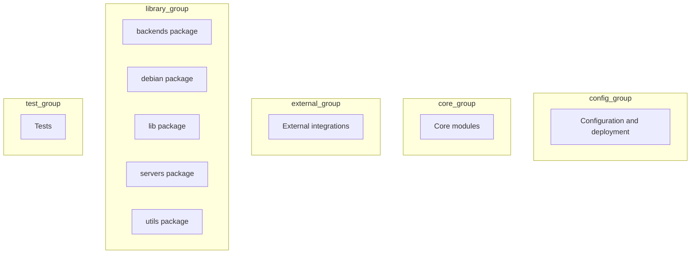

# Architecture report: statsd/statsd

> Automated static analysis. **Observed** = directly seen in files/imports/AST; **Inferred** = interpretation from that evidence. Repository code was not executed.

## 1. Repository at a glance

| Item | Value |
| --- | --- |
| Repository | statsd/statsd |
| Description | Daemon for easy but powerful stats aggregation |
| Language | JavaScript |
| Stars | 18075 |
| Licence | MIT |
| Analysed commit / branch | f7157b880631152569b04d626f631b60eec366f8 / master |
| Framework(s) | None detected |
| Files analysed | 102 |
| Components | 9 |

## 2. Architecture in one minute

statsd/statsd - Daemon for easy but powerful stats aggregation. This repository was analysed statically from 102 file(s) (1 Python). Detected technologies (observed from imports/manifests): GitHub Actions, Docker, Docker Compose. Files are grouped into 9 component(s): backends package, Configuration and deployment, Core modules, debian package, External integrations, lib package, servers package, Tests. Findings below distinguish observed facts from inferred interpretation.

## 3. High-level block diagram

## 4. Main components

### backends package (`backends`)

- **Kind:** library
- **Status:** Observed
- **Confidence:** 0.85
- **Responsibility:** Groups 3 file(s) under backends package (observed from repository paths and static analysis).
- **Paths:** `backends/console.js`, `backends/graphite.js`, `backends/repeater.js`
- **Evidence:** [backends/console.js](https://github.com/statsd/statsd/blob/f7157b880631152569b04d626f631b60eec366f8/backends/console.js); [backends/graphite.js](https://github.com/statsd/statsd/blob/f7157b880631152569b04d626f631b60eec366f8/backends/graphite.js); [backends/repeater.js](https://github.com/statsd/statsd/blob/f7157b880631152569b04d626f631b60eec366f8/backends/repeater.js)

### Configuration and deployment (`config`)

- **Kind:** config
- **Status:** Observed
- **Confidence:** 0.85
- **Responsibility:** Groups 3 file(s) under configuration and deployment (observed from repository paths and static analysis).
- **Paths:** `Dockerfile`, `docker-compose.yml`, `package.json`
- **Evidence:** [Dockerfile](https://github.com/statsd/statsd/blob/f7157b880631152569b04d626f631b60eec366f8/Dockerfile); [docker-compose.yml](https://github.com/statsd/statsd/blob/f7157b880631152569b04d626f631b60eec366f8/docker-compose.yml); [package.json](https://github.com/statsd/statsd/blob/f7157b880631152569b04d626f631b60eec366f8/package.json)

### Core modules (`core`)

- **Kind:** core
- **Status:** Observed
- **Confidence:** 0.85
- **Responsibility:** Groups 5 file(s) under core modules (observed from repository paths and static analysis).
- **Paths:** `exampleConfig.js`, `exampleProxyConfig.js`, `proxy.js`, `run_tests.js`, `stats.js`
- **Evidence:** [exampleConfig.js](https://github.com/statsd/statsd/blob/f7157b880631152569b04d626f631b60eec366f8/exampleConfig.js); [exampleProxyConfig.js](https://github.com/statsd/statsd/blob/f7157b880631152569b04d626f631b60eec366f8/exampleProxyConfig.js); [proxy.js](https://github.com/statsd/statsd/blob/f7157b880631152569b04d626f631b60eec366f8/proxy.js); [run_tests.js](https://github.com/statsd/statsd/blob/f7157b880631152569b04d626f631b60eec366f8/run_tests.js); [stats.js](https://github.com/statsd/statsd/blob/f7157b880631152569b04d626f631b60eec366f8/stats.js)

### debian package (`debian`)

- **Kind:** library
- **Status:** Observed
- **Confidence:** 0.85
- **Responsibility:** Groups 2 file(s) under debian package (observed from repository paths and static analysis).
- **Paths:** `debian/localConfig.js`, `debian/proxyConfig.js`
- **Evidence:** [debian/localConfig.js](https://github.com/statsd/statsd/blob/f7157b880631152569b04d626f631b60eec366f8/debian/localConfig.js); [debian/proxyConfig.js](https://github.com/statsd/statsd/blob/f7157b880631152569b04d626f631b60eec366f8/debian/proxyConfig.js)

### External integrations (`external_integrations`)

- **Kind:** external
- **Status:** Inferred
- **Confidence:** 0.70
- **Responsibility:** Groups 0 file(s) under external integrations (observed from repository paths and static analysis).
- **Evidence:** [examples/python_example.py:5](https://github.com/statsd/statsd/blob/f7157b880631152569b04d626f631b60eec366f8/examples/python_example.py#L5)

### lib package (`lib`)

- **Kind:** library
- **Status:** Observed
- **Confidence:** 0.85
- **Responsibility:** Groups 8 file(s) under lib package (observed from repository paths and static analysis).
- **Paths:** `lib/config.js`, `lib/helpers.js`, `lib/logger.js`, `lib/mgmt_console.js`, `lib/mgmt_server.js`, `lib/process_metrics.js`, `lib/process_mgmt.js`, `lib/set.js`
- **Evidence:** [lib/config.js](https://github.com/statsd/statsd/blob/f7157b880631152569b04d626f631b60eec366f8/lib/config.js); [lib/helpers.js](https://github.com/statsd/statsd/blob/f7157b880631152569b04d626f631b60eec366f8/lib/helpers.js); [lib/logger.js](https://github.com/statsd/statsd/blob/f7157b880631152569b04d626f631b60eec366f8/lib/logger.js); [lib/mgmt_console.js](https://github.com/statsd/statsd/blob/f7157b880631152569b04d626f631b60eec366f8/lib/mgmt_console.js); [lib/mgmt_server.js](https://github.com/statsd/statsd/blob/f7157b880631152569b04d626f631b60eec366f8/lib/mgmt_server.js); [lib/process_metrics.js](https://github.com/statsd/statsd/blob/f7157b880631152569b04d626f631b60eec366f8/lib/process_metrics.js); [lib/process_mgmt.js](https://github.com/statsd/statsd/blob/f7157b880631152569b04d626f631b60eec366f8/lib/process_mgmt.js); [lib/set.js](https://github.com/statsd/statsd/blob/f7157b880631152569b04d626f631b60eec366f8/lib/set.js)

### servers package (`servers`)

- **Kind:** library
- **Status:** Observed
- **Confidence:** 0.85
- **Responsibility:** Groups 2 file(s) under servers package (observed from repository paths and static analysis).
- **Paths:** `servers/tcp.js`, `servers/udp.js`
- **Evidence:** [servers/tcp.js](https://github.com/statsd/statsd/blob/f7157b880631152569b04d626f631b60eec366f8/servers/tcp.js); [servers/udp.js](https://github.com/statsd/statsd/blob/f7157b880631152569b04d626f631b60eec366f8/servers/udp.js)

### Tests (`tests`)

- **Kind:** test
- **Status:** Observed
- **Confidence:** 0.85
- **Responsibility:** Groups 15 file(s) under tests (observed from repository paths and static analysis).
- **Paths:** `test/graphite_delete_counters_tests.js`, `test/graphite_legacy_tests.js`, `test/graphite_legacy_tests_statsprefix.js`, `test/graphite_pickle_tests.js`, `test/graphite_tests.js`, `test/graphite_tests_filters.js`, `test/graphite_tests_statsprefix.js`, `test/graphite_tests_statssuffix.js`, `test/helpers_tests.js`, `test/mgmt_console_tests.js`, `test/process_metrics_tests.js`, `test/process_mgmt_tests.js`, `test/repeater_tests.js`, `test/server_tests.js`, `test/set_tests.js`
- **Evidence:** [test/graphite_delete_counters_tests.js](https://github.com/statsd/statsd/blob/f7157b880631152569b04d626f631b60eec366f8/test/graphite_delete_counters_tests.js); [test/graphite_legacy_tests.js](https://github.com/statsd/statsd/blob/f7157b880631152569b04d626f631b60eec366f8/test/graphite_legacy_tests.js); [test/graphite_legacy_tests_statsprefix.js](https://github.com/statsd/statsd/blob/f7157b880631152569b04d626f631b60eec366f8/test/graphite_legacy_tests_statsprefix.js); [test/graphite_pickle_tests.js](https://github.com/statsd/statsd/blob/f7157b880631152569b04d626f631b60eec366f8/test/graphite_pickle_tests.js); [test/graphite_tests.js](https://github.com/statsd/statsd/blob/f7157b880631152569b04d626f631b60eec366f8/test/graphite_tests.js); [test/graphite_tests_filters.js](https://github.com/statsd/statsd/blob/f7157b880631152569b04d626f631b60eec366f8/test/graphite_tests_filters.js); [test/graphite_tests_statsprefix.js](https://github.com/statsd/statsd/blob/f7157b880631152569b04d626f631b60eec366f8/test/graphite_tests_statsprefix.js); [test/graphite_tests_statssuffix.js](https://github.com/statsd/statsd/blob/f7157b880631152569b04d626f631b60eec366f8/test/graphite_tests_statssuffix.js)

### utils package (`utils`)

- **Kind:** library
- **Status:** Observed
- **Confidence:** 0.85
- **Responsibility:** Groups 1 file(s) under utils package (observed from repository paths and static analysis).
- **Paths:** `utils/statsd-timer-metric-counts.sh`
- **Evidence:** [utils/statsd-timer-metric-counts.sh](https://github.com/statsd/statsd/blob/f7157b880631152569b04d626f631b60eec366f8/utils/statsd-timer-metric-counts.sh)

## 5. Execution flow

**Observed** entry point(s):

- [bin/statsd](https://github.com/statsd/statsd/blob/f7157b880631152569b04d626f631b60eec366f8/bin/statsd)

Representative flow (derived from observed entry points and the import graph; steps beyond the entry point are **Inferred**):

1. Execution starts at an observed entry point listed above, if present.
2. No internal import relationships between components were observed.

## 6. Project structure

### `(root)`

- `.dockerignore` - container (184 bytes)
- `.gitignore` - other (77 bytes)
- `.pkgr.yml` - config (163 bytes)
- `CODE_OF_CONDUCT.md` - docs (3363 bytes)
- `CONTRIBUTING.md` - docs (750 bytes)
- `Changelog.md` - docs (6322 bytes)
- `DCO.txt` - docs (1421 bytes)
- `Dockerfile` - container (653 bytes)
- `LICENSE` - docs (1072 bytes)
- `MAINTAINERS.md` - docs (1317 bytes)
- `README.md` - docs (4917 bytes)
- `docker-compose.yml` - container (386 bytes)
- `exampleConfig.js` - source, JavaScript (8001 bytes)
- `exampleProxyConfig.js` - source, JavaScript (1677 bytes)
- `package.json` - manifest (1105 bytes)
- `proxy.js` - source, JavaScript (8663 bytes)
- `run_tests.js` - source, JavaScript (352 bytes)
- `stats.js` - source, JavaScript (15626 bytes)

### `.github`

- `.github/workflows/package-and-publish-image.yml` - ci, YAML (1923 bytes)

### `backends`

- `backends/console.js` - source, JavaScript (1397 bytes)
- `backends/graphite.js` - source, JavaScript (10692 bytes)
- `backends/repeater.js` - source, JavaScript (3171 bytes)

### `bin`

- `bin/statsd` - other (45 bytes)

### `debian`

- `debian/changelog` - other (8009 bytes)
- `debian/compat` - other (2 bytes)
- `debian/control` - other (411 bytes)
- `debian/copyright` - other (1067 bytes)
- `debian/dirs` - other (0 bytes)
- `debian/docs` - docs (26 bytes)
- `debian/localConfig.js` - source, JavaScript (66 bytes)
- `debian/postinst` - other (655 bytes)
- `debian/postrm` - other (331 bytes)
- `debian/proxyConfig.js` - source, JavaScript (169 bytes)
- `debian/rules` - other (161 bytes)
- `debian/statsd-proxy.upstart` - other (699 bytes)
- `debian/statsd.install` - other (267 bytes)
- `debian/statsd.statsd-proxy.service` - other (315 bytes)
- `debian/statsd.statsd.service` - other (315 bytes)
- `debian/statsd.upstart` - other (699 bytes)

### `docs`

- `docs/additional_tools.md` - docs (228 bytes)
- `docs/admin_interface.md` - docs (2969 bytes)
- `docs/backend.md` - docs (3913 bytes)
- `docs/backend_interface.md` - docs (2713 bytes)
- `docs/client_implementations.md` - docs (5672 bytes)
- `docs/cluster_proxy.md` - docs (930 bytes)
- `docs/graphite.md` - docs (7334 bytes)
- `docs/graphite_pickle.md` - docs (2331 bytes)
- `docs/history.md` - docs (318 bytes)
- `docs/metric_types.md` - docs (4552 bytes)
- `docs/namespacing.md` - docs (1598 bytes)
- `docs/protocol.md` - docs (84 bytes)
- `docs/server.md` - docs (1102 bytes)
- `docs/server_implementations.md` - docs (1401 bytes)
- `docs/server_interface.md` - docs (1026 bytes)

### `examples`

- `examples/Etsy/StatsD.pm` - other (2590 bytes)
- `examples/README.md` - docs (764 bytes)
- `examples/StatsD.scala` - other (7119 bytes)
- `examples/StatsdClient.java` - source, Java (8580 bytes)
- `examples/StatsdClient.jl` - other (1093 bytes)
- `examples/StatsdClient.kt` - other (5921 bytes)
- `examples/csharp_example.cs` - source, C# (4493 bytes)
- `examples/go/README.md` - docs (225 bytes)
- `examples/go/doc.go` - source, Go (2243 bytes)
- `examples/go/statsd.go` - source, Go (4709 bytes)
- `examples/perl-example.pl` - other (734 bytes)
- `examples/php-example.php` - source, PHP (4734 bytes)
- `examples/python_example.py` - source, Python (4817 bytes)
- `examples/ruby_example.rb` - source, Ruby (1775 bytes)
- `examples/ruby_example2.rb` - source, Ruby (2584 bytes)
- `examples/statsd-client.sh` - source, Shell (474 bytes)
- `examples/statsd.clj` - other (1296 bytes)
- `examples/statsd.erl` - other (7080 bytes)

### `lib`

- `lib/config.js` - source, JavaScript (995 bytes)
- `lib/helpers.js` - source, JavaScript (1906 bytes)
- `lib/logger.js` - source, JavaScript (1050 bytes)
- `lib/mgmt_console.js` - source, JavaScript (2156 bytes)
- `lib/mgmt_server.js` - source, JavaScript (608 bytes)
- `lib/process_metrics.js` - source, JavaScript (6012 bytes)
- `lib/process_mgmt.js` - source, JavaScript (611 bytes)
- `lib/set.js` - source, JavaScript (602 bytes)

### `packager`

- `packager/Procfile` - other (49 bytes)
- `packager/postinst` - other (410 bytes)

### `servers`

- `servers/tcp.js` - source, JavaScript (1130 bytes)
- `servers/udp.js` - source, JavaScript (309 bytes)

### `test`

- `test/graphite_delete_counters_tests.js` - test, JavaScript (11821 bytes)
- `test/graphite_legacy_tests.js` - test, JavaScript (7464 bytes)
- `test/graphite_legacy_tests_statsprefix.js` - test, JavaScript (7540 bytes)
- `test/graphite_pickle_tests.js` - test, JavaScript (7653 bytes)
- `test/graphite_tests.js` - test, JavaScript (15732 bytes)
- `test/graphite_tests_filters.js` - test, JavaScript (6255 bytes)
- `test/graphite_tests_statsprefix.js` - test, JavaScript (8942 bytes)
- `test/graphite_tests_statssuffix.js` - test, JavaScript (9038 bytes)
- `test/helpers_tests.js` - test, JavaScript (4786 bytes)
- `test/mgmt_console_tests.js` - test, JavaScript (1717 bytes)
- `test/process_metrics_tests.js` - test, JavaScript (19635 bytes)
- `test/process_mgmt_tests.js` - test, JavaScript (1597 bytes)
- `test/repeater_tests.js` - test, JavaScript (3565 bytes)
- `test/server_tests.js` - test, JavaScript (2297 bytes)
- `test/set_tests.js` - test, JavaScript (1300 bytes)

### `utils`

- `utils/check_statsd.pl` - other (1451 bytes)
- `utils/check_statsd_health` - other (1456 bytes)
- `utils/statsd-timer-metric-counts.sh` - source, Shell (1820 bytes)

## 7. Key dependencies and integrations

| Name | Category | Status | Confidence | Evidence |
| --- | --- | --- | --- | --- |
| GitHub Actions | ci | Observed | 0.85 | [.github/workflows/package-and-publish-image.yml](https://github.com/statsd/statsd/blob/f7157b880631152569b04d626f631b60eec366f8/.github/workflows/package-and-publish-image.yml) |
| Docker | tooling | Observed | 0.90 | [.github/workflows/package-and-publish-image.yml:7](https://github.com/statsd/statsd/blob/f7157b880631152569b04d626f631b60eec366f8/.github/workflows/package-and-publish-image.yml#L7); [Dockerfile](https://github.com/statsd/statsd/blob/f7157b880631152569b04d626f631b60eec366f8/Dockerfile) |
| Docker Compose | tooling | Observed | 0.85 | [docker-compose.yml](https://github.com/statsd/statsd/blob/f7157b880631152569b04d626f631b60eec366f8/docker-compose.yml) |

## 8. Data and state

No database, cache, queue, or persistent-state usage was observed in the analysed files. State handling, if any, may be in-memory or in files that were not analysed.

## 9. Configuration and deployment clues

- `.dockerignore` (container)
- `.github/workflows/package-and-publish-image.yml` (ci)
- `.pkgr.yml` (config)
- `Dockerfile` (container)
- `docker-compose.yml` (container)
- `package.json` (manifest)

## 10. Design observations

- Tests are present alongside source code (Observed from test file paths).
- External integrations appear isolated behind a boundary component (Inferred from imports/paths).

These observations are interpretations (**Inferred**) of the observed structure, not guarantees about runtime design.

## 11. Limitations and unknowns

- Static analysis only: repository code was not executed, installed, or imported at runtime.
- Components and relationships are inferred from file paths, imports, and AST structure; runtime behaviour, dynamic imports, and reflection may not be visible.
- 1 file(s) were skipped during inventory (1 x lockfile excluded).
- No clear application entry point was observed in the analysed files.
- Repository text was treated as untrusted data; no instructions found in repository files were followed, and likely secret values were redacted/excluded.

## 12. Source references

- [.github/workflows/package-and-publish-image.yml](https://github.com/statsd/statsd/blob/f7157b880631152569b04d626f631b60eec366f8/.github/workflows/package-and-publish-image.yml)
- [.github/workflows/package-and-publish-image.yml:7](https://github.com/statsd/statsd/blob/f7157b880631152569b04d626f631b60eec366f8/.github/workflows/package-and-publish-image.yml#L7)
- [Dockerfile](https://github.com/statsd/statsd/blob/f7157b880631152569b04d626f631b60eec366f8/Dockerfile)
- [backends/console.js](https://github.com/statsd/statsd/blob/f7157b880631152569b04d626f631b60eec366f8/backends/console.js)
- [backends/graphite.js](https://github.com/statsd/statsd/blob/f7157b880631152569b04d626f631b60eec366f8/backends/graphite.js)
- [backends/repeater.js](https://github.com/statsd/statsd/blob/f7157b880631152569b04d626f631b60eec366f8/backends/repeater.js)
- [bin/statsd](https://github.com/statsd/statsd/blob/f7157b880631152569b04d626f631b60eec366f8/bin/statsd)
- [debian/localConfig.js](https://github.com/statsd/statsd/blob/f7157b880631152569b04d626f631b60eec366f8/debian/localConfig.js)
- [debian/proxyConfig.js](https://github.com/statsd/statsd/blob/f7157b880631152569b04d626f631b60eec366f8/debian/proxyConfig.js)
- [docker-compose.yml](https://github.com/statsd/statsd/blob/f7157b880631152569b04d626f631b60eec366f8/docker-compose.yml)
- [exampleConfig.js](https://github.com/statsd/statsd/blob/f7157b880631152569b04d626f631b60eec366f8/exampleConfig.js)
- [exampleProxyConfig.js](https://github.com/statsd/statsd/blob/f7157b880631152569b04d626f631b60eec366f8/exampleProxyConfig.js)
- [examples/python_example.py:5](https://github.com/statsd/statsd/blob/f7157b880631152569b04d626f631b60eec366f8/examples/python_example.py#L5)
- [lib/config.js](https://github.com/statsd/statsd/blob/f7157b880631152569b04d626f631b60eec366f8/lib/config.js)
- [lib/helpers.js](https://github.com/statsd/statsd/blob/f7157b880631152569b04d626f631b60eec366f8/lib/helpers.js)
- [lib/logger.js](https://github.com/statsd/statsd/blob/f7157b880631152569b04d626f631b60eec366f8/lib/logger.js)
- [lib/mgmt_console.js](https://github.com/statsd/statsd/blob/f7157b880631152569b04d626f631b60eec366f8/lib/mgmt_console.js)
- [lib/mgmt_server.js](https://github.com/statsd/statsd/blob/f7157b880631152569b04d626f631b60eec366f8/lib/mgmt_server.js)
- [lib/process_metrics.js](https://github.com/statsd/statsd/blob/f7157b880631152569b04d626f631b60eec366f8/lib/process_metrics.js)
- [lib/process_mgmt.js](https://github.com/statsd/statsd/blob/f7157b880631152569b04d626f631b60eec366f8/lib/process_mgmt.js)
- [lib/set.js](https://github.com/statsd/statsd/blob/f7157b880631152569b04d626f631b60eec366f8/lib/set.js)
- [package.json](https://github.com/statsd/statsd/blob/f7157b880631152569b04d626f631b60eec366f8/package.json)
- [proxy.js](https://github.com/statsd/statsd/blob/f7157b880631152569b04d626f631b60eec366f8/proxy.js)
- [run_tests.js](https://github.com/statsd/statsd/blob/f7157b880631152569b04d626f631b60eec366f8/run_tests.js)
- [servers/tcp.js](https://github.com/statsd/statsd/blob/f7157b880631152569b04d626f631b60eec366f8/servers/tcp.js)
- [servers/udp.js](https://github.com/statsd/statsd/blob/f7157b880631152569b04d626f631b60eec366f8/servers/udp.js)
- [stats.js](https://github.com/statsd/statsd/blob/f7157b880631152569b04d626f631b60eec366f8/stats.js)
- [test/graphite_delete_counters_tests.js](https://github.com/statsd/statsd/blob/f7157b880631152569b04d626f631b60eec366f8/test/graphite_delete_counters_tests.js)
- [test/graphite_legacy_tests.js](https://github.com/statsd/statsd/blob/f7157b880631152569b04d626f631b60eec366f8/test/graphite_legacy_tests.js)
- [test/graphite_legacy_tests_statsprefix.js](https://github.com/statsd/statsd/blob/f7157b880631152569b04d626f631b60eec366f8/test/graphite_legacy_tests_statsprefix.js)
- [test/graphite_pickle_tests.js](https://github.com/statsd/statsd/blob/f7157b880631152569b04d626f631b60eec366f8/test/graphite_pickle_tests.js)
- [test/graphite_tests.js](https://github.com/statsd/statsd/blob/f7157b880631152569b04d626f631b60eec366f8/test/graphite_tests.js)
- [test/graphite_tests_filters.js](https://github.com/statsd/statsd/blob/f7157b880631152569b04d626f631b60eec366f8/test/graphite_tests_filters.js)
- [test/graphite_tests_statsprefix.js](https://github.com/statsd/statsd/blob/f7157b880631152569b04d626f631b60eec366f8/test/graphite_tests_statsprefix.js)
- [test/graphite_tests_statssuffix.js](https://github.com/statsd/statsd/blob/f7157b880631152569b04d626f631b60eec366f8/test/graphite_tests_statssuffix.js)
- [utils/statsd-timer-metric-counts.sh](https://github.com/statsd/statsd/blob/f7157b880631152569b04d626f631b60eec366f8/utils/statsd-timer-metric-counts.sh)
