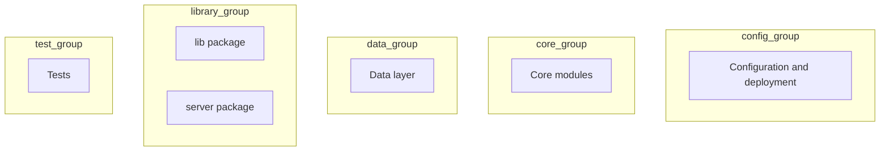

# Architecture report: strongloop/loopback

> Automated static analysis. **Observed** = directly seen in files/imports/AST; **Inferred** = interpretation from that evidence. Repository code was not executed.

## 1. Repository at a glance

| Item | Value |
| --- | --- |
| Repository | strongloop/loopback |
| Description | LoopBack makes it easy to build modern applications that require complex integrations. |
| Language | JavaScript |
| Stars | 13140 |
| Licence | Other |
| Analysed commit / branch | 13371fd2a138a6f39db77e5a455b3170e5d4a0f5 / master |
| Framework(s) | Express |
| Files analysed | 241 |
| Components | 6 |

## 2. Architecture in one minute

strongloop/loopback - LoopBack makes it easy to build modern applications that require complex integrations.. This repository was analysed statically from 241 file(s) (0 Python). Detected technologies (observed from imports/manifests): Express. Files are grouped into 6 component(s): Configuration and deployment, Core modules, Data layer, lib package, server package, Tests. Findings below distinguish observed facts from inferred interpretation.

## 3. High-level block diagram

## 4. Main components

### Configuration and deployment (`config`)

- **Kind:** config
- **Status:** Observed
- **Confidence:** 0.85
- **Responsibility:** Groups 28 file(s) under configuration and deployment (observed from repository paths and static analysis).
- **Paths:** `common/models/access-token.json`, `common/models/acl.json`, `common/models/application.json`, `common/models/change.json`, `common/models/checkpoint.json`, `common/models/email.json`, `common/models/key-value-model.json`, `common/models/role-mapping.json`, `common/models/role.json`, `common/models/scope.json`, `common/models/user.json`, `docs.json`, `intl/cs/messages.json`, `intl/de/messages.json`, `intl/en/messages.json`, `intl/es/messages.json`, `intl/fr/messages.json`, `intl/it/messages.json`, `intl/ja/messages.json`, `intl/ko/messages.json`, `intl/nl/messages.json`, `intl/pl/messages.json`, `intl/pt/messages.json`, `intl/ru/messages.json`, `intl/tr/messages.json`, `intl/zh-Hans/messages.json`, `intl/zh-Hant/messages.json`, `package.json`
- **Evidence:** [common/models/access-token.json](https://github.com/strongloop/loopback/blob/13371fd2a138a6f39db77e5a455b3170e5d4a0f5/common/models/access-token.json); [common/models/acl.json](https://github.com/strongloop/loopback/blob/13371fd2a138a6f39db77e5a455b3170e5d4a0f5/common/models/acl.json); [common/models/application.json](https://github.com/strongloop/loopback/blob/13371fd2a138a6f39db77e5a455b3170e5d4a0f5/common/models/application.json); [common/models/change.json](https://github.com/strongloop/loopback/blob/13371fd2a138a6f39db77e5a455b3170e5d4a0f5/common/models/change.json); [common/models/checkpoint.json](https://github.com/strongloop/loopback/blob/13371fd2a138a6f39db77e5a455b3170e5d4a0f5/common/models/checkpoint.json); [common/models/email.json](https://github.com/strongloop/loopback/blob/13371fd2a138a6f39db77e5a455b3170e5d4a0f5/common/models/email.json); [common/models/key-value-model.json](https://github.com/strongloop/loopback/blob/13371fd2a138a6f39db77e5a455b3170e5d4a0f5/common/models/key-value-model.json); [common/models/role-mapping.json](https://github.com/strongloop/loopback/blob/13371fd2a138a6f39db77e5a455b3170e5d4a0f5/common/models/role-mapping.json)

### Core modules (`core`)

- **Kind:** core
- **Status:** Observed
- **Confidence:** 0.85
- **Responsibility:** Groups 2 file(s) under core modules (observed from repository paths and static analysis).
- **Paths:** `Gruntfile.js`, `index.js`
- **Evidence:** [Gruntfile.js](https://github.com/strongloop/loopback/blob/13371fd2a138a6f39db77e5a455b3170e5d4a0f5/Gruntfile.js); [index.js](https://github.com/strongloop/loopback/blob/13371fd2a138a6f39db77e5a455b3170e5d4a0f5/index.js)

### Data layer (`data_layer`)

- **Kind:** data
- **Status:** Observed
- **Confidence:** 0.85
- **Responsibility:** Groups 11 file(s) under data layer (observed from repository paths and static analysis).
- **Paths:** `common/models/access-token.js`, `common/models/acl.js`, `common/models/application.js`, `common/models/change.js`, `common/models/checkpoint.js`, `common/models/email.js`, `common/models/key-value-model.js`, `common/models/role-mapping.js`, `common/models/role.js`, `common/models/scope.js`, `common/models/user.js`
- **Evidence:** [common/models/access-token.js](https://github.com/strongloop/loopback/blob/13371fd2a138a6f39db77e5a455b3170e5d4a0f5/common/models/access-token.js); [common/models/acl.js](https://github.com/strongloop/loopback/blob/13371fd2a138a6f39db77e5a455b3170e5d4a0f5/common/models/acl.js); [common/models/application.js](https://github.com/strongloop/loopback/blob/13371fd2a138a6f39db77e5a455b3170e5d4a0f5/common/models/application.js); [common/models/change.js](https://github.com/strongloop/loopback/blob/13371fd2a138a6f39db77e5a455b3170e5d4a0f5/common/models/change.js); [common/models/checkpoint.js](https://github.com/strongloop/loopback/blob/13371fd2a138a6f39db77e5a455b3170e5d4a0f5/common/models/checkpoint.js); [common/models/email.js](https://github.com/strongloop/loopback/blob/13371fd2a138a6f39db77e5a455b3170e5d4a0f5/common/models/email.js); [common/models/key-value-model.js](https://github.com/strongloop/loopback/blob/13371fd2a138a6f39db77e5a455b3170e5d4a0f5/common/models/key-value-model.js); [common/models/role-mapping.js](https://github.com/strongloop/loopback/blob/13371fd2a138a6f39db77e5a455b3170e5d4a0f5/common/models/role-mapping.js)

### lib package (`lib`)

- **Kind:** library
- **Status:** Observed
- **Confidence:** 0.85
- **Responsibility:** Groups 17 file(s) under lib package (observed from repository paths and static analysis).
- **Paths:** `lib/access-context.js`, `lib/application.js`, `lib/browser-express.js`, `lib/builtin-models.js`, `lib/configure-shared-methods.js`, `lib/connectors/base-connector.js`, `lib/connectors/mail.js`, `lib/connectors/memory.js`, `lib/current-context.js`, `lib/globalize.js`, `lib/loopback.js`, `lib/model.js`, `lib/persisted-model.js`, `lib/registry.js`, `lib/runtime.js`, `lib/server-app.js`, `lib/utils.js`
- **Evidence:** [lib/access-context.js](https://github.com/strongloop/loopback/blob/13371fd2a138a6f39db77e5a455b3170e5d4a0f5/lib/access-context.js); [lib/application.js](https://github.com/strongloop/loopback/blob/13371fd2a138a6f39db77e5a455b3170e5d4a0f5/lib/application.js); [lib/browser-express.js](https://github.com/strongloop/loopback/blob/13371fd2a138a6f39db77e5a455b3170e5d4a0f5/lib/browser-express.js); [lib/builtin-models.js](https://github.com/strongloop/loopback/blob/13371fd2a138a6f39db77e5a455b3170e5d4a0f5/lib/builtin-models.js); [lib/configure-shared-methods.js](https://github.com/strongloop/loopback/blob/13371fd2a138a6f39db77e5a455b3170e5d4a0f5/lib/configure-shared-methods.js); [lib/connectors/base-connector.js](https://github.com/strongloop/loopback/blob/13371fd2a138a6f39db77e5a455b3170e5d4a0f5/lib/connectors/base-connector.js); [lib/connectors/mail.js](https://github.com/strongloop/loopback/blob/13371fd2a138a6f39db77e5a455b3170e5d4a0f5/lib/connectors/mail.js); [lib/connectors/memory.js](https://github.com/strongloop/loopback/blob/13371fd2a138a6f39db77e5a455b3170e5d4a0f5/lib/connectors/memory.js)

### server package (`server`)

- **Kind:** library
- **Status:** Observed
- **Confidence:** 0.85
- **Responsibility:** Groups 8 file(s) under server package (observed from repository paths and static analysis).
- **Paths:** `server/middleware/context.js`, `server/middleware/error-handler.js`, `server/middleware/favicon.js`, `server/middleware/rest.js`, `server/middleware/static.js`, `server/middleware/status.js`, `server/middleware/token.js`, `server/middleware/url-not-found.js`
- **Evidence:** [server/middleware/context.js](https://github.com/strongloop/loopback/blob/13371fd2a138a6f39db77e5a455b3170e5d4a0f5/server/middleware/context.js); [server/middleware/error-handler.js](https://github.com/strongloop/loopback/blob/13371fd2a138a6f39db77e5a455b3170e5d4a0f5/server/middleware/error-handler.js); [server/middleware/favicon.js](https://github.com/strongloop/loopback/blob/13371fd2a138a6f39db77e5a455b3170e5d4a0f5/server/middleware/favicon.js); [server/middleware/rest.js](https://github.com/strongloop/loopback/blob/13371fd2a138a6f39db77e5a455b3170e5d4a0f5/server/middleware/rest.js); [server/middleware/static.js](https://github.com/strongloop/loopback/blob/13371fd2a138a6f39db77e5a455b3170e5d4a0f5/server/middleware/static.js); [server/middleware/status.js](https://github.com/strongloop/loopback/blob/13371fd2a138a6f39db77e5a455b3170e5d4a0f5/server/middleware/status.js); [server/middleware/token.js](https://github.com/strongloop/loopback/blob/13371fd2a138a6f39db77e5a455b3170e5d4a0f5/server/middleware/token.js); [server/middleware/url-not-found.js](https://github.com/strongloop/loopback/blob/13371fd2a138a6f39db77e5a455b3170e5d4a0f5/server/middleware/url-not-found.js)

### Tests (`tests`)

- **Kind:** test
- **Status:** Observed
- **Confidence:** 0.85
- **Responsibility:** Groups 148 file(s) under tests (observed from repository paths and static analysis).
- **Paths:** `test/access-control.integration.js`, `test/access-token.test.js`, `test/acl.test.js`, `test/app.test.js`, `test/authorization-scopes.test.js`, `test/change-stream.test.js`, `test/change.test.js`, `test/checkpoint.test.js`, `test/context-options.test.js`, `test/data-source.test.js`, `test/e2e/remote-connector.e2e.js`, `test/e2e/replication.e2e.js`, `test/email.test.js`, `test/error-handler.test.js`, `test/fixtures/access-control/common/models/access-token.json`, `test/fixtures/access-control/common/models/account.json`, `test/fixtures/access-control/common/models/accountWithReplaceOnPUTfalse.json`, `test/fixtures/access-control/common/models/alert.json`, `test/fixtures/access-control/common/models/bank.json`, `test/fixtures/access-control/common/models/email.json`, `test/fixtures/access-control/common/models/transaction.json`, `test/fixtures/access-control/common/models/user.json`, `test/fixtures/access-control/server/config.json`, `test/fixtures/access-control/server/datasources.json`, `test/fixtures/access-control/server/model-config.json`, `test/fixtures/access-control/server/server.js`, `test/fixtures/e2e/server/models.js`, `test/fixtures/e2e/server/server.js`, `test/fixtures/shared-methods/both-configs-set/common/models/todo.js`, `test/fixtures/shared-methods/both-configs-set/common/models/todo.json`, `test/fixtures/shared-methods/both-configs-set/server/config.json`, `test/fixtures/shared-methods/both-configs-set/server/datasources.json`, `test/fixtures/shared-methods/both-configs-set/server/model-config.json`, `test/fixtures/shared-methods/both-configs-set/server/server.js`, `test/fixtures/shared-methods/config-default-false/common/models/todo.js`, `test/fixtures/shared-methods/config-default-false/common/models/todo.json`, `test/fixtures/shared-methods/config-default-false/server/config.json`, `test/fixtures/shared-methods/config-default-false/server/datasources.json`, `test/fixtures/shared-methods/config-default-false/server/model-config.json`, `test/fixtures/shared-methods/config-default-false/server/server.js`, `test/fixtures/shared-methods/config-default-true/common/models/todo.js`, `test/fixtures/shared-methods/config-default-true/common/models/todo.json`, `test/fixtures/shared-methods/config-default-true/server/config.json`, `test/fixtures/shared-methods/config-default-true/server/datasources.json`, `test/fixtures/shared-methods/config-default-true/server/model-config.json`, `test/fixtures/shared-methods/config-default-true/server/server.js`, `test/fixtures/shared-methods/config-defined-false/common/models/todo.js`, `test/fixtures/shared-methods/config-defined-false/common/models/todo.json`, `test/fixtures/shared-methods/config-defined-false/server/config.json`, `test/fixtures/shared-methods/config-defined-false/server/datasources.json`, `test/fixtures/shared-methods/config-defined-false/server/model-config.json`, `test/fixtures/shared-methods/config-defined-false/server/server.js`, `test/fixtures/shared-methods/config-defined-true/common/models/todo.js`, `test/fixtures/shared-methods/config-defined-true/common/models/todo.json`, `test/fixtures/shared-methods/config-defined-true/server/config.json`, `test/fixtures/shared-methods/config-defined-true/server/datasources.json`, `test/fixtures/shared-methods/config-defined-true/server/model-config.json`, `test/fixtures/shared-methods/config-defined-true/server/server.js`, `test/fixtures/shared-methods/model-config-default-false/common/models/todo.js`, `test/fixtures/shared-methods/model-config-default-false/common/models/todo.json`, `test/fixtures/shared-methods/model-config-default-false/server/config.json`, `test/fixtures/shared-methods/model-config-default-false/server/datasources.json`, `test/fixtures/shared-methods/model-config-default-false/server/model-config.json`, `test/fixtures/shared-methods/model-config-default-false/server/server.js`, `test/fixtures/shared-methods/model-config-default-true/common/models/todo.js`, `test/fixtures/shared-methods/model-config-default-true/common/models/todo.json`, `test/fixtures/shared-methods/model-config-default-true/server/config.json`, `test/fixtures/shared-methods/model-config-default-true/server/datasources.json`, `test/fixtures/shared-methods/model-config-default-true/server/model-config.json`, `test/fixtures/shared-methods/model-config-default-true/server/server.js`, `test/fixtures/shared-methods/model-config-defined-false/common/models/todo.js`, `test/fixtures/shared-methods/model-config-defined-false/common/models/todo.json`, `test/fixtures/shared-methods/model-config-defined-false/server/config.json`, `test/fixtures/shared-methods/model-config-defined-false/server/datasources.json`, `test/fixtures/shared-methods/model-config-defined-false/server/model-config.json`, `test/fixtures/shared-methods/model-config-defined-false/server/server.js`, `test/fixtures/shared-methods/model-config-defined-true/common/models/todo.js`, `test/fixtures/shared-methods/model-config-defined-true/common/models/todo.json`, `test/fixtures/shared-methods/model-config-defined-true/server/config.json`, `test/fixtures/shared-methods/model-config-defined-true/server/datasources.json`, `test/fixtures/shared-methods/model-config-defined-true/server/model-config.json`, `test/fixtures/shared-methods/model-config-defined-true/server/server.js`, `test/fixtures/simple-app/boot/bad.txt`, `test/fixtures/simple-app/boot/foo.js`, `test/fixtures/simple-app/common/models/bar.js`, `test/fixtures/simple-app/common/models/bar.json`, `test/fixtures/simple-app/common/models/foo.json`, `test/fixtures/simple-app/server/config.json`, `test/fixtures/simple-app/server/datasources.json`, `test/fixtures/simple-app/server/model-config.json`, `test/fixtures/simple-integration-app/common/models/access-token.json`, `test/fixtures/simple-integration-app/common/models/appointment.json`, `test/fixtures/simple-integration-app/common/models/customer-forceid.json`, `test/fixtures/simple-integration-app/common/models/customer.json`, `test/fixtures/simple-integration-app/common/models/email.json`, `test/fixtures/simple-integration-app/common/models/patient.json`, `test/fixtures/simple-integration-app/common/models/physician.json`, `test/fixtures/simple-integration-app/common/models/profile.json`, `test/fixtures/simple-integration-app/common/models/store-replacing.json`, `test/fixtures/simple-integration-app/common/models/store-updating.json`, `test/fixtures/simple-integration-app/common/models/store.json`, `test/fixtures/simple-integration-app/common/models/user.json`, `test/fixtures/simple-integration-app/common/models/widget.json`, `test/fixtures/simple-integration-app/server/config.json`, `test/fixtures/simple-integration-app/server/datasources.json`, `test/fixtures/simple-integration-app/server/model-config.json`, `test/fixtures/simple-integration-app/server/server.js`, `test/fixtures/user-integration-app/common/models/blog.json`, `test/fixtures/user-integration-app/common/models/my-user.json`, `test/fixtures/user-integration-app/common/models/post.json`, `test/fixtures/user-integration-app/server/config.json`, `test/fixtures/user-integration-app/server/datasources.json`, `test/fixtures/user-integration-app/server/model-config.json`, `test/fixtures/user-integration-app/server/server.js`, `test/geo-point.test.js`, `test/helpers/error-loggers.js`, `test/helpers/expect.js`, `test/helpers/loopback-testing-helper.js`, `test/helpers/use-english.js`, `test/helpers/wait-for-event.js`, `test/hidden-properties.test.js`, `test/integration.test.js`, `test/karma.conf.js`, `test/key-value-model.test.js`, `test/loopback.test.js`, `test/memory.test.js`, `test/mocha.opts`, `test/model.application.test.js`, `test/model.test.js`, `test/multiple-user-principal-accessing-another-user-model.js`, `test/multiple-user-principal-types.test.js`, `test/registries.test.js`, `test/relations.integration.js`, `test/remote-connector.test.js`, `test/remoting-coercion.test.js`, `test/remoting.integration.js`, `test/replication.rest.test.js`, `test/replication.test.js`, `test/rest.middleware.test.js`, `test/role-mapping.test.js`, `test/role.test.js`, `test/user-password.test.js`, `test/user.integration.js`, `test/user.test.js`, `test/util/describe.js`, `test/util/it.js`, `test/util/model-tests.js`, `test/utils.test.js`
- **Evidence:** [test/access-control.integration.js](https://github.com/strongloop/loopback/blob/13371fd2a138a6f39db77e5a455b3170e5d4a0f5/test/access-control.integration.js); [test/access-token.test.js](https://github.com/strongloop/loopback/blob/13371fd2a138a6f39db77e5a455b3170e5d4a0f5/test/access-token.test.js); [test/acl.test.js](https://github.com/strongloop/loopback/blob/13371fd2a138a6f39db77e5a455b3170e5d4a0f5/test/acl.test.js); [test/app.test.js](https://github.com/strongloop/loopback/blob/13371fd2a138a6f39db77e5a455b3170e5d4a0f5/test/app.test.js); [test/authorization-scopes.test.js](https://github.com/strongloop/loopback/blob/13371fd2a138a6f39db77e5a455b3170e5d4a0f5/test/authorization-scopes.test.js); [test/change-stream.test.js](https://github.com/strongloop/loopback/blob/13371fd2a138a6f39db77e5a455b3170e5d4a0f5/test/change-stream.test.js); [test/change.test.js](https://github.com/strongloop/loopback/blob/13371fd2a138a6f39db77e5a455b3170e5d4a0f5/test/change.test.js); [test/checkpoint.test.js](https://github.com/strongloop/loopback/blob/13371fd2a138a6f39db77e5a455b3170e5d4a0f5/test/checkpoint.test.js)

## 5. Execution flow

**Observed** entry point(s):

- [index.js](https://github.com/strongloop/loopback/blob/13371fd2a138a6f39db77e5a455b3170e5d4a0f5/index.js)

Representative flow (derived from observed entry points and the import graph; steps beyond the entry point are **Inferred**):

1. Execution starts at an observed entry point listed above, if present.
2. No internal import relationships between components were observed.

## 6. Project structure

### `(root)`

- `.eslintignore` - other (14 bytes)
- `.eslintrc` - other (208 bytes)
- `.gitignore` - other (136 bytes)
- `.nycrc` - other (80 bytes)
- `.travis.yml` - ci, YAML (209 bytes)
- `CHANGES.md` - docs (88382 bytes)
- `CODEOWNERS` - other (258 bytes)
- `CONTRIBUTING.md` - docs (7067 bytes)
- `Gruntfile.js` - source, JavaScript (6770 bytes)
- `LICENSE` - docs (1190 bytes)
- `README.md` - docs (6362 bytes)
- `docs.json` - config (928 bytes)
- `index.js` - source, JavaScript (851 bytes)
- `package.json` - manifest (3243 bytes)

### `.github`

- `.github/ISSUE_TEMPLATE/Bug_report.md` - docs (1403 bytes)
- `.github/ISSUE_TEMPLATE/Feature_request.md` - docs (658 bytes)
- `.github/ISSUE_TEMPLATE/Question.md` - docs (602 bytes)
- `.github/ISSUE_TEMPLATE/config.yml` - config (717 bytes)
- `.github/PULL_REQUEST_TEMPLATE.md` - docs (684 bytes)
- `.github/stale.yml` - config (997 bytes)

### `common`

- `common/models/README.md` - docs (3187 bytes)
- `common/models/access-token.js` - source, JavaScript (8493 bytes)
- `common/models/access-token.json` - config (698 bytes)
- `common/models/acl.js` - source, JavaScript (23047 bytes)
- `common/models/acl.json` - config (374 bytes)
- `common/models/application.js` - source, JavaScript (6672 bytes)
- `common/models/application.json` - config (2930 bytes)
- `common/models/change.js` - source, JavaScript (22155 bytes)
- `common/models/change.json` - config (363 bytes)
- `common/models/checkpoint.js` - source, JavaScript (2552 bytes)
- `common/models/checkpoint.json` - config (182 bytes)
- `common/models/email.js` - source, JavaScript (1841 bytes)
- `common/models/email.json` - config (278 bytes)
- `common/models/key-value-model.js` - source, JavaScript (7709 bytes)
- `common/models/key-value-model.json` - config (49 bytes)
- `common/models/role-mapping.js` - source, JavaScript (3073 bytes)
- `common/models/role-mapping.json` - config (553 bytes)
- `common/models/role.js` - source, JavaScript (23194 bytes)
- `common/models/role.json` - config (499 bytes)
- `common/models/scope.js` - source, JavaScript (1712 bytes)
- `common/models/scope.json` - config (290 bytes)
- `common/models/user.js` - source, JavaScript (49721 bytes)
- `common/models/user.json` - config (2526 bytes)

### `docs`

- `docs/api-explorer-details.md` - docs (3040 bytes)

### `example`

- `example/client-server/client.js` - source, JavaScript (724 bytes)
- `example/client-server/models.js` - source, JavaScript (1022 bytes)
- `example/client-server/server.js` - source, JavaScript (789 bytes)
- `example/colors/app.js` - source, JavaScript (702 bytes)
- `example/mobile-models/app.js` - source, JavaScript (1399 bytes)
- `example/replication/app.js` - source, JavaScript (3467 bytes)
- `example/simple-data-source/app.js` - source, JavaScript (707 bytes)

### `intl`

- `intl/cs/messages.json` - config (8347 bytes)
- `intl/de/messages.json` - config (8958 bytes)
- `intl/en/messages.json` - config (7889 bytes)
- `intl/es/messages.json` - config (8960 bytes)
- `intl/fr/messages.json` - config (9066 bytes)
- `intl/it/messages.json` - config (8791 bytes)
- `intl/ja/messages.json` - config (10190 bytes)
- `intl/ko/messages.json` - config (9399 bytes)
- `intl/nl/messages.json` - config (8690 bytes)
- `intl/pl/messages.json` - config (9052 bytes)
- `intl/pt/messages.json` - config (8665 bytes)
- `intl/ru/messages.json` - config (11873 bytes)
- `intl/tr/messages.json` - config (8956 bytes)
- `intl/zh-Hans/messages.json` - config (7840 bytes)
- `intl/zh-Hant/messages.json` - config (7788 bytes)

### `lib`

- `lib/access-context.js` - source, JavaScript (13550 bytes)
- `lib/application.js` - source, JavaScript (19414 bytes)
- `lib/browser-express.js` - source, JavaScript (781 bytes)
- `lib/builtin-models.js` - source, JavaScript (2854 bytes)
- `lib/configure-shared-methods.js` - source, JavaScript (2862 bytes)
- `lib/connectors/base-connector.js` - source, JavaScript (1199 bytes)
- `lib/connectors/mail.js` - source, JavaScript (5091 bytes)
- `lib/connectors/memory.js` - source, JavaScript (898 bytes)
- `lib/current-context.js` - source, JavaScript (1194 bytes)
- `lib/globalize.js` - source, JavaScript (376 bytes)
- `lib/loopback.js` - source, JavaScript (9788 bytes)
- `lib/model.js` - source, JavaScript (37841 bytes)
- `lib/persisted-model.js` - source, JavaScript (71046 bytes)
- `lib/registry.js` - source, JavaScript (12113 bytes)
- `lib/runtime.js` - source, JavaScript (686 bytes)
- `lib/server-app.js` - source, JavaScript (9667 bytes)
- `lib/utils.js` - source, JavaScript (4379 bytes)

### `server`

- `server/middleware/context.js` - source, JavaScript (475 bytes)
- `server/middleware/error-handler.js` - source, JavaScript (377 bytes)
- `server/middleware/favicon.js` - source, JavaScript (489 bytes)
- `server/middleware/rest.js` - source, JavaScript (1844 bytes)
- `server/middleware/static.js` - source, JavaScript (609 bytes)
- `server/middleware/status.js` - source, JavaScript (778 bytes)
- `server/middleware/token.js` - source, JavaScript (5599 bytes)
- `server/middleware/url-not-found.js` - source, JavaScript (734 bytes)

### `templates`

- `templates/reset-form.ejs` - other (18 bytes)
- `templates/verify.ejs` - other (176 bytes)

### `test`

- `test/access-control.integration.js` - test, JavaScript (15004 bytes)
- `test/access-token.test.js` - test, JavaScript (24672 bytes)
- `test/acl.test.js` - test, JavaScript (22975 bytes)
- `test/app.test.js` - test, JavaScript (36088 bytes)
- `test/authorization-scopes.test.js` - test, JavaScript (4023 bytes)
- `test/change-stream.test.js` - test, JavaScript (4535 bytes)
- `test/change.test.js` - test, JavaScript (18350 bytes)
- `test/checkpoint.test.js` - test, JavaScript (3220 bytes)
- `test/context-options.test.js` - test, JavaScript (12519 bytes)
- `test/data-source.test.js` - test, JavaScript (5128 bytes)
- `test/e2e/remote-connector.e2e.js` - test, JavaScript (1107 bytes)
- `test/e2e/replication.e2e.js` - test, JavaScript (1253 bytes)
- `test/email.test.js` - test, JavaScript (2788 bytes)
- `test/error-handler.test.js` - test, JavaScript (601 bytes)
- `test/fixtures/access-control/common/models/access-token.json` - test (484 bytes)
- `test/fixtures/access-control/common/models/account.json` - test (886 bytes)
- `test/fixtures/access-control/common/models/accountWithReplaceOnPUTfalse.json` - test (887 bytes)
- `test/fixtures/access-control/common/models/alert.json` - test (191 bytes)
- `test/fixtures/access-control/common/models/bank.json` - test (624 bytes)
- `test/fixtures/access-control/common/models/email.json` - test (186 bytes)
- `test/fixtures/access-control/common/models/transaction.json` - test (193 bytes)
- `test/fixtures/access-control/common/models/user.json` - test (427 bytes)
- `test/fixtures/access-control/server/config.json` - test (129 bytes)
- `test/fixtures/access-control/server/datasources.json` - test (84 bytes)
- `test/fixtures/access-control/server/model-config.json` - test (857 bytes)
- `test/fixtures/access-control/server/server.js` - test, JavaScript (654 bytes)
- `test/fixtures/e2e/server/models.js` - test, JavaScript (391 bytes)
- `test/fixtures/e2e/server/server.js` - test, JavaScript (679 bytes)
- `test/fixtures/shared-methods/both-configs-set/common/models/todo.js` - test, JavaScript (246 bytes)
- `test/fixtures/shared-methods/both-configs-set/common/models/todo.json` - test (283 bytes)
- `test/fixtures/shared-methods/both-configs-set/server/config.json` - test (461 bytes)
- `test/fixtures/shared-methods/both-configs-set/server/datasources.json` - test (62 bytes)
- `test/fixtures/shared-methods/both-configs-set/server/model-config.json` - test (757 bytes)
- `test/fixtures/shared-methods/both-configs-set/server/server.js` - test, JavaScript (387 bytes)
- `test/fixtures/shared-methods/config-default-false/common/models/todo.js` - test, JavaScript (246 bytes)
- `test/fixtures/shared-methods/config-default-false/common/models/todo.json` - test (283 bytes)
- `test/fixtures/shared-methods/config-default-false/server/config.json` - test (435 bytes)
- `test/fixtures/shared-methods/config-default-false/server/datasources.json` - test (62 bytes)
- `test/fixtures/shared-methods/config-default-false/server/model-config.json` - test (638 bytes)
- `test/fixtures/shared-methods/config-default-false/server/server.js` - test, JavaScript (387 bytes)
- `test/fixtures/shared-methods/config-default-true/common/models/todo.js` - test, JavaScript (246 bytes)
- `test/fixtures/shared-methods/config-default-true/common/models/todo.json` - test (283 bytes)
- `test/fixtures/shared-methods/config-default-true/server/config.json` - test (434 bytes)
- `test/fixtures/shared-methods/config-default-true/server/datasources.json` - test (62 bytes)
- `test/fixtures/shared-methods/config-default-true/server/model-config.json` - test (638 bytes)
- `test/fixtures/shared-methods/config-default-true/server/server.js` - test, JavaScript (387 bytes)
- `test/fixtures/shared-methods/config-defined-false/common/models/todo.js` - test, JavaScript (246 bytes)
- `test/fixtures/shared-methods/config-defined-false/common/models/todo.json` - test (283 bytes)
- `test/fixtures/shared-methods/config-defined-false/server/config.json` - test (438 bytes)
- `test/fixtures/shared-methods/config-defined-false/server/datasources.json` - test (62 bytes)
- `test/fixtures/shared-methods/config-defined-false/server/model-config.json` - test (638 bytes)
- `test/fixtures/shared-methods/config-defined-false/server/server.js` - test, JavaScript (387 bytes)
- `test/fixtures/shared-methods/config-defined-true/common/models/todo.js` - test, JavaScript (246 bytes)
- `test/fixtures/shared-methods/config-defined-true/common/models/todo.json` - test (283 bytes)
- `test/fixtures/shared-methods/config-defined-true/server/config.json` - test (437 bytes)
- `test/fixtures/shared-methods/config-defined-true/server/datasources.json` - test (62 bytes)
- `test/fixtures/shared-methods/config-defined-true/server/model-config.json` - test (638 bytes)
- `test/fixtures/shared-methods/config-defined-true/server/server.js` - test, JavaScript (387 bytes)
- `test/fixtures/shared-methods/model-config-default-false/common/models/todo.js` - test, JavaScript (246 bytes)
- `test/fixtures/shared-methods/model-config-default-false/common/models/todo.json` - test (283 bytes)
- `test/fixtures/shared-methods/model-config-default-false/server/config.json` - test (388 bytes)
- `test/fixtures/shared-methods/model-config-default-false/server/datasources.json` - test (62 bytes)
- `test/fixtures/shared-methods/model-config-default-false/server/model-config.json` - test (748 bytes)
- `test/fixtures/shared-methods/model-config-default-false/server/server.js` - test, JavaScript (387 bytes)
- `test/fixtures/shared-methods/model-config-default-true/common/models/todo.js` - test, JavaScript (246 bytes)
- `test/fixtures/shared-methods/model-config-default-true/common/models/todo.json` - test (283 bytes)
- `test/fixtures/shared-methods/model-config-default-true/server/config.json` - test (388 bytes)
- `test/fixtures/shared-methods/model-config-default-true/server/datasources.json` - test (62 bytes)
- `test/fixtures/shared-methods/model-config-default-true/server/model-config.json` - test (747 bytes)
- `test/fixtures/shared-methods/model-config-default-true/server/server.js` - test, JavaScript (387 bytes)
- `test/fixtures/shared-methods/model-config-defined-false/common/models/todo.js` - test, JavaScript (246 bytes)
- `test/fixtures/shared-methods/model-config-defined-false/common/models/todo.json` - test (283 bytes)
- `test/fixtures/shared-methods/model-config-defined-false/server/config.json` - test (388 bytes)
- `test/fixtures/shared-methods/model-config-defined-false/server/datasources.json` - test (62 bytes)
- `test/fixtures/shared-methods/model-config-defined-false/server/model-config.json` - test (751 bytes)
- `test/fixtures/shared-methods/model-config-defined-false/server/server.js` - test, JavaScript (387 bytes)
- `test/fixtures/shared-methods/model-config-defined-true/common/models/todo.js` - test, JavaScript (246 bytes)
- `test/fixtures/shared-methods/model-config-defined-true/common/models/todo.json` - test (283 bytes)
- `test/fixtures/shared-methods/model-config-defined-true/server/config.json` - test (388 bytes)
- `test/fixtures/shared-methods/model-config-defined-true/server/datasources.json` - test (62 bytes)
- `test/fixtures/shared-methods/model-config-defined-true/server/model-config.json` - test (750 bytes)
- `test/fixtures/shared-methods/model-config-defined-true/server/server.js` - test, JavaScript (387 bytes)
- `test/fixtures/simple-app/boot/bad.txt` - test (23 bytes)
- `test/fixtures/simple-app/boot/foo.js` - test, JavaScript (236 bytes)
- `test/fixtures/simple-app/common/models/bar.js` - test, JavaScript (274 bytes)
- `test/fixtures/simple-app/common/models/bar.json` - test (39 bytes)
- `test/fixtures/simple-app/common/models/foo.json` - test (39 bytes)
- `test/fixtures/simple-app/server/config.json` - test (131 bytes)
- `test/fixtures/simple-app/server/datasources.json` - test (44 bytes)
- `test/fixtures/simple-app/server/model-config.json` - test (479 bytes)
- `test/fixtures/simple-integration-app/common/models/access-token.json` - test (52 bytes)
- `test/fixtures/simple-integration-app/common/models/appointment.json` - test (357 bytes)
- `test/fixtures/simple-integration-app/common/models/customer-forceid.json` - test (174 bytes)
- `test/fixtures/simple-integration-app/common/models/customer.json` - test (236 bytes)
- `test/fixtures/simple-integration-app/common/models/email.json` - test (186 bytes)
- `test/fixtures/simple-integration-app/common/models/patient.json` - test (269 bytes)
- `test/fixtures/simple-integration-app/common/models/physician.json` - test (231 bytes)
- `test/fixtures/simple-integration-app/common/models/profile.json` - test (119 bytes)
- `test/fixtures/simple-integration-app/common/models/store-replacing.json` - test (306 bytes)
- `test/fixtures/simple-integration-app/common/models/store-updating.json` - test (307 bytes)
- `test/fixtures/simple-integration-app/common/models/store.json` - test (230 bytes)
- `test/fixtures/simple-integration-app/common/models/user.json` - test (172 bytes)
- `test/fixtures/simple-integration-app/common/models/widget.json` - test (220 bytes)
- `test/fixtures/simple-integration-app/server/config.json` - test (300 bytes)
- `test/fixtures/simple-integration-app/server/datasources.json` - test (84 bytes)
- `test/fixtures/simple-integration-app/server/model-config.json` - test (1186 bytes)
- `test/fixtures/simple-integration-app/server/server.js` - test, JavaScript (550 bytes)
- `test/fixtures/user-integration-app/common/models/blog.json` - test (255 bytes)
- `test/fixtures/user-integration-app/common/models/my-user.json` - test (303 bytes)
- `test/fixtures/user-integration-app/common/models/post.json` - test (299 bytes)
- `test/fixtures/user-integration-app/server/config.json` - test (300 bytes)
- `test/fixtures/user-integration-app/server/datasources.json` - test (135 bytes)
- `test/fixtures/user-integration-app/server/model-config.json` - test (952 bytes)
- `test/fixtures/user-integration-app/server/server.js` - test, JavaScript (658 bytes)
- `test/geo-point.test.js` - test, JavaScript (2256 bytes)
- `test/helpers/error-loggers.js` - test, JavaScript (638 bytes)
- `test/helpers/expect.js` - test, JavaScript (336 bytes)
- `test/helpers/loopback-testing-helper.js` - test, JavaScript (7451 bytes)
- `test/helpers/use-english.js` - test, JavaScript (408 bytes)
- `test/helpers/wait-for-event.js` - test, JavaScript (404 bytes)
- `test/hidden-properties.test.js` - test, JavaScript (1984 bytes)
- `test/integration.test.js` - test, JavaScript (2896 bytes)
- `test/karma.conf.js` - test, JavaScript (4559 bytes)
- `test/key-value-model.test.js` - test, JavaScript (5411 bytes)
- `test/loopback.test.js` - test, JavaScript (25883 bytes)
- `test/memory.test.js` - test, JavaScript (1137 bytes)
- `test/mocha.opts` - test (37 bytes)
- `test/model.application.test.js` - test, JavaScript (10347 bytes)
- `test/model.test.js` - test, JavaScript (33170 bytes)
- `test/multiple-user-principal-accessing-another-user-model.js` - test, JavaScript (8491 bytes)
- `test/multiple-user-principal-types.test.js` - test, JavaScript (27134 bytes)
- `test/registries.test.js` - test, JavaScript (2528 bytes)
- `test/relations.integration.js` - test, JavaScript (53422 bytes)
- `test/remote-connector.test.js` - test, JavaScript (2919 bytes)
- `test/remoting-coercion.test.js` - test, JavaScript (1226 bytes)
- `test/remoting.integration.js` - test, JavaScript (14508 bytes)
- `test/replication.rest.test.js` - test, JavaScript (20296 bytes)
- `test/replication.test.js` - test, JavaScript (62400 bytes)
- `test/rest.middleware.test.js` - test, JavaScript (13032 bytes)
- `test/role-mapping.test.js` - test, JavaScript (3355 bytes)
- `test/role.test.js` - test, JavaScript (39204 bytes)
- `test/user-password.test.js` - test, JavaScript (7136 bytes)
- `test/user.integration.js` - test, JavaScript (10632 bytes)
- `test/user.test.js` - test, JavaScript (105240 bytes)
- `test/util/describe.js` - test, JavaScript (589 bytes)
- `test/util/it.js` - test, JavaScript (535 bytes)
- `test/util/model-tests.js` - test, JavaScript (10086 bytes)
- `test/utils.test.js` - test, JavaScript (3743 bytes)

## 7. Key dependencies and integrations

| Name | Category | Status | Confidence | Evidence |
| --- | --- | --- | --- | --- |
| Express | framework | Observed | 0.85 | [package.json:11](https://github.com/strongloop/loopback/blob/13371fd2a138a6f39db77e5a455b3170e5d4a0f5/package.json#L11) |

## 8. Data and state

- Data component `data_layer` (Observed): Groups 11 file(s) under data layer (observed from repository paths and static analysis).

## 9. Configuration and deployment clues

- `.github/ISSUE_TEMPLATE/config.yml` (config)
- `.github/stale.yml` (config)
- `.travis.yml` (ci)
- `common/models/access-token.json` (config)
- `common/models/acl.json` (config)
- `common/models/application.json` (config)
- `common/models/change.json` (config)
- `common/models/checkpoint.json` (config)
- `common/models/email.json` (config)
- `common/models/key-value-model.json` (config)
- `common/models/role-mapping.json` (config)
- `common/models/role.json` (config)
- `common/models/scope.json` (config)
- `common/models/user.json` (config)
- `docs.json` (config)
- `intl/cs/messages.json` (config)
- `intl/de/messages.json` (config)
- `intl/en/messages.json` (config)
- `intl/es/messages.json` (config)
- `intl/fr/messages.json` (config)
- `intl/it/messages.json` (config)
- `intl/ja/messages.json` (config)
- `intl/ko/messages.json` (config)
- `intl/nl/messages.json` (config)
- `intl/pl/messages.json` (config)
- `intl/pt/messages.json` (config)
- `intl/ru/messages.json` (config)
- `intl/tr/messages.json` (config)
- `intl/zh-Hans/messages.json` (config)
- `intl/zh-Hant/messages.json` (config)
- `package.json` (manifest)

## 10. Design observations

- Data-related code is grouped separately, suggesting a data-layer boundary (Inferred).
- Tests are present alongside source code (Observed from test file paths).

These observations are interpretations (**Inferred**) of the observed structure, not guarantees about runtime design.

## 11. Limitations and unknowns

- Static analysis only: repository code was not executed, installed, or imported at runtime.
- Components and relationships are inferred from file paths, imports, and AST structure; runtime behaviour, dynamic imports, and reflection may not be visible.
- 1 file(s) were skipped during inventory (1 x likely secret file excluded).
- No clear application entry point was observed in the analysed files.
- Repository text was treated as untrusted data; no instructions found in repository files were followed, and likely secret values were redacted/excluded.
- JavaScript and TypeScript files were inventoried from paths and package manifests. They were not parsed with a full language AST, and repository code was not executed.

## 12. Source references

- [Gruntfile.js](https://github.com/strongloop/loopback/blob/13371fd2a138a6f39db77e5a455b3170e5d4a0f5/Gruntfile.js)
- [common/models/access-token.js](https://github.com/strongloop/loopback/blob/13371fd2a138a6f39db77e5a455b3170e5d4a0f5/common/models/access-token.js)
- [common/models/access-token.json](https://github.com/strongloop/loopback/blob/13371fd2a138a6f39db77e5a455b3170e5d4a0f5/common/models/access-token.json)
- [common/models/acl.js](https://github.com/strongloop/loopback/blob/13371fd2a138a6f39db77e5a455b3170e5d4a0f5/common/models/acl.js)
- [common/models/acl.json](https://github.com/strongloop/loopback/blob/13371fd2a138a6f39db77e5a455b3170e5d4a0f5/common/models/acl.json)
- [common/models/application.js](https://github.com/strongloop/loopback/blob/13371fd2a138a6f39db77e5a455b3170e5d4a0f5/common/models/application.js)
- [common/models/application.json](https://github.com/strongloop/loopback/blob/13371fd2a138a6f39db77e5a455b3170e5d4a0f5/common/models/application.json)
- [common/models/change.js](https://github.com/strongloop/loopback/blob/13371fd2a138a6f39db77e5a455b3170e5d4a0f5/common/models/change.js)
- [common/models/change.json](https://github.com/strongloop/loopback/blob/13371fd2a138a6f39db77e5a455b3170e5d4a0f5/common/models/change.json)
- [common/models/checkpoint.js](https://github.com/strongloop/loopback/blob/13371fd2a138a6f39db77e5a455b3170e5d4a0f5/common/models/checkpoint.js)
- [common/models/checkpoint.json](https://github.com/strongloop/loopback/blob/13371fd2a138a6f39db77e5a455b3170e5d4a0f5/common/models/checkpoint.json)
- [common/models/email.js](https://github.com/strongloop/loopback/blob/13371fd2a138a6f39db77e5a455b3170e5d4a0f5/common/models/email.js)
- [common/models/email.json](https://github.com/strongloop/loopback/blob/13371fd2a138a6f39db77e5a455b3170e5d4a0f5/common/models/email.json)
- [common/models/key-value-model.js](https://github.com/strongloop/loopback/blob/13371fd2a138a6f39db77e5a455b3170e5d4a0f5/common/models/key-value-model.js)
- [common/models/key-value-model.json](https://github.com/strongloop/loopback/blob/13371fd2a138a6f39db77e5a455b3170e5d4a0f5/common/models/key-value-model.json)
- [common/models/role-mapping.js](https://github.com/strongloop/loopback/blob/13371fd2a138a6f39db77e5a455b3170e5d4a0f5/common/models/role-mapping.js)
- [common/models/role-mapping.json](https://github.com/strongloop/loopback/blob/13371fd2a138a6f39db77e5a455b3170e5d4a0f5/common/models/role-mapping.json)
- [index.js](https://github.com/strongloop/loopback/blob/13371fd2a138a6f39db77e5a455b3170e5d4a0f5/index.js)
- [lib/access-context.js](https://github.com/strongloop/loopback/blob/13371fd2a138a6f39db77e5a455b3170e5d4a0f5/lib/access-context.js)
- [lib/application.js](https://github.com/strongloop/loopback/blob/13371fd2a138a6f39db77e5a455b3170e5d4a0f5/lib/application.js)
- [lib/browser-express.js](https://github.com/strongloop/loopback/blob/13371fd2a138a6f39db77e5a455b3170e5d4a0f5/lib/browser-express.js)
- [lib/builtin-models.js](https://github.com/strongloop/loopback/blob/13371fd2a138a6f39db77e5a455b3170e5d4a0f5/lib/builtin-models.js)
- [lib/configure-shared-methods.js](https://github.com/strongloop/loopback/blob/13371fd2a138a6f39db77e5a455b3170e5d4a0f5/lib/configure-shared-methods.js)
- [lib/connectors/base-connector.js](https://github.com/strongloop/loopback/blob/13371fd2a138a6f39db77e5a455b3170e5d4a0f5/lib/connectors/base-connector.js)
- [lib/connectors/mail.js](https://github.com/strongloop/loopback/blob/13371fd2a138a6f39db77e5a455b3170e5d4a0f5/lib/connectors/mail.js)
- [lib/connectors/memory.js](https://github.com/strongloop/loopback/blob/13371fd2a138a6f39db77e5a455b3170e5d4a0f5/lib/connectors/memory.js)
- [package.json:11](https://github.com/strongloop/loopback/blob/13371fd2a138a6f39db77e5a455b3170e5d4a0f5/package.json#L11)
- [server/middleware/context.js](https://github.com/strongloop/loopback/blob/13371fd2a138a6f39db77e5a455b3170e5d4a0f5/server/middleware/context.js)
- [server/middleware/error-handler.js](https://github.com/strongloop/loopback/blob/13371fd2a138a6f39db77e5a455b3170e5d4a0f5/server/middleware/error-handler.js)
- [server/middleware/favicon.js](https://github.com/strongloop/loopback/blob/13371fd2a138a6f39db77e5a455b3170e5d4a0f5/server/middleware/favicon.js)
- [server/middleware/rest.js](https://github.com/strongloop/loopback/blob/13371fd2a138a6f39db77e5a455b3170e5d4a0f5/server/middleware/rest.js)
- [server/middleware/static.js](https://github.com/strongloop/loopback/blob/13371fd2a138a6f39db77e5a455b3170e5d4a0f5/server/middleware/static.js)
- [server/middleware/status.js](https://github.com/strongloop/loopback/blob/13371fd2a138a6f39db77e5a455b3170e5d4a0f5/server/middleware/status.js)
- [server/middleware/token.js](https://github.com/strongloop/loopback/blob/13371fd2a138a6f39db77e5a455b3170e5d4a0f5/server/middleware/token.js)
- [server/middleware/url-not-found.js](https://github.com/strongloop/loopback/blob/13371fd2a138a6f39db77e5a455b3170e5d4a0f5/server/middleware/url-not-found.js)
- [test/access-control.integration.js](https://github.com/strongloop/loopback/blob/13371fd2a138a6f39db77e5a455b3170e5d4a0f5/test/access-control.integration.js)
- [test/access-token.test.js](https://github.com/strongloop/loopback/blob/13371fd2a138a6f39db77e5a455b3170e5d4a0f5/test/access-token.test.js)
- [test/acl.test.js](https://github.com/strongloop/loopback/blob/13371fd2a138a6f39db77e5a455b3170e5d4a0f5/test/acl.test.js)
- [test/app.test.js](https://github.com/strongloop/loopback/blob/13371fd2a138a6f39db77e5a455b3170e5d4a0f5/test/app.test.js)
- [test/authorization-scopes.test.js](https://github.com/strongloop/loopback/blob/13371fd2a138a6f39db77e5a455b3170e5d4a0f5/test/authorization-scopes.test.js)
- [test/change-stream.test.js](https://github.com/strongloop/loopback/blob/13371fd2a138a6f39db77e5a455b3170e5d4a0f5/test/change-stream.test.js)
- [test/change.test.js](https://github.com/strongloop/loopback/blob/13371fd2a138a6f39db77e5a455b3170e5d4a0f5/test/change.test.js)
- [test/checkpoint.test.js](https://github.com/strongloop/loopback/blob/13371fd2a138a6f39db77e5a455b3170e5d4a0f5/test/checkpoint.test.js)
