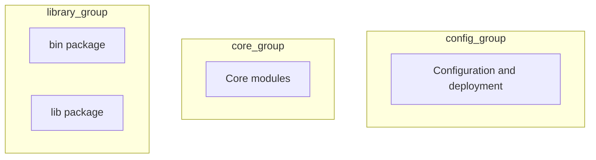

# Architecture report: stylelint/stylelint

> Automated static analysis. **Observed** = directly seen in files/imports/AST; **Inferred** = interpretation from that evidence. Repository code was not executed.

## 1. Repository at a glance

| Item | Value |
| --- | --- |
| Repository | stylelint/stylelint |
| Description | A mighty CSS linter that helps you avoid errors and enforce conventions. |
| Language | JavaScript |
| Stars | 11550 |
| Licence | MIT |
| Analysed commit / branch | ee4f118acae33876a93ced5866872328e36660c2 / main |
| Framework(s) | None detected |
| Files analysed | 797 |
| Components | 4 |

## 2. Architecture in one minute

stylelint/stylelint - A mighty CSS linter that helps you avoid errors and enforce conventions.. This repository was analysed statically from 797 file(s) (0 Python). Detected technologies (observed from imports/manifests): GitHub Actions. Files are grouped into 4 component(s): bin package, Configuration and deployment, Core modules, lib package. Findings below distinguish observed facts from inferred interpretation.

## 3. High-level block diagram

## 4. Main components

### bin package (`bin`)

- **Kind:** library
- **Status:** Observed
- **Confidence:** 0.85
- **Responsibility:** Groups 1 file(s) under bin package (observed from repository paths and static analysis).
- **Paths:** `bin/stylelint.mjs`
- **Evidence:** [bin/stylelint.mjs](https://github.com/stylelint/stylelint/blob/ee4f118acae33876a93ced5866872328e36660c2/bin/stylelint.mjs)

### Configuration and deployment (`config`)

- **Kind:** config
- **Status:** Observed
- **Confidence:** 0.85
- **Responsibility:** Groups 43 file(s) under configuration and deployment (observed from repository paths and static analysis).
- **Paths:** `codecov.yml`, `lib/__tests__/fixtures/config-allow-empty-input.json`, `lib/__tests__/fixtures/config-at-rule-empty-line-before.json`, `lib/__tests__/fixtures/config-block-empty-ok.json`, `lib/__tests__/fixtures/config-block-no-empty-and-color-hex-length-short.json`, `lib/__tests__/fixtures/config-block-no-empty-report-disables.json`, `lib/__tests__/fixtures/config-block-no-empty.json`, `lib/__tests__/fixtures/config-color-named-custom-message.yaml`, `lib/__tests__/fixtures/config-color-no-invalid-hex.json`, `lib/__tests__/fixtures/config-extending-and-ignoring.json`, `lib/__tests__/fixtures/config-extending-another-extend.json`, `lib/__tests__/fixtures/config-extending-one.json`, `lib/__tests__/fixtures/config-extending-three-with-override.json`, `lib/__tests__/fixtures/config-extending-two.json`, `lib/__tests__/fixtures/config-extending-with-plugin.json`, `lib/__tests__/fixtures/config-language-options.json`, `lib/__tests__/fixtures/config-length-zero-no-unit-true.json`, `lib/__tests__/fixtures/config-no-empty-source.json`, `lib/__tests__/fixtures/config-no-pixels.json`, `lib/__tests__/fixtures/config-overrides/at-rule-no-unknown.json`, `lib/__tests__/fixtures/config-overrides/extending-plugin-and-one-rule.json`, `lib/__tests__/fixtures/config-overrides/extending-simple-rule.json`, `lib/__tests__/fixtures/config-overrides/extends-in-overrides.json`, `lib/__tests__/fixtures/config-overrides/number-max-precision-4.json`, `lib/__tests__/fixtures/config-overrides/number-max-precision-8.json`, `lib/__tests__/fixtures/config-overrides/plugin-and-one-rule.json`, `lib/__tests__/fixtures/config-overrides/scss.json`, `lib/__tests__/fixtures/config-overrides/simple-rule.json`, `lib/__tests__/fixtures/config-plugin-extending-with-plugin.json`, `lib/__tests__/fixtures/config-relative-plugin-nested.json`, `lib/__tests__/fixtures/config-relative-plugin.json`, `lib/__tests__/fixtures/config-with-undefined-rule.json`, `lib/__tests__/fixtures/config-without-rules.json`, `lib/__tests__/fixtures/default-severity-warning.json`, `lib/__tests__/fixtures/disableOptions/file-config/.stylelintrc.json`, `lib/__tests__/fixtures/quiet-deprecation-warnings/config.json`, `lib/__tests__/fixtures/suppressions/config-block-color-length-invalid-option.json`, `lib/__tests__/fixtures/suppressions/config-block-color-length.json`, `lib/__tests__/fixtures/suppressions/config-block-no-empty_and_color-invalid.json`, `lib/__tests__/fixtures/suppressions/config-length-zero-no-unit.json`, `lib/__tests__/fixtures/suppressions/existing-suppressions.json`, `lib/__tests__/stylelintignore-test/fixtures/config-block-no-empty.json`, `lib/__tests__/stylelintignore-test/fixtures/config-color-no-invalid-hex.json`
- **Evidence:** [codecov.yml](https://github.com/stylelint/stylelint/blob/ee4f118acae33876a93ced5866872328e36660c2/codecov.yml); [lib/__tests__/fixtures/config-allow-empty-input.json](https://github.com/stylelint/stylelint/blob/ee4f118acae33876a93ced5866872328e36660c2/lib/__tests__/fixtures/config-allow-empty-input.json); [lib/__tests__/fixtures/config-at-rule-empty-line-before.json](https://github.com/stylelint/stylelint/blob/ee4f118acae33876a93ced5866872328e36660c2/lib/__tests__/fixtures/config-at-rule-empty-line-before.json); [lib/__tests__/fixtures/config-block-empty-ok.json](https://github.com/stylelint/stylelint/blob/ee4f118acae33876a93ced5866872328e36660c2/lib/__tests__/fixtures/config-block-empty-ok.json); [lib/__tests__/fixtures/config-block-no-empty-and-color-hex-length-short.json](https://github.com/stylelint/stylelint/blob/ee4f118acae33876a93ced5866872328e36660c2/lib/__tests__/fixtures/config-block-no-empty-and-color-hex-length-short.json); [lib/__tests__/fixtures/config-block-no-empty-report-disables.json](https://github.com/stylelint/stylelint/blob/ee4f118acae33876a93ced5866872328e36660c2/lib/__tests__/fixtures/config-block-no-empty-report-disables.json); [lib/__tests__/fixtures/config-block-no-empty.json](https://github.com/stylelint/stylelint/blob/ee4f118acae33876a93ced5866872328e36660c2/lib/__tests__/fixtures/config-block-no-empty.json); [lib/__tests__/fixtures/config-color-named-custom-message.yaml](https://github.com/stylelint/stylelint/blob/ee4f118acae33876a93ced5866872328e36660c2/lib/__tests__/fixtures/config-color-named-custom-message.yaml)

### Core modules (`core`)

- **Kind:** core
- **Status:** Observed
- **Confidence:** 0.85
- **Responsibility:** Groups 1 file(s) under core modules (observed from repository paths and static analysis).
- **Paths:** `eslint.config.mjs`
- **Evidence:** [eslint.config.mjs](https://github.com/stylelint/stylelint/blob/ee4f118acae33876a93ced5866872328e36660c2/eslint.config.mjs)

### lib package (`lib`)

- **Kind:** library
- **Status:** Observed
- **Confidence:** 0.85
- **Responsibility:** Groups 445 file(s) under lib package (observed from repository paths and static analysis).
- **Paths:** `lib/__tests__/applyOverrides.test.mjs`, `lib/__tests__/cli-suppressions.test.mjs`, `lib/__tests__/cli.test.mjs`, `lib/__tests__/constants.test.mjs`, `lib/__tests__/defaultSeverity.test.mjs`, `lib/__tests__/descriptionlessDisables.test.mjs`, `lib/__tests__/disableRanges-integration.test.mjs`, `lib/__tests__/disableRanges.test.mjs`, `lib/__tests__/extends.test.mjs`, `lib/__tests__/fixtures/broken-syntax/stylelint.config.cjs`, `lib/__tests__/fixtures/config-block-no-empty.mjs`, `lib/__tests__/fixtures/config-extending-with-object.mjs`, `lib/__tests__/fixtures/config-require-unknown.cjs`, `lib/__tests__/fixtures/custom-formatter.cjs`, `lib/__tests__/fixtures/custom-formatter.mjs`, `lib/__tests__/fixtures/custom-parser.cjs`, `lib/__tests__/fixtures/custom-parser.mjs`, `lib/__tests__/fixtures/custom-syntax.cjs`, `lib/__tests__/fixtures/custom-syntax.mjs`, `lib/__tests__/fixtures/plugin-array.mjs`, `lib/__tests__/fixtures/plugin-async.mjs`, `lib/__tests__/fixtures/plugin-bom.mjs`, `lib/__tests__/fixtures/plugin-conditionally-check-color-named.mjs`, `lib/__tests__/fixtures/plugin-fixer-assigns-value.mjs`, `lib/__tests__/fixtures/plugin-fixer-buggy.mjs`, `lib/__tests__/fixtures/plugin-fixer.mjs`, `lib/__tests__/fixtures/plugin-fixers-undo-each-other.mjs`, `lib/__tests__/fixtures/plugin-fixes.mjs`, `lib/__tests__/fixtures/plugin-primary-array.mjs`, `lib/__tests__/fixtures/plugin-slashless-warn-about-foo.mjs`, `lib/__tests__/fixtures/plugin-warn-about-bar.mjs`, `lib/__tests__/fixtures/plugin-warn-about-foo.cjs`, `lib/__tests__/fixtures/plugin-warn-about-foo.mjs`, `lib/__tests__/fixtures/postcss-naive-css-in-js.cjs`, `lib/__tests__/fixtures/postprocess-empty.mjs`, `lib/__tests__/fixtures/postprocess-remap-location.mjs`, `lib/__tests__/fixtures/postprocess-unknown-function.mjs`, `lib/__tests__/fixtures/postprocess-update-text.mjs`, `lib/__tests__/fixtures/processor-not-a-function.mjs`, `lib/__tests__/fixtures/rule-deprecated.mjs`, `lib/__tests__/fixtures/rule-warn-deprecation.mjs`, `lib/__tests__/formatters.test.mjs`, `lib/__tests__/getConfigForFile.test.mjs`, `lib/__tests__/getPostcssResult.test.mjs`, `lib/__tests__/ignore.test.mjs`, `lib/__tests__/ignoreDisables.test.mjs`, `lib/__tests__/integration.test.mjs`, `lib/__tests__/invalidScopeDisables.test.mjs`, `lib/__tests__/isPathIgnored.test.mjs`, `lib/__tests__/languageOptions.test.mjs`, `lib/__tests__/message.test.mjs`, `lib/__tests__/needlessDisables.test.mjs`, `lib/__tests__/normalizeRuleSettings-integration.test.mjs`, `lib/__tests__/normalizeRuleSettings.test.mjs`, `lib/__tests__/overrides.test.mjs`, `lib/__tests__/plugins.test.mjs`, `lib/__tests__/postcssPlugin.test.mjs`, `lib/__tests__/printConfig.test.mjs`, `lib/__tests__/processors.test.mjs`, `lib/__tests__/referenceFiles.test.mjs`, `lib/__tests__/reportDisables.test.mjs`, `lib/__tests__/reportUnknownRuleNames.test.mjs`, `lib/__tests__/require.test.cjs`, `lib/__tests__/resolveConfig.test.mjs`, `lib/__tests__/standalone-abort-signal.test.mjs`, `lib/__tests__/standalone-cache.test.mjs`, `lib/__tests__/standalone-compute-edit-info.test.mjs`, `lib/__tests__/standalone-custom-url.test.mjs`, `lib/__tests__/standalone-deprecations.test.mjs`, `lib/__tests__/standalone-fix.test.mjs`, `lib/__tests__/standalone-formatter.test.mjs`, `lib/__tests__/standalone-glob-parent-test/folder/another-folder/standalone-glob-parent-wildcard.test.mjs`, `lib/__tests__/standalone-glob-parent-test/folder/standalone-glob-parent.test.mjs`, `lib/__tests__/standalone-globs.test.mjs`, `lib/__tests__/standalone-maxWarnings.test.mjs`, `lib/__tests__/standalone-parseErrors.test.mjs`, `lib/__tests__/standalone-quiet-deprecation-warnings.test.mjs`, `lib/__tests__/standalone-quiet.test.mjs`, `lib/__tests__/standalone-syntax.test.mjs`, `lib/__tests__/standalone-timing.test.mjs`, `lib/__tests__/standalone.test.mjs`, `lib/__tests__/stylelintignore-test/stylelintignore.test.mjs`, `lib/__tests__/timing.test.mjs`, `lib/__tests__/unscopedDisables.test.mjs`, `lib/__tests__/validateLanguageOptions.test.mjs`, `lib/__tests__/writeOutputFile.test.mjs`, `lib/assignDisabledRanges.mjs`, `lib/augmentConfig.mjs`, `lib/cli.mjs`, `lib/constants.mjs`, `lib/createPartialStylelintResult.mjs`, `lib/createPlugin.mjs`, `lib/createStylelint.mjs`, `lib/descriptionlessDisables.mjs`, `lib/formatters/__tests__/compactFormatter.test.mjs`, `lib/formatters/__tests__/jsonFormatter.test.mjs`, `lib/formatters/__tests__/stringFormatter.test.mjs`, `lib/formatters/__tests__/tapFormatter.test.mjs`, `lib/formatters/__tests__/terminalLink.test.mjs`, `lib/formatters/__tests__/unixFormatter.test.mjs`, `lib/formatters/__tests__/verboseFormatter.test.mjs`, `lib/formatters/__tests__/wrapText.test.mjs`, `lib/formatters/calcSeverityCounts.mjs`, `lib/formatters/compactFormatter.mjs`, `lib/formatters/index.mjs`, `lib/formatters/jsonFormatter.mjs`, `lib/formatters/preprocessWarnings.mjs`, `lib/formatters/stringFormatter.mjs`, `lib/formatters/tapFormatter.mjs`, `lib/formatters/terminalLink.mjs`, `lib/formatters/unixFormatter.mjs`, `lib/formatters/verboseFormatter.mjs`, `lib/formatters/wrapText.mjs`, `lib/getConfigForFile.mjs`, `lib/getPostcssResult.mjs`, `lib/index.mjs`, `lib/invalidScopeDisables.mjs`, `lib/isPathIgnored.mjs`, `lib/lintPostcssResult.mjs`, `lib/lintSource.mjs`, `lib/needlessDisables.mjs`, `lib/normalizeAllRuleSettings.mjs`, `lib/normalizeRuleSettings.mjs`, `lib/postcssPlugin.mjs`, `lib/prepareReturnValue.mjs`, `lib/printConfig.mjs`, `lib/reference/__tests__/atKeywords.test.mjs`, `lib/reference/atKeywords.mjs`, `lib/reference/functions.mjs`, `lib/reference/keywords.mjs`, `lib/reference/mediaFeatures.mjs`, `lib/reference/mediaTypes.mjs`, `lib/reference/prefixes.mjs`, `lib/reference/properties.mjs`, `lib/reference/selectors.mjs`, `lib/reference/units.mjs`, `lib/reportDisables.mjs`, `lib/reportUnknownRuleNames.mjs`, `lib/resolveConfig.mjs`, `lib/rules/__tests__/index.test.mjs`, `lib/rules/alpha-value-notation/__tests__/index.mjs`, `lib/rules/alpha-value-notation/index.mjs`, `lib/rules/annotation-no-unknown/__tests__/index.mjs`, `lib/rules/annotation-no-unknown/index.mjs`, `lib/rules/at-charset-rule-no-invalid/__tests__/index.mjs`, `lib/rules/at-charset-rule-no-invalid/index.mjs`, `lib/rules/at-rule-allowed-list/__tests__/index.mjs`, `lib/rules/at-rule-allowed-list/index.mjs`, `lib/rules/at-rule-descriptor-no-unknown/__tests__/index.mjs`, `lib/rules/at-rule-descriptor-no-unknown/index.mjs`, `lib/rules/at-rule-descriptor-value-no-unknown/__tests__/index.mjs`, `lib/rules/at-rule-descriptor-value-no-unknown/index.mjs`, `lib/rules/at-rule-disallowed-list/__tests__/index.mjs`, `lib/rules/at-rule-disallowed-list/index.mjs`, `lib/rules/at-rule-empty-line-before/__tests__/index.mjs`, `lib/rules/at-rule-empty-line-before/index.mjs`, `lib/rules/at-rule-no-deprecated/__tests__/index.mjs`, `lib/rules/at-rule-no-deprecated/index.mjs`, `lib/rules/at-rule-no-unknown/__tests__/index.mjs`, `lib/rules/at-rule-no-unknown/index.mjs`, `lib/rules/at-rule-no-vendor-prefix/__tests__/index.mjs`, `lib/rules/at-rule-no-vendor-prefix/index.mjs`, `lib/rules/at-rule-prelude-no-invalid/__tests__/index.mjs`, `lib/rules/at-rule-prelude-no-invalid/index.mjs`, `lib/rules/at-rule-property-required-list/__tests__/index.mjs`, `lib/rules/at-rule-property-required-list/index.mjs`, `lib/rules/block-no-empty/__tests__/index.mjs`, `lib/rules/block-no-empty/index.mjs`, `lib/rules/block-no-redundant-nested-style-rules/__tests__/index.mjs`, `lib/rules/block-no-redundant-nested-style-rules/index.mjs`, `lib/rules/color-function-alias-notation/__tests__/index.mjs`, `lib/rules/color-function-alias-notation/index.mjs`, `lib/rules/color-function-notation/__tests__/index.mjs`, `lib/rules/color-function-notation/index.mjs`, `lib/rules/color-hex-alpha/__tests__/index.mjs`, `lib/rules/color-hex-alpha/index.mjs`, `lib/rules/color-hex-length/__tests__/index.mjs`, `lib/rules/color-hex-length/index.mjs`, `lib/rules/color-named/__tests__/colordUtils.test.mjs`, `lib/rules/color-named/__tests__/index.mjs`, `lib/rules/color-named/colordUtils.mjs`, `lib/rules/color-named/index.mjs`, `lib/rules/color-no-hex/__tests__/index.mjs`, `lib/rules/color-no-hex/index.mjs`, `lib/rules/color-no-invalid-hex/__tests__/index.mjs`, `lib/rules/color-no-invalid-hex/index.mjs`, `lib/rules/comment-empty-line-before/__tests__/index.mjs`, `lib/rules/comment-empty-line-before/index.mjs`, `lib/rules/comment-no-empty/__tests__/index.mjs`, `lib/rules/comment-no-empty/index.mjs`, `lib/rules/comment-pattern/__tests__/index.mjs`, `lib/rules/comment-pattern/index.mjs`, `lib/rules/comment-whitespace-inside/__tests__/index.mjs`, `lib/rules/comment-whitespace-inside/index.mjs`, `lib/rules/comment-word-disallowed-list/__tests__/index.mjs`, `lib/rules/comment-word-disallowed-list/index.mjs`, `lib/rules/container-name-pattern/__tests__/index.mjs`, `lib/rules/container-name-pattern/index.mjs`, `lib/rules/custom-media-pattern/__tests__/index.mjs`, `lib/rules/custom-media-pattern/index.mjs`, `lib/rules/custom-property-empty-line-before/__tests__/index.mjs`, `lib/rules/custom-property-empty-line-before/index.mjs`, `lib/rules/custom-property-no-missing-var-function/__tests__/index.mjs`, `lib/rules/custom-property-no-missing-var-function/index.mjs`, `lib/rules/custom-property-pattern/__tests__/index.mjs`, `lib/rules/custom-property-pattern/index.mjs`, `lib/rules/declaration-block-no-duplicate-custom-properties/__tests__/index.mjs`, `lib/rules/declaration-block-no-duplicate-custom-properties/index.mjs`, `lib/rules/declaration-block-no-duplicate-properties/__tests__/index.mjs`, `lib/rules/declaration-block-no-duplicate-properties/index.mjs`, `lib/rules/declaration-block-no-redundant-longhand-properties/__tests__/index.mjs`, `lib/rules/declaration-block-no-redundant-longhand-properties/index.mjs`, `lib/rules/declaration-block-no-shorthand-property-overrides/__tests__/index.mjs`, `lib/rules/declaration-block-no-shorthand-property-overrides/index.mjs`, `lib/rules/declaration-empty-line-before/__tests__/index.mjs`, `lib/rules/declaration-empty-line-before/index.mjs`, `lib/rules/declaration-no-important/__tests__/index.mjs`, `lib/rules/declaration-no-important/index.mjs`, `lib/rules/declaration-property-custom-property-allowed-list/__tests__/index.mjs`, `lib/rules/declaration-property-custom-property-allowed-list/index.mjs`, `lib/rules/declaration-property-max-values/__tests__/index.mjs`, `lib/rules/declaration-property-max-values/index.mjs`, `lib/rules/declaration-property-unit-allowed-list/__tests__/index.mjs`, `lib/rules/declaration-property-unit-allowed-list/index.mjs`, `lib/rules/declaration-property-unit-disallowed-list/__tests__/index.mjs`, `lib/rules/declaration-property-unit-disallowed-list/index.mjs`, `lib/rules/declaration-property-value-allowed-list/__tests__/index.mjs`, `lib/rules/declaration-property-value-allowed-list/index.mjs`, `lib/rules/declaration-property-value-disallowed-list/__tests__/index.mjs`, `lib/rules/declaration-property-value-disallowed-list/index.mjs`, `lib/rules/declaration-property-value-keyword-no-deprecated/__tests__/index.mjs`, `lib/rules/declaration-property-value-keyword-no-deprecated/index.mjs`, `lib/rules/declaration-property-value-no-unknown/__tests__/index.mjs`, `lib/rules/declaration-property-value-no-unknown/index.mjs`, `lib/rules/display-notation/__tests__/index.mjs`, `lib/rules/display-notation/index.mjs`, `lib/rules/font-family-name-quotes/__tests__/index.mjs`, `lib/rules/font-family-name-quotes/index.mjs`, `lib/rules/font-family-no-duplicate-names/__tests__/index.mjs`, `lib/rules/font-family-no-duplicate-names/index.mjs`, `lib/rules/font-family-no-missing-generic-family-keyword/__tests__/index.mjs`, `lib/rules/font-family-no-missing-generic-family-keyword/index.mjs`, `lib/rules/font-weight-notation/__tests__/index.mjs`, `lib/rules/font-weight-notation/index.mjs`, `lib/rules/function-allowed-list/__tests__/index.mjs`, `lib/rules/function-allowed-list/index.mjs`, `lib/rules/function-calc-no-unspaced-operator/__tests__/index.mjs`, `lib/rules/function-calc-no-unspaced-operator/index.mjs`, `lib/rules/function-disallowed-list/__tests__/index.mjs`, `lib/rules/function-disallowed-list/index.mjs`, `lib/rules/function-linear-gradient-no-nonstandard-direction/__tests__/index.mjs`, `lib/rules/function-linear-gradient-no-nonstandard-direction/index.mjs`, `lib/rules/function-name-case/__tests__/index.mjs`, `lib/rules/function-name-case/index.mjs`, `lib/rules/function-no-unknown/__tests__/index.mjs`, `lib/rules/function-no-unknown/index.mjs`, `lib/rules/function-url-no-scheme-relative/__tests__/index.mjs`, `lib/rules/function-url-no-scheme-relative/index.mjs`, `lib/rules/function-url-quotes/__tests__/index.mjs`, `lib/rules/function-url-quotes/index.mjs`, `lib/rules/function-url-scheme-allowed-list/__tests__/index.mjs`, `lib/rules/function-url-scheme-allowed-list/index.mjs`, `lib/rules/function-url-scheme-disallowed-list/__tests__/index.mjs`, `lib/rules/function-url-scheme-disallowed-list/index.mjs`, `lib/rules/hue-degree-notation/__tests__/index.mjs`, `lib/rules/hue-degree-notation/index.mjs`, `lib/rules/import-notation/__tests__/index.mjs`, `lib/rules/import-notation/index.mjs`, `lib/rules/index.mjs`, `lib/rules/keyframe-block-no-duplicate-selectors/__tests__/index.mjs`, `lib/rules/keyframe-block-no-duplicate-selectors/index.mjs`, `lib/rules/keyframe-declaration-no-important/__tests__/index.mjs`, `lib/rules/keyframe-declaration-no-important/index.mjs`, `lib/rules/keyframe-selector-notation/__tests__/index.mjs`, `lib/rules/keyframe-selector-notation/index.mjs`, `lib/rules/keyframes-name-pattern/__tests__/index.mjs`, `lib/rules/keyframes-name-pattern/index.mjs`, `lib/rules/layer-name-pattern/__tests__/index.mjs`, `lib/rules/layer-name-pattern/index.mjs`, `lib/rules/length-zero-no-unit/__tests__/index.mjs`, `lib/rules/length-zero-no-unit/index.mjs`, `lib/rules/lightness-notation/__tests__/index.mjs`, `lib/rules/lightness-notation/index.mjs`, `lib/rules/max-nesting-depth/__tests__/index.mjs`, `lib/rules/max-nesting-depth/index.mjs`, `lib/rules/media-feature-name-allowed-list/__tests__/index.mjs`, `lib/rules/media-feature-name-allowed-list/index.mjs`, `lib/rules/media-feature-name-disallowed-list/__tests__/index.mjs`, `lib/rules/media-feature-name-disallowed-list/index.mjs`, `lib/rules/media-feature-name-no-unknown/__tests__/index.mjs`, `lib/rules/media-feature-name-no-unknown/index.mjs`, `lib/rules/media-feature-name-no-vendor-prefix/__tests__/index.mjs`, `lib/rules/media-feature-name-no-vendor-prefix/index.mjs`, `lib/rules/media-feature-name-unit-allowed-list/__tests__/index.mjs`, `lib/rules/media-feature-name-unit-allowed-list/index.mjs`, `lib/rules/media-feature-name-value-allowed-list/__tests__/index.mjs`, `lib/rules/media-feature-name-value-allowed-list/index.mjs`, `lib/rules/media-feature-name-value-no-unknown/__tests__/index.mjs`, `lib/rules/media-feature-name-value-no-unknown/index.mjs`, `lib/rules/media-feature-range-notation/__tests__/index.mjs`, `lib/rules/media-feature-range-notation/index.mjs`, `lib/rules/media-query-no-invalid/__tests__/index.mjs`, `lib/rules/media-query-no-invalid/index.mjs`, `lib/rules/media-type-no-deprecated/__tests__/index.mjs`, `lib/rules/media-type-no-deprecated/index.mjs`, `lib/rules/named-grid-areas-no-invalid/__tests__/index.mjs`, `lib/rules/named-grid-areas-no-invalid/index.mjs`, `lib/rules/named-grid-areas-no-invalid/utils/__tests__/findNotContiguousOrRectangular.test.mjs`, `lib/rules/named-grid-areas-no-invalid/utils/findNotContiguousOrRectangular.mjs`, `lib/rules/nesting-selector-no-missing-scoping-root/__tests__/index.mjs`, `lib/rules/nesting-selector-no-missing-scoping-root/index.mjs`, `lib/rules/no-descending-specificity/__tests__/index.mjs`, `lib/rules/no-descending-specificity/index.mjs`, `lib/rules/no-duplicate-at-import-rules/__tests__/index.mjs`, `lib/rules/no-duplicate-at-import-rules/index.mjs`, `lib/rules/no-duplicate-selectors/__tests__/index.mjs`, `lib/rules/no-duplicate-selectors/index.mjs`, `lib/rules/no-empty-source/__tests__/index.mjs`, `lib/rules/no-empty-source/index.mjs`, `lib/rules/no-invalid-double-slash-comments/__tests__/index.mjs`, `lib/rules/no-invalid-double-slash-comments/index.mjs`, `lib/rules/no-invalid-position-at-import-rule/__tests__/index.mjs`, `lib/rules/no-invalid-position-at-import-rule/index.mjs`, `lib/rules/no-invalid-position-declaration/__tests__/index.mjs`, `lib/rules/no-invalid-position-declaration/index.mjs`, `lib/rules/no-irregular-whitespace/__tests__/index.mjs`, `lib/rules/no-irregular-whitespace/index.mjs`, `lib/rules/no-unknown-animations/__tests__/index.mjs`, `lib/rules/no-unknown-animations/index.mjs`, `lib/rules/no-unknown-custom-media/__tests__/index.mjs`, `lib/rules/no-unknown-custom-media/index.mjs`, `lib/rules/no-unknown-custom-properties/__tests__/index.mjs`, `lib/rules/no-unknown-custom-properties/index.mjs`, `lib/rules/number-max-precision/__tests__/index.mjs`, `lib/rules/number-max-precision/index.mjs`, `lib/rules/property-allowed-list/__tests__/index.mjs`, `lib/rules/property-allowed-list/index.mjs`, `lib/rules/property-disallowed-list/__tests__/index.mjs`, `lib/rules/property-disallowed-list/index.mjs`, `lib/rules/property-layout-mappings/__tests__/index.mjs`, `lib/rules/property-layout-mappings/index.mjs`, `lib/rules/property-no-deprecated/__tests__/index.mjs`, `lib/rules/property-no-deprecated/index.mjs`, `lib/rules/property-no-unknown/__tests__/index.mjs`, `lib/rules/property-no-unknown/index.mjs`, `lib/rules/property-no-vendor-prefix/__tests__/index.mjs`, `lib/rules/property-no-vendor-prefix/index.mjs`, `lib/rules/relative-selector-nesting-notation/__tests__/index.mjs`, `lib/rules/relative-selector-nesting-notation/index.mjs`, `lib/rules/rule-empty-line-before/__tests__/index.mjs`, `lib/rules/rule-empty-line-before/index.mjs`, `lib/rules/rule-nesting-at-rule-required-list/__tests__/index.mjs`, `lib/rules/rule-nesting-at-rule-required-list/index.mjs`, `lib/rules/rule-selector-property-disallowed-list/__tests__/index.mjs`, `lib/rules/rule-selector-property-disallowed-list/index.mjs`, `lib/rules/selector-anb-no-unmatchable/__tests__/index.mjs`, `lib/rules/selector-anb-no-unmatchable/index.mjs`, `lib/rules/selector-attribute-name-disallowed-list/__tests__/index.mjs`, `lib/rules/selector-attribute-name-disallowed-list/index.mjs`, `lib/rules/selector-attribute-operator-allowed-list/__tests__/index.mjs`, `lib/rules/selector-attribute-operator-allowed-list/index.mjs`, `lib/rules/selector-attribute-operator-disallowed-list/__tests__/index.mjs`, `lib/rules/selector-attribute-operator-disallowed-list/index.mjs`, `lib/rules/selector-attribute-quotes/__tests__/index.mjs`, `lib/rules/selector-attribute-quotes/index.mjs`, `lib/rules/selector-class-pattern/__tests__/index.mjs`, `lib/rules/selector-class-pattern/index.mjs`, `lib/rules/selector-combinator-allowed-list/__tests__/index.mjs`, `lib/rules/selector-combinator-allowed-list/index.mjs`, `lib/rules/selector-combinator-disallowed-list/__tests__/index.mjs`, `lib/rules/selector-combinator-disallowed-list/index.mjs`, `lib/rules/selector-disallowed-list/__tests__/index.mjs`, `lib/rules/selector-disallowed-list/index.mjs`, `lib/rules/selector-id-pattern/__tests__/index.mjs`, `lib/rules/selector-id-pattern/index.mjs`, `lib/rules/selector-max-attribute/__tests__/index.mjs`, `lib/rules/selector-max-attribute/index.mjs`, `lib/rules/selector-max-class/__tests__/index.mjs`, `lib/rules/selector-max-class/index.mjs`, `lib/rules/selector-max-combinators/__tests__/index.mjs`, `lib/rules/selector-max-combinators/index.mjs`, `lib/rules/selector-max-compound-selectors/__tests__/index.mjs`, `lib/rules/selector-max-compound-selectors/index.mjs`, `lib/rules/selector-max-id/__tests__/index.mjs`, `lib/rules/selector-max-id/index.mjs`, `lib/rules/selector-max-pseudo-class/__tests__/index.mjs`, `lib/rules/selector-max-pseudo-class/index.mjs`, `lib/rules/selector-max-specificity/__tests__/index.mjs`, `lib/rules/selector-max-specificity/index.mjs`, `lib/rules/selector-max-type/__tests__/index.mjs`, `lib/rules/selector-max-type/index.mjs`, `lib/rules/selector-max-universal/__tests__/index.mjs`, `lib/rules/selector-max-universal/index.mjs`, `lib/rules/selector-nested-pattern/__tests__/index.mjs`, `lib/rules/selector-nested-pattern/index.mjs`, `lib/rules/selector-no-deprecated/__tests__/index.mjs`, `lib/rules/selector-no-deprecated/index.mjs`, `lib/rules/selector-no-invalid/__tests__/index.mjs`, `lib/rules/selector-no-invalid/index.mjs`, `lib/rules/selector-no-qualifying-type/__tests__/index.mjs`, `lib/rules/selector-no-qualifying-type/index.mjs`, `lib/rules/selector-no-unmatchable/__tests__/index.mjs`, `lib/rules/selector-no-unmatchable/index.mjs`, `lib/rules/selector-no-vendor-prefix/__tests__/index.mjs`, `lib/rules/selector-no-vendor-prefix/index.mjs`, `lib/rules/selector-not-notation/__tests__/index.mjs`, `lib/rules/selector-not-notation/index.mjs`, `lib/rules/selector-pseudo-class-allowed-list/__tests__/index.mjs`, `lib/rules/selector-pseudo-class-allowed-list/index.mjs`, `lib/rules/selector-pseudo-class-disallowed-list/__tests__/index.mjs`, `lib/rules/selector-pseudo-class-disallowed-list/index.mjs`, `lib/rules/selector-pseudo-class-no-unknown/__tests__/index.mjs`, `lib/rules/selector-pseudo-class-no-unknown/index.mjs`, `lib/rules/selector-pseudo-element-allowed-list/__tests__/index.mjs`, `lib/rules/selector-pseudo-element-allowed-list/index.mjs`, `lib/rules/selector-pseudo-element-colon-notation/__tests__/index.mjs`, `lib/rules/selector-pseudo-element-colon-notation/index.mjs`, `lib/rules/selector-pseudo-element-disallowed-list/__tests__/index.mjs`, `lib/rules/selector-pseudo-element-disallowed-list/index.mjs`, `lib/rules/selector-pseudo-element-no-unknown/__tests__/index.mjs`, `lib/rules/selector-pseudo-element-no-unknown/index.mjs`, `lib/rules/selector-type-case/__tests__/index.mjs`, `lib/rules/selector-type-case/index.mjs`, `lib/rules/selector-type-no-unknown/__tests__/index.mjs`, `lib/rules/selector-type-no-unknown/index.mjs`, `lib/rules/shorthand-property-no-redundant-values/__tests__/index.mjs`, `lib/rules/shorthand-property-no-redundant-values/index.mjs`, `lib/rules/string-no-newline/__tests__/index.mjs`, `lib/rules/string-no-newline/index.mjs`, `lib/rules/syntax-string-no-invalid/__tests__/index.mjs`, `lib/rules/syntax-string-no-invalid/index.mjs`, `lib/rules/time-min-milliseconds/__tests__/index.mjs`, `lib/rules/time-min-milliseconds/index.mjs`, `lib/rules/unit-allowed-list/__tests__/index.mjs`, `lib/rules/unit-allowed-list/index.mjs`, `lib/rules/unit-disallowed-list/__tests__/index.mjs`, `lib/rules/unit-disallowed-list/index.mjs`, `lib/rules/unit-layout-mappings/__tests__/index.mjs`, `lib/rules/unit-layout-mappings/index.mjs`, `lib/rules/unit-no-unknown/__tests__/index.mjs`, `lib/rules/unit-no-unknown/index.mjs`, `lib/rules/value-keyword-case/__tests__/index.mjs`, `lib/rules/value-keyword-case/index.mjs`, `lib/rules/value-keyword-layout-mappings/__tests__/index.mjs`, `lib/rules/value-keyword-layout-mappings/index.mjs`
- **Evidence:** [lib/__tests__/applyOverrides.test.mjs](https://github.com/stylelint/stylelint/blob/ee4f118acae33876a93ced5866872328e36660c2/lib/__tests__/applyOverrides.test.mjs); [lib/__tests__/cli-suppressions.test.mjs](https://github.com/stylelint/stylelint/blob/ee4f118acae33876a93ced5866872328e36660c2/lib/__tests__/cli-suppressions.test.mjs); [lib/__tests__/cli.test.mjs](https://github.com/stylelint/stylelint/blob/ee4f118acae33876a93ced5866872328e36660c2/lib/__tests__/cli.test.mjs); [lib/__tests__/constants.test.mjs](https://github.com/stylelint/stylelint/blob/ee4f118acae33876a93ced5866872328e36660c2/lib/__tests__/constants.test.mjs); [lib/__tests__/defaultSeverity.test.mjs](https://github.com/stylelint/stylelint/blob/ee4f118acae33876a93ced5866872328e36660c2/lib/__tests__/defaultSeverity.test.mjs); [lib/__tests__/descriptionlessDisables.test.mjs](https://github.com/stylelint/stylelint/blob/ee4f118acae33876a93ced5866872328e36660c2/lib/__tests__/descriptionlessDisables.test.mjs); [lib/__tests__/disableRanges-integration.test.mjs](https://github.com/stylelint/stylelint/blob/ee4f118acae33876a93ced5866872328e36660c2/lib/__tests__/disableRanges-integration.test.mjs); [lib/__tests__/disableRanges.test.mjs](https://github.com/stylelint/stylelint/blob/ee4f118acae33876a93ced5866872328e36660c2/lib/__tests__/disableRanges.test.mjs)

## 5. Execution flow

No entry point was observed; the startup flow below is therefore limited.

Representative flow (derived from observed entry points and the import graph; steps beyond the entry point are **Inferred**):

1. Execution starts at an observed entry point listed above, if present.
2. No internal import relationships between components were observed.

## 6. Project structure

### `(root)`

- `.codespellrc` - other (144 bytes)
- `.editorconfig` - config (256 bytes)
- `.gitattributes` - other (27 bytes)
- `.gitignore` - other (244 bytes)
- `.prettierignore` - other (494 bytes)
- `.remarkignore` - other (8 bytes)
- `CONTRIBUTING.md` - docs (5487 bytes)
- `LICENSE` - docs (1123 bytes)
- `README.md` - docs (4848 bytes)
- `SUPPORT.md` - docs (568 bytes)
- `codecov.yml` - config (132 bytes)
- `eslint.config.mjs` - source, JavaScript (614 bytes)

### `.changeset`

- `.changeset/README.md` - docs (510 bytes)
- `.changeset/better-years-greet.md` - docs (135 bytes)
- `.changeset/changelog-stylelint.mjs` - source, JavaScript (1837 bytes)
- `.changeset/changelog-stylelint.test.mjs` - source, JavaScript (4700 bytes)
- `.changeset/config.json` - config (268 bytes)
- `.changeset/early-moments-attend.md` - docs (136 bytes)
- `.changeset/fair-seals-camp.md` - docs (83 bytes)
- `.changeset/full-taxis-grow.md` - docs (66 bytes)
- `.changeset/gentle-lizards-crash.md` - docs (206 bytes)
- `.changeset/get-github-info.mock.mjs` - source, JavaScript (155 bytes)
- `.changeset/legal-colts-attend.md` - docs (147 bytes)
- `.changeset/puny-monkeys-draw.md` - docs (102 bytes)
- `.changeset/rewrite-changelog.mjs` - source, JavaScript (1982 bytes)
- `.changeset/smart-jars-decide.md` - docs (86 bytes)
- `.changeset/twenty-flowers-retire.md` - docs (79 bytes)

### `.githooks`

- `.githooks/pre-commit` - other (40 bytes)

### `.github`

- `.github/CODEOWNERS` - other (408 bytes)
- `.github/ISSUE_TEMPLATE/REPORT_A_BUG.yml` - config (3286 bytes)
- `.github/ISSUE_TEMPLATE/REPORT_A_DOCS_ISSUE.yml` - config (520 bytes)
- `.github/ISSUE_TEMPLATE/REQUEST_A_FEATURE.yml` - config (511 bytes)
- `.github/dependabot.yml` - config (1264 bytes)
- `.github/workflows/ci.yml` - ci, YAML (3291 bytes)
- `.github/workflows/close-unknown-effort-prs.yml` - ci, YAML (2103 bytes)
- `.github/workflows/comment-on-old-issues.yml` - ci, YAML (1209 bytes)
- `.github/workflows/publish-to-pkg.pr.new.yml` - ci, YAML (1683 bytes)
- `.github/workflows/release-pr.yml` - ci, YAML (334 bytes)
- `.github/workflows/release.yml` - ci, YAML (308 bytes)
- `.github/workflows/update-pkg.pr.new-comment.yml` - ci, YAML (1915 bytes)

### `bin`

- `bin/stylelint.mjs` - source, JavaScript (121 bytes)

### `docs`

- `docs/about/governance.md` - docs (1375 bytes)
- `docs/about/semantic-versioning.md` - docs (1552 bytes)
- `docs/about/vision.md` - docs (1707 bytes)
- `docs/contributor-guide/benchmarks.md` - docs (9631 bytes)
- `docs/contributor-guide/glossary.md` - docs (2662 bytes)
- `docs/contributor-guide/rules.md` - docs (17959 bytes)
- `docs/contributor-guide/system-tests.md` - docs (1190 bytes)
- `docs/developer-guide/formatters.md` - docs (1673 bytes)
- `docs/developer-guide/plugins.md` - docs (12736 bytes)
- `docs/developer-guide/syntaxes.md` - docs (1847 bytes)
- `docs/maintainer-guide/issues.md` - docs (4396 bytes)
- `docs/maintainer-guide/pull-requests.md` - docs (1715 bytes)
- `docs/maintainer-guide/releases.md` - docs (2352 bytes)
- `docs/migration-guide/to-14.md` - docs (7230 bytes)
- `docs/migration-guide/to-15.md` - docs (10204 bytes)
- `docs/migration-guide/to-16.md` - docs (11617 bytes)
- `docs/migration-guide/to-17.md` - docs (13614 bytes)
- `docs/migration-guide/to-18.md` - docs (18893 bytes)
- `docs/user-guide/cli.md` - docs (8687 bytes)
- `docs/user-guide/configure.md` - docs (28813 bytes)
- `docs/user-guide/customize.md` - docs (9711 bytes)
- `docs/user-guide/errors.md` - docs (2466 bytes)
- `docs/user-guide/get-started.md` - docs (4514 bytes)
- `docs/user-guide/ignore-code.md` - docs (3245 bytes)
- `docs/user-guide/node-api.md` - docs (8904 bytes)
- `docs/user-guide/options.md` - docs (11057 bytes)
- `docs/user-guide/postcss-plugin.md` - docs (3042 bytes)
- `docs/user-guide/rules.md` - docs (28508 bytes)
- `docs/user-guide/suppressions.md` - docs (1394 bytes)

### `identity`

- `identity/credits.md` - docs (261 bytes)
- `identity/stylelint-icon-and-text-white-square.svg` - other (11227 bytes)
- `identity/stylelint-icon-black.svg` - other (1290 bytes)
- `identity/stylelint-icon-white.svg` - other (1351 bytes)
- `identity/stylelint-text-black.svg` - other (5664 bytes)
- `identity/stylelint-text-white.svg` - other (5646 bytes)

### `lib`

- `lib/__tests__/.stylelintignore` - other (27 bytes)
- `lib/__tests__/applyOverrides.test.mjs` - source, JavaScript (10060 bytes)
- `lib/__tests__/cli-suppressions.test.mjs` - source, JavaScript (17801 bytes)
- `lib/__tests__/cli.test.mjs` - source, JavaScript (29264 bytes)
- `lib/__tests__/cli.test.mjs.snapshot` - other (7125 bytes)
- `lib/__tests__/constants.test.mjs` - source, JavaScript (421 bytes)
- `lib/__tests__/defaultSeverity.test.mjs` - source, JavaScript (1570 bytes)
- `lib/__tests__/descriptionlessDisables.test.mjs` - source, JavaScript (7791 bytes)
- `lib/__tests__/disableRanges-integration.test.mjs` - source, JavaScript (6866 bytes)
- `lib/__tests__/disableRanges.test.mjs` - source, JavaScript (22515 bytes)
- `lib/__tests__/extends.test.mjs` - source, JavaScript (5168 bytes)
- `lib/__tests__/fixtures/at-rule-empty-line-before.html` - other (122 bytes)
- `lib/__tests__/fixtures/broken-syntax/broken-syntax.css` - other (2 bytes)
- `lib/__tests__/fixtures/broken-syntax/correct-syntax.css` - other (5 bytes)
- `lib/__tests__/fixtures/broken-syntax/stylelint.config.cjs` - source, JavaScript (82 bytes)
- `lib/__tests__/fixtures/cache/valid.css` - other (47 bytes)
- `lib/__tests__/fixtures/comment-empty-line-before.html` - other (95 bytes)
- `lib/__tests__/fixtures/config-allow-empty-input.json` - config (43 bytes)
- `lib/__tests__/fixtures/config-at-rule-empty-line-before.json` - config (139 bytes)
- `lib/__tests__/fixtures/config-block-empty-ok.json` - config (44 bytes)
- `lib/__tests__/fixtures/config-block-no-empty-and-color-hex-length-short.json` - config (75 bytes)
- `lib/__tests__/fixtures/config-block-no-empty-report-disables.json` - config (74 bytes)
- `lib/__tests__/fixtures/config-block-no-empty.json` - config (44 bytes)
- `lib/__tests__/fixtures/config-block-no-empty.mjs` - source, JavaScript (60 bytes)
- `lib/__tests__/fixtures/config-color-named-custom-message.yaml` - config (66 bytes)
- `lib/__tests__/fixtures/config-color-no-invalid-hex.json` - config (50 bytes)
- `lib/__tests__/fixtures/config-extending-and-ignoring.json` - config (85 bytes)
- `lib/__tests__/fixtures/config-extending-another-extend.json` - config (46 bytes)
- `lib/__tests__/fixtures/config-extending-one.json` - config (47 bytes)
- `lib/__tests__/fixtures/config-extending-three-with-override.json` - config (128 bytes)
- `lib/__tests__/fixtures/config-extending-two.json` - config (87 bytes)
- `lib/__tests__/fixtures/config-extending-with-object.mjs` - source, JavaScript (113 bytes)
- `lib/__tests__/fixtures/config-extending-with-plugin.json` - config (81 bytes)
- `lib/__tests__/fixtures/config-language-options.json` - config (715 bytes)
- `lib/__tests__/fixtures/config-length-zero-no-unit-true.json` - config (49 bytes)
- `lib/__tests__/fixtures/config-no-empty-source.json` - config (45 bytes)
- `lib/__tests__/fixtures/config-no-pixels.json` - config (52 bytes)
- `lib/__tests__/fixtures/config-overrides/at-rule-no-unknown.json` - config (48 bytes)
- `lib/__tests__/fixtures/config-overrides/extending-plugin-and-one-rule.json` - config (240 bytes)
- `lib/__tests__/fixtures/config-overrides/extending-simple-rule.json` - config (175 bytes)
- `lib/__tests__/fixtures/config-overrides/extends-in-overrides.json` - config (113 bytes)
- `lib/__tests__/fixtures/config-overrides/number-max-precision-4.json` - config (47 bytes)
- `lib/__tests__/fixtures/config-overrides/number-max-precision-8.json` - config (47 bytes)
- `lib/__tests__/fixtures/config-overrides/plugin-and-one-rule.json` - config (198 bytes)
- `lib/__tests__/fixtures/config-overrides/precision.css` - other (26 bytes)
- `lib/__tests__/fixtures/config-overrides/scss.json` - config (48 bytes)
- `lib/__tests__/fixtures/config-overrides/simple-rule.json` - config (60 bytes)
- `lib/__tests__/fixtures/config-overrides/style.css` - other (33 bytes)
- `lib/__tests__/fixtures/config-overrides/style.module.css` - other (40 bytes)
- `lib/__tests__/fixtures/config-overrides/style.scss` - other (21 bytes)
- `lib/__tests__/fixtures/config-overrides/testPrintConfig/.stylelintrc` - other (48 bytes)
- `lib/__tests__/fixtures/config-overrides/testPrintConfig/style.css` - other (33 bytes)
- `lib/__tests__/fixtures/config-per-file/a/.stylelintrc` - other (44 bytes)
- `lib/__tests__/fixtures/config-per-file/a/a.css` - other (0 bytes)
- `lib/__tests__/fixtures/config-per-file/a/b/.stylelintrc` - other (44 bytes)
- `lib/__tests__/fixtures/config-per-file/a/b/b.css` - other (5 bytes)
- `lib/__tests__/fixtures/config-per-file/a/b/c/.stylelintrc` - other (44 bytes)
- `lib/__tests__/fixtures/config-per-file/a/b/c/c.css` - other (5 bytes)
- `lib/__tests__/fixtures/config-per-file/a/b/c/d/d.css` - other (5 bytes)
- `lib/__tests__/fixtures/config-plugin-extending-with-plugin.json` - config (142 bytes)
- `lib/__tests__/fixtures/config-reference-files/document.html` - other (271 bytes)
- `lib/__tests__/fixtures/config-reference-files/entrypoint.css` - other (40 bytes)
- `lib/__tests__/fixtures/config-reference-files/malformed.css` - other (2 bytes)
- `lib/__tests__/fixtures/config-reference-files/ordered/a.css` - other (66 bytes)
- `lib/__tests__/fixtures/config-reference-files/ordered/b.css` - other (42 bytes)
- `lib/__tests__/fixtures/config-reference-files/ordered/entrypoint.css` - other (48 bytes)
- `lib/__tests__/fixtures/config-reference-files/test.css` - other (27 bytes)
- `lib/__tests__/fixtures/config-reference-files/test.module.css` - other (27 bytes)
- `lib/__tests__/fixtures/config-reference-files/tokens.css` - other (163 bytes)
- `lib/__tests__/fixtures/config-reference-files/tokens.scss` - other (31 bytes)
- `lib/__tests__/fixtures/config-reference-files/tokens/animations.css` - other (18 bytes)
- `lib/__tests__/fixtures/config-relative-plugin-nested.json` - config (103 bytes)
- `lib/__tests__/fixtures/config-relative-plugin.json` - config (100 bytes)
- `lib/__tests__/fixtures/config-require-unknown.cjs` - source, JavaScript (109 bytes)
- `lib/__tests__/fixtures/config-with-undefined-rule.json` - config (42 bytes)
- `lib/__tests__/fixtures/config-without-rules.json` - config (3 bytes)
- `lib/__tests__/fixtures/custom-formatter.cjs` - source, JavaScript (125 bytes)
- `lib/__tests__/fixtures/custom-formatter.mjs` - source, JavaScript (117 bytes)
- `lib/__tests__/fixtures/custom-parser.cjs` - source, JavaScript (64 bytes)
- `lib/__tests__/fixtures/custom-parser.mjs` - source, JavaScript (74 bytes)
- `lib/__tests__/fixtures/custom-syntax.cjs` - source, JavaScript (145 bytes)
- `lib/__tests__/fixtures/custom-syntax.mjs` - source, JavaScript (102 bytes)
- `lib/__tests__/fixtures/default-severity-warning.json` - config (75 bytes)
- `lib/__tests__/fixtures/disableOptions/.stylelintignore` - other (81 bytes)
- `lib/__tests__/fixtures/disableOptions/disabled-ranges-1.css` - other (280 bytes)
- `lib/__tests__/fixtures/disableOptions/disabled-ranges-2.css` - other (286 bytes)
- `lib/__tests__/fixtures/disableOptions/disabled-ranges-3.css` - other (4 bytes)
- `lib/__tests__/fixtures/disableOptions/file-config/.stylelintrc.json` - config (44 bytes)
- `lib/__tests__/fixtures/disableOptions/file-config/disabled-ranges-1.css` - other (105 bytes)
- `lib/__tests__/fixtures/disableOptions/ignored-file.css` - other (131 bytes)
- `lib/__tests__/fixtures/empty-block-with-disables.css` - other (41 bytes)
- `lib/__tests__/fixtures/empty-block-with-relevant-disable.css` - other (44 bytes)
- `lib/__tests__/fixtures/empty-block.css` - other (65 bytes)
- `lib/__tests__/fixtures/fix.css` - other (248 bytes)
- `lib/__tests__/fixtures/getConfigForFile/a/.stylelintrc` - other (73 bytes)
- `lib/__tests__/fixtures/getConfigForFile/a/b/foo.css` - other (5 bytes)
- `lib/__tests__/fixtures/globby-options/.dot/empty-block.css` - other (5 bytes)
- `lib/__tests__/fixtures/globs/[digit]/not-digits/styles.css` - other (5 bytes)
- `lib/__tests__/fixtures/globs/a(b)/styles.css` - other (5 bytes)
- `lib/__tests__/fixtures/globs/extglob!(s)/styles.css` - other (5 bytes)
- `lib/__tests__/fixtures/globs/glob+chars/glob-plus.css` - other (5 bytes)
- `lib/__tests__/fixtures/globs/glob-contains-plus/styles.css` - other (5 bytes)
- `lib/__tests__/fixtures/globs/got!negate/negate/styles.css` - other (5 bytes)
- `lib/__tests__/fixtures/globs/got[braces] and (spaces)/styles.css` - other (5 bytes)
- `lib/__tests__/fixtures/globs/negated-globs/ignore/ignore-this-file.css` - other (5 bytes)
- `lib/__tests__/fixtures/globs/negated-globs/lint-this-file.css` - other (5 bytes)
- `lib/__tests__/fixtures/globs/with spaces/styles.css` - other (5 bytes)
- `lib/__tests__/fixtures/ignore-2.txt` - docs (100 bytes)
- `lib/__tests__/fixtures/ignore.txt` - docs (86 bytes)
- `lib/__tests__/fixtures/invalid-hex.css` - other (24 bytes)
- `lib/__tests__/fixtures/invalid-hex.html` - other (159 bytes)
- `lib/__tests__/fixtures/invalid-hex.scss` - other (40 bytes)
- `lib/__tests__/fixtures/no-empty-source.html` - other (198 bytes)
- `lib/__tests__/fixtures/plugin-array.mjs` - source, JavaScript (222 bytes)
- `lib/__tests__/fixtures/plugin-async.mjs` - source, JavaScript (541 bytes)
- `lib/__tests__/fixtures/plugin-bom.mjs` - source, JavaScript (925 bytes)
- `lib/__tests__/fixtures/plugin-conditionally-check-color-named.mjs` - source, JavaScript (477 bytes)
- `lib/__tests__/fixtures/plugin-fixer-assigns-value.mjs` - source, JavaScript (801 bytes)
- `lib/__tests__/fixtures/plugin-fixer-buggy.mjs` - source, JavaScript (930 bytes)
- `lib/__tests__/fixtures/plugin-fixer.mjs` - source, JavaScript (996 bytes)
- `lib/__tests__/fixtures/plugin-fixers-undo-each-other.mjs` - source, JavaScript (1130 bytes)
- `lib/__tests__/fixtures/plugin-fixes.mjs` - source, JavaScript (1203 bytes)
- `lib/__tests__/fixtures/plugin-primary-array.mjs` - source, JavaScript (389 bytes)
- `lib/__tests__/fixtures/plugin-slashless-warn-about-foo.mjs` - source, JavaScript (548 bytes)
- `lib/__tests__/fixtures/plugin-warn-about-bar.mjs` - source, JavaScript (542 bytes)
- `lib/__tests__/fixtures/plugin-warn-about-foo.cjs` - source, JavaScript (770 bytes)
- `lib/__tests__/fixtures/plugin-warn-about-foo.mjs` - source, JavaScript (763 bytes)
- `lib/__tests__/fixtures/postcss-naive-css-in-js.cjs` - source, JavaScript (1157 bytes)
- `lib/__tests__/fixtures/postprocess-empty.mjs` - source, JavaScript (57 bytes)
- `lib/__tests__/fixtures/postprocess-remap-location.mjs` - source, JavaScript (259 bytes)
- `lib/__tests__/fixtures/postprocess-unknown-function.mjs` - source, JavaScript (134 bytes)
- `lib/__tests__/fixtures/postprocess-update-text.mjs` - source, JavaScript (803 bytes)
- `lib/__tests__/fixtures/processor-not-a-function.mjs` - source, JavaScript (19 bytes)
- `lib/__tests__/fixtures/quiet-deprecation-warnings/config.json` - config (47 bytes)
- `lib/__tests__/fixtures/quiet-deprecation-warnings/style.css` - other (20 bytes)
- `lib/__tests__/fixtures/rule-deprecated.mjs` - source, JavaScript (342 bytes)
- `lib/__tests__/fixtures/rule-empty-line-before.html` - other (123 bytes)
- `lib/__tests__/fixtures/rule-warn-deprecation.mjs` - source, JavaScript (210 bytes)
- `lib/__tests__/fixtures/standaloneNoParsing/no-syntax-error.css` - other (45 bytes)
- `lib/__tests__/fixtures/standaloneNoParsing/syntax-error-ignored.scss` - other (41 bytes)
- `lib/__tests__/fixtures/suppressions/block-color-length.css` - other (43 bytes)
- `lib/__tests__/fixtures/suppressions/config-block-color-length-invalid-option.json` - config (136 bytes)
- `lib/__tests__/fixtures/suppressions/config-block-color-length.json` - config (107 bytes)
- `lib/__tests__/fixtures/suppressions/config-block-no-empty_and_color-invalid.json` - config (76 bytes)
- `lib/__tests__/fixtures/suppressions/config-length-zero-no-unit.json` - config (46 bytes)
- `lib/__tests__/fixtures/suppressions/empty-block.css` - other (5 bytes)
- `lib/__tests__/fixtures/suppressions/existing-suppressions.json` - config (94 bytes)
- `lib/__tests__/fixtures/suppressions/length-zero-no-unit.css` - other (16 bytes)
- `lib/__tests__/fixtures/syntax_error.css` - other (4 bytes)
- `lib/__tests__/fixtures/syntax_error.less` - other (4 bytes)
- `lib/__tests__/fixtures/syntax_error.pcss` - other (4 bytes)
- `lib/__tests__/fixtures/syntax_error.postcss` - other (4 bytes)
- `lib/__tests__/fixtures/syntax_error.scss` - other (4 bytes)
- `lib/__tests__/formatters.test.mjs` - source, JavaScript (712 bytes)
- `lib/__tests__/getConfigForFile.test.mjs` - source, JavaScript (5232 bytes)
- `lib/__tests__/getPostcssResult.test.mjs` - source, JavaScript (1648 bytes)
- `lib/__tests__/ignore.test.mjs` - source, JavaScript (13488 bytes)
- `lib/__tests__/ignoreDisables.test.mjs` - source, JavaScript (2072 bytes)
- `lib/__tests__/integration.test.mjs` - source, JavaScript (4877 bytes)
- `lib/__tests__/invalidScopeDisables.test.mjs` - source, JavaScript (7865 bytes)
- `lib/__tests__/isPathIgnored.test.mjs` - source, JavaScript (1340 bytes)
- `lib/__tests__/languageOptions.test.mjs` - source, JavaScript (10068 bytes)
- `lib/__tests__/message.test.mjs` - source, JavaScript (587 bytes)
- `lib/__tests__/needlessDisables.test.mjs` - source, JavaScript (10031 bytes)
- `lib/__tests__/normalizeRuleSettings-integration.test.mjs` - source, JavaScript (2277 bytes)
- `lib/__tests__/normalizeRuleSettings.test.mjs` - source, JavaScript (4817 bytes)
- `lib/__tests__/overrides.test.mjs` - source, JavaScript (13211 bytes)
- `lib/__tests__/plugins.test.mjs` - source, JavaScript (11040 bytes)
- `lib/__tests__/postcssPlugin.test.mjs` - source, JavaScript (6518 bytes)
- `lib/__tests__/printConfig.test.mjs` - source, JavaScript (2383 bytes)
- `lib/__tests__/processors.test.mjs` - source, JavaScript (5319 bytes)
- `lib/__tests__/referenceFiles.test.mjs` - source, JavaScript (19707 bytes)
- `lib/__tests__/reportDisables.test.mjs` - source, JavaScript (3087 bytes)
- `lib/__tests__/reportUnknownRuleNames.test.mjs` - source, JavaScript (1675 bytes)
- `lib/__tests__/require.test.cjs` - source, JavaScript (609 bytes)
- `lib/__tests__/resolveConfig.test.mjs` - source, JavaScript (3610 bytes)
- `lib/__tests__/standalone-abort-signal.test.mjs` - source, JavaScript (5231 bytes)
- `lib/__tests__/standalone-cache.test.mjs` - source, JavaScript (16069 bytes)
- `lib/__tests__/standalone-compute-edit-info.test.mjs` - source, JavaScript (3818 bytes)
- `lib/__tests__/standalone-custom-url.test.mjs` - source, JavaScript (418 bytes)
- `lib/__tests__/standalone-deprecations.test.mjs` - source, JavaScript (1130 bytes)
- `lib/__tests__/standalone-fix.test.mjs` - source, JavaScript (25091 bytes)
- `lib/__tests__/standalone-formatter.test.mjs` - source, JavaScript (4929 bytes)
- `lib/__tests__/standalone-glob-parent-test/folder/another-folder/standalone-glob-parent-wildcard.test.mjs` - source, JavaScript (589 bytes)
- `lib/__tests__/standalone-glob-parent-test/folder/sibling/sibling-style.css` - other (4 bytes)
- `lib/__tests__/standalone-glob-parent-test/folder/standalone-glob-parent.test.mjs` - source, JavaScript (566 bytes)
- `lib/__tests__/standalone-glob-parent-test/parent-folder-style.css` - other (4 bytes)
- `lib/__tests__/standalone-globs.test.mjs` - source, JavaScript (6956 bytes)
- `lib/__tests__/standalone-maxWarnings.test.mjs` - source, JavaScript (1671 bytes)
- `lib/__tests__/standalone-parseErrors.test.mjs` - source, JavaScript (1478 bytes)
- `lib/__tests__/standalone-quiet-deprecation-warnings.test.mjs` - source, JavaScript (2126 bytes)
- `lib/__tests__/standalone-quiet.test.mjs` - source, JavaScript (2898 bytes)
- `lib/__tests__/standalone-syntax.test.mjs` - source, JavaScript (9589 bytes)
- `lib/__tests__/standalone-timing.test.mjs` - source, JavaScript (723 bytes)
- `lib/__tests__/standalone.test.mjs` - source, JavaScript (12243 bytes)
- `lib/__tests__/stylelintignore-test/.postcssPluginignore` - other (8 bytes)
- `lib/__tests__/stylelintignore-test/.stylelintignore` - other (107 bytes)
- `lib/__tests__/stylelintignore-test/.stylelintignore-empty` - other (0 bytes)
- `lib/__tests__/stylelintignore-test/.stylelintignore2` - other (55 bytes)
- `lib/__tests__/stylelintignore-test/fixtures/config-block-no-empty.json` - config (44 bytes)
- `lib/__tests__/stylelintignore-test/fixtures/config-color-no-invalid-hex.json` - config (50 bytes)
- `lib/__tests__/stylelintignore-test/fixtures/empty-block.css` - other (65 bytes)
- `lib/__tests__/stylelintignore-test/fixtures/invalid-hex.css` - other (24 bytes)
- `lib/__tests__/stylelintignore-test/stylelintignore.test.mjs` - source, JavaScript (6497 bytes)
- `lib/__tests__/timing.test.mjs` - source, JavaScript (4895 bytes)
- `lib/__tests__/unscopedDisables.test.mjs` - source, JavaScript (4388 bytes)
- `lib/__tests__/validateLanguageOptions.test.mjs` - source, JavaScript (3803 bytes)
- `lib/__tests__/writeOutputFile.test.mjs` - source, JavaScript (866 bytes)
- `lib/assignDisabledRanges.mjs` - source, JavaScript (12231 bytes)
- `lib/augmentConfig.mjs` - source, JavaScript (18287 bytes)
- `lib/cli.mjs` - source, JavaScript (23104 bytes)
- `lib/constants.mjs` - source, JavaScript (1097 bytes)
- `lib/createPartialStylelintResult.mjs` - source, JavaScript (3379 bytes)
- `lib/createPlugin.mjs` - source, JavaScript (156 bytes)
- `lib/createStylelint.mjs` - source, JavaScript (1188 bytes)
- `lib/descriptionlessDisables.mjs` - source, JavaScript (1498 bytes)
- `lib/formatters/__tests__/compactFormatter.test.mjs` - source, JavaScript (3227 bytes)
- `lib/formatters/__tests__/jsonFormatter.test.mjs` - source, JavaScript (642 bytes)
- `lib/formatters/__tests__/stringFormatter.test.mjs` - source, JavaScript (15322 bytes)
- `lib/formatters/__tests__/tapFormatter.test.mjs` - source, JavaScript (6744 bytes)
- `lib/formatters/__tests__/terminalLink.test.mjs` - source, JavaScript (1982 bytes)
- `lib/formatters/__tests__/unixFormatter.test.mjs` - source, JavaScript (3677 bytes)
- `lib/formatters/__tests__/verboseFormatter.test.mjs` - source, JavaScript (10392 bytes)
- `lib/formatters/__tests__/wrapText.test.mjs` - source, JavaScript (1819 bytes)
- `lib/formatters/calcSeverityCounts.mjs` - source, JavaScript (482 bytes)
- `lib/formatters/compactFormatter.mjs` - source, JavaScript (498 bytes)
- `lib/formatters/index.mjs` - source, JavaScript (611 bytes)
- `lib/formatters/jsonFormatter.mjs` - source, JavaScript (297 bytes)
- `lib/formatters/preprocessWarnings.mjs` - source, JavaScript (1656 bytes)
- `lib/formatters/stringFormatter.mjs` - source, JavaScript (8845 bytes)
- `lib/formatters/tapFormatter.mjs` - source, JavaScript (2277 bytes)
- `lib/formatters/terminalLink.mjs` - source, JavaScript (670 bytes)
- `lib/formatters/unixFormatter.mjs` - source, JavaScript (919 bytes)
- `lib/formatters/verboseFormatter.mjs` - source, JavaScript (3709 bytes)
- `lib/formatters/wrapText.mjs` - source, JavaScript (1877 bytes)
- `lib/getConfigForFile.mjs` - source, JavaScript (3248 bytes)
- `lib/getPostcssResult.mjs` - source, JavaScript (1753 bytes)
- `lib/index.mjs` - source, JavaScript (1405 bytes)
- `lib/invalidScopeDisables.mjs` - source, JavaScript (1193 bytes)
- `lib/isPathIgnored.mjs` - source, JavaScript (2234 bytes)
- `lib/lintPostcssResult.mjs` - source, JavaScript (6209 bytes)
- `lib/lintSource.mjs` - source, JavaScript (4816 bytes)
- `lib/needlessDisables.mjs` - source, JavaScript (2894 bytes)
- `lib/normalizeAllRuleSettings.mjs` - source, JavaScript (772 bytes)
- `lib/normalizeRuleSettings.mjs` - source, JavaScript (1770 bytes)
- `lib/postcssPlugin.mjs` - source, JavaScript (1332 bytes)
- `lib/prepareReturnValue.mjs` - source, JavaScript (1829 bytes)
- `lib/printConfig.mjs` - source, JavaScript (939 bytes)
- `lib/reference/__tests__/atKeywords.test.mjs` - source, JavaScript (332 bytes)
- `lib/reference/atKeywords.mjs` - source, JavaScript (1941 bytes)
- `lib/reference/functions.mjs` - source, JavaScript (2039 bytes)
- `lib/reference/keywords.mjs` - source, JavaScript (14966 bytes)
- `lib/reference/mediaFeatures.mjs` - source, JavaScript (3663 bytes)
- `lib/reference/mediaTypes.mjs` - source, JavaScript (255 bytes)
- `lib/reference/prefixes.mjs` - source, JavaScript (348 bytes)
- `lib/reference/properties.mjs` - source, JavaScript (32202 bytes)
- `lib/reference/selectors.mjs` - source, JavaScript (17974 bytes)
- `lib/reference/units.mjs` - source, JavaScript (2063 bytes)
- `lib/reportDisables.mjs` - source, JavaScript (1385 bytes)
- `lib/reportUnknownRuleNames.mjs` - source, JavaScript (1955 bytes)
- `lib/resolveConfig.mjs` - source, JavaScript (861 bytes)
- `lib/rules/__tests__/index.test.mjs` - source, JavaScript (5408 bytes)
- `lib/rules/alpha-value-notation/README.md` - docs (2299 bytes)
- `lib/rules/alpha-value-notation/__tests__/index.mjs` - source, JavaScript (15557 bytes)
- `lib/rules/alpha-value-notation/index.mjs` - source, JavaScript (5392 bytes)
- `lib/rules/annotation-no-unknown/README.md` - docs (1395 bytes)
- `lib/rules/annotation-no-unknown/__tests__/index.mjs` - source, JavaScript (1129 bytes)
- `lib/rules/annotation-no-unknown/index.mjs` - source, JavaScript (2146 bytes)
- `lib/rules/at-charset-rule-no-invalid/README.md` - docs (1773 bytes)
- `lib/rules/at-charset-rule-no-invalid/__tests__/index.mjs` - source, JavaScript (6502 bytes)
- `lib/rules/at-charset-rule-no-invalid/index.mjs` - source, JavaScript (2321 bytes)
- `lib/rules/at-rule-allowed-list/README.md` - docs (1263 bytes)
- `lib/rules/at-rule-allowed-list/__tests__/index.mjs` - source, JavaScript (3336 bytes)
- `lib/rules/at-rule-allowed-list/index.mjs` - source, JavaScript (1443 bytes)
- `lib/rules/at-rule-descriptor-no-unknown/README.md` - docs (1871 bytes)
- `lib/rules/at-rule-descriptor-no-unknown/__tests__/index.mjs` - source, JavaScript (4502 bytes)
- `lib/rules/at-rule-descriptor-no-unknown/index.mjs` - source, JavaScript (3168 bytes)
- `lib/rules/at-rule-descriptor-value-no-unknown/README.md` - docs (2555 bytes)
- `lib/rules/at-rule-descriptor-value-no-unknown/__tests__/index.mjs` - source, JavaScript (3723 bytes)
- `lib/rules/at-rule-descriptor-value-no-unknown/index.mjs` - source, JavaScript (2964 bytes)
- `lib/rules/at-rule-disallowed-list/README.md` - docs (1075 bytes)
- `lib/rules/at-rule-disallowed-list/__tests__/index.mjs` - source, JavaScript (3634 bytes)
- `lib/rules/at-rule-disallowed-list/index.mjs` - source, JavaScript (1457 bytes)
- `lib/rules/at-rule-empty-line-before/README.md` - docs (7530 bytes)
- `lib/rules/at-rule-empty-line-before/__tests__/index.mjs` - source, JavaScript (24716 bytes)
- `lib/rules/at-rule-empty-line-before/index.mjs` - source, JavaScript (5416 bytes)
- `lib/rules/at-rule-no-deprecated/README.md` - docs (2029 bytes)
- `lib/rules/at-rule-no-deprecated/__tests__/index.mjs` - source, JavaScript (2142 bytes)
- `lib/rules/at-rule-no-deprecated/index.mjs` - source, JavaScript (2047 bytes)
- `lib/rules/at-rule-no-unknown/README.md` - docs (1544 bytes)
- `lib/rules/at-rule-no-unknown/__tests__/index.mjs` - source, JavaScript (4368 bytes)
- `lib/rules/at-rule-no-unknown/index.mjs` - source, JavaScript (1945 bytes)
- `lib/rules/at-rule-no-vendor-prefix/README.md` - docs (1914 bytes)
- `lib/rules/at-rule-no-vendor-prefix/__tests__/index.mjs` - source, JavaScript (2263 bytes)
- `lib/rules/at-rule-no-vendor-prefix/index.mjs` - source, JavaScript (1821 bytes)
- `lib/rules/at-rule-prelude-no-invalid/README.md` - docs (2271 bytes)
- `lib/rules/at-rule-prelude-no-invalid/__tests__/index.mjs` - source, JavaScript (1839 bytes)
- `lib/rules/at-rule-prelude-no-invalid/index.mjs` - source, JavaScript (1903 bytes)
- `lib/rules/at-rule-property-required-list/README.md` - docs (1455 bytes)
- `lib/rules/at-rule-property-required-list/__tests__/index.mjs` - source, JavaScript (1960 bytes)
- `lib/rules/at-rule-property-required-list/index.mjs` - source, JavaScript (2363 bytes)
- `lib/rules/block-no-empty/README.md` - docs (1176 bytes)
- `lib/rules/block-no-empty/__tests__/index.mjs` - source, JavaScript (4958 bytes)
- `lib/rules/block-no-empty/index.mjs` - source, JavaScript (2649 bytes)
- `lib/rules/block-no-redundant-nested-style-rules/README.md` - docs (1028 bytes)
- `lib/rules/block-no-redundant-nested-style-rules/__tests__/index.mjs` - source, JavaScript (1969 bytes)
- `lib/rules/block-no-redundant-nested-style-rules/index.mjs` - source, JavaScript (1238 bytes)
- `lib/rules/color-function-alias-notation/README.md` - docs (1959 bytes)
- `lib/rules/color-function-alias-notation/__tests__/index.mjs` - source, JavaScript (2941 bytes)
- `lib/rules/color-function-alias-notation/index.mjs` - source, JavaScript (2601 bytes)
- `lib/rules/color-function-notation/README.md` - docs (3270 bytes)
- `lib/rules/color-function-notation/__tests__/index.mjs` - source, JavaScript (10201 bytes)
- `lib/rules/color-function-notation/index.mjs` - source, JavaScript (4515 bytes)
- `lib/rules/color-hex-alpha/README.md` - docs (1308 bytes)
- `lib/rules/color-hex-alpha/__tests__/index.mjs` - source, JavaScript (1766 bytes)
- `lib/rules/color-hex-alpha/index.mjs` - source, JavaScript (1955 bytes)
- `lib/rules/color-hex-length/README.md` - docs (1577 bytes)
- `lib/rules/color-hex-length/__tests__/index.mjs` - source, JavaScript (6548 bytes)
- `lib/rules/color-hex-length/index.mjs` - source, JavaScript (2913 bytes)
- `lib/rules/color-named/README.md` - docs (3599 bytes)
- `lib/rules/color-named/__tests__/colordUtils.test.mjs` - source, JavaScript (3421 bytes)
- `lib/rules/color-named/__tests__/index.mjs` - source, JavaScript (11358 bytes)
- `lib/rules/color-named/colordUtils.mjs` - source, JavaScript (2722 bytes)
- `lib/rules/color-named/index.mjs` - source, JavaScript (4977 bytes)
- `lib/rules/color-no-hex/README.md` - docs (1551 bytes)
- `lib/rules/color-no-hex/__tests__/index.mjs` - source, JavaScript (3451 bytes)
- `lib/rules/color-no-hex/index.mjs` - source, JavaScript (2258 bytes)
- `lib/rules/color-no-invalid-hex/README.md` - docs (1682 bytes)
- `lib/rules/color-no-invalid-hex/__tests__/index.mjs` - source, JavaScript (2654 bytes)
- `lib/rules/color-no-invalid-hex/index.mjs` - source, JavaScript (1902 bytes)
- `lib/rules/comment-empty-line-before/README.md` - docs (3759 bytes)
- `lib/rules/comment-empty-line-before/__tests__/index.mjs` - source, JavaScript (8061 bytes)
- `lib/rules/comment-empty-line-before/index.mjs` - source, JavaScript (3466 bytes)
- `lib/rules/comment-no-empty/README.md` - docs (838 bytes)
- `lib/rules/comment-no-empty/__tests__/index.mjs` - source, JavaScript (1131 bytes)
- `lib/rules/comment-no-empty/index.mjs` - source, JavaScript (1149 bytes)
- `lib/rules/comment-pattern/README.md` - docs (754 bytes)
- `lib/rules/comment-pattern/__tests__/index.mjs` - source, JavaScript (1537 bytes)
- `lib/rules/comment-pattern/index.mjs` - source, JavaScript (1184 bytes)
- `lib/rules/comment-whitespace-inside/README.md` - docs (1869 bytes)
- `lib/rules/comment-whitespace-inside/__tests__/index.mjs` - source, JavaScript (6219 bytes)
- `lib/rules/comment-whitespace-inside/index.mjs` - source, JavaScript (3890 bytes)
- `lib/rules/comment-word-disallowed-list/README.md` - docs (1057 bytes)
- `lib/rules/comment-word-disallowed-list/__tests__/index.mjs` - source, JavaScript (6017 bytes)
- `lib/rules/comment-word-disallowed-list/index.mjs` - source, JavaScript (1600 bytes)
- `lib/rules/container-name-pattern/README.md` - docs (1082 bytes)
- `lib/rules/container-name-pattern/__tests__/index.mjs` - source, JavaScript (3948 bytes)
- `lib/rules/container-name-pattern/index.mjs` - source, JavaScript (3321 bytes)
- `lib/rules/custom-media-pattern/README.md` - docs (860 bytes)
- `lib/rules/custom-media-pattern/__tests__/index.mjs` - source, JavaScript (2366 bytes)
- `lib/rules/custom-media-pattern/index.mjs` - source, JavaScript (1665 bytes)
- `lib/rules/custom-property-empty-line-before/README.md` - docs (5474 bytes)
- `lib/rules/custom-property-empty-line-before/__tests__/index.mjs` - source, JavaScript (19883 bytes)
- `lib/rules/custom-property-empty-line-before/index.mjs` - source, JavaScript (4633 bytes)
- `lib/rules/custom-property-no-missing-var-function/README.md` - docs (1697 bytes)
- `lib/rules/custom-property-no-missing-var-function/__tests__/index.mjs` - source, JavaScript (9222 bytes)
- `lib/rules/custom-property-no-missing-var-function/index.mjs` - source, JavaScript (5074 bytes)
- `lib/rules/custom-property-pattern/README.md` - docs (893 bytes)
- `lib/rules/custom-property-pattern/__tests__/index.mjs` - source, JavaScript (4484 bytes)
- `lib/rules/custom-property-pattern/index.mjs` - source, JavaScript (2826 bytes)
- `lib/rules/declaration-block-no-duplicate-custom-properties/README.md` - docs (2059 bytes)
- `lib/rules/declaration-block-no-duplicate-custom-properties/__tests__/index.mjs` - source, JavaScript (5280 bytes)
- `lib/rules/declaration-block-no-duplicate-custom-properties/index.mjs` - source, JavaScript (1916 bytes)
- `lib/rules/declaration-block-no-duplicate-properties/README.md` - docs (5262 bytes)
- `lib/rules/declaration-block-no-duplicate-properties/__tests__/index.mjs` - source, JavaScript (21322 bytes)
- `lib/rules/declaration-block-no-duplicate-properties/index.mjs` - source, JavaScript (8357 bytes)
- `lib/rules/declaration-block-no-redundant-longhand-properties/README.md` - docs (5924 bytes)
- `lib/rules/declaration-block-no-redundant-longhand-properties/__tests__/index.mjs` - source, JavaScript (36137 bytes)
- `lib/rules/declaration-block-no-redundant-longhand-properties/index.mjs` - source, JavaScript (12844 bytes)
- `lib/rules/declaration-block-no-shorthand-property-overrides/README.md` - docs (1999 bytes)
- `lib/rules/declaration-block-no-shorthand-property-overrides/__tests__/index.mjs` - source, JavaScript (9482 bytes)
- `lib/rules/declaration-block-no-shorthand-property-overrides/index.mjs` - source, JavaScript (2321 bytes)
- `lib/rules/declaration-empty-line-before/README.md` - docs (5683 bytes)
- `lib/rules/declaration-empty-line-before/__tests__/index.mjs` - source, JavaScript (27077 bytes)
- `lib/rules/declaration-empty-line-before/index.mjs` - source, JavaScript (4614 bytes)
- `lib/rules/declaration-no-important/README.md` - docs (1304 bytes)
- `lib/rules/declaration-no-important/__tests__/index.mjs` - source, JavaScript (818 bytes)
- `lib/rules/declaration-no-important/index.mjs` - source, JavaScript (1166 bytes)
- `lib/rules/declaration-property-custom-property-allowed-list/README.md` - docs (1613 bytes)
- `lib/rules/declaration-property-custom-property-allowed-list/__tests__/index.mjs` - source, JavaScript (1931 bytes)
- `lib/rules/declaration-property-custom-property-allowed-list/index.mjs` - source, JavaScript (2859 bytes)
- `lib/rules/declaration-property-max-values/README.md` - docs (1621 bytes)
- `lib/rules/declaration-property-max-values/__tests__/index.mjs` - source, JavaScript (2078 bytes)
- `lib/rules/declaration-property-max-values/index.mjs` - source, JavaScript (2216 bytes)
- `lib/rules/declaration-property-unit-allowed-list/README.md` - docs (2626 bytes)
- `lib/rules/declaration-property-unit-allowed-list/__tests__/index.mjs` - source, JavaScript (5144 bytes)
- `lib/rules/declaration-property-unit-allowed-list/index.mjs` - source, JavaScript (2723 bytes)
- `lib/rules/declaration-property-unit-disallowed-list/README.md` - docs (1663 bytes)
- `lib/rules/declaration-property-unit-disallowed-list/__tests__/index.mjs` - source, JavaScript (3740 bytes)
- `lib/rules/declaration-property-unit-disallowed-list/index.mjs` - source, JavaScript (2478 bytes)
- `lib/rules/declaration-property-value-allowed-list/README.md` - docs (2586 bytes)
- `lib/rules/declaration-property-value-allowed-list/__tests__/index.mjs` - source, JavaScript (1754 bytes)
- `lib/rules/declaration-property-value-allowed-list/index.mjs` - source, JavaScript (1838 bytes)
- `lib/rules/declaration-property-value-disallowed-list/README.md` - docs (3026 bytes)
- `lib/rules/declaration-property-value-disallowed-list/__tests__/index.mjs` - source, JavaScript (4404 bytes)
- `lib/rules/declaration-property-value-disallowed-list/index.mjs` - source, JavaScript (1846 bytes)
- `lib/rules/declaration-property-value-keyword-no-deprecated/README.md` - docs (2371 bytes)
- `lib/rules/declaration-property-value-keyword-no-deprecated/__tests__/index.mjs` - source, JavaScript (4955 bytes)
- `lib/rules/declaration-property-value-keyword-no-deprecated/index.mjs` - source, JavaScript (5860 bytes)
- `lib/rules/declaration-property-value-no-unknown/README.md` - docs (4239 bytes)
- `lib/rules/declaration-property-value-no-unknown/__tests__/index.mjs` - source, JavaScript (28441 bytes)
- `lib/rules/declaration-property-value-no-unknown/index.mjs` - source, JavaScript (22810 bytes)
- `lib/rules/display-notation/README.md` - docs (2494 bytes)
- `lib/rules/display-notation/__tests__/index.mjs` - source, JavaScript (4187 bytes)
- `lib/rules/display-notation/index.mjs` - source, JavaScript (6028 bytes)
- `lib/rules/font-family-name-quotes/README.md` - docs (4617 bytes)
- `lib/rules/font-family-name-quotes/__tests__/index.mjs` - source, JavaScript (24125 bytes)
- `lib/rules/font-family-name-quotes/index.mjs` - source, JavaScript (6160 bytes)
- `lib/rules/font-family-no-duplicate-names/README.md` - docs (2081 bytes)
- `lib/rules/font-family-no-duplicate-names/__tests__/index.mjs` - source, JavaScript (2981 bytes)
- `lib/rules/font-family-no-duplicate-names/index.mjs` - source, JavaScript (2782 bytes)
- `lib/rules/font-family-no-missing-generic-family-keyword/README.md` - docs (2171 bytes)
- `lib/rules/font-family-no-missing-generic-family-keyword/__tests__/index.mjs` - source, JavaScript (5521 bytes)
- `lib/rules/font-family-no-missing-generic-family-keyword/index.mjs` - source, JavaScript (3061 bytes)
- `lib/rules/font-weight-notation/README.md` - docs (3146 bytes)
- `lib/rules/font-weight-notation/__tests__/index.mjs` - source, JavaScript (11782 bytes)
- `lib/rules/font-weight-notation/index.mjs` - source, JavaScript (5924 bytes)
- `lib/rules/function-allowed-list/README.md` - docs (2137 bytes)
- `lib/rules/function-allowed-list/__tests__/index.mjs` - source, JavaScript (5578 bytes)
- `lib/rules/function-allowed-list/index.mjs` - source, JavaScript (2761 bytes)
- `lib/rules/function-calc-no-unspaced-operator/README.md` - docs (1733 bytes)
- `lib/rules/function-calc-no-unspaced-operator/__tests__/index.mjs` - source, JavaScript (27658 bytes)
- `lib/rules/function-calc-no-unspaced-operator/index.mjs` - source, JavaScript (16098 bytes)
- `lib/rules/function-disallowed-list/README.md` - docs (1024 bytes)
- `lib/rules/function-disallowed-list/__tests__/index.mjs` - source, JavaScript (4612 bytes)
- `lib/rules/function-disallowed-list/index.mjs` - source, JavaScript (1858 bytes)
- `lib/rules/function-linear-gradient-no-nonstandard-direction/README.md` - docs (2442 bytes)
- `lib/rules/function-linear-gradient-no-nonstandard-direction/__tests__/index.mjs` - source, JavaScript (8952 bytes)
- `lib/rules/function-linear-gradient-no-nonstandard-direction/index.mjs` - source, JavaScript (4145 bytes)
- `lib/rules/function-name-case/README.md` - docs (2841 bytes)
- `lib/rules/function-name-case/__tests__/index.mjs` - source, JavaScript (19004 bytes)
- `lib/rules/function-name-case/index.mjs` - source, JavaScript (3303 bytes)
- `lib/rules/function-no-unknown/README.md` - docs (2188 bytes)
- `lib/rules/function-no-unknown/__tests__/index.mjs` - source, JavaScript (3379 bytes)
- `lib/rules/function-no-unknown/index.mjs` - source, JavaScript (3569 bytes)
- `lib/rules/function-url-no-scheme-relative/README.md` - docs (1386 bytes)
- `lib/rules/function-url-no-scheme-relative/__tests__/index.mjs` - source, JavaScript (4198 bytes)
- `lib/rules/function-url-no-scheme-relative/index.mjs` - source, JavaScript (1886 bytes)
- `lib/rules/function-url-quotes/README.md` - docs (2413 bytes)
- `lib/rules/function-url-quotes/__tests__/index.mjs` - source, JavaScript (22232 bytes)
- `lib/rules/function-url-quotes/index.mjs` - source, JavaScript (7219 bytes)
- `lib/rules/function-url-scheme-allowed-list/README.md` - docs (2162 bytes)
- `lib/rules/function-url-scheme-allowed-list/__tests__/index.mjs` - source, JavaScript (6957 bytes)
- `lib/rules/function-url-scheme-allowed-list/index.mjs` - source, JavaScript (1848 bytes)
- `lib/rules/function-url-scheme-disallowed-list/README.md` - docs (2087 bytes)
- `lib/rules/function-url-scheme-disallowed-list/__tests__/index.mjs` - source, JavaScript (5672 bytes)
- `lib/rules/function-url-scheme-disallowed-list/index.mjs` - source, JavaScript (1855 bytes)
- `lib/rules/hue-degree-notation/README.md` - docs (1736 bytes)
- `lib/rules/hue-degree-notation/__tests__/index.mjs` - source, JavaScript (8846 bytes)
- `lib/rules/hue-degree-notation/index.mjs` - source, JavaScript (3423 bytes)
- `lib/rules/import-notation/README.md` - docs (1765 bytes)
- `lib/rules/import-notation/__tests__/index.mjs` - source, JavaScript (5487 bytes)
- `lib/rules/import-notation/index.mjs` - source, JavaScript (3397 bytes)
- `lib/rules/index.mjs` - source, JavaScript (5692 bytes)
- `lib/rules/keyframe-block-no-duplicate-selectors/README.md` - docs (1168 bytes)
- `lib/rules/keyframe-block-no-duplicate-selectors/__tests__/index.mjs` - source, JavaScript (2379 bytes)
- `lib/rules/keyframe-block-no-duplicate-selectors/index.mjs` - source, JavaScript (1938 bytes)
- `lib/rules/keyframe-declaration-no-important/README.md` - docs (1099 bytes)
- `lib/rules/keyframe-declaration-no-important/__tests__/index.mjs` - source, JavaScript (2091 bytes)
- `lib/rules/keyframe-declaration-no-important/index.mjs` - source, JavaScript (1345 bytes)
- `lib/rules/keyframe-selector-notation/README.md` - docs (2221 bytes)
- `lib/rules/keyframe-selector-notation/__tests__/index.mjs` - source, JavaScript (11927 bytes)
- `lib/rules/keyframe-selector-notation/index.mjs` - source, JavaScript (5622 bytes)
- `lib/rules/keyframes-name-pattern/README.md` - docs (1010 bytes)
- `lib/rules/keyframes-name-pattern/__tests__/index.mjs` - source, JavaScript (1751 bytes)
- `lib/rules/keyframes-name-pattern/index.mjs` - source, JavaScript (1656 bytes)
- `lib/rules/layer-name-pattern/README.md` - docs (1108 bytes)
- `lib/rules/layer-name-pattern/__tests__/index.mjs` - source, JavaScript (2563 bytes)
- `lib/rules/layer-name-pattern/index.mjs` - source, JavaScript (2352 bytes)
- `lib/rules/length-zero-no-unit/README.md` - docs (2676 bytes)
- `lib/rules/length-zero-no-unit/__tests__/index.mjs` - source, JavaScript (20814 bytes)
- `lib/rules/length-zero-no-unit/index.mjs` - source, JavaScript (5566 bytes)
- `lib/rules/lightness-notation/README.md` - docs (2592 bytes)
- `lib/rules/lightness-notation/__tests__/index.mjs` - source, JavaScript (10772 bytes)
- `lib/rules/lightness-notation/index.mjs` - source, JavaScript (4342 bytes)
- `lib/rules/max-nesting-depth/README.md` - docs (7670 bytes)
- `lib/rules/max-nesting-depth/__tests__/index.mjs` - source, JavaScript (8865 bytes)
- `lib/rules/max-nesting-depth/index.mjs` - source, JavaScript (4951 bytes)
- `lib/rules/media-feature-name-allowed-list/README.md` - docs (1344 bytes)
- `lib/rules/media-feature-name-allowed-list/__tests__/index.mjs` - source, JavaScript (4335 bytes)
- `lib/rules/media-feature-name-allowed-list/index.mjs` - source, JavaScript (1955 bytes)
- `lib/rules/media-feature-name-disallowed-list/README.md` - docs (1436 bytes)
- `lib/rules/media-feature-name-disallowed-list/__tests__/index.mjs` - source, JavaScript (4549 bytes)
- `lib/rules/media-feature-name-disallowed-list/index.mjs` - source, JavaScript (1962 bytes)
- `lib/rules/media-feature-name-no-unknown/README.md` - docs (2124 bytes)
- `lib/rules/media-feature-name-no-unknown/__tests__/index.mjs` - source, JavaScript (8153 bytes)
- `lib/rules/media-feature-name-no-unknown/index.mjs` - source, JavaScript (2307 bytes)
- `lib/rules/media-feature-name-no-vendor-prefix/README.md` - docs (2134 bytes)
- `lib/rules/media-feature-name-no-vendor-prefix/__tests__/index.mjs` - source, JavaScript (4347 bytes)
- `lib/rules/media-feature-name-no-vendor-prefix/index.mjs` - source, JavaScript (2264 bytes)
- `lib/rules/media-feature-name-unit-allowed-list/README.md` - docs (1593 bytes)
- `lib/rules/media-feature-name-unit-allowed-list/__tests__/index.mjs` - source, JavaScript (3393 bytes)
- `lib/rules/media-feature-name-unit-allowed-list/index.mjs` - source, JavaScript (3148 bytes)
- `lib/rules/media-feature-name-value-allowed-list/README.md` - docs (1914 bytes)
- `lib/rules/media-feature-name-value-allowed-list/__tests__/index.mjs` - source, JavaScript (4426 bytes)
- `lib/rules/media-feature-name-value-allowed-list/index.mjs` - source, JavaScript (2839 bytes)
- `lib/rules/media-feature-name-value-no-unknown/README.md` - docs (2263 bytes)
- `lib/rules/media-feature-name-value-no-unknown/__tests__/index.mjs` - source, JavaScript (9964 bytes)
- `lib/rules/media-feature-name-value-no-unknown/index.mjs` - source, JavaScript (9053 bytes)
- `lib/rules/media-feature-range-notation/README.md` - docs (2567 bytes)
- `lib/rules/media-feature-range-notation/__tests__/index.mjs` - source, JavaScript (8253 bytes)
- `lib/rules/media-feature-range-notation/index.mjs` - source, JavaScript (5659 bytes)
- `lib/rules/media-query-no-invalid/README.md` - docs (2003 bytes)
- `lib/rules/media-query-no-invalid/__tests__/index.mjs` - source, JavaScript (6974 bytes)
- `lib/rules/media-query-no-invalid/index.mjs` - source, JavaScript (5418 bytes)
- `lib/rules/media-type-no-deprecated/README.md` - docs (1580 bytes)
- `lib/rules/media-type-no-deprecated/__tests__/index.mjs` - source, JavaScript (3207 bytes)
- `lib/rules/media-type-no-deprecated/index.mjs` - source, JavaScript (2515 bytes)
- `lib/rules/named-grid-areas-no-invalid/README.md` - docs (1324 bytes)
- `lib/rules/named-grid-areas-no-invalid/__tests__/index.mjs` - source, JavaScript (4420 bytes)
- `lib/rules/named-grid-areas-no-invalid/index.mjs` - source, JavaScript (3315 bytes)
- `lib/rules/named-grid-areas-no-invalid/utils/__tests__/findNotContiguousOrRectangular.test.mjs` - source, JavaScript (862 bytes)
- `lib/rules/named-grid-areas-no-invalid/utils/findNotContiguousOrRectangular.mjs` - source, JavaScript (1100 bytes)
- `lib/rules/nesting-selector-no-missing-scoping-root/README.md` - docs (1564 bytes)
- `lib/rules/nesting-selector-no-missing-scoping-root/__tests__/index.mjs` - source, JavaScript (4169 bytes)
- `lib/rules/nesting-selector-no-missing-scoping-root/index.mjs` - source, JavaScript (3932 bytes)
- `lib/rules/no-descending-specificity/README.md` - docs (6632 bytes)
- `lib/rules/no-descending-specificity/__tests__/index.mjs` - source, JavaScript (10736 bytes)
- `lib/rules/no-descending-specificity/index.mjs` - source, JavaScript (6060 bytes)
- `lib/rules/no-duplicate-at-import-rules/README.md` - docs (1108 bytes)
- `lib/rules/no-duplicate-at-import-rules/__tests__/index.mjs` - source, JavaScript (4914 bytes)
- `lib/rules/no-duplicate-at-import-rules/index.mjs` - source, JavaScript (4016 bytes)
- `lib/rules/no-duplicate-selectors/README.md` - docs (3343 bytes)
- `lib/rules/no-duplicate-selectors/__tests__/fixtures/also-using-foo.css` - other (17 bytes)
- `lib/rules/no-duplicate-selectors/__tests__/fixtures/using-foo-twice.css` - other (37 bytes)
- `lib/rules/no-duplicate-selectors/__tests__/fixtures/using-foo.css` - other (22 bytes)
- `lib/rules/no-duplicate-selectors/__tests__/index.mjs` - source, JavaScript (15743 bytes)
- `lib/rules/no-duplicate-selectors/index.mjs` - source, JavaScript (6904 bytes)
- `lib/rules/no-empty-source/README.md` - docs (566 bytes)
- `lib/rules/no-empty-source/__tests__/index.mjs` - source, JavaScript (2694 bytes)
- `lib/rules/no-empty-source/index.mjs` - source, JavaScript (1635 bytes)
- `lib/rules/no-invalid-double-slash-comments/README.md` - docs (1480 bytes)
- `lib/rules/no-invalid-double-slash-comments/__tests__/index.mjs` - source, JavaScript (3091 bytes)
- `lib/rules/no-invalid-double-slash-comments/index.mjs` - source, JavaScript (1862 bytes)
- `lib/rules/no-invalid-position-at-import-rule/README.md` - docs (1644 bytes)
- `lib/rules/no-invalid-position-at-import-rule/__tests__/index.mjs` - source, JavaScript (4019 bytes)
- `lib/rules/no-invalid-position-at-import-rule/index.mjs` - source, JavaScript (1990 bytes)
- `lib/rules/no-invalid-position-declaration/README.md` - docs (1734 bytes)
- `lib/rules/no-invalid-position-declaration/__tests__/index.mjs` - source, JavaScript (7622 bytes)
- `lib/rules/no-invalid-position-declaration/index.mjs` - source, JavaScript (2622 bytes)
- `lib/rules/no-irregular-whitespace/README.md` - docs (1597 bytes)
- `lib/rules/no-irregular-whitespace/__tests__/index.mjs` - source, JavaScript (8555 bytes)
- `lib/rules/no-irregular-whitespace/index.mjs` - source, JavaScript (6365 bytes)
- `lib/rules/no-unknown-animations/README.md` - docs (1864 bytes)
- `lib/rules/no-unknown-animations/__tests__/index.mjs` - source, JavaScript (6920 bytes)
- `lib/rules/no-unknown-animations/index.mjs` - source, JavaScript (2527 bytes)
- `lib/rules/no-unknown-custom-media/README.md` - docs (1346 bytes)
- `lib/rules/no-unknown-custom-media/__tests__/index.mjs` - source, JavaScript (2317 bytes)
- `lib/rules/no-unknown-custom-media/index.mjs` - source, JavaScript (2872 bytes)
- `lib/rules/no-unknown-custom-properties/README.md` - docs (1596 bytes)
- `lib/rules/no-unknown-custom-properties/__tests__/index.mjs` - source, JavaScript (1947 bytes)
- `lib/rules/no-unknown-custom-properties/index.mjs` - source, JavaScript (2215 bytes)
- `lib/rules/number-max-precision/README.md` - docs (3220 bytes)
- `lib/rules/number-max-precision/__tests__/index.mjs` - source, JavaScript (6806 bytes)
- `lib/rules/number-max-precision/index.mjs` - source, JavaScript (5627 bytes)
- `lib/rules/property-allowed-list/README.md` - docs (1538 bytes)
- `lib/rules/property-allowed-list/__tests__/index.mjs` - source, JavaScript (4799 bytes)
- `lib/rules/property-allowed-list/index.mjs` - source, JavaScript (1362 bytes)
- `lib/rules/property-disallowed-list/README.md` - docs (1432 bytes)
- `lib/rules/property-disallowed-list/__tests__/index.mjs` - source, JavaScript (4147 bytes)
- `lib/rules/property-disallowed-list/index.mjs` - source, JavaScript (1369 bytes)
- `lib/rules/property-layout-mappings/README.md` - docs (3771 bytes)
- `lib/rules/property-layout-mappings/__tests__/index.mjs` - source, JavaScript (26870 bytes)
- `lib/rules/property-layout-mappings/index.mjs` - source, JavaScript (12610 bytes)
- `lib/rules/property-no-deprecated/README.md` - docs (2079 bytes)
- `lib/rules/property-no-deprecated/__tests__/index.mjs` - source, JavaScript (2705 bytes)
- `lib/rules/property-no-deprecated/index.mjs` - source, JavaScript (4737 bytes)
- `lib/rules/property-no-unknown/README.md` - docs (3338 bytes)
- `lib/rules/property-no-unknown/__tests__/index.mjs` - source, JavaScript (7297 bytes)
- `lib/rules/property-no-unknown/index.mjs` - source, JavaScript (3237 bytes)
- `lib/rules/property-no-vendor-prefix/README.md` - docs (1969 bytes)
- `lib/rules/property-no-vendor-prefix/__tests__/index.mjs` - source, JavaScript (7157 bytes)
- `lib/rules/property-no-vendor-prefix/index.mjs` - source, JavaScript (2318 bytes)
- `lib/rules/relative-selector-nesting-notation/README.md` - docs (1764 bytes)
- `lib/rules/relative-selector-nesting-notation/__tests__/index.mjs` - source, JavaScript (6675 bytes)
- `lib/rules/relative-selector-nesting-notation/index.mjs` - source, JavaScript (5254 bytes)
- `lib/rules/rule-empty-line-before/README.md` - docs (5445 bytes)
- `lib/rules/rule-empty-line-before/__tests__/index.mjs` - source, JavaScript (19167 bytes)
- `lib/rules/rule-empty-line-before/index.mjs` - source, JavaScript (4528 bytes)
- `lib/rules/rule-nesting-at-rule-required-list/README.md` - docs (1260 bytes)
- `lib/rules/rule-nesting-at-rule-required-list/__tests__/index.mjs` - source, JavaScript (1459 bytes)
- `lib/rules/rule-nesting-at-rule-required-list/index.mjs` - source, JavaScript (2438 bytes)
- `lib/rules/rule-selector-property-disallowed-list/README.md` - docs (1839 bytes)
- `lib/rules/rule-selector-property-disallowed-list/__tests__/index.mjs` - source, JavaScript (3474 bytes)
- `lib/rules/rule-selector-property-disallowed-list/index.mjs` - source, JavaScript (2945 bytes)
- `lib/rules/selector-anb-no-unmatchable/README.md` - docs (1191 bytes)
- `lib/rules/selector-anb-no-unmatchable/__tests__/index.mjs` - source, JavaScript (4044 bytes)
- `lib/rules/selector-anb-no-unmatchable/index.mjs` - source, JavaScript (2804 bytes)
- `lib/rules/selector-attribute-name-disallowed-list/README.md` - docs (1105 bytes)
- `lib/rules/selector-attribute-name-disallowed-list/__tests__/index.mjs` - source, JavaScript (2564 bytes)
- `lib/rules/selector-attribute-name-disallowed-list/index.mjs` - source, JavaScript (1946 bytes)
- `lib/rules/selector-attribute-operator-allowed-list/README.md` - docs (1048 bytes)
- `lib/rules/selector-attribute-operator-allowed-list/__tests__/index.mjs` - source, JavaScript (2703 bytes)
- `lib/rules/selector-attribute-operator-allowed-list/index.mjs` - source, JavaScript (1892 bytes)
- `lib/rules/selector-attribute-operator-disallowed-list/README.md` - docs (987 bytes)
- `lib/rules/selector-attribute-operator-disallowed-list/__tests__/index.mjs` - source, JavaScript (2522 bytes)
- `lib/rules/selector-attribute-operator-disallowed-list/index.mjs` - source, JavaScript (1899 bytes)
- `lib/rules/selector-attribute-quotes/README.md` - docs (2042 bytes)
- `lib/rules/selector-attribute-quotes/__tests__/index.mjs` - source, JavaScript (9383 bytes)
- `lib/rules/selector-attribute-quotes/index.mjs` - source, JavaScript (3031 bytes)
- `lib/rules/selector-class-pattern/README.md` - docs (1426 bytes)
- `lib/rules/selector-class-pattern/__tests__/index.mjs` - source, JavaScript (4977 bytes)
- `lib/rules/selector-class-pattern/index.mjs` - source, JavaScript (1970 bytes)
- `lib/rules/selector-combinator-allowed-list/README.md` - docs (1086 bytes)
- `lib/rules/selector-combinator-allowed-list/__tests__/index.mjs` - source, JavaScript (2157 bytes)
- `lib/rules/selector-combinator-allowed-list/index.mjs` - source, JavaScript (2009 bytes)
- `lib/rules/selector-combinator-disallowed-list/README.md` - docs (1153 bytes)
- `lib/rules/selector-combinator-disallowed-list/__tests__/index.mjs` - source, JavaScript (2140 bytes)
- `lib/rules/selector-combinator-disallowed-list/index.mjs` - source, JavaScript (2016 bytes)
- `lib/rules/selector-disallowed-list/README.md` - docs (2202 bytes)
- `lib/rules/selector-disallowed-list/__tests__/index.mjs` - source, JavaScript (5107 bytes)
- `lib/rules/selector-disallowed-list/index.mjs` - source, JavaScript (2983 bytes)
- `lib/rules/selector-id-pattern/README.md` - docs (1156 bytes)
- `lib/rules/selector-id-pattern/__tests__/index.mjs` - source, JavaScript (2865 bytes)
- `lib/rules/selector-id-pattern/index.mjs` - source, JavaScript (1825 bytes)
- `lib/rules/selector-max-attribute/README.md` - docs (1853 bytes)
- `lib/rules/selector-max-attribute/__tests__/index.mjs` - source, JavaScript (8941 bytes)
- `lib/rules/selector-max-attribute/index.mjs` - source, JavaScript (2468 bytes)
- `lib/rules/selector-max-class/README.md` - docs (1204 bytes)
- `lib/rules/selector-max-class/__tests__/index.mjs` - source, JavaScript (5345 bytes)
- `lib/rules/selector-max-class/index.mjs` - source, JavaScript (2065 bytes)
- `lib/rules/selector-max-combinators/README.md` - docs (1262 bytes)
- `lib/rules/selector-max-combinators/__tests__/index.mjs` - source, JavaScript (8456 bytes)
- `lib/rules/selector-max-combinators/index.mjs` - source, JavaScript (2084 bytes)
- `lib/rules/selector-max-compound-selectors/README.md` - docs (2818 bytes)
- `lib/rules/selector-max-compound-selectors/__tests__/index.mjs` - source, JavaScript (9448 bytes)
- `lib/rules/selector-max-compound-selectors/index.mjs` - source, JavaScript (3555 bytes)
- `lib/rules/selector-max-id/README.md` - docs (2021 bytes)
- `lib/rules/selector-max-id/__tests__/index.mjs` - source, JavaScript (11817 bytes)
- `lib/rules/selector-max-id/index.mjs` - source, JavaScript (2902 bytes)
- `lib/rules/selector-max-pseudo-class/README.md` - docs (1360 bytes)
- `lib/rules/selector-max-pseudo-class/__tests__/index.mjs` - source, JavaScript (5307 bytes)
- `lib/rules/selector-max-pseudo-class/index.mjs` - source, JavaScript (2436 bytes)
- `lib/rules/selector-max-specificity/README.md` - docs (2157 bytes)
- `lib/rules/selector-max-specificity/__tests__/index.mjs` - source, JavaScript (11364 bytes)
- `lib/rules/selector-max-specificity/index.mjs` - source, JavaScript (2545 bytes)
- `lib/rules/selector-max-type/README.md` - docs (3245 bytes)
- `lib/rules/selector-max-type/__tests__/index.mjs` - source, JavaScript (17173 bytes)
- `lib/rules/selector-max-type/index.mjs` - source, JavaScript (6447 bytes)
- `lib/rules/selector-max-universal/README.md` - docs (1633 bytes)
- `lib/rules/selector-max-universal/__tests__/index.mjs` - source, JavaScript (8424 bytes)
- `lib/rules/selector-max-universal/index.mjs` - source, JavaScript (2583 bytes)
- `lib/rules/selector-nested-pattern/README.md` - docs (1854 bytes)
- `lib/rules/selector-nested-pattern/__tests__/index.mjs` - source, JavaScript (4778 bytes)
- `lib/rules/selector-nested-pattern/index.mjs` - source, JavaScript (2504 bytes)
- `lib/rules/selector-no-deprecated/README.md` - docs (1855 bytes)
- `lib/rules/selector-no-deprecated/__tests__/index.mjs` - source, JavaScript (6912 bytes)
- `lib/rules/selector-no-deprecated/index.mjs` - source, JavaScript (4978 bytes)
- `lib/rules/selector-no-invalid/README.md` - docs (1629 bytes)
- `lib/rules/selector-no-invalid/__tests__/index.mjs` - source, JavaScript (7211 bytes)
- `lib/rules/selector-no-invalid/index.mjs` - source, JavaScript (9948 bytes)
- `lib/rules/selector-no-qualifying-type/README.md` - docs (2558 bytes)
- `lib/rules/selector-no-qualifying-type/__tests__/index.mjs` - source, JavaScript (43354 bytes)
- `lib/rules/selector-no-qualifying-type/index.mjs` - source, JavaScript (5263 bytes)
- `lib/rules/selector-no-unmatchable/README.md` - docs (1974 bytes)
- `lib/rules/selector-no-unmatchable/__tests__/index.mjs` - source, JavaScript (7673 bytes)
- `lib/rules/selector-no-unmatchable/index.mjs` - source, JavaScript (12124 bytes)
- `lib/rules/selector-no-vendor-prefix/README.md` - docs (1923 bytes)
- `lib/rules/selector-no-vendor-prefix/__tests__/index.mjs` - source, JavaScript (4866 bytes)
- `lib/rules/selector-no-vendor-prefix/index.mjs` - source, JavaScript (2378 bytes)
- `lib/rules/selector-not-notation/README.md` - docs (1817 bytes)
- `lib/rules/selector-not-notation/__tests__/index.mjs` - source, JavaScript (4888 bytes)
- `lib/rules/selector-not-notation/index.mjs` - source, JavaScript (5378 bytes)
- `lib/rules/selector-pseudo-class-allowed-list/README.md` - docs (1058 bytes)
- `lib/rules/selector-pseudo-class-allowed-list/__tests__/index.mjs` - source, JavaScript (4703 bytes)
- `lib/rules/selector-pseudo-class-allowed-list/index.mjs` - source, JavaScript (2557 bytes)
- `lib/rules/selector-pseudo-class-disallowed-list/README.md` - docs (1168 bytes)
- `lib/rules/selector-pseudo-class-disallowed-list/__tests__/index.mjs` - source, JavaScript (5235 bytes)
- `lib/rules/selector-pseudo-class-disallowed-list/index.mjs` - source, JavaScript (2562 bytes)
- `lib/rules/selector-pseudo-class-no-unknown/README.md` - docs (1779 bytes)
- `lib/rules/selector-pseudo-class-no-unknown/__tests__/index.mjs` - source, JavaScript (10220 bytes)
- `lib/rules/selector-pseudo-class-no-unknown/index.mjs` - source, JavaScript (5725 bytes)
- `lib/rules/selector-pseudo-element-allowed-list/README.md` - docs (1188 bytes)
- `lib/rules/selector-pseudo-element-allowed-list/__tests__/index.mjs` - source, JavaScript (3126 bytes)
- `lib/rules/selector-pseudo-element-allowed-list/index.mjs` - source, JavaScript (1979 bytes)
- `lib/rules/selector-pseudo-element-colon-notation/README.md` - docs (2775 bytes)
- `lib/rules/selector-pseudo-element-colon-notation/__tests__/index.mjs` - source, JavaScript (6925 bytes)
- `lib/rules/selector-pseudo-element-colon-notation/index.mjs` - source, JavaScript (2452 bytes)
- `lib/rules/selector-pseudo-element-disallowed-list/README.md` - docs (1400 bytes)
- `lib/rules/selector-pseudo-element-disallowed-list/__tests__/index.mjs` - source, JavaScript (2777 bytes)
- `lib/rules/selector-pseudo-element-disallowed-list/index.mjs` - source, JavaScript (1956 bytes)
- `lib/rules/selector-pseudo-element-no-unknown/README.md` - docs (1824 bytes)
- `lib/rules/selector-pseudo-element-no-unknown/__tests__/index.mjs` - source, JavaScript (4798 bytes)
- `lib/rules/selector-pseudo-element-no-unknown/index.mjs` - source, JavaScript (2418 bytes)
- `lib/rules/selector-type-case/README.md` - docs (1807 bytes)
- `lib/rules/selector-type-case/__tests__/index.mjs` - source, JavaScript (7607 bytes)
- `lib/rules/selector-type-case/index.mjs` - source, JavaScript (3159 bytes)
- `lib/rules/selector-type-no-unknown/README.md` - docs (2660 bytes)
- `lib/rules/selector-type-no-unknown/__tests__/index.mjs` - source, JavaScript (9026 bytes)
- `lib/rules/selector-type-no-unknown/index.mjs` - source, JavaScript (4020 bytes)
- `lib/rules/shorthand-property-no-redundant-values/README.md` - docs (2580 bytes)
- `lib/rules/shorthand-property-no-redundant-values/__tests__/index.mjs` - source, JavaScript (18646 bytes)
- `lib/rules/shorthand-property-no-redundant-values/index.mjs` - source, JavaScript (10315 bytes)
- `lib/rules/string-no-newline/README.md` - docs (2552 bytes)
- `lib/rules/string-no-newline/__tests__/index.mjs` - source, JavaScript (4176 bytes)
- `lib/rules/string-no-newline/index.mjs` - source, JavaScript (2897 bytes)
- `lib/rules/syntax-string-no-invalid/README.md` - docs (1378 bytes)
- `lib/rules/syntax-string-no-invalid/__tests__/index.mjs` - source, JavaScript (3091 bytes)
- `lib/rules/syntax-string-no-invalid/index.mjs` - source, JavaScript (2431 bytes)
- `lib/rules/time-min-milliseconds/README.md` - docs (1888 bytes)
- `lib/rules/time-min-milliseconds/__tests__/index.mjs` - source, JavaScript (11660 bytes)
- `lib/rules/time-min-milliseconds/index.mjs` - source, JavaScript (4147 bytes)
- `lib/rules/unit-allowed-list/README.md` - docs (2637 bytes)
- `lib/rules/unit-allowed-list/__tests__/index.mjs` - source, JavaScript (8469 bytes)
- `lib/rules/unit-allowed-list/index.mjs` - source, JavaScript (3214 bytes)
- `lib/rules/unit-disallowed-list/README.md` - docs (3674 bytes)
- `lib/rules/unit-disallowed-list/__tests__/index.mjs` - source, JavaScript (13270 bytes)
- `lib/rules/unit-disallowed-list/index.mjs` - source, JavaScript (5823 bytes)
- `lib/rules/unit-layout-mappings/README.md` - docs (3218 bytes)
- `lib/rules/unit-layout-mappings/__tests__/index.mjs` - source, JavaScript (5930 bytes)
- `lib/rules/unit-layout-mappings/index.mjs` - source, JavaScript (4227 bytes)
- `lib/rules/unit-no-unknown/README.md` - docs (2773 bytes)
- `lib/rules/unit-no-unknown/__tests__/index.mjs` - source, JavaScript (14036 bytes)
- `lib/rules/unit-no-unknown/index.mjs` - source, JavaScript (6193 bytes)
- `lib/rules/value-keyword-case/README.md` - docs (5131 bytes)
- `lib/rules/value-keyword-case/__tests__/index.mjs` - source, JavaScript (64307 bytes)
- `lib/rules/value-keyword-case/index.mjs` - source, JavaScript (6804 bytes)
- `lib/rules/value-keyword-layout-mappings/README.md` - docs (4023 bytes)
- `lib/rules/value-keyword-layout-mappings/__tests__/index.mjs` - source, JavaScript (7652 bytes)
- `lib/rules/value-keyword-layout-mappings/index.mjs` - source, JavaScript (6681 bytes)
- `lib/rules/value-no-invalid/README.md` - docs (1672 bytes)

## 7. Key dependencies and integrations

| Name | Category | Status | Confidence | Evidence |
| --- | --- | --- | --- | --- |
| GitHub Actions | ci | Observed | 0.90 | [.github/workflows/ci.yml](https://github.com/stylelint/stylelint/blob/ee4f118acae33876a93ced5866872328e36660c2/.github/workflows/ci.yml); [.github/workflows/close-unknown-effort-prs.yml](https://github.com/stylelint/stylelint/blob/ee4f118acae33876a93ced5866872328e36660c2/.github/workflows/close-unknown-effort-prs.yml); [.github/workflows/comment-on-old-issues.yml](https://github.com/stylelint/stylelint/blob/ee4f118acae33876a93ced5866872328e36660c2/.github/workflows/comment-on-old-issues.yml); [.github/workflows/publish-to-pkg.pr.new.yml](https://github.com/stylelint/stylelint/blob/ee4f118acae33876a93ced5866872328e36660c2/.github/workflows/publish-to-pkg.pr.new.yml) |

## 8. Data and state

No database, cache, queue, or persistent-state usage was observed in the analysed files. State handling, if any, may be in-memory or in files that were not analysed.

## 9. Configuration and deployment clues

- `.changeset/config.json` (config)
- `.editorconfig` (config)
- `.github/ISSUE_TEMPLATE/REPORT_A_BUG.yml` (config)
- `.github/ISSUE_TEMPLATE/REPORT_A_DOCS_ISSUE.yml` (config)
- `.github/ISSUE_TEMPLATE/REQUEST_A_FEATURE.yml` (config)
- `.github/dependabot.yml` (config)
- `.github/workflows/ci.yml` (ci)
- `.github/workflows/close-unknown-effort-prs.yml` (ci)
- `.github/workflows/comment-on-old-issues.yml` (ci)
- `.github/workflows/publish-to-pkg.pr.new.yml` (ci)
- `.github/workflows/release-pr.yml` (ci)
- `.github/workflows/release.yml` (ci)
- `.github/workflows/update-pkg.pr.new-comment.yml` (ci)
- `codecov.yml` (config)
- `lib/__tests__/fixtures/config-allow-empty-input.json` (config)
- `lib/__tests__/fixtures/config-at-rule-empty-line-before.json` (config)
- `lib/__tests__/fixtures/config-block-empty-ok.json` (config)
- `lib/__tests__/fixtures/config-block-no-empty-and-color-hex-length-short.json` (config)
- `lib/__tests__/fixtures/config-block-no-empty-report-disables.json` (config)
- `lib/__tests__/fixtures/config-block-no-empty.json` (config)
- `lib/__tests__/fixtures/config-color-named-custom-message.yaml` (config)
- `lib/__tests__/fixtures/config-color-no-invalid-hex.json` (config)
- `lib/__tests__/fixtures/config-extending-and-ignoring.json` (config)
- `lib/__tests__/fixtures/config-extending-another-extend.json` (config)
- `lib/__tests__/fixtures/config-extending-one.json` (config)
- `lib/__tests__/fixtures/config-extending-three-with-override.json` (config)
- `lib/__tests__/fixtures/config-extending-two.json` (config)
- `lib/__tests__/fixtures/config-extending-with-plugin.json` (config)
- `lib/__tests__/fixtures/config-language-options.json` (config)
- `lib/__tests__/fixtures/config-length-zero-no-unit-true.json` (config)
- `lib/__tests__/fixtures/config-no-empty-source.json` (config)
- `lib/__tests__/fixtures/config-no-pixels.json` (config)
- `lib/__tests__/fixtures/config-overrides/at-rule-no-unknown.json` (config)
- `lib/__tests__/fixtures/config-overrides/extending-plugin-and-one-rule.json` (config)
- `lib/__tests__/fixtures/config-overrides/extending-simple-rule.json` (config)
- `lib/__tests__/fixtures/config-overrides/extends-in-overrides.json` (config)
- `lib/__tests__/fixtures/config-overrides/number-max-precision-4.json` (config)
- `lib/__tests__/fixtures/config-overrides/number-max-precision-8.json` (config)
- `lib/__tests__/fixtures/config-overrides/plugin-and-one-rule.json` (config)
- `lib/__tests__/fixtures/config-overrides/scss.json` (config)
- `lib/__tests__/fixtures/config-overrides/simple-rule.json` (config)
- `lib/__tests__/fixtures/config-plugin-extending-with-plugin.json` (config)
- `lib/__tests__/fixtures/config-relative-plugin-nested.json` (config)
- `lib/__tests__/fixtures/config-relative-plugin.json` (config)
- `lib/__tests__/fixtures/config-with-undefined-rule.json` (config)
- `lib/__tests__/fixtures/config-without-rules.json` (config)
- `lib/__tests__/fixtures/default-severity-warning.json` (config)
- `lib/__tests__/fixtures/disableOptions/file-config/.stylelintrc.json` (config)
- `lib/__tests__/fixtures/quiet-deprecation-warnings/config.json` (config)
- `lib/__tests__/fixtures/suppressions/config-block-color-length-invalid-option.json` (config)
- `lib/__tests__/fixtures/suppressions/config-block-color-length.json` (config)
- `lib/__tests__/fixtures/suppressions/config-block-no-empty_and_color-invalid.json` (config)
- `lib/__tests__/fixtures/suppressions/config-length-zero-no-unit.json` (config)
- `lib/__tests__/fixtures/suppressions/existing-suppressions.json` (config)
- `lib/__tests__/stylelintignore-test/fixtures/config-block-no-empty.json` (config)
- `lib/__tests__/stylelintignore-test/fixtures/config-color-no-invalid-hex.json` (config)

## 10. Design observations

- No strong design patterns could be established from the available evidence.

These observations are interpretations (**Inferred**) of the observed structure, not guarantees about runtime design.

## 11. Limitations and unknowns

- Static analysis only: repository code was not executed, installed, or imported at runtime.
- Components and relationships are inferred from file paths, imports, and AST structure; runtime behaviour, dynamic imports, and reflection may not be visible.
- 3 file(s) were skipped during inventory (1 x likely secret file excluded; 2 x vendored/generated directory excluded).
- No clear application entry point was observed in the analysed files.
- Repository text was treated as untrusted data; no instructions found in repository files were followed, and likely secret values were redacted/excluded.
- JavaScript and TypeScript files were inventoried from paths and package manifests. They were not parsed with a full language AST, and repository code was not executed.

## 12. Source references

- [.github/workflows/ci.yml](https://github.com/stylelint/stylelint/blob/ee4f118acae33876a93ced5866872328e36660c2/.github/workflows/ci.yml)
- [.github/workflows/close-unknown-effort-prs.yml](https://github.com/stylelint/stylelint/blob/ee4f118acae33876a93ced5866872328e36660c2/.github/workflows/close-unknown-effort-prs.yml)
- [.github/workflows/comment-on-old-issues.yml](https://github.com/stylelint/stylelint/blob/ee4f118acae33876a93ced5866872328e36660c2/.github/workflows/comment-on-old-issues.yml)
- [.github/workflows/publish-to-pkg.pr.new.yml](https://github.com/stylelint/stylelint/blob/ee4f118acae33876a93ced5866872328e36660c2/.github/workflows/publish-to-pkg.pr.new.yml)
- [.github/workflows/release-pr.yml](https://github.com/stylelint/stylelint/blob/ee4f118acae33876a93ced5866872328e36660c2/.github/workflows/release-pr.yml)
- [.github/workflows/release.yml](https://github.com/stylelint/stylelint/blob/ee4f118acae33876a93ced5866872328e36660c2/.github/workflows/release.yml)
- [.github/workflows/update-pkg.pr.new-comment.yml](https://github.com/stylelint/stylelint/blob/ee4f118acae33876a93ced5866872328e36660c2/.github/workflows/update-pkg.pr.new-comment.yml)
- [bin/stylelint.mjs](https://github.com/stylelint/stylelint/blob/ee4f118acae33876a93ced5866872328e36660c2/bin/stylelint.mjs)
- [codecov.yml](https://github.com/stylelint/stylelint/blob/ee4f118acae33876a93ced5866872328e36660c2/codecov.yml)
- [eslint.config.mjs](https://github.com/stylelint/stylelint/blob/ee4f118acae33876a93ced5866872328e36660c2/eslint.config.mjs)
- [lib/__tests__/applyOverrides.test.mjs](https://github.com/stylelint/stylelint/blob/ee4f118acae33876a93ced5866872328e36660c2/lib/__tests__/applyOverrides.test.mjs)
- [lib/__tests__/cli-suppressions.test.mjs](https://github.com/stylelint/stylelint/blob/ee4f118acae33876a93ced5866872328e36660c2/lib/__tests__/cli-suppressions.test.mjs)
- [lib/__tests__/cli.test.mjs](https://github.com/stylelint/stylelint/blob/ee4f118acae33876a93ced5866872328e36660c2/lib/__tests__/cli.test.mjs)
- [lib/__tests__/constants.test.mjs](https://github.com/stylelint/stylelint/blob/ee4f118acae33876a93ced5866872328e36660c2/lib/__tests__/constants.test.mjs)
- [lib/__tests__/defaultSeverity.test.mjs](https://github.com/stylelint/stylelint/blob/ee4f118acae33876a93ced5866872328e36660c2/lib/__tests__/defaultSeverity.test.mjs)
- [lib/__tests__/descriptionlessDisables.test.mjs](https://github.com/stylelint/stylelint/blob/ee4f118acae33876a93ced5866872328e36660c2/lib/__tests__/descriptionlessDisables.test.mjs)
- [lib/__tests__/disableRanges-integration.test.mjs](https://github.com/stylelint/stylelint/blob/ee4f118acae33876a93ced5866872328e36660c2/lib/__tests__/disableRanges-integration.test.mjs)
- [lib/__tests__/disableRanges.test.mjs](https://github.com/stylelint/stylelint/blob/ee4f118acae33876a93ced5866872328e36660c2/lib/__tests__/disableRanges.test.mjs)
- [lib/__tests__/fixtures/config-allow-empty-input.json](https://github.com/stylelint/stylelint/blob/ee4f118acae33876a93ced5866872328e36660c2/lib/__tests__/fixtures/config-allow-empty-input.json)
- [lib/__tests__/fixtures/config-at-rule-empty-line-before.json](https://github.com/stylelint/stylelint/blob/ee4f118acae33876a93ced5866872328e36660c2/lib/__tests__/fixtures/config-at-rule-empty-line-before.json)
- [lib/__tests__/fixtures/config-block-empty-ok.json](https://github.com/stylelint/stylelint/blob/ee4f118acae33876a93ced5866872328e36660c2/lib/__tests__/fixtures/config-block-empty-ok.json)
- [lib/__tests__/fixtures/config-block-no-empty-and-color-hex-length-short.json](https://github.com/stylelint/stylelint/blob/ee4f118acae33876a93ced5866872328e36660c2/lib/__tests__/fixtures/config-block-no-empty-and-color-hex-length-short.json)
- [lib/__tests__/fixtures/config-block-no-empty-report-disables.json](https://github.com/stylelint/stylelint/blob/ee4f118acae33876a93ced5866872328e36660c2/lib/__tests__/fixtures/config-block-no-empty-report-disables.json)
- [lib/__tests__/fixtures/config-block-no-empty.json](https://github.com/stylelint/stylelint/blob/ee4f118acae33876a93ced5866872328e36660c2/lib/__tests__/fixtures/config-block-no-empty.json)
- [lib/__tests__/fixtures/config-color-named-custom-message.yaml](https://github.com/stylelint/stylelint/blob/ee4f118acae33876a93ced5866872328e36660c2/lib/__tests__/fixtures/config-color-named-custom-message.yaml)
