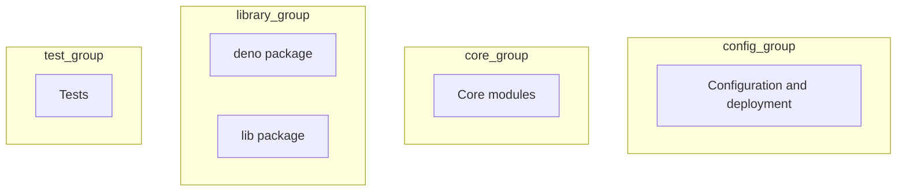

# Architecture report: stylus/stylus

> Automated static analysis. **Observed** = directly seen in files/imports/AST; **Inferred** = interpretation from that evidence. Repository code was not executed.

## 1. Repository at a glance

| Item | Value |
| --- | --- |
| Repository | stylus/stylus |
| Description | Expressive, robust, feature-rich CSS language built for nodejs |
| Language | JavaScript |
| Stars | 11322 |
| Licence | MIT |
| Analysed commit / branch | 2e11b972a56d6e41c1408254e60e3d6fb76356d8 / dev |
| Framework(s) | Vue |
| Files analysed | 793 |
| Components | 5 |

## 2. Architecture in one minute

stylus/stylus - Expressive, robust, feature-rich CSS language built for nodejs. This repository was analysed statically from 793 file(s) (0 Python). Detected technologies (observed from imports/manifests): GitHub Actions, Vue. Files are grouped into 5 component(s): Configuration and deployment, Core modules, deno package, lib package, Tests. Findings below distinguish observed facts from inferred interpretation.

## 3. High-level block diagram

## 4. Main components

### Configuration and deployment (`config`)

- **Kind:** config
- **Status:** Observed
- **Confidence:** 0.85
- **Responsibility:** Groups 1 file(s) under configuration and deployment (observed from repository paths and static analysis).
- **Paths:** `package.json`
- **Evidence:** [package.json](https://github.com/stylus/stylus/blob/2e11b972a56d6e41c1408254e60e3d6fb76356d8/package.json)

### Core modules (`core`)

- **Kind:** core
- **Status:** Observed
- **Confidence:** 0.85
- **Responsibility:** Groups 2 file(s) under core modules (observed from repository paths and static analysis).
- **Paths:** `bm.js`, `index.js`
- **Evidence:** [bm.js](https://github.com/stylus/stylus/blob/2e11b972a56d6e41c1408254e60e3d6fb76356d8/bm.js); [index.js](https://github.com/stylus/stylus/blob/2e11b972a56d6e41c1408254e60e3d6fb76356d8/index.js)

### deno package (`deno`)

- **Kind:** library
- **Status:** Observed
- **Confidence:** 0.85
- **Responsibility:** Groups 1 file(s) under deno package (observed from repository paths and static analysis).
- **Paths:** `deno/test.ts`
- **Evidence:** [deno/test.ts](https://github.com/stylus/stylus/blob/2e11b972a56d6e41c1408254e60e3d6fb76356d8/deno/test.ts)

### lib package (`lib`)

- **Kind:** library
- **Status:** Observed
- **Confidence:** 0.85
- **Responsibility:** Groups 137 file(s) under lib package (observed from repository paths and static analysis).
- **Paths:** `lib/browserify.js`, `lib/cache/fs.js`, `lib/cache/index.js`, `lib/cache/memory.js`, `lib/cache/null.js`, `lib/colors.js`, `lib/convert/css.js`, `lib/errors.js`, `lib/functions/acos.js`, `lib/functions/add-property.js`, `lib/functions/adjust.js`, `lib/functions/alpha.js`, `lib/functions/asin.js`, `lib/functions/atan.js`, `lib/functions/base-convert.js`, `lib/functions/basename.js`, `lib/functions/blend.js`, `lib/functions/blue.js`, `lib/functions/clone.js`, `lib/functions/component.js`, `lib/functions/contrast.js`, `lib/functions/convert-angle.js`, `lib/functions/convert.js`, `lib/functions/current-media.js`, `lib/functions/define.js`, `lib/functions/dirname.js`, `lib/functions/error.js`, `lib/functions/extname.js`, `lib/functions/green.js`, `lib/functions/hsl.js`, `lib/functions/hsla.js`, `lib/functions/hue.js`, `lib/functions/image-size.js`, `lib/functions/image.js`, `lib/functions/index.js`, `lib/functions/json.js`, `lib/functions/length.js`, `lib/functions/lightness.js`, `lib/functions/list-separator.js`, `lib/functions/lookup.js`, `lib/functions/luminosity.js`, `lib/functions/match.js`, `lib/functions/math-prop.js`, `lib/functions/math.js`, `lib/functions/merge.js`, `lib/functions/operate.js`, `lib/functions/opposite-position.js`, `lib/functions/p.js`, `lib/functions/pathjoin.js`, `lib/functions/pop.js`, `lib/functions/prefix-classes.js`, `lib/functions/push.js`, `lib/functions/range.js`, `lib/functions/red.js`, `lib/functions/remove.js`, `lib/functions/replace.js`, `lib/functions/resolver.js`, `lib/functions/rgb.js`, `lib/functions/rgba.js`, `lib/functions/s.js`, `lib/functions/saturation.js`, `lib/functions/selector-exists.js`, `lib/functions/selector.js`, `lib/functions/selectors.js`, `lib/functions/shift.js`, `lib/functions/slice.js`, `lib/functions/split.js`, `lib/functions/substr.js`, `lib/functions/tan.js`, `lib/functions/trace.js`, `lib/functions/transparentify.js`, `lib/functions/type.js`, `lib/functions/unit.js`, `lib/functions/unquote.js`, `lib/functions/unshift.js`, `lib/functions/url.js`, `lib/functions/use.js`, `lib/functions/warn.js`, `lib/lexer.js`, `lib/middleware.js`, `lib/nodes/arguments.js`, `lib/nodes/atblock.js`, `lib/nodes/atrule.js`, `lib/nodes/binop.js`, `lib/nodes/block.js`, `lib/nodes/boolean.js`, `lib/nodes/call.js`, `lib/nodes/charset.js`, `lib/nodes/comment.js`, `lib/nodes/each.js`, `lib/nodes/expression.js`, `lib/nodes/extend.js`, `lib/nodes/feature.js`, `lib/nodes/function.js`, `lib/nodes/group.js`, `lib/nodes/hsla.js`, `lib/nodes/ident.js`, `lib/nodes/if.js`, `lib/nodes/import.js`, `lib/nodes/index.js`, `lib/nodes/keyframes.js`, `lib/nodes/literal.js`, `lib/nodes/media.js`, `lib/nodes/member.js`, `lib/nodes/namespace.js`, `lib/nodes/node.js`, `lib/nodes/null.js`, `lib/nodes/object.js`, `lib/nodes/params.js`, `lib/nodes/property.js`, `lib/nodes/query-list.js`, `lib/nodes/query.js`, `lib/nodes/return.js`, `lib/nodes/rgba.js`, `lib/nodes/root.js`, `lib/nodes/selector.js`, `lib/nodes/string.js`, `lib/nodes/supports.js`, `lib/nodes/ternary.js`, `lib/nodes/unaryop.js`, `lib/nodes/unit.js`, `lib/parser.js`, `lib/renderer.js`, `lib/selector-parser.js`, `lib/stack/frame.js`, `lib/stack/index.js`, `lib/stack/scope.js`, `lib/stylus.js`, `lib/token.js`, `lib/units.js`, `lib/utils.js`, `lib/visitor/compiler.js`, `lib/visitor/deps-resolver.js`, `lib/visitor/evaluator.js`, `lib/visitor/index.js`, `lib/visitor/normalizer.js`, `lib/visitor/sourcemapper.js`
- **Evidence:** [lib/browserify.js](https://github.com/stylus/stylus/blob/2e11b972a56d6e41c1408254e60e3d6fb76356d8/lib/browserify.js); [lib/cache/fs.js](https://github.com/stylus/stylus/blob/2e11b972a56d6e41c1408254e60e3d6fb76356d8/lib/cache/fs.js); [lib/cache/index.js](https://github.com/stylus/stylus/blob/2e11b972a56d6e41c1408254e60e3d6fb76356d8/lib/cache/index.js); [lib/cache/memory.js](https://github.com/stylus/stylus/blob/2e11b972a56d6e41c1408254e60e3d6fb76356d8/lib/cache/memory.js); [lib/cache/null.js](https://github.com/stylus/stylus/blob/2e11b972a56d6e41c1408254e60e3d6fb76356d8/lib/cache/null.js); [lib/colors.js](https://github.com/stylus/stylus/blob/2e11b972a56d6e41c1408254e60e3d6fb76356d8/lib/colors.js); [lib/convert/css.js](https://github.com/stylus/stylus/blob/2e11b972a56d6e41c1408254e60e3d6fb76356d8/lib/convert/css.js); [lib/errors.js](https://github.com/stylus/stylus/blob/2e11b972a56d6e41c1408254e60e3d6fb76356d8/lib/errors.js)

### Tests (`tests`)

- **Kind:** test
- **Status:** Observed
- **Confidence:** 0.85
- **Responsibility:** Groups 572 file(s) under tests (observed from repository paths and static analysis).
- **Paths:** `test/cases/arithmetic.color.css`, `test/cases/arithmetic.color.styl`, `test/cases/arithmetic.css`, `test/cases/arithmetic.styl`, `test/cases/arithmetic.unary.css`, `test/cases/arithmetic.unary.styl`, `test/cases/atblock.css`, `test/cases/atblock.styl`, `test/cases/atrules.compressed.css`, `test/cases/atrules.compressed.styl`, `test/cases/atrules.css`, `test/cases/atrules.styl`, `test/cases/atscope.css`, `test/cases/atscope.styl`, `test/cases/bifs.add-property.css`, `test/cases/bifs.add-property.styl`, `test/cases/bifs.base-convert.css`, `test/cases/bifs.base-convert.styl`, `test/cases/bifs.blend.css`, `test/cases/bifs.blend.styl`, `test/cases/bifs.cache.at-media.css`, `test/cases/bifs.cache.at-media.styl`, `test/cases/bifs.cache.css`, `test/cases/bifs.cache.samename.css`, `test/cases/bifs.cache.samename.styl`, `test/cases/bifs.cache.size.css`, `test/cases/bifs.cache.size.styl`, `test/cases/bifs.cache.styl`, `test/cases/bifs.called-from.css`, `test/cases/bifs.called-from.styl`, `test/cases/bifs.clone.css`, `test/cases/bifs.clone.styl`, `test/cases/bifs.complement.css`, `test/cases/bifs.complement.styl`, `test/cases/bifs.components.css`, `test/cases/bifs.components.styl`, `test/cases/bifs.contrast.css`, `test/cases/bifs.contrast.styl`, `test/cases/bifs.convert.css`, `test/cases/bifs.convert.styl`, `test/cases/bifs.current-media.css`, `test/cases/bifs.current-media.styl`, `test/cases/bifs.current-property.css`, `test/cases/bifs.current-property.styl`, `test/cases/bifs.dark.css`, `test/cases/bifs.dark.styl`, `test/cases/bifs.darken.css`, `test/cases/bifs.darken.styl`, `test/cases/bifs.define.css`, `test/cases/bifs.define.styl`, `test/cases/bifs.fade.css`, `test/cases/bifs.fade.styl`, `test/cases/bifs.floats.css`, `test/cases/bifs.floats.styl`, `test/cases/bifs.grayscale.css`, `test/cases/bifs.grayscale.styl`, `test/cases/bifs.hsla.css`, `test/cases/bifs.hsla.styl`, `test/cases/bifs.image-size.css`, `test/cases/bifs.image-size.styl`, `test/cases/bifs.index.css`, `test/cases/bifs.index.styl`, `test/cases/bifs.invert.css`, `test/cases/bifs.invert.styl`, `test/cases/bifs.join.css`, `test/cases/bifs.join.styl`, `test/cases/bifs.json.css`, `test/cases/bifs.json.styl`, `test/cases/bifs.keys.css`, `test/cases/bifs.keys.styl`, `test/cases/bifs.last.css`, `test/cases/bifs.last.styl`, `test/cases/bifs.length.css`, `test/cases/bifs.length.styl`, `test/cases/bifs.light.css`, `test/cases/bifs.light.styl`, `test/cases/bifs.lighten.css`, `test/cases/bifs.lighten.styl`, `test/cases/bifs.list-separator.css`, `test/cases/bifs.list-separator.styl`, `test/cases/bifs.lookup.css`, `test/cases/bifs.lookup.styl`, `test/cases/bifs.luminosity.css`, `test/cases/bifs.luminosity.styl`, `test/cases/bifs.match.css`, `test/cases/bifs.match.styl`, `test/cases/bifs.math.css`, `test/cases/bifs.math.styl`, `test/cases/bifs.merge.css`, `test/cases/bifs.merge.styl`, `test/cases/bifs.mix.css`, `test/cases/bifs.mix.styl`, `test/cases/bifs.opposite-position.css`, `test/cases/bifs.opposite-position.styl`, `test/cases/bifs.percent-to-decimal.css`, `test/cases/bifs.percent-to-decimal.styl`, `test/cases/bifs.percentage.css`, `test/cases/bifs.percentage.styl`, `test/cases/bifs.pop.css`, `test/cases/bifs.pop.styl`, `test/cases/bifs.prefix-classes.css`, `test/cases/bifs.prefix-classes.styl`, `test/cases/bifs.push.css`, `test/cases/bifs.push.styl`, `test/cases/bifs.range.css`, `test/cases/bifs.range.styl`, `test/cases/bifs.remove-unit.css`, `test/cases/bifs.remove-unit.styl`, `test/cases/bifs.remove.css`, `test/cases/bifs.remove.styl`, `test/cases/bifs.replace.css`, `test/cases/bifs.replace.styl`, `test/cases/bifs.rgba.css`, `test/cases/bifs.rgba.styl`, `test/cases/bifs.s.css`, `test/cases/bifs.s.styl`, `test/cases/bifs.saturate-desaturate.css`, `test/cases/bifs.saturate-desaturate.styl`, `test/cases/bifs.selector.css`, `test/cases/bifs.selector.exitsts.css`, `test/cases/bifs.selector.exitsts.styl`, `test/cases/bifs.selector.styl`, `test/cases/bifs.selectors.css`, `test/cases/bifs.selectors.styl`, `test/cases/bifs.shade.css`, `test/cases/bifs.shade.styl`, `test/cases/bifs.slice.css`, `test/cases/bifs.slice.styl`, `test/cases/bifs.split.css`, `test/cases/bifs.split.styl`, `test/cases/bifs.substr.css`, `test/cases/bifs.substr.styl`, `test/cases/bifs.tint.css`, `test/cases/bifs.tint.styl`, `test/cases/bifs.transparentify.css`, `test/cases/bifs.transparentify.styl`, `test/cases/bifs.type.css`, `test/cases/bifs.type.styl`, `test/cases/bifs.unit.css`, `test/cases/bifs.unit.styl`, `test/cases/bifs.unquote.css`, `test/cases/bifs.unquote.styl`, `test/cases/bifs.url.css`, `test/cases/bifs.url.styl`, `test/cases/bifs.use.css`, `test/cases/bifs.use.styl`, `test/cases/bifs.values.css`, `test/cases/bifs.values.styl`, `test/cases/casting.css`, `test/cases/casting.styl`, `test/cases/coercion.css`, `test/cases/coercion.styl`, `test/cases/colors.css`, `test/cases/colors.styl`, `test/cases/comments.css`, `test/cases/comments.styl`, `test/cases/compress.comments.css`, `test/cases/compress.comments.styl`, `test/cases/compress.semicolon.css`, `test/cases/compress.semicolon.styl`, `test/cases/compress.units.css`, `test/cases/compress.units.styl`, `test/cases/conditional-assignment.css`, `test/cases/conditional-assignment.styl`, `test/cases/control.blueprint.ie.css`, `test/cases/control.blueprint.ie.styl`, `test/cases/control.blueprint.screen.css`, `test/cases/control.blueprint.screen.styl`, `test/cases/control.boilerplate.css`, `test/cases/control.boilerplate.styl`, `test/cases/css.eos.css`, `test/cases/css.eos.styl`, `test/cases/css.extend.css`, `test/cases/css.extend.styl`, `test/cases/css.functions.single-line.css`, `test/cases/css.functions.single-line.styl`, `test/cases/css.if.css`, `test/cases/css.if.styl`, `test/cases/css.keyframes.css`, `test/cases/css.keyframes.styl`, `test/cases/css.large.css`, `test/cases/css.large.styl`, `test/cases/css.media.css`, `test/cases/css.media.styl`, `test/cases/css.mixins.braces.css`, `test/cases/css.mixins.braces.styl`, `test/cases/css.mixins.css`, `test/cases/css.mixins.root.css`, `test/cases/css.mixins.root.styl`, `test/cases/css.mixins.root.wonky.css`, `test/cases/css.mixins.root.wonky.styl`, `test/cases/css.mixins.styl`, `test/cases/css.selector.interpolation.css`, `test/cases/css.selector.interpolation.styl`, `test/cases/css.selectors.css`, `test/cases/css.selectors.styl`, `test/cases/css.whitespace.css`, `test/cases/css.whitespace.styl`, `test/cases/dumb.css`, `test/cases/dumb.styl`, `test/cases/eol-escape.css`, `test/cases/eol-escape.styl`, `test/cases/escape.css`, `test/cases/escape.styl`, `test/cases/extend.block-level.css`, `test/cases/extend.block-level.styl`, `test/cases/extend.block-level/a.styl`, `test/cases/extend.block-level/b.styl`, `test/cases/extend.cascade.css`, `test/cases/extend.cascade.styl`, `test/cases/extend.complex.css`, `test/cases/extend.complex.styl`, `test/cases/extend.css`, `test/cases/extend.in-loop-context.css`, `test/cases/extend.in-loop-context.styl`, `test/cases/extend.in-loop.css`, `test/cases/extend.in-loop.styl`, `test/cases/extend.in-media-query.css`, `test/cases/extend.in-media-query.styl`, `test/cases/extend.in-mixin.css`, `test/cases/extend.in-mixin.nested.css`, `test/cases/extend.in-mixin.nested.styl`, `test/cases/extend.in-mixin.styl`, `test/cases/extend.multiple-definitions.css`, `test/cases/extend.multiple-definitions.styl`, `test/cases/extend.multiple-selectors.css`, `test/cases/extend.multiple-selectors.styl`, `test/cases/extend.styl`, `test/cases/extend.using-variable.css`, `test/cases/extend.using-variable.styl`, `test/cases/extend.with.optional.css`, `test/cases/extend.with.optional.styl`, `test/cases/extend.with.parent.reference.css`, `test/cases/extend.with.parent.reference.styl`, `test/cases/extend.with.placeholders.css`, `test/cases/extend.with.placeholders.styl`, `test/cases/fontface.css`, `test/cases/fontface.styl`, `test/cases/for.complex.css`, `test/cases/for.complex.styl`, `test/cases/for.css`, `test/cases/for.function.css`, `test/cases/for.function.styl`, `test/cases/for.postfix.css`, `test/cases/for.postfix.styl`, `test/cases/for.styl`, `test/cases/function.arguments.css`, `test/cases/function.arguments.styl`, `test/cases/function.literals.css`, `test/cases/function.literals.styl`, `test/cases/functions.anonymous.css`, `test/cases/functions.anonymous.styl`, `test/cases/functions.arg-calls.css`, `test/cases/functions.arg-calls.styl`, `test/cases/functions.call.css`, `test/cases/functions.call.mixin.css`, `test/cases/functions.call.mixin.styl`, `test/cases/functions.call.styl`, `test/cases/functions.call.to-string.css`, `test/cases/functions.call.to-string.styl`, `test/cases/functions.css`, `test/cases/functions.defaults.css`, `test/cases/functions.defaults.styl`, `test/cases/functions.multi-line.css`, `test/cases/functions.multi-line.styl`, `test/cases/functions.multiple-calls.css`, `test/cases/functions.multiple-calls.styl`, `test/cases/functions.nested-calls.css`, `test/cases/functions.nested-calls.styl`, `test/cases/functions.nested.css`, `test/cases/functions.nested.styl`, `test/cases/functions.property.css`, `test/cases/functions.property.styl`, `test/cases/functions.return.css`, `test/cases/functions.return.each.css`, `test/cases/functions.return.each.styl`, `test/cases/functions.return.styl`, `test/cases/functions.styl`, `test/cases/functions.url.css`, `test/cases/functions.url.styl`, `test/cases/functions.variable.css`, `test/cases/functions.variable.ident.css`, `test/cases/functions.variable.ident.styl`, `test/cases/functions.variable.styl`, `test/cases/hack.star.css`, `test/cases/hack.star.styl`, `test/cases/hoist.at-rules.css`, `test/cases/hoist.at-rules.styl`, `test/cases/if.css`, `test/cases/if.else.css`, `test/cases/if.else.styl`, `test/cases/if.mixin.css`, `test/cases/if.mixin.styl`, `test/cases/if.postfix.css`, `test/cases/if.postfix.styl`, `test/cases/if.selectors.css`, `test/cases/if.selectors.styl`, `test/cases/if.styl`, `test/cases/import.basic.css`, `test/cases/import.basic.styl`, `test/cases/import.basic/a.styl`, `test/cases/import.basic/b.styl`, `test/cases/import.basic/c.styl`, `test/cases/import.basic/clone.styl`, `test/cases/import.basic/clone2.styl`, `test/cases/import.clone.css`, `test/cases/import.clone.styl`, `test/cases/import.comments.css`, `test/cases/import.comments.styl`, `test/cases/import.comments/comments.styl`, `test/cases/import.complex.css`, `test/cases/import.complex.styl`, `test/cases/import.complex/a.styl`, `test/cases/import.complex/c.styl`, `test/cases/import.complex/d.styl`, `test/cases/import.complex/nested/b.styl`, `test/cases/import.glob.css`, `test/cases/import.glob.styl`, `test/cases/import.glob/a.styl`, `test/cases/import.glob/c.styl`, `test/cases/import.glob/nested/b.styl`, `test/cases/import.include._basic.css`, `test/cases/import.include.basic.css`, `test/cases/import.include.basic.styl`, `test/cases/import.include.complex.css`, `test/cases/import.include.complex.styl`, `test/cases/import.include.complex/a.styl`, `test/cases/import.include.complex/nested/b.styl`, `test/cases/import.include.complex/nested/c.css`, `test/cases/import.include.function.call.css`, `test/cases/import.include.function.call.styl`, `test/cases/import.include.function.css`, `test/cases/import.include.function.styl`, `test/cases/import.include.function/a.styl`, `test/cases/import.include.function/b.css`, `test/cases/import.include.function/import.common.styl`, `test/cases/import.include.function/import.vendor.styl`, `test/cases/import.include.in.function.css`, `test/cases/import.include.in.function.styl`, `test/cases/import.include.in.function/a.styl`, `test/cases/import.include.in.function/b.css`, `test/cases/import.include.megacomplex.css`, `test/cases/import.include.megacomplex.styl`, `test/cases/import.include.megacomplex/a.styl`, `test/cases/import.include.megacomplex/b/b.styl`, `test/cases/import.include.megacomplex/b/d/d.css`, `test/cases/import.include.megacomplex/b/e/e.css`, `test/cases/import.include.megacomplex/b/f/g/g.styl`, `test/cases/import.include.megacomplex/b/h.css`, `test/cases/import.include.megacomplex/c.css`, `test/cases/import.include.resolver.absolute.css`, `test/cases/import.include.resolver.absolute.styl`, `test/cases/import.include.resolver.css-file.css`, `test/cases/import.include.resolver.css-file.styl`, `test/cases/import.include.resolver.css-file/a.css`, `test/cases/import.include.resolver.images.css`, `test/cases/import.include.resolver.images.styl`, `test/cases/import.include.resolver.images/a.styl`, `test/cases/import.include.resolver.images/b/a`, `test/cases/import.include.resolver.images/b/b.styl`, `test/cases/import.include.resolver.images/b/c.css`, `test/cases/import.include.resolver.nested.css`, `test/cases/import.include.resolver.nested.styl`, `test/cases/import.include.resolver.nested/a/a.styl`, `test/cases/import.include.resolver.nested/b/b.styl`, `test/cases/import.index.css`, `test/cases/import.index.styl`, `test/cases/import.json/icons.json`, `test/cases/import.json/local-vars.json`, `test/cases/import.json/vars.json`, `test/cases/import.literal.css`, `test/cases/import.literal.styl`, `test/cases/import.literal/import.literal.css.styl`, `test/cases/import.lookup.css`, `test/cases/import.lookup.styl`, `test/cases/import.lookup/index.styl`, `test/cases/import.lookup/lookup-a/lookup-a.styl`, `test/cases/import.loop/test.styl`, `test/cases/import.mixins.css`, `test/cases/import.mixins.styl`, `test/cases/import.mixins.transparent.css`, `test/cases/import.mixins.transparent.styl`, `test/cases/import.namespace.css`, `test/cases/import.namespace.styl`, `test/cases/import.namespace/svg.styl`, `test/cases/import.ordering.css`, `test/cases/import.ordering.styl`, `test/cases/import.ordering/five.styl`, `test/cases/import.ordering/four.styl`, `test/cases/import.ordering/two.styl`, `test/cases/important.css`, `test/cases/important.styl`, `test/cases/index.styl`, `test/cases/interpolation.properties.css`, `test/cases/interpolation.properties.styl`, `test/cases/introspection.css`, `test/cases/introspection.styl`, `test/cases/is.a.obj.operator.css`, `test/cases/is.a.obj.operator.styl`, `test/cases/jquery.css`, `test/cases/jquery.styl`, `test/cases/keyframes.css`, `test/cases/keyframes.fabrication.css`, `test/cases/keyframes.fabrication.defaults.css`, `test/cases/keyframes.fabrication.defaults.styl`, `test/cases/keyframes.fabrication.styl`, `test/cases/keyframes.newlines.css`, `test/cases/keyframes.newlines.styl`, `test/cases/keyframes.styl`, `test/cases/kwargs.css`, `test/cases/kwargs.styl`, `test/cases/list.css`, `test/cases/list.styl`, `test/cases/literal.color.css`, `test/cases/literal.color.styl`, `test/cases/literal.css`, `test/cases/literal.styl`, `test/cases/media.bubble.css`, `test/cases/media.bubble.styl`, `test/cases/media.complex.css`, `test/cases/media.complex.styl`, `test/cases/media.css`, `test/cases/media.styl`, `test/cases/mixin.conditional.css`, `test/cases/mixin.conditional.styl`, `test/cases/mixin.order.conditional.css`, `test/cases/mixin.order.conditional.styl`, `test/cases/mixin.order.css`, `test/cases/mixin.order.nested.css`, `test/cases/mixin.order.nested.styl`, `test/cases/mixin.order.styl`, `test/cases/mixin.pass-keyword-args.css`, `test/cases/mixin.pass-keyword-args.styl`, `test/cases/mixins.complex.css`, `test/cases/mixins.complex.fix-to.css`, `test/cases/mixins.complex.fix-to.styl`, `test/cases/mixins.complex.styl`, `test/cases/mixins.conditional.css`, `test/cases/mixins.conditional.styl`, `test/cases/mixins.nested.css`, `test/cases/mixins.nested.selectors.css`, `test/cases/mixins.nested.selectors.styl`, `test/cases/mixins.nested.styl`, `test/cases/mixins.order.2.css`, `test/cases/mixins.order.2.styl`, `test/cases/mixins.reset.css`, `test/cases/mixins.reset.styl`, `test/cases/mixins.return.css`, `test/cases/mixins.return.styl`, `test/cases/mixins.root.css`, `test/cases/mixins.root.styl`, `test/cases/mixins/bar.styl`, `test/cases/mixins/box.styl`, `test/cases/moz-document-import.css`, `test/cases/moz-document-import.styl`, `test/cases/moz-document.css`, `test/cases/moz-document.styl`, `test/cases/multiline.css`, `test/cases/multiline.styl`, `test/cases/negative-property-lookup.css`, `test/cases/negative-property-lookup.styl`, `test/cases/object-prototype-props.css`, `test/cases/object-prototype-props.styl`, `test/cases/object.complex.css`, `test/cases/object.complex.styl`, `test/cases/object.css`, `test/cases/object.mixin.css`, `test/cases/object.mixin.styl`, `test/cases/object.styl`, `test/cases/operator.range.css`, `test/cases/operator.range.styl`, `test/cases/operators.assignment.function.css`, `test/cases/operators.assignment.function.styl`, `test/cases/operators.assignment.mixin.css`, `test/cases/operators.assignment.mixin.styl`, `test/cases/operators.assignment.root.css`, `test/cases/operators.assignment.root.styl`, `test/cases/operators.complex.css`, `test/cases/operators.complex.styl`, `test/cases/operators.css`, `test/cases/operators.equality.css`, `test/cases/operators.equality.styl`, `test/cases/operators.in.css`, `test/cases/operators.in.styl`, `test/cases/operators.mixins.css`, `test/cases/operators.mixins.styl`, `test/cases/operators.precedence.css`, `test/cases/operators.precedence.styl`, `test/cases/operators.styl`, `test/cases/operators.subscript.assign.css`, `test/cases/operators.subscript.assign.styl`, `test/cases/operators.subscript.css`, `test/cases/operators.subscript.range.css`, `test/cases/operators.subscript.range.styl`, `test/cases/operators.subscript.styl`, `test/cases/operators.unary.css`, `test/cases/operators.unary.styl`, `test/cases/page.css`, `test/cases/page.styl`, `test/cases/parent.complex.css`, `test/cases/parent.complex.styl`, `test/cases/parent.css`, `test/cases/parent.styl`, `test/cases/parse.css`, `test/cases/parse.styl`, `test/cases/plugins/add.js`, `test/cases/prefix.css.selector.interpolation.css`, `test/cases/prefix.css.selector.interpolation.styl`, `test/cases/prefix.extend.complex.css`, `test/cases/prefix.extend.complex.styl`, `test/cases/prefix.extend.css`, `test/cases/prefix.extend.styl`, `test/cases/prefix.extend.with.placeholders.css`, `test/cases/prefix.extend.with.placeholders.styl`, `test/cases/prefix.grid.css`, `test/cases/prefix.grid.styl`, `test/cases/properties.colons.css`, `test/cases/properties.colons.styl`, `test/cases/properties.css`, `test/cases/properties.one-line.css`, `test/cases/properties.one-line.styl`, `test/cases/properties.styl`, `test/cases/property-access.bubble.css`, `test/cases/property-access.bubble.styl`, `test/cases/property-access.css`, `test/cases/property-access.siblings.css`, `test/cases/property-access.siblings.styl`, `test/cases/property-access.styl`, `test/cases/queries.css`, `test/cases/queries.styl`, `test/cases/regression.107.lookup-failure.css`, `test/cases/regression.107.lookup-failure.styl`, `test/cases/regression.1112.css`, `test/cases/regression.1112.styl`, `test/cases/regression.1171.css`, `test/cases/regression.1171.styl`, `test/cases/regression.1173.css`, `test/cases/regression.1173.styl`, `test/cases/regression.1182.css`, `test/cases/regression.1182.styl`, `test/cases/regression.1205.css`, `test/cases/regression.1205.styl`, `test/cases/regression.1206.css`, `test/cases/regression.1206.styl`, `test/cases/regression.1214.css`, `test/cases/regression.1214.styl`, `test/cases/regression.127.css`, `test/cases/regression.127.styl`, `test/cases/regression.1277.css`, `test/cases/regression.1277.styl`, `test/cases/regression.130.css`, `test/cases/regression.130.styl`, `test/cases/regression.131.css`, `test/cases/regression.131.styl`, `test/cases/regression.137.css`, `test/cases/regression.137.styl`, `test/cases/regression.139.css`, `test/cases/regression.139.styl`, `test/cases/regression.142.css`, `test/cases/regression.142.styl`, `test/cases/regression.146.css`, `test/cases/regression.146.styl`, `test/cases/regression.153.css`, `test/cases/regression.153.styl`, `test/cases/regression.154.css`, `test/cases/regression.154.styl`, `test/cases/regression.156.css`, `test/cases/regression.156.styl`, `test/cases/regression.1571.css`, `test/cases/regression.1571.styl`, `test/cases/regression.1572.css`, `test/cases/regression.1572.styl`
- **Evidence:** [test/cases/arithmetic.color.css](https://github.com/stylus/stylus/blob/2e11b972a56d6e41c1408254e60e3d6fb76356d8/test/cases/arithmetic.color.css); [test/cases/arithmetic.color.styl](https://github.com/stylus/stylus/blob/2e11b972a56d6e41c1408254e60e3d6fb76356d8/test/cases/arithmetic.color.styl); [test/cases/arithmetic.css](https://github.com/stylus/stylus/blob/2e11b972a56d6e41c1408254e60e3d6fb76356d8/test/cases/arithmetic.css); [test/cases/arithmetic.styl](https://github.com/stylus/stylus/blob/2e11b972a56d6e41c1408254e60e3d6fb76356d8/test/cases/arithmetic.styl); [test/cases/arithmetic.unary.css](https://github.com/stylus/stylus/blob/2e11b972a56d6e41c1408254e60e3d6fb76356d8/test/cases/arithmetic.unary.css); [test/cases/arithmetic.unary.styl](https://github.com/stylus/stylus/blob/2e11b972a56d6e41c1408254e60e3d6fb76356d8/test/cases/arithmetic.unary.styl); [test/cases/atblock.css](https://github.com/stylus/stylus/blob/2e11b972a56d6e41c1408254e60e3d6fb76356d8/test/cases/atblock.css); [test/cases/atblock.styl](https://github.com/stylus/stylus/blob/2e11b972a56d6e41c1408254e60e3d6fb76356d8/test/cases/atblock.styl)

## 5. Execution flow

**Observed** entry point(s):

- [bin/stylus](https://github.com/stylus/stylus/blob/2e11b972a56d6e41c1408254e60e3d6fb76356d8/bin/stylus)
- [index.js](https://github.com/stylus/stylus/blob/2e11b972a56d6e41c1408254e60e3d6fb76356d8/index.js)
- [lib/cache/index.js](https://github.com/stylus/stylus/blob/2e11b972a56d6e41c1408254e60e3d6fb76356d8/lib/cache/index.js)
- [lib/functions/index.js](https://github.com/stylus/stylus/blob/2e11b972a56d6e41c1408254e60e3d6fb76356d8/lib/functions/index.js)
- [lib/nodes/index.js](https://github.com/stylus/stylus/blob/2e11b972a56d6e41c1408254e60e3d6fb76356d8/lib/nodes/index.js)
- [lib/stack/index.js](https://github.com/stylus/stylus/blob/2e11b972a56d6e41c1408254e60e3d6fb76356d8/lib/stack/index.js)
- [lib/visitor/index.js](https://github.com/stylus/stylus/blob/2e11b972a56d6e41c1408254e60e3d6fb76356d8/lib/visitor/index.js)

Representative flow (derived from observed entry points and the import graph; steps beyond the entry point are **Inferred**):

1. Execution starts at an observed entry point listed above, if present.
2. No internal import relationships between components were observed.

## 6. Project structure

### `(root)`

- `.gitignore` - other (99 bytes)
- `.npmignore` - other (215 bytes)
- `Changelog.md` - docs (52951 bytes)
- `Code_of_Conduct.md` - docs (2382 bytes)
- `Contributing.md` - docs (8828 bytes)
- `LICENSE` - docs (1094 bytes)
- `Makefile` - other (864 bytes)
- `Readme.md` - docs (3661 bytes)
- `SECURITY.md` - docs (278 bytes)
- `bm.js` - source, JavaScript (1372 bytes)
- `index.js` - source, JavaScript (42 bytes)
- `package.json` - manifest (1157 bytes)

### `.github`

- `.github/FUNDING.yml` - config (640 bytes)
- `.github/ISSUE_TEMPLATE/bug.md` - docs (1057 bytes)
- `.github/ISSUE_TEMPLATE/config.yml` - config (580 bytes)
- `.github/PULL_REQUEST_TEMPLATE.md` - docs (1089 bytes)
- `.github/dependabot.yml` - config (179 bytes)
- `.github/workflows/ci.yml` - ci, YAML (3412 bytes)

### `bin`

- `bin/stylus` - other (18959 bytes)

### `deno`

- `deno/test.ts` - source, TypeScript (678 bytes)

### `docs`

- `docs/.gitignore` - docs (70 bytes)
- `docs/.vitepress/components.d.ts` - docs (408 bytes)
- `docs/.vitepress/components/HomePage.vue` - docs (509 bytes)
- `docs/.vitepress/components/Runkit.vue` - docs (827 bytes)
- `docs/.vitepress/config.ts` - docs (7047 bytes)
- `docs/.vitepress/meta.ts` - docs (1295 bytes)
- `docs/.vitepress/scripts/assets.ts` - docs (2944 bytes)
- `docs/.vitepress/style/main.css` - docs (449 bytes)
- `docs/.vitepress/style/vars.css` - docs (2220 bytes)
- `docs/.vitepress/theme/index.ts` - docs (504 bytes)
- `docs/.vitepress/theme/pwa.ts` - docs (83 bytes)
- `docs/docs/atrules.md` - docs (905 bytes)
- `docs/docs/bifs.md` - docs (24981 bytes)
- `docs/docs/block.md` - docs (904 bytes)
- `docs/docs/comments.md` - docs (820 bytes)
- `docs/docs/compare.md` - docs (1658 bytes)
- `docs/docs/conditionals.md` - docs (2771 bytes)
- `docs/docs/css-style.md` - docs (2488 bytes)
- `docs/docs/error-reporting.md` - docs (1370 bytes)
- `docs/docs/escape.md` - docs (493 bytes)
- `docs/docs/executable.md` - docs (8661 bytes)
- `docs/docs/extend.md` - docs (4161 bytes)
- `docs/docs/firebug.md` - docs (1582 bytes)
- `docs/docs/font-face.md` - docs (479 bytes)
- `docs/docs/functions.md` - docs (5049 bytes)
- `docs/docs/functions.url.md` - docs (2713 bytes)
- `docs/docs/gedit.md` - docs (1507 bytes)
- `docs/docs/hashes.md` - docs (3014 bytes)
- `docs/docs/import.md` - docs (4256 bytes)
- `docs/docs/index.md` - docs (2535 bytes)
- `docs/docs/interpolation.md` - docs (1519 bytes)
- `docs/docs/introspection.md` - docs (916 bytes)
- `docs/docs/iteration.md` - docs (2366 bytes)
- `docs/docs/js.md` - docs (5999 bytes)
- `docs/docs/keyframes.md` - docs (1775 bytes)
- `docs/docs/kwargs.md` - docs (969 bytes)
- `docs/docs/lists.md` - docs (10708 bytes)
- `docs/docs/literal.md` - docs (560 bytes)
- `docs/docs/media.md` - docs (1872 bytes)
- `docs/docs/middleware.md` - docs (1951 bytes)
- `docs/docs/mixins.md` - docs (4281 bytes)
- `docs/docs/operators.md` - docs (9974 bytes)
- `docs/docs/selectors.md` - docs (8443 bytes)
- `docs/docs/sourcemaps.md` - docs (1349 bytes)
- `docs/docs/textmate.md` - docs (256 bytes)
- `docs/docs/vargs.md` - docs (2294 bytes)
- `docs/docs/variables.md` - docs (2288 bytes)
- `docs/index.md` - docs (1120 bytes)
- `docs/package.json` - manifest (658 bytes)
- `docs/public/logo.svg` - docs (6695 bytes)
- `docs/public/robots.txt` - docs (23 bytes)
- `docs/try.md` - docs (139 bytes)
- `docs/tsconfig.json` - config (660 bytes)
- `docs/vite.config.ts` - docs (3374 bytes)

### `editors`

- `editors/Stylus.tmbundle/Commands/Compile and Display CSS.tmCommand` - other (976 bytes)
- `editors/Stylus.tmbundle/Preferences/Comments.tmPreferences` - other (816 bytes)
- `editors/Stylus.tmbundle/Preferences/Disable indent corrections.tmPreferences` - other (458 bytes)
- `editors/Stylus.tmbundle/Syntaxes/Stylus.tmLanguage` - other (13481 bytes)
- `editors/Stylus.tmbundle/info.plist` - other (302 bytes)
- `editors/gedit/styl.lang` - other (15434 bytes)

### `graphics`

- `graphics/Vectors/stylus.ai` - other (191811 bytes)
- `graphics/Vectors/stylus.svg` - other (7786 bytes)
- `graphics/Vectors/stylus_icon.svg` - other (4303 bytes)

### `lib`

- `lib/browserify.js` - source, JavaScript (39 bytes)
- `lib/cache/fs.js` - source, JavaScript (1654 bytes)
- `lib/cache/index.js` - source, JavaScript (502 bytes)
- `lib/cache/memory.js` - source, JavaScript (2211 bytes)
- `lib/cache/null.js` - source, JavaScript (736 bytes)
- `lib/colors.js` - source, JavaScript (5025 bytes)
- `lib/convert/css.js` - source, JavaScript (6238 bytes)
- `lib/errors.js` - source, JavaScript (851 bytes)
- `lib/functions/acos.js` - source, JavaScript (579 bytes)
- `lib/functions/add-property.js` - source, JavaScript (769 bytes)
- `lib/functions/adjust.js` - source, JavaScript (788 bytes)
- `lib/functions/alpha.js` - source, JavaScript (748 bytes)
- `lib/functions/asin.js` - source, JavaScript (547 bytes)
- `lib/functions/atan.js` - source, JavaScript (549 bytes)
- `lib/functions/base-convert.js` - source, JavaScript (725 bytes)
- `lib/functions/basename.js` - source, JavaScript (335 bytes)
- `lib/functions/blend.js` - source, JavaScript (937 bytes)
- `lib/functions/blue.js` - source, JavaScript (678 bytes)
- `lib/functions/clone.js` - source, JavaScript (261 bytes)
- `lib/functions/component.js` - source, JavaScript (1090 bytes)
- `lib/functions/contrast.js` - source, JavaScript (2432 bytes)
- `lib/functions/convert-angle.js` - source, JavaScript (362 bytes)
- `lib/functions/convert.js` - source, JavaScript (330 bytes)
- `lib/functions/current-media.js` - source, JavaScript (506 bytes)
- `lib/functions/define.js` - source, JavaScript (598 bytes)
- `lib/functions/dirname.js` - source, JavaScript (322 bytes)
- `lib/functions/error.js` - source, JavaScript (308 bytes)
- `lib/functions/extname.js` - source, JavaScript (302 bytes)
- `lib/functions/green.js` - source, JavaScript (685 bytes)
- `lib/functions/hsl.js` - source, JavaScript (715 bytes)
- `lib/functions/hsla.js` - source, JavaScript (1382 bytes)
- `lib/functions/hue.js` - source, JavaScript (750 bytes)
- `lib/functions/image-size.js` - source, JavaScript (1228 bytes)
- `lib/functions/image.js` - source, JavaScript (3935 bytes)
- `lib/functions/index.js` - source, JavaScript (2782 bytes)
- `lib/functions/index.styl` - other (5883 bytes)
- `lib/functions/json.js` - source, JavaScript (2954 bytes)
- `lib/functions/length.js` - source, JavaScript (587 bytes)
- `lib/functions/lightness.js` - source, JavaScript (794 bytes)
- `lib/functions/list-separator.js` - source, JavaScript (482 bytes)
- `lib/functions/lookup.js` - source, JavaScript (393 bytes)
- `lib/functions/luminosity.js` - source, JavaScript (864 bytes)
- `lib/functions/match.js` - source, JavaScript (1058 bytes)
- `lib/functions/math-prop.js` - source, JavaScript (238 bytes)
- `lib/functions/math.js` - source, JavaScript (379 bytes)
- `lib/functions/merge.js` - source, JavaScript (610 bytes)
- `lib/functions/operate.js` - source, JavaScript (457 bytes)
- `lib/functions/opposite-position.js` - source, JavaScript (823 bytes)
- `lib/functions/p.js` - source, JavaScript (433 bytes)
- `lib/functions/pathjoin.js` - source, JavaScript (331 bytes)
- `lib/functions/pop.js` - source, JavaScript (245 bytes)
- `lib/functions/prefix-classes.js` - source, JavaScript (542 bytes)
- `lib/functions/push.js` - source, JavaScript (387 bytes)
- `lib/functions/range.js` - source, JavaScript (857 bytes)
- `lib/functions/red.js` - source, JavaScript (670 bytes)
- `lib/functions/remove.js` - source, JavaScript (400 bytes)
- `lib/functions/replace.js` - source, JavaScript (744 bytes)
- `lib/functions/resolver.js` - source, JavaScript (2157 bytes)
- `lib/functions/rgb.js` - source, JavaScript (759 bytes)
- `lib/functions/rgba.js` - source, JavaScript (1532 bytes)
- `lib/functions/s.js` - source, JavaScript (881 bytes)
- `lib/functions/saturation.js` - source, JavaScript (801 bytes)
- `lib/functions/selector-exists.js` - source, JavaScript (555 bytes)
- `lib/functions/selector.js` - source, JavaScript (1798 bytes)
- `lib/functions/selectors.js` - source, JavaScript (1044 bytes)
- `lib/functions/shift.js` - source, JavaScript (252 bytes)
- `lib/functions/slice.js` - source, JavaScript (673 bytes)
- `lib/functions/split.js` - source, JavaScript (663 bytes)
- `lib/functions/substr.js` - source, JavaScript (607 bytes)
- `lib/functions/tan.js` - source, JavaScript (593 bytes)
- `lib/functions/trace.js` - source, JavaScript (170 bytes)
- `lib/functions/transparentify.js` - source, JavaScript (1806 bytes)
- `lib/functions/type.js` - source, JavaScript (491 bytes)
- `lib/functions/unit.js` - source, JavaScript (509 bytes)
- `lib/functions/unquote.js` - source, JavaScript (465 bytes)
- `lib/functions/unshift.js` - source, JavaScript (385 bytes)
- `lib/functions/url.js` - source, JavaScript (3381 bytes)
- `lib/functions/use.js` - source, JavaScript (1689 bytes)
- `lib/functions/warn.js` - source, JavaScript (341 bytes)
- `lib/lexer.js` - source, JavaScript (18227 bytes)
- `lib/middleware.js` - source, JavaScript (7103 bytes)
- `lib/nodes/arguments.js` - source, JavaScript (1591 bytes)
- `lib/nodes/atblock.js` - source, JavaScript (1112 bytes)
- `lib/nodes/atrule.js` - source, JavaScript (2519 bytes)
- `lib/nodes/binop.js` - source, JavaScript (1502 bytes)
- `lib/nodes/block.js` - source, JavaScript (2227 bytes)
- `lib/nodes/boolean.js` - source, JavaScript (1553 bytes)
- `lib/nodes/call.js` - source, JavaScript (1496 bytes)
- `lib/nodes/charset.js` - source, JavaScript (800 bytes)
- `lib/nodes/comment.js` - source, JavaScript (972 bytes)
- `lib/nodes/each.js` - source, JavaScript (1333 bytes)
- `lib/nodes/expression.js` - source, JavaScript (4602 bytes)
- `lib/nodes/extend.js` - source, JavaScript (1034 bytes)
- `lib/nodes/feature.js` - source, JavaScript (1546 bytes)
- `lib/nodes/function.js` - source, JavaScript (2187 bytes)
- `lib/nodes/group.js` - source, JavaScript (1783 bytes)
- `lib/nodes/hsla.js` - source, JavaScript (4555 bytes)
- `lib/nodes/ident.js` - source, JavaScript (2709 bytes)
- `lib/nodes/if.js` - source, JavaScript (1451 bytes)
- `lib/nodes/import.js` - source, JavaScript (1153 bytes)
- `lib/nodes/index.js` - source, JavaScript (1872 bytes)
- `lib/nodes/keyframes.js` - source, JavaScript (1465 bytes)
- `lib/nodes/literal.js` - source, JavaScript (1754 bytes)
- `lib/nodes/media.js` - source, JavaScript (1170 bytes)
- `lib/nodes/member.js` - source, JavaScript (1420 bytes)
- `lib/nodes/namespace.js` - source, JavaScript (960 bytes)
- `lib/nodes/node.js` - source, JavaScript (4698 bytes)
- `lib/nodes/null.js` - source, JavaScript (1040 bytes)
- `lib/nodes/object.js` - source, JavaScript (4196 bytes)
- `lib/nodes/params.js` - source, JavaScript (1356 bytes)
- `lib/nodes/property.js` - source, JavaScript (1837 bytes)
- `lib/nodes/query-list.js` - source, JavaScript (1772 bytes)
- `lib/nodes/query.js` - source, JavaScript (3096 bytes)
- `lib/nodes/return.js` - source, JavaScript (1011 bytes)
- `lib/nodes/rgba.js` - source, JavaScript (6996 bytes)
- `lib/nodes/root.js` - source, JavaScript (1365 bytes)
- `lib/nodes/selector.js` - source, JavaScript (1680 bytes)
- `lib/nodes/string.js` - source, JavaScript (2705 bytes)
- `lib/nodes/supports.js` - source, JavaScript (1238 bytes)
- `lib/nodes/ternary.js` - source, JavaScript (1332 bytes)
- `lib/nodes/unaryop.js` - source, JavaScript (1050 bytes)
- `lib/nodes/unit.js` - source, JavaScript (4580 bytes)
- `lib/parser.js` - source, JavaScript (49766 bytes)
- `lib/renderer.js` - source, JavaScript (5661 bytes)
- `lib/selector-parser.js` - source, JavaScript (4655 bytes)
- `lib/stack/frame.js` - source, JavaScript (1055 bytes)
- `lib/stack/index.js` - source, JavaScript (2475 bytes)
- `lib/stack/scope.js` - source, JavaScript (911 bytes)
- `lib/stylus.js` - source, JavaScript (1780 bytes)
- `lib/token.js` - source, JavaScript (932 bytes)
- `lib/units.js` - source, JavaScript (827 bytes)
- `lib/utils.js` - source, JavaScript (11872 bytes)
- `lib/visitor/compiler.js` - source, JavaScript (12824 bytes)
- `lib/visitor/deps-resolver.js` - source, JavaScript (3330 bytes)
- `lib/visitor/evaluator.js` - source, JavaScript (36489 bytes)
- `lib/visitor/index.js` - source, JavaScript (540 bytes)
- `lib/visitor/normalizer.js` - source, JavaScript (9597 bytes)
- `lib/visitor/sourcemapper.js` - source, JavaScript (4474 bytes)

### `test`

- `test/cases/arithmetic.color.css` - test (448 bytes)
- `test/cases/arithmetic.color.styl` - test (597 bytes)
- `test/cases/arithmetic.css` - test (237 bytes)
- `test/cases/arithmetic.styl` - test (335 bytes)
- `test/cases/arithmetic.unary.css` - test (267 bytes)
- `test/cases/arithmetic.unary.styl` - test (254 bytes)
- `test/cases/atblock.css` - test (401 bytes)
- `test/cases/atblock.styl` - test (703 bytes)
- `test/cases/atrules.compressed.css` - test (51 bytes)
- `test/cases/atrules.compressed.styl` - test (55 bytes)
- `test/cases/atrules.css` - test (998 bytes)
- `test/cases/atrules.styl` - test (942 bytes)
- `test/cases/atscope.css` - test (355 bytes)
- `test/cases/atscope.styl` - test (310 bytes)
- `test/cases/bifs.add-property.css` - test (2272 bytes)
- `test/cases/bifs.add-property.styl` - test (1624 bytes)
- `test/cases/bifs.base-convert.css` - test (212 bytes)
- `test/cases/bifs.base-convert.styl` - test (536 bytes)
- `test/cases/bifs.blend.css` - test (251 bytes)
- `test/cases/bifs.blend.styl` - test (456 bytes)
- `test/cases/bifs.cache.at-media.css` - test (359 bytes)
- `test/cases/bifs.cache.at-media.styl` - test (513 bytes)
- `test/cases/bifs.cache.css` - test (563 bytes)
- `test/cases/bifs.cache.samename.css` - test (98 bytes)
- `test/cases/bifs.cache.samename.styl` - test (198 bytes)
- `test/cases/bifs.cache.size.css` - test (96 bytes)
- `test/cases/bifs.cache.size.styl` - test (180 bytes)
- `test/cases/bifs.cache.styl` - test (528 bytes)
- `test/cases/bifs.called-from.css` - test (143 bytes)
- `test/cases/bifs.called-from.styl` - test (259 bytes)
- `test/cases/bifs.clone.css` - test (67 bytes)
- `test/cases/bifs.clone.styl` - test (80 bytes)
- `test/cases/bifs.complement.css` - test (92 bytes)
- `test/cases/bifs.complement.styl` - test (124 bytes)
- `test/cases/bifs.components.css` - test (2424 bytes)
- `test/cases/bifs.components.styl` - test (3888 bytes)
- `test/cases/bifs.contrast.css` - test (162 bytes)
- `test/cases/bifs.contrast.styl` - test (364 bytes)
- `test/cases/bifs.convert.css` - test (143 bytes)
- `test/cases/bifs.convert.styl` - test (370 bytes)
- `test/cases/bifs.current-media.css` - test (612 bytes)
- `test/cases/bifs.current-media.styl` - test (602 bytes)
- `test/cases/bifs.current-property.css` - test (102 bytes)
- `test/cases/bifs.current-property.styl` - test (338 bytes)
- `test/cases/bifs.dark.css` - test (47 bytes)
- `test/cases/bifs.dark.styl` - test (86 bytes)
- `test/cases/bifs.darken.css` - test (78 bytes)
- `test/cases/bifs.darken.styl` - test (136 bytes)
- `test/cases/bifs.define.css` - test (123 bytes)
- `test/cases/bifs.define.styl` - test (447 bytes)
- `test/cases/bifs.fade.css` - test (256 bytes)
- `test/cases/bifs.fade.styl` - test (294 bytes)
- `test/cases/bifs.floats.css` - test (575 bytes)
- `test/cases/bifs.floats.styl` - test (641 bytes)
- `test/cases/bifs.grayscale.css` - test (146 bytes)
- `test/cases/bifs.grayscale.styl` - test (166 bytes)
- `test/cases/bifs.hsla.css` - test (287 bytes)
- `test/cases/bifs.hsla.styl` - test (323 bytes)
- `test/cases/bifs.image-size.css` - test (261 bytes)
- `test/cases/bifs.image-size.styl` - test (653 bytes)
- `test/cases/bifs.index.css` - test (42 bytes)
- `test/cases/bifs.index.styl` - test (99 bytes)
- `test/cases/bifs.invert.css` - test (171 bytes)
- `test/cases/bifs.invert.styl` - test (183 bytes)
- `test/cases/bifs.join.css` - test (383 bytes)
- `test/cases/bifs.join.styl` - test (506 bytes)
- `test/cases/bifs.json.css` - test (883 bytes)
- `test/cases/bifs.json.styl` - test (1561 bytes)
- `test/cases/bifs.keys.css` - test (58 bytes)
- `test/cases/bifs.keys.styl` - test (70 bytes)
- `test/cases/bifs.last.css` - test (47 bytes)
- `test/cases/bifs.last.styl` - test (98 bytes)
- `test/cases/bifs.length.css` - test (98 bytes)
- `test/cases/bifs.length.styl` - test (290 bytes)
- `test/cases/bifs.light.css` - test (47 bytes)
- `test/cases/bifs.light.styl` - test (88 bytes)
- `test/cases/bifs.lighten.css` - test (151 bytes)
- `test/cases/bifs.lighten.styl` - test (287 bytes)
- `test/cases/bifs.list-separator.css` - test (51 bytes)
- `test/cases/bifs.list-separator.styl` - test (145 bytes)
- `test/cases/bifs.lookup.css` - test (26 bytes)
- `test/cases/bifs.lookup.styl` - test (96 bytes)
- `test/cases/bifs.luminosity.css` - test (91 bytes)
- `test/cases/bifs.luminosity.styl` - test (160 bytes)
- `test/cases/bifs.match.css` - test (455 bytes)
- `test/cases/bifs.match.styl` - test (1346 bytes)
- `test/cases/bifs.math.css` - test (1120 bytes)
- `test/cases/bifs.math.styl` - test (1330 bytes)
- `test/cases/bifs.merge.css` - test (81 bytes)
- `test/cases/bifs.merge.styl` - test (352 bytes)
- `test/cases/bifs.mix.css` - test (94 bytes)
- `test/cases/bifs.mix.styl` - test (123 bytes)
- `test/cases/bifs.opposite-position.css` - test (103 bytes)
- `test/cases/bifs.opposite-position.styl` - test (290 bytes)
- `test/cases/bifs.percent-to-decimal.css` - test (71 bytes)
- `test/cases/bifs.percent-to-decimal.styl` - test (146 bytes)
- `test/cases/bifs.percentage.css` - test (91 bytes)
- `test/cases/bifs.percentage.styl` - test (120 bytes)
- `test/cases/bifs.pop.css` - test (253 bytes)
- `test/cases/bifs.pop.styl` - test (464 bytes)
- `test/cases/bifs.prefix-classes.css` - test (482 bytes)
- `test/cases/bifs.prefix-classes.styl` - test (500 bytes)
- `test/cases/bifs.push.css` - test (283 bytes)
- `test/cases/bifs.push.styl` - test (575 bytes)
- `test/cases/bifs.range.css` - test (222 bytes)
- `test/cases/bifs.range.styl` - test (119 bytes)
- `test/cases/bifs.remove-unit.css` - test (66 bytes)
- `test/cases/bifs.remove-unit.styl` - test (97 bytes)
- `test/cases/bifs.remove.css` - test (102 bytes)
- `test/cases/bifs.remove.styl` - test (147 bytes)
- `test/cases/bifs.replace.css` - test (45 bytes)
- `test/cases/bifs.replace.styl` - test (66 bytes)
- `test/cases/bifs.rgba.css` - test (335 bytes)
- `test/cases/bifs.rgba.styl` - test (347 bytes)
- `test/cases/bifs.s.css` - test (190 bytes)
- `test/cases/bifs.s.styl` - test (289 bytes)
- `test/cases/bifs.saturate-desaturate.css` - test (316 bytes)
- `test/cases/bifs.saturate-desaturate.styl` - test (463 bytes)
- `test/cases/bifs.selector.css` - test (947 bytes)
- `test/cases/bifs.selector.exitsts.css` - test (41 bytes)
- `test/cases/bifs.selector.exitsts.styl` - test (174 bytes)
- `test/cases/bifs.selector.styl` - test (1369 bytes)
- `test/cases/bifs.selectors.css` - test (168 bytes)
- `test/cases/bifs.selectors.styl` - test (192 bytes)
- `test/cases/bifs.shade.css` - test (95 bytes)
- `test/cases/bifs.shade.styl` - test (124 bytes)
- `test/cases/bifs.slice.css` - test (397 bytes)
- `test/cases/bifs.slice.styl` - test (590 bytes)
- `test/cases/bifs.split.css` - test (92 bytes)
- `test/cases/bifs.split.styl` - test (131 bytes)
- `test/cases/bifs.substr.css` - test (57 bytes)
- `test/cases/bifs.substr.styl` - test (122 bytes)
- `test/cases/bifs.tint.css` - test (98 bytes)
- `test/cases/bifs.tint.styl` - test (120 bytes)
- `test/cases/bifs.transparentify.css` - test (566 bytes)
- `test/cases/bifs.transparentify.styl` - test (666 bytes)
- `test/cases/bifs.type.css` - test (214 bytes)
- `test/cases/bifs.type.styl` - test (285 bytes)
- `test/cases/bifs.unit.css` - test (59 bytes)
- `test/cases/bifs.unit.styl` - test (84 bytes)
- `test/cases/bifs.unquote.css` - test (74 bytes)
- `test/cases/bifs.unquote.styl` - test (133 bytes)
- `test/cases/bifs.url.css` - test (450 bytes)
- `test/cases/bifs.url.styl` - test (463 bytes)
- `test/cases/bifs.use.css` - test (131 bytes)
- `test/cases/bifs.use.styl` - test (272 bytes)
- `test/cases/bifs.values.css` - test (51 bytes)
- `test/cases/bifs.values.styl` - test (71 bytes)
- `test/cases/casting.css` - test (189 bytes)
- `test/cases/casting.styl` - test (243 bytes)
- `test/cases/coercion.css` - test (239 bytes)
- `test/cases/coercion.styl` - test (273 bytes)
- `test/cases/colors.css` - test (4138 bytes)
- `test/cases/colors.styl` - test (4310 bytes)
- `test/cases/comments.css` - test (984 bytes)
- `test/cases/comments.styl` - test (1213 bytes)
- `test/cases/compress.comments.css` - test (25 bytes)
- `test/cases/compress.comments.styl` - test (45 bytes)
- `test/cases/compress.semicolon.css` - test (33 bytes)
- `test/cases/compress.semicolon.styl` - test (40 bytes)
- `test/cases/compress.units.css` - test (209 bytes)
- `test/cases/compress.units.styl` - test (263 bytes)
- `test/cases/conditional-assignment.css` - test (46 bytes)
- `test/cases/conditional-assignment.styl` - test (96 bytes)
- `test/cases/control.blueprint.ie.css` - test (2083 bytes)
- `test/cases/control.blueprint.ie.styl` - test (1936 bytes)
- `test/cases/control.blueprint.screen.css` - test (13835 bytes)
- `test/cases/control.blueprint.screen.styl` - test (12224 bytes)
- `test/cases/control.boilerplate.css` - test (8224 bytes)
- `test/cases/control.boilerplate.styl` - test (8643 bytes)
- `test/cases/css.eos.css` - test (25 bytes)
- `test/cases/css.eos.styl` - test (21 bytes)
- `test/cases/css.extend.css` - test (137 bytes)
- `test/cases/css.extend.styl` - test (162 bytes)
- `test/cases/css.functions.single-line.css` - test (80 bytes)
- `test/cases/css.functions.single-line.styl` - test (154 bytes)
- `test/cases/css.if.css` - test (78 bytes)
- `test/cases/css.if.styl` - test (204 bytes)
- `test/cases/css.keyframes.css` - test (496 bytes)
- `test/cases/css.keyframes.styl` - test (472 bytes)
- `test/cases/css.large.css` - test (3177 bytes)
- `test/cases/css.large.styl` - test (3182 bytes)
- `test/cases/css.media.css` - test (166 bytes)
- `test/cases/css.media.styl` - test (168 bytes)
- `test/cases/css.mixins.braces.css` - test (834 bytes)
- `test/cases/css.mixins.braces.styl` - test (1035 bytes)
- `test/cases/css.mixins.css` - test (834 bytes)
- `test/cases/css.mixins.root.css` - test (440 bytes)
- `test/cases/css.mixins.root.styl` - test (292 bytes)
- `test/cases/css.mixins.root.wonky.css` - test (440 bytes)
- `test/cases/css.mixins.root.wonky.styl` - test (264 bytes)
- `test/cases/css.mixins.styl` - test (973 bytes)
- `test/cases/css.selector.interpolation.css` - test (987 bytes)
- `test/cases/css.selector.interpolation.styl` - test (1099 bytes)
- `test/cases/css.selectors.css` - test (516 bytes)
- `test/cases/css.selectors.styl` - test (588 bytes)
- `test/cases/css.whitespace.css` - test (335 bytes)
- `test/cases/css.whitespace.styl` - test (316 bytes)
- `test/cases/dumb.css` - test (113 bytes)
- `test/cases/dumb.styl` - test (211 bytes)
- `test/cases/eol-escape.css` - test (165 bytes)
- `test/cases/eol-escape.styl` - test (316 bytes)
- `test/cases/escape.css` - test (93 bytes)
- `test/cases/escape.styl` - test (83 bytes)
- `test/cases/extend.block-level.css` - test (57 bytes)
- `test/cases/extend.block-level.styl` - test (31 bytes)
- `test/cases/extend.block-level/a.styl` - test (63 bytes)
- `test/cases/extend.block-level/b.styl` - test (23 bytes)
- `test/cases/extend.cascade.css` - test (42 bytes)
- `test/cases/extend.cascade.styl` - test (62 bytes)
- `test/cases/extend.complex.css` - test (296 bytes)
- `test/cases/extend.complex.styl` - test (303 bytes)
- `test/cases/extend.css` - test (284 bytes)
- `test/cases/extend.in-loop-context.css` - test (113 bytes)
- `test/cases/extend.in-loop-context.styl` - test (106 bytes)
- `test/cases/extend.in-loop.css` - test (57 bytes)
- `test/cases/extend.in-loop.styl` - test (62 bytes)
- `test/cases/extend.in-media-query.css` - test (75 bytes)
- `test/cases/extend.in-media-query.styl` - test (81 bytes)
- `test/cases/extend.in-mixin.css` - test (155 bytes)
- `test/cases/extend.in-mixin.nested.css` - test (42 bytes)
- `test/cases/extend.in-mixin.nested.styl` - test (154 bytes)
- `test/cases/extend.in-mixin.styl` - test (223 bytes)
- `test/cases/extend.multiple-definitions.css` - test (125 bytes)
- `test/cases/extend.multiple-definitions.styl` - test (97 bytes)
- `test/cases/extend.multiple-selectors.css` - test (334 bytes)
- `test/cases/extend.multiple-selectors.styl` - test (378 bytes)
- `test/cases/extend.styl` - test (306 bytes)
- `test/cases/extend.using-variable.css` - test (33 bytes)
- `test/cases/extend.using-variable.styl` - test (58 bytes)
- `test/cases/extend.with.optional.css` - test (117 bytes)
- `test/cases/extend.with.optional.styl` - test (218 bytes)
- `test/cases/extend.with.parent.reference.css` - test (113 bytes)
- `test/cases/extend.with.parent.reference.styl` - test (152 bytes)
- `test/cases/extend.with.placeholders.css` - test (721 bytes)
- `test/cases/extend.with.placeholders.styl` - test (1403 bytes)
- `test/cases/fontface.css` - test (441 bytes)
- `test/cases/fontface.styl` - test (455 bytes)
- `test/cases/for.complex.css` - test (540 bytes)
- `test/cases/for.complex.styl` - test (499 bytes)
- `test/cases/for.css` - test (533 bytes)
- `test/cases/for.function.css` - test (224 bytes)
- `test/cases/for.function.styl` - test (795 bytes)
- `test/cases/for.postfix.css` - test (131 bytes)
- `test/cases/for.postfix.styl` - test (49 bytes)
- `test/cases/for.styl` - test (552 bytes)
- `test/cases/function.arguments.css` - test (164 bytes)
- `test/cases/function.arguments.styl` - test (499 bytes)
- `test/cases/function.literals.css` - test (93 bytes)
- `test/cases/function.literals.styl` - test (133 bytes)
- `test/cases/functions.anonymous.css` - test (22 bytes)
- `test/cases/functions.anonymous.styl` - test (125 bytes)
- `test/cases/functions.arg-calls.css` - test (44 bytes)
- `test/cases/functions.arg-calls.styl` - test (104 bytes)
- `test/cases/functions.call.css` - test (103 bytes)
- `test/cases/functions.call.mixin.css` - test (852 bytes)
- `test/cases/functions.call.mixin.styl` - test (1369 bytes)
- `test/cases/functions.call.styl` - test (151 bytes)
- `test/cases/functions.call.to-string.css` - test (131 bytes)
- `test/cases/functions.call.to-string.styl` - test (103 bytes)
- `test/cases/functions.css` - test (136 bytes)
- `test/cases/functions.defaults.css` - test (207 bytes)
- `test/cases/functions.defaults.styl` - test (385 bytes)
- `test/cases/functions.multi-line.css` - test (74 bytes)
- `test/cases/functions.multi-line.styl` - test (165 bytes)
- `test/cases/functions.multiple-calls.css` - test (190 bytes)
- `test/cases/functions.multiple-calls.styl` - test (271 bytes)
- `test/cases/functions.nested-calls.css` - test (19 bytes)
- `test/cases/functions.nested-calls.styl` - test (76 bytes)
- `test/cases/functions.nested.css` - test (87 bytes)
- `test/cases/functions.nested.styl` - test (406 bytes)
- `test/cases/functions.property.css` - test (318 bytes)
- `test/cases/functions.property.styl` - test (355 bytes)
- `test/cases/functions.return.css` - test (152 bytes)
- `test/cases/functions.return.each.css` - test (117 bytes)
- `test/cases/functions.return.each.styl` - test (354 bytes)
- `test/cases/functions.return.styl` - test (889 bytes)
- `test/cases/functions.styl` - test (498 bytes)
- `test/cases/functions.url.css` - test (1147 bytes)
- `test/cases/functions.url.styl` - test (386 bytes)
- `test/cases/functions.variable.css` - test (119 bytes)
- `test/cases/functions.variable.ident.css` - test (22 bytes)
- `test/cases/functions.variable.ident.styl` - test (94 bytes)
- `test/cases/functions.variable.styl` - test (276 bytes)
- `test/cases/hack.star.css` - test (290 bytes)
- `test/cases/hack.star.styl` - test (320 bytes)
- `test/cases/hoist.at-rules.css` - test (111 bytes)
- `test/cases/hoist.at-rules.styl` - test (104 bytes)
- `test/cases/if.css` - test (444 bytes)
- `test/cases/if.else.css` - test (115 bytes)
- `test/cases/if.else.styl` - test (501 bytes)
- `test/cases/if.mixin.css` - test (203 bytes)
- `test/cases/if.mixin.styl` - test (492 bytes)
- `test/cases/if.postfix.css` - test (556 bytes)
- `test/cases/if.postfix.styl` - test (1542 bytes)
- `test/cases/if.selectors.css` - test (302 bytes)
- `test/cases/if.selectors.styl` - test (376 bytes)
- `test/cases/if.styl` - test (996 bytes)
- `test/cases/import.basic.css` - test (117 bytes)
- `test/cases/import.basic.styl` - test (56 bytes)
- `test/cases/import.basic/a.styl` - test (28 bytes)
- `test/cases/import.basic/b.styl` - test (30 bytes)
- `test/cases/import.basic/c.styl` - test (16 bytes)
- `test/cases/import.basic/clone.styl` - test (65 bytes)
- `test/cases/import.basic/clone2.styl` - test (89 bytes)
- `test/cases/import.clone.css` - test (116 bytes)
- `test/cases/import.clone.styl` - test (71 bytes)
- `test/cases/import.comments.css` - test (30 bytes)
- `test/cases/import.comments.styl` - test (36 bytes)
- `test/cases/import.comments/comments.styl` - test (60 bytes)
- `test/cases/import.complex.css` - test (119 bytes)
- `test/cases/import.complex.styl` - test (82 bytes)
- `test/cases/import.complex/a.styl` - test (35 bytes)
- `test/cases/import.complex/c.styl` - test (15 bytes)
- `test/cases/import.complex/d.styl` - test (18 bytes)
- `test/cases/import.complex/nested/b.styl` - test (29 bytes)
- `test/cases/import.glob.css` - test (61 bytes)
- `test/cases/import.glob.styl` - test (29 bytes)
- `test/cases/import.glob/a.styl` - test (14 bytes)
- `test/cases/import.glob/c.styl` - test (14 bytes)
- `test/cases/import.glob/nested/b.styl` - test (16 bytes)
- `test/cases/import.include._basic.css` - test (28 bytes)
- `test/cases/import.include.basic.css` - test (28 bytes)
- `test/cases/import.include.basic.styl` - test (37 bytes)
- `test/cases/import.include.complex.css` - test (44 bytes)
- `test/cases/import.include.complex.styl` - test (37 bytes)
- `test/cases/import.include.complex/a.styl` - test (19 bytes)
- `test/cases/import.include.complex/nested/b.styl` - test (16 bytes)
- `test/cases/import.include.complex/nested/c.css` - test (44 bytes)
- `test/cases/import.include.function.call.css` - test (112 bytes)
- `test/cases/import.include.function.call.styl` - test (148 bytes)
- `test/cases/import.include.function.css` - test (42 bytes)
- `test/cases/import.include.function.styl` - test (36 bytes)
- `test/cases/import.include.function/a.styl` - test (29 bytes)
- `test/cases/import.include.function/b.css` - test (42 bytes)
- `test/cases/import.include.function/import.common.styl` - test (18 bytes)
- `test/cases/import.include.function/import.vendor.styl` - test (116 bytes)
- `test/cases/import.include.in.function.css` - test (29 bytes)
- `test/cases/import.include.in.function.styl` - test (48 bytes)
- `test/cases/import.include.in.function/a.styl` - test (26 bytes)
- `test/cases/import.include.in.function/b.css` - test (29 bytes)
- `test/cases/import.include.megacomplex.css` - test (170 bytes)
- `test/cases/import.include.megacomplex.styl` - test (39 bytes)
- `test/cases/import.include.megacomplex/a.styl` - test (47 bytes)
- `test/cases/import.include.megacomplex/b/b.styl` - test (75 bytes)
- `test/cases/import.include.megacomplex/b/d/d.css` - test (50 bytes)
- `test/cases/import.include.megacomplex/b/e/e.css` - test (50 bytes)
- `test/cases/import.include.megacomplex/b/f/g/g.styl` - test (23 bytes)
- `test/cases/import.include.megacomplex/b/h.css` - test (38 bytes)
- `test/cases/import.include.megacomplex/c.css` - test (29 bytes)
- `test/cases/import.include.resolver.absolute.css` - test (302 bytes)
- `test/cases/import.include.resolver.absolute.styl` - test (293 bytes)
- `test/cases/import.include.resolver.css-file.css` - test (22 bytes)
- `test/cases/import.include.resolver.css-file.styl` - test (55 bytes)
- `test/cases/import.include.resolver.css-file/a.css` - test (22 bytes)
- `test/cases/import.include.resolver.images.css` - test (467 bytes)
- `test/cases/import.include.resolver.images.styl` - test (43 bytes)
- `test/cases/import.include.resolver.images/a.styl` - test (14 bytes)
- `test/cases/import.include.resolver.images/b/a` - test (0 bytes)
- `test/cases/import.include.resolver.images/b/b.styl` - test (16 bytes)
- `test/cases/import.include.resolver.images/b/c.css` - test (232 bytes)
- `test/cases/import.include.resolver.nested.css` - test (75 bytes)
- `test/cases/import.include.resolver.nested.styl` - test (56 bytes)
- `test/cases/import.include.resolver.nested/a/a.styl` - test (52 bytes)
- `test/cases/import.include.resolver.nested/b/b.styl` - test (17 bytes)
- `test/cases/import.index.css` - test (58 bytes)
- `test/cases/import.index.styl` - test (30 bytes)
- `test/cases/import.json/icons.json` - test (20 bytes)
- `test/cases/import.json/local-vars.json` - test (78 bytes)
- `test/cases/import.json/vars.json` - test (514 bytes)
- `test/cases/import.literal.css` - test (66 bytes)
- `test/cases/import.literal.styl` - test (94 bytes)
- `test/cases/import.literal/import.literal.css.styl` - test (14 bytes)
- `test/cases/import.lookup.css` - test (75 bytes)
- `test/cases/import.lookup.styl` - test (30 bytes)
- `test/cases/import.lookup/index.styl` - test (57 bytes)
- `test/cases/import.lookup/lookup-a/lookup-a.styl` - test (19 bytes)
- `test/cases/import.loop/test.styl` - test (15 bytes)
- `test/cases/import.mixins.css` - test (90 bytes)
- `test/cases/import.mixins.styl` - test (70 bytes)
- `test/cases/import.mixins.transparent.css` - test (51 bytes)
- `test/cases/import.mixins.transparent.styl` - test (51 bytes)
- `test/cases/import.namespace.css` - test (186 bytes)
- `test/cases/import.namespace.styl` - test (31 bytes)
- `test/cases/import.namespace/svg.styl` - test (162 bytes)
- `test/cases/import.ordering.css` - test (103 bytes)
- `test/cases/import.ordering.styl` - test (102 bytes)
- `test/cases/import.ordering/five.styl` - test (14 bytes)
- `test/cases/import.ordering/four.styl` - test (46 bytes)
- `test/cases/import.ordering/two.styl` - test (13 bytes)
- `test/cases/important.css` - test (59 bytes)
- `test/cases/important.styl` - test (48 bytes)
- `test/cases/index.styl` - test (14 bytes)
- `test/cases/interpolation.properties.css` - test (633 bytes)
- `test/cases/interpolation.properties.styl` - test (808 bytes)
- `test/cases/introspection.css` - test (70 bytes)
- `test/cases/introspection.styl` - test (150 bytes)
- `test/cases/is.a.obj.operator.css` - test (25 bytes)
- `test/cases/is.a.obj.operator.styl` - test (247 bytes)
- `test/cases/jquery.css` - test (30 bytes)
- `test/cases/jquery.styl` - test (53 bytes)
- `test/cases/keyframes.css` - test (2852 bytes)
- `test/cases/keyframes.fabrication.css` - test (159 bytes)
- `test/cases/keyframes.fabrication.defaults.css` - test (324 bytes)
- `test/cases/keyframes.fabrication.defaults.styl` - test (77 bytes)
- `test/cases/keyframes.fabrication.styl` - test (101 bytes)
- `test/cases/keyframes.newlines.css` - test (424 bytes)
- `test/cases/keyframes.newlines.styl` - test (88 bytes)
- `test/cases/keyframes.styl` - test (899 bytes)
- `test/cases/kwargs.css` - test (901 bytes)
- `test/cases/kwargs.styl` - test (1314 bytes)
- `test/cases/list.css` - test (57 bytes)
- `test/cases/list.styl` - test (52 bytes)
- `test/cases/literal.color.css` - test (323 bytes)
- `test/cases/literal.color.styl` - test (291 bytes)
- `test/cases/literal.css` - test (53 bytes)
- `test/cases/literal.styl` - test (70 bytes)
- `test/cases/media.bubble.css` - test (1698 bytes)
- `test/cases/media.bubble.styl` - test (1299 bytes)
- `test/cases/media.complex.css` - test (3727 bytes)
- `test/cases/media.complex.styl` - test (3929 bytes)
- `test/cases/media.css` - test (584 bytes)
- `test/cases/media.styl` - test (674 bytes)
- `test/cases/mixin.conditional.css` - test (206 bytes)
- `test/cases/mixin.conditional.styl` - test (394 bytes)
- `test/cases/mixin.order.conditional.css` - test (107 bytes)
- `test/cases/mixin.order.conditional.styl` - test (185 bytes)
- `test/cases/mixin.order.css` - test (84 bytes)
- `test/cases/mixin.order.nested.css` - test (84 bytes)
- `test/cases/mixin.order.nested.styl` - test (149 bytes)
- `test/cases/mixin.order.styl` - test (148 bytes)
- `test/cases/mixin.pass-keyword-args.css` - test (91 bytes)
- `test/cases/mixin.pass-keyword-args.styl` - test (140 bytes)
- `test/cases/mixins.complex.css` - test (550 bytes)
- `test/cases/mixins.complex.fix-to.css` - test (168 bytes)
- `test/cases/mixins.complex.fix-to.styl` - test (397 bytes)
- `test/cases/mixins.complex.styl` - test (666 bytes)
- `test/cases/mixins.conditional.css` - test (28 bytes)
- `test/cases/mixins.conditional.styl` - test (100 bytes)
- `test/cases/mixins.nested.css` - test (78 bytes)
- `test/cases/mixins.nested.selectors.css` - test (232 bytes)
- `test/cases/mixins.nested.selectors.styl` - test (291 bytes)
- `test/cases/mixins.nested.styl` - test (135 bytes)
- `test/cases/mixins.order.2.css` - test (107 bytes)
- `test/cases/mixins.order.2.styl` - test (171 bytes)
- `test/cases/mixins.reset.css` - test (545 bytes)
- `test/cases/mixins.reset.styl` - test (595 bytes)
- `test/cases/mixins.return.css` - test (80 bytes)
- `test/cases/mixins.return.styl` - test (380 bytes)
- `test/cases/mixins.root.css` - test (24 bytes)
- `test/cases/mixins.root.styl` - test (35 bytes)
- `test/cases/mixins/bar.styl` - test (67 bytes)
- `test/cases/mixins/box.styl` - test (123 bytes)
- `test/cases/moz-document-import.css` - test (262 bytes)
- `test/cases/moz-document-import.styl` - test (23 bytes)
- `test/cases/moz-document.css` - test (262 bytes)
- `test/cases/moz-document.styl` - test (243 bytes)
- `test/cases/multiline.css` - test (774 bytes)
- `test/cases/multiline.styl` - test (1636 bytes)
- `test/cases/negative-property-lookup.css` - test (153 bytes)
- `test/cases/negative-property-lookup.styl` - test (203 bytes)
- `test/cases/object-prototype-props.css` - test (93 bytes)
- `test/cases/object-prototype-props.styl` - test (95 bytes)
- `test/cases/object.complex.css` - test (508 bytes)
- `test/cases/object.complex.styl` - test (1333 bytes)
- `test/cases/object.css` - test (1265 bytes)
- `test/cases/object.mixin.css` - test (934 bytes)
- `test/cases/object.mixin.styl` - test (1510 bytes)
- `test/cases/object.styl` - test (2358 bytes)
- `test/cases/operator.range.css` - test (283 bytes)
- `test/cases/operator.range.styl` - test (485 bytes)
- `test/cases/operators.assignment.function.css` - test (98 bytes)
- `test/cases/operators.assignment.function.styl` - test (228 bytes)
- `test/cases/operators.assignment.mixin.css` - test (98 bytes)
- `test/cases/operators.assignment.mixin.styl` - test (248 bytes)
- `test/cases/operators.assignment.root.css` - test (175 bytes)
- `test/cases/operators.assignment.root.styl` - test (311 bytes)
- `test/cases/operators.complex.css` - test (96 bytes)
- `test/cases/operators.complex.styl` - test (456 bytes)
- `test/cases/operators.css` - test (731 bytes)
- `test/cases/operators.equality.css` - test (612 bytes)
- `test/cases/operators.equality.styl` - test (1005 bytes)
- `test/cases/operators.in.css` - test (393 bytes)
- `test/cases/operators.in.styl` - test (721 bytes)
- `test/cases/operators.mixins.css` - test (129 bytes)
- `test/cases/operators.mixins.styl` - test (331 bytes)
- `test/cases/operators.precedence.css` - test (469 bytes)
- `test/cases/operators.precedence.styl` - test (1227 bytes)
- `test/cases/operators.styl` - test (1614 bytes)
- `test/cases/operators.subscript.assign.css` - test (243 bytes)
- `test/cases/operators.subscript.assign.styl` - test (496 bytes)
- `test/cases/operators.subscript.css` - test (566 bytes)
- `test/cases/operators.subscript.range.css` - test (123 bytes)
- `test/cases/operators.subscript.range.styl` - test (185 bytes)
- `test/cases/operators.subscript.styl` - test (1063 bytes)
- `test/cases/operators.unary.css` - test (116 bytes)
- `test/cases/operators.unary.styl` - test (114 bytes)
- `test/cases/page.css` - test (534 bytes)
- `test/cases/page.styl` - test (476 bytes)
- `test/cases/parent.complex.css` - test (365 bytes)
- `test/cases/parent.complex.styl` - test (216 bytes)
- `test/cases/parent.css` - test (545 bytes)
- `test/cases/parent.styl` - test (525 bytes)
- `test/cases/parse.css` - test (706 bytes)
- `test/cases/parse.styl` - test (686 bytes)
- `test/cases/plugins/add.js` - test, JavaScript (753 bytes)
- `test/cases/prefix.css.selector.interpolation.css` - test (1051 bytes)
- `test/cases/prefix.css.selector.interpolation.styl` - test (1099 bytes)
- `test/cases/prefix.extend.complex.css` - test (331 bytes)
- `test/cases/prefix.extend.complex.styl` - test (303 bytes)
- `test/cases/prefix.extend.css` - test (173 bytes)
- `test/cases/prefix.extend.styl` - test (162 bytes)
- `test/cases/prefix.extend.with.placeholders.css` - test (645 bytes)
- `test/cases/prefix.extend.with.placeholders.styl` - test (1032 bytes)
- `test/cases/prefix.grid.css` - test (12201 bytes)
- `test/cases/prefix.grid.styl` - test (2794 bytes)
- `test/cases/properties.colons.css` - test (85 bytes)
- `test/cases/properties.colons.styl` - test (92 bytes)
- `test/cases/properties.css` - test (351 bytes)
- `test/cases/properties.one-line.css` - test (121 bytes)
- `test/cases/properties.one-line.styl` - test (113 bytes)
- `test/cases/properties.styl` - test (373 bytes)
- `test/cases/property-access.bubble.css` - test (470 bytes)
- `test/cases/property-access.bubble.styl` - test (540 bytes)
- `test/cases/property-access.css` - test (1123 bytes)
- `test/cases/property-access.siblings.css` - test (219 bytes)
- `test/cases/property-access.siblings.styl` - test (262 bytes)
- `test/cases/property-access.styl` - test (1283 bytes)
- `test/cases/queries.css` - test (97 bytes)
- `test/cases/queries.styl` - test (98 bytes)
- `test/cases/regression.107.lookup-failure.css` - test (192 bytes)
- `test/cases/regression.107.lookup-failure.styl` - test (228 bytes)
- `test/cases/regression.1112.css` - test (21 bytes)
- `test/cases/regression.1112.styl` - test (21 bytes)
- `test/cases/regression.1171.css` - test (173 bytes)
- `test/cases/regression.1171.styl` - test (139 bytes)
- `test/cases/regression.1173.css` - test (81 bytes)
- `test/cases/regression.1173.styl` - test (76 bytes)
- `test/cases/regression.1182.css` - test (40 bytes)
- `test/cases/regression.1182.styl` - test (252 bytes)
- `test/cases/regression.1205.css` - test (88 bytes)
- `test/cases/regression.1205.styl` - test (233 bytes)
- `test/cases/regression.1206.css` - test (58 bytes)
- `test/cases/regression.1206.styl` - test (46 bytes)
- `test/cases/regression.1214.css` - test (34 bytes)
- `test/cases/regression.1214.styl` - test (149 bytes)
- `test/cases/regression.127.css` - test (31 bytes)
- `test/cases/regression.127.styl` - test (25 bytes)
- `test/cases/regression.1277.css` - test (576 bytes)
- `test/cases/regression.1277.styl` - test (1532 bytes)
- `test/cases/regression.130.css` - test (164 bytes)
- `test/cases/regression.130.styl` - test (163 bytes)
- `test/cases/regression.131.css` - test (65 bytes)
- `test/cases/regression.131.styl` - test (70 bytes)
- `test/cases/regression.137.css` - test (72 bytes)
- `test/cases/regression.137.styl` - test (59 bytes)
- `test/cases/regression.139.css` - test (58 bytes)
- `test/cases/regression.139.styl` - test (401 bytes)
- `test/cases/regression.142.css` - test (354 bytes)
- `test/cases/regression.142.styl` - test (418 bytes)
- `test/cases/regression.146.css` - test (309 bytes)
- `test/cases/regression.146.styl` - test (312 bytes)
- `test/cases/regression.153.css` - test (81 bytes)
- `test/cases/regression.153.styl` - test (81 bytes)
- `test/cases/regression.154.css` - test (71 bytes)
- `test/cases/regression.154.styl` - test (163 bytes)
- `test/cases/regression.156.css` - test (44 bytes)
- `test/cases/regression.156.styl` - test (90 bytes)
- `test/cases/regression.1571.css` - test (75 bytes)
- `test/cases/regression.1571.styl` - test (370 bytes)
- `test/cases/regression.1572.css` - test (164 bytes)
- `test/cases/regression.1572.styl` - test (512 bytes)

## 7. Key dependencies and integrations

| Name | Category | Status | Confidence | Evidence |
| --- | --- | --- | --- | --- |
| GitHub Actions | ci | Observed | 0.85 | [.github/workflows/ci.yml](https://github.com/stylus/stylus/blob/2e11b972a56d6e41c1408254e60e3d6fb76356d8/.github/workflows/ci.yml) |
| Vue | framework | Observed | 0.85 | [docs/package.json:10](https://github.com/stylus/stylus/blob/2e11b972a56d6e41c1408254e60e3d6fb76356d8/docs/package.json#L10) |

## 8. Data and state

No database, cache, queue, or persistent-state usage was observed in the analysed files. State handling, if any, may be in-memory or in files that were not analysed.

## 9. Configuration and deployment clues

- `.github/FUNDING.yml` (config)
- `.github/ISSUE_TEMPLATE/config.yml` (config)
- `.github/dependabot.yml` (config)
- `.github/workflows/ci.yml` (ci)
- `docs/package.json` (manifest)
- `docs/tsconfig.json` (config)
- `package.json` (manifest)

## 10. Design observations

- Tests are present alongside source code (Observed from test file paths).

These observations are interpretations (**Inferred**) of the observed structure, not guarantees about runtime design.

## 11. Limitations and unknowns

- Static analysis only: repository code was not executed, installed, or imported at runtime.
- Components and relationships are inferred from file paths, imports, and AST structure; runtime behaviour, dynamic imports, and reflection may not be visible.
- 7 file(s) were skipped during inventory (7 x vendored/generated directory excluded).
- No clear application entry point was observed in the analysed files.
- Repository text was treated as untrusted data; no instructions found in repository files were followed, and likely secret values were redacted/excluded.
- JavaScript and TypeScript files were inventoried from paths and package manifests. They were not parsed with a full language AST, and repository code was not executed.

## 12. Source references

- [.github/workflows/ci.yml](https://github.com/stylus/stylus/blob/2e11b972a56d6e41c1408254e60e3d6fb76356d8/.github/workflows/ci.yml)
- [bin/stylus](https://github.com/stylus/stylus/blob/2e11b972a56d6e41c1408254e60e3d6fb76356d8/bin/stylus)
- [bm.js](https://github.com/stylus/stylus/blob/2e11b972a56d6e41c1408254e60e3d6fb76356d8/bm.js)
- [deno/test.ts](https://github.com/stylus/stylus/blob/2e11b972a56d6e41c1408254e60e3d6fb76356d8/deno/test.ts)
- [docs/package.json:10](https://github.com/stylus/stylus/blob/2e11b972a56d6e41c1408254e60e3d6fb76356d8/docs/package.json#L10)
- [index.js](https://github.com/stylus/stylus/blob/2e11b972a56d6e41c1408254e60e3d6fb76356d8/index.js)
- [lib/browserify.js](https://github.com/stylus/stylus/blob/2e11b972a56d6e41c1408254e60e3d6fb76356d8/lib/browserify.js)
- [lib/cache/fs.js](https://github.com/stylus/stylus/blob/2e11b972a56d6e41c1408254e60e3d6fb76356d8/lib/cache/fs.js)
- [lib/cache/index.js](https://github.com/stylus/stylus/blob/2e11b972a56d6e41c1408254e60e3d6fb76356d8/lib/cache/index.js)
- [lib/cache/memory.js](https://github.com/stylus/stylus/blob/2e11b972a56d6e41c1408254e60e3d6fb76356d8/lib/cache/memory.js)
- [lib/cache/null.js](https://github.com/stylus/stylus/blob/2e11b972a56d6e41c1408254e60e3d6fb76356d8/lib/cache/null.js)
- [lib/colors.js](https://github.com/stylus/stylus/blob/2e11b972a56d6e41c1408254e60e3d6fb76356d8/lib/colors.js)
- [lib/convert/css.js](https://github.com/stylus/stylus/blob/2e11b972a56d6e41c1408254e60e3d6fb76356d8/lib/convert/css.js)
- [lib/errors.js](https://github.com/stylus/stylus/blob/2e11b972a56d6e41c1408254e60e3d6fb76356d8/lib/errors.js)
- [lib/functions/index.js](https://github.com/stylus/stylus/blob/2e11b972a56d6e41c1408254e60e3d6fb76356d8/lib/functions/index.js)
- [lib/nodes/index.js](https://github.com/stylus/stylus/blob/2e11b972a56d6e41c1408254e60e3d6fb76356d8/lib/nodes/index.js)
- [lib/stack/index.js](https://github.com/stylus/stylus/blob/2e11b972a56d6e41c1408254e60e3d6fb76356d8/lib/stack/index.js)
- [lib/visitor/index.js](https://github.com/stylus/stylus/blob/2e11b972a56d6e41c1408254e60e3d6fb76356d8/lib/visitor/index.js)
- [package.json](https://github.com/stylus/stylus/blob/2e11b972a56d6e41c1408254e60e3d6fb76356d8/package.json)
- [test/cases/arithmetic.color.css](https://github.com/stylus/stylus/blob/2e11b972a56d6e41c1408254e60e3d6fb76356d8/test/cases/arithmetic.color.css)
- [test/cases/arithmetic.color.styl](https://github.com/stylus/stylus/blob/2e11b972a56d6e41c1408254e60e3d6fb76356d8/test/cases/arithmetic.color.styl)
- [test/cases/arithmetic.css](https://github.com/stylus/stylus/blob/2e11b972a56d6e41c1408254e60e3d6fb76356d8/test/cases/arithmetic.css)
- [test/cases/arithmetic.styl](https://github.com/stylus/stylus/blob/2e11b972a56d6e41c1408254e60e3d6fb76356d8/test/cases/arithmetic.styl)
- [test/cases/arithmetic.unary.css](https://github.com/stylus/stylus/blob/2e11b972a56d6e41c1408254e60e3d6fb76356d8/test/cases/arithmetic.unary.css)
- [test/cases/arithmetic.unary.styl](https://github.com/stylus/stylus/blob/2e11b972a56d6e41c1408254e60e3d6fb76356d8/test/cases/arithmetic.unary.styl)
- [test/cases/atblock.css](https://github.com/stylus/stylus/blob/2e11b972a56d6e41c1408254e60e3d6fb76356d8/test/cases/atblock.css)
- [test/cases/atblock.styl](https://github.com/stylus/stylus/blob/2e11b972a56d6e41c1408254e60e3d6fb76356d8/test/cases/atblock.styl)
