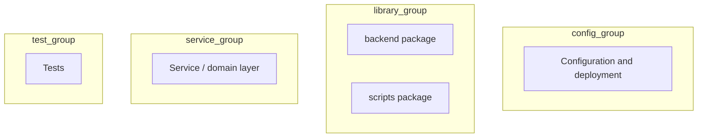

# Architecture report: sub-store-org/Sub-Store

> Automated static analysis. **Observed** = directly seen in files/imports/AST; **Inferred** = interpretation from that evidence. Repository code was not executed.

## 1. Repository at a glance

| Item | Value |
| --- | --- |
| Repository | sub-store-org/Sub-Store |
| Description | Advanced Subscription Manager for QX, Loon, Surge, Stash, Egern and Shadowrocket! |
| Language | JavaScript |
| Stars | 10904 |
| Licence | AGPL-3.0 |
| Analysed commit / branch | 2e7a63c6f4d5f067415eefc12bbbf012123e7f8d / master |
| Framework(s) | Express |
| Files analysed | 179 |
| Components | 5 |

## 2. Architecture in one minute

sub-store-org/Sub-Store - Advanced Subscription Manager for QX, Loon, Surge, Stash, Egern and Shadowrocket!. This repository was analysed statically from 179 file(s) (0 Python). Detected technologies (observed from imports/manifests): GitHub Actions, Express. Files are grouped into 5 component(s): backend package, Configuration and deployment, scripts package, Service / domain layer, Tests. Findings below distinguish observed facts from inferred interpretation.

## 3. High-level block diagram

## 4. Main components

### backend package (`backend`)

- **Kind:** library
- **Status:** Observed
- **Confidence:** 0.85
- **Responsibility:** Groups 69 file(s) under backend package (observed from repository paths and static analysis).
- **Paths:** `backend/bundle-esbuild.js`, `backend/dev-esbuild.js`, `backend/esbuild-dev.js`, `backend/src/constants.js`, `backend/src/main.js`, `backend/src/products/cron-sync-artifacts.js`, `backend/src/products/proxy-utils.esm.js`, `backend/src/products/resource-parser.loon.js`, `backend/src/products/sub-store-0.js`, `backend/src/products/sub-store-1.js`, `backend/src/restful/age-output.js`, `backend/src/restful/age.js`, `backend/src/restful/archives.js`, `backend/src/restful/artifacts.js`, `backend/src/restful/collections.js`, `backend/src/restful/download.js`, `backend/src/restful/errors/index.js`, `backend/src/restful/file.js`, `backend/src/restful/ignore-failed-remote-sub.js`, `backend/src/restful/index.js`, `backend/src/restful/logs.js`, `backend/src/restful/miscs.js`, `backend/src/restful/module.js`, `backend/src/restful/node-info.js`, `backend/src/restful/parser.js`, `backend/src/restful/preview.js`, `backend/src/restful/response-transformer.js`, `backend/src/restful/response.js`, `backend/src/restful/settings.js`, `backend/src/restful/sort.js`, `backend/src/restful/subscriptions.js`, `backend/src/restful/sync.js`, `backend/src/restful/token.js`, `backend/src/runtime/child-process.js`, `backend/src/runtime/dgram.js`, `backend/src/runtime/fs.js`, `backend/src/runtime/net.js`, `backend/src/runtime/path.js`, `backend/src/runtime/platform.js`, `backend/src/runtime/stream-promises.js`, `backend/src/runtime/tls.js`, `backend/src/runtime/worker-threads.js`, `backend/src/utils/age.js`, `backend/src/utils/archive.js`, `backend/src/utils/artifact-cron.js`, `backend/src/utils/artifact-sync-policy.js`, `backend/src/utils/cors.js`, `backend/src/utils/create-item-position.js`, `backend/src/utils/database.js`, `backend/src/utils/debug-logs.js`, `backend/src/utils/dns.js`, `backend/src/utils/download.js`, `backend/src/utils/editor-language.js`, `backend/src/utils/env.js`, `backend/src/utils/file-type.js`, `backend/src/utils/flow.js`, `backend/src/utils/frontend-static.js`, `backend/src/utils/geo.js`, `backend/src/utils/gist.js`, `backend/src/utils/headers-resource-cache.js`, `backend/src/utils/index.js`, `backend/src/utils/logical.js`, `backend/src/utils/migration.js`, `backend/src/utils/request-concurrency.js`, `backend/src/utils/resource-cache.js`, `backend/src/utils/rs.js`, `backend/src/utils/script-resource-cache.js`, `backend/src/utils/user-agent.js`, `backend/src/utils/yaml.js`
- **Evidence:** [backend/bundle-esbuild.js](https://github.com/sub-store-org/Sub-Store/blob/2e7a63c6f4d5f067415eefc12bbbf012123e7f8d/backend/bundle-esbuild.js); [backend/dev-esbuild.js](https://github.com/sub-store-org/Sub-Store/blob/2e7a63c6f4d5f067415eefc12bbbf012123e7f8d/backend/dev-esbuild.js); [backend/esbuild-dev.js](https://github.com/sub-store-org/Sub-Store/blob/2e7a63c6f4d5f067415eefc12bbbf012123e7f8d/backend/esbuild-dev.js); [backend/src/constants.js](https://github.com/sub-store-org/Sub-Store/blob/2e7a63c6f4d5f067415eefc12bbbf012123e7f8d/backend/src/constants.js); [backend/src/main.js](https://github.com/sub-store-org/Sub-Store/blob/2e7a63c6f4d5f067415eefc12bbbf012123e7f8d/backend/src/main.js); [backend/src/products/cron-sync-artifacts.js](https://github.com/sub-store-org/Sub-Store/blob/2e7a63c6f4d5f067415eefc12bbbf012123e7f8d/backend/src/products/cron-sync-artifacts.js); [backend/src/products/proxy-utils.esm.js](https://github.com/sub-store-org/Sub-Store/blob/2e7a63c6f4d5f067415eefc12bbbf012123e7f8d/backend/src/products/proxy-utils.esm.js); [backend/src/products/resource-parser.loon.js](https://github.com/sub-store-org/Sub-Store/blob/2e7a63c6f4d5f067415eefc12bbbf012123e7f8d/backend/src/products/resource-parser.loon.js)

### Configuration and deployment (`config`)

- **Kind:** config
- **Status:** Observed
- **Confidence:** 0.85
- **Responsibility:** Groups 7 file(s) under configuration and deployment (observed from repository paths and static analysis).
- **Paths:** `backend/.eslintrc.json`, `backend/.prettierrc.json`, `backend/jsconfig.json`, `backend/package.json`, `backend/pnpm-workspace.yaml`, `config/Egern.yaml`, `config/QX-Task.json`
- **Evidence:** [backend/.eslintrc.json](https://github.com/sub-store-org/Sub-Store/blob/2e7a63c6f4d5f067415eefc12bbbf012123e7f8d/backend/.eslintrc.json); [backend/.prettierrc.json](https://github.com/sub-store-org/Sub-Store/blob/2e7a63c6f4d5f067415eefc12bbbf012123e7f8d/backend/.prettierrc.json); [backend/jsconfig.json](https://github.com/sub-store-org/Sub-Store/blob/2e7a63c6f4d5f067415eefc12bbbf012123e7f8d/backend/jsconfig.json); [backend/package.json](https://github.com/sub-store-org/Sub-Store/blob/2e7a63c6f4d5f067415eefc12bbbf012123e7f8d/backend/package.json); [backend/pnpm-workspace.yaml](https://github.com/sub-store-org/Sub-Store/blob/2e7a63c6f4d5f067415eefc12bbbf012123e7f8d/backend/pnpm-workspace.yaml); [config/Egern.yaml](https://github.com/sub-store-org/Sub-Store/blob/2e7a63c6f4d5f067415eefc12bbbf012123e7f8d/config/Egern.yaml); [config/QX-Task.json](https://github.com/sub-store-org/Sub-Store/blob/2e7a63c6f4d5f067415eefc12bbbf012123e7f8d/config/QX-Task.json)

### scripts package (`scripts`)

- **Kind:** library
- **Status:** Observed
- **Confidence:** 0.85
- **Responsibility:** Groups 9 file(s) under scripts package (observed from repository paths and static analysis).
- **Paths:** `scripts/demo.js`, `scripts/fancy-characters.js`, `scripts/ip-flag-node.js`, `scripts/ip-flag.js`, `scripts/media-filter.js`, `scripts/revert.js`, `scripts/tls-fingerprint.js`, `scripts/udp-filter.js`, `scripts/vmess-ws-obfs-host.js`
- **Evidence:** [scripts/demo.js](https://github.com/sub-store-org/Sub-Store/blob/2e7a63c6f4d5f067415eefc12bbbf012123e7f8d/scripts/demo.js); [scripts/fancy-characters.js](https://github.com/sub-store-org/Sub-Store/blob/2e7a63c6f4d5f067415eefc12bbbf012123e7f8d/scripts/fancy-characters.js); [scripts/ip-flag-node.js](https://github.com/sub-store-org/Sub-Store/blob/2e7a63c6f4d5f067415eefc12bbbf012123e7f8d/scripts/ip-flag-node.js); [scripts/ip-flag.js](https://github.com/sub-store-org/Sub-Store/blob/2e7a63c6f4d5f067415eefc12bbbf012123e7f8d/scripts/ip-flag.js); [scripts/media-filter.js](https://github.com/sub-store-org/Sub-Store/blob/2e7a63c6f4d5f067415eefc12bbbf012123e7f8d/scripts/media-filter.js); [scripts/revert.js](https://github.com/sub-store-org/Sub-Store/blob/2e7a63c6f4d5f067415eefc12bbbf012123e7f8d/scripts/revert.js); [scripts/tls-fingerprint.js](https://github.com/sub-store-org/Sub-Store/blob/2e7a63c6f4d5f067415eefc12bbbf012123e7f8d/scripts/tls-fingerprint.js); [scripts/udp-filter.js](https://github.com/sub-store-org/Sub-Store/blob/2e7a63c6f4d5f067415eefc12bbbf012123e7f8d/scripts/udp-filter.js)

### Service / domain layer (`service_layer`)

- **Kind:** service
- **Status:** Observed
- **Confidence:** 0.85
- **Responsibility:** Groups 34 file(s) under service / domain layer (observed from repository paths and static analysis).
- **Paths:** `backend/src/core/app.js`, `backend/src/core/proxy-utils/ech-utils.js`, `backend/src/core/proxy-utils/index.js`, `backend/src/core/proxy-utils/parsers/index.js`, `backend/src/core/proxy-utils/parsers/peggy/loon.js`, `backend/src/core/proxy-utils/parsers/peggy/qx.js`, `backend/src/core/proxy-utils/parsers/peggy/surge.js`, `backend/src/core/proxy-utils/parsers/peggy/trojan-uri.js`, `backend/src/core/proxy-utils/preprocessors/index.js`, `backend/src/core/proxy-utils/processors/index.js`, `backend/src/core/proxy-utils/producers/clash.js`, `backend/src/core/proxy-utils/producers/clashmeta.js`, `backend/src/core/proxy-utils/producers/egern.js`, `backend/src/core/proxy-utils/producers/index.js`, `backend/src/core/proxy-utils/producers/loon.js`, `backend/src/core/proxy-utils/producers/qx.js`, `backend/src/core/proxy-utils/producers/shadowrocket.js`, `backend/src/core/proxy-utils/producers/sing-box.js`, `backend/src/core/proxy-utils/producers/stash.js`, `backend/src/core/proxy-utils/producers/surfboard.js`, `backend/src/core/proxy-utils/producers/surge.js`, `backend/src/core/proxy-utils/producers/surgemac.js`, `backend/src/core/proxy-utils/producers/uri.js`, `backend/src/core/proxy-utils/producers/utils.js`, `backend/src/core/proxy-utils/producers/v2ray.js`, `backend/src/core/proxy-utils/surge-xhttp.js`, `backend/src/core/proxy-utils/transport-path.js`, `backend/src/core/proxy-utils/validators/index.js`, `backend/src/core/proxy-utils/vmess-security.js`, `backend/src/core/proxy-utils/xhttp-utils.js`, `backend/src/core/rule-utils/index.js`, `backend/src/core/rule-utils/parsers.js`, `backend/src/core/rule-utils/preprocessors.js`, `backend/src/core/rule-utils/producers.js`
- **Evidence:** [backend/src/core/app.js](https://github.com/sub-store-org/Sub-Store/blob/2e7a63c6f4d5f067415eefc12bbbf012123e7f8d/backend/src/core/app.js); [backend/src/core/proxy-utils/ech-utils.js](https://github.com/sub-store-org/Sub-Store/blob/2e7a63c6f4d5f067415eefc12bbbf012123e7f8d/backend/src/core/proxy-utils/ech-utils.js); [backend/src/core/proxy-utils/index.js](https://github.com/sub-store-org/Sub-Store/blob/2e7a63c6f4d5f067415eefc12bbbf012123e7f8d/backend/src/core/proxy-utils/index.js); [backend/src/core/proxy-utils/parsers/index.js](https://github.com/sub-store-org/Sub-Store/blob/2e7a63c6f4d5f067415eefc12bbbf012123e7f8d/backend/src/core/proxy-utils/parsers/index.js); [backend/src/core/proxy-utils/parsers/peggy/loon.js](https://github.com/sub-store-org/Sub-Store/blob/2e7a63c6f4d5f067415eefc12bbbf012123e7f8d/backend/src/core/proxy-utils/parsers/peggy/loon.js); [backend/src/core/proxy-utils/parsers/peggy/qx.js](https://github.com/sub-store-org/Sub-Store/blob/2e7a63c6f4d5f067415eefc12bbbf012123e7f8d/backend/src/core/proxy-utils/parsers/peggy/qx.js); [backend/src/core/proxy-utils/parsers/peggy/surge.js](https://github.com/sub-store-org/Sub-Store/blob/2e7a63c6f4d5f067415eefc12bbbf012123e7f8d/backend/src/core/proxy-utils/parsers/peggy/surge.js); [backend/src/core/proxy-utils/parsers/peggy/trojan-uri.js](https://github.com/sub-store-org/Sub-Store/blob/2e7a63c6f4d5f067415eefc12bbbf012123e7f8d/backend/src/core/proxy-utils/parsers/peggy/trojan-uri.js)

### Tests (`tests`)

- **Kind:** test
- **Status:** Observed
- **Confidence:** 0.85
- **Responsibility:** Groups 39 file(s) under tests (observed from repository paths and static analysis).
- **Paths:** `backend/src/test/config/cors-module-config.spec.js`, `backend/src/test/products/resource-parser.loon.spec.js`, `backend/src/test/products/sub-store-0.spec.js`, `backend/src/test/proxy-parsers/helpers.js`, `backend/src/test/proxy-parsers/pipeline.spec.js`, `backend/src/test/proxy-parsers/qx-comma-password.spec.js`, `backend/src/test/proxy-parsers/uri.spec.js`, `backend/src/test/proxy-parsers/v2ray-and-platforms.spec.js`, `backend/src/test/proxy-preprocessors/preprocessors.spec.js`, `backend/src/test/proxy-processors/process-context.spec.js`, `backend/src/test/proxy-processors/resolve-domain.spec.js`, `backend/src/test/proxy-producers/helpers.js`, `backend/src/test/proxy-producers/target-alias.spec.js`, `backend/src/test/restful/age-config-validation.spec.js`, `backend/src/test/restful/age.spec.js`, `backend/src/test/restful/archive.spec.js`, `backend/src/test/restful/create-position.spec.js`, `backend/src/test/restful/download.spec.js`, `backend/src/test/restful/file.spec.js`, `backend/src/test/restful/gist-backup-age.spec.js`, `backend/src/test/restful/index.spec.js`, `backend/src/test/restful/logs.spec.js`, `backend/src/test/restful/mihomo-config.spec.js`, `backend/src/test/restful/settings.spec.js`, `backend/src/test/restful/sync.spec.js`, `backend/src/test/restful/token.spec.js`, `backend/src/test/runtime/browser-bundle.spec.js`, `backend/src/test/runtime/builtin.spec.js`, `backend/src/test/runtime/runtime-manifest.spec.js`, `backend/src/test/utils/age-bundle.spec.js`, `backend/src/test/utils/age.spec.js`, `backend/src/test/utils/artifact-cron.spec.js`, `backend/src/test/utils/artifact-sync-policy.spec.js`, `backend/src/test/utils/cors.spec.js`, `backend/src/test/utils/download.spec.js`, `backend/src/test/utils/flow.spec.js`, `backend/src/test/utils/frontend-static.spec.js`, `backend/src/test/utils/gist.spec.js`, `backend/src/test/utils/request-concurrency.spec.js`
- **Evidence:** [backend/src/test/config/cors-module-config.spec.js](https://github.com/sub-store-org/Sub-Store/blob/2e7a63c6f4d5f067415eefc12bbbf012123e7f8d/backend/src/test/config/cors-module-config.spec.js); [backend/src/test/products/resource-parser.loon.spec.js](https://github.com/sub-store-org/Sub-Store/blob/2e7a63c6f4d5f067415eefc12bbbf012123e7f8d/backend/src/test/products/resource-parser.loon.spec.js); [backend/src/test/products/sub-store-0.spec.js](https://github.com/sub-store-org/Sub-Store/blob/2e7a63c6f4d5f067415eefc12bbbf012123e7f8d/backend/src/test/products/sub-store-0.spec.js); [backend/src/test/proxy-parsers/helpers.js](https://github.com/sub-store-org/Sub-Store/blob/2e7a63c6f4d5f067415eefc12bbbf012123e7f8d/backend/src/test/proxy-parsers/helpers.js); [backend/src/test/proxy-parsers/pipeline.spec.js](https://github.com/sub-store-org/Sub-Store/blob/2e7a63c6f4d5f067415eefc12bbbf012123e7f8d/backend/src/test/proxy-parsers/pipeline.spec.js); [backend/src/test/proxy-parsers/qx-comma-password.spec.js](https://github.com/sub-store-org/Sub-Store/blob/2e7a63c6f4d5f067415eefc12bbbf012123e7f8d/backend/src/test/proxy-parsers/qx-comma-password.spec.js); [backend/src/test/proxy-parsers/uri.spec.js](https://github.com/sub-store-org/Sub-Store/blob/2e7a63c6f4d5f067415eefc12bbbf012123e7f8d/backend/src/test/proxy-parsers/uri.spec.js); [backend/src/test/proxy-parsers/v2ray-and-platforms.spec.js](https://github.com/sub-store-org/Sub-Store/blob/2e7a63c6f4d5f067415eefc12bbbf012123e7f8d/backend/src/test/proxy-parsers/v2ray-and-platforms.spec.js)

## 5. Execution flow

**Observed** entry point(s):

- [backend/src/core/app.js](https://github.com/sub-store-org/Sub-Store/blob/2e7a63c6f4d5f067415eefc12bbbf012123e7f8d/backend/src/core/app.js)
- [backend/src/main.js](https://github.com/sub-store-org/Sub-Store/blob/2e7a63c6f4d5f067415eefc12bbbf012123e7f8d/backend/src/main.js)
- [backend/src/restful/index.js](https://github.com/sub-store-org/Sub-Store/blob/2e7a63c6f4d5f067415eefc12bbbf012123e7f8d/backend/src/restful/index.js)
- [backend/src/utils/index.js](https://github.com/sub-store-org/Sub-Store/blob/2e7a63c6f4d5f067415eefc12bbbf012123e7f8d/backend/src/utils/index.js)

Representative flow (derived from observed entry points and the import graph; steps beyond the entry point are **Inferred**):

1. Execution starts at an observed entry point listed above, if present.
2. No internal import relationships between components were observed.

## 6. Project structure

### `(root)`

- `.gitignore` - other (2141 bytes)
- `.node-version` - other (8 bytes)
- `LICENSE` - docs (34577 bytes)
- `README.md` - docs (10967 bytes)
- `vs.code-workspace` - other (60 bytes)

### `.github`

- `.github/ISSUE_TEMPLATE/功能建议.yml` - config (1823 bytes)
- `.github/ISSUE_TEMPLATE/问题反馈.yml` - config (2658 bytes)
- `.github/workflows/main.yml` - ci, YAML (3964 bytes)
- `.github/workflows/star-history.yml` - ci, YAML (353 bytes)

### `backend`

- `backend/.babelrc` - other (506 bytes)
- `backend/.eslintrc.json` - config (301 bytes)
- `backend/.prettierrc.json` - config (103 bytes)
- `backend/banner` - other (1480 bytes)
- `backend/bundle-esbuild.js` - source, JavaScript (7097 bytes)
- `backend/dev-esbuild.js` - source, JavaScript (774 bytes)
- `backend/esbuild-dev.js` - source, JavaScript (3653 bytes)
- `backend/jsconfig.json` - config (94 bytes)
- `backend/package.json` - manifest (2047 bytes)
- `backend/patches/http-proxy@1.18.1.patch` - other (1653 bytes)
- `backend/pnpm-workspace.yaml` - config (249 bytes)
- `backend/src/constants.js` - source, JavaScript (1154 bytes)
- `backend/src/core/app.js` - source, JavaScript (144 bytes)
- `backend/src/core/proxy-utils/ech-utils.js` - source, JavaScript (4296 bytes)
- `backend/src/core/proxy-utils/index.js` - source, JavaScript (40631 bytes)
- `backend/src/core/proxy-utils/parsers/index.js` - source, JavaScript (116776 bytes)
- `backend/src/core/proxy-utils/parsers/peggy/loon.js` - source, JavaScript (14155 bytes)
- `backend/src/core/proxy-utils/parsers/peggy/qx.js` - source, JavaScript (12331 bytes)
- `backend/src/core/proxy-utils/parsers/peggy/surge.js` - source, JavaScript (30769 bytes)
- `backend/src/core/proxy-utils/parsers/peggy/trojan-uri.js` - source, JavaScript (5590 bytes)
- `backend/src/core/proxy-utils/preprocessors/index.js` - source, JavaScript (7799 bytes)
- `backend/src/core/proxy-utils/processors/index.js` - source, JavaScript (59062 bytes)
- `backend/src/core/proxy-utils/producers/clash.js` - source, JavaScript (9223 bytes)
- `backend/src/core/proxy-utils/producers/clashmeta.js` - source, JavaScript (21597 bytes)
- `backend/src/core/proxy-utils/producers/egern.js` - source, JavaScript (38343 bytes)
- `backend/src/core/proxy-utils/producers/index.js` - source, JavaScript (1827 bytes)
- `backend/src/core/proxy-utils/producers/loon.js` - source, JavaScript (27476 bytes)
- `backend/src/core/proxy-utils/producers/qx.js` - source, JavaScript (21503 bytes)
- `backend/src/core/proxy-utils/producers/shadowrocket.js` - source, JavaScript (13456 bytes)
- `backend/src/core/proxy-utils/producers/sing-box.js` - source, JavaScript (68279 bytes)
- `backend/src/core/proxy-utils/producers/stash.js` - source, JavaScript (15031 bytes)
- `backend/src/core/proxy-utils/producers/surfboard.js` - source, JavaScript (12434 bytes)
- `backend/src/core/proxy-utils/producers/surge.js` - source, JavaScript (48474 bytes)
- `backend/src/core/proxy-utils/producers/surgemac.js` - source, JavaScript (9441 bytes)
- `backend/src/core/proxy-utils/producers/uri.js` - source, JavaScript (63374 bytes)
- `backend/src/core/proxy-utils/producers/utils.js` - source, JavaScript (6818 bytes)
- `backend/src/core/proxy-utils/producers/v2ray.js` - source, JavaScript (621 bytes)
- `backend/src/core/proxy-utils/surge-xhttp.js` - source, JavaScript (2525 bytes)
- `backend/src/core/proxy-utils/transport-path.js` - source, JavaScript (4329 bytes)
- `backend/src/core/proxy-utils/validators/index.js` - source, JavaScript (0 bytes)
- `backend/src/core/proxy-utils/vmess-security.js` - source, JavaScript (2337 bytes)
- `backend/src/core/proxy-utils/xhttp-utils.js` - source, JavaScript (4625 bytes)
- `backend/src/core/rule-utils/index.js` - source, JavaScript (2140 bytes)
- `backend/src/core/rule-utils/parsers.js` - source, JavaScript (2112 bytes)
- `backend/src/core/rule-utils/preprocessors.js` - source, JavaScript (500 bytes)
- `backend/src/core/rule-utils/producers.js` - source, JavaScript (3065 bytes)
- `backend/src/main.js` - source, JavaScript (2549 bytes)
- `backend/src/products/cron-sync-artifacts.js` - source, JavaScript (10588 bytes)
- `backend/src/products/proxy-utils.esm.js` - source, JavaScript (117 bytes)
- `backend/src/products/resource-parser.loon.js` - source, JavaScript (4829 bytes)
- `backend/src/products/sub-store-0.js` - source, JavaScript (1718 bytes)
- `backend/src/products/sub-store-1.js` - source, JavaScript (1113 bytes)
- `backend/src/restful/age-output.js` - source, JavaScript (1732 bytes)
- `backend/src/restful/age.js` - source, JavaScript (987 bytes)
- `backend/src/restful/archives.js` - source, JavaScript (3679 bytes)
- `backend/src/restful/artifacts.js` - source, JavaScript (14017 bytes)
- `backend/src/restful/collections.js` - source, JavaScript (6405 bytes)
- `backend/src/restful/download.js` - source, JavaScript (30515 bytes)
- `backend/src/restful/errors/index.js` - source, JavaScript (892 bytes)
- `backend/src/restful/file.js` - source, JavaScript (20893 bytes)
- `backend/src/restful/ignore-failed-remote-sub.js` - source, JavaScript (2069 bytes)
- `backend/src/restful/index.js` - source, JavaScript (22128 bytes)
- `backend/src/restful/logs.js` - source, JavaScript (1379 bytes)
- `backend/src/restful/miscs.js` - source, JavaScript (17185 bytes)
- `backend/src/restful/module.js` - source, JavaScript (3157 bytes)
- `backend/src/restful/node-info.js` - source, JavaScript (1759 bytes)
- `backend/src/restful/parser.js` - source, JavaScript (1968 bytes)
- `backend/src/restful/preview.js` - source, JavaScript (17228 bytes)
- `backend/src/restful/response-transformer.js` - source, JavaScript (1498 bytes)
- `backend/src/restful/response.js` - source, JavaScript (537 bytes)
- `backend/src/restful/settings.js` - source, JavaScript (10498 bytes)
- `backend/src/restful/sort.js` - source, JavaScript (2059 bytes)
- `backend/src/restful/subscriptions.js` - source, JavaScript (13719 bytes)
- `backend/src/restful/sync.js` - source, JavaScript (50371 bytes)
- `backend/src/restful/token.js` - source, JavaScript (15950 bytes)
- `backend/src/runtime/child-process.js` - source, JavaScript (151 bytes)
- `backend/src/runtime/dgram.js` - source, JavaScript (136 bytes)
- `backend/src/runtime/fs.js` - source, JavaScript (130 bytes)
- `backend/src/runtime/net.js` - source, JavaScript (132 bytes)
- `backend/src/runtime/path.js` - source, JavaScript (134 bytes)
- `backend/src/runtime/platform.js` - source, JavaScript (208 bytes)
- `backend/src/runtime/stream-promises.js` - source, JavaScript (155 bytes)
- `backend/src/runtime/tls.js` - source, JavaScript (132 bytes)
- `backend/src/runtime/worker-threads.js` - source, JavaScript (158 bytes)
- `backend/src/test/config/cors-module-config.spec.js` - test, JavaScript (2278 bytes)
- `backend/src/test/products/resource-parser.loon.spec.js` - test, JavaScript (11596 bytes)
- `backend/src/test/products/sub-store-0.spec.js` - test, JavaScript (551 bytes)
- `backend/src/test/proxy-parsers/helpers.js` - test, JavaScript (919 bytes)
- `backend/src/test/proxy-parsers/pipeline.spec.js` - test, JavaScript (8514 bytes)
- `backend/src/test/proxy-parsers/qx-comma-password.spec.js` - test, JavaScript (3218 bytes)
- `backend/src/test/proxy-parsers/uri.spec.js` - test, JavaScript (31153 bytes)
- `backend/src/test/proxy-parsers/v2ray-and-platforms.spec.js` - test, JavaScript (165780 bytes)
- `backend/src/test/proxy-preprocessors/preprocessors.spec.js` - test, JavaScript (22880 bytes)
- `backend/src/test/proxy-processors/process-context.spec.js` - test, JavaScript (12589 bytes)
- `backend/src/test/proxy-processors/resolve-domain.spec.js` - test, JavaScript (38504 bytes)
- `backend/src/test/proxy-producers/helpers.js` - test, JavaScript (1537 bytes)
- `backend/src/test/proxy-producers/target-alias.spec.js` - test, JavaScript (990 bytes)
- `backend/src/test/restful/age-config-validation.spec.js` - test, JavaScript (8111 bytes)
- `backend/src/test/restful/age.spec.js` - test, JavaScript (2195 bytes)
- `backend/src/test/restful/archive.spec.js` - test, JavaScript (21060 bytes)
- `backend/src/test/restful/create-position.spec.js` - test, JavaScript (10285 bytes)
- `backend/src/test/restful/download.spec.js` - test, JavaScript (35944 bytes)
- `backend/src/test/restful/file.spec.js` - test, JavaScript (17785 bytes)
- `backend/src/test/restful/gist-backup-age.spec.js` - test, JavaScript (11113 bytes)
- `backend/src/test/restful/index.spec.js` - test, JavaScript (955 bytes)
- `backend/src/test/restful/logs.spec.js` - test, JavaScript (21914 bytes)
- `backend/src/test/restful/mihomo-config.spec.js` - test, JavaScript (28257 bytes)
- `backend/src/test/restful/settings.spec.js` - test, JavaScript (14857 bytes)
- `backend/src/test/restful/sync.spec.js` - test, JavaScript (17925 bytes)
- `backend/src/test/restful/token.spec.js` - test, JavaScript (14701 bytes)
- `backend/src/test/runtime/browser-bundle.spec.js` - test, JavaScript (1006 bytes)
- `backend/src/test/runtime/builtin.spec.js` - test, JavaScript (998 bytes)
- `backend/src/test/runtime/runtime-manifest.spec.js` - test, JavaScript (5872 bytes)
- `backend/src/test/utils/age-bundle.spec.js` - test, JavaScript (3651 bytes)
- `backend/src/test/utils/age.spec.js` - test, JavaScript (4286 bytes)
- `backend/src/test/utils/artifact-cron.spec.js` - test, JavaScript (3592 bytes)
- `backend/src/test/utils/artifact-sync-policy.spec.js` - test, JavaScript (2135 bytes)
- `backend/src/test/utils/cors.spec.js` - test, JavaScript (6638 bytes)
- `backend/src/test/utils/download.spec.js` - test, JavaScript (14036 bytes)
- `backend/src/test/utils/flow.spec.js` - test, JavaScript (6239 bytes)
- `backend/src/test/utils/frontend-static.spec.js` - test, JavaScript (10470 bytes)
- `backend/src/test/utils/gist.spec.js` - test, JavaScript (13386 bytes)
- `backend/src/test/utils/request-concurrency.spec.js` - test, JavaScript (5378 bytes)
- `backend/src/utils/age.js` - source, JavaScript (11094 bytes)
- `backend/src/utils/archive.js` - source, JavaScript (5149 bytes)
- `backend/src/utils/artifact-cron.js` - source, JavaScript (4092 bytes)
- `backend/src/utils/artifact-sync-policy.js` - source, JavaScript (1093 bytes)
- `backend/src/utils/cors.js` - source, JavaScript (5250 bytes)
- `backend/src/utils/create-item-position.js` - source, JavaScript (286 bytes)
- `backend/src/utils/database.js` - source, JavaScript (697 bytes)
- `backend/src/utils/debug-logs.js` - source, JavaScript (10761 bytes)
- `backend/src/utils/dns.js` - source, JavaScript (11365 bytes)
- `backend/src/utils/download.js` - source, JavaScript (17863 bytes)
- `backend/src/utils/editor-language.js` - source, JavaScript (693 bytes)
- `backend/src/utils/env.js` - source, JavaScript (1809 bytes)
- `backend/src/utils/file-type.js` - source, JavaScript (933 bytes)
- `backend/src/utils/flow.js` - source, JavaScript (21087 bytes)
- `backend/src/utils/frontend-static.js` - source, JavaScript (2282 bytes)
- `backend/src/utils/geo.js` - source, JavaScript (28029 bytes)
- `backend/src/utils/gist.js` - source, JavaScript (15608 bytes)
- `backend/src/utils/headers-resource-cache.js` - source, JavaScript (2852 bytes)
- `backend/src/utils/index.js` - source, JavaScript (5670 bytes)
- `backend/src/utils/logical.js` - source, JavaScript (353 bytes)
- `backend/src/utils/migration.js` - source, JavaScript (4407 bytes)
- `backend/src/utils/request-concurrency.js` - source, JavaScript (3834 bytes)
- `backend/src/utils/resource-cache.js` - source, JavaScript (2781 bytes)
- `backend/src/utils/rs.js` - source, JavaScript (289 bytes)
- `backend/src/utils/script-resource-cache.js` - source, JavaScript (2842 bytes)
- `backend/src/utils/user-agent.js` - source, JavaScript (1881 bytes)
- `backend/src/utils/yaml.js` - source, JavaScript (2459 bytes)

### `config`

- `config/Egern.yaml` - config (3781 bytes)
- `config/Loon-parser.plugin` - other (1219 bytes)
- `config/Loon.plugin` - other (1671 bytes)
- `config/QX-Task.json` - config (422 bytes)
- `config/QX.snippet` - other (358 bytes)
- `config/README.md` - docs (5945 bytes)
- `config/Stash.stoverride` - other (1179 bytes)
- `config/Surge-Beta.sgmodule` - other (3543 bytes)
- `config/Surge-Noability.sgmodule` - other (1323 bytes)
- `config/Surge-ability.sgmodule` - other (1139 bytes)
- `config/Surge.sgmodule` - other (3539 bytes)

### `scripts`

- `scripts/demo.js` - source, JavaScript (33964 bytes)
- `scripts/fancy-characters.js` - source, JavaScript (9153 bytes)
- `scripts/ip-flag-node.js` - source, JavaScript (2104 bytes)
- `scripts/ip-flag.js` - source, JavaScript (9318 bytes)
- `scripts/media-filter.js` - source, JavaScript (0 bytes)
- `scripts/revert.js` - source, JavaScript (4797 bytes)
- `scripts/tls-fingerprint.js` - source, JavaScript (251 bytes)
- `scripts/udp-filter.js` - source, JavaScript (92 bytes)
- `scripts/vmess-ws-obfs-host.js` - source, JavaScript (437 bytes)

## 7. Key dependencies and integrations

| Name | Category | Status | Confidence | Evidence |
| --- | --- | --- | --- | --- |
| GitHub Actions | ci | Observed | 0.90 | [.github/workflows/main.yml](https://github.com/sub-store-org/Sub-Store/blob/2e7a63c6f4d5f067415eefc12bbbf012123e7f8d/.github/workflows/main.yml); [.github/workflows/star-history.yml](https://github.com/sub-store-org/Sub-Store/blob/2e7a63c6f4d5f067415eefc12bbbf012123e7f8d/.github/workflows/star-history.yml) |
| Express | framework | Observed | 0.85 | [backend/package.json:30](https://github.com/sub-store-org/Sub-Store/blob/2e7a63c6f4d5f067415eefc12bbbf012123e7f8d/backend/package.json#L30) |

## 8. Data and state

No database, cache, queue, or persistent-state usage was observed in the analysed files. State handling, if any, may be in-memory or in files that were not analysed.

## 9. Configuration and deployment clues

- `.github/ISSUE_TEMPLATE/功能建议.yml` (config)
- `.github/ISSUE_TEMPLATE/问题反馈.yml` (config)
- `.github/workflows/main.yml` (ci)
- `.github/workflows/star-history.yml` (ci)
- `backend/.eslintrc.json` (config)
- `backend/.prettierrc.json` (config)
- `backend/jsconfig.json` (config)
- `backend/package.json` (manifest)
- `backend/pnpm-workspace.yaml` (config)
- `config/Egern.yaml` (config)
- `config/QX-Task.json` (config)

## 10. Design observations

- Service/domain code is distinct from entry and data code, suggesting layered separation (Inferred).
- Tests are present alongside source code (Observed from test file paths).

These observations are interpretations (**Inferred**) of the observed structure, not guarantees about runtime design.

## 11. Limitations and unknowns

- Static analysis only: repository code was not executed, installed, or imported at runtime.
- Components and relationships are inferred from file paths, imports, and AST structure; runtime behaviour, dynamic imports, and reflection may not be visible.
- 9 file(s) were skipped during inventory (1 x lockfile excluded; 8 x vendored/generated directory excluded).
- No clear application entry point was observed in the analysed files.
- Repository text was treated as untrusted data; no instructions found in repository files were followed, and likely secret values were redacted/excluded.
- JavaScript and TypeScript files were inventoried from paths and package manifests. They were not parsed with a full language AST, and repository code was not executed.

## 12. Source references

- [.github/workflows/main.yml](https://github.com/sub-store-org/Sub-Store/blob/2e7a63c6f4d5f067415eefc12bbbf012123e7f8d/.github/workflows/main.yml)
- [.github/workflows/star-history.yml](https://github.com/sub-store-org/Sub-Store/blob/2e7a63c6f4d5f067415eefc12bbbf012123e7f8d/.github/workflows/star-history.yml)
- [backend/.eslintrc.json](https://github.com/sub-store-org/Sub-Store/blob/2e7a63c6f4d5f067415eefc12bbbf012123e7f8d/backend/.eslintrc.json)
- [backend/.prettierrc.json](https://github.com/sub-store-org/Sub-Store/blob/2e7a63c6f4d5f067415eefc12bbbf012123e7f8d/backend/.prettierrc.json)
- [backend/bundle-esbuild.js](https://github.com/sub-store-org/Sub-Store/blob/2e7a63c6f4d5f067415eefc12bbbf012123e7f8d/backend/bundle-esbuild.js)
- [backend/dev-esbuild.js](https://github.com/sub-store-org/Sub-Store/blob/2e7a63c6f4d5f067415eefc12bbbf012123e7f8d/backend/dev-esbuild.js)
- [backend/esbuild-dev.js](https://github.com/sub-store-org/Sub-Store/blob/2e7a63c6f4d5f067415eefc12bbbf012123e7f8d/backend/esbuild-dev.js)
- [backend/jsconfig.json](https://github.com/sub-store-org/Sub-Store/blob/2e7a63c6f4d5f067415eefc12bbbf012123e7f8d/backend/jsconfig.json)
- [backend/package.json](https://github.com/sub-store-org/Sub-Store/blob/2e7a63c6f4d5f067415eefc12bbbf012123e7f8d/backend/package.json)
- [backend/package.json:30](https://github.com/sub-store-org/Sub-Store/blob/2e7a63c6f4d5f067415eefc12bbbf012123e7f8d/backend/package.json#L30)
- [backend/pnpm-workspace.yaml](https://github.com/sub-store-org/Sub-Store/blob/2e7a63c6f4d5f067415eefc12bbbf012123e7f8d/backend/pnpm-workspace.yaml)
- [backend/src/constants.js](https://github.com/sub-store-org/Sub-Store/blob/2e7a63c6f4d5f067415eefc12bbbf012123e7f8d/backend/src/constants.js)
- [backend/src/core/app.js](https://github.com/sub-store-org/Sub-Store/blob/2e7a63c6f4d5f067415eefc12bbbf012123e7f8d/backend/src/core/app.js)
- [backend/src/core/proxy-utils/ech-utils.js](https://github.com/sub-store-org/Sub-Store/blob/2e7a63c6f4d5f067415eefc12bbbf012123e7f8d/backend/src/core/proxy-utils/ech-utils.js)
- [backend/src/core/proxy-utils/index.js](https://github.com/sub-store-org/Sub-Store/blob/2e7a63c6f4d5f067415eefc12bbbf012123e7f8d/backend/src/core/proxy-utils/index.js)
- [backend/src/core/proxy-utils/parsers/index.js](https://github.com/sub-store-org/Sub-Store/blob/2e7a63c6f4d5f067415eefc12bbbf012123e7f8d/backend/src/core/proxy-utils/parsers/index.js)
- [backend/src/core/proxy-utils/parsers/peggy/loon.js](https://github.com/sub-store-org/Sub-Store/blob/2e7a63c6f4d5f067415eefc12bbbf012123e7f8d/backend/src/core/proxy-utils/parsers/peggy/loon.js)
- [backend/src/core/proxy-utils/parsers/peggy/qx.js](https://github.com/sub-store-org/Sub-Store/blob/2e7a63c6f4d5f067415eefc12bbbf012123e7f8d/backend/src/core/proxy-utils/parsers/peggy/qx.js)
- [backend/src/core/proxy-utils/parsers/peggy/surge.js](https://github.com/sub-store-org/Sub-Store/blob/2e7a63c6f4d5f067415eefc12bbbf012123e7f8d/backend/src/core/proxy-utils/parsers/peggy/surge.js)
- [backend/src/core/proxy-utils/parsers/peggy/trojan-uri.js](https://github.com/sub-store-org/Sub-Store/blob/2e7a63c6f4d5f067415eefc12bbbf012123e7f8d/backend/src/core/proxy-utils/parsers/peggy/trojan-uri.js)
- [backend/src/main.js](https://github.com/sub-store-org/Sub-Store/blob/2e7a63c6f4d5f067415eefc12bbbf012123e7f8d/backend/src/main.js)
- [backend/src/products/cron-sync-artifacts.js](https://github.com/sub-store-org/Sub-Store/blob/2e7a63c6f4d5f067415eefc12bbbf012123e7f8d/backend/src/products/cron-sync-artifacts.js)
- [backend/src/products/proxy-utils.esm.js](https://github.com/sub-store-org/Sub-Store/blob/2e7a63c6f4d5f067415eefc12bbbf012123e7f8d/backend/src/products/proxy-utils.esm.js)
- [backend/src/products/resource-parser.loon.js](https://github.com/sub-store-org/Sub-Store/blob/2e7a63c6f4d5f067415eefc12bbbf012123e7f8d/backend/src/products/resource-parser.loon.js)
- [backend/src/restful/index.js](https://github.com/sub-store-org/Sub-Store/blob/2e7a63c6f4d5f067415eefc12bbbf012123e7f8d/backend/src/restful/index.js)
- [backend/src/test/config/cors-module-config.spec.js](https://github.com/sub-store-org/Sub-Store/blob/2e7a63c6f4d5f067415eefc12bbbf012123e7f8d/backend/src/test/config/cors-module-config.spec.js)
- [backend/src/test/products/resource-parser.loon.spec.js](https://github.com/sub-store-org/Sub-Store/blob/2e7a63c6f4d5f067415eefc12bbbf012123e7f8d/backend/src/test/products/resource-parser.loon.spec.js)
- [backend/src/test/products/sub-store-0.spec.js](https://github.com/sub-store-org/Sub-Store/blob/2e7a63c6f4d5f067415eefc12bbbf012123e7f8d/backend/src/test/products/sub-store-0.spec.js)
- [backend/src/test/proxy-parsers/helpers.js](https://github.com/sub-store-org/Sub-Store/blob/2e7a63c6f4d5f067415eefc12bbbf012123e7f8d/backend/src/test/proxy-parsers/helpers.js)
- [backend/src/test/proxy-parsers/pipeline.spec.js](https://github.com/sub-store-org/Sub-Store/blob/2e7a63c6f4d5f067415eefc12bbbf012123e7f8d/backend/src/test/proxy-parsers/pipeline.spec.js)
- [backend/src/test/proxy-parsers/qx-comma-password.spec.js](https://github.com/sub-store-org/Sub-Store/blob/2e7a63c6f4d5f067415eefc12bbbf012123e7f8d/backend/src/test/proxy-parsers/qx-comma-password.spec.js)
- [backend/src/test/proxy-parsers/uri.spec.js](https://github.com/sub-store-org/Sub-Store/blob/2e7a63c6f4d5f067415eefc12bbbf012123e7f8d/backend/src/test/proxy-parsers/uri.spec.js)
- [backend/src/test/proxy-parsers/v2ray-and-platforms.spec.js](https://github.com/sub-store-org/Sub-Store/blob/2e7a63c6f4d5f067415eefc12bbbf012123e7f8d/backend/src/test/proxy-parsers/v2ray-and-platforms.spec.js)
- [backend/src/utils/index.js](https://github.com/sub-store-org/Sub-Store/blob/2e7a63c6f4d5f067415eefc12bbbf012123e7f8d/backend/src/utils/index.js)
- [config/Egern.yaml](https://github.com/sub-store-org/Sub-Store/blob/2e7a63c6f4d5f067415eefc12bbbf012123e7f8d/config/Egern.yaml)
- [config/QX-Task.json](https://github.com/sub-store-org/Sub-Store/blob/2e7a63c6f4d5f067415eefc12bbbf012123e7f8d/config/QX-Task.json)
- [scripts/demo.js](https://github.com/sub-store-org/Sub-Store/blob/2e7a63c6f4d5f067415eefc12bbbf012123e7f8d/scripts/demo.js)
- [scripts/fancy-characters.js](https://github.com/sub-store-org/Sub-Store/blob/2e7a63c6f4d5f067415eefc12bbbf012123e7f8d/scripts/fancy-characters.js)
- [scripts/ip-flag-node.js](https://github.com/sub-store-org/Sub-Store/blob/2e7a63c6f4d5f067415eefc12bbbf012123e7f8d/scripts/ip-flag-node.js)
- [scripts/ip-flag.js](https://github.com/sub-store-org/Sub-Store/blob/2e7a63c6f4d5f067415eefc12bbbf012123e7f8d/scripts/ip-flag.js)
- [scripts/media-filter.js](https://github.com/sub-store-org/Sub-Store/blob/2e7a63c6f4d5f067415eefc12bbbf012123e7f8d/scripts/media-filter.js)
- [scripts/revert.js](https://github.com/sub-store-org/Sub-Store/blob/2e7a63c6f4d5f067415eefc12bbbf012123e7f8d/scripts/revert.js)
- [scripts/tls-fingerprint.js](https://github.com/sub-store-org/Sub-Store/blob/2e7a63c6f4d5f067415eefc12bbbf012123e7f8d/scripts/tls-fingerprint.js)
- [scripts/udp-filter.js](https://github.com/sub-store-org/Sub-Store/blob/2e7a63c6f4d5f067415eefc12bbbf012123e7f8d/scripts/udp-filter.js)
