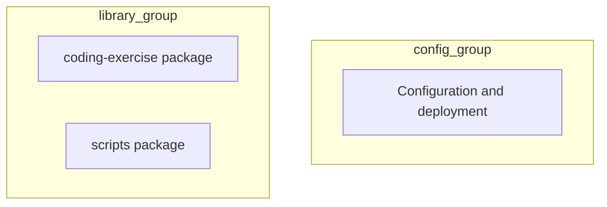

# Architecture report: sudheerj/javascript-interview-questions

> Automated static analysis. **Observed** = directly seen in files/imports/AST; **Inferred** = interpretation from that evidence. Repository code was not executed.

## 1. Repository at a glance

| Item | Value |
| --- | --- |
| Repository | sudheerj/javascript-interview-questions |
| Description | List of 1000 JavaScript Interview Questions |
| Language | JavaScript |
| Stars | 27679 |
| Licence | Not detected |
| Analysed commit / branch | 698de06ad5d9eb2eeb7dfff7f7c448d039a21998 / master |
| Framework(s) | None detected |
| Files analysed | 34 |
| Components | 3 |

## 2. Architecture in one minute

sudheerj/javascript-interview-questions - List of 1000 JavaScript Interview Questions. This repository was analysed statically from 34 file(s) (0 Python). Detected technologies (observed from imports/manifests): GitHub Actions. Files are grouped into 3 component(s): coding-exercise package, Configuration and deployment, scripts package. Findings below distinguish observed facts from inferred interpretation.

## 3. High-level block diagram

## 4. Main components

### coding-exercise package (`coding_exercise`)

- **Kind:** library
- **Status:** Observed
- **Confidence:** 0.85
- **Responsibility:** Groups 24 file(s) under coding-exercise package (observed from repository paths and static analysis).
- **Paths:** `coding-exercise/accidental-global.js`, `coding-exercise/array-methods-chaining.js`, `coding-exercise/async-await-error.js`, `coding-exercise/class-multiple-constructors.js`, `coding-exercise/closure-counter.js`, `coding-exercise/debounce-function/debounce.js`, `coding-exercise/deep-merge-nested-objects/solution.js`, `coding-exercise/destructuring-defaults.js`, `coding-exercise/eventloop-order.js`, `coding-exercise/floatingpoint-problem.js`, `coding-exercise/function-arrow-context.js`, `coding-exercise/function-context.js`, `coding-exercise/function-expression.js`, `coding-exercise/function-hoisted.js`, `coding-exercise/function-without-new.js`, `coding-exercise/object-property-shorthand.js`, `coding-exercise/promise-all-behavior.js`, `coding-exercise/prototype-chain.js`, `coding-exercise/semicolon-issue.js`, `coding-exercise/spread-operator-objects.js`, `coding-exercise/superArrayOfObjects/superArrayOfObjects.js`, `coding-exercise/temporal-dead-zone.js`, `coding-exercise/throttle-function/throttle.js`, `coding-exercise/type-coercion-comparison.js`
- **Evidence:** [coding-exercise/accidental-global.js](https://github.com/sudheerj/javascript-interview-questions/blob/698de06ad5d9eb2eeb7dfff7f7c448d039a21998/coding-exercise/accidental-global.js); [coding-exercise/array-methods-chaining.js](https://github.com/sudheerj/javascript-interview-questions/blob/698de06ad5d9eb2eeb7dfff7f7c448d039a21998/coding-exercise/array-methods-chaining.js); [coding-exercise/async-await-error.js](https://github.com/sudheerj/javascript-interview-questions/blob/698de06ad5d9eb2eeb7dfff7f7c448d039a21998/coding-exercise/async-await-error.js); [coding-exercise/class-multiple-constructors.js](https://github.com/sudheerj/javascript-interview-questions/blob/698de06ad5d9eb2eeb7dfff7f7c448d039a21998/coding-exercise/class-multiple-constructors.js); [coding-exercise/closure-counter.js](https://github.com/sudheerj/javascript-interview-questions/blob/698de06ad5d9eb2eeb7dfff7f7c448d039a21998/coding-exercise/closure-counter.js); [coding-exercise/debounce-function/debounce.js](https://github.com/sudheerj/javascript-interview-questions/blob/698de06ad5d9eb2eeb7dfff7f7c448d039a21998/coding-exercise/debounce-function/debounce.js); [coding-exercise/deep-merge-nested-objects/solution.js](https://github.com/sudheerj/javascript-interview-questions/blob/698de06ad5d9eb2eeb7dfff7f7c448d039a21998/coding-exercise/deep-merge-nested-objects/solution.js); [coding-exercise/destructuring-defaults.js](https://github.com/sudheerj/javascript-interview-questions/blob/698de06ad5d9eb2eeb7dfff7f7c448d039a21998/coding-exercise/destructuring-defaults.js)

### Configuration and deployment (`config`)

- **Kind:** config
- **Status:** Observed
- **Confidence:** 0.85
- **Responsibility:** Groups 1 file(s) under configuration and deployment (observed from repository paths and static analysis).
- **Paths:** `package.json`
- **Evidence:** [package.json](https://github.com/sudheerj/javascript-interview-questions/blob/698de06ad5d9eb2eeb7dfff7f7c448d039a21998/package.json)

### scripts package (`scripts`)

- **Kind:** library
- **Status:** Observed
- **Confidence:** 0.85
- **Responsibility:** Groups 1 file(s) under scripts package (observed from repository paths and static analysis).
- **Paths:** `scripts/toc.mjs`
- **Evidence:** [scripts/toc.mjs](https://github.com/sudheerj/javascript-interview-questions/blob/698de06ad5d9eb2eeb7dfff7f7c448d039a21998/scripts/toc.mjs)

## 5. Execution flow

No entry point was observed; the startup flow below is therefore limited.

Representative flow (derived from observed entry points and the import graph; steps beyond the entry point are **Inferred**):

1. Execution starts at an observed entry point listed above, if present.
2. No internal import relationships between components were observed.

## 6. Project structure

### `(root)`

- `.gitignore` - other (2072 bytes)
- `package.json` - manifest (272 bytes)

### `.github`

- `.github/FUNDING.yml` - config (61 bytes)
- `.github/workflows/gen-toc.yml` - ci, YAML (1007 bytes)

### `coding-exercise`

- `coding-exercise/accidental-global.js` - source, JavaScript (830 bytes)
- `coding-exercise/array-methods-chaining.js` - source, JavaScript (1020 bytes)
- `coding-exercise/async-await-error.js` - source, JavaScript (1030 bytes)
- `coding-exercise/class-multiple-constructors.js` - source, JavaScript (452 bytes)
- `coding-exercise/closure-counter.js` - source, JavaScript (895 bytes)
- `coding-exercise/debounce-function/README.md` - docs (2053 bytes)
- `coding-exercise/debounce-function/debounce.js` - source, JavaScript (4727 bytes)
- `coding-exercise/deep-merge-nested-objects/README.md` - docs (1716 bytes)
- `coding-exercise/deep-merge-nested-objects/question.md` - docs (1197 bytes)
- `coding-exercise/deep-merge-nested-objects/solution.js` - source, JavaScript (1258 bytes)
- `coding-exercise/destructuring-defaults.js` - source, JavaScript (1020 bytes)
- `coding-exercise/eventloop-order.js` - source, JavaScript (158 bytes)
- `coding-exercise/floatingpoint-problem.js` - source, JavaScript (478 bytes)
- `coding-exercise/function-arrow-context.js` - source, JavaScript (534 bytes)
- `coding-exercise/function-context.js` - source, JavaScript (514 bytes)
- `coding-exercise/function-expression.js` - source, JavaScript (69 bytes)
- `coding-exercise/function-hoisted.js` - source, JavaScript (222 bytes)
- `coding-exercise/function-without-new.js` - source, JavaScript (217 bytes)
- `coding-exercise/object-property-shorthand.js` - source, JavaScript (870 bytes)
- `coding-exercise/promise-all-behavior.js` - source, JavaScript (1554 bytes)
- `coding-exercise/prototype-chain.js` - source, JavaScript (1065 bytes)
- `coding-exercise/semicolon-issue.js` - source, JavaScript (105 bytes)
- `coding-exercise/spread-operator-objects.js` - source, JavaScript (1001 bytes)
- `coding-exercise/superArrayOfObjects/README.md` - docs (779 bytes)
- `coding-exercise/superArrayOfObjects/superArrayOfObjects.js` - source, JavaScript (1013 bytes)
- `coding-exercise/temporal-dead-zone.js` - source, JavaScript (1036 bytes)
- `coding-exercise/throttle-function/README.md` - docs (9749 bytes)
- `coding-exercise/throttle-function/throttle.js` - source, JavaScript (7928 bytes)
- `coding-exercise/type-coercion-comparison.js` - source, JavaScript (1088 bytes)

### `scripts`

- `scripts/toc.mjs` - source, JavaScript (2619 bytes)

## 7. Key dependencies and integrations

| Name | Category | Status | Confidence | Evidence |
| --- | --- | --- | --- | --- |
| GitHub Actions | ci | Observed | 0.85 | [.github/workflows/gen-toc.yml](https://github.com/sudheerj/javascript-interview-questions/blob/698de06ad5d9eb2eeb7dfff7f7c448d039a21998/.github/workflows/gen-toc.yml) |

## 8. Data and state

No database, cache, queue, or persistent-state usage was observed in the analysed files. State handling, if any, may be in-memory or in files that were not analysed.

## 9. Configuration and deployment clues

- `.github/FUNDING.yml` (config)
- `.github/workflows/gen-toc.yml` (ci)
- `package.json` (manifest)

## 10. Design observations

- No strong design patterns could be established from the available evidence.

These observations are interpretations (**Inferred**) of the observed structure, not guarantees about runtime design.

## 11. Limitations and unknowns

- Static analysis only: repository code was not executed, installed, or imported at runtime.
- Components and relationships are inferred from file paths, imports, and AST structure; runtime behaviour, dynamic imports, and reflection may not be visible.
- 1 file(s) were skipped during inventory (1 x lockfile excluded).
- No clear application entry point was observed in the analysed files.
- Repository text was treated as untrusted data; no instructions found in repository files were followed, and likely secret values were redacted/excluded.
- JavaScript and TypeScript files were inventoried from paths and package manifests. They were not parsed with a full language AST, and repository code was not executed.

## 12. Source references

- [.github/workflows/gen-toc.yml](https://github.com/sudheerj/javascript-interview-questions/blob/698de06ad5d9eb2eeb7dfff7f7c448d039a21998/.github/workflows/gen-toc.yml)
- [coding-exercise/accidental-global.js](https://github.com/sudheerj/javascript-interview-questions/blob/698de06ad5d9eb2eeb7dfff7f7c448d039a21998/coding-exercise/accidental-global.js)
- [coding-exercise/array-methods-chaining.js](https://github.com/sudheerj/javascript-interview-questions/blob/698de06ad5d9eb2eeb7dfff7f7c448d039a21998/coding-exercise/array-methods-chaining.js)
- [coding-exercise/async-await-error.js](https://github.com/sudheerj/javascript-interview-questions/blob/698de06ad5d9eb2eeb7dfff7f7c448d039a21998/coding-exercise/async-await-error.js)
- [coding-exercise/class-multiple-constructors.js](https://github.com/sudheerj/javascript-interview-questions/blob/698de06ad5d9eb2eeb7dfff7f7c448d039a21998/coding-exercise/class-multiple-constructors.js)
- [coding-exercise/closure-counter.js](https://github.com/sudheerj/javascript-interview-questions/blob/698de06ad5d9eb2eeb7dfff7f7c448d039a21998/coding-exercise/closure-counter.js)
- [coding-exercise/debounce-function/debounce.js](https://github.com/sudheerj/javascript-interview-questions/blob/698de06ad5d9eb2eeb7dfff7f7c448d039a21998/coding-exercise/debounce-function/debounce.js)
- [coding-exercise/deep-merge-nested-objects/solution.js](https://github.com/sudheerj/javascript-interview-questions/blob/698de06ad5d9eb2eeb7dfff7f7c448d039a21998/coding-exercise/deep-merge-nested-objects/solution.js)
- [coding-exercise/destructuring-defaults.js](https://github.com/sudheerj/javascript-interview-questions/blob/698de06ad5d9eb2eeb7dfff7f7c448d039a21998/coding-exercise/destructuring-defaults.js)
- [package.json](https://github.com/sudheerj/javascript-interview-questions/blob/698de06ad5d9eb2eeb7dfff7f7c448d039a21998/package.json)
- [scripts/toc.mjs](https://github.com/sudheerj/javascript-interview-questions/blob/698de06ad5d9eb2eeb7dfff7f7c448d039a21998/scripts/toc.mjs)
