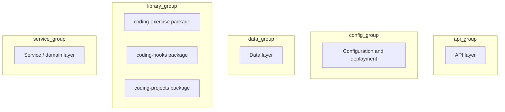

# Architecture report: sudheerj/reactjs-interview-questions

> Automated static analysis. **Observed** = directly seen in files/imports/AST; **Inferred** = interpretation from that evidence. Repository code was not executed.

## 1. Repository at a glance

| Item | Value |
| --- | --- |
| Repository | sudheerj/reactjs-interview-questions |
| Description | List of top 500 ReactJS Interview Questions & Answers....Coding exercise questions are coming soon!! |
| Language | JavaScript |
| Stars | 44919 |
| Licence | MIT |
| Analysed commit / branch | 55b7d491cd74c7b37f9352f3b2420d66e7187951 / master |
| Framework(s) | React |
| Files analysed | 332 |
| Components | 7 |

## 2. Architecture in one minute

sudheerj/reactjs-interview-questions - List of top 500 ReactJS Interview Questions & Answers....Coding exercise questions are coming soon!!. This repository was analysed statically from 332 file(s) (0 Python). Detected technologies (observed from imports/manifests): React, Jest, TypeScript, Vite. Files are grouped into 7 component(s): API layer, coding-exercise package, coding-hooks package, coding-projects package, Configuration and deployment, Data layer, Service / domain layer. Findings below distinguish observed facts from inferred interpretation.

## 3. High-level block diagram

## 4. Main components

### API layer (`api_layer`)

- **Kind:** api
- **Status:** Observed
- **Confidence:** 0.85
- **Responsibility:** Groups 1 file(s) under api layer (observed from repository paths and static analysis).
- **Paths:** `coding-projects/infinite-scroll-app/src/api/postsApi.ts`
- **Evidence:** [coding-projects/infinite-scroll-app/src/api/postsApi.ts](https://github.com/sudheerj/reactjs-interview-questions/blob/55b7d491cd74c7b37f9352f3b2420d66e7187951/coding-projects/infinite-scroll-app/src/api/postsApi.ts)

### coding-exercise package (`coding_exercise`)

- **Kind:** library
- **Status:** Observed
- **Confidence:** 0.85
- **Responsibility:** Groups 25 file(s) under coding-exercise package (observed from repository paths and static analysis).
- **Paths:** `coding-exercise/hooks/useDebounce.tsx`, `coding-exercise/src/App.js`, `coding-exercise/src/App.test.js`, `coding-exercise/src/components/ExerciseCard.js`, `coding-exercise/src/components/HomePage.js`, `coding-exercise/src/components/NavigationButton.js`, `coding-exercise/src/exercises/__template__/Problem.js`, `coding-exercise/src/exercises/__template__/Solution.js`, `coding-exercise/src/exercises/__template__/index.js`, `coding-exercise/src/exercises/exercise-01-state-batching/Problem.js`, `coding-exercise/src/exercises/exercise-01-state-batching/Solution.js`, `coding-exercise/src/exercises/exercise-01-state-batching/index.js`, `coding-exercise/src/exercises/exercise-02-useeffect-dependencies/Problem.js`, `coding-exercise/src/exercises/exercise-02-useeffect-dependencies/Solution.js`, `coding-exercise/src/exercises/exercise-02-useeffect-dependencies/index.js`, `coding-exercise/src/exercises/exercise-03-useCallback-memoization/Problem.js`, `coding-exercise/src/exercises/exercise-03-useCallback-memoization/Solution.js`, `coding-exercise/src/exercises/exercise-03-useCallback-memoization/index.js`, `coding-exercise/src/exercises/exercise-04-custom-hooks/Problem.js`, `coding-exercise/src/exercises/exercise-04-custom-hooks/Solution.js`, `coding-exercise/src/exercises/exercise-04-custom-hooks/index.js`, `coding-exercise/src/exercises/index.js`, `coding-exercise/src/index.js`, `coding-exercise/src/serviceWorker.js`, `coding-exercise/src/setupTests.js`
- **Evidence:** [coding-exercise/hooks/useDebounce.tsx](https://github.com/sudheerj/reactjs-interview-questions/blob/55b7d491cd74c7b37f9352f3b2420d66e7187951/coding-exercise/hooks/useDebounce.tsx); [coding-exercise/src/App.js](https://github.com/sudheerj/reactjs-interview-questions/blob/55b7d491cd74c7b37f9352f3b2420d66e7187951/coding-exercise/src/App.js); [coding-exercise/src/App.test.js](https://github.com/sudheerj/reactjs-interview-questions/blob/55b7d491cd74c7b37f9352f3b2420d66e7187951/coding-exercise/src/App.test.js); [coding-exercise/src/components/ExerciseCard.js](https://github.com/sudheerj/reactjs-interview-questions/blob/55b7d491cd74c7b37f9352f3b2420d66e7187951/coding-exercise/src/components/ExerciseCard.js); [coding-exercise/src/components/HomePage.js](https://github.com/sudheerj/reactjs-interview-questions/blob/55b7d491cd74c7b37f9352f3b2420d66e7187951/coding-exercise/src/components/HomePage.js); [coding-exercise/src/components/NavigationButton.js](https://github.com/sudheerj/reactjs-interview-questions/blob/55b7d491cd74c7b37f9352f3b2420d66e7187951/coding-exercise/src/components/NavigationButton.js); [coding-exercise/src/exercises/__template__/Problem.js](https://github.com/sudheerj/reactjs-interview-questions/blob/55b7d491cd74c7b37f9352f3b2420d66e7187951/coding-exercise/src/exercises/__template__/Problem.js); [coding-exercise/src/exercises/__template__/Solution.js](https://github.com/sudheerj/reactjs-interview-questions/blob/55b7d491cd74c7b37f9352f3b2420d66e7187951/coding-exercise/src/exercises/__template__/Solution.js)

### coding-hooks package (`coding_hooks`)

- **Kind:** library
- **Status:** Observed
- **Confidence:** 0.85
- **Responsibility:** Groups 19 file(s) under coding-hooks package (observed from repository paths and static analysis).
- **Paths:** `coding-hooks/src/App.tsx`, `coding-hooks/src/hooks/01-usePrevious/App.tsx`, `coding-hooks/src/hooks/01-usePrevious/usePrevious.ts`, `coding-hooks/src/hooks/02-useDebounce/App.tsx`, `coding-hooks/src/hooks/02-useDebounce/useDebounce.ts`, `coding-hooks/src/hooks/03-useDebounceCallback/App.tsx`, `coding-hooks/src/hooks/03-useDebounceCallback/useDebounceCallback.ts`, `coding-hooks/src/hooks/04-useToggle/App.tsx`, `coding-hooks/src/hooks/04-useToggle/useToggle.ts`, `coding-hooks/src/hooks/05-useInterval/App.tsx`, `coding-hooks/src/hooks/05-useInterval/useInterval.ts`, `coding-hooks/src/hooks/06-useLocalStorage/App.tsx`, `coding-hooks/src/hooks/06-useLocalStorage/useLocalStorage.ts`, `coding-hooks/src/hooks/07-useFetch/App.tsx`, `coding-hooks/src/hooks/07-useFetch/useFetch.ts`, `coding-hooks/src/hooks/08-useThrottle/App.tsx`, `coding-hooks/src/hooks/08-useThrottle/useThrottle.ts`, `coding-hooks/src/main.tsx`, `coding-hooks/vite.config.ts`
- **Evidence:** [coding-hooks/src/App.tsx](https://github.com/sudheerj/reactjs-interview-questions/blob/55b7d491cd74c7b37f9352f3b2420d66e7187951/coding-hooks/src/App.tsx); [coding-hooks/src/hooks/01-usePrevious/App.tsx](https://github.com/sudheerj/reactjs-interview-questions/blob/55b7d491cd74c7b37f9352f3b2420d66e7187951/coding-hooks/src/hooks/01-usePrevious/App.tsx); [coding-hooks/src/hooks/01-usePrevious/usePrevious.ts](https://github.com/sudheerj/reactjs-interview-questions/blob/55b7d491cd74c7b37f9352f3b2420d66e7187951/coding-hooks/src/hooks/01-usePrevious/usePrevious.ts); [coding-hooks/src/hooks/02-useDebounce/App.tsx](https://github.com/sudheerj/reactjs-interview-questions/blob/55b7d491cd74c7b37f9352f3b2420d66e7187951/coding-hooks/src/hooks/02-useDebounce/App.tsx); [coding-hooks/src/hooks/02-useDebounce/useDebounce.ts](https://github.com/sudheerj/reactjs-interview-questions/blob/55b7d491cd74c7b37f9352f3b2420d66e7187951/coding-hooks/src/hooks/02-useDebounce/useDebounce.ts); [coding-hooks/src/hooks/03-useDebounceCallback/App.tsx](https://github.com/sudheerj/reactjs-interview-questions/blob/55b7d491cd74c7b37f9352f3b2420d66e7187951/coding-hooks/src/hooks/03-useDebounceCallback/App.tsx); [coding-hooks/src/hooks/03-useDebounceCallback/useDebounceCallback.ts](https://github.com/sudheerj/reactjs-interview-questions/blob/55b7d491cd74c7b37f9352f3b2420d66e7187951/coding-hooks/src/hooks/03-useDebounceCallback/useDebounceCallback.ts); [coding-hooks/src/hooks/04-useToggle/App.tsx](https://github.com/sudheerj/reactjs-interview-questions/blob/55b7d491cd74c7b37f9352f3b2420d66e7187951/coding-hooks/src/hooks/04-useToggle/App.tsx)

### coding-projects package (`coding_projects`)

- **Kind:** library
- **Status:** Observed
- **Confidence:** 0.85
- **Responsibility:** Groups 74 file(s) under coding-projects package (observed from repository paths and static analysis).
- **Paths:** `coding-projects/accordion-app/src/App.tsx`, `coding-projects/accordion-app/src/components/Accordion.tsx`, `coding-projects/accordion-app/src/components/AccordionItem.tsx`, `coding-projects/accordion-app/src/main.tsx`, `coding-projects/accordion-app/src/types/accordion.ts`, `coding-projects/accordion-app/vite.config.ts`, `coding-projects/autocomplete-app/eslint.config.js`, `coding-projects/autocomplete-app/src/App.tsx`, `coding-projects/autocomplete-app/src/data.ts`, `coding-projects/autocomplete-app/src/main.tsx`, `coding-projects/autocomplete-app/vite.config.ts`, `coding-projects/carousel-app/src/App.tsx`, `coding-projects/carousel-app/src/components/Carousel.tsx`, `coding-projects/carousel-app/src/main.tsx`, `coding-projects/carousel-app/vite.config.ts`, `coding-projects/data-table-app/src/App.tsx`, `coding-projects/data-table-app/src/components/DataTable.tsx`, `coding-projects/data-table-app/src/components/Pagination.tsx`, `coding-projects/data-table-app/src/components/SearchBar.tsx`, `coding-projects/data-table-app/src/main.tsx`, `coding-projects/data-table-app/src/types/user.ts`, `coding-projects/data-table-app/vite.config.ts`, `coding-projects/hacker-news-jobs/eslint.config.js`, `coding-projects/hacker-news-jobs/src/App.tsx`, `coding-projects/hacker-news-jobs/src/main.tsx`, `coding-projects/hacker-news-jobs/vite.config.ts`, `coding-projects/infinite-scroll-app/src/App.tsx`, `coding-projects/infinite-scroll-app/src/components/InfinitePosts.tsx`, `coding-projects/infinite-scroll-app/src/components/PostCard.tsx`, `coding-projects/infinite-scroll-app/src/main.tsx`, `coding-projects/infinite-scroll-app/src/types/post.ts`, `coding-projects/infinite-scroll-app/vite.config.ts`, `coding-projects/nested-comments/src/App.tsx`, `coding-projects/nested-comments/src/components/Comment.tsx`, `coding-projects/nested-comments/src/components/CommentForm.tsx`, `coding-projects/nested-comments/src/components/CommentList.tsx`, `coding-projects/nested-comments/src/main.tsx`, `coding-projects/nested-comments/src/types/Comment.ts`, `coding-projects/nested-comments/vite.config.ts`, `coding-projects/react-modal/src/App.tsx`, `coding-projects/react-modal/src/components/Modal.tsx`, `coding-projects/react-modal/src/main.tsx`, `coding-projects/react-modal/vite.config.ts`, `coding-projects/shopping-cart/src/App.tsx`, `coding-projects/shopping-cart/src/components/Cart.tsx`, `coding-projects/shopping-cart/src/components/ProductCard.tsx`, `coding-projects/shopping-cart/src/main.tsx`, `coding-projects/shopping-cart/src/types/product.ts`, `coding-projects/shopping-cart/vite.config.ts`, `coding-projects/star-rating/jest.config.ts`, `coding-projects/star-rating/src/App.tsx`, `coding-projects/star-rating/src/components/StarRating.test.tsx`, `coding-projects/star-rating/src/components/StarRating.tsx`, `coding-projects/star-rating/src/main.tsx`, `coding-projects/star-rating/src/types/rating.ts`, `coding-projects/star-rating/vite.config.ts`, `coding-projects/theme-switcher/src/App.tsx`, `coding-projects/theme-switcher/src/components/ThemeSwitcher.tsx`, `coding-projects/theme-switcher/src/context/ThemeContext.tsx`, `coding-projects/theme-switcher/src/main.tsx`, `coding-projects/theme-switcher/vite.config.ts`, `coding-projects/todo-app/src/App.tsx`, `coding-projects/todo-app/src/components/TodoForm.tsx`, `coding-projects/todo-app/src/components/TodoItem.tsx`, `coding-projects/todo-app/src/components/TodoList.tsx`, `coding-projects/todo-app/src/main.tsx`, `coding-projects/todo-app/src/types/todo.ts`, `coding-projects/todo-app/vite.config.ts`, `coding-projects/tree-view-app/src/App.tsx`, `coding-projects/tree-view-app/src/components/Tree.tsx`, `coding-projects/tree-view-app/src/components/TreeNode.tsx`, `coding-projects/tree-view-app/src/main.tsx`, `coding-projects/tree-view-app/src/types/tree.ts`, `coding-projects/tree-view-app/vite.config.ts`
- **Evidence:** [coding-projects/accordion-app/src/App.tsx](https://github.com/sudheerj/reactjs-interview-questions/blob/55b7d491cd74c7b37f9352f3b2420d66e7187951/coding-projects/accordion-app/src/App.tsx); [coding-projects/accordion-app/src/components/Accordion.tsx](https://github.com/sudheerj/reactjs-interview-questions/blob/55b7d491cd74c7b37f9352f3b2420d66e7187951/coding-projects/accordion-app/src/components/Accordion.tsx); [coding-projects/accordion-app/src/components/AccordionItem.tsx](https://github.com/sudheerj/reactjs-interview-questions/blob/55b7d491cd74c7b37f9352f3b2420d66e7187951/coding-projects/accordion-app/src/components/AccordionItem.tsx); [coding-projects/accordion-app/src/main.tsx](https://github.com/sudheerj/reactjs-interview-questions/blob/55b7d491cd74c7b37f9352f3b2420d66e7187951/coding-projects/accordion-app/src/main.tsx); [coding-projects/accordion-app/src/types/accordion.ts](https://github.com/sudheerj/reactjs-interview-questions/blob/55b7d491cd74c7b37f9352f3b2420d66e7187951/coding-projects/accordion-app/src/types/accordion.ts); [coding-projects/accordion-app/vite.config.ts](https://github.com/sudheerj/reactjs-interview-questions/blob/55b7d491cd74c7b37f9352f3b2420d66e7187951/coding-projects/accordion-app/vite.config.ts); [coding-projects/autocomplete-app/eslint.config.js](https://github.com/sudheerj/reactjs-interview-questions/blob/55b7d491cd74c7b37f9352f3b2420d66e7187951/coding-projects/autocomplete-app/eslint.config.js); [coding-projects/autocomplete-app/src/App.tsx](https://github.com/sudheerj/reactjs-interview-questions/blob/55b7d491cd74c7b37f9352f3b2420d66e7187951/coding-projects/autocomplete-app/src/App.tsx)

### Configuration and deployment (`config`)

- **Kind:** config
- **Status:** Observed
- **Confidence:** 0.85
- **Responsibility:** Groups 71 file(s) under configuration and deployment (observed from repository paths and static analysis).
- **Paths:** `coding-exercise/package.json`, `coding-exercise/public/manifest.json`, `coding-hooks/.oxlintrc.json`, `coding-hooks/package.json`, `coding-hooks/tsconfig.app.json`, `coding-hooks/tsconfig.json`, `coding-hooks/tsconfig.node.json`, `coding-projects/accordion-app/.oxlintrc.json`, `coding-projects/accordion-app/package.json`, `coding-projects/accordion-app/tsconfig.app.json`, `coding-projects/accordion-app/tsconfig.json`, `coding-projects/accordion-app/tsconfig.node.json`, `coding-projects/autocomplete-app/package.json`, `coding-projects/autocomplete-app/tsconfig.app.json`, `coding-projects/autocomplete-app/tsconfig.json`, `coding-projects/autocomplete-app/tsconfig.node.json`, `coding-projects/carousel-app/.oxlintrc.json`, `coding-projects/carousel-app/package.json`, `coding-projects/carousel-app/tsconfig.app.json`, `coding-projects/carousel-app/tsconfig.json`, `coding-projects/carousel-app/tsconfig.node.json`, `coding-projects/data-table-app/.oxlintrc.json`, `coding-projects/data-table-app/package.json`, `coding-projects/data-table-app/tsconfig.app.json`, `coding-projects/data-table-app/tsconfig.json`, `coding-projects/data-table-app/tsconfig.node.json`, `coding-projects/hacker-news-jobs/package.json`, `coding-projects/hacker-news-jobs/tsconfig.app.json`, `coding-projects/hacker-news-jobs/tsconfig.json`, `coding-projects/hacker-news-jobs/tsconfig.node.json`, `coding-projects/infinite-scroll-app/.oxlintrc.json`, `coding-projects/infinite-scroll-app/package.json`, `coding-projects/infinite-scroll-app/tsconfig.app.json`, `coding-projects/infinite-scroll-app/tsconfig.json`, `coding-projects/infinite-scroll-app/tsconfig.node.json`, `coding-projects/nested-comments/.oxlintrc.json`, `coding-projects/nested-comments/package.json`, `coding-projects/nested-comments/tsconfig.app.json`, `coding-projects/nested-comments/tsconfig.json`, `coding-projects/nested-comments/tsconfig.node.json`, `coding-projects/react-modal/.oxlintrc.json`, `coding-projects/react-modal/package.json`, `coding-projects/react-modal/tsconfig.app.json`, `coding-projects/react-modal/tsconfig.json`, `coding-projects/react-modal/tsconfig.node.json`, `coding-projects/shopping-cart/.oxlintrc.json`, `coding-projects/shopping-cart/package.json`, `coding-projects/shopping-cart/tsconfig.app.json`, `coding-projects/shopping-cart/tsconfig.json`, `coding-projects/shopping-cart/tsconfig.node.json`, `coding-projects/star-rating/.oxlintrc.json`, `coding-projects/star-rating/package.json`, `coding-projects/star-rating/tsconfig.app.json`, `coding-projects/star-rating/tsconfig.jest.json`, `coding-projects/star-rating/tsconfig.json`, `coding-projects/star-rating/tsconfig.node.json`, `coding-projects/theme-switcher/.oxlintrc.json`, `coding-projects/theme-switcher/package.json`, `coding-projects/theme-switcher/tsconfig.app.json`, `coding-projects/theme-switcher/tsconfig.json`, `coding-projects/theme-switcher/tsconfig.node.json`, `coding-projects/todo-app/.oxlintrc.json`, `coding-projects/todo-app/package.json`, `coding-projects/todo-app/tsconfig.app.json`, `coding-projects/todo-app/tsconfig.json`, `coding-projects/todo-app/tsconfig.node.json`, `coding-projects/tree-view-app/.oxlintrc.json`, `coding-projects/tree-view-app/package.json`, `coding-projects/tree-view-app/tsconfig.app.json`, `coding-projects/tree-view-app/tsconfig.json`, `coding-projects/tree-view-app/tsconfig.node.json`
- **Evidence:** [coding-exercise/package.json](https://github.com/sudheerj/reactjs-interview-questions/blob/55b7d491cd74c7b37f9352f3b2420d66e7187951/coding-exercise/package.json); [coding-exercise/public/manifest.json](https://github.com/sudheerj/reactjs-interview-questions/blob/55b7d491cd74c7b37f9352f3b2420d66e7187951/coding-exercise/public/manifest.json); [coding-hooks/.oxlintrc.json](https://github.com/sudheerj/reactjs-interview-questions/blob/55b7d491cd74c7b37f9352f3b2420d66e7187951/coding-hooks/.oxlintrc.json); [coding-hooks/package.json](https://github.com/sudheerj/reactjs-interview-questions/blob/55b7d491cd74c7b37f9352f3b2420d66e7187951/coding-hooks/package.json); [coding-hooks/tsconfig.app.json](https://github.com/sudheerj/reactjs-interview-questions/blob/55b7d491cd74c7b37f9352f3b2420d66e7187951/coding-hooks/tsconfig.app.json); [coding-hooks/tsconfig.json](https://github.com/sudheerj/reactjs-interview-questions/blob/55b7d491cd74c7b37f9352f3b2420d66e7187951/coding-hooks/tsconfig.json); [coding-hooks/tsconfig.node.json](https://github.com/sudheerj/reactjs-interview-questions/blob/55b7d491cd74c7b37f9352f3b2420d66e7187951/coding-hooks/tsconfig.node.json); [coding-projects/accordion-app/.oxlintrc.json](https://github.com/sudheerj/reactjs-interview-questions/blob/55b7d491cd74c7b37f9352f3b2420d66e7187951/coding-projects/accordion-app/.oxlintrc.json)

### Data layer (`data_layer`)

- **Kind:** data
- **Status:** Observed
- **Confidence:** 0.85
- **Responsibility:** Groups 5 file(s) under data layer (observed from repository paths and static analysis).
- **Paths:** `coding-projects/accordion-app/src/data/faqData.ts`, `coding-projects/nested-comments/src/data/Comments.ts`, `coding-projects/shopping-cart/src/data/products.ts`, `coding-projects/star-rating/src/data/rating.ts`, `coding-projects/tree-view-app/src/data/treeData.ts`
- **Evidence:** [coding-projects/accordion-app/src/data/faqData.ts](https://github.com/sudheerj/reactjs-interview-questions/blob/55b7d491cd74c7b37f9352f3b2420d66e7187951/coding-projects/accordion-app/src/data/faqData.ts); [coding-projects/nested-comments/src/data/Comments.ts](https://github.com/sudheerj/reactjs-interview-questions/blob/55b7d491cd74c7b37f9352f3b2420d66e7187951/coding-projects/nested-comments/src/data/Comments.ts); [coding-projects/shopping-cart/src/data/products.ts](https://github.com/sudheerj/reactjs-interview-questions/blob/55b7d491cd74c7b37f9352f3b2420d66e7187951/coding-projects/shopping-cart/src/data/products.ts); [coding-projects/star-rating/src/data/rating.ts](https://github.com/sudheerj/reactjs-interview-questions/blob/55b7d491cd74c7b37f9352f3b2420d66e7187951/coding-projects/star-rating/src/data/rating.ts); [coding-projects/tree-view-app/src/data/treeData.ts](https://github.com/sudheerj/reactjs-interview-questions/blob/55b7d491cd74c7b37f9352f3b2420d66e7187951/coding-projects/tree-view-app/src/data/treeData.ts)

### Service / domain layer (`service_layer`)

- **Kind:** service
- **Status:** Observed
- **Confidence:** 0.85
- **Responsibility:** Groups 1 file(s) under service / domain layer (observed from repository paths and static analysis).
- **Paths:** `coding-projects/data-table-app/src/services/userService.ts`
- **Evidence:** [coding-projects/data-table-app/src/services/userService.ts](https://github.com/sudheerj/reactjs-interview-questions/blob/55b7d491cd74c7b37f9352f3b2420d66e7187951/coding-projects/data-table-app/src/services/userService.ts)

## 5. Execution flow

**Observed** entry point(s):

- [coding-exercise/src/App.js](https://github.com/sudheerj/reactjs-interview-questions/blob/55b7d491cd74c7b37f9352f3b2420d66e7187951/coding-exercise/src/App.js)
- [coding-exercise/src/exercises/index.js](https://github.com/sudheerj/reactjs-interview-questions/blob/55b7d491cd74c7b37f9352f3b2420d66e7187951/coding-exercise/src/exercises/index.js)
- [coding-exercise/src/index.js](https://github.com/sudheerj/reactjs-interview-questions/blob/55b7d491cd74c7b37f9352f3b2420d66e7187951/coding-exercise/src/index.js)
- [coding-hooks/src/App.tsx](https://github.com/sudheerj/reactjs-interview-questions/blob/55b7d491cd74c7b37f9352f3b2420d66e7187951/coding-hooks/src/App.tsx)
- [coding-hooks/src/main.tsx](https://github.com/sudheerj/reactjs-interview-questions/blob/55b7d491cd74c7b37f9352f3b2420d66e7187951/coding-hooks/src/main.tsx)
- [coding-projects/accordion-app/src/App.tsx](https://github.com/sudheerj/reactjs-interview-questions/blob/55b7d491cd74c7b37f9352f3b2420d66e7187951/coding-projects/accordion-app/src/App.tsx)
- [coding-projects/accordion-app/src/main.tsx](https://github.com/sudheerj/reactjs-interview-questions/blob/55b7d491cd74c7b37f9352f3b2420d66e7187951/coding-projects/accordion-app/src/main.tsx)
- [coding-projects/autocomplete-app/src/App.tsx](https://github.com/sudheerj/reactjs-interview-questions/blob/55b7d491cd74c7b37f9352f3b2420d66e7187951/coding-projects/autocomplete-app/src/App.tsx)
- [coding-projects/autocomplete-app/src/main.tsx](https://github.com/sudheerj/reactjs-interview-questions/blob/55b7d491cd74c7b37f9352f3b2420d66e7187951/coding-projects/autocomplete-app/src/main.tsx)
- [coding-projects/carousel-app/src/App.tsx](https://github.com/sudheerj/reactjs-interview-questions/blob/55b7d491cd74c7b37f9352f3b2420d66e7187951/coding-projects/carousel-app/src/App.tsx)
- [coding-projects/carousel-app/src/main.tsx](https://github.com/sudheerj/reactjs-interview-questions/blob/55b7d491cd74c7b37f9352f3b2420d66e7187951/coding-projects/carousel-app/src/main.tsx)
- [coding-projects/data-table-app/src/App.tsx](https://github.com/sudheerj/reactjs-interview-questions/blob/55b7d491cd74c7b37f9352f3b2420d66e7187951/coding-projects/data-table-app/src/App.tsx)

Representative flow (derived from observed entry points and the import graph; steps beyond the entry point are **Inferred**):

1. Execution starts at an observed entry point listed above, if present.
2. No internal import relationships between components were observed.

## 6. Project structure

### `(root)`

- `.gitignore` - other (37 bytes)
- `LICENSE` - docs (1077 bytes)

### `.github`

- `.github/FUNDING.yml` - config (109 bytes)

### `coding-exercise`

- `coding-exercise/.gitignore` - other (310 bytes)
- `coding-exercise/ARCHITECTURE.md` - docs (9471 bytes)
- `coding-exercise/QUICK_START.md` - docs (4038 bytes)
- `coding-exercise/README.md` - docs (14888 bytes)
- `coding-exercise/hooks/index.html` - other (2128 bytes)
- `coding-exercise/hooks/useDebounce.tsx` - source, TypeScript (0 bytes)
- `coding-exercise/package.json` - manifest (751 bytes)
- `coding-exercise/public/index.html` - other (1721 bytes)
- `coding-exercise/public/manifest.json` - config (492 bytes)
- `coding-exercise/public/robots.txt` - docs (67 bytes)
- `coding-exercise/src/App.css` - other (564 bytes)
- `coding-exercise/src/App.js` - source, JavaScript (1281 bytes)
- `coding-exercise/src/App.test.js` - source, JavaScript (280 bytes)
- `coding-exercise/src/components/ExerciseCard.js` - source, JavaScript (2712 bytes)
- `coding-exercise/src/components/HomePage.js` - source, JavaScript (1891 bytes)
- `coding-exercise/src/components/NavigationButton.js` - source, JavaScript (621 bytes)
- `coding-exercise/src/exercises/__template__/Problem.js` - source, JavaScript (1300 bytes)
- `coding-exercise/src/exercises/__template__/README.md` - docs (1887 bytes)
- `coding-exercise/src/exercises/__template__/Solution.js` - source, JavaScript (3587 bytes)
- `coding-exercise/src/exercises/__template__/index.js` - source, JavaScript (98 bytes)
- `coding-exercise/src/exercises/exercise-01-state-batching/Problem.js` - source, JavaScript (1311 bytes)
- `coding-exercise/src/exercises/exercise-01-state-batching/Solution.js` - source, JavaScript (4146 bytes)
- `coding-exercise/src/exercises/exercise-01-state-batching/index.js` - source, JavaScript (98 bytes)
- `coding-exercise/src/exercises/exercise-02-useeffect-dependencies/Problem.js` - source, JavaScript (1585 bytes)
- `coding-exercise/src/exercises/exercise-02-useeffect-dependencies/Solution.js` - source, JavaScript (6856 bytes)
- `coding-exercise/src/exercises/exercise-02-useeffect-dependencies/index.js` - source, JavaScript (98 bytes)
- `coding-exercise/src/exercises/exercise-03-useCallback-memoization/Problem.js` - source, JavaScript (2491 bytes)
- `coding-exercise/src/exercises/exercise-03-useCallback-memoization/Solution.js` - source, JavaScript (9656 bytes)
- `coding-exercise/src/exercises/exercise-03-useCallback-memoization/index.js` - source, JavaScript (98 bytes)
- `coding-exercise/src/exercises/exercise-04-custom-hooks/Problem.js` - source, JavaScript (3905 bytes)
- `coding-exercise/src/exercises/exercise-04-custom-hooks/Solution.js` - source, JavaScript (12207 bytes)
- `coding-exercise/src/exercises/exercise-04-custom-hooks/index.js` - source, JavaScript (98 bytes)
- `coding-exercise/src/exercises/index.js` - source, JavaScript (1867 bytes)
- `coding-exercise/src/index.css` - other (366 bytes)
- `coding-exercise/src/index.js` - source, JavaScript (535 bytes)
- `coding-exercise/src/logo.svg` - other (2671 bytes)
- `coding-exercise/src/serviceWorker.js` - source, JavaScript (5086 bytes)
- `coding-exercise/src/setupTests.js` - source, JavaScript (241 bytes)

### `coding-hooks`

- `coding-hooks/.gitignore` - other (253 bytes)
- `coding-hooks/.oxlintrc.json` - config (245 bytes)
- `coding-hooks/README.md` - docs (1278 bytes)
- `coding-hooks/index.html` - other (364 bytes)
- `coding-hooks/package.json` - manifest (532 bytes)
- `coding-hooks/public/favicon.svg` - other (9522 bytes)
- `coding-hooks/public/icons.svg` - other (5031 bytes)
- `coding-hooks/src/App.css` - other (2891 bytes)
- `coding-hooks/src/App.tsx` - source, TypeScript (1510 bytes)
- `coding-hooks/src/assets/react.svg` - other (4126 bytes)
- `coding-hooks/src/assets/vite.svg` - other (8709 bytes)
- `coding-hooks/src/hooks/01-usePrevious/App.tsx` - source, TypeScript (465 bytes)
- `coding-hooks/src/hooks/01-usePrevious/usePrevious.ts` - source, TypeScript (249 bytes)
- `coding-hooks/src/hooks/02-useDebounce/App.tsx` - source, TypeScript (486 bytes)
- `coding-hooks/src/hooks/02-useDebounce/useDebounce.ts` - source, TypeScript (399 bytes)
- `coding-hooks/src/hooks/03-useDebounceCallback/App.tsx` - source, TypeScript (740 bytes)
- `coding-hooks/src/hooks/03-useDebounceCallback/useDebounceCallback.ts` - source, TypeScript (939 bytes)
- `coding-hooks/src/hooks/04-useToggle/App.tsx` - source, TypeScript (304 bytes)
- `coding-hooks/src/hooks/04-useToggle/useToggle.ts` - source, TypeScript (250 bytes)
- `coding-hooks/src/hooks/05-useInterval/App.tsx` - source, TypeScript (356 bytes)
- `coding-hooks/src/hooks/05-useInterval/useInterval.ts` - source, TypeScript (449 bytes)
- `coding-hooks/src/hooks/06-useLocalStorage/App.tsx` - source, TypeScript (375 bytes)
- `coding-hooks/src/hooks/06-useLocalStorage/useLocalStorage.ts` - source, TypeScript (410 bytes)
- `coding-hooks/src/hooks/07-useFetch/App.tsx` - source, TypeScript (467 bytes)
- `coding-hooks/src/hooks/07-useFetch/useFetch.ts` - source, TypeScript (438 bytes)
- `coding-hooks/src/hooks/08-useThrottle/App.tsx` - source, TypeScript (645 bytes)
- `coding-hooks/src/hooks/08-useThrottle/useThrottle.ts` - source, TypeScript (617 bytes)
- `coding-hooks/src/index.css` - other (2169 bytes)
- `coding-hooks/src/main.tsx` - source, TypeScript (230 bytes)
- `coding-hooks/tsconfig.app.json` - config (655 bytes)
- `coding-hooks/tsconfig.json` - config (119 bytes)
- `coding-hooks/tsconfig.node.json` - config (558 bytes)
- `coding-hooks/vite.config.ts` - source, TypeScript (161 bytes)

### `coding-projects`

- `coding-projects/accordion-app/.gitignore` - other (253 bytes)
- `coding-projects/accordion-app/.oxlintrc.json` - config (245 bytes)
- `coding-projects/accordion-app/README.md` - docs (1278 bytes)
- `coding-projects/accordion-app/index.html` - other (365 bytes)
- `coding-projects/accordion-app/package.json` - manifest (533 bytes)
- `coding-projects/accordion-app/public/favicon.svg` - other (9522 bytes)
- `coding-projects/accordion-app/public/icons.svg` - other (5031 bytes)
- `coding-projects/accordion-app/src/App.css` - other (931 bytes)
- `coding-projects/accordion-app/src/App.tsx` - source, TypeScript (488 bytes)
- `coding-projects/accordion-app/src/assets/react.svg` - other (4126 bytes)
- `coding-projects/accordion-app/src/assets/vite.svg` - other (8709 bytes)
- `coding-projects/accordion-app/src/components/Accordion.tsx` - source, TypeScript (984 bytes)
- `coding-projects/accordion-app/src/components/AccordionItem.tsx` - source, TypeScript (1033 bytes)
- `coding-projects/accordion-app/src/data/faqData.ts` - source, TypeScript (990 bytes)
- `coding-projects/accordion-app/src/index.css` - other (174 bytes)
- `coding-projects/accordion-app/src/main.tsx` - source, TypeScript (230 bytes)
- `coding-projects/accordion-app/src/types/accordion.ts` - source, TypeScript (298 bytes)
- `coding-projects/accordion-app/tsconfig.app.json` - config (655 bytes)
- `coding-projects/accordion-app/tsconfig.json` - config (119 bytes)
- `coding-projects/accordion-app/tsconfig.node.json` - config (558 bytes)
- `coding-projects/accordion-app/vite.config.ts` - source, TypeScript (161 bytes)
- `coding-projects/autocomplete-app/.gitignore` - other (253 bytes)
- `coding-projects/autocomplete-app/README.md` - docs (2427 bytes)
- `coding-projects/autocomplete-app/eslint.config.js` - source, JavaScript (591 bytes)
- `coding-projects/autocomplete-app/index.html` - other (368 bytes)
- `coding-projects/autocomplete-app/package.json` - manifest (717 bytes)
- `coding-projects/autocomplete-app/public/favicon.svg` - other (9522 bytes)
- `coding-projects/autocomplete-app/public/icons.svg` - other (5031 bytes)
- `coding-projects/autocomplete-app/src/App.css` - other (955 bytes)
- `coding-projects/autocomplete-app/src/App.tsx` - source, TypeScript (2925 bytes)
- `coding-projects/autocomplete-app/src/assets/react.svg` - other (4126 bytes)
- `coding-projects/autocomplete-app/src/assets/vite.svg` - other (8709 bytes)
- `coding-projects/autocomplete-app/src/data.ts` - source, TypeScript (308 bytes)
- `coding-projects/autocomplete-app/src/index.css` - other (2169 bytes)
- `coding-projects/autocomplete-app/src/main.tsx` - source, TypeScript (230 bytes)
- `coding-projects/autocomplete-app/tsconfig.app.json` - config (655 bytes)
- `coding-projects/autocomplete-app/tsconfig.json` - config (119 bytes)
- `coding-projects/autocomplete-app/tsconfig.node.json` - config (558 bytes)
- `coding-projects/autocomplete-app/vite.config.ts` - source, TypeScript (161 bytes)
- `coding-projects/carousel-app/.gitignore` - other (253 bytes)
- `coding-projects/carousel-app/.oxlintrc.json` - config (245 bytes)
- `coding-projects/carousel-app/README.md` - docs (1278 bytes)
- `coding-projects/carousel-app/index.html` - other (364 bytes)
- `coding-projects/carousel-app/package.json` - manifest (532 bytes)
- `coding-projects/carousel-app/public/favicon.svg` - other (9522 bytes)
- `coding-projects/carousel-app/public/icons.svg` - other (5031 bytes)
- `coding-projects/carousel-app/src/App.css` - other (2891 bytes)
- `coding-projects/carousel-app/src/App.tsx` - source, TypeScript (3646 bytes)
- `coding-projects/carousel-app/src/assets/react.svg` - other (4126 bytes)
- `coding-projects/carousel-app/src/assets/vite.svg` - other (8709 bytes)
- `coding-projects/carousel-app/src/components/Carousel.css` - other (0 bytes)
- `coding-projects/carousel-app/src/components/Carousel.tsx` - source, TypeScript (0 bytes)
- `coding-projects/carousel-app/src/index.css` - other (2169 bytes)
- `coding-projects/carousel-app/src/main.tsx` - source, TypeScript (230 bytes)
- `coding-projects/carousel-app/tsconfig.app.json` - config (655 bytes)
- `coding-projects/carousel-app/tsconfig.json` - config (119 bytes)
- `coding-projects/carousel-app/tsconfig.node.json` - config (558 bytes)
- `coding-projects/carousel-app/vite.config.ts` - source, TypeScript (161 bytes)
- `coding-projects/data-table-app/.gitignore` - other (253 bytes)
- `coding-projects/data-table-app/.oxlintrc.json` - config (245 bytes)
- `coding-projects/data-table-app/README.md` - docs (1278 bytes)
- `coding-projects/data-table-app/index.html` - other (366 bytes)
- `coding-projects/data-table-app/package.json` - manifest (534 bytes)
- `coding-projects/data-table-app/public/favicon.svg` - other (9522 bytes)
- `coding-projects/data-table-app/public/icons.svg` - other (5031 bytes)
- `coding-projects/data-table-app/src/App.css` - other (2566 bytes)
- `coding-projects/data-table-app/src/App.tsx` - source, TypeScript (2424 bytes)
- `coding-projects/data-table-app/src/assets/react.svg` - other (4126 bytes)
- `coding-projects/data-table-app/src/assets/vite.svg` - other (8709 bytes)
- `coding-projects/data-table-app/src/components/DataTable.tsx` - source, TypeScript (1243 bytes)
- `coding-projects/data-table-app/src/components/Pagination.tsx` - source, TypeScript (624 bytes)
- `coding-projects/data-table-app/src/components/SearchBar.tsx` - source, TypeScript (339 bytes)
- `coding-projects/data-table-app/src/index.css` - other (2169 bytes)
- `coding-projects/data-table-app/src/main.tsx` - source, TypeScript (230 bytes)
- `coding-projects/data-table-app/src/services/userService.ts` - source, TypeScript (311 bytes)
- `coding-projects/data-table-app/src/types/user.ts` - source, TypeScript (160 bytes)
- `coding-projects/data-table-app/tsconfig.app.json` - config (655 bytes)
- `coding-projects/data-table-app/tsconfig.json` - config (119 bytes)
- `coding-projects/data-table-app/tsconfig.node.json` - config (558 bytes)
- `coding-projects/data-table-app/vite.config.ts` - source, TypeScript (161 bytes)
- `coding-projects/hacker-news-jobs/.gitignore` - other (253 bytes)
- `coding-projects/hacker-news-jobs/README.md` - docs (2427 bytes)
- `coding-projects/hacker-news-jobs/eslint.config.js` - source, JavaScript (591 bytes)
- `coding-projects/hacker-news-jobs/index.html` - other (368 bytes)
- `coding-projects/hacker-news-jobs/package.json` - manifest (717 bytes)
- `coding-projects/hacker-news-jobs/public/favicon.svg` - other (9522 bytes)
- `coding-projects/hacker-news-jobs/public/icons.svg` - other (5031 bytes)
- `coding-projects/hacker-news-jobs/src/App.css` - other (2891 bytes)
- `coding-projects/hacker-news-jobs/src/App.tsx` - source, TypeScript (3646 bytes)
- `coding-projects/hacker-news-jobs/src/assets/react.svg` - other (4126 bytes)
- `coding-projects/hacker-news-jobs/src/assets/vite.svg` - other (8709 bytes)
- `coding-projects/hacker-news-jobs/src/index.css` - other (2169 bytes)
- `coding-projects/hacker-news-jobs/src/main.tsx` - source, TypeScript (230 bytes)
- `coding-projects/hacker-news-jobs/tsconfig.app.json` - config (655 bytes)
- `coding-projects/hacker-news-jobs/tsconfig.json` - config (119 bytes)
- `coding-projects/hacker-news-jobs/tsconfig.node.json` - config (558 bytes)
- `coding-projects/hacker-news-jobs/vite.config.ts` - source, TypeScript (161 bytes)
- `coding-projects/infinite-scroll-app/.gitignore` - other (253 bytes)
- `coding-projects/infinite-scroll-app/.oxlintrc.json` - config (245 bytes)
- `coding-projects/infinite-scroll-app/README.md` - docs (1278 bytes)
- `coding-projects/infinite-scroll-app/index.html` - other (371 bytes)
- `coding-projects/infinite-scroll-app/package.json` - manifest (539 bytes)
- `coding-projects/infinite-scroll-app/public/favicon.svg` - other (9522 bytes)
- `coding-projects/infinite-scroll-app/public/icons.svg` - other (5031 bytes)
- `coding-projects/infinite-scroll-app/src/App.css` - other (735 bytes)
- `coding-projects/infinite-scroll-app/src/App.tsx` - source, TypeScript (158 bytes)
- `coding-projects/infinite-scroll-app/src/api/postsApi.ts` - source, TypeScript (456 bytes)
- `coding-projects/infinite-scroll-app/src/assets/react.svg` - other (4126 bytes)
- `coding-projects/infinite-scroll-app/src/assets/vite.svg` - other (8709 bytes)
- `coding-projects/infinite-scroll-app/src/components/InfinitePosts.tsx` - source, TypeScript (2940 bytes)
- `coding-projects/infinite-scroll-app/src/components/PostCard.tsx` - source, TypeScript (291 bytes)
- `coding-projects/infinite-scroll-app/src/index.css` - other (126 bytes)
- `coding-projects/infinite-scroll-app/src/main.tsx` - source, TypeScript (230 bytes)
- `coding-projects/infinite-scroll-app/src/types/post.ts` - source, TypeScript (97 bytes)
- `coding-projects/infinite-scroll-app/tsconfig.app.json` - config (655 bytes)
- `coding-projects/infinite-scroll-app/tsconfig.json` - config (119 bytes)
- `coding-projects/infinite-scroll-app/tsconfig.node.json` - config (558 bytes)
- `coding-projects/infinite-scroll-app/vite.config.ts` - source, TypeScript (161 bytes)
- `coding-projects/nested-comments/.gitignore` - other (253 bytes)
- `coding-projects/nested-comments/.oxlintrc.json` - config (245 bytes)
- `coding-projects/nested-comments/README.md` - docs (1278 bytes)
- `coding-projects/nested-comments/index.html` - other (367 bytes)
- `coding-projects/nested-comments/package.json` - manifest (535 bytes)
- `coding-projects/nested-comments/public/favicon.svg` - other (9522 bytes)
- `coding-projects/nested-comments/public/icons.svg` - other (5031 bytes)
- `coding-projects/nested-comments/src/App.css` - other (1240 bytes)
- `coding-projects/nested-comments/src/App.tsx` - source, TypeScript (1601 bytes)
- `coding-projects/nested-comments/src/assets/react.svg` - other (4126 bytes)
- `coding-projects/nested-comments/src/assets/vite.svg` - other (8709 bytes)
- `coding-projects/nested-comments/src/components/Comment.tsx` - source, TypeScript (1180 bytes)
- `coding-projects/nested-comments/src/components/CommentForm.tsx` - source, TypeScript (781 bytes)
- `coding-projects/nested-comments/src/components/CommentList.tsx` - source, TypeScript (559 bytes)
- `coding-projects/nested-comments/src/data/Comments.ts` - source, TypeScript (385 bytes)
- `coding-projects/nested-comments/src/index.css` - other (2169 bytes)
- `coding-projects/nested-comments/src/main.tsx` - source, TypeScript (230 bytes)
- `coding-projects/nested-comments/src/types/Comment.ts` - source, TypeScript (105 bytes)
- `coding-projects/nested-comments/tsconfig.app.json` - config (655 bytes)
- `coding-projects/nested-comments/tsconfig.json` - config (119 bytes)
- `coding-projects/nested-comments/tsconfig.node.json` - config (558 bytes)
- `coding-projects/nested-comments/vite.config.ts` - source, TypeScript (161 bytes)
- `coding-projects/react-modal/.gitignore` - other (253 bytes)
- `coding-projects/react-modal/.oxlintrc.json` - config (245 bytes)
- `coding-projects/react-modal/README.md` - docs (1278 bytes)
- `coding-projects/react-modal/index.html` - other (363 bytes)
- `coding-projects/react-modal/package.json` - manifest (531 bytes)
- `coding-projects/react-modal/public/favicon.svg` - other (9522 bytes)
- `coding-projects/react-modal/public/icons.svg` - other (5031 bytes)
- `coding-projects/react-modal/src/App.css` - other (369 bytes)
- `coding-projects/react-modal/src/App.tsx` - source, TypeScript (509 bytes)
- `coding-projects/react-modal/src/assets/react.svg` - other (4126 bytes)
- `coding-projects/react-modal/src/assets/vite.svg` - other (8709 bytes)
- `coding-projects/react-modal/src/components/Modal.css` - other (845 bytes)
- `coding-projects/react-modal/src/components/Modal.tsx` - source, TypeScript (1202 bytes)
- `coding-projects/react-modal/src/index.css` - other (2169 bytes)
- `coding-projects/react-modal/src/main.tsx` - source, TypeScript (230 bytes)
- `coding-projects/react-modal/tsconfig.app.json` - config (655 bytes)
- `coding-projects/react-modal/tsconfig.json` - config (119 bytes)
- `coding-projects/react-modal/tsconfig.node.json` - config (558 bytes)
- `coding-projects/react-modal/vite.config.ts` - source, TypeScript (161 bytes)
- `coding-projects/shopping-cart/.gitignore` - other (253 bytes)
- `coding-projects/shopping-cart/.oxlintrc.json` - config (245 bytes)
- `coding-projects/shopping-cart/README.md` - docs (1278 bytes)
- `coding-projects/shopping-cart/index.html` - other (365 bytes)
- `coding-projects/shopping-cart/package.json` - manifest (533 bytes)
- `coding-projects/shopping-cart/public/favicon.svg` - other (9522 bytes)
- `coding-projects/shopping-cart/public/icons.svg` - other (5031 bytes)
- `coding-projects/shopping-cart/src/App.css` - other (1230 bytes)
- `coding-projects/shopping-cart/src/App.tsx` - source, TypeScript (1812 bytes)
- `coding-projects/shopping-cart/src/components/Cart.tsx` - source, TypeScript (1478 bytes)
- `coding-projects/shopping-cart/src/components/ProductCard.tsx` - source, TypeScript (608 bytes)
- `coding-projects/shopping-cart/src/data/products.ts` - source, TypeScript (404 bytes)
- `coding-projects/shopping-cart/src/index.css` - other (74 bytes)
- `coding-projects/shopping-cart/src/main.tsx` - source, TypeScript (230 bytes)
- `coding-projects/shopping-cart/src/types/product.ts` - source, TypeScript (170 bytes)
- `coding-projects/shopping-cart/tsconfig.app.json` - config (655 bytes)
- `coding-projects/shopping-cart/tsconfig.json` - config (119 bytes)
- `coding-projects/shopping-cart/tsconfig.node.json` - config (558 bytes)
- `coding-projects/shopping-cart/vite.config.ts` - source, TypeScript (161 bytes)
- `coding-projects/star-rating/.gitignore` - other (253 bytes)
- `coding-projects/star-rating/.oxlintrc.json` - config (245 bytes)
- `coding-projects/star-rating/README.md` - docs (1278 bytes)
- `coding-projects/star-rating/index.html` - other (363 bytes)
- `coding-projects/star-rating/jest.config.ts` - source, TypeScript (318 bytes)
- `coding-projects/star-rating/package.json` - manifest (802 bytes)
- `coding-projects/star-rating/public/favicon.svg` - other (9522 bytes)
- `coding-projects/star-rating/public/icons.svg` - other (5031 bytes)
- `coding-projects/star-rating/src/App.css` - other (237 bytes)
- `coding-projects/star-rating/src/App.tsx` - source, TypeScript (475 bytes)
- `coding-projects/star-rating/src/components/StarRating.test.tsx` - source, TypeScript (1274 bytes)
- `coding-projects/star-rating/src/components/StarRating.tsx` - source, TypeScript (1119 bytes)
- `coding-projects/star-rating/src/data/rating.ts` - source, TypeScript (290 bytes)
- `coding-projects/star-rating/src/index.css` - other (55 bytes)
- `coding-projects/star-rating/src/main.tsx` - source, TypeScript (230 bytes)
- `coding-projects/star-rating/src/types/rating.ts` - source, TypeScript (81 bytes)
- `coding-projects/star-rating/tsconfig.app.json` - config (655 bytes)
- `coding-projects/star-rating/tsconfig.jest.json` - config (323 bytes)
- `coding-projects/star-rating/tsconfig.json` - config (119 bytes)
- `coding-projects/star-rating/tsconfig.node.json` - config (558 bytes)
- `coding-projects/star-rating/vite.config.ts` - source, TypeScript (161 bytes)
- `coding-projects/theme-switcher/.gitignore` - other (253 bytes)
- `coding-projects/theme-switcher/.oxlintrc.json` - config (245 bytes)
- `coding-projects/theme-switcher/README.md` - docs (1278 bytes)
- `coding-projects/theme-switcher/index.html` - other (366 bytes)
- `coding-projects/theme-switcher/package.json` - manifest (534 bytes)
- `coding-projects/theme-switcher/public/favicon.svg` - other (9522 bytes)
- `coding-projects/theme-switcher/public/icons.svg` - other (5031 bytes)
- `coding-projects/theme-switcher/src/App.css` - other (672 bytes)
- `coding-projects/theme-switcher/src/App.tsx` - source, TypeScript (430 bytes)
- `coding-projects/theme-switcher/src/components/ThemeSwitcher.tsx` - source, TypeScript (324 bytes)
- `coding-projects/theme-switcher/src/context/ThemeContext.tsx` - source, TypeScript (910 bytes)
- `coding-projects/theme-switcher/src/index.css` - other (2169 bytes)
- `coding-projects/theme-switcher/src/main.tsx` - source, TypeScript (332 bytes)
- `coding-projects/theme-switcher/tsconfig.app.json` - config (655 bytes)
- `coding-projects/theme-switcher/tsconfig.json` - config (119 bytes)
- `coding-projects/theme-switcher/tsconfig.node.json` - config (558 bytes)
- `coding-projects/theme-switcher/vite.config.ts` - source, TypeScript (161 bytes)
- `coding-projects/todo-app/.gitignore` - other (253 bytes)
- `coding-projects/todo-app/.oxlintrc.json` - config (245 bytes)
- `coding-projects/todo-app/README.md` - docs (1278 bytes)
- `coding-projects/todo-app/index.html` - other (360 bytes)
- `coding-projects/todo-app/package.json` - manifest (578 bytes)
- `coding-projects/todo-app/public/favicon.svg` - other (9522 bytes)
- `coding-projects/todo-app/public/icons.svg` - other (5031 bytes)
- `coding-projects/todo-app/src/App.css` - other (2891 bytes)
- `coding-projects/todo-app/src/App.tsx` - source, TypeScript (1029 bytes)
- `coding-projects/todo-app/src/assets/react.svg` - other (4126 bytes)
- `coding-projects/todo-app/src/assets/vite.svg` - other (8709 bytes)
- `coding-projects/todo-app/src/components/TodoForm.tsx` - source, TypeScript (769 bytes)
- `coding-projects/todo-app/src/components/TodoItem.tsx` - source, TypeScript (1458 bytes)
- `coding-projects/todo-app/src/components/TodoList.tsx` - source, TypeScript (596 bytes)
- `coding-projects/todo-app/src/index.css` - other (1788 bytes)
- `coding-projects/todo-app/src/main.tsx` - source, TypeScript (230 bytes)
- `coding-projects/todo-app/src/types/todo.ts` - source, TypeScript (56 bytes)
- `coding-projects/todo-app/tsconfig.app.json` - config (655 bytes)
- `coding-projects/todo-app/tsconfig.json` - config (119 bytes)
- `coding-projects/todo-app/tsconfig.node.json` - config (558 bytes)
- `coding-projects/todo-app/vite.config.ts` - source, TypeScript (161 bytes)
- `coding-projects/tree-view-app/.gitignore` - other (253 bytes)
- `coding-projects/tree-view-app/.oxlintrc.json` - config (245 bytes)
- `coding-projects/tree-view-app/README.md` - docs (1278 bytes)
- `coding-projects/tree-view-app/index.html` - other (365 bytes)
- `coding-projects/tree-view-app/package.json` - manifest (533 bytes)
- `coding-projects/tree-view-app/public/favicon.svg` - other (9522 bytes)
- `coding-projects/tree-view-app/public/icons.svg` - other (5031 bytes)
- `coding-projects/tree-view-app/src/App.css` - other (995 bytes)
- `coding-projects/tree-view-app/src/App.tsx` - source, TypeScript (262 bytes)
- `coding-projects/tree-view-app/src/assets/react.svg` - other (4126 bytes)
- `coding-projects/tree-view-app/src/assets/vite.svg` - other (8709 bytes)
- `coding-projects/tree-view-app/src/components/Tree.tsx` - source, TypeScript (394 bytes)
- `coding-projects/tree-view-app/src/components/TreeNode.tsx` - source, TypeScript (1230 bytes)
- `coding-projects/tree-view-app/src/data/treeData.ts` - source, TypeScript (1042 bytes)
- `coding-projects/tree-view-app/src/index.css` - other (2169 bytes)
- `coding-projects/tree-view-app/src/main.tsx` - source, TypeScript (230 bytes)
- `coding-projects/tree-view-app/src/types/tree.ts` - source, TypeScript (160 bytes)
- `coding-projects/tree-view-app/tsconfig.app.json` - config (655 bytes)
- `coding-projects/tree-view-app/tsconfig.json` - config (119 bytes)
- `coding-projects/tree-view-app/tsconfig.node.json` - config (558 bytes)
- `coding-projects/tree-view-app/vite.config.ts` - source, TypeScript (161 bytes)

## 7. Key dependencies and integrations

| Name | Category | Status | Confidence | Evidence |
| --- | --- | --- | --- | --- |
| React | framework | Observed | 0.90 | [coding-exercise/package.json:7](https://github.com/sudheerj/reactjs-interview-questions/blob/55b7d491cd74c7b37f9352f3b2420d66e7187951/coding-exercise/package.json#L7); [coding-exercise/package.json:10](https://github.com/sudheerj/reactjs-interview-questions/blob/55b7d491cd74c7b37f9352f3b2420d66e7187951/coding-exercise/package.json#L10); [coding-hooks/package.json:13](https://github.com/sudheerj/reactjs-interview-questions/blob/55b7d491cd74c7b37f9352f3b2420d66e7187951/coding-hooks/package.json#L13); [coding-hooks/package.json:14](https://github.com/sudheerj/reactjs-interview-questions/blob/55b7d491cd74c7b37f9352f3b2420d66e7187951/coding-hooks/package.json#L14) |
| Jest | tooling | Observed | 0.85 | [coding-projects/star-rating/package.json:11](https://github.com/sudheerj/reactjs-interview-questions/blob/55b7d491cd74c7b37f9352f3b2420d66e7187951/coding-projects/star-rating/package.json#L11) |
| TypeScript | tooling | Observed | 0.90 | [coding-hooks/package.json:22](https://github.com/sudheerj/reactjs-interview-questions/blob/55b7d491cd74c7b37f9352f3b2420d66e7187951/coding-hooks/package.json#L22); [coding-projects/accordion-app/package.json:22](https://github.com/sudheerj/reactjs-interview-questions/blob/55b7d491cd74c7b37f9352f3b2420d66e7187951/coding-projects/accordion-app/package.json#L22); [coding-projects/autocomplete-app/package.json:26](https://github.com/sudheerj/reactjs-interview-questions/blob/55b7d491cd74c7b37f9352f3b2420d66e7187951/coding-projects/autocomplete-app/package.json#L26); [coding-projects/carousel-app/package.json:22](https://github.com/sudheerj/reactjs-interview-questions/blob/55b7d491cd74c7b37f9352f3b2420d66e7187951/coding-projects/carousel-app/package.json#L22) |
| Vite | tooling | Observed | 0.90 | [coding-hooks/package.json:7](https://github.com/sudheerj/reactjs-interview-questions/blob/55b7d491cd74c7b37f9352f3b2420d66e7187951/coding-hooks/package.json#L7); [coding-projects/accordion-app/package.json:7](https://github.com/sudheerj/reactjs-interview-questions/blob/55b7d491cd74c7b37f9352f3b2420d66e7187951/coding-projects/accordion-app/package.json#L7); [coding-projects/autocomplete-app/package.json:7](https://github.com/sudheerj/reactjs-interview-questions/blob/55b7d491cd74c7b37f9352f3b2420d66e7187951/coding-projects/autocomplete-app/package.json#L7); [coding-projects/carousel-app/package.json:7](https://github.com/sudheerj/reactjs-interview-questions/blob/55b7d491cd74c7b37f9352f3b2420d66e7187951/coding-projects/carousel-app/package.json#L7) |

## 8. Data and state

- Data component `data_layer` (Observed): Groups 5 file(s) under data layer (observed from repository paths and static analysis).

## 9. Configuration and deployment clues

- `.github/FUNDING.yml` (config)
- `coding-exercise/package.json` (manifest)
- `coding-exercise/public/manifest.json` (config)
- `coding-hooks/.oxlintrc.json` (config)
- `coding-hooks/package.json` (manifest)
- `coding-hooks/tsconfig.app.json` (config)
- `coding-hooks/tsconfig.json` (config)
- `coding-hooks/tsconfig.node.json` (config)
- `coding-projects/accordion-app/.oxlintrc.json` (config)
- `coding-projects/accordion-app/package.json` (manifest)
- `coding-projects/accordion-app/tsconfig.app.json` (config)
- `coding-projects/accordion-app/tsconfig.json` (config)
- `coding-projects/accordion-app/tsconfig.node.json` (config)
- `coding-projects/autocomplete-app/package.json` (manifest)
- `coding-projects/autocomplete-app/tsconfig.app.json` (config)
- `coding-projects/autocomplete-app/tsconfig.json` (config)
- `coding-projects/autocomplete-app/tsconfig.node.json` (config)
- `coding-projects/carousel-app/.oxlintrc.json` (config)
- `coding-projects/carousel-app/package.json` (manifest)
- `coding-projects/carousel-app/tsconfig.app.json` (config)
- `coding-projects/carousel-app/tsconfig.json` (config)
- `coding-projects/carousel-app/tsconfig.node.json` (config)
- `coding-projects/data-table-app/.oxlintrc.json` (config)
- `coding-projects/data-table-app/package.json` (manifest)
- `coding-projects/data-table-app/tsconfig.app.json` (config)
- `coding-projects/data-table-app/tsconfig.json` (config)
- `coding-projects/data-table-app/tsconfig.node.json` (config)
- `coding-projects/hacker-news-jobs/package.json` (manifest)
- `coding-projects/hacker-news-jobs/tsconfig.app.json` (config)
- `coding-projects/hacker-news-jobs/tsconfig.json` (config)
- `coding-projects/hacker-news-jobs/tsconfig.node.json` (config)
- `coding-projects/infinite-scroll-app/.oxlintrc.json` (config)
- `coding-projects/infinite-scroll-app/package.json` (manifest)
- `coding-projects/infinite-scroll-app/tsconfig.app.json` (config)
- `coding-projects/infinite-scroll-app/tsconfig.json` (config)
- `coding-projects/infinite-scroll-app/tsconfig.node.json` (config)
- `coding-projects/nested-comments/.oxlintrc.json` (config)
- `coding-projects/nested-comments/package.json` (manifest)
- `coding-projects/nested-comments/tsconfig.app.json` (config)
- `coding-projects/nested-comments/tsconfig.json` (config)
- `coding-projects/nested-comments/tsconfig.node.json` (config)
- `coding-projects/react-modal/.oxlintrc.json` (config)
- `coding-projects/react-modal/package.json` (manifest)
- `coding-projects/react-modal/tsconfig.app.json` (config)
- `coding-projects/react-modal/tsconfig.json` (config)
- `coding-projects/react-modal/tsconfig.node.json` (config)
- `coding-projects/shopping-cart/.oxlintrc.json` (config)
- `coding-projects/shopping-cart/package.json` (manifest)
- `coding-projects/shopping-cart/tsconfig.app.json` (config)
- `coding-projects/shopping-cart/tsconfig.json` (config)
- `coding-projects/shopping-cart/tsconfig.node.json` (config)
- `coding-projects/star-rating/.oxlintrc.json` (config)
- `coding-projects/star-rating/package.json` (manifest)
- `coding-projects/star-rating/tsconfig.app.json` (config)
- `coding-projects/star-rating/tsconfig.jest.json` (config)
- `coding-projects/star-rating/tsconfig.json` (config)
- `coding-projects/star-rating/tsconfig.node.json` (config)
- `coding-projects/theme-switcher/.oxlintrc.json` (config)
- `coding-projects/theme-switcher/package.json` (manifest)
- `coding-projects/theme-switcher/tsconfig.app.json` (config)
- `coding-projects/theme-switcher/tsconfig.json` (config)
- `coding-projects/theme-switcher/tsconfig.node.json` (config)
- `coding-projects/todo-app/.oxlintrc.json` (config)
- `coding-projects/todo-app/package.json` (manifest)
- `coding-projects/todo-app/tsconfig.app.json` (config)
- `coding-projects/todo-app/tsconfig.json` (config)
- `coding-projects/todo-app/tsconfig.node.json` (config)
- `coding-projects/tree-view-app/.oxlintrc.json` (config)
- `coding-projects/tree-view-app/package.json` (manifest)
- `coding-projects/tree-view-app/tsconfig.app.json` (config)
- `coding-projects/tree-view-app/tsconfig.json` (config)
- `coding-projects/tree-view-app/tsconfig.node.json` (config)

## 10. Design observations

- An entry/API layer is separated from other code (Inferred from paths and decorators).
- Data-related code is grouped separately, suggesting a data-layer boundary (Inferred).
- Service/domain code is distinct from entry and data code, suggesting layered separation (Inferred).

These observations are interpretations (**Inferred**) of the observed structure, not guarantees about runtime design.

## 11. Limitations and unknowns

- Static analysis only: repository code was not executed, installed, or imported at runtime.
- Components and relationships are inferred from file paths, imports, and AST structure; runtime behaviour, dynamic imports, and reflection may not be visible.
- 468 file(s) were skipped during inventory (13 x lockfile excluded; 455 x vendored/generated directory excluded).
- No clear application entry point was observed in the analysed files.
- Repository text was treated as untrusted data; no instructions found in repository files were followed, and likely secret values were redacted/excluded.
- JavaScript and TypeScript files were inventoried from paths and package manifests. They were not parsed with a full language AST, and repository code was not executed.

## 12. Source references

- [coding-exercise/hooks/useDebounce.tsx](https://github.com/sudheerj/reactjs-interview-questions/blob/55b7d491cd74c7b37f9352f3b2420d66e7187951/coding-exercise/hooks/useDebounce.tsx)
- [coding-exercise/package.json](https://github.com/sudheerj/reactjs-interview-questions/blob/55b7d491cd74c7b37f9352f3b2420d66e7187951/coding-exercise/package.json)
- [coding-exercise/package.json:7](https://github.com/sudheerj/reactjs-interview-questions/blob/55b7d491cd74c7b37f9352f3b2420d66e7187951/coding-exercise/package.json#L7)
- [coding-exercise/package.json:10](https://github.com/sudheerj/reactjs-interview-questions/blob/55b7d491cd74c7b37f9352f3b2420d66e7187951/coding-exercise/package.json#L10)
- [coding-exercise/public/manifest.json](https://github.com/sudheerj/reactjs-interview-questions/blob/55b7d491cd74c7b37f9352f3b2420d66e7187951/coding-exercise/public/manifest.json)
- [coding-exercise/src/App.js](https://github.com/sudheerj/reactjs-interview-questions/blob/55b7d491cd74c7b37f9352f3b2420d66e7187951/coding-exercise/src/App.js)
- [coding-exercise/src/App.test.js](https://github.com/sudheerj/reactjs-interview-questions/blob/55b7d491cd74c7b37f9352f3b2420d66e7187951/coding-exercise/src/App.test.js)
- [coding-exercise/src/components/ExerciseCard.js](https://github.com/sudheerj/reactjs-interview-questions/blob/55b7d491cd74c7b37f9352f3b2420d66e7187951/coding-exercise/src/components/ExerciseCard.js)
- [coding-exercise/src/components/HomePage.js](https://github.com/sudheerj/reactjs-interview-questions/blob/55b7d491cd74c7b37f9352f3b2420d66e7187951/coding-exercise/src/components/HomePage.js)
- [coding-exercise/src/components/NavigationButton.js](https://github.com/sudheerj/reactjs-interview-questions/blob/55b7d491cd74c7b37f9352f3b2420d66e7187951/coding-exercise/src/components/NavigationButton.js)
- [coding-exercise/src/exercises/__template__/Problem.js](https://github.com/sudheerj/reactjs-interview-questions/blob/55b7d491cd74c7b37f9352f3b2420d66e7187951/coding-exercise/src/exercises/__template__/Problem.js)
- [coding-exercise/src/exercises/__template__/Solution.js](https://github.com/sudheerj/reactjs-interview-questions/blob/55b7d491cd74c7b37f9352f3b2420d66e7187951/coding-exercise/src/exercises/__template__/Solution.js)
- [coding-exercise/src/exercises/index.js](https://github.com/sudheerj/reactjs-interview-questions/blob/55b7d491cd74c7b37f9352f3b2420d66e7187951/coding-exercise/src/exercises/index.js)
- [coding-exercise/src/index.js](https://github.com/sudheerj/reactjs-interview-questions/blob/55b7d491cd74c7b37f9352f3b2420d66e7187951/coding-exercise/src/index.js)
- [coding-hooks/.oxlintrc.json](https://github.com/sudheerj/reactjs-interview-questions/blob/55b7d491cd74c7b37f9352f3b2420d66e7187951/coding-hooks/.oxlintrc.json)
- [coding-hooks/package.json](https://github.com/sudheerj/reactjs-interview-questions/blob/55b7d491cd74c7b37f9352f3b2420d66e7187951/coding-hooks/package.json)
- [coding-hooks/package.json:7](https://github.com/sudheerj/reactjs-interview-questions/blob/55b7d491cd74c7b37f9352f3b2420d66e7187951/coding-hooks/package.json#L7)
- [coding-hooks/package.json:13](https://github.com/sudheerj/reactjs-interview-questions/blob/55b7d491cd74c7b37f9352f3b2420d66e7187951/coding-hooks/package.json#L13)
- [coding-hooks/package.json:14](https://github.com/sudheerj/reactjs-interview-questions/blob/55b7d491cd74c7b37f9352f3b2420d66e7187951/coding-hooks/package.json#L14)
- [coding-hooks/package.json:22](https://github.com/sudheerj/reactjs-interview-questions/blob/55b7d491cd74c7b37f9352f3b2420d66e7187951/coding-hooks/package.json#L22)
- [coding-hooks/src/App.tsx](https://github.com/sudheerj/reactjs-interview-questions/blob/55b7d491cd74c7b37f9352f3b2420d66e7187951/coding-hooks/src/App.tsx)
- [coding-hooks/src/hooks/01-usePrevious/App.tsx](https://github.com/sudheerj/reactjs-interview-questions/blob/55b7d491cd74c7b37f9352f3b2420d66e7187951/coding-hooks/src/hooks/01-usePrevious/App.tsx)
- [coding-hooks/src/hooks/01-usePrevious/usePrevious.ts](https://github.com/sudheerj/reactjs-interview-questions/blob/55b7d491cd74c7b37f9352f3b2420d66e7187951/coding-hooks/src/hooks/01-usePrevious/usePrevious.ts)
- [coding-hooks/src/hooks/02-useDebounce/App.tsx](https://github.com/sudheerj/reactjs-interview-questions/blob/55b7d491cd74c7b37f9352f3b2420d66e7187951/coding-hooks/src/hooks/02-useDebounce/App.tsx)
- [coding-hooks/src/hooks/02-useDebounce/useDebounce.ts](https://github.com/sudheerj/reactjs-interview-questions/blob/55b7d491cd74c7b37f9352f3b2420d66e7187951/coding-hooks/src/hooks/02-useDebounce/useDebounce.ts)
- [coding-hooks/src/hooks/03-useDebounceCallback/App.tsx](https://github.com/sudheerj/reactjs-interview-questions/blob/55b7d491cd74c7b37f9352f3b2420d66e7187951/coding-hooks/src/hooks/03-useDebounceCallback/App.tsx)
- [coding-hooks/src/hooks/03-useDebounceCallback/useDebounceCallback.ts](https://github.com/sudheerj/reactjs-interview-questions/blob/55b7d491cd74c7b37f9352f3b2420d66e7187951/coding-hooks/src/hooks/03-useDebounceCallback/useDebounceCallback.ts)
- [coding-hooks/src/hooks/04-useToggle/App.tsx](https://github.com/sudheerj/reactjs-interview-questions/blob/55b7d491cd74c7b37f9352f3b2420d66e7187951/coding-hooks/src/hooks/04-useToggle/App.tsx)
- [coding-hooks/src/main.tsx](https://github.com/sudheerj/reactjs-interview-questions/blob/55b7d491cd74c7b37f9352f3b2420d66e7187951/coding-hooks/src/main.tsx)
- [coding-hooks/tsconfig.app.json](https://github.com/sudheerj/reactjs-interview-questions/blob/55b7d491cd74c7b37f9352f3b2420d66e7187951/coding-hooks/tsconfig.app.json)
- [coding-hooks/tsconfig.json](https://github.com/sudheerj/reactjs-interview-questions/blob/55b7d491cd74c7b37f9352f3b2420d66e7187951/coding-hooks/tsconfig.json)
- [coding-hooks/tsconfig.node.json](https://github.com/sudheerj/reactjs-interview-questions/blob/55b7d491cd74c7b37f9352f3b2420d66e7187951/coding-hooks/tsconfig.node.json)
- [coding-projects/accordion-app/.oxlintrc.json](https://github.com/sudheerj/reactjs-interview-questions/blob/55b7d491cd74c7b37f9352f3b2420d66e7187951/coding-projects/accordion-app/.oxlintrc.json)
- [coding-projects/accordion-app/package.json:7](https://github.com/sudheerj/reactjs-interview-questions/blob/55b7d491cd74c7b37f9352f3b2420d66e7187951/coding-projects/accordion-app/package.json#L7)
- [coding-projects/accordion-app/package.json:13](https://github.com/sudheerj/reactjs-interview-questions/blob/55b7d491cd74c7b37f9352f3b2420d66e7187951/coding-projects/accordion-app/package.json#L13)
- [coding-projects/accordion-app/package.json:14](https://github.com/sudheerj/reactjs-interview-questions/blob/55b7d491cd74c7b37f9352f3b2420d66e7187951/coding-projects/accordion-app/package.json#L14)
- [coding-projects/accordion-app/package.json:22](https://github.com/sudheerj/reactjs-interview-questions/blob/55b7d491cd74c7b37f9352f3b2420d66e7187951/coding-projects/accordion-app/package.json#L22)
- [coding-projects/accordion-app/src/App.tsx](https://github.com/sudheerj/reactjs-interview-questions/blob/55b7d491cd74c7b37f9352f3b2420d66e7187951/coding-projects/accordion-app/src/App.tsx)
- [coding-projects/accordion-app/src/components/Accordion.tsx](https://github.com/sudheerj/reactjs-interview-questions/blob/55b7d491cd74c7b37f9352f3b2420d66e7187951/coding-projects/accordion-app/src/components/Accordion.tsx)
- [coding-projects/accordion-app/src/components/AccordionItem.tsx](https://github.com/sudheerj/reactjs-interview-questions/blob/55b7d491cd74c7b37f9352f3b2420d66e7187951/coding-projects/accordion-app/src/components/AccordionItem.tsx)
- [coding-projects/accordion-app/src/data/faqData.ts](https://github.com/sudheerj/reactjs-interview-questions/blob/55b7d491cd74c7b37f9352f3b2420d66e7187951/coding-projects/accordion-app/src/data/faqData.ts)
- [coding-projects/accordion-app/src/main.tsx](https://github.com/sudheerj/reactjs-interview-questions/blob/55b7d491cd74c7b37f9352f3b2420d66e7187951/coding-projects/accordion-app/src/main.tsx)
- [coding-projects/accordion-app/src/types/accordion.ts](https://github.com/sudheerj/reactjs-interview-questions/blob/55b7d491cd74c7b37f9352f3b2420d66e7187951/coding-projects/accordion-app/src/types/accordion.ts)
- [coding-projects/accordion-app/vite.config.ts](https://github.com/sudheerj/reactjs-interview-questions/blob/55b7d491cd74c7b37f9352f3b2420d66e7187951/coding-projects/accordion-app/vite.config.ts)
- [coding-projects/autocomplete-app/eslint.config.js](https://github.com/sudheerj/reactjs-interview-questions/blob/55b7d491cd74c7b37f9352f3b2420d66e7187951/coding-projects/autocomplete-app/eslint.config.js)
- [coding-projects/autocomplete-app/package.json:7](https://github.com/sudheerj/reactjs-interview-questions/blob/55b7d491cd74c7b37f9352f3b2420d66e7187951/coding-projects/autocomplete-app/package.json#L7)
- [coding-projects/autocomplete-app/package.json:13](https://github.com/sudheerj/reactjs-interview-questions/blob/55b7d491cd74c7b37f9352f3b2420d66e7187951/coding-projects/autocomplete-app/package.json#L13)
- [coding-projects/autocomplete-app/package.json:14](https://github.com/sudheerj/reactjs-interview-questions/blob/55b7d491cd74c7b37f9352f3b2420d66e7187951/coding-projects/autocomplete-app/package.json#L14)
- [coding-projects/autocomplete-app/package.json:26](https://github.com/sudheerj/reactjs-interview-questions/blob/55b7d491cd74c7b37f9352f3b2420d66e7187951/coding-projects/autocomplete-app/package.json#L26)
- [coding-projects/autocomplete-app/src/App.tsx](https://github.com/sudheerj/reactjs-interview-questions/blob/55b7d491cd74c7b37f9352f3b2420d66e7187951/coding-projects/autocomplete-app/src/App.tsx)
- [coding-projects/autocomplete-app/src/main.tsx](https://github.com/sudheerj/reactjs-interview-questions/blob/55b7d491cd74c7b37f9352f3b2420d66e7187951/coding-projects/autocomplete-app/src/main.tsx)
- [coding-projects/carousel-app/package.json:7](https://github.com/sudheerj/reactjs-interview-questions/blob/55b7d491cd74c7b37f9352f3b2420d66e7187951/coding-projects/carousel-app/package.json#L7)
- [coding-projects/carousel-app/package.json:22](https://github.com/sudheerj/reactjs-interview-questions/blob/55b7d491cd74c7b37f9352f3b2420d66e7187951/coding-projects/carousel-app/package.json#L22)
- [coding-projects/carousel-app/src/App.tsx](https://github.com/sudheerj/reactjs-interview-questions/blob/55b7d491cd74c7b37f9352f3b2420d66e7187951/coding-projects/carousel-app/src/App.tsx)
- [coding-projects/carousel-app/src/main.tsx](https://github.com/sudheerj/reactjs-interview-questions/blob/55b7d491cd74c7b37f9352f3b2420d66e7187951/coding-projects/carousel-app/src/main.tsx)
- [coding-projects/data-table-app/package.json:7](https://github.com/sudheerj/reactjs-interview-questions/blob/55b7d491cd74c7b37f9352f3b2420d66e7187951/coding-projects/data-table-app/package.json#L7)
- [coding-projects/data-table-app/package.json:22](https://github.com/sudheerj/reactjs-interview-questions/blob/55b7d491cd74c7b37f9352f3b2420d66e7187951/coding-projects/data-table-app/package.json#L22)
- [coding-projects/data-table-app/src/App.tsx](https://github.com/sudheerj/reactjs-interview-questions/blob/55b7d491cd74c7b37f9352f3b2420d66e7187951/coding-projects/data-table-app/src/App.tsx)
- [coding-projects/data-table-app/src/services/userService.ts](https://github.com/sudheerj/reactjs-interview-questions/blob/55b7d491cd74c7b37f9352f3b2420d66e7187951/coding-projects/data-table-app/src/services/userService.ts)
- [coding-projects/hacker-news-jobs/package.json:7](https://github.com/sudheerj/reactjs-interview-questions/blob/55b7d491cd74c7b37f9352f3b2420d66e7187951/coding-projects/hacker-news-jobs/package.json#L7)
- [coding-projects/hacker-news-jobs/package.json:26](https://github.com/sudheerj/reactjs-interview-questions/blob/55b7d491cd74c7b37f9352f3b2420d66e7187951/coding-projects/hacker-news-jobs/package.json#L26)
- [coding-projects/infinite-scroll-app/package.json:7](https://github.com/sudheerj/reactjs-interview-questions/blob/55b7d491cd74c7b37f9352f3b2420d66e7187951/coding-projects/infinite-scroll-app/package.json#L7)
- [coding-projects/infinite-scroll-app/package.json:22](https://github.com/sudheerj/reactjs-interview-questions/blob/55b7d491cd74c7b37f9352f3b2420d66e7187951/coding-projects/infinite-scroll-app/package.json#L22)
- [coding-projects/infinite-scroll-app/src/api/postsApi.ts](https://github.com/sudheerj/reactjs-interview-questions/blob/55b7d491cd74c7b37f9352f3b2420d66e7187951/coding-projects/infinite-scroll-app/src/api/postsApi.ts)
- [coding-projects/nested-comments/package.json:7](https://github.com/sudheerj/reactjs-interview-questions/blob/55b7d491cd74c7b37f9352f3b2420d66e7187951/coding-projects/nested-comments/package.json#L7)
- [coding-projects/nested-comments/package.json:22](https://github.com/sudheerj/reactjs-interview-questions/blob/55b7d491cd74c7b37f9352f3b2420d66e7187951/coding-projects/nested-comments/package.json#L22)
- [coding-projects/nested-comments/src/data/Comments.ts](https://github.com/sudheerj/reactjs-interview-questions/blob/55b7d491cd74c7b37f9352f3b2420d66e7187951/coding-projects/nested-comments/src/data/Comments.ts)
- [coding-projects/shopping-cart/src/data/products.ts](https://github.com/sudheerj/reactjs-interview-questions/blob/55b7d491cd74c7b37f9352f3b2420d66e7187951/coding-projects/shopping-cart/src/data/products.ts)
- [coding-projects/star-rating/package.json:11](https://github.com/sudheerj/reactjs-interview-questions/blob/55b7d491cd74c7b37f9352f3b2420d66e7187951/coding-projects/star-rating/package.json#L11)
- [coding-projects/star-rating/src/data/rating.ts](https://github.com/sudheerj/reactjs-interview-questions/blob/55b7d491cd74c7b37f9352f3b2420d66e7187951/coding-projects/star-rating/src/data/rating.ts)
- [coding-projects/tree-view-app/src/data/treeData.ts](https://github.com/sudheerj/reactjs-interview-questions/blob/55b7d491cd74c7b37f9352f3b2420d66e7187951/coding-projects/tree-view-app/src/data/treeData.ts)
