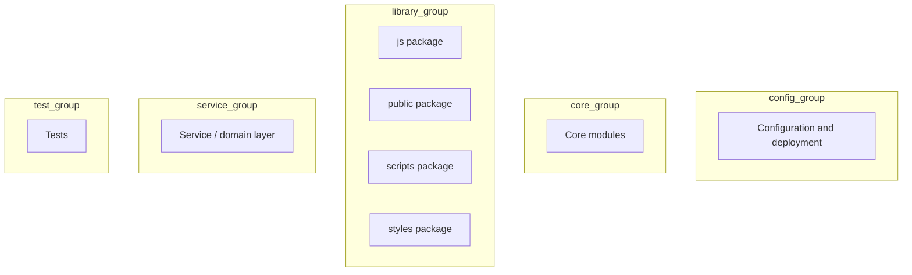

# Architecture report: summernote/summernote

> Automated static analysis. **Observed** = directly seen in files/imports/AST; **Inferred** = interpretation from that evidence. Repository code was not executed.

## 1. Repository at a glance

| Item | Value |
| --- | --- |
| Repository | summernote/summernote |
| Description | Super Simple WYSIWYG Editor |
| Language | JavaScript |
| Stars | 11841 |
| Licence | MIT |
| Analysed commit / branch | ac5460e0e9a0b622ad7deff162915a3960ff4b96 / main |
| Framework(s) | None detected |
| Files analysed | 264 |
| Components | 8 |

## 2. Architecture in one minute

summernote/summernote - Super Simple WYSIWYG Editor. This repository was analysed statically from 264 file(s) (0 Python). Detected technologies (observed from imports/manifests): GitHub Actions, Vite, Vitest. Files are grouped into 8 component(s): Configuration and deployment, Core modules, js package, public package, scripts package, Service / domain layer, styles package, Tests. Findings below distinguish observed facts from inferred interpretation.

## 3. High-level block diagram

## 4. Main components

### Configuration and deployment (`config`)

- **Kind:** config
- **Status:** Observed
- **Confidence:** 0.85
- **Responsibility:** Groups 5 file(s) under configuration and deployment (observed from repository paths and static analysis).
- **Paths:** `package.json`, `src/styles/bs3/summernote-bs3.json`, `src/styles/bs4/summernote-bs4.json`, `src/styles/bs5/summernote-bs5.json`, `src/styles/lite/summernote-lite.json`
- **Evidence:** [package.json](https://github.com/summernote/summernote/blob/ac5460e0e9a0b622ad7deff162915a3960ff4b96/package.json); [src/styles/bs3/summernote-bs3.json](https://github.com/summernote/summernote/blob/ac5460e0e9a0b622ad7deff162915a3960ff4b96/src/styles/bs3/summernote-bs3.json); [src/styles/bs4/summernote-bs4.json](https://github.com/summernote/summernote/blob/ac5460e0e9a0b622ad7deff162915a3960ff4b96/src/styles/bs4/summernote-bs4.json); [src/styles/bs5/summernote-bs5.json](https://github.com/summernote/summernote/blob/ac5460e0e9a0b622ad7deff162915a3960ff4b96/src/styles/bs5/summernote-bs5.json); [src/styles/lite/summernote-lite.json](https://github.com/summernote/summernote/blob/ac5460e0e9a0b622ad7deff162915a3960ff4b96/src/styles/lite/summernote-lite.json)

### Core modules (`core`)

- **Kind:** core
- **Status:** Observed
- **Confidence:** 0.85
- **Responsibility:** Groups 3 file(s) under core modules (observed from repository paths and static analysis).
- **Paths:** `vite.config.dev.js`, `vite.config.js`, `vitest.config.js`
- **Evidence:** [vite.config.dev.js](https://github.com/summernote/summernote/blob/ac5460e0e9a0b622ad7deff162915a3960ff4b96/vite.config.dev.js); [vite.config.js](https://github.com/summernote/summernote/blob/ac5460e0e9a0b622ad7deff162915a3960ff4b96/vite.config.js); [vitest.config.js](https://github.com/summernote/summernote/blob/ac5460e0e9a0b622ad7deff162915a3960ff4b96/vitest.config.js)

### js package (`js`)

- **Kind:** library
- **Status:** Observed
- **Confidence:** 0.85
- **Responsibility:** Groups 32 file(s) under js package (observed from repository paths and static analysis).
- **Paths:** `src/js/Context.js`, `src/js/editing/Bullet.js`, `src/js/editing/History.js`, `src/js/editing/Style.js`, `src/js/editing/Table.js`, `src/js/editing/Typing.js`, `src/js/module/AirPopover.js`, `src/js/module/AutoLink.js`, `src/js/module/AutoReplace.js`, `src/js/module/AutoSync.js`, `src/js/module/Buttons.js`, `src/js/module/Clipboard.js`, `src/js/module/Codeview.js`, `src/js/module/Dropzone.js`, `src/js/module/Editor.js`, `src/js/module/Fullscreen.js`, `src/js/module/Handle.js`, `src/js/module/HelpDialog.js`, `src/js/module/HintPopover.js`, `src/js/module/ImageDialog.js`, `src/js/module/ImagePopover.js`, `src/js/module/LinkDialog.js`, `src/js/module/LinkPopover.js`, `src/js/module/Placeholder.js`, `src/js/module/Statusbar.js`, `src/js/module/TablePopover.js`, `src/js/module/Toolbar.js`, `src/js/module/VideoDialog.js`, `src/js/renderer.js`, `src/js/settings.js`, `src/js/summernote-en-US.js`, `src/js/summernote.js`
- **Evidence:** [src/js/Context.js](https://github.com/summernote/summernote/blob/ac5460e0e9a0b622ad7deff162915a3960ff4b96/src/js/Context.js); [src/js/editing/Bullet.js](https://github.com/summernote/summernote/blob/ac5460e0e9a0b622ad7deff162915a3960ff4b96/src/js/editing/Bullet.js); [src/js/editing/History.js](https://github.com/summernote/summernote/blob/ac5460e0e9a0b622ad7deff162915a3960ff4b96/src/js/editing/History.js); [src/js/editing/Style.js](https://github.com/summernote/summernote/blob/ac5460e0e9a0b622ad7deff162915a3960ff4b96/src/js/editing/Style.js); [src/js/editing/Table.js](https://github.com/summernote/summernote/blob/ac5460e0e9a0b622ad7deff162915a3960ff4b96/src/js/editing/Table.js); [src/js/editing/Typing.js](https://github.com/summernote/summernote/blob/ac5460e0e9a0b622ad7deff162915a3960ff4b96/src/js/editing/Typing.js); [src/js/module/AirPopover.js](https://github.com/summernote/summernote/blob/ac5460e0e9a0b622ad7deff162915a3960ff4b96/src/js/module/AirPopover.js); [src/js/module/AutoLink.js](https://github.com/summernote/summernote/blob/ac5460e0e9a0b622ad7deff162915a3960ff4b96/src/js/module/AutoLink.js)

### public package (`public`)

- **Kind:** library
- **Status:** Observed
- **Confidence:** 0.85
- **Responsibility:** Groups 49 file(s) under public package (observed from repository paths and static analysis).
- **Paths:** `public/lang/summernote-ar-AR.js`, `public/lang/summernote-az-AZ.js`, `public/lang/summernote-bg-BG.js`, `public/lang/summernote-bn-BD.js`, `public/lang/summernote-ca-ES.js`, `public/lang/summernote-cs-CZ.js`, `public/lang/summernote-da-DK.js`, `public/lang/summernote-de-CH.js`, `public/lang/summernote-de-DE.js`, `public/lang/summernote-el-GR.js`, `public/lang/summernote-es-ES.js`, `public/lang/summernote-es-EU.js`, `public/lang/summernote-fa-IR.js`, `public/lang/summernote-fi-FI.js`, `public/lang/summernote-fr-FR.js`, `public/lang/summernote-gl-ES.js`, `public/lang/summernote-he-IL.js`, `public/lang/summernote-hr-HR.js`, `public/lang/summernote-hu-HU.js`, `public/lang/summernote-id-ID.js`, `public/lang/summernote-it-IT.js`, `public/lang/summernote-ja-JP.js`, `public/lang/summernote-ko-KR.js`, `public/lang/summernote-lt-LT.js`, `public/lang/summernote-lt-LV.js`, `public/lang/summernote-mn-MN.js`, `public/lang/summernote-nb-NO.js`, `public/lang/summernote-nl-NL.js`, `public/lang/summernote-pl-PL.js`, `public/lang/summernote-pt-BR.js`, `public/lang/summernote-pt-PT.js`, `public/lang/summernote-ro-RO.js`, `public/lang/summernote-ru-RU.js`, `public/lang/summernote-sk-SK.js`, `public/lang/summernote-sl-SI.js`, `public/lang/summernote-sr-RS-Latin.js`, `public/lang/summernote-sr-RS.js`, `public/lang/summernote-sv-SE.js`, `public/lang/summernote-ta-IN.js`, `public/lang/summernote-th-TH.js`, `public/lang/summernote-tr-TR.js`, `public/lang/summernote-uk-UA.js`, `public/lang/summernote-uz-UZ.js`, `public/lang/summernote-vi-VN.js`, `public/lang/summernote-zh-CN.js`, `public/lang/summernote-zh-TW.js`, `public/plugin/databasic/summernote-ext-databasic.js`, `public/plugin/hello/summernote-ext-hello.js`, `public/plugin/specialchars/summernote-ext-specialchars.js`
- **Evidence:** [public/lang/summernote-ar-AR.js](https://github.com/summernote/summernote/blob/ac5460e0e9a0b622ad7deff162915a3960ff4b96/public/lang/summernote-ar-AR.js); [public/lang/summernote-az-AZ.js](https://github.com/summernote/summernote/blob/ac5460e0e9a0b622ad7deff162915a3960ff4b96/public/lang/summernote-az-AZ.js); [public/lang/summernote-bg-BG.js](https://github.com/summernote/summernote/blob/ac5460e0e9a0b622ad7deff162915a3960ff4b96/public/lang/summernote-bg-BG.js); [public/lang/summernote-bn-BD.js](https://github.com/summernote/summernote/blob/ac5460e0e9a0b622ad7deff162915a3960ff4b96/public/lang/summernote-bn-BD.js); [public/lang/summernote-ca-ES.js](https://github.com/summernote/summernote/blob/ac5460e0e9a0b622ad7deff162915a3960ff4b96/public/lang/summernote-ca-ES.js); [public/lang/summernote-cs-CZ.js](https://github.com/summernote/summernote/blob/ac5460e0e9a0b622ad7deff162915a3960ff4b96/public/lang/summernote-cs-CZ.js); [public/lang/summernote-da-DK.js](https://github.com/summernote/summernote/blob/ac5460e0e9a0b622ad7deff162915a3960ff4b96/public/lang/summernote-da-DK.js); [public/lang/summernote-de-CH.js](https://github.com/summernote/summernote/blob/ac5460e0e9a0b622ad7deff162915a3960ff4b96/public/lang/summernote-de-CH.js)

### scripts package (`scripts`)

- **Kind:** library
- **Status:** Observed
- **Confidence:** 0.85
- **Responsibility:** Groups 3 file(s) under scripts package (observed from repository paths and static analysis).
- **Paths:** `scripts/build-all.js`, `scripts/build-fonts.js`, `scripts/vite-plugins/vitePostCSSSourceMap.mjs`
- **Evidence:** [scripts/build-all.js](https://github.com/summernote/summernote/blob/ac5460e0e9a0b622ad7deff162915a3960ff4b96/scripts/build-all.js); [scripts/build-fonts.js](https://github.com/summernote/summernote/blob/ac5460e0e9a0b622ad7deff162915a3960ff4b96/scripts/build-fonts.js); [scripts/vite-plugins/vitePostCSSSourceMap.mjs](https://github.com/summernote/summernote/blob/ac5460e0e9a0b622ad7deff162915a3960ff4b96/scripts/vite-plugins/vitePostCSSSourceMap.mjs)

### Service / domain layer (`service_layer`)

- **Kind:** service
- **Status:** Observed
- **Confidence:** 0.85
- **Responsibility:** Groups 7 file(s) under service / domain layer (observed from repository paths and static analysis).
- **Paths:** `src/js/core/async.js`, `src/js/core/dom.js`, `src/js/core/env.js`, `src/js/core/func.js`, `src/js/core/key.js`, `src/js/core/lists.js`, `src/js/core/range.js`
- **Evidence:** [src/js/core/async.js](https://github.com/summernote/summernote/blob/ac5460e0e9a0b622ad7deff162915a3960ff4b96/src/js/core/async.js); [src/js/core/dom.js](https://github.com/summernote/summernote/blob/ac5460e0e9a0b622ad7deff162915a3960ff4b96/src/js/core/dom.js); [src/js/core/env.js](https://github.com/summernote/summernote/blob/ac5460e0e9a0b622ad7deff162915a3960ff4b96/src/js/core/env.js); [src/js/core/func.js](https://github.com/summernote/summernote/blob/ac5460e0e9a0b622ad7deff162915a3960ff4b96/src/js/core/func.js); [src/js/core/key.js](https://github.com/summernote/summernote/blob/ac5460e0e9a0b622ad7deff162915a3960ff4b96/src/js/core/key.js); [src/js/core/lists.js](https://github.com/summernote/summernote/blob/ac5460e0e9a0b622ad7deff162915a3960ff4b96/src/js/core/lists.js); [src/js/core/range.js](https://github.com/summernote/summernote/blob/ac5460e0e9a0b622ad7deff162915a3960ff4b96/src/js/core/range.js)

### styles package (`styles`)

- **Kind:** library
- **Status:** Observed
- **Confidence:** 0.85
- **Responsibility:** Groups 7 file(s) under styles package (observed from repository paths and static analysis).
- **Paths:** `src/styles/bs3/summernote-bs3.js`, `src/styles/bs4/summernote-bs4.js`, `src/styles/bs5/summernote-bs5.js`, `src/styles/lite/js/DropdownUI.js`, `src/styles/lite/js/ModalUI.js`, `src/styles/lite/js/TooltipUI.js`, `src/styles/lite/summernote-lite.js`
- **Evidence:** [src/styles/bs3/summernote-bs3.js](https://github.com/summernote/summernote/blob/ac5460e0e9a0b622ad7deff162915a3960ff4b96/src/styles/bs3/summernote-bs3.js); [src/styles/bs4/summernote-bs4.js](https://github.com/summernote/summernote/blob/ac5460e0e9a0b622ad7deff162915a3960ff4b96/src/styles/bs4/summernote-bs4.js); [src/styles/bs5/summernote-bs5.js](https://github.com/summernote/summernote/blob/ac5460e0e9a0b622ad7deff162915a3960ff4b96/src/styles/bs5/summernote-bs5.js); [src/styles/lite/js/DropdownUI.js](https://github.com/summernote/summernote/blob/ac5460e0e9a0b622ad7deff162915a3960ff4b96/src/styles/lite/js/DropdownUI.js); [src/styles/lite/js/ModalUI.js](https://github.com/summernote/summernote/blob/ac5460e0e9a0b622ad7deff162915a3960ff4b96/src/styles/lite/js/ModalUI.js); [src/styles/lite/js/TooltipUI.js](https://github.com/summernote/summernote/blob/ac5460e0e9a0b622ad7deff162915a3960ff4b96/src/styles/lite/js/TooltipUI.js); [src/styles/lite/summernote-lite.js](https://github.com/summernote/summernote/blob/ac5460e0e9a0b622ad7deff162915a3960ff4b96/src/styles/lite/summernote-lite.js)

### Tests (`tests`)

- **Kind:** test
- **Status:** Observed
- **Confidence:** 0.85
- **Responsibility:** Groups 19 file(s) under tests (observed from repository paths and static analysis).
- **Paths:** `test/base/Context.spec.js`, `test/base/core/dom.spec.js`, `test/base/core/func.spec.js`, `test/base/core/key.spec.js`, `test/base/core/lists.spec.js`, `test/base/core/range.spec.js`, `test/base/editing/Table.spec.js`, `test/base/editing/Typing.spec.js`, `test/base/editing/style.spec.js`, `test/base/module/Buttons.spec.js`, `test/base/module/Codeview.spec.js`, `test/base/module/Editor.spec.js`, `test/base/module/Fullscreen.spec.js`, `test/base/module/HintPopover.spec.js`, `test/base/module/LinkDialog.spec.js`, `test/base/module/Placeholder.spec.js`, `test/base/module/VideoDialog.spec.js`, `test/util.js`, `test/vitest.setup.js`
- **Evidence:** [test/base/Context.spec.js](https://github.com/summernote/summernote/blob/ac5460e0e9a0b622ad7deff162915a3960ff4b96/test/base/Context.spec.js); [test/base/core/dom.spec.js](https://github.com/summernote/summernote/blob/ac5460e0e9a0b622ad7deff162915a3960ff4b96/test/base/core/dom.spec.js); [test/base/core/func.spec.js](https://github.com/summernote/summernote/blob/ac5460e0e9a0b622ad7deff162915a3960ff4b96/test/base/core/func.spec.js); [test/base/core/key.spec.js](https://github.com/summernote/summernote/blob/ac5460e0e9a0b622ad7deff162915a3960ff4b96/test/base/core/key.spec.js); [test/base/core/lists.spec.js](https://github.com/summernote/summernote/blob/ac5460e0e9a0b622ad7deff162915a3960ff4b96/test/base/core/lists.spec.js); [test/base/core/range.spec.js](https://github.com/summernote/summernote/blob/ac5460e0e9a0b622ad7deff162915a3960ff4b96/test/base/core/range.spec.js); [test/base/editing/Table.spec.js](https://github.com/summernote/summernote/blob/ac5460e0e9a0b622ad7deff162915a3960ff4b96/test/base/editing/Table.spec.js); [test/base/editing/Typing.spec.js](https://github.com/summernote/summernote/blob/ac5460e0e9a0b622ad7deff162915a3960ff4b96/test/base/editing/Typing.spec.js)

## 5. Execution flow

No entry point was observed; the startup flow below is therefore limited.

Representative flow (derived from observed entry points and the import graph; steps beyond the entry point are **Inferred**):

1. Execution starts at an observed entry point listed above, if present.
2. No internal import relationships between components were observed.

## 6. Project structure

### `(root)`

- `.babelrc` - other (120 bytes)
- `.editorconfig` - config (251 bytes)
- `.eslintrc` - other (623 bytes)
- `.gitignore` - other (555 bytes)
- `.npmignore` - other (108 bytes)
- `.prettierrc.js` - source, JavaScript (110 bytes)
- `.yarnrc.yml` - config (25 bytes)
- `CHANGES.md` - docs (28485 bytes)
- `LICENSE` - docs (1127 bytes)
- `MAINTAINING.md` - docs (1349 bytes)
- `README.md` - docs (4264 bytes)
- `index.html` - other (1380 bytes)
- `package.json` - manifest (2191 bytes)
- `vite.config.dev.js` - source, JavaScript (864 bytes)
- `vite.config.js` - source, JavaScript (2184 bytes)
- `vitest.config.js` - source, JavaScript (317 bytes)

### `.github`

- `.github/CODE_OF_CONDUCT.md` - docs (3223 bytes)
- `.github/CONTRIBUTING.md` - docs (5127 bytes)
- `.github/FUNDING.yml` - config (28 bytes)
- `.github/ISSUE_TEMPLATE.md` - docs (4034 bytes)
- `.github/ISSUE_TEMPLATE/bug_report.yml` - config (3884 bytes)
- `.github/ISSUE_TEMPLATE/config.yml` - config (477 bytes)
- `.github/ISSUE_TEMPLATE/feature_request.yml` - config (1736 bytes)
- `.github/ISSUE_TEMPLATE/improve_documentation.yml` - config (1860 bytes)
- `.github/PULL_REQUEST_TEMPLATE.md` - docs (711 bytes)
- `.github/workflows/build.yml` - ci, YAML (514 bytes)
- `.github/workflows/codeql-analysis.yml` - ci, YAML (2448 bytes)
- `.github/workflows/npm-publish.yml` - ci, YAML (648 bytes)

### `examples`

- `examples/README.md` - docs (244 bytes)
- `examples/airmode.html` - other (3313 bytes)
- `examples/codemirror.html` - other (2033 bytes)
- `examples/custom-style.html` - other (1519 bytes)
- `examples/example.css` - other (29 bytes)
- `examples/external-api.html` - other (2940 bytes)
- `examples/external-codemirror.html` - other (2460 bytes)
- `examples/hint-emoji.html` - other (2138 bytes)
- `examples/hint-math.html` - other (1959 bytes)
- `examples/hint-userdefine.html` - other (1811 bytes)
- `examples/hint-words.html` - other (2229 bytes)
- `examples/history-limit.html` - other (1503 bytes)
- `examples/index.html` - other (3951 bytes)
- `examples/jquery-custom-event.html` - other (6032 bytes)
- `examples/lang.html` - other (1312 bytes)
- `examples/link-blank.html` - other (1022 bytes)
- `examples/mode-switcher.html` - other (3854 bytes)
- `examples/ondialog-multitab.html` - other (2908 bytes)
- `examples/ondialog.html` - other (2025 bytes)
- `examples/placeholder.html` - other (1168 bytes)
- `examples/plugin-hello.html` - other (1183 bytes)
- `examples/recordEveryKeyStroke.html` - other (1346 bytes)
- `examples/summernote-bs3.html` - other (1684 bytes)
- `examples/summernote-bs4.html` - other (1901 bytes)
- `examples/summernote-bs5.html` - other (2039 bytes)
- `examples/symbols_mathematical-symbols_Greek-letters.json` - config (25412 bytes)
- `examples/textarea.html` - other (1746 bytes)
- `examples/toolbar-container.html` - other (1249 bytes)
- `examples/with-google-font.html` - other (1328 bytes)

### `public`

- `public/font/summernote.hash` - other (32 bytes)
- `public/lang/README.md` - docs (272 bytes)
- `public/lang/summernote-ar-AR.js` - source, JavaScript (6111 bytes)
- `public/lang/summernote-az-AZ.js` - source, JavaScript (5832 bytes)
- `public/lang/summernote-bg-BG.js` - source, JavaScript (6475 bytes)
- `public/lang/summernote-bn-BD.js` - source, JavaScript (8820 bytes)
- `public/lang/summernote-ca-ES.js` - source, JavaScript (5249 bytes)
- `public/lang/summernote-cs-CZ.js` - source, JavaScript (5136 bytes)
- `public/lang/summernote-da-DK.js` - source, JavaScript (5033 bytes)
- `public/lang/summernote-de-CH.js` - source, JavaScript (5001 bytes)
- `public/lang/summernote-de-DE.js` - source, JavaScript (5001 bytes)
- `public/lang/summernote-el-GR.js` - source, JavaScript (7392 bytes)
- `public/lang/summernote-es-ES.js` - source, JavaScript (5559 bytes)
- `public/lang/summernote-es-EU.js` - source, JavaScript (5079 bytes)
- `public/lang/summernote-fa-IR.js` - source, JavaScript (6096 bytes)
- `public/lang/summernote-fi-FI.js` - source, JavaScript (4938 bytes)
- `public/lang/summernote-fr-FR.js` - source, JavaScript (5506 bytes)
- `public/lang/summernote-gl-ES.js` - source, JavaScript (5194 bytes)
- `public/lang/summernote-he-IL.js` - source, JavaScript (5283 bytes)
- `public/lang/summernote-hr-HR.js` - source, JavaScript (4976 bytes)
- `public/lang/summernote-hu-HU.js` - source, JavaScript (5247 bytes)
- `public/lang/summernote-id-ID.js` - source, JavaScript (5095 bytes)
- `public/lang/summernote-it-IT.js` - source, JavaScript (5590 bytes)
- `public/lang/summernote-ja-JP.js` - source, JavaScript (4885 bytes)
- `public/lang/summernote-ko-KR.js` - source, JavaScript (5399 bytes)
- `public/lang/summernote-lt-LT.js` - source, JavaScript (5304 bytes)
- `public/lang/summernote-lt-LV.js` - source, JavaScript (5281 bytes)
- `public/lang/summernote-mn-MN.js` - source, JavaScript (5984 bytes)
- `public/lang/summernote-nb-NO.js` - source, JavaScript (5002 bytes)
- `public/lang/summernote-nl-NL.js` - source, JavaScript (5143 bytes)
- `public/lang/summernote-pl-PL.js` - source, JavaScript (5120 bytes)
- `public/lang/summernote-pt-BR.js` - source, JavaScript (5228 bytes)
- `public/lang/summernote-pt-PT.js` - source, JavaScript (5303 bytes)
- `public/lang/summernote-ro-RO.js` - source, JavaScript (5336 bytes)
- `public/lang/summernote-ru-RU.js` - source, JavaScript (7190 bytes)
- `public/lang/summernote-sk-SK.js` - source, JavaScript (5259 bytes)
- `public/lang/summernote-sl-SI.js` - source, JavaScript (5100 bytes)
- `public/lang/summernote-sr-RS-Latin.js` - source, JavaScript (4986 bytes)
- `public/lang/summernote-sr-RS.js` - source, JavaScript (5714 bytes)
- `public/lang/summernote-sv-SE.js` - source, JavaScript (5250 bytes)
- `public/lang/summernote-ta-IN.js` - source, JavaScript (6689 bytes)
- `public/lang/summernote-th-TH.js` - source, JavaScript (7304 bytes)
- `public/lang/summernote-tr-TR.js` - source, JavaScript (5385 bytes)
- `public/lang/summernote-uk-UA.js` - source, JavaScript (6270 bytes)
- `public/lang/summernote-uz-UZ.js` - source, JavaScript (4171 bytes)
- `public/lang/summernote-vi-VN.js` - source, JavaScript (4985 bytes)
- `public/lang/summernote-zh-CN.js` - source, JavaScript (4593 bytes)
- `public/lang/summernote-zh-TW.js` - source, JavaScript (4820 bytes)
- `public/plugin/databasic/summernote-ext-databasic.css` - other (254 bytes)
- `public/plugin/databasic/summernote-ext-databasic.js` - source, JavaScript (8260 bytes)
- `public/plugin/hello/summernote-ext-hello.js` - source, JavaScript (2596 bytes)
- `public/plugin/specialchars/summernote-ext-specialchars.js` - source, JavaScript (10459 bytes)

### `scripts`

- `scripts/build-all.js` - source, JavaScript (1456 bytes)
- `scripts/build-fonts.js` - source, JavaScript (1204 bytes)
- `scripts/vite-plugins/vitePostCSSSourceMap.mjs` - source, JavaScript (1054 bytes)

### `src`

- `src/font/icons/align-center.svg` - other (575 bytes)
- `src/font/icons/align-indent.svg` - other (881 bytes)
- `src/font/icons/align-justify.svg` - other (576 bytes)
- `src/font/icons/align-left.svg` - other (715 bytes)
- `src/font/icons/align-outdent.svg` - other (884 bytes)
- `src/font/icons/align-right.svg` - other (575 bytes)
- `src/font/icons/align.svg` - other (648 bytes)
- `src/font/icons/arrow-circle-down.svg` - other (472 bytes)
- `src/font/icons/arrow-circle-left.svg` - other (465 bytes)
- `src/font/icons/arrow-circle-right.svg` - other (468 bytes)
- `src/font/icons/arrow-circle-up.svg` - other (464 bytes)
- `src/font/icons/arrows-alt.svg` - other (738 bytes)
- `src/font/icons/arrows-h.svg` - other (321 bytes)
- `src/font/icons/arrows-v.svg` - other (323 bytes)
- `src/font/icons/bold.svg` - other (1755 bytes)
- `src/font/icons/caret.svg` - other (765 bytes)
- `src/font/icons/chain-broken.svg` - other (2516 bytes)
- `src/font/icons/circle.svg` - other (508 bytes)
- `src/font/icons/close.svg` - other (1123 bytes)
- `src/font/icons/code.svg` - other (683 bytes)
- `src/font/icons/col-after.svg` - other (3931 bytes)
- `src/font/icons/col-before.svg` - other (1855 bytes)
- `src/font/icons/col-remove.svg` - other (1875 bytes)
- `src/font/icons/eraser.svg` - other (848 bytes)
- `src/font/icons/float-left.svg` - other (638 bytes)
- `src/font/icons/float-none.svg` - other (642 bytes)
- `src/font/icons/float-right.svg` - other (634 bytes)
- `src/font/icons/font.svg` - other (1067 bytes)
- `src/font/icons/frame.svg` - other (1562 bytes)
- `src/font/icons/italic.svg` - other (1007 bytes)
- `src/font/icons/link.svg` - other (1596 bytes)
- `src/font/icons/magic.svg` - other (616 bytes)
- `src/font/icons/menu-check.svg` - other (646 bytes)
- `src/font/icons/minus.svg` - other (595 bytes)
- `src/font/icons/orderedlist.svg` - other (1110 bytes)
- `src/font/icons/pencil.svg` - other (704 bytes)
- `src/font/icons/picture.svg` - other (1400 bytes)
- `src/font/icons/question.svg` - other (759 bytes)
- `src/font/icons/redo.svg` - other (428 bytes)
- `src/font/icons/rollback.svg` - other (1067 bytes)
- `src/font/icons/row-above.svg` - other (1848 bytes)
- `src/font/icons/row-below.svg` - other (1851 bytes)
- `src/font/icons/row-remove.svg` - other (1868 bytes)
- `src/font/icons/special-character.svg` - other (1311 bytes)
- `src/font/icons/square.svg` - other (561 bytes)
- `src/font/icons/strikethrough.svg` - other (2534 bytes)
- `src/font/icons/subscript.svg` - other (1295 bytes)
- `src/font/icons/summernote.svg` - other (2687 bytes)
- `src/font/icons/superscript.svg` - other (1290 bytes)
- `src/font/icons/table.svg` - other (1240 bytes)
- `src/font/icons/text-height.svg` - other (1206 bytes)
- `src/font/icons/trash.svg` - other (1352 bytes)
- `src/font/icons/underline.svg` - other (1679 bytes)
- `src/font/icons/undo.svg` - other (449 bytes)
- `src/font/icons/unorderedlist.svg` - other (839 bytes)
- `src/font/icons/video.svg` - other (786 bytes)
- `src/font/summernote.hash` - other (32 bytes)
- `src/font/template.scss` - other (2569 bytes)
- `src/js/Context.js` - source, JavaScript (6094 bytes)
- `src/js/core/async.js` - source, JavaScript (1033 bytes)
- `src/js/core/dom.js` - source, JavaScript (27068 bytes)
- `src/js/core/env.js` - source, JavaScript (2867 bytes)
- `src/js/core/func.js` - source, JavaScript (3582 bytes)
- `src/js/core/key.js` - source, JavaScript (1970 bytes)
- `src/js/core/lists.js` - source, JavaScript (3917 bytes)
- `src/js/core/range.js` - source, JavaScript (24660 bytes)
- `src/js/editing/Bullet.js` - source, JavaScript (7691 bytes)
- `src/js/editing/History.js` - source, JavaScript (2971 bytes)
- `src/js/editing/Style.js` - source, JavaScript (5198 bytes)
- `src/js/editing/Table.js` - source, JavaScript (19061 bytes)
- `src/js/editing/Typing.js` - source, JavaScript (3859 bytes)
- `src/js/module/AirPopover.js` - source, JavaScript (3379 bytes)
- `src/js/module/AutoLink.js` - source, JavaScript (2019 bytes)
- `src/js/module/AutoReplace.js` - source, JavaScript (2089 bytes)
- `src/js/module/AutoSync.js` - source, JavaScript (357 bytes)
- `src/js/module/Buttons.js` - source, JavaScript (35901 bytes)
- `src/js/module/Clipboard.js` - source, JavaScript (1464 bytes)
- `src/js/module/Codeview.js` - source, JavaScript (4991 bytes)
- `src/js/module/Dropzone.js` - source, JavaScript (4071 bytes)
- `src/js/module/Editor.js` - source, JavaScript (28486 bytes)
- `src/js/module/Fullscreen.js` - source, JavaScript (1698 bytes)
- `src/js/module/Handle.js` - source, JavaScript (4041 bytes)
- `src/js/module/HelpDialog.js` - source, JavaScript (2331 bytes)
- `src/js/module/HintPopover.js` - source, JavaScript (7806 bytes)
- `src/js/module/ImageDialog.js` - source, JavaScript (4591 bytes)
- `src/js/module/ImagePopover.js` - source, JavaScript (2013 bytes)
- `src/js/module/LinkDialog.js` - source, JavaScript (6395 bytes)
- `src/js/module/LinkPopover.js` - source, JavaScript (2316 bytes)
- `src/js/module/Placeholder.js` - source, JavaScript (1151 bytes)
- `src/js/module/Statusbar.js` - source, JavaScript (1854 bytes)
- `src/js/module/TablePopover.js` - source, JavaScript (2145 bytes)
- `src/js/module/Toolbar.js` - source, JavaScript (4170 bytes)
- `src/js/module/VideoDialog.js` - source, JavaScript (9591 bytes)
- `src/js/renderer.js` - source, JavaScript (1561 bytes)
- `src/js/settings.js` - source, JavaScript (11970 bytes)
- `src/js/summernote-en-US.js` - source, JavaScript (4827 bytes)
- `src/js/summernote.js` - source, JavaScript (1404 bytes)
- `src/styles/README.md` - docs (570 bytes)
- `src/styles/bs3/summernote-bs3.html` - other (1584 bytes)
- `src/styles/bs3/summernote-bs3.js` - source, JavaScript (9535 bytes)
- `src/styles/bs3/summernote-bs3.json` - config (30 bytes)
- `src/styles/bs3/summernote-bs3.scss` - other (72 bytes)
- `src/styles/bs4/summernote-bs4.html` - other (1809 bytes)
- `src/styles/bs4/summernote-bs4.js` - source, JavaScript (10613 bytes)
- `src/styles/bs4/summernote-bs4.json` - config (30 bytes)
- `src/styles/bs4/summernote-bs4.scss` - other (233 bytes)
- `src/styles/bs5/summernote-bs5.html` - other (1941 bytes)
- `src/styles/bs5/summernote-bs5.js` - source, JavaScript (10284 bytes)
- `src/styles/bs5/summernote-bs5.json` - config (30 bytes)
- `src/styles/bs5/summernote-bs5.scss` - other (233 bytes)
- `src/styles/lite/js/DropdownUI.js` - source, JavaScript (1837 bytes)
- `src/styles/lite/js/ModalUI.js` - source, JavaScript (745 bytes)
- `src/styles/lite/js/TooltipUI.js` - source, JavaScript (2877 bytes)
- `src/styles/lite/scss/btn-group.scss` - other (745 bytes)
- `src/styles/lite/scss/buttons.scss` - other (2328 bytes)
- `src/styles/lite/scss/common.scss` - other (117 bytes)
- `src/styles/lite/scss/dropdown.scss` - other (795 bytes)
- `src/styles/lite/scss/form.scss` - other (697 bytes)
- `src/styles/lite/scss/mixins.scss` - other (31 bytes)
- `src/styles/lite/scss/mixins/buttons.scss` - other (933 bytes)
- `src/styles/lite/scss/modal.scss` - other (3302 bytes)
- `src/styles/lite/scss/popover.scss` - other (2864 bytes)
- `src/styles/lite/scss/toolbar.scss` - other (204 bytes)
- `src/styles/lite/scss/tooltip.scss` - other (1895 bytes)
- `src/styles/lite/scss/variables.scss` - other (2465 bytes)
- `src/styles/lite/summernote-lite.html` - other (1556 bytes)
- `src/styles/lite/summernote-lite.js` - source, JavaScript (23546 bytes)
- `src/styles/lite/summernote-lite.json` - config (23 bytes)
- `src/styles/lite/summernote-lite.scss` - other (1511 bytes)
- `src/styles/summernote/README.md` - docs (291 bytes)
- `src/styles/summernote/common.scss` - other (12313 bytes)
- `src/styles/summernote/elements.scss` - other (5879 bytes)
- `src/styles/summernote/font.scss` - other (4641 bytes)

### `test`

- `test/base/Context.spec.js` - test, JavaScript (2014 bytes)
- `test/base/core/dom.spec.js` - test, JavaScript (12824 bytes)
- `test/base/core/func.spec.js` - test, JavaScript (4497 bytes)
- `test/base/core/key.spec.js` - test, JavaScript (521 bytes)
- `test/base/core/lists.spec.js` - test, JavaScript (3154 bytes)
- `test/base/core/range.spec.js` - test, JavaScript (17346 bytes)
- `test/base/editing/Table.spec.js` - test, JavaScript (26550 bytes)
- `test/base/editing/Typing.spec.js` - test, JavaScript (3315 bytes)
- `test/base/editing/style.spec.js` - test, JavaScript (3558 bytes)
- `test/base/module/Buttons.spec.js` - test, JavaScript (12681 bytes)
- `test/base/module/Codeview.spec.js` - test, JavaScript (3896 bytes)
- `test/base/module/Editor.spec.js` - test, JavaScript (20322 bytes)
- `test/base/module/Fullscreen.spec.js` - test, JavaScript (828 bytes)
- `test/base/module/HintPopover.spec.js` - test, JavaScript (6753 bytes)
- `test/base/module/LinkDialog.spec.js` - test, JavaScript (6254 bytes)
- `test/base/module/Placeholder.spec.js` - test, JavaScript (1188 bytes)
- `test/base/module/VideoDialog.spec.js` - test, JavaScript (3004 bytes)
- `test/util.js` - test, JavaScript (106 bytes)
- `test/vitest.setup.js` - test, JavaScript (948 bytes)

## 7. Key dependencies and integrations

| Name | Category | Status | Confidence | Evidence |
| --- | --- | --- | --- | --- |
| GitHub Actions | ci | Observed | 0.90 | [.github/workflows/build.yml](https://github.com/summernote/summernote/blob/ac5460e0e9a0b622ad7deff162915a3960ff4b96/.github/workflows/build.yml); [.github/workflows/codeql-analysis.yml](https://github.com/summernote/summernote/blob/ac5460e0e9a0b622ad7deff162915a3960ff4b96/.github/workflows/codeql-analysis.yml); [.github/workflows/npm-publish.yml](https://github.com/summernote/summernote/blob/ac5460e0e9a0b622ad7deff162915a3960ff4b96/.github/workflows/npm-publish.yml) |
| Vite | tooling | Observed | 0.85 | [package.json:24](https://github.com/summernote/summernote/blob/ac5460e0e9a0b622ad7deff162915a3960ff4b96/package.json#L24) |
| Vitest | tooling | Observed | 0.85 | [package.json:29](https://github.com/summernote/summernote/blob/ac5460e0e9a0b622ad7deff162915a3960ff4b96/package.json#L29) |

## 8. Data and state

No database, cache, queue, or persistent-state usage was observed in the analysed files. State handling, if any, may be in-memory or in files that were not analysed.

## 9. Configuration and deployment clues

- `.editorconfig` (config)
- `.github/FUNDING.yml` (config)
- `.github/ISSUE_TEMPLATE/bug_report.yml` (config)
- `.github/ISSUE_TEMPLATE/config.yml` (config)
- `.github/ISSUE_TEMPLATE/feature_request.yml` (config)
- `.github/ISSUE_TEMPLATE/improve_documentation.yml` (config)
- `.github/workflows/build.yml` (ci)
- `.github/workflows/codeql-analysis.yml` (ci)
- `.github/workflows/npm-publish.yml` (ci)
- `.yarnrc.yml` (config)
- `examples/symbols_mathematical-symbols_Greek-letters.json` (config)
- `package.json` (manifest)
- `src/styles/bs3/summernote-bs3.json` (config)
- `src/styles/bs4/summernote-bs4.json` (config)
- `src/styles/bs5/summernote-bs5.json` (config)
- `src/styles/lite/summernote-lite.json` (config)

## 10. Design observations

- Service/domain code is distinct from entry and data code, suggesting layered separation (Inferred).
- Tests are present alongside source code (Observed from test file paths).

These observations are interpretations (**Inferred**) of the observed structure, not guarantees about runtime design.

## 11. Limitations and unknowns

- Static analysis only: repository code was not executed, installed, or imported at runtime.
- Components and relationships are inferred from file paths, imports, and AST structure; runtime behaviour, dynamic imports, and reflection may not be visible.
- No clear application entry point was observed in the analysed files.
- Repository text was treated as untrusted data; no instructions found in repository files were followed, and likely secret values were redacted/excluded.
- JavaScript and TypeScript files were inventoried from paths and package manifests. They were not parsed with a full language AST, and repository code was not executed.

## 12. Source references

- [.github/workflows/build.yml](https://github.com/summernote/summernote/blob/ac5460e0e9a0b622ad7deff162915a3960ff4b96/.github/workflows/build.yml)
- [.github/workflows/codeql-analysis.yml](https://github.com/summernote/summernote/blob/ac5460e0e9a0b622ad7deff162915a3960ff4b96/.github/workflows/codeql-analysis.yml)
- [.github/workflows/npm-publish.yml](https://github.com/summernote/summernote/blob/ac5460e0e9a0b622ad7deff162915a3960ff4b96/.github/workflows/npm-publish.yml)
- [package.json](https://github.com/summernote/summernote/blob/ac5460e0e9a0b622ad7deff162915a3960ff4b96/package.json)
- [package.json:24](https://github.com/summernote/summernote/blob/ac5460e0e9a0b622ad7deff162915a3960ff4b96/package.json#L24)
- [package.json:29](https://github.com/summernote/summernote/blob/ac5460e0e9a0b622ad7deff162915a3960ff4b96/package.json#L29)
- [public/lang/summernote-ar-AR.js](https://github.com/summernote/summernote/blob/ac5460e0e9a0b622ad7deff162915a3960ff4b96/public/lang/summernote-ar-AR.js)
- [public/lang/summernote-az-AZ.js](https://github.com/summernote/summernote/blob/ac5460e0e9a0b622ad7deff162915a3960ff4b96/public/lang/summernote-az-AZ.js)
- [public/lang/summernote-bg-BG.js](https://github.com/summernote/summernote/blob/ac5460e0e9a0b622ad7deff162915a3960ff4b96/public/lang/summernote-bg-BG.js)
- [public/lang/summernote-bn-BD.js](https://github.com/summernote/summernote/blob/ac5460e0e9a0b622ad7deff162915a3960ff4b96/public/lang/summernote-bn-BD.js)
- [public/lang/summernote-ca-ES.js](https://github.com/summernote/summernote/blob/ac5460e0e9a0b622ad7deff162915a3960ff4b96/public/lang/summernote-ca-ES.js)
- [public/lang/summernote-cs-CZ.js](https://github.com/summernote/summernote/blob/ac5460e0e9a0b622ad7deff162915a3960ff4b96/public/lang/summernote-cs-CZ.js)
- [public/lang/summernote-da-DK.js](https://github.com/summernote/summernote/blob/ac5460e0e9a0b622ad7deff162915a3960ff4b96/public/lang/summernote-da-DK.js)
- [public/lang/summernote-de-CH.js](https://github.com/summernote/summernote/blob/ac5460e0e9a0b622ad7deff162915a3960ff4b96/public/lang/summernote-de-CH.js)
- [scripts/build-all.js](https://github.com/summernote/summernote/blob/ac5460e0e9a0b622ad7deff162915a3960ff4b96/scripts/build-all.js)
- [scripts/build-fonts.js](https://github.com/summernote/summernote/blob/ac5460e0e9a0b622ad7deff162915a3960ff4b96/scripts/build-fonts.js)
- [scripts/vite-plugins/vitePostCSSSourceMap.mjs](https://github.com/summernote/summernote/blob/ac5460e0e9a0b622ad7deff162915a3960ff4b96/scripts/vite-plugins/vitePostCSSSourceMap.mjs)
- [src/js/Context.js](https://github.com/summernote/summernote/blob/ac5460e0e9a0b622ad7deff162915a3960ff4b96/src/js/Context.js)
- [src/js/core/async.js](https://github.com/summernote/summernote/blob/ac5460e0e9a0b622ad7deff162915a3960ff4b96/src/js/core/async.js)
- [src/js/core/dom.js](https://github.com/summernote/summernote/blob/ac5460e0e9a0b622ad7deff162915a3960ff4b96/src/js/core/dom.js)
- [src/js/core/env.js](https://github.com/summernote/summernote/blob/ac5460e0e9a0b622ad7deff162915a3960ff4b96/src/js/core/env.js)
- [src/js/core/func.js](https://github.com/summernote/summernote/blob/ac5460e0e9a0b622ad7deff162915a3960ff4b96/src/js/core/func.js)
- [src/js/core/key.js](https://github.com/summernote/summernote/blob/ac5460e0e9a0b622ad7deff162915a3960ff4b96/src/js/core/key.js)
- [src/js/core/lists.js](https://github.com/summernote/summernote/blob/ac5460e0e9a0b622ad7deff162915a3960ff4b96/src/js/core/lists.js)
- [src/js/core/range.js](https://github.com/summernote/summernote/blob/ac5460e0e9a0b622ad7deff162915a3960ff4b96/src/js/core/range.js)
- [src/js/editing/Bullet.js](https://github.com/summernote/summernote/blob/ac5460e0e9a0b622ad7deff162915a3960ff4b96/src/js/editing/Bullet.js)
- [src/js/editing/History.js](https://github.com/summernote/summernote/blob/ac5460e0e9a0b622ad7deff162915a3960ff4b96/src/js/editing/History.js)
- [src/js/editing/Style.js](https://github.com/summernote/summernote/blob/ac5460e0e9a0b622ad7deff162915a3960ff4b96/src/js/editing/Style.js)
- [src/js/editing/Table.js](https://github.com/summernote/summernote/blob/ac5460e0e9a0b622ad7deff162915a3960ff4b96/src/js/editing/Table.js)
- [src/js/editing/Typing.js](https://github.com/summernote/summernote/blob/ac5460e0e9a0b622ad7deff162915a3960ff4b96/src/js/editing/Typing.js)
- [src/js/module/AirPopover.js](https://github.com/summernote/summernote/blob/ac5460e0e9a0b622ad7deff162915a3960ff4b96/src/js/module/AirPopover.js)
- [src/js/module/AutoLink.js](https://github.com/summernote/summernote/blob/ac5460e0e9a0b622ad7deff162915a3960ff4b96/src/js/module/AutoLink.js)
- [src/styles/bs3/summernote-bs3.js](https://github.com/summernote/summernote/blob/ac5460e0e9a0b622ad7deff162915a3960ff4b96/src/styles/bs3/summernote-bs3.js)
- [src/styles/bs3/summernote-bs3.json](https://github.com/summernote/summernote/blob/ac5460e0e9a0b622ad7deff162915a3960ff4b96/src/styles/bs3/summernote-bs3.json)
- [src/styles/bs4/summernote-bs4.js](https://github.com/summernote/summernote/blob/ac5460e0e9a0b622ad7deff162915a3960ff4b96/src/styles/bs4/summernote-bs4.js)
- [src/styles/bs4/summernote-bs4.json](https://github.com/summernote/summernote/blob/ac5460e0e9a0b622ad7deff162915a3960ff4b96/src/styles/bs4/summernote-bs4.json)
- [src/styles/bs5/summernote-bs5.js](https://github.com/summernote/summernote/blob/ac5460e0e9a0b622ad7deff162915a3960ff4b96/src/styles/bs5/summernote-bs5.js)
- [src/styles/bs5/summernote-bs5.json](https://github.com/summernote/summernote/blob/ac5460e0e9a0b622ad7deff162915a3960ff4b96/src/styles/bs5/summernote-bs5.json)
- [src/styles/lite/js/DropdownUI.js](https://github.com/summernote/summernote/blob/ac5460e0e9a0b622ad7deff162915a3960ff4b96/src/styles/lite/js/DropdownUI.js)
- [src/styles/lite/js/ModalUI.js](https://github.com/summernote/summernote/blob/ac5460e0e9a0b622ad7deff162915a3960ff4b96/src/styles/lite/js/ModalUI.js)
- [src/styles/lite/js/TooltipUI.js](https://github.com/summernote/summernote/blob/ac5460e0e9a0b622ad7deff162915a3960ff4b96/src/styles/lite/js/TooltipUI.js)
- [src/styles/lite/summernote-lite.js](https://github.com/summernote/summernote/blob/ac5460e0e9a0b622ad7deff162915a3960ff4b96/src/styles/lite/summernote-lite.js)
- [src/styles/lite/summernote-lite.json](https://github.com/summernote/summernote/blob/ac5460e0e9a0b622ad7deff162915a3960ff4b96/src/styles/lite/summernote-lite.json)
- [test/base/Context.spec.js](https://github.com/summernote/summernote/blob/ac5460e0e9a0b622ad7deff162915a3960ff4b96/test/base/Context.spec.js)
- [test/base/core/dom.spec.js](https://github.com/summernote/summernote/blob/ac5460e0e9a0b622ad7deff162915a3960ff4b96/test/base/core/dom.spec.js)
- [test/base/core/func.spec.js](https://github.com/summernote/summernote/blob/ac5460e0e9a0b622ad7deff162915a3960ff4b96/test/base/core/func.spec.js)
- [test/base/core/key.spec.js](https://github.com/summernote/summernote/blob/ac5460e0e9a0b622ad7deff162915a3960ff4b96/test/base/core/key.spec.js)
- [test/base/core/lists.spec.js](https://github.com/summernote/summernote/blob/ac5460e0e9a0b622ad7deff162915a3960ff4b96/test/base/core/lists.spec.js)
- [test/base/core/range.spec.js](https://github.com/summernote/summernote/blob/ac5460e0e9a0b622ad7deff162915a3960ff4b96/test/base/core/range.spec.js)
- [test/base/editing/Table.spec.js](https://github.com/summernote/summernote/blob/ac5460e0e9a0b622ad7deff162915a3960ff4b96/test/base/editing/Table.spec.js)
- [test/base/editing/Typing.spec.js](https://github.com/summernote/summernote/blob/ac5460e0e9a0b622ad7deff162915a3960ff4b96/test/base/editing/Typing.spec.js)
- [vite.config.dev.js](https://github.com/summernote/summernote/blob/ac5460e0e9a0b622ad7deff162915a3960ff4b96/vite.config.dev.js)
- [vite.config.js](https://github.com/summernote/summernote/blob/ac5460e0e9a0b622ad7deff162915a3960ff4b96/vite.config.js)
- [vitest.config.js](https://github.com/summernote/summernote/blob/ac5460e0e9a0b622ad7deff162915a3960ff4b96/vitest.config.js)
