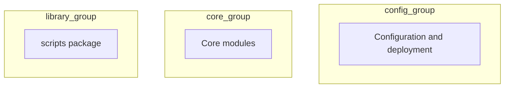

# Architecture report: surmon-china/vue-awesome-swiper

> Automated static analysis. **Observed** = directly seen in files/imports/AST; **Inferred** = interpretation from that evidence. Repository code was not executed.

## 1. Repository at a glance

| Item | Value |
| --- | --- |
| Repository | surmon-china/vue-awesome-swiper |
| Description | 🏆 Swiper component for @vuejs |
| Language | JavaScript |
| Stars | 12752 |
| Licence | MIT |
| Analysed commit / branch | a86323ec39f10b8fd4855a43974a22dbe9602165 / main |
| Framework(s) | Vue |
| Files analysed | 13 |
| Components | 3 |

## 2. Architecture in one minute

surmon-china/vue-awesome-swiper - 🏆 Swiper component for @vuejs. This repository was analysed statically from 13 file(s) (0 Python). Detected technologies (observed from imports/manifests): GitHub Actions, Vue, TypeScript. Files are grouped into 3 component(s): Configuration and deployment, Core modules, scripts package. Findings below distinguish observed facts from inferred interpretation.

## 3. High-level block diagram

## 4. Main components

### Configuration and deployment (`config`)

- **Kind:** config
- **Status:** Observed
- **Confidence:** 0.85
- **Responsibility:** Groups 2 file(s) under configuration and deployment (observed from repository paths and static analysis).
- **Paths:** `package.json`, `tsconfig.json`
- **Evidence:** [package.json](https://github.com/surmon-china/vue-awesome-swiper/blob/a86323ec39f10b8fd4855a43974a22dbe9602165/package.json); [tsconfig.json](https://github.com/surmon-china/vue-awesome-swiper/blob/a86323ec39f10b8fd4855a43974a22dbe9602165/tsconfig.json)

### Core modules (`core`)

- **Kind:** core
- **Status:** Observed
- **Confidence:** 0.85
- **Responsibility:** Groups 2 file(s) under core modules (observed from repository paths and static analysis).
- **Paths:** `index.d.ts`, `index.js`
- **Evidence:** [index.d.ts](https://github.com/surmon-china/vue-awesome-swiper/blob/a86323ec39f10b8fd4855a43974a22dbe9602165/index.d.ts); [index.js](https://github.com/surmon-china/vue-awesome-swiper/blob/a86323ec39f10b8fd4855a43974a22dbe9602165/index.js)

### scripts package (`scripts`)

- **Kind:** library
- **Status:** Observed
- **Confidence:** 0.85
- **Responsibility:** Groups 1 file(s) under scripts package (observed from repository paths and static analysis).
- **Paths:** `scripts/release.sh`
- **Evidence:** [scripts/release.sh](https://github.com/surmon-china/vue-awesome-swiper/blob/a86323ec39f10b8fd4855a43974a22dbe9602165/scripts/release.sh)

## 5. Execution flow

**Observed** entry point(s):

- [index.js](https://github.com/surmon-china/vue-awesome-swiper/blob/a86323ec39f10b8fd4855a43974a22dbe9602165/index.js)

Representative flow (derived from observed entry points and the import graph; steps beyond the entry point are **Inferred**):

1. Execution starts at an observed entry point listed above, if present.
2. No internal import relationships between components were observed.

## 6. Project structure

### `(root)`

- `.editorconfig` - config (161 bytes)
- `.gitignore` - other (455 bytes)
- `CHANGELOG.md` - docs (3831 bytes)
- `LICENSE` - docs (1063 bytes)
- `README.md` - docs (5210 bytes)
- `index.d.ts` - source, TypeScript (343 bytes)
- `index.js` - source, JavaScript (338 bytes)
- `package.json` - manifest (1040 bytes)
- `tsconfig.json` - config (343 bytes)

### `.github`

- `.github/workflows/publish.yml` - ci, YAML (716 bytes)
- `.github/workflows/release.yml` - ci, YAML (551 bytes)

### `presses`

- `presses/swiper-logo.svg` - other (2029 bytes)

### `scripts`

- `scripts/release.sh` - source, Shell (227 bytes)

## 7. Key dependencies and integrations

| Name | Category | Status | Confidence | Evidence |
| --- | --- | --- | --- | --- |
| GitHub Actions | ci | Observed | 0.90 | [.github/workflows/publish.yml](https://github.com/surmon-china/vue-awesome-swiper/blob/a86323ec39f10b8fd4855a43974a22dbe9602165/.github/workflows/publish.yml); [.github/workflows/release.yml](https://github.com/surmon-china/vue-awesome-swiper/blob/a86323ec39f10b8fd4855a43974a22dbe9602165/.github/workflows/release.yml) |
| Vue | framework | Observed | 0.90 | [package.json:2](https://github.com/surmon-china/vue-awesome-swiper/blob/a86323ec39f10b8fd4855a43974a22dbe9602165/package.json#L2) |
| TypeScript | tooling | Observed | 0.85 | [package.json:46](https://github.com/surmon-china/vue-awesome-swiper/blob/a86323ec39f10b8fd4855a43974a22dbe9602165/package.json#L46) |

## 8. Data and state

No database, cache, queue, or persistent-state usage was observed in the analysed files. State handling, if any, may be in-memory or in files that were not analysed.

## 9. Configuration and deployment clues

- `.editorconfig` (config)
- `.github/workflows/publish.yml` (ci)
- `.github/workflows/release.yml` (ci)
- `package.json` (manifest)
- `tsconfig.json` (config)

## 10. Design observations

- No strong design patterns could be established from the available evidence.

These observations are interpretations (**Inferred**) of the observed structure, not guarantees about runtime design.

## 11. Limitations and unknowns

- Static analysis only: repository code was not executed, installed, or imported at runtime.
- Components and relationships are inferred from file paths, imports, and AST structure; runtime behaviour, dynamic imports, and reflection may not be visible.
- 1 file(s) were skipped during inventory (1 x lockfile excluded).
- No clear application entry point was observed in the analysed files.
- Repository text was treated as untrusted data; no instructions found in repository files were followed, and likely secret values were redacted/excluded.
- JavaScript and TypeScript files were inventoried from paths and package manifests. They were not parsed with a full language AST, and repository code was not executed.
- The GitHub repository was marked archived at selection time.

## 12. Source references

- [.github/workflows/publish.yml](https://github.com/surmon-china/vue-awesome-swiper/blob/a86323ec39f10b8fd4855a43974a22dbe9602165/.github/workflows/publish.yml)
- [.github/workflows/release.yml](https://github.com/surmon-china/vue-awesome-swiper/blob/a86323ec39f10b8fd4855a43974a22dbe9602165/.github/workflows/release.yml)
- [index.d.ts](https://github.com/surmon-china/vue-awesome-swiper/blob/a86323ec39f10b8fd4855a43974a22dbe9602165/index.d.ts)
- [index.js](https://github.com/surmon-china/vue-awesome-swiper/blob/a86323ec39f10b8fd4855a43974a22dbe9602165/index.js)
- [package.json](https://github.com/surmon-china/vue-awesome-swiper/blob/a86323ec39f10b8fd4855a43974a22dbe9602165/package.json)
- [package.json:2](https://github.com/surmon-china/vue-awesome-swiper/blob/a86323ec39f10b8fd4855a43974a22dbe9602165/package.json#L2)
- [package.json:46](https://github.com/surmon-china/vue-awesome-swiper/blob/a86323ec39f10b8fd4855a43974a22dbe9602165/package.json#L46)
- [scripts/release.sh](https://github.com/surmon-china/vue-awesome-swiper/blob/a86323ec39f10b8fd4855a43974a22dbe9602165/scripts/release.sh)
- [tsconfig.json](https://github.com/surmon-china/vue-awesome-swiper/blob/a86323ec39f10b8fd4855a43974a22dbe9602165/tsconfig.json)
