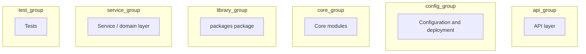

# Architecture report: sveltejs/kit

> Automated static analysis. **Observed** = directly seen in files/imports/AST; **Inferred** = interpretation from that evidence. Repository code was not executed.

## 1. Repository at a glance

| Item | Value |
| --- | --- |
| Repository | sveltejs/kit |
| Description | web development, streamlined |
| Language | JavaScript |
| Stars | 20913 |
| Licence | MIT |
| Analysed commit / branch | 089db3f6e460dbe16a1f32caa181ef6b2fa374b7 / main |
| Framework(s) | Svelte |
| Files analysed | 794 |
| Components | 6 |

## 2. Architecture in one minute

sveltejs/kit - web development, streamlined. This repository was analysed statically from 794 file(s) (0 Python). Detected technologies (observed from imports/manifests): GitHub Actions, Svelte, TypeScript, Vite, Vitest. Files are grouped into 6 component(s): API layer, Configuration and deployment, Core modules, packages package, Service / domain layer, Tests. Findings below distinguish observed facts from inferred interpretation.

## 3. High-level block diagram

## 4. Main components

### API layer (`api_layer`)

- **Kind:** api
- **Status:** Observed
- **Confidence:** 0.85
- **Responsibility:** Groups 1 file(s) under api layer (observed from repository paths and static analysis).
- **Paths:** `packages/kit/src/core/adapt/fixtures/basic/.svelte-kit/output/client/routes/index.js`
- **Evidence:** [packages/kit/src/core/adapt/fixtures/basic/.svelte-kit/output/client/routes/index.js](https://github.com/sveltejs/kit/blob/089db3f6e460dbe16a1f32caa181ef6b2fa374b7/packages/kit/src/core/adapt/fixtures/basic/.svelte-kit/output/client/routes/index.js)

### Configuration and deployment (`config`)

- **Kind:** config
- **Status:** Observed
- **Confidence:** 0.85
- **Responsibility:** Groups 39 file(s) under configuration and deployment (observed from repository paths and static analysis).
- **Paths:** `FUNDING.json`, `documentation/docs/+assets/messages.json`, `package.json`, `packages/adapter-auto/package.json`, `packages/adapter-auto/tsconfig.json`, `packages/adapter-bun/package.json`, `packages/adapter-bun/tsconfig.json`, `packages/adapter-cloudflare/files/tsconfig.json`, `packages/adapter-cloudflare/package.json`, `packages/adapter-cloudflare/tsconfig.json`, `packages/adapter-netlify/files/tsconfig.json`, `packages/adapter-netlify/package.json`, `packages/adapter-netlify/tsconfig.json`, `packages/adapter-node/package.json`, `packages/adapter-node/tsconfig.json`, `packages/adapter-static/package.json`, `packages/adapter-static/tsconfig.json`, `packages/adapter-vercel/package.json`, `packages/adapter-vercel/tsconfig.json`, `packages/enhanced-img/package.json`, `packages/enhanced-img/tsconfig.json`, `packages/kit/package.json`, `packages/kit/src/core/config/index.js`, `packages/kit/src/core/config/index.spec.js`, `packages/kit/src/core/config/options.js`, `packages/kit/src/core/config/types.d.ts`, `packages/kit/src/core/postbuild/fixtures/backslash-in-attribute/output.json`, `packages/kit/src/core/postbuild/fixtures/base/output.json`, `packages/kit/src/core/postbuild/fixtures/basic-href/output.json`, `packages/kit/src/core/postbuild/fixtures/basic-src/output.json`, `packages/kit/src/core/postbuild/fixtures/basic-srcset/output.json`, `packages/kit/src/core/postbuild/fixtures/encoded-ids/output.json`, `packages/kit/src/core/postbuild/fixtures/href-with-character-reference/output.json`, `packages/kit/src/core/postbuild/fixtures/ids/output.json`, `packages/kit/src/core/postbuild/fixtures/include-rel-external/output.json`, `packages/kit/src/core/postbuild/fixtures/invalid-url/output.json`, `packages/kit/src/core/postbuild/fixtures/meta/output.json`, `packages/kit/src/core/postbuild/fixtures/unquoted-attributes/output.json`, `packages/kit/src/core/sync/write_tsconfig/test-app/package.json`
- **Evidence:** [FUNDING.json](https://github.com/sveltejs/kit/blob/089db3f6e460dbe16a1f32caa181ef6b2fa374b7/FUNDING.json); [documentation/docs/+assets/messages.json](https://github.com/sveltejs/kit/blob/089db3f6e460dbe16a1f32caa181ef6b2fa374b7/documentation/docs/%2Bassets/messages.json); [package.json](https://github.com/sveltejs/kit/blob/089db3f6e460dbe16a1f32caa181ef6b2fa374b7/package.json); [packages/adapter-auto/package.json](https://github.com/sveltejs/kit/blob/089db3f6e460dbe16a1f32caa181ef6b2fa374b7/packages/adapter-auto/package.json); [packages/adapter-auto/tsconfig.json](https://github.com/sveltejs/kit/blob/089db3f6e460dbe16a1f32caa181ef6b2fa374b7/packages/adapter-auto/tsconfig.json); [packages/adapter-bun/package.json](https://github.com/sveltejs/kit/blob/089db3f6e460dbe16a1f32caa181ef6b2fa374b7/packages/adapter-bun/package.json); [packages/adapter-bun/tsconfig.json](https://github.com/sveltejs/kit/blob/089db3f6e460dbe16a1f32caa181ef6b2fa374b7/packages/adapter-bun/tsconfig.json); [packages/adapter-cloudflare/files/tsconfig.json](https://github.com/sveltejs/kit/blob/089db3f6e460dbe16a1f32caa181ef6b2fa374b7/packages/adapter-cloudflare/files/tsconfig.json)

### Core modules (`core`)

- **Kind:** core
- **Status:** Observed
- **Confidence:** 0.85
- **Responsibility:** Groups 1 file(s) under core modules (observed from repository paths and static analysis).
- **Paths:** `eslint.config.js`
- **Evidence:** [eslint.config.js](https://github.com/sveltejs/kit/blob/089db3f6e460dbe16a1f32caa181ef6b2fa374b7/eslint.config.js)

### packages package (`packages`)

- **Kind:** library
- **Status:** Observed
- **Confidence:** 0.85
- **Responsibility:** Groups 71 file(s) under packages package (observed from repository paths and static analysis).
- **Paths:** `packages/adapter-auto/adapters.js`, `packages/adapter-auto/index.d.ts`, `packages/adapter-auto/index.js`, `packages/adapter-bun/ambient.d.ts`, `packages/adapter-bun/index.d.ts`, `packages/adapter-bun/index.js`, `packages/adapter-bun/internal.d.ts`, `packages/adapter-bun/src/assets.js`, `packages/adapter-bun/src/env.js`, `packages/adapter-bun/src/handler.js`, `packages/adapter-bun/src/index.js`, `packages/adapter-cloudflare/files/internal.d.ts`, `packages/adapter-cloudflare/files/worker.js`, `packages/adapter-cloudflare/globals.d.ts`, `packages/adapter-cloudflare/index.d.ts`, `packages/adapter-cloudflare/index.js`, `packages/adapter-cloudflare/index.spec.js`, `packages/adapter-cloudflare/src/virtual-cloudflare-workers.js`, `packages/adapter-cloudflare/utils.js`, `packages/adapter-cloudflare/utils.spec.js`, `packages/adapter-netlify/ambient.d.ts`, `packages/adapter-netlify/files/edge.js`, `packages/adapter-netlify/files/serverless.js`, `packages/adapter-netlify/index.d.ts`, `packages/adapter-netlify/index.js`, `packages/adapter-netlify/utils.js`, `packages/adapter-netlify/utils.spec.js`, `packages/adapter-netlify/vitest.config.js`, `packages/adapter-node/ambient.d.ts`, `packages/adapter-node/index.d.ts`, `packages/adapter-node/index.js`, `packages/adapter-node/internal.d.ts`, `packages/adapter-node/src/env.js`, `packages/adapter-node/src/env.spec.ts`, `packages/adapter-node/src/handler.js`, `packages/adapter-node/src/handler.spec.js`, `packages/adapter-node/src/index.js`, `packages/adapter-node/src/static.js`, `packages/adapter-node/src/static.spec.ts`, `packages/adapter-node/src/utils.js`, `packages/adapter-node/src/utils.spec.ts`, `packages/adapter-node/vitest.config.js`, `packages/adapter-static/index.d.ts`, `packages/adapter-static/index.js`, `packages/adapter-static/platforms.js`, `packages/adapter-vercel/files/catch-all.js`, `packages/adapter-vercel/files/serverless.js`, `packages/adapter-vercel/index.d.ts`, `packages/adapter-vercel/index.js`, `packages/adapter-vercel/internal.d.ts`, `packages/adapter-vercel/utils.js`, `packages/adapter-vercel/utils.spec.js`, `packages/enhanced-img/src/index.js`, `packages/enhanced-img/src/vite-plugin.js`, `packages/enhanced-img/types/ambient.d.ts`, `packages/enhanced-img/types/index.d.ts`, `packages/enhanced-img/types/internal.d.ts`, `packages/kit/scripts/cp.js`, `packages/kit/scripts/generate-dts.js`, `packages/kit/scripts/generate-version.js`, `packages/kit/scripts/process-messages/index.js`, `packages/kit/scripts/process-messages/templates/build-errors.js`, `packages/kit/scripts/process-messages/templates/build-warnings.js`, `packages/kit/scripts/process-messages/templates/client-errors.js`, `packages/kit/scripts/process-messages/templates/client-warnings.js`, `packages/kit/scripts/process-messages/templates/server-errors.js`, `packages/kit/scripts/process-messages/templates/server-warnings.js`, `packages/kit/scripts/process-messages/templates/shared-errors.js`, `packages/kit/scripts/process-messages/templates/shared-warnings.js`, `packages/kit/src/cli.js`, `packages/kit/src/constants.js`
- **Evidence:** [packages/adapter-auto/adapters.js](https://github.com/sveltejs/kit/blob/089db3f6e460dbe16a1f32caa181ef6b2fa374b7/packages/adapter-auto/adapters.js); [packages/adapter-auto/index.d.ts](https://github.com/sveltejs/kit/blob/089db3f6e460dbe16a1f32caa181ef6b2fa374b7/packages/adapter-auto/index.d.ts); [packages/adapter-auto/index.js](https://github.com/sveltejs/kit/blob/089db3f6e460dbe16a1f32caa181ef6b2fa374b7/packages/adapter-auto/index.js); [packages/adapter-bun/ambient.d.ts](https://github.com/sveltejs/kit/blob/089db3f6e460dbe16a1f32caa181ef6b2fa374b7/packages/adapter-bun/ambient.d.ts); [packages/adapter-bun/index.d.ts](https://github.com/sveltejs/kit/blob/089db3f6e460dbe16a1f32caa181ef6b2fa374b7/packages/adapter-bun/index.d.ts); [packages/adapter-bun/index.js](https://github.com/sveltejs/kit/blob/089db3f6e460dbe16a1f32caa181ef6b2fa374b7/packages/adapter-bun/index.js); [packages/adapter-bun/internal.d.ts](https://github.com/sveltejs/kit/blob/089db3f6e460dbe16a1f32caa181ef6b2fa374b7/packages/adapter-bun/internal.d.ts); [packages/adapter-bun/src/assets.js](https://github.com/sveltejs/kit/blob/089db3f6e460dbe16a1f32caa181ef6b2fa374b7/packages/adapter-bun/src/assets.js)

### Service / domain layer (`service_layer`)

- **Kind:** service
- **Status:** Observed
- **Confidence:** 0.85
- **Responsibility:** Groups 47 file(s) under service / domain layer (observed from repository paths and static analysis).
- **Paths:** `packages/kit/src/core/adapt/builder.js`, `packages/kit/src/core/adapt/builder.spec.js`, `packages/kit/src/core/adapt/fixtures/basic/.svelte-kit/output/server/.well-known/test.js`, `packages/kit/src/core/adapt/fixtures/basic/.svelte-kit/output/server/index.js`, `packages/kit/src/core/adapt/fixtures/instrument/index.js`, `packages/kit/src/core/adapt/fixtures/instrument/server/instrumentation.server.js`, `packages/kit/src/core/adapt/index.js`, `packages/kit/src/core/env.js`, `packages/kit/src/core/features.js`, `packages/kit/src/core/generate_manifest/find_server_assets.js`, `packages/kit/src/core/generate_manifest/find_server_assets.spec.js`, `packages/kit/src/core/generate_manifest/index.js`, `packages/kit/src/core/params.js`, `packages/kit/src/core/params.spec.js`, `packages/kit/src/core/postbuild/analyse.js`, `packages/kit/src/core/postbuild/crawl.js`, `packages/kit/src/core/postbuild/crawl.spec.js`, `packages/kit/src/core/postbuild/entities.js`, `packages/kit/src/core/postbuild/entities.spec.js`, `packages/kit/src/core/postbuild/fallback.js`, `packages/kit/src/core/postbuild/prerender.js`, `packages/kit/src/core/postbuild/queue.js`, `packages/kit/src/core/postbuild/queue.spec.js`, `packages/kit/src/core/sync/create_manifest_data/conflict.js`, `packages/kit/src/core/sync/create_manifest_data/index.js`, `packages/kit/src/core/sync/create_manifest_data/index.spec.js`, `packages/kit/src/core/sync/create_manifest_data/sort.js`, `packages/kit/src/core/sync/create_manifest_data/types.d.ts`, `packages/kit/src/core/sync/fixtures/src/hook.server.js`, `packages/kit/src/core/sync/sync.js`, `packages/kit/src/core/sync/sync.spec.js`, `packages/kit/src/core/sync/ts.js`, `packages/kit/src/core/sync/utils.js`, `packages/kit/src/core/sync/utils.spec.js`, `packages/kit/src/core/sync/write_app_manifest.js`, `packages/kit/src/core/sync/write_app_types.js`, `packages/kit/src/core/sync/write_client_manifest.js`, `packages/kit/src/core/sync/write_env.js`, `packages/kit/src/core/sync/write_server.js`, `packages/kit/src/core/sync/write_tsconfig/index.js`, `packages/kit/src/core/sync/write_tsconfig/index.spec.js`, `packages/kit/src/core/sync/write_tsconfig/utils.js`, `packages/kit/src/core/sync/write_tsconfig/utils.spec.js`, `packages/kit/src/core/sync/write_tsconfig/validate.js`, `packages/kit/src/core/sync/write_tsconfig/validate.spec.js`, `packages/kit/src/core/sync/write_types/index.js`, `packages/kit/src/core/sync/write_types/index.spec.js`
- **Evidence:** [packages/kit/src/core/adapt/builder.js](https://github.com/sveltejs/kit/blob/089db3f6e460dbe16a1f32caa181ef6b2fa374b7/packages/kit/src/core/adapt/builder.js); [packages/kit/src/core/adapt/builder.spec.js](https://github.com/sveltejs/kit/blob/089db3f6e460dbe16a1f32caa181ef6b2fa374b7/packages/kit/src/core/adapt/builder.spec.js); [packages/kit/src/core/adapt/fixtures/basic/.svelte-kit/output/server/.well-known/test.js](https://github.com/sveltejs/kit/blob/089db3f6e460dbe16a1f32caa181ef6b2fa374b7/packages/kit/src/core/adapt/fixtures/basic/.svelte-kit/output/server/.well-known/test.js); [packages/kit/src/core/adapt/fixtures/basic/.svelte-kit/output/server/index.js](https://github.com/sveltejs/kit/blob/089db3f6e460dbe16a1f32caa181ef6b2fa374b7/packages/kit/src/core/adapt/fixtures/basic/.svelte-kit/output/server/index.js); [packages/kit/src/core/adapt/fixtures/instrument/index.js](https://github.com/sveltejs/kit/blob/089db3f6e460dbe16a1f32caa181ef6b2fa374b7/packages/kit/src/core/adapt/fixtures/instrument/index.js); [packages/kit/src/core/adapt/fixtures/instrument/server/instrumentation.server.js](https://github.com/sveltejs/kit/blob/089db3f6e460dbe16a1f32caa181ef6b2fa374b7/packages/kit/src/core/adapt/fixtures/instrument/server/instrumentation.server.js); [packages/kit/src/core/adapt/index.js](https://github.com/sveltejs/kit/blob/089db3f6e460dbe16a1f32caa181ef6b2fa374b7/packages/kit/src/core/adapt/index.js); [packages/kit/src/core/env.js](https://github.com/sveltejs/kit/blob/089db3f6e460dbe16a1f32caa181ef6b2fa374b7/packages/kit/src/core/env.js)

### Tests (`tests`)

- **Kind:** test
- **Status:** Observed
- **Confidence:** 0.85
- **Responsibility:** Groups 426 file(s) under tests (observed from repository paths and static analysis).
- **Paths:** `packages/adapter-auto/test/adapters.spec.js`, `packages/adapter-auto/test/index.spec.js`, `packages/adapter-bun/test/adapter.spec.ts`, `packages/adapter-bun/test/apps/basic/.gitignore`, `packages/adapter-bun/test/apps/basic/package.json`, `packages/adapter-bun/test/apps/basic/playwright.config.js`, `packages/adapter-bun/test/apps/basic/src/app.html`, `packages/adapter-bun/test/apps/basic/src/instrumentation.server.js`, `packages/adapter-bun/test/apps/basic/src/routes/+page.js`, `packages/adapter-bun/test/apps/basic/src/routes/+page.svelte`, `packages/adapter-bun/test/apps/basic/src/routes/data.json/+server.js`, `packages/adapter-bun/test/apps/basic/src/routes/dependency/+server.js`, `packages/adapter-bun/test/apps/basic/src/routes/event-stream/+server.js`, `packages/adapter-bun/test/apps/basic/src/routes/instrumented/+server.js`, `packages/adapter-bun/test/apps/basic/src/routes/platform/+server.js`, `packages/adapter-bun/test/apps/basic/src/routes/prerendered.ico/+server.js`, `packages/adapter-bun/test/apps/basic/src/routes/prerendered/+page.js`, `packages/adapter-bun/test/apps/basic/src/routes/prerendered/+page.svelte`, `packages/adapter-bun/test/apps/basic/src/routes/read/+server.js`, `packages/adapter-bun/test/apps/basic/src/routes/read/file.txt`, `packages/adapter-bun/test/apps/basic/static/.well-known/adapter-bun.txt`, `packages/adapter-bun/test/apps/basic/static/data.json`, `packages/adapter-bun/test/apps/basic/static/encoded name.txt`, `packages/adapter-bun/test/apps/basic/static/sub/index.html`, `packages/adapter-bun/test/apps/basic/test/browser.test.js`, `packages/adapter-bun/test/apps/basic/test/server.test.js`, `packages/adapter-bun/test/apps/basic/tsconfig.json`, `packages/adapter-bun/test/apps/basic/vite.config.js`, `packages/adapter-bun/test/assets.spec.ts`, `packages/adapter-bun/test/env.spec.ts`, `packages/adapter-bun/test/handler.spec.ts`, `packages/adapter-bun/test/mocks.ts`, `packages/adapter-bun/test/start.spec.ts`, `packages/adapter-bun/test/utils.js`, `packages/adapter-bun/tests/types.ts`, `packages/adapter-cloudflare/test/apps/pages/.gitignore`, `packages/adapter-cloudflare/test/apps/pages/package.json`, `packages/adapter-cloudflare/test/apps/pages/playwright.config.js`, `packages/adapter-cloudflare/test/apps/pages/server-side-dep/index.d.ts`, `packages/adapter-cloudflare/test/apps/pages/server-side-dep/index.js`, `packages/adapter-cloudflare/test/apps/pages/server-side-dep/package.json`, `packages/adapter-cloudflare/test/apps/pages/src/app.html`, `packages/adapter-cloudflare/test/apps/pages/src/routes/+page.server.js`, `packages/adapter-cloudflare/test/apps/pages/src/routes/+page.svelte`, `packages/adapter-cloudflare/test/apps/pages/test/test.js`, `packages/adapter-cloudflare/test/apps/pages/tsconfig.json`, `packages/adapter-cloudflare/test/apps/pages/vite.config.js`, `packages/adapter-cloudflare/test/apps/workers/.gitignore`, `packages/adapter-cloudflare/test/apps/workers/config/wrangler.jsonc`, `packages/adapter-cloudflare/test/apps/workers/package.json`, `packages/adapter-cloudflare/test/apps/workers/playwright.config.js`, `packages/adapter-cloudflare/test/apps/workers/server-side-dep/index.d.ts`, `packages/adapter-cloudflare/test/apps/workers/server-side-dep/index.js`, `packages/adapter-cloudflare/test/apps/workers/server-side-dep/package.json`, `packages/adapter-cloudflare/test/apps/workers/src/app.html`, `packages/adapter-cloudflare/test/apps/workers/src/routes/+page.server.js`, `packages/adapter-cloudflare/test/apps/workers/src/routes/+page.svelte`, `packages/adapter-cloudflare/test/apps/workers/src/routes/cf/+server.js`, `packages/adapter-cloudflare/test/apps/workers/src/routes/env/+server.js`, `packages/adapter-cloudflare/test/apps/workers/src/routes/prerender/+server.js`, `packages/adapter-cloudflare/test/apps/workers/src/routes/read/+server.js`, `packages/adapter-cloudflare/test/apps/workers/src/routes/read/file.txt`, `packages/adapter-cloudflare/test/apps/workers/test/test.js`, `packages/adapter-cloudflare/test/apps/workers/tsconfig.json`, `packages/adapter-cloudflare/test/apps/workers/vite.config.js`, `packages/adapter-cloudflare/test/utils.js`, `packages/adapter-netlify/test/apps/basic/.gitignore`, `packages/adapter-netlify/test/apps/basic/_headers`, `packages/adapter-netlify/test/apps/basic/_redirects`, `packages/adapter-netlify/test/apps/basic/build.test.js`, `packages/adapter-netlify/test/apps/basic/package.json`, `packages/adapter-netlify/test/apps/basic/playwright.config.js`, `packages/adapter-netlify/test/apps/basic/src/app.html`, `packages/adapter-netlify/test/apps/basic/src/routes/+page.svelte`, `packages/adapter-netlify/test/apps/basic/src/routes/greeting/[name]/+page.server.js`, `packages/adapter-netlify/test/apps/basic/src/routes/greeting/[name]/+page.svelte`, `packages/adapter-netlify/test/apps/basic/src/routes/read/+server.js`, `packages/adapter-netlify/test/apps/basic/src/routes/read/file.txt`, `packages/adapter-netlify/test/apps/basic/test/test.js`, `packages/adapter-netlify/test/apps/basic/tsconfig.json`, `packages/adapter-netlify/test/apps/basic/vite.config.ts`, `packages/adapter-netlify/test/apps/edge/.gitignore`, `packages/adapter-netlify/test/apps/edge/_headers`, `packages/adapter-netlify/test/apps/edge/_redirects`, `packages/adapter-netlify/test/apps/edge/_test_dependencies/wasm-lib/index.js`, `packages/adapter-netlify/test/apps/edge/_test_dependencies/wasm-lib/package.json`, `packages/adapter-netlify/test/apps/edge/build.test.js`, `packages/adapter-netlify/test/apps/edge/package.json`, `packages/adapter-netlify/test/apps/edge/playwright.config.js`, `packages/adapter-netlify/test/apps/edge/src/app.html`, `packages/adapter-netlify/test/apps/edge/src/env.js`, `packages/adapter-netlify/test/apps/edge/src/instrumentation.server.js`, `packages/adapter-netlify/test/apps/edge/src/routes/+page.svelte`, `packages/adapter-netlify/test/apps/edge/src/routes/greeting/[name]/+page.server.js`, `packages/adapter-netlify/test/apps/edge/src/routes/greeting/[name]/+page.svelte`, `packages/adapter-netlify/test/apps/edge/src/routes/instrumentation-env/+server.js`, `packages/adapter-netlify/test/apps/edge/src/routes/node-builtin/+server.js`, `packages/adapter-netlify/test/apps/edge/src/routes/read/+server.js`, `packages/adapter-netlify/test/apps/edge/src/routes/read/file.txt`, `packages/adapter-netlify/test/apps/edge/src/routes/treeshake-server/+page.js`, `packages/adapter-netlify/test/apps/edge/src/routes/treeshake-server/+page.svelte`, `packages/adapter-netlify/test/apps/edge/src/routes/wasm/+server.js`, `packages/adapter-netlify/test/apps/edge/test/test.js`, `packages/adapter-netlify/test/apps/edge/tsconfig.json`, `packages/adapter-netlify/test/apps/edge/vite.config.ts`, `packages/adapter-netlify/test/apps/instrumentation/.gitignore`, `packages/adapter-netlify/test/apps/instrumentation/package.json`, `packages/adapter-netlify/test/apps/instrumentation/playwright.config.js`, `packages/adapter-netlify/test/apps/instrumentation/src/app.html`, `packages/adapter-netlify/test/apps/instrumentation/src/env.js`, `packages/adapter-netlify/test/apps/instrumentation/src/instrumentation.server.js`, `packages/adapter-netlify/test/apps/instrumentation/src/routes/+page.svelte`, `packages/adapter-netlify/test/apps/instrumentation/src/routes/instrumented/+server.js`, `packages/adapter-netlify/test/apps/instrumentation/test/test.js`, `packages/adapter-netlify/test/apps/instrumentation/tsconfig.json`, `packages/adapter-netlify/test/apps/instrumentation/vite.config.ts`, `packages/adapter-netlify/test/apps/split/.gitignore`, `packages/adapter-netlify/test/apps/split/_redirects`, `packages/adapter-netlify/test/apps/split/build.test.js`, `packages/adapter-netlify/test/apps/split/package.json`, `packages/adapter-netlify/test/apps/split/playwright.config.js`, `packages/adapter-netlify/test/apps/split/src/app.html`, `packages/adapter-netlify/test/apps/split/src/hooks.js`, `packages/adapter-netlify/test/apps/split/src/routes/+error.svelte`, `packages/adapter-netlify/test/apps/split/src/routes/+page.svelte`, `packages/adapter-netlify/test/apps/split/src/routes/collection/[[optional]]/article/+page.server.js`, `packages/adapter-netlify/test/apps/split/src/routes/collection/[[optional]]/article/+page.svelte`, `packages/adapter-netlify/test/apps/split/src/routes/collision/foo.bar/+server.js`, `packages/adapter-netlify/test/apps/split/src/routes/collision/foo_bar/+server.js`, `packages/adapter-netlify/test/apps/split/src/routes/dynamic/+page.svelte`, `packages/adapter-netlify/test/apps/split/src/routes/dynamic/[id]/+page.server.js`, `packages/adapter-netlify/test/apps/split/src/routes/dynamic/[id]/+page.svelte`, `packages/adapter-netlify/test/apps/split/src/routes/greeting/[name]/+page.server.js`, `packages/adapter-netlify/test/apps/split/src/routes/greeting/[name]/+page.svelte`, `packages/adapter-netlify/test/apps/split/src/routes/remote/query/+page.js`, `packages/adapter-netlify/test/apps/split/src/routes/remote/query/+page.svelte`, `packages/adapter-netlify/test/apps/split/src/routes/remote/query/example.remote.js`, `packages/adapter-netlify/test/apps/split/src/routes/reroute/+page.js`, `packages/adapter-netlify/test/apps/split/src/routes/reroute/+page.svelte`, `packages/adapter-netlify/test/apps/split/test/test.js`, `packages/adapter-netlify/test/apps/split/tsconfig.json`, `packages/adapter-netlify/test/apps/split/vite.config.ts`, `packages/adapter-netlify/test/utils.js`, `packages/adapter-node/test/apps/basic/.gitignore`, `packages/adapter-node/test/apps/basic/build.test.js`, `packages/adapter-node/test/apps/basic/package.json`, `packages/adapter-node/test/apps/basic/playwright.config.js`, `packages/adapter-node/test/apps/basic/server-side-dep/index.d.ts`, `packages/adapter-node/test/apps/basic/server-side-dep/index.js`, `packages/adapter-node/test/apps/basic/server-side-dep/package.json`, `packages/adapter-node/test/apps/basic/server-side-svelte-dep/Hello.svelte`, `packages/adapter-node/test/apps/basic/server-side-svelte-dep/component.js`, `packages/adapter-node/test/apps/basic/server-side-svelte-dep/index.d.ts`, `packages/adapter-node/test/apps/basic/server-side-svelte-dep/index.js`, `packages/adapter-node/test/apps/basic/server-side-svelte-dep/package.json`, `packages/adapter-node/test/apps/basic/src/app.html`, `packages/adapter-node/test/apps/basic/src/env.js`, `packages/adapter-node/test/apps/basic/src/hooks.server.js`, `packages/adapter-node/test/apps/basic/src/instrumentation.server.js`, `packages/adapter-node/test/apps/basic/src/routes/+page.svelte`, `packages/adapter-node/test/apps/basic/src/routes/event-stream/+server.js`, `packages/adapter-node/test/apps/basic/src/routes/event-stream/charset/+server.js`, `packages/adapter-node/test/apps/basic/src/routes/event-stream/proxied/+server.js`, `packages/adapter-node/test/apps/basic/src/routes/external-dependency/+server.js`, `packages/adapter-node/test/apps/basic/src/routes/instrumentation-env/+server.js`, `packages/adapter-node/test/apps/basic/src/routes/prerendered-page/+page.js`, `packages/adapter-node/test/apps/basic/src/routes/prerendered-page/+page.svelte`, `packages/adapter-node/test/apps/basic/src/routes/prerendered.ico/+server.js`, `packages/adapter-node/test/apps/basic/src/routes/svelte-dependency/+server.js`, `packages/adapter-node/test/apps/basic/src/routes/svelte-dependency/component/+page.svelte`, `packages/adapter-node/test/apps/basic/static/.hidden`, `packages/adapter-node/test/apps/basic/static/.well-known/thing.txt`, `packages/adapter-node/test/apps/basic/static/a+b.txt`, `packages/adapter-node/test/apps/basic/static/data.json`, `packages/adapter-node/test/apps/basic/static/page.html`, `packages/adapter-node/test/apps/basic/static/range.txt`, `packages/adapter-node/test/apps/basic/static/sub/index.html`, `packages/adapter-node/test/apps/basic/static/v1.0/index.html`, `packages/adapter-node/test/apps/basic/test/test.js`, `packages/adapter-node/test/apps/basic/tsconfig.json`, `packages/adapter-node/test/apps/basic/vite.config.js`, `packages/adapter-node/test/utils.js`, `packages/adapter-static/test/apps/prerendered/.gitignore`, `packages/adapter-static/test/apps/prerendered/package.json`, `packages/adapter-static/test/apps/prerendered/playwright.config.js`, `packages/adapter-static/test/apps/prerendered/src/app.html`, `packages/adapter-static/test/apps/prerendered/src/env.ts`, `packages/adapter-static/test/apps/prerendered/src/global.d.ts`, `packages/adapter-static/test/apps/prerendered/src/routes/+layout.js`, `packages/adapter-static/test/apps/prerendered/src/routes/+layout.svelte`, `packages/adapter-static/test/apps/prerendered/src/routes/+page.js`, `packages/adapter-static/test/apps/prerendered/src/routes/+page.svelte`, `packages/adapter-static/test/apps/prerendered/src/routes/endpoint/explicit.json/+server.js`, `packages/adapter-static/test/apps/prerendered/src/routes/endpoint/implicit.json/+server.js`, `packages/adapter-static/test/apps/prerendered/src/routes/public-env/+page.svelte`, `packages/adapter-static/test/apps/prerendered/src/routes/server-emitted-asset/+page.server.js`, `packages/adapter-static/test/apps/prerendered/src/routes/server-emitted-asset/+page.svelte`, `packages/adapter-static/test/apps/prerendered/test/test.js`, `packages/adapter-static/test/apps/prerendered/vite.config.js`, `packages/adapter-static/test/apps/spa/.gitignore`, `packages/adapter-static/test/apps/spa/jsconfig.json`, `packages/adapter-static/test/apps/spa/package.json`, `packages/adapter-static/test/apps/spa/playwright.config.js`, `packages/adapter-static/test/apps/spa/src/app.html`, `packages/adapter-static/test/apps/spa/src/env.ts`, `packages/adapter-static/test/apps/spa/src/routes/+error.svelte`, `packages/adapter-static/test/apps/spa/src/routes/+layout.svelte`, `packages/adapter-static/test/apps/spa/src/routes/+page.svelte`, `packages/adapter-static/test/apps/spa/src/routes/about/+page.js`, `packages/adapter-static/test/apps/spa/src/routes/about/+page.svelte`, `packages/adapter-static/test/apps/spa/src/routes/fallback/[...rest]/+page.svelte`, `packages/adapter-static/test/apps/spa/test/test.js`, `packages/adapter-static/test/apps/spa/vite.config.js`, `packages/adapter-static/test/utils.js`, `packages/adapter-vercel/test/apps/basic/asset.txt`, `packages/adapter-vercel/test/apps/basic/build.test.js`, `packages/adapter-vercel/test/apps/basic/package.json`, `packages/adapter-vercel/test/apps/basic/playwright.config.js`, `packages/adapter-vercel/test/apps/basic/src/app.d.ts`, `packages/adapter-vercel/test/apps/basic/src/app.html`, `packages/adapter-vercel/test/apps/basic/src/env.js`, `packages/adapter-vercel/test/apps/basic/src/instrumentation.server.js`, `packages/adapter-vercel/test/apps/basic/src/routes/+layout.svelte`, `packages/adapter-vercel/test/apps/basic/src/routes/+page.svelte`, `packages/adapter-vercel/test/apps/basic/src/routes/api/json/+server.ts`, `packages/adapter-vercel/test/apps/basic/src/routes/deep/nested/route/+page.server.ts`, `packages/adapter-vercel/test/apps/basic/src/routes/deep/nested/route/+page.svelte`, `packages/adapter-vercel/test/apps/basic/src/routes/instrumentation-env/+server.ts`, `packages/adapter-vercel/test/apps/basic/src/routes/isr-trailing-slash/+page.server.ts`, `packages/adapter-vercel/test/apps/basic/src/routes/isr-trailing-slash/+page.svelte`, `packages/adapter-vercel/test/apps/basic/src/routes/isr/+page.server.ts`, `packages/adapter-vercel/test/apps/basic/src/routes/isr/+page.svelte`, `packages/adapter-vercel/test/apps/basic/src/routes/isr/[slug]/+page.server.ts`, `packages/adapter-vercel/test/apps/basic/src/routes/isr/[slug]/+page.svelte`, `packages/adapter-vercel/test/apps/basic/src/routes/max-duration/+server.ts`, `packages/adapter-vercel/test/apps/basic/src/routes/prerendered/+page.server.ts`, `packages/adapter-vercel/test/apps/basic/src/routes/prerendered/+page.svelte`, `packages/adapter-vercel/test/apps/basic/src/routes/process-cwd/+server.js`, `packages/adapter-vercel/test/apps/basic/src/routes/read/+server.ts`, `packages/adapter-vercel/test/apps/basic/src/routes/read/file.txt`, `packages/adapter-vercel/test/apps/basic/src/routes/server-data/+page.server.ts`, `packages/adapter-vercel/test/apps/basic/src/routes/server-data/+page.svelte`, `packages/adapter-vercel/test/apps/basic/test/test.ts`, `packages/adapter-vercel/test/apps/basic/tsconfig.json`, `packages/adapter-vercel/test/apps/basic/vite.config.ts`, `packages/adapter-vercel/test/apps/paths-base/build.test.js`, `packages/adapter-vercel/test/apps/paths-base/package.json`, `packages/adapter-vercel/test/apps/paths-base/src/app.d.ts`, `packages/adapter-vercel/test/apps/paths-base/src/app.html`, `packages/adapter-vercel/test/apps/paths-base/src/routes/+page.js`, `packages/adapter-vercel/test/apps/paths-base/src/routes/+page.svelte`, `packages/adapter-vercel/test/apps/paths-base/src/routes/prerendered/[slug]/+page.server.ts`, `packages/adapter-vercel/test/apps/paths-base/src/routes/prerendered/[slug]/+page.svelte`, `packages/adapter-vercel/test/apps/paths-base/tsconfig.json`, `packages/adapter-vercel/test/apps/paths-base/vite.config.ts`, `packages/adapter-vercel/test/apps/split/package.json`, `packages/adapter-vercel/test/apps/split/playwright.config.js`, `packages/adapter-vercel/test/apps/split/src/app.d.ts`, `packages/adapter-vercel/test/apps/split/src/app.html`, `packages/adapter-vercel/test/apps/split/src/hooks.ts`, `packages/adapter-vercel/test/apps/split/src/routes/+layout.svelte`, `packages/adapter-vercel/test/apps/split/src/routes/+page.svelte`, `packages/adapter-vercel/test/apps/split/src/routes/a/+page.svelte`, `packages/adapter-vercel/test/apps/split/src/routes/reroute/+page.js`, `packages/adapter-vercel/test/apps/split/src/routes/reroute/+page.svelte`, `packages/adapter-vercel/test/apps/split/test/test.ts`, `packages/adapter-vercel/test/apps/split/tsconfig.json`, `packages/adapter-vercel/test/apps/split/vite.config.ts`, `packages/adapter-vercel/test/utils.js`, `packages/enhanced-img/test/Input.svelte`, `packages/enhanced-img/test/Output.svelte`, `packages/enhanced-img/test/apps/basics/jsconfig.json`, `packages/enhanced-img/test/apps/basics/package.json`, `packages/enhanced-img/test/apps/basics/playwright.config.js`, `packages/enhanced-img/test/apps/basics/src/app.html`, `packages/enhanced-img/test/apps/basics/src/routes/+error.svelte`, `packages/enhanced-img/test/apps/basics/src/routes/+layout.svelte`, `packages/enhanced-img/test/apps/basics/src/routes/+page.svelte`, `packages/enhanced-img/test/apps/basics/src/routes/image.svelte`, `packages/enhanced-img/test/apps/basics/src/routes/playwright-logo.svg`, `packages/enhanced-img/test/apps/basics/test/test.js`, `packages/enhanced-img/test/apps/basics/vite.config.js`, `packages/enhanced-img/test/markup-plugin.spec.js`, `packages/enhanced-img/test/utils.js`, `packages/kit/src/core/sync/create_manifest_data/test/params.js`, `packages/kit/src/core/sync/create_manifest_data/test/samples/basic-layout/+layout.svelte`, `packages/kit/src/core/sync/create_manifest_data/test/samples/basic-layout/+page.svelte`, `packages/kit/src/core/sync/create_manifest_data/test/samples/basic-layout/foo/+layout.svelte`, `packages/kit/src/core/sync/create_manifest_data/test/samples/basic-layout/foo/+page.svelte`, `packages/kit/src/core/sync/create_manifest_data/test/samples/basic/+page.d.ts`, `packages/kit/src/core/sync/create_manifest_data/test/samples/basic/+page.svelte`, `packages/kit/src/core/sync/create_manifest_data/test/samples/basic/about/+page.svelte`, `packages/kit/src/core/sync/create_manifest_data/test/samples/basic/blog.json/+server.js`, `packages/kit/src/core/sync/create_manifest_data/test/samples/basic/blog/+page.svelte`, `packages/kit/src/core/sync/create_manifest_data/test/samples/basic/blog/[slug].json/+server.ts`, `packages/kit/src/core/sync/create_manifest_data/test/samples/basic/blog/[slug]/+page.svelte`, `packages/kit/src/core/sync/create_manifest_data/test/samples/basic/blog/default.svelte`, `packages/kit/src/core/sync/create_manifest_data/test/samples/conflicting-groups/(x)/a/+page.svelte`, `packages/kit/src/core/sync/create_manifest_data/test/samples/conflicting-groups/(y)/a/+page.svelte`, `packages/kit/src/core/sync/create_manifest_data/test/samples/conflicting-params/[slug1]/+page.svelte`, `packages/kit/src/core/sync/create_manifest_data/test/samples/conflicting-params/[slug2]/+page.svelte`, `packages/kit/src/core/sync/create_manifest_data/test/samples/conflicting-ts-js-handlers-layout/+layout.server.js`, `packages/kit/src/core/sync/create_manifest_data/test/samples/conflicting-ts-js-handlers-layout/+layout.server.ts`, `packages/kit/src/core/sync/create_manifest_data/test/samples/conflicting-ts-js-handlers-page/+page.js`, `packages/kit/src/core/sync/create_manifest_data/test/samples/conflicting-ts-js-handlers-page/+page.ts`, `packages/kit/src/core/sync/create_manifest_data/test/samples/conflicting-ts-js-handlers-server/+server.js`, `packages/kit/src/core/sync/create_manifest_data/test/samples/conflicting-ts-js-handlers-server/+server.ts`, `packages/kit/src/core/sync/create_manifest_data/test/samples/custom-extension/+page.funk`, `packages/kit/src/core/sync/create_manifest_data/test/samples/custom-extension/about/+page.jazz`, `packages/kit/src/core/sync/create_manifest_data/test/samples/custom-extension/blog.json/+server.js`, `packages/kit/src/core/sync/create_manifest_data/test/samples/custom-extension/blog/+page.svelte`, `packages/kit/src/core/sync/create_manifest_data/test/samples/custom-extension/blog/[slug].json/+server.js`, `packages/kit/src/core/sync/create_manifest_data/test/samples/custom-extension/blog/[slug]/+page.beebop`, `packages/kit/src/core/sync/create_manifest_data/test/samples/custom-extension/blog/_default.svelte`, `packages/kit/src/core/sync/create_manifest_data/test/samples/declared-layout/+layout-foo.svelte`, `packages/kit/src/core/sync/create_manifest_data/test/samples/encoding/[u+1f600]/+page.svelte`, `packages/kit/src/core/sync/create_manifest_data/test/samples/encoding/[x+22]/+page.svelte`, `packages/kit/src/core/sync/create_manifest_data/test/samples/encoding/[x+23]/+page.svelte`, `packages/kit/src/core/sync/create_manifest_data/test/samples/encoding/[x+3f]/+page.svelte`, `packages/kit/src/core/sync/create_manifest_data/test/samples/encoding/[x+5b]/+page.svelte`, `packages/kit/src/core/sync/create_manifest_data/test/samples/encoding/[x+5d]/+page.svelte`, `packages/kit/src/core/sync/create_manifest_data/test/samples/group-optional/(group)/[[optional]]/+page.svelte`, `packages/kit/src/core/sync/create_manifest_data/test/samples/group-optional/+page.svelte`, `packages/kit/src/core/sync/create_manifest_data/test/samples/hidden-dot/.unknown/foo.txt.js`, `packages/kit/src/core/sync/create_manifest_data/test/samples/hidden-dot/.well-known/dnt-policy.txt/+server.js`, `packages/kit/src/core/sync/create_manifest_data/test/samples/hidden-underscore/+page.svelte`, `packages/kit/src/core/sync/create_manifest_data/test/samples/hidden-underscore/_foo.js`, `packages/kit/src/core/sync/create_manifest_data/test/samples/hidden-underscore/a/_b/c/d.js`, `packages/kit/src/core/sync/create_manifest_data/test/samples/hidden-underscore/e/f/g/h/+server.js`, `packages/kit/src/core/sync/create_manifest_data/test/samples/hidden-underscore/i/_j.js`, `packages/kit/src/core/sync/create_manifest_data/test/samples/invalid-named-layout-reference/x/+page@.js`, `packages/kit/src/core/sync/create_manifest_data/test/samples/invalid-named-layout-reference/x/+page@.svelte`, `packages/kit/src/core/sync/create_manifest_data/test/samples/invalid-params/[foo][bar]/+server.js`, `packages/kit/src/core/sync/create_manifest_data/test/samples/lockfiles/foo/+server.js`, `packages/kit/src/core/sync/create_manifest_data/test/samples/lockfiles/foo/+server.js_tmp`, `packages/kit/src/core/sync/create_manifest_data/test/samples/missing-prefix/+page.svelte`, `packages/kit/src/core/sync/create_manifest_data/test/samples/missing-prefix/error.ts`, `packages/kit/src/core/sync/create_manifest_data/test/samples/missing-prefix/page.svelte`, `packages/kit/src/core/sync/create_manifest_data/test/samples/multiple-layouts/+layout.svelte`, `packages/kit/src/core/sync/create_manifest_data/test/samples/multiple-layouts/+layout@.svelte`, `packages/kit/src/core/sync/create_manifest_data/test/samples/multiple-pages/+page.svelte`, `packages/kit/src/core/sync/create_manifest_data/test/samples/multiple-pages/+page@.svelte`, `packages/kit/src/core/sync/create_manifest_data/test/samples/multiple-slugs/[file].[ext]/+server.js`, `packages/kit/src/core/sync/create_manifest_data/test/samples/named-layout-missing/+page@missing.svelte`, `packages/kit/src/core/sync/create_manifest_data/test/samples/named-layouts/(special)/(alsospecial)/+layout.svelte`, `packages/kit/src/core/sync/create_manifest_data/test/samples/named-layouts/(special)/(alsospecial)/b/c/c1/+page.svelte`, `packages/kit/src/core/sync/create_manifest_data/test/samples/named-layouts/(special)/+layout.js`, `packages/kit/src/core/sync/create_manifest_data/test/samples/named-layouts/(special)/+layout.server.js`, `packages/kit/src/core/sync/create_manifest_data/test/samples/named-layouts/(special)/+layout.svelte`, `packages/kit/src/core/sync/create_manifest_data/test/samples/named-layouts/(special)/a/a2/+page.svelte`, `packages/kit/src/core/sync/create_manifest_data/test/samples/named-layouts/+layout.svelte`, `packages/kit/src/core/sync/create_manifest_data/test/samples/named-layouts/a/+layout.svelte`, `packages/kit/src/core/sync/create_manifest_data/test/samples/named-layouts/a/a1/+page.svelte`, `packages/kit/src/core/sync/create_manifest_data/test/samples/named-layouts/b/c/+layout.svelte`, `packages/kit/src/core/sync/create_manifest_data/test/samples/named-layouts/b/c/c2/+page@.svelte`, `packages/kit/src/core/sync/create_manifest_data/test/samples/named-layouts/b/d/(special)/(extraspecial)/+layout.svelte`, `packages/kit/src/core/sync/create_manifest_data/test/samples/named-layouts/b/d/(special)/(extraspecial)/d2/+page.svelte`, `packages/kit/src/core/sync/create_manifest_data/test/samples/named-layouts/b/d/(special)/(extraspecial)/d3/+page@(special).svelte`, `packages/kit/src/core/sync/create_manifest_data/test/samples/named-layouts/b/d/(special)/+layout.svelte`, `packages/kit/src/core/sync/create_manifest_data/test/samples/named-layouts/b/d/(special)/+page.svelte`, `packages/kit/src/core/sync/create_manifest_data/test/samples/named-layouts/b/d/d1/+page.svelte`, `packages/kit/src/core/sync/create_manifest_data/test/samples/nested-errors/foo/+layout.svelte`, `packages/kit/src/core/sync/create_manifest_data/test/samples/nested-errors/foo/bar/+error.svelte`, `packages/kit/src/core/sync/create_manifest_data/test/samples/nested-errors/foo/bar/baz/+error.svelte`, `packages/kit/src/core/sync/create_manifest_data/test/samples/nested-errors/foo/bar/baz/+layout.svelte`, `packages/kit/src/core/sync/create_manifest_data/test/samples/nested-errors/foo/bar/baz/+page.svelte`, `packages/kit/src/core/sync/create_manifest_data/test/samples/nested-optionals/[[a]]/+page.svelte`, `packages/kit/src/core/sync/create_manifest_data/test/samples/nested-optionals/[[a]]/[[b]]/+page.svelte`, `packages/kit/src/core/sync/create_manifest_data/test/samples/optional-adjacent/+page.svelte`, `packages/kit/src/core/sync/create_manifest_data/test/samples/optional-adjacent/[[optional]]/+page.svelte`, `packages/kit/src/core/sync/create_manifest_data/test/samples/optional-group/[[optional]]/(group)/+page.svelte`, `packages/kit/src/core/sync/create_manifest_data/test/samples/optional-group/[[optional]]/+server.js`, `packages/kit/src/core/sync/create_manifest_data/test/samples/optional/[[foo]]bar/+server.js`, `packages/kit/src/core/sync/create_manifest_data/test/samples/optional/[[optional]]/+page.svelte`, `packages/kit/src/core/sync/create_manifest_data/test/samples/optional/nested/+page.svelte`, `packages/kit/src/core/sync/create_manifest_data/test/samples/optional/nested/[[optional]]/+page.svelte`, `packages/kit/src/core/sync/create_manifest_data/test/samples/optional/nested/[[optional]]/sub/+page.svelte`, `packages/kit/src/core/sync/create_manifest_data/test/samples/optional/prefix[[suffix]]/+page.svelte`, `packages/kit/src/core/sync/create_manifest_data/test/samples/page-without-svelte-file/+page.svelte`, `packages/kit/src/core/sync/create_manifest_data/test/samples/page-without-svelte-file/error/+error.svelte`, `packages/kit/src/core/sync/create_manifest_data/test/samples/page-without-svelte-file/error/[...path]/+page.js`, `packages/kit/src/core/sync/create_manifest_data/test/samples/page-without-svelte-file/layout/+layout.svelte`, `packages/kit/src/core/sync/create_manifest_data/test/samples/page-without-svelte-file/layout/exists/+layout.js`, `packages/kit/src/core/sync/create_manifest_data/test/samples/page-without-svelte-file/layout/exists/+page.svelte`, `packages/kit/src/core/sync/create_manifest_data/test/samples/page-without-svelte-file/layout/redirect/+page.server.js`, `packages/kit/src/core/sync/create_manifest_data/test/samples/prerendered-dual-route/x/+page.server.js`, `packages/kit/src/core/sync/create_manifest_data/test/samples/prerendered-dual-route/x/+page.svelte`, `packages/kit/src/core/sync/create_manifest_data/test/samples/prerendered-dual-route/x/+server.js`, `packages/kit/src/core/sync/create_manifest_data/test/samples/rest-prefix-suffix/[...rest].json/+server.js`, `packages/kit/src/core/sync/create_manifest_data/test/samples/rest-prefix-suffix/prefix-[...rest]/+page.svelte`, `packages/kit/src/core/sync/create_manifest_data/test/samples/rest/a/+page.svelte`, `packages/kit/src/core/sync/create_manifest_data/test/samples/rest/a/[...rest]/+page.server.js`, `packages/kit/src/core/sync/create_manifest_data/test/samples/rest/a/[...rest]/+page.svelte`, `packages/kit/src/core/sync/create_manifest_data/test/samples/rest/b/+page.svelte`, `packages/kit/src/core/sync/create_manifest_data/test/samples/rest/b/[...rest]/+page.server.ts`, `packages/kit/src/core/sync/create_manifest_data/test/samples/rest/b/[...rest]/+page.svelte`, `packages/kit/src/core/sync/create_manifest_data/test/samples/symlinks/bar/+page.svelte`, `packages/kit/src/core/sync/create_manifest_data/test/samples/symlinks/routes/+page.svelte`, `packages/kit/src/core/sync/create_manifest_data/test/static/bar/baz.txt`, `packages/kit/src/core/sync/create_manifest_data/test/static/foo.txt`, `packages/kit/src/core/sync/write_types/test/actions/+page.server.js`, `packages/kit/src/core/sync/write_types/test/actions/package.json`, `packages/kit/src/core/sync/write_types/test/actions/tsconfig.json`, `packages/kit/src/core/sync/write_types/test/app-types/(group)/path-a/+page.js`, `packages/kit/src/core/sync/write_types/test/app-types/(group)/path-a/trailing-slash/always/+page.server.js`, `packages/kit/src/core/sync/write_types/test/app-types/(group)/path-a/trailing-slash/always/endpoint/+server.js`, `packages/kit/src/core/sync/write_types/test/app-types/(group)/path-a/trailing-slash/always/layout/+layout.js`, `packages/kit/src/core/sync/write_types/test/app-types/(group)/path-a/trailing-slash/always/layout/inside/+page.svelte`, `packages/kit/src/core/sync/write_types/test/app-types/(group)/path-a/trailing-slash/ignore/+page.server.js`, `packages/kit/src/core/sync/write_types/test/app-types/(group)/path-a/trailing-slash/ignore/endpoint/+server.js`, `packages/kit/src/core/sync/write_types/test/app-types/(group)/path-a/trailing-slash/ignore/layout/+layout.js`, `packages/kit/src/core/sync/write_types/test/app-types/(group)/path-a/trailing-slash/ignore/layout/inside/+page.svelte`, `packages/kit/src/core/sync/write_types/test/app-types/(group)/path-a/trailing-slash/mixed/+page.js`, `packages/kit/src/core/sync/write_types/test/app-types/(group)/path-a/trailing-slash/mixed/+server.js`, `packages/kit/src/core/sync/write_types/test/app-types/(group)/path-a/trailing-slash/never/+page.server.js`, `packages/kit/src/core/sync/write_types/test/app-types/(group)/path-a/trailing-slash/never/endpoint/+server.js`, `packages/kit/src/core/sync/write_types/test/app-types/(group)/path-a/trailing-slash/never/layout/+layout.js`, `packages/kit/src/core/sync/write_types/test/app-types/(group)/path-a/trailing-slash/never/layout/inside/+page.svelte`, `packages/kit/src/core/sync/write_types/test/app-types/+page.js`, `packages/kit/src/core/sync/write_types/test/app-types/[[a]]/[[b]]/deep/+page.js`, `packages/kit/src/core/sync/write_types/test/app-types/[[lang]]/about/+page.js`, `packages/kit/src/core/sync/write_types/test/app-types/[x+2e]well-known/+page.js`, `packages/kit/src/core/sync/write_types/test/app-types/[x+40][handle]/+page.js`, `packages/kit/src/core/sync/write_types/test/app-types/files/[...path]/+page.js`, `packages/kit/src/core/sync/write_types/test/app-types/foo/[bar]/[baz]/+page.js`, `packages/kit/src/core/sync/write_types/test/app-types/layout-endpoint/+layout.server.js`
- **Evidence:** [packages/adapter-auto/test/adapters.spec.js](https://github.com/sveltejs/kit/blob/089db3f6e460dbe16a1f32caa181ef6b2fa374b7/packages/adapter-auto/test/adapters.spec.js); [packages/adapter-auto/test/index.spec.js](https://github.com/sveltejs/kit/blob/089db3f6e460dbe16a1f32caa181ef6b2fa374b7/packages/adapter-auto/test/index.spec.js); [packages/adapter-bun/test/adapter.spec.ts](https://github.com/sveltejs/kit/blob/089db3f6e460dbe16a1f32caa181ef6b2fa374b7/packages/adapter-bun/test/adapter.spec.ts); [packages/adapter-bun/test/apps/basic/.gitignore](https://github.com/sveltejs/kit/blob/089db3f6e460dbe16a1f32caa181ef6b2fa374b7/packages/adapter-bun/test/apps/basic/.gitignore); [packages/adapter-bun/test/apps/basic/package.json](https://github.com/sveltejs/kit/blob/089db3f6e460dbe16a1f32caa181ef6b2fa374b7/packages/adapter-bun/test/apps/basic/package.json); [packages/adapter-bun/test/apps/basic/playwright.config.js](https://github.com/sveltejs/kit/blob/089db3f6e460dbe16a1f32caa181ef6b2fa374b7/packages/adapter-bun/test/apps/basic/playwright.config.js); [packages/adapter-bun/test/apps/basic/src/app.html](https://github.com/sveltejs/kit/blob/089db3f6e460dbe16a1f32caa181ef6b2fa374b7/packages/adapter-bun/test/apps/basic/src/app.html); [packages/adapter-bun/test/apps/basic/src/instrumentation.server.js](https://github.com/sveltejs/kit/blob/089db3f6e460dbe16a1f32caa181ef6b2fa374b7/packages/adapter-bun/test/apps/basic/src/instrumentation.server.js)

## 5. Execution flow

**Observed** entry point(s):

- [packages/adapter-auto/index.js](https://github.com/sveltejs/kit/blob/089db3f6e460dbe16a1f32caa181ef6b2fa374b7/packages/adapter-auto/index.js)
- [packages/adapter-bun/index.js](https://github.com/sveltejs/kit/blob/089db3f6e460dbe16a1f32caa181ef6b2fa374b7/packages/adapter-bun/index.js)
- [packages/adapter-bun/src/index.js](https://github.com/sveltejs/kit/blob/089db3f6e460dbe16a1f32caa181ef6b2fa374b7/packages/adapter-bun/src/index.js)
- [packages/adapter-cloudflare/index.js](https://github.com/sveltejs/kit/blob/089db3f6e460dbe16a1f32caa181ef6b2fa374b7/packages/adapter-cloudflare/index.js)
- [packages/adapter-netlify/index.js](https://github.com/sveltejs/kit/blob/089db3f6e460dbe16a1f32caa181ef6b2fa374b7/packages/adapter-netlify/index.js)
- [packages/adapter-node/index.js](https://github.com/sveltejs/kit/blob/089db3f6e460dbe16a1f32caa181ef6b2fa374b7/packages/adapter-node/index.js)
- [packages/adapter-node/src/index.js](https://github.com/sveltejs/kit/blob/089db3f6e460dbe16a1f32caa181ef6b2fa374b7/packages/adapter-node/src/index.js)
- [packages/adapter-static/index.js](https://github.com/sveltejs/kit/blob/089db3f6e460dbe16a1f32caa181ef6b2fa374b7/packages/adapter-static/index.js)
- [packages/adapter-vercel/index.js](https://github.com/sveltejs/kit/blob/089db3f6e460dbe16a1f32caa181ef6b2fa374b7/packages/adapter-vercel/index.js)
- [packages/enhanced-img/src/index.js](https://github.com/sveltejs/kit/blob/089db3f6e460dbe16a1f32caa181ef6b2fa374b7/packages/enhanced-img/src/index.js)

Representative flow (derived from observed entry points and the import graph; steps beyond the entry point are **Inferred**):

1. Execution starts at an observed entry point listed above, if present.
2. No internal import relationships between components were observed.

## 6. Project structure

### `(root)`

- `.editorconfig` - config (129 bytes)
- `.gitattributes` - other (107 bytes)
- `.gitignore` - other (473 bytes)
- `.oxfmtrc.json` - config (1148 bytes)
- `AGENTS.md` - docs (4191 bytes)
- `CONTRIBUTING.md` - docs (8920 bytes)
- `FUNDING.json` - config (98 bytes)
- `LICENSE` - docs (1110 bytes)
- `README.md` - docs (2868 bytes)
- `eslint.config.js` - source, JavaScript (4419 bytes)
- `package.json` - manifest (1834 bytes)

### `.changeset`

- `.changeset/changelog.js` - source, JavaScript (656 bytes)
- `.changeset/config.json` - config (351 bytes)
- `.changeset/crawl-backslash-attribute.md` - docs (122 bytes)
- `.changeset/hash-page-bytes.md` - docs (207 bytes)
- `.changeset/node-sse-charset.md` - docs (166 bytes)
- `.changeset/quote-digit-params.md` - docs (123 bytes)
- `.changeset/skip-etag-with-nonce.md` - docs (134 bytes)
- `.changeset/tidy-package-watch-output.md` - docs (112 bytes)
- `.changeset/vercel-skew-bundle-strategies.md` - docs (106 bytes)

### `.eslint`

- `.eslint/no-exports-to-runtime-imports.js` - source, JavaScript (1411 bytes)
- `.eslint/no-runtime-to-exports-imports.js` - source, JavaScript (1543 bytes)
- `.eslint/require-path-to-file-url.js` - source, JavaScript (2649 bytes)

### `.githooks`

- `.githooks/pre-push` - other (71 bytes)

### `.github`

- `.github/FUNDING.yml` - config (24 bytes)
- `.github/ISSUE_TEMPLATE/bug_report.yml` - config (2352 bytes)
- `.github/ISSUE_TEMPLATE/config.yml` - config (177 bytes)
- `.github/ISSUE_TEMPLATE/feature_request.yml` - config (1676 bytes)
- `.github/PULL_REQUEST_TEMPLATE.md` - docs (1252 bytes)
- `.github/actions/node-setup/action.yml` - config (372 bytes)
- `.github/actions/playwright-setup/action.yml` - config (929 bytes)
- `.github/workflows/audit.yml` - ci, YAML (678 bytes)
- `.github/workflows/autofix-lint.yml` - ci, YAML (3247 bytes)
- `.github/workflows/ci.yml` - ci, YAML (7795 bytes)
- `.github/workflows/platform-test.yml` - ci, YAML (6055 bytes)
- `.github/workflows/platform-tests-all.yml` - ci, YAML (5700 bytes)
- `.github/workflows/release.yml` - ci, YAML (1785 bytes)

### `.vscode`

- `.vscode/settings.json` - config (332 bytes)

### `.well-known`

- `.well-known/funding-manifest-urls` - other (33 bytes)

### `documentation`

- `documentation/docs/+assets/messages.json` - config (154208 bytes)
- `documentation/docs/10-getting-started/10-introduction.md` - docs (2714 bytes)
- `documentation/docs/10-getting-started/20-creating-a-project.md` - docs (1377 bytes)
- `documentation/docs/10-getting-started/25-project-types.md` - docs (7106 bytes)
- `documentation/docs/10-getting-started/30-project-structure.md` - docs (5415 bytes)
- `documentation/docs/10-getting-started/40-web-standards.md` - docs (5223 bytes)
- `documentation/docs/10-getting-started/index.md` - docs (31 bytes)
- `documentation/docs/20-core-concepts/10-routing.md` - docs (17864 bytes)
- `documentation/docs/20-core-concepts/20-load.md` - docs (31656 bytes)
- `documentation/docs/20-core-concepts/30-form-actions.md` - docs (21375 bytes)
- `documentation/docs/20-core-concepts/40-page-options.md` - docs (13201 bytes)
- `documentation/docs/20-core-concepts/50-state-management.md` - docs (7963 bytes)
- `documentation/docs/20-core-concepts/60-remote-functions.md` - docs (52358 bytes)
- `documentation/docs/20-core-concepts/70-environment-variables.md` - docs (6392 bytes)
- `documentation/docs/20-core-concepts/index.md` - docs (29 bytes)
- `documentation/docs/25-build-and-deploy/10-building-your-app.md` - docs (1324 bytes)
- `documentation/docs/25-build-and-deploy/20-adapters.md` - docs (1868 bytes)
- `documentation/docs/25-build-and-deploy/30-adapter-auto.md` - docs (1841 bytes)
- `documentation/docs/25-build-and-deploy/40-adapter-node.md` - docs (15456 bytes)
- `documentation/docs/25-build-and-deploy/45-adapter-bun.md` - docs (10554 bytes)
- `documentation/docs/25-build-and-deploy/50-adapter-static.md` - docs (7043 bytes)
- `documentation/docs/25-build-and-deploy/55-single-page-apps.md` - docs (4391 bytes)
- `documentation/docs/25-build-and-deploy/60-adapter-cloudflare.md` - docs (12242 bytes)
- `documentation/docs/25-build-and-deploy/70-adapter-cloudflare-workers.md` - docs (6333 bytes)
- `documentation/docs/25-build-and-deploy/80-adapter-netlify.md` - docs (5022 bytes)
- `documentation/docs/25-build-and-deploy/90-adapter-vercel.md` - docs (11230 bytes)
- `documentation/docs/25-build-and-deploy/99-writing-adapters.md` - docs (3120 bytes)
- `documentation/docs/25-build-and-deploy/index.md` - docs (32 bytes)
- `documentation/docs/30-advanced/10-advanced-routing.md` - docs (12620 bytes)
- `documentation/docs/30-advanced/20-hooks.md` - docs (18183 bytes)
- `documentation/docs/30-advanced/25-errors.md` - docs (7605 bytes)
- `documentation/docs/30-advanced/30-link-options.md` - docs (6670 bytes)
- `documentation/docs/30-advanced/40-service-workers.md` - docs (7354 bytes)
- `documentation/docs/30-advanced/50-server-only-modules.md` - docs (3069 bytes)
- `documentation/docs/30-advanced/65-snapshots.md` - docs (3352 bytes)
- `documentation/docs/30-advanced/67-shallow-routing.md` - docs (7661 bytes)
- `documentation/docs/30-advanced/68-observability.md` - docs (10561 bytes)
- `documentation/docs/30-advanced/70-packaging.md` - docs (15208 bytes)
- `documentation/docs/30-advanced/index.md` - docs (24 bytes)
- `documentation/docs/40-best-practices/03-auth.md` - docs (4505 bytes)
- `documentation/docs/40-best-practices/05-performance.md` - docs (10784 bytes)
- `documentation/docs/40-best-practices/06-icons.md` - docs (1216 bytes)
- `documentation/docs/40-best-practices/07-images.md` - docs (11116 bytes)
- `documentation/docs/40-best-practices/10-accessibility.md` - docs (5592 bytes)
- `documentation/docs/40-best-practices/20-seo.md` - docs (3270 bytes)
- `documentation/docs/40-best-practices/index.md` - docs (30 bytes)
- `documentation/docs/60-appendix/10-faq.md` - docs (10411 bytes)
- `documentation/docs/60-appendix/20-integrations.md` - docs (2999 bytes)
- `documentation/docs/60-appendix/25-debugging.md` - docs (2572 bytes)
- `documentation/docs/60-appendix/30-migrating-to-sveltekit-2.md` - docs (13179 bytes)
- `documentation/docs/60-appendix/35-migrating-to-sveltekit-3.md` - docs (29934 bytes)
- `documentation/docs/60-appendix/40-migrating.md` - docs (9213 bytes)
- `documentation/docs/60-appendix/50-additional-resources.md` - docs (1540 bytes)
- `documentation/docs/60-appendix/60-glossary.md` - docs (7056 bytes)
- `documentation/docs/60-appendix/index.md` - docs (24 bytes)
- `documentation/docs/98-reference/10-@sveltejs-kit.md` - docs (207 bytes)
- `documentation/docs/98-reference/15-@sveltejs-kit-adapter.md` - docs (71 bytes)
- `documentation/docs/98-reference/15-@sveltejs-kit-env.md` - docs (62 bytes)
- `documentation/docs/98-reference/15-@sveltejs-kit-hooks.md` - docs (66 bytes)
- `documentation/docs/98-reference/15-@sveltejs-kit-node.md` - docs (65 bytes)
- `documentation/docs/98-reference/15-@sveltejs-kit-params.md` - docs (68 bytes)
- `documentation/docs/98-reference/15-@sveltejs-kit-vite.md` - docs (153 bytes)
- `documentation/docs/98-reference/19-$app-env.md` - docs (44 bytes)
- `documentation/docs/98-reference/20-$app-env-private.md` - docs (189 bytes)
- `documentation/docs/98-reference/20-$app-env-public.md` - docs (187 bytes)
- `documentation/docs/98-reference/20-$app-forms.md` - docs (62 bytes)
- `documentation/docs/98-reference/20-$app-manifest.md` - docs (54 bytes)
- `documentation/docs/98-reference/20-$app-navigation.md` - docs (89 bytes)
- `documentation/docs/98-reference/20-$app-paths.md` - docs (120 bytes)
- `documentation/docs/98-reference/20-$app-server.md` - docs (50 bytes)
- `documentation/docs/98-reference/20-$app-service-worker.md` - docs (120 bytes)
- `documentation/docs/98-reference/20-$app-state.md` - docs (189 bytes)
- `documentation/docs/98-reference/20-$app-tsconfig.md` - docs (1509 bytes)
- `documentation/docs/98-reference/21-$app-tsconfig-service-worker.md` - docs (367 bytes)
- `documentation/docs/98-reference/22-$app-types.md` - docs (2742 bytes)
- `documentation/docs/98-reference/26-$lib.md` - docs (1027 bytes)
- `documentation/docs/98-reference/52-cli.md` - docs (754 bytes)
- `documentation/docs/98-reference/54-types.md` - docs (3638 bytes)
- `documentation/docs/98-reference/index.md` - docs (25 bytes)
- `documentation/docs/99-legacy-reference/10-$service-worker.md` - docs (882 bytes)
- `documentation/docs/99-legacy-reference/20-$app-environment.md` - docs (145 bytes)
- `documentation/docs/99-legacy-reference/20-$app-stores.md` - docs (146 bytes)
- `documentation/docs/99-legacy-reference/25-$env-dynamic-private.md` - docs (184 bytes)
- `documentation/docs/99-legacy-reference/25-$env-dynamic-public.md` - docs (183 bytes)
- `documentation/docs/99-legacy-reference/25-$env-static-private.md` - docs (183 bytes)
- `documentation/docs/99-legacy-reference/25-$env-static-public.md` - docs (182 bytes)
- `documentation/docs/99-legacy-reference/index.md` - docs (22 bytes)
- `documentation/docs/index.md` - docs (25 bytes)

### `packages`

- `packages/adapter-auto/.gitignore` - other (23 bytes)
- `packages/adapter-auto/CHANGELOG.md` - docs (45552 bytes)
- `packages/adapter-auto/README.md` - docs (312 bytes)
- `packages/adapter-auto/adapters.js` - source, JavaScript (1230 bytes)
- `packages/adapter-auto/index.d.ts` - source, TypeScript (85 bytes)
- `packages/adapter-auto/index.js` - source, JavaScript (5087 bytes)
- `packages/adapter-auto/package.json` - manifest (1113 bytes)
- `packages/adapter-auto/test/adapters.spec.js` - test, JavaScript (783 bytes)
- `packages/adapter-auto/test/index.spec.js` - test, JavaScript (1334 bytes)
- `packages/adapter-auto/tsconfig.json` - config (206 bytes)
- `packages/adapter-bun/.gitignore` - other (41 bytes)
- `packages/adapter-bun/CHANGELOG.md` - docs (7513 bytes)
- `packages/adapter-bun/LICENSE` - docs (1110 bytes)
- `packages/adapter-bun/README.md` - docs (806 bytes)
- `packages/adapter-bun/ambient.d.ts` - source, TypeScript (228 bytes)
- `packages/adapter-bun/index.d.ts` - source, TypeScript (1891 bytes)
- `packages/adapter-bun/index.js` - source, JavaScript (9982 bytes)
- `packages/adapter-bun/internal.d.ts` - source, TypeScript (1110 bytes)
- `packages/adapter-bun/package.json` - manifest (1106 bytes)
- `packages/adapter-bun/src/assets.js` - source, JavaScript (7904 bytes)
- `packages/adapter-bun/src/env.js` - source, JavaScript (4128 bytes)
- `packages/adapter-bun/src/handler.js` - source, JavaScript (4557 bytes)
- `packages/adapter-bun/src/index.js` - source, JavaScript (3591 bytes)
- `packages/adapter-bun/test/adapter.spec.ts` - test, TypeScript (16081 bytes)
- `packages/adapter-bun/test/apps/basic/.gitignore` - test (45 bytes)
- `packages/adapter-bun/test/apps/basic/package.json` - test (499 bytes)
- `packages/adapter-bun/test/apps/basic/playwright.config.js` - test, JavaScript (52 bytes)
- `packages/adapter-bun/test/apps/basic/src/app.html` - test (286 bytes)
- `packages/adapter-bun/test/apps/basic/src/instrumentation.server.js` - test, JavaScript (43 bytes)
- `packages/adapter-bun/test/apps/basic/src/routes/+page.js` - test, JavaScript (31 bytes)
- `packages/adapter-bun/test/apps/basic/src/routes/+page.svelte` - test, Svelte (139 bytes)
- `packages/adapter-bun/test/apps/basic/src/routes/data.json/+server.js` - test, JavaScript (95 bytes)
- `packages/adapter-bun/test/apps/basic/src/routes/dependency/+server.js` - test, JavaScript (245 bytes)
- `packages/adapter-bun/test/apps/basic/src/routes/event-stream/+server.js` - test, JavaScript (129 bytes)
- `packages/adapter-bun/test/apps/basic/src/routes/instrumented/+server.js` - test, JavaScript (101 bytes)
- `packages/adapter-bun/test/apps/basic/src/routes/platform/+server.js` - test, JavaScript (500 bytes)
- `packages/adapter-bun/test/apps/basic/src/routes/prerendered.ico/+server.js` - test, JavaScript (162 bytes)
- `packages/adapter-bun/test/apps/basic/src/routes/prerendered/+page.js` - test, JavaScript (70 bytes)
- `packages/adapter-bun/test/apps/basic/src/routes/prerendered/+page.svelte` - test, Svelte (21 bytes)
- `packages/adapter-bun/test/apps/basic/src/routes/read/+server.js` - test, JavaScript (128 bytes)
- `packages/adapter-bun/test/apps/basic/src/routes/read/file.txt` - test (28 bytes)
- `packages/adapter-bun/test/apps/basic/static/.well-known/adapter-bun.txt` - test (12 bytes)
- `packages/adapter-bun/test/apps/basic/static/data.json` - test (42 bytes)
- `packages/adapter-bun/test/apps/basic/static/encoded name.txt` - test (31 bytes)
- `packages/adapter-bun/test/apps/basic/static/sub/index.html` - test (86 bytes)
- `packages/adapter-bun/test/apps/basic/test/browser.test.js` - test, JavaScript (401 bytes)
- `packages/adapter-bun/test/apps/basic/test/server.test.js` - test, JavaScript (6006 bytes)
- `packages/adapter-bun/test/apps/basic/tsconfig.json` - test (53 bytes)
- `packages/adapter-bun/test/apps/basic/vite.config.js` - test, JavaScript (761 bytes)
- `packages/adapter-bun/test/assets.spec.ts` - test, TypeScript (10990 bytes)
- `packages/adapter-bun/test/env.spec.ts` - test, TypeScript (5640 bytes)
- `packages/adapter-bun/test/handler.spec.ts` - test, TypeScript (9685 bytes)
- `packages/adapter-bun/test/mocks.ts` - test, TypeScript (887 bytes)
- `packages/adapter-bun/test/start.spec.ts` - test, TypeScript (7033 bytes)
- `packages/adapter-bun/test/utils.js` - test, JavaScript (1253 bytes)
- `packages/adapter-bun/tests/types.ts` - test, TypeScript (829 bytes)
- `packages/adapter-bun/tsconfig.json` - config (416 bytes)
- `packages/adapter-cloudflare/CHANGELOG.md` - docs (57735 bytes)
- `packages/adapter-cloudflare/README.md` - docs (627 bytes)
- `packages/adapter-cloudflare/files/internal.d.ts` - source, TypeScript (364 bytes)
- `packages/adapter-cloudflare/files/tsconfig.json` - config (231 bytes)
- `packages/adapter-cloudflare/files/worker.js` - source, JavaScript (2559 bytes)
- `packages/adapter-cloudflare/globals.d.ts` - source, TypeScript (246 bytes)
- `packages/adapter-cloudflare/index.d.ts` - source, TypeScript (3056 bytes)
- `packages/adapter-cloudflare/index.js` - source, JavaScript (11786 bytes)
- `packages/adapter-cloudflare/index.spec.js` - source, JavaScript (4890 bytes)
- `packages/adapter-cloudflare/package.json` - manifest (1536 bytes)
- `packages/adapter-cloudflare/src/virtual-cloudflare-workers.js` - source, JavaScript (3545 bytes)
- `packages/adapter-cloudflare/test/apps/pages/.gitignore` - test (46 bytes)
- `packages/adapter-cloudflare/test/apps/pages/package.json` - test (560 bytes)
- `packages/adapter-cloudflare/test/apps/pages/playwright.config.js` - test, JavaScript (52 bytes)
- `packages/adapter-cloudflare/test/apps/pages/server-side-dep/index.d.ts` - test, TypeScript (51 bytes)
- `packages/adapter-cloudflare/test/apps/pages/server-side-dep/index.js` - test, JavaScript (85 bytes)
- `packages/adapter-cloudflare/test/apps/pages/server-side-dep/package.json` - test (157 bytes)
- `packages/adapter-cloudflare/test/apps/pages/src/app.html` - test (224 bytes)
- `packages/adapter-cloudflare/test/apps/pages/src/routes/+page.server.js` - test, JavaScript (184 bytes)
- `packages/adapter-cloudflare/test/apps/pages/src/routes/+page.svelte` - test, Svelte (63 bytes)
- `packages/adapter-cloudflare/test/apps/pages/test/test.js` - test, JavaScript (173 bytes)
- `packages/adapter-cloudflare/test/apps/pages/tsconfig.json` - test (273 bytes)
- `packages/adapter-cloudflare/test/apps/pages/vite.config.js` - test, JavaScript (262 bytes)
- `packages/adapter-cloudflare/test/apps/workers/.gitignore` - test (92 bytes)
- `packages/adapter-cloudflare/test/apps/workers/config/wrangler.jsonc` - test (378 bytes)
- `packages/adapter-cloudflare/test/apps/workers/package.json` - test (697 bytes)
- `packages/adapter-cloudflare/test/apps/workers/playwright.config.js` - test, JavaScript (52 bytes)
- `packages/adapter-cloudflare/test/apps/workers/server-side-dep/index.d.ts` - test, TypeScript (51 bytes)
- `packages/adapter-cloudflare/test/apps/workers/server-side-dep/index.js` - test, JavaScript (85 bytes)
- `packages/adapter-cloudflare/test/apps/workers/server-side-dep/package.json` - test (157 bytes)
- `packages/adapter-cloudflare/test/apps/workers/src/app.html` - test (224 bytes)
- `packages/adapter-cloudflare/test/apps/workers/src/routes/+page.server.js` - test, JavaScript (184 bytes)
- `packages/adapter-cloudflare/test/apps/workers/src/routes/+page.svelte` - test, Svelte (63 bytes)
- `packages/adapter-cloudflare/test/apps/workers/src/routes/cf/+server.js` - test, JavaScript (72 bytes)
- `packages/adapter-cloudflare/test/apps/workers/src/routes/env/+server.js` - test, JavaScript (100 bytes)
- `packages/adapter-cloudflare/test/apps/workers/src/routes/prerender/+server.js` - test, JavaScript (206 bytes)
- `packages/adapter-cloudflare/test/apps/workers/src/routes/read/+server.js` - test, JavaScript (118 bytes)
- `packages/adapter-cloudflare/test/apps/workers/src/routes/read/file.txt` - test (55 bytes)
- `packages/adapter-cloudflare/test/apps/workers/test/test.js` - test, JavaScript (1037 bytes)
- `packages/adapter-cloudflare/test/apps/workers/tsconfig.json` - test (273 bytes)
- `packages/adapter-cloudflare/test/apps/workers/vite.config.js` - test, JavaScript (314 bytes)
- `packages/adapter-cloudflare/test/utils.js` - test, JavaScript (1186 bytes)
- `packages/adapter-cloudflare/tsconfig.json` - config (663 bytes)
- `packages/adapter-cloudflare/utils.js` - source, JavaScript (7995 bytes)
- `packages/adapter-cloudflare/utils.spec.js` - source, JavaScript (10851 bytes)
- `packages/adapter-netlify/.gitignore` - other (23 bytes)
- `packages/adapter-netlify/CHANGELOG.md` - docs (66954 bytes)
- `packages/adapter-netlify/README.md` - docs (282 bytes)
- `packages/adapter-netlify/ambient.d.ts` - source, TypeScript (131 bytes)
- `packages/adapter-netlify/files/edge.js` - source, JavaScript (1054 bytes)
- `packages/adapter-netlify/files/serverless.js` - source, JavaScript (691 bytes)
- `packages/adapter-netlify/files/tsconfig.json` - config (270 bytes)
- `packages/adapter-netlify/index.d.ts` - source, TypeScript (753 bytes)
- `packages/adapter-netlify/index.js` - source, JavaScript (17400 bytes)
- `packages/adapter-netlify/package.json` - manifest (1429 bytes)
- `packages/adapter-netlify/test/apps/basic/.gitignore` - test (63 bytes)
- `packages/adapter-netlify/test/apps/basic/_headers` - test (50 bytes)
- `packages/adapter-netlify/test/apps/basic/_redirects` - test (38 bytes)
- `packages/adapter-netlify/test/apps/basic/build.test.js` - test, JavaScript (620 bytes)
- `packages/adapter-netlify/test/apps/basic/package.json` - test (487 bytes)
- `packages/adapter-netlify/test/apps/basic/playwright.config.js` - test, JavaScript (52 bytes)
- `packages/adapter-netlify/test/apps/basic/src/app.html` - test (225 bytes)
- `packages/adapter-netlify/test/apps/basic/src/routes/+page.svelte` - test, Svelte (30 bytes)
- `packages/adapter-netlify/test/apps/basic/src/routes/greeting/[name]/+page.server.js` - test, JavaScript (117 bytes)
- `packages/adapter-netlify/test/apps/basic/src/routes/greeting/[name]/+page.svelte` - test, Svelte (73 bytes)
- `packages/adapter-netlify/test/apps/basic/src/routes/read/+server.js` - test, JavaScript (118 bytes)
- `packages/adapter-netlify/test/apps/basic/src/routes/read/file.txt` - test (55 bytes)
- `packages/adapter-netlify/test/apps/basic/test/test.js` - test, JavaScript (785 bytes)
- `packages/adapter-netlify/test/apps/basic/tsconfig.json` - test (273 bytes)
- `packages/adapter-netlify/test/apps/basic/vite.config.ts` - test, TypeScript (280 bytes)
- `packages/adapter-netlify/test/apps/edge/.gitignore` - test (62 bytes)
- `packages/adapter-netlify/test/apps/edge/_headers` - test (50 bytes)
- `packages/adapter-netlify/test/apps/edge/_redirects` - test (38 bytes)
- `packages/adapter-netlify/test/apps/edge/_test_dependencies/wasm-lib/index.js` - test, JavaScript (249 bytes)
- `packages/adapter-netlify/test/apps/edge/_test_dependencies/wasm-lib/package.json` - test (117 bytes)
- `packages/adapter-netlify/test/apps/edge/build.test.js` - test, JavaScript (1705 bytes)
- `packages/adapter-netlify/test/apps/edge/package.json` - test (547 bytes)
- `packages/adapter-netlify/test/apps/edge/playwright.config.js` - test, JavaScript (52 bytes)
- `packages/adapter-netlify/test/apps/edge/src/app.html` - test (225 bytes)
- `packages/adapter-netlify/test/apps/edge/src/env.js` - test, JavaScript (148 bytes)
- `packages/adapter-netlify/test/apps/edge/src/instrumentation.server.js` - test, JavaScript (137 bytes)
- `packages/adapter-netlify/test/apps/edge/src/routes/+page.svelte` - test, Svelte (30 bytes)
- `packages/adapter-netlify/test/apps/edge/src/routes/greeting/[name]/+page.server.js` - test, JavaScript (117 bytes)
- `packages/adapter-netlify/test/apps/edge/src/routes/greeting/[name]/+page.svelte` - test, Svelte (73 bytes)
- `packages/adapter-netlify/test/apps/edge/src/routes/instrumentation-env/+server.js` - test, JavaScript (113 bytes)
- `packages/adapter-netlify/test/apps/edge/src/routes/node-builtin/+server.js` - test, JavaScript (218 bytes)
- `packages/adapter-netlify/test/apps/edge/src/routes/read/+server.js` - test, JavaScript (118 bytes)
- `packages/adapter-netlify/test/apps/edge/src/routes/read/file.txt` - test (55 bytes)
- `packages/adapter-netlify/test/apps/edge/src/routes/treeshake-server/+page.js` - test, JavaScript (26 bytes)
- `packages/adapter-netlify/test/apps/edge/src/routes/treeshake-server/+page.svelte` - test, Svelte (53 bytes)
- `packages/adapter-netlify/test/apps/edge/src/routes/wasm/+server.js` - test, JavaScript (121 bytes)
- `packages/adapter-netlify/test/apps/edge/test/test.js` - test, JavaScript (1619 bytes)
- `packages/adapter-netlify/test/apps/edge/tsconfig.json` - test (273 bytes)
- `packages/adapter-netlify/test/apps/edge/vite.config.ts` - test, TypeScript (301 bytes)
- `packages/adapter-netlify/test/apps/instrumentation/.gitignore` - test (62 bytes)
- `packages/adapter-netlify/test/apps/instrumentation/package.json` - test (383 bytes)
- `packages/adapter-netlify/test/apps/instrumentation/playwright.config.js` - test, JavaScript (52 bytes)
- `packages/adapter-netlify/test/apps/instrumentation/src/app.html` - test (225 bytes)
- `packages/adapter-netlify/test/apps/instrumentation/src/env.js` - test, JavaScript (122 bytes)
- `packages/adapter-netlify/test/apps/instrumentation/src/instrumentation.server.js` - test, JavaScript (180 bytes)
- `packages/adapter-netlify/test/apps/instrumentation/src/routes/+page.svelte` - test, Svelte (30 bytes)
- `packages/adapter-netlify/test/apps/instrumentation/src/routes/instrumented/+server.js` - test, JavaScript (165 bytes)
- `packages/adapter-netlify/test/apps/instrumentation/test/test.js` - test, JavaScript (484 bytes)
- `packages/adapter-netlify/test/apps/instrumentation/tsconfig.json` - test (291 bytes)
- `packages/adapter-netlify/test/apps/instrumentation/vite.config.ts` - test, TypeScript (272 bytes)
- `packages/adapter-netlify/test/apps/split/.gitignore` - test (63 bytes)
- `packages/adapter-netlify/test/apps/split/_redirects` - test (38 bytes)
- `packages/adapter-netlify/test/apps/split/build.test.js` - test, JavaScript (2506 bytes)
- `packages/adapter-netlify/test/apps/split/package.json` - test (487 bytes)
- `packages/adapter-netlify/test/apps/split/playwright.config.js` - test, JavaScript (52 bytes)
- `packages/adapter-netlify/test/apps/split/src/app.html` - test (225 bytes)
- `packages/adapter-netlify/test/apps/split/src/hooks.js` - test, JavaScript (103 bytes)
- `packages/adapter-netlify/test/apps/split/src/routes/+error.svelte` - test, Svelte (146 bytes)
- `packages/adapter-netlify/test/apps/split/src/routes/+page.svelte` - test, Svelte (30 bytes)
- `packages/adapter-netlify/test/apps/split/src/routes/collection/[[optional]]/article/+page.server.js` - test, JavaScript (133 bytes)
- `packages/adapter-netlify/test/apps/split/src/routes/collection/[[optional]]/article/+page.svelte` - test, Svelte (208 bytes)
- `packages/adapter-netlify/test/apps/split/src/routes/collision/foo.bar/+server.js` - test, JavaScript (58 bytes)
- `packages/adapter-netlify/test/apps/split/src/routes/collision/foo_bar/+server.js` - test, JavaScript (62 bytes)
- `packages/adapter-netlify/test/apps/split/src/routes/dynamic/+page.svelte` - test, Svelte (135 bytes)
- `packages/adapter-netlify/test/apps/split/src/routes/dynamic/[id]/+page.server.js` - test, JavaScript (116 bytes)
- `packages/adapter-netlify/test/apps/split/src/routes/dynamic/[id]/+page.svelte` - test, Svelte (239 bytes)
- `packages/adapter-netlify/test/apps/split/src/routes/greeting/[name]/+page.server.js` - test, JavaScript (117 bytes)
- `packages/adapter-netlify/test/apps/split/src/routes/greeting/[name]/+page.svelte` - test, Svelte (73 bytes)
- `packages/adapter-netlify/test/apps/split/src/routes/remote/query/+page.js` - test, JavaScript (119 bytes)
- `packages/adapter-netlify/test/apps/split/src/routes/remote/query/+page.svelte` - test, Svelte (303 bytes)
- `packages/adapter-netlify/test/apps/split/src/routes/remote/query/example.remote.js` - test, JavaScript (97 bytes)
- `packages/adapter-netlify/test/apps/split/src/routes/reroute/+page.js` - test, JavaScript (91 bytes)
- `packages/adapter-netlify/test/apps/split/src/routes/reroute/+page.svelte` - test, Svelte (101 bytes)
- `packages/adapter-netlify/test/apps/split/test/test.js` - test, JavaScript (1519 bytes)
- `packages/adapter-netlify/test/apps/split/tsconfig.json` - test (273 bytes)
- `packages/adapter-netlify/test/apps/split/vite.config.ts` - test, TypeScript (436 bytes)
- `packages/adapter-netlify/test/utils.js` - test, JavaScript (705 bytes)
- `packages/adapter-netlify/tsconfig.json` - config (304 bytes)
- `packages/adapter-netlify/utils.js` - source, JavaScript (863 bytes)
- `packages/adapter-netlify/utils.spec.js` - source, JavaScript (3398 bytes)
- `packages/adapter-netlify/vitest.config.js` - source, JavaScript (123 bytes)
- `packages/adapter-node/.gitignore` - other (33 bytes)
- `packages/adapter-node/CHANGELOG.md` - docs (81104 bytes)
- `packages/adapter-node/LICENSE` - docs (1110 bytes)
- `packages/adapter-node/README.md` - docs (371 bytes)
- `packages/adapter-node/ambient.d.ts` - source, TypeScript (248 bytes)
- `packages/adapter-node/index.d.ts` - source, TypeScript (873 bytes)
- `packages/adapter-node/index.js` - source, JavaScript (9003 bytes)
- `packages/adapter-node/internal.d.ts` - source, TypeScript (915 bytes)
- `packages/adapter-node/package.json` - manifest (1368 bytes)
- `packages/adapter-node/src/env.js` - source, JavaScript (2304 bytes)
- `packages/adapter-node/src/env.spec.ts` - source, TypeScript (1359 bytes)
- `packages/adapter-node/src/handler.js` - source, JavaScript (6046 bytes)
- `packages/adapter-node/src/handler.spec.js` - source, JavaScript (1794 bytes)
- `packages/adapter-node/src/index.js` - source, JavaScript (3733 bytes)
- `packages/adapter-node/src/static.js` - source, JavaScript (7790 bytes)
- `packages/adapter-node/src/static.spec.ts` - source, TypeScript (10460 bytes)
- `packages/adapter-node/src/utils.js` - source, JavaScript (2020 bytes)
- `packages/adapter-node/src/utils.spec.ts` - source, TypeScript (2634 bytes)
- `packages/adapter-node/test/apps/basic/.gitignore` - test (7 bytes)
- `packages/adapter-node/test/apps/basic/build.test.js` - test, JavaScript (1013 bytes)
- `packages/adapter-node/test/apps/basic/package.json` - test (639 bytes)
- `packages/adapter-node/test/apps/basic/playwright.config.js` - test, JavaScript (52 bytes)
- `packages/adapter-node/test/apps/basic/server-side-dep/index.d.ts` - test, TypeScript (35 bytes)
- `packages/adapter-node/test/apps/basic/server-side-dep/index.js` - test, JavaScript (116 bytes)
- `packages/adapter-node/test/apps/basic/server-side-dep/package.json` - test (157 bytes)
- `packages/adapter-node/test/apps/basic/server-side-svelte-dep/Hello.svelte` - test, Svelte (38 bytes)
- `packages/adapter-node/test/apps/basic/server-side-svelte-dep/component.js` - test, JavaScript (51 bytes)
- `packages/adapter-node/test/apps/basic/server-side-svelte-dep/index.d.ts` - test, TypeScript (35 bytes)
- `packages/adapter-node/test/apps/basic/server-side-svelte-dep/index.js` - test, JavaScript (71 bytes)
- `packages/adapter-node/test/apps/basic/server-side-svelte-dep/package.json` - test (249 bytes)
- `packages/adapter-node/test/apps/basic/src/app.html` - test (224 bytes)
- `packages/adapter-node/test/apps/basic/src/env.js` - test, JavaScript (143 bytes)
- `packages/adapter-node/test/apps/basic/src/hooks.server.js` - test, JavaScript (403 bytes)
- `packages/adapter-node/test/apps/basic/src/instrumentation.server.js` - test, JavaScript (172 bytes)
- `packages/adapter-node/test/apps/basic/src/routes/+page.svelte` - test, Svelte (141 bytes)
- `packages/adapter-node/test/apps/basic/src/routes/event-stream/+server.js` - test, JavaScript (278 bytes)
- `packages/adapter-node/test/apps/basic/src/routes/event-stream/charset/+server.js` - test, JavaScript (144 bytes)
- `packages/adapter-node/test/apps/basic/src/routes/event-stream/proxied/+server.js` - test, JavaScript (135 bytes)
- `packages/adapter-node/test/apps/basic/src/routes/external-dependency/+server.js` - test, JavaScript (103 bytes)
- `packages/adapter-node/test/apps/basic/src/routes/instrumentation-env/+server.js` - test, JavaScript (182 bytes)
- `packages/adapter-node/test/apps/basic/src/routes/prerendered-page/+page.js` - test, JavaScript (31 bytes)
- `packages/adapter-node/test/apps/basic/src/routes/prerendered-page/+page.svelte` - test, Svelte (21 bytes)
- `packages/adapter-node/test/apps/basic/src/routes/prerendered.ico/+server.js` - test, JavaScript (162 bytes)
- `packages/adapter-node/test/apps/basic/src/routes/svelte-dependency/+server.js` - test, JavaScript (177 bytes)
- `packages/adapter-node/test/apps/basic/src/routes/svelte-dependency/component/+page.svelte` - test, Svelte (89 bytes)
- `packages/adapter-node/test/apps/basic/static/.hidden` - test (3 bytes)
- `packages/adapter-node/test/apps/basic/static/.well-known/thing.txt` - test (2 bytes)
- `packages/adapter-node/test/apps/basic/static/a+b.txt` - test (4 bytes)
- `packages/adapter-node/test/apps/basic/static/data.json` - test (25 bytes)
- `packages/adapter-node/test/apps/basic/static/page.html` - test (26 bytes)
- `packages/adapter-node/test/apps/basic/static/range.txt` - test (10 bytes)
- `packages/adapter-node/test/apps/basic/static/sub/index.html` - test (29 bytes)
- `packages/adapter-node/test/apps/basic/static/v1.0/index.html` - test (38 bytes)
- `packages/adapter-node/test/apps/basic/test/test.js` - test, JavaScript (5004 bytes)
- `packages/adapter-node/test/apps/basic/tsconfig.json` - test (69 bytes)
- `packages/adapter-node/test/apps/basic/vite.config.js` - test, JavaScript (300 bytes)
- `packages/adapter-node/test/utils.js` - test, JavaScript (1168 bytes)
- `packages/adapter-node/tsconfig.json` - config (407 bytes)
- `packages/adapter-node/vitest.config.js` - source, JavaScript (130 bytes)
- `packages/adapter-static/.gitignore` - other (41 bytes)
- `packages/adapter-static/CHANGELOG.md` - docs (27804 bytes)
- `packages/adapter-static/LICENSE` - docs (1110 bytes)
- `packages/adapter-static/README.md` - docs (724 bytes)
- `packages/adapter-static/index.d.ts` - source, TypeScript (2033 bytes)
- `packages/adapter-static/index.js` - source, JavaScript (3753 bytes)
- `packages/adapter-static/package.json` - manifest (1207 bytes)
- `packages/adapter-static/platforms.js` - source, JavaScript (3379 bytes)
- `packages/adapter-static/test/apps/prerendered/.gitignore` - test (60 bytes)
- `packages/adapter-static/test/apps/prerendered/package.json` - test (458 bytes)
- `packages/adapter-static/test/apps/prerendered/playwright.config.js` - test, JavaScript (52 bytes)
- `packages/adapter-static/test/apps/prerendered/src/app.html` - test (224 bytes)
- `packages/adapter-static/test/apps/prerendered/src/env.ts` - test, TypeScript (149 bytes)
- `packages/adapter-static/test/apps/prerendered/src/global.d.ts` - test, TypeScript (40 bytes)
- `packages/adapter-static/test/apps/prerendered/src/routes/+layout.js` - test, JavaScript (31 bytes)
- `packages/adapter-static/test/apps/prerendered/src/routes/+layout.svelte` - test, Svelte (9 bytes)
- `packages/adapter-static/test/apps/prerendered/src/routes/+page.js` - test, JavaScript (164 bytes)
- `packages/adapter-static/test/apps/prerendered/src/routes/+page.svelte` - test, Svelte (146 bytes)
- `packages/adapter-static/test/apps/prerendered/src/routes/endpoint/explicit.json/+server.js` - test, JavaScript (176 bytes)
- `packages/adapter-static/test/apps/prerendered/src/routes/endpoint/implicit.json/+server.js` - test, JavaScript (259 bytes)
- `packages/adapter-static/test/apps/prerendered/src/routes/public-env/+page.svelte` - test, Svelte (215 bytes)
- `packages/adapter-static/test/apps/prerendered/src/routes/server-emitted-asset/+page.server.js` - test, JavaScript (79 bytes)
- `packages/adapter-static/test/apps/prerendered/src/routes/server-emitted-asset/+page.svelte` - test, Svelte (72 bytes)
- `packages/adapter-static/test/apps/prerendered/test/test.js` - test, JavaScript (1272 bytes)
- `packages/adapter-static/test/apps/prerendered/vite.config.js` - test, JavaScript (268 bytes)
- `packages/adapter-static/test/apps/spa/.gitignore` - test (54 bytes)
- `packages/adapter-static/test/apps/spa/jsconfig.json` - test (97 bytes)
- `packages/adapter-static/test/apps/spa/package.json` - test (465 bytes)
- `packages/adapter-static/test/apps/spa/playwright.config.js` - test, JavaScript (52 bytes)
- `packages/adapter-static/test/apps/spa/src/app.html` - test (224 bytes)
- `packages/adapter-static/test/apps/spa/src/env.ts` - test, TypeScript (148 bytes)
- `packages/adapter-static/test/apps/spa/src/routes/+error.svelte` - test, Svelte (79 bytes)
- `packages/adapter-static/test/apps/spa/src/routes/+layout.svelte` - test, Svelte (132 bytes)
- `packages/adapter-static/test/apps/spa/src/routes/+page.svelte` - test, Svelte (39 bytes)
- `packages/adapter-static/test/apps/spa/src/routes/about/+page.js` - test, JavaScript (31 bytes)
- `packages/adapter-static/test/apps/spa/src/routes/about/+page.svelte` - test, Svelte (35 bytes)
- `packages/adapter-static/test/apps/spa/src/routes/fallback/[...rest]/+page.svelte` - test, Svelte (132 bytes)
- `packages/adapter-static/test/apps/spa/test/test.js` - test, JavaScript (1870 bytes)
- `packages/adapter-static/test/apps/spa/vite.config.js` - test, JavaScript (299 bytes)
- `packages/adapter-static/test/utils.js` - test, JavaScript (994 bytes)
- `packages/adapter-static/tsconfig.json` - config (285 bytes)
- `packages/adapter-vercel/.gitignore` - other (23 bytes)
- `packages/adapter-vercel/CHANGELOG.md` - docs (69903 bytes)
- `packages/adapter-vercel/README.md` - docs (278 bytes)
- `packages/adapter-vercel/files/catch-all.js` - source, JavaScript (573 bytes)
- `packages/adapter-vercel/files/serverless.js` - source, JavaScript (804 bytes)
- `packages/adapter-vercel/index.d.ts` - source, TypeScript (2480 bytes)
- `packages/adapter-vercel/index.js` - source, JavaScript (22881 bytes)
- `packages/adapter-vercel/internal.d.ts` - source, TypeScript (82 bytes)
- `packages/adapter-vercel/package.json` - manifest (1177 bytes)
- `packages/adapter-vercel/test/apps/basic/asset.txt` - test (22 bytes)
- `packages/adapter-vercel/test/apps/basic/build.test.js` - test, JavaScript (2843 bytes)
- `packages/adapter-vercel/test/apps/basic/package.json` - test (513 bytes)
- `packages/adapter-vercel/test/apps/basic/playwright.config.js` - test, JavaScript (52 bytes)
- `packages/adapter-vercel/test/apps/basic/src/app.d.ts` - test, TypeScript (333 bytes)
- `packages/adapter-vercel/test/apps/basic/src/app.html` - test (286 bytes)
- `packages/adapter-vercel/test/apps/basic/src/env.js` - test, JavaScript (122 bytes)
- `packages/adapter-vercel/test/apps/basic/src/instrumentation.server.js` - test, JavaScript (137 bytes)
- `packages/adapter-vercel/test/apps/basic/src/routes/+layout.svelte` - test, Svelte (81 bytes)
- `packages/adapter-vercel/test/apps/basic/src/routes/+page.svelte` - test, Svelte (242 bytes)
- `packages/adapter-vercel/test/apps/basic/src/routes/api/json/+server.ts` - test, TypeScript (149 bytes)
- `packages/adapter-vercel/test/apps/basic/src/routes/deep/nested/route/+page.server.ts` - test, TypeScript (114 bytes)
- `packages/adapter-vercel/test/apps/basic/src/routes/deep/nested/route/+page.svelte` - test, Svelte (143 bytes)
- `packages/adapter-vercel/test/apps/basic/src/routes/instrumentation-env/+server.ts` - test, TypeScript (113 bytes)
- `packages/adapter-vercel/test/apps/basic/src/routes/isr-trailing-slash/+page.server.ts` - test, TypeScript (163 bytes)
- `packages/adapter-vercel/test/apps/basic/src/routes/isr-trailing-slash/+page.svelte` - test, Svelte (132 bytes)
- `packages/adapter-vercel/test/apps/basic/src/routes/isr/+page.server.ts` - test, TypeScript (123 bytes)
- `packages/adapter-vercel/test/apps/basic/src/routes/isr/+page.svelte` - test, Svelte (117 bytes)
- `packages/adapter-vercel/test/apps/basic/src/routes/isr/[slug]/+page.server.ts` - test, TypeScript (154 bytes)
- `packages/adapter-vercel/test/apps/basic/src/routes/isr/[slug]/+page.svelte` - test, Svelte (125 bytes)
- `packages/adapter-vercel/test/apps/basic/src/routes/max-duration/+server.ts` - test, TypeScript (172 bytes)
- `packages/adapter-vercel/test/apps/basic/src/routes/prerendered/+page.server.ts` - test, TypeScript (111 bytes)
- `packages/adapter-vercel/test/apps/basic/src/routes/prerendered/+page.svelte` - test, Svelte (80 bytes)
- `packages/adapter-vercel/test/apps/basic/src/routes/process-cwd/+server.js` - test, JavaScript (169 bytes)
- `packages/adapter-vercel/test/apps/basic/src/routes/read/+server.ts` - test, TypeScript (118 bytes)
- `packages/adapter-vercel/test/apps/basic/src/routes/read/file.txt` - test (28 bytes)
- `packages/adapter-vercel/test/apps/basic/src/routes/server-data/+page.server.ts` - test, TypeScript (96 bytes)
- `packages/adapter-vercel/test/apps/basic/src/routes/server-data/+page.svelte` - test, Svelte (119 bytes)
- `packages/adapter-vercel/test/apps/basic/test/test.ts` - test, TypeScript (6783 bytes)
- `packages/adapter-vercel/test/apps/basic/tsconfig.json` - test (387 bytes)
- `packages/adapter-vercel/test/apps/basic/vite.config.ts` - test, TypeScript (224 bytes)
- `packages/adapter-vercel/test/apps/paths-base/build.test.js` - test, JavaScript (840 bytes)
- `packages/adapter-vercel/test/apps/paths-base/package.json` - test (480 bytes)
- `packages/adapter-vercel/test/apps/paths-base/src/app.d.ts` - test, TypeScript (274 bytes)
- `packages/adapter-vercel/test/apps/paths-base/src/app.html` - test (286 bytes)
- `packages/adapter-vercel/test/apps/paths-base/src/routes/+page.js` - test, JavaScript (31 bytes)
- `packages/adapter-vercel/test/apps/paths-base/src/routes/+page.svelte` - test, Svelte (40 bytes)
- `packages/adapter-vercel/test/apps/paths-base/src/routes/prerendered/[slug]/+page.server.ts` - test, TypeScript (156 bytes)
- `packages/adapter-vercel/test/apps/paths-base/src/routes/prerendered/[slug]/+page.svelte` - test, Svelte (90 bytes)
- `packages/adapter-vercel/test/apps/paths-base/tsconfig.json` - test (372 bytes)
- `packages/adapter-vercel/test/apps/paths-base/vite.config.ts` - test, TypeScript (253 bytes)
- `packages/adapter-vercel/test/apps/split/package.json` - test (400 bytes)
- `packages/adapter-vercel/test/apps/split/playwright.config.js` - test, JavaScript (52 bytes)
- `packages/adapter-vercel/test/apps/split/src/app.d.ts` - test, TypeScript (274 bytes)
- `packages/adapter-vercel/test/apps/split/src/app.html` - test (286 bytes)
- `packages/adapter-vercel/test/apps/split/src/hooks.ts` - test, TypeScript (169 bytes)
- `packages/adapter-vercel/test/apps/split/src/routes/+layout.svelte` - test, Svelte (81 bytes)
- `packages/adapter-vercel/test/apps/split/src/routes/+page.svelte` - test, Svelte (118 bytes)
- `packages/adapter-vercel/test/apps/split/src/routes/a/+page.svelte` - test, Svelte (89 bytes)
- `packages/adapter-vercel/test/apps/split/src/routes/reroute/+page.js` - test, JavaScript (91 bytes)
- `packages/adapter-vercel/test/apps/split/src/routes/reroute/+page.svelte` - test, Svelte (101 bytes)
- `packages/adapter-vercel/test/apps/split/test/test.ts` - test, TypeScript (628 bytes)
- `packages/adapter-vercel/test/apps/split/tsconfig.json` - test (387 bytes)
- `packages/adapter-vercel/test/apps/split/vite.config.ts` - test, TypeScript (239 bytes)
- `packages/adapter-vercel/test/utils.js` - test, JavaScript (705 bytes)
- `packages/adapter-vercel/tsconfig.json` - config (344 bytes)
- `packages/adapter-vercel/utils.js` - source, JavaScript (4594 bytes)
- `packages/adapter-vercel/utils.spec.js` - source, JavaScript (6828 bytes)
- `packages/enhanced-img/CHANGELOG.md` - docs (10587 bytes)
- `packages/enhanced-img/README.md` - docs (707 bytes)
- `packages/enhanced-img/package.json` - manifest (1404 bytes)
- `packages/enhanced-img/src/index.js` - source, JavaScript (3979 bytes)
- `packages/enhanced-img/src/vite-plugin.js` - source, JavaScript (15158 bytes)
- `packages/enhanced-img/test/Input.svelte` - test, Svelte (2004 bytes)
- `packages/enhanced-img/test/Output.svelte` - test, Svelte (8028 bytes)
- `packages/enhanced-img/test/apps/basics/jsconfig.json` - test (118 bytes)
- `packages/enhanced-img/test/apps/basics/package.json` - test (408 bytes)
- `packages/enhanced-img/test/apps/basics/playwright.config.js` - test, JavaScript (52 bytes)
- `packages/enhanced-img/test/apps/basics/src/app.html` - test (224 bytes)
- `packages/enhanced-img/test/apps/basics/src/routes/+error.svelte` - test, Svelte (79 bytes)
- `packages/enhanced-img/test/apps/basics/src/routes/+layout.svelte` - test, Svelte (127 bytes)
- `packages/enhanced-img/test/apps/basics/src/routes/+page.svelte` - test, Svelte (542 bytes)
- `packages/enhanced-img/test/apps/basics/src/routes/image.svelte` - test, Svelte (337 bytes)
- `packages/enhanced-img/test/apps/basics/src/routes/playwright-logo.svg` - test (5033 bytes)
- `packages/enhanced-img/test/apps/basics/test/test.js` - test, JavaScript (585 bytes)
- `packages/enhanced-img/test/apps/basics/vite.config.js` - test, JavaScript (372 bytes)
- `packages/enhanced-img/test/markup-plugin.spec.js` - test, JavaScript (3942 bytes)
- `packages/enhanced-img/test/utils.js` - test, JavaScript (805 bytes)
- `packages/enhanced-img/tsconfig.json` - config (394 bytes)
- `packages/enhanced-img/types/ambient.d.ts` - source, TypeScript (128 bytes)
- `packages/enhanced-img/types/index.d.ts` - source, TypeScript (1590 bytes)
- `packages/enhanced-img/types/internal.d.ts` - source, TypeScript (855 bytes)
- `packages/kit/.gitignore` - other (290 bytes)
- `packages/kit/CHANGELOG-pre-1.md` - docs (149564 bytes)
- `packages/kit/README.md` - docs (476 bytes)
- `packages/kit/messages/build-errors/adapt.md` - docs (1991 bytes)
- `packages/kit/messages/build-errors/analyse.md` - docs (358 bytes)
- `packages/kit/messages/build-errors/build.md` - docs (7024 bytes)
- `packages/kit/messages/build-errors/config.md` - docs (14622 bytes)
- `packages/kit/messages/build-errors/env.md` - docs (1803 bytes)
- `packages/kit/messages/build-errors/prerender.md` - docs (6685 bytes)
- `packages/kit/messages/build-errors/routes.md` - docs (8996 bytes)
- `packages/kit/messages/build-errors/tsconfig.md` - docs (415 bytes)
- `packages/kit/messages/build-warnings/build.md` - docs (4333 bytes)
- `packages/kit/messages/build-warnings/config.md` - docs (1419 bytes)
- `packages/kit/messages/build-warnings/routes.md` - docs (486 bytes)
- `packages/kit/messages/build-warnings/sync.md` - docs (319 bytes)
- `packages/kit/messages/build-warnings/tsconfig.md` - docs (2446 bytes)
- `packages/kit/messages/client-errors/forms.md` - docs (1203 bytes)
- `packages/kit/messages/client-errors/navigation.md` - docs (3238 bytes)
- `packages/kit/messages/client-errors/preload.md` - docs (1172 bytes)
- `packages/kit/messages/client-errors/remote.md` - docs (3032 bytes)
- `packages/kit/messages/client-errors/snapshots.md` - docs (1155 bytes)
- `packages/kit/messages/client-warnings/forms.md` - docs (440 bytes)
- `packages/kit/messages/client-warnings/links.md` - docs (976 bytes)
- `packages/kit/messages/client-warnings/load.md` - docs (760 bytes)
- `packages/kit/messages/client-warnings/navigation.md` - docs (4285 bytes)
- `packages/kit/messages/client-warnings/preload.md` - docs (1961 bytes)
- `packages/kit/messages/client-warnings/remote.md` - docs (1094 bytes)
- `packages/kit/messages/server-errors/hooks.md` - docs (617 bytes)
- `packages/kit/messages/server-errors/page.md` - docs (9920 bytes)
- `packages/kit/messages/server-errors/remote.md` - docs (7318 bytes)
- `packages/kit/messages/server-errors/request.md` - docs (7662 bytes)
- `packages/kit/messages/server-errors/runtime.md` - docs (4564 bytes)
- `packages/kit/messages/server-errors/tracing.md` - docs (728 bytes)
- `packages/kit/messages/server-warnings/hooks.md` - docs (1034 bytes)
- `packages/kit/messages/server-warnings/page.md` - docs (4268 bytes)
- `packages/kit/messages/server-warnings/request.md` - docs (2063 bytes)
- `packages/kit/messages/shared-errors/exports.md` - docs (1620 bytes)
- `packages/kit/messages/shared-errors/forms.md` - docs (2059 bytes)
- `packages/kit/messages/shared-errors/public.md` - docs (6464 bytes)
- `packages/kit/messages/shared-errors/remote.md` - docs (1364 bytes)
- `packages/kit/messages/shared-errors/routing.md` - docs (3258 bytes)
- `packages/kit/messages/shared-warnings/deprecations.md` - docs (3055 bytes)
- `packages/kit/messages/shared-warnings/remote.md` - docs (1037 bytes)
- `packages/kit/package.json` - manifest (6297 bytes)
- `packages/kit/scripts/cp.js` - source, JavaScript (149 bytes)
- `packages/kit/scripts/generate-dts.js` - source, JavaScript (1736 bytes)
- `packages/kit/scripts/generate-version.js` - source, JavaScript (361 bytes)
- `packages/kit/scripts/process-messages/index.js` - source, JavaScript (2247 bytes)
- `packages/kit/scripts/process-messages/templates/build-errors.js` - source, JavaScript (314 bytes)
- `packages/kit/scripts/process-messages/templates/build-warnings.js` - source, JavaScript (162 bytes)
- `packages/kit/scripts/process-messages/templates/client-errors.js` - source, JavaScript (302 bytes)
- `packages/kit/scripts/process-messages/templates/client-warnings.js` - source, JavaScript (580 bytes)
- `packages/kit/scripts/process-messages/templates/server-errors.js` - source, JavaScript (328 bytes)
- `packages/kit/scripts/process-messages/templates/server-warnings.js` - source, JavaScript (372 bytes)
- `packages/kit/scripts/process-messages/templates/shared-errors.js` - source, JavaScript (345 bytes)
- `packages/kit/scripts/process-messages/templates/shared-warnings.js` - source, JavaScript (372 bytes)
- `packages/kit/src/cli.js` - source, JavaScript (3617 bytes)
- `packages/kit/src/constants.js` - source, JavaScript (1051 bytes)
- `packages/kit/src/core/adapt/builder.js` - source, JavaScript (12331 bytes)
- `packages/kit/src/core/adapt/builder.spec.js` - source, JavaScript (12365 bytes)
- `packages/kit/src/core/adapt/fixtures/.gitignore` - other (28 bytes)
- `packages/kit/src/core/adapt/fixtures/basic/.svelte-kit/output/client/routes/index.js` - source, JavaScript (0 bytes)
- `packages/kit/src/core/adapt/fixtures/basic/.svelte-kit/output/server/.well-known/test.js` - source, JavaScript (0 bytes)
- `packages/kit/src/core/adapt/fixtures/basic/.svelte-kit/output/server/index.js` - source, JavaScript (0 bytes)
- `packages/kit/src/core/adapt/fixtures/basic/static/answer.md` - docs (3 bytes)
- `packages/kit/src/core/adapt/fixtures/compress/foo.css` - other (0 bytes)
- `packages/kit/src/core/adapt/fixtures/compress/foo.md` - docs (0 bytes)
- `packages/kit/src/core/adapt/fixtures/compress/foo.mdx` - other (0 bytes)
- `packages/kit/src/core/adapt/fixtures/instrument/index.js` - source, JavaScript (19 bytes)
- `packages/kit/src/core/adapt/fixtures/instrument/server/instrumentation.server.js` - source, JavaScript (11 bytes)
- `packages/kit/src/core/adapt/index.js` - source, JavaScript (1489 bytes)
- `packages/kit/src/core/config/default-error.html` - other (1319 bytes)
- `packages/kit/src/core/config/index.js` - source, JavaScript (6772 bytes)
- `packages/kit/src/core/config/index.spec.js` - source, JavaScript (18697 bytes)
- `packages/kit/src/core/config/options.js` - source, JavaScript (11283 bytes)
- `packages/kit/src/core/config/types.d.ts` - source, TypeScript (69 bytes)
- `packages/kit/src/core/env.js` - source, JavaScript (12838 bytes)
- `packages/kit/src/core/features.js` - source, JavaScript (565 bytes)
- `packages/kit/src/core/generate_manifest/find_server_assets.js` - source, JavaScript (2217 bytes)
- `packages/kit/src/core/generate_manifest/find_server_assets.spec.js` - source, JavaScript (2757 bytes)
- `packages/kit/src/core/generate_manifest/index.js` - source, JavaScript (4940 bytes)
- `packages/kit/src/core/params.js` - source, JavaScript (1781 bytes)
- `packages/kit/src/core/params.spec.js` - source, JavaScript (2137 bytes)
- `packages/kit/src/core/postbuild/analyse.js` - source, JavaScript (7680 bytes)
- `packages/kit/src/core/postbuild/crawl.js` - source, JavaScript (5073 bytes)
- `packages/kit/src/core/postbuild/crawl.spec.js` - source, JavaScript (518 bytes)
- `packages/kit/src/core/postbuild/entities.js` - source, JavaScript (43692 bytes)
- `packages/kit/src/core/postbuild/entities.spec.js` - source, JavaScript (2824 bytes)
- `packages/kit/src/core/postbuild/fallback.js` - source, JavaScript (1368 bytes)
- `packages/kit/src/core/postbuild/fixtures/backslash-in-attribute/input.html` - other (132 bytes)
- `packages/kit/src/core/postbuild/fixtures/backslash-in-attribute/output.json` - config (69 bytes)
- `packages/kit/src/core/postbuild/fixtures/base/input.html` - other (415 bytes)
- `packages/kit/src/core/postbuild/fixtures/base/output.json` - config (219 bytes)
- `packages/kit/src/core/postbuild/fixtures/basic-href/input.html` - other (391 bytes)
- `packages/kit/src/core/postbuild/fixtures/basic-href/output.json` - config (159 bytes)
- `packages/kit/src/core/postbuild/fixtures/basic-src/input.html` - other (135 bytes)
- `packages/kit/src/core/postbuild/fixtures/basic-src/output.json` - config (63 bytes)
- `packages/kit/src/core/postbuild/fixtures/basic-srcset/input.html` - other (401 bytes)
- `packages/kit/src/core/postbuild/fixtures/basic-srcset/output.json` - config (285 bytes)
- `packages/kit/src/core/postbuild/fixtures/encoded-ids/input.html` - other (129 bytes)
- `packages/kit/src/core/postbuild/fixtures/encoded-ids/output.json` - config (91 bytes)
- `packages/kit/src/core/postbuild/fixtures/href-with-character-reference/input.html` - other (374 bytes)
- `packages/kit/src/core/postbuild/fixtures/href-with-character-reference/output.json` - config (175 bytes)
- `packages/kit/src/core/postbuild/fixtures/ids/input.html` - other (150 bytes)
- `packages/kit/src/core/postbuild/fixtures/ids/output.json` - config (104 bytes)
- `packages/kit/src/core/postbuild/fixtures/include-rel-external/input.html` - other (257 bytes)
- `packages/kit/src/core/postbuild/fixtures/include-rel-external/output.json` - config (108 bytes)
- `packages/kit/src/core/postbuild/fixtures/invalid-url/input.html` - other (404 bytes)
- `packages/kit/src/core/postbuild/fixtures/invalid-url/output.json` - config (243 bytes)
- `packages/kit/src/core/postbuild/fixtures/meta/input.html` - other (474 bytes)
- `packages/kit/src/core/postbuild/fixtures/meta/output.json` - config (143 bytes)
- `packages/kit/src/core/postbuild/fixtures/unquoted-attributes/input.html` - other (228 bytes)
- `packages/kit/src/core/postbuild/fixtures/unquoted-attributes/output.json` - config (120 bytes)
- `packages/kit/src/core/postbuild/prerender.js` - source, JavaScript (20728 bytes)
- `packages/kit/src/core/postbuild/queue.js` - source, JavaScript (1385 bytes)
- `packages/kit/src/core/postbuild/queue.spec.js` - source, JavaScript (2314 bytes)
- `packages/kit/src/core/sync/create_manifest_data/conflict.js` - source, JavaScript (2076 bytes)
- `packages/kit/src/core/sync/create_manifest_data/index.js` - source, JavaScript (16425 bytes)
- `packages/kit/src/core/sync/create_manifest_data/index.spec.js` - source, JavaScript (28105 bytes)
- `packages/kit/src/core/sync/create_manifest_data/sort.js` - source, JavaScript (4257 bytes)
- `packages/kit/src/core/sync/create_manifest_data/test/params.js` - test, JavaScript (130 bytes)
- `packages/kit/src/core/sync/create_manifest_data/test/samples/basic-layout/+layout.svelte` - test, Svelte (0 bytes)
- `packages/kit/src/core/sync/create_manifest_data/test/samples/basic-layout/+page.svelte` - test, Svelte (0 bytes)
- `packages/kit/src/core/sync/create_manifest_data/test/samples/basic-layout/foo/+layout.svelte` - test, Svelte (0 bytes)
- `packages/kit/src/core/sync/create_manifest_data/test/samples/basic-layout/foo/+page.svelte` - test, Svelte (0 bytes)
- `packages/kit/src/core/sync/create_manifest_data/test/samples/basic/+page.d.ts` - test, TypeScript (0 bytes)
- `packages/kit/src/core/sync/create_manifest_data/test/samples/basic/+page.svelte` - test, Svelte (0 bytes)
- `packages/kit/src/core/sync/create_manifest_data/test/samples/basic/about/+page.svelte` - test, Svelte (0 bytes)
- `packages/kit/src/core/sync/create_manifest_data/test/samples/basic/blog.json/+server.js` - test, JavaScript (0 bytes)
- `packages/kit/src/core/sync/create_manifest_data/test/samples/basic/blog/+page.svelte` - test, Svelte (0 bytes)
- `packages/kit/src/core/sync/create_manifest_data/test/samples/basic/blog/[slug].json/+server.ts` - test, TypeScript (0 bytes)
- `packages/kit/src/core/sync/create_manifest_data/test/samples/basic/blog/[slug]/+page.svelte` - test, Svelte (0 bytes)
- `packages/kit/src/core/sync/create_manifest_data/test/samples/basic/blog/default.svelte` - test, Svelte (0 bytes)
- `packages/kit/src/core/sync/create_manifest_data/test/samples/conflicting-groups/(x)/a/+page.svelte` - test, Svelte (0 bytes)
- `packages/kit/src/core/sync/create_manifest_data/test/samples/conflicting-groups/(y)/a/+page.svelte` - test, Svelte (0 bytes)
- `packages/kit/src/core/sync/create_manifest_data/test/samples/conflicting-params/[slug1]/+page.svelte` - test, Svelte (0 bytes)
- `packages/kit/src/core/sync/create_manifest_data/test/samples/conflicting-params/[slug2]/+page.svelte` - test, Svelte (0 bytes)
- `packages/kit/src/core/sync/create_manifest_data/test/samples/conflicting-ts-js-handlers-layout/+layout.server.js` - test, JavaScript (0 bytes)
- `packages/kit/src/core/sync/create_manifest_data/test/samples/conflicting-ts-js-handlers-layout/+layout.server.ts` - test, TypeScript (0 bytes)
- `packages/kit/src/core/sync/create_manifest_data/test/samples/conflicting-ts-js-handlers-page/+page.js` - test, JavaScript (0 bytes)
- `packages/kit/src/core/sync/create_manifest_data/test/samples/conflicting-ts-js-handlers-page/+page.ts` - test, TypeScript (0 bytes)
- `packages/kit/src/core/sync/create_manifest_data/test/samples/conflicting-ts-js-handlers-server/+server.js` - test, JavaScript (0 bytes)
- `packages/kit/src/core/sync/create_manifest_data/test/samples/conflicting-ts-js-handlers-server/+server.ts` - test, TypeScript (0 bytes)
- `packages/kit/src/core/sync/create_manifest_data/test/samples/custom-extension/+page.funk` - test (0 bytes)
- `packages/kit/src/core/sync/create_manifest_data/test/samples/custom-extension/about/+page.jazz` - test (0 bytes)
- `packages/kit/src/core/sync/create_manifest_data/test/samples/custom-extension/blog.json/+server.js` - test, JavaScript (0 bytes)
- `packages/kit/src/core/sync/create_manifest_data/test/samples/custom-extension/blog/+page.svelte` - test, Svelte (0 bytes)
- `packages/kit/src/core/sync/create_manifest_data/test/samples/custom-extension/blog/[slug].json/+server.js` - test, JavaScript (0 bytes)
- `packages/kit/src/core/sync/create_manifest_data/test/samples/custom-extension/blog/[slug]/+page.beebop` - test (0 bytes)
- `packages/kit/src/core/sync/create_manifest_data/test/samples/custom-extension/blog/_default.svelte` - test, Svelte (0 bytes)
- `packages/kit/src/core/sync/create_manifest_data/test/samples/declared-layout/+layout-foo.svelte` - test, Svelte (0 bytes)
- `packages/kit/src/core/sync/create_manifest_data/test/samples/encoding/[u+1f600]/+page.svelte` - test, Svelte (0 bytes)
- `packages/kit/src/core/sync/create_manifest_data/test/samples/encoding/[x+22]/+page.svelte` - test, Svelte (0 bytes)
- `packages/kit/src/core/sync/create_manifest_data/test/samples/encoding/[x+23]/+page.svelte` - test, Svelte (0 bytes)
- `packages/kit/src/core/sync/create_manifest_data/test/samples/encoding/[x+3f]/+page.svelte` - test, Svelte (0 bytes)
- `packages/kit/src/core/sync/create_manifest_data/test/samples/encoding/[x+5b]/+page.svelte` - test, Svelte (0 bytes)
- `packages/kit/src/core/sync/create_manifest_data/test/samples/encoding/[x+5d]/+page.svelte` - test, Svelte (0 bytes)
- `packages/kit/src/core/sync/create_manifest_data/test/samples/group-optional/(group)/[[optional]]/+page.svelte` - test, Svelte (0 bytes)
- `packages/kit/src/core/sync/create_manifest_data/test/samples/group-optional/+page.svelte` - test, Svelte (0 bytes)
- `packages/kit/src/core/sync/create_manifest_data/test/samples/hidden-dot/.unknown/foo.txt.js` - test, JavaScript (0 bytes)
- `packages/kit/src/core/sync/create_manifest_data/test/samples/hidden-dot/.well-known/dnt-policy.txt/+server.js` - test, JavaScript (0 bytes)
- `packages/kit/src/core/sync/create_manifest_data/test/samples/hidden-underscore/+page.svelte` - test, Svelte (0 bytes)
- `packages/kit/src/core/sync/create_manifest_data/test/samples/hidden-underscore/_foo.js` - test, JavaScript (0 bytes)
- `packages/kit/src/core/sync/create_manifest_data/test/samples/hidden-underscore/a/_b/c/d.js` - test, JavaScript (0 bytes)
- `packages/kit/src/core/sync/create_manifest_data/test/samples/hidden-underscore/e/f/g/h/+server.js` - test, JavaScript (0 bytes)
- `packages/kit/src/core/sync/create_manifest_data/test/samples/hidden-underscore/i/_j.js` - test, JavaScript (0 bytes)
- `packages/kit/src/core/sync/create_manifest_data/test/samples/invalid-named-layout-reference/x/+page@.js` - test, JavaScript (0 bytes)
- `packages/kit/src/core/sync/create_manifest_data/test/samples/invalid-named-layout-reference/x/+page@.svelte` - test, Svelte (0 bytes)
- `packages/kit/src/core/sync/create_manifest_data/test/samples/invalid-params/[foo][bar]/+server.js` - test, JavaScript (0 bytes)
- `packages/kit/src/core/sync/create_manifest_data/test/samples/lockfiles/foo/+server.js` - test, JavaScript (0 bytes)
- `packages/kit/src/core/sync/create_manifest_data/test/samples/lockfiles/foo/+server.js_tmp` - test (0 bytes)
- `packages/kit/src/core/sync/create_manifest_data/test/samples/missing-prefix/+page.svelte` - test, Svelte (0 bytes)
- `packages/kit/src/core/sync/create_manifest_data/test/samples/missing-prefix/error.ts` - test, TypeScript (0 bytes)
- `packages/kit/src/core/sync/create_manifest_data/test/samples/missing-prefix/page.svelte` - test, Svelte (0 bytes)
- `packages/kit/src/core/sync/create_manifest_data/test/samples/multiple-layouts/+layout.svelte` - test, Svelte (0 bytes)
- `packages/kit/src/core/sync/create_manifest_data/test/samples/multiple-layouts/+layout@.svelte` - test, Svelte (0 bytes)
- `packages/kit/src/core/sync/create_manifest_data/test/samples/multiple-pages/+page.svelte` - test, Svelte (0 bytes)
- `packages/kit/src/core/sync/create_manifest_data/test/samples/multiple-pages/+page@.svelte` - test, Svelte (0 bytes)
- `packages/kit/src/core/sync/create_manifest_data/test/samples/multiple-slugs/[file].[ext]/+server.js` - test, JavaScript (0 bytes)
- `packages/kit/src/core/sync/create_manifest_data/test/samples/named-layout-missing/+page@missing.svelte` - test, Svelte (0 bytes)
- `packages/kit/src/core/sync/create_manifest_data/test/samples/named-layouts/(special)/(alsospecial)/+layout.svelte` - test, Svelte (0 bytes)
- `packages/kit/src/core/sync/create_manifest_data/test/samples/named-layouts/(special)/(alsospecial)/b/c/c1/+page.svelte` - test, Svelte (0 bytes)
- `packages/kit/src/core/sync/create_manifest_data/test/samples/named-layouts/(special)/+layout.js` - test, JavaScript (0 bytes)
- `packages/kit/src/core/sync/create_manifest_data/test/samples/named-layouts/(special)/+layout.server.js` - test, JavaScript (0 bytes)
- `packages/kit/src/core/sync/create_manifest_data/test/samples/named-layouts/(special)/+layout.svelte` - test, Svelte (0 bytes)
- `packages/kit/src/core/sync/create_manifest_data/test/samples/named-layouts/(special)/a/a2/+page.svelte` - test, Svelte (0 bytes)
- `packages/kit/src/core/sync/create_manifest_data/test/samples/named-layouts/+layout.svelte` - test, Svelte (33 bytes)
- `packages/kit/src/core/sync/create_manifest_data/test/samples/named-layouts/a/+layout.svelte` - test, Svelte (0 bytes)
- `packages/kit/src/core/sync/create_manifest_data/test/samples/named-layouts/a/a1/+page.svelte` - test, Svelte (0 bytes)
- `packages/kit/src/core/sync/create_manifest_data/test/samples/named-layouts/b/c/+layout.svelte` - test, Svelte (0 bytes)
- `packages/kit/src/core/sync/create_manifest_data/test/samples/named-layouts/b/c/c2/+page@.svelte` - test, Svelte (0 bytes)
- `packages/kit/src/core/sync/create_manifest_data/test/samples/named-layouts/b/d/(special)/(extraspecial)/+layout.svelte` - test, Svelte (0 bytes)
- `packages/kit/src/core/sync/create_manifest_data/test/samples/named-layouts/b/d/(special)/(extraspecial)/d2/+page.svelte` - test, Svelte (0 bytes)
- `packages/kit/src/core/sync/create_manifest_data/test/samples/named-layouts/b/d/(special)/(extraspecial)/d3/+page@(special).svelte` - test, Svelte (0 bytes)
- `packages/kit/src/core/sync/create_manifest_data/test/samples/named-layouts/b/d/(special)/+layout.svelte` - test, Svelte (0 bytes)
- `packages/kit/src/core/sync/create_manifest_data/test/samples/named-layouts/b/d/(special)/+page.svelte` - test, Svelte (0 bytes)
- `packages/kit/src/core/sync/create_manifest_data/test/samples/named-layouts/b/d/d1/+page.svelte` - test, Svelte (0 bytes)
- `packages/kit/src/core/sync/create_manifest_data/test/samples/nested-errors/foo/+layout.svelte` - test, Svelte (0 bytes)
- `packages/kit/src/core/sync/create_manifest_data/test/samples/nested-errors/foo/bar/+error.svelte` - test, Svelte (0 bytes)
- `packages/kit/src/core/sync/create_manifest_data/test/samples/nested-errors/foo/bar/baz/+error.svelte` - test, Svelte (0 bytes)
- `packages/kit/src/core/sync/create_manifest_data/test/samples/nested-errors/foo/bar/baz/+layout.svelte` - test, Svelte (0 bytes)
- `packages/kit/src/core/sync/create_manifest_data/test/samples/nested-errors/foo/bar/baz/+page.svelte` - test, Svelte (0 bytes)
- `packages/kit/src/core/sync/create_manifest_data/test/samples/nested-optionals/[[a]]/+page.svelte` - test, Svelte (0 bytes)
- `packages/kit/src/core/sync/create_manifest_data/test/samples/nested-optionals/[[a]]/[[b]]/+page.svelte` - test, Svelte (0 bytes)
- `packages/kit/src/core/sync/create_manifest_data/test/samples/optional-adjacent/+page.svelte` - test, Svelte (0 bytes)
- `packages/kit/src/core/sync/create_manifest_data/test/samples/optional-adjacent/[[optional]]/+page.svelte` - test, Svelte (0 bytes)
- `packages/kit/src/core/sync/create_manifest_data/test/samples/optional-group/[[optional]]/(group)/+page.svelte` - test, Svelte (0 bytes)
- `packages/kit/src/core/sync/create_manifest_data/test/samples/optional-group/[[optional]]/+server.js` - test, JavaScript (0 bytes)
- `packages/kit/src/core/sync/create_manifest_data/test/samples/optional/[[foo]]bar/+server.js` - test, JavaScript (0 bytes)
- `packages/kit/src/core/sync/create_manifest_data/test/samples/optional/[[optional]]/+page.svelte` - test, Svelte (0 bytes)
- `packages/kit/src/core/sync/create_manifest_data/test/samples/optional/nested/+page.svelte` - test, Svelte (0 bytes)
- `packages/kit/src/core/sync/create_manifest_data/test/samples/optional/nested/[[optional]]/+page.svelte` - test, Svelte (0 bytes)
- `packages/kit/src/core/sync/create_manifest_data/test/samples/optional/nested/[[optional]]/sub/+page.svelte` - test, Svelte (0 bytes)
- `packages/kit/src/core/sync/create_manifest_data/test/samples/optional/prefix[[suffix]]/+page.svelte` - test, Svelte (0 bytes)
- `packages/kit/src/core/sync/create_manifest_data/test/samples/page-without-svelte-file/+page.svelte` - test, Svelte (0 bytes)
- `packages/kit/src/core/sync/create_manifest_data/test/samples/page-without-svelte-file/error/+error.svelte` - test, Svelte (0 bytes)
- `packages/kit/src/core/sync/create_manifest_data/test/samples/page-without-svelte-file/error/[...path]/+page.js` - test, JavaScript (0 bytes)
- `packages/kit/src/core/sync/create_manifest_data/test/samples/page-without-svelte-file/layout/+layout.svelte` - test, Svelte (0 bytes)
- `packages/kit/src/core/sync/create_manifest_data/test/samples/page-without-svelte-file/layout/exists/+layout.js` - test, JavaScript (0 bytes)
- `packages/kit/src/core/sync/create_manifest_data/test/samples/page-without-svelte-file/layout/exists/+page.svelte` - test, Svelte (0 bytes)
- `packages/kit/src/core/sync/create_manifest_data/test/samples/page-without-svelte-file/layout/redirect/+page.server.js` - test, JavaScript (0 bytes)
- `packages/kit/src/core/sync/create_manifest_data/test/samples/prerendered-dual-route/x/+page.server.js` - test, JavaScript (31 bytes)
- `packages/kit/src/core/sync/create_manifest_data/test/samples/prerendered-dual-route/x/+page.svelte` - test, Svelte (14 bytes)
- `packages/kit/src/core/sync/create_manifest_data/test/samples/prerendered-dual-route/x/+server.js` - test, JavaScript (95 bytes)
- `packages/kit/src/core/sync/create_manifest_data/test/samples/rest-prefix-suffix/[...rest].json/+server.js` - test, JavaScript (0 bytes)
- `packages/kit/src/core/sync/create_manifest_data/test/samples/rest-prefix-suffix/prefix-[...rest]/+page.svelte` - test, Svelte (0 bytes)
- `packages/kit/src/core/sync/create_manifest_data/test/samples/rest/a/+page.svelte` - test, Svelte (0 bytes)
- `packages/kit/src/core/sync/create_manifest_data/test/samples/rest/a/[...rest]/+page.server.js` - test, JavaScript (0 bytes)
- `packages/kit/src/core/sync/create_manifest_data/test/samples/rest/a/[...rest]/+page.svelte` - test, Svelte (0 bytes)
- `packages/kit/src/core/sync/create_manifest_data/test/samples/rest/b/+page.svelte` - test, Svelte (0 bytes)
- `packages/kit/src/core/sync/create_manifest_data/test/samples/rest/b/[...rest]/+page.server.ts` - test, TypeScript (0 bytes)
- `packages/kit/src/core/sync/create_manifest_data/test/samples/rest/b/[...rest]/+page.svelte` - test, Svelte (0 bytes)
- `packages/kit/src/core/sync/create_manifest_data/test/samples/symlinks/bar/+page.svelte` - test, Svelte (0 bytes)
- `packages/kit/src/core/sync/create_manifest_data/test/samples/symlinks/routes/+page.svelte` - test, Svelte (0 bytes)
- `packages/kit/src/core/sync/create_manifest_data/test/static/bar/baz.txt` - test (14 bytes)
- `packages/kit/src/core/sync/create_manifest_data/test/static/foo.txt` - test (9 bytes)
- `packages/kit/src/core/sync/create_manifest_data/types.d.ts` - source, TypeScript (682 bytes)
- `packages/kit/src/core/sync/fixtures/src/hook.server.js` - source, JavaScript (0 bytes)
- `packages/kit/src/core/sync/sync.js` - source, JavaScript (3639 bytes)
- `packages/kit/src/core/sync/sync.spec.js` - source, JavaScript (5852 bytes)
- `packages/kit/src/core/sync/ts.js` - source, JavaScript (145 bytes)
- `packages/kit/src/core/sync/utils.js` - source, JavaScript (3071 bytes)
- `packages/kit/src/core/sync/utils.spec.js` - source, JavaScript (2693 bytes)
- `packages/kit/src/core/sync/write_app_manifest.js` - source, JavaScript (2793 bytes)
- `packages/kit/src/core/sync/write_app_types.js` - source, JavaScript (9524 bytes)
- `packages/kit/src/core/sync/write_client_manifest.js` - source, JavaScript (6492 bytes)
- `packages/kit/src/core/sync/write_env.js` - source, JavaScript (1290 bytes)
- `packages/kit/src/core/sync/write_server.js` - source, JavaScript (3483 bytes)
- `packages/kit/src/core/sync/write_tsconfig/index.js` - source, JavaScript (6970 bytes)
- `packages/kit/src/core/sync/write_tsconfig/index.spec.js` - source, JavaScript (3609 bytes)
- `packages/kit/src/core/sync/write_tsconfig/test-app/package.json` - manifest (88 bytes)
- `packages/kit/src/core/sync/write_tsconfig/utils.js` - source, JavaScript (2230 bytes)
- `packages/kit/src/core/sync/write_tsconfig/utils.spec.js` - source, JavaScript (1153 bytes)
- `packages/kit/src/core/sync/write_tsconfig/validate.js` - source, JavaScript (3248 bytes)
- `packages/kit/src/core/sync/write_tsconfig/validate.spec.js` - source, JavaScript (2626 bytes)
- `packages/kit/src/core/sync/write_types/index.js` - source, JavaScript (29837 bytes)
- `packages/kit/src/core/sync/write_types/index.spec.js` - source, JavaScript (10237 bytes)
- `packages/kit/src/core/sync/write_types/test/actions/+page.server.js` - test, JavaScript (2214 bytes)
- `packages/kit/src/core/sync/write_types/test/actions/package.json` - test (244 bytes)
- `packages/kit/src/core/sync/write_types/test/actions/tsconfig.json` - test (237 bytes)
- `packages/kit/src/core/sync/write_types/test/app-types/(group)/path-a/+page.js` - test, JavaScript (0 bytes)
- `packages/kit/src/core/sync/write_types/test/app-types/(group)/path-a/trailing-slash/always/+page.server.js` - test, JavaScript (39 bytes)
- `packages/kit/src/core/sync/write_types/test/app-types/(group)/path-a/trailing-slash/always/endpoint/+server.js` - test, JavaScript (39 bytes)
- `packages/kit/src/core/sync/write_types/test/app-types/(group)/path-a/trailing-slash/always/layout/+layout.js` - test, JavaScript (39 bytes)
- `packages/kit/src/core/sync/write_types/test/app-types/(group)/path-a/trailing-slash/always/layout/inside/+page.svelte` - test, Svelte (0 bytes)
- `packages/kit/src/core/sync/write_types/test/app-types/(group)/path-a/trailing-slash/ignore/+page.server.js` - test, JavaScript (39 bytes)
- `packages/kit/src/core/sync/write_types/test/app-types/(group)/path-a/trailing-slash/ignore/endpoint/+server.js` - test, JavaScript (39 bytes)
- `packages/kit/src/core/sync/write_types/test/app-types/(group)/path-a/trailing-slash/ignore/layout/+layout.js` - test, JavaScript (39 bytes)
- `packages/kit/src/core/sync/write_types/test/app-types/(group)/path-a/trailing-slash/ignore/layout/inside/+page.svelte` - test, Svelte (0 bytes)
- `packages/kit/src/core/sync/write_types/test/app-types/(group)/path-a/trailing-slash/mixed/+page.js` - test, JavaScript (0 bytes)
- `packages/kit/src/core/sync/write_types/test/app-types/(group)/path-a/trailing-slash/mixed/+server.js` - test, JavaScript (39 bytes)
- `packages/kit/src/core/sync/write_types/test/app-types/(group)/path-a/trailing-slash/never/+page.server.js` - test, JavaScript (38 bytes)
- `packages/kit/src/core/sync/write_types/test/app-types/(group)/path-a/trailing-slash/never/endpoint/+server.js` - test, JavaScript (38 bytes)
- `packages/kit/src/core/sync/write_types/test/app-types/(group)/path-a/trailing-slash/never/layout/+layout.js` - test, JavaScript (38 bytes)
- `packages/kit/src/core/sync/write_types/test/app-types/(group)/path-a/trailing-slash/never/layout/inside/+page.svelte` - test, Svelte (0 bytes)
- `packages/kit/src/core/sync/write_types/test/app-types/+page.js` - test, JavaScript (8572 bytes)
- `packages/kit/src/core/sync/write_types/test/app-types/[[a]]/[[b]]/deep/+page.js` - test, JavaScript (0 bytes)
- `packages/kit/src/core/sync/write_types/test/app-types/[[lang]]/about/+page.js` - test, JavaScript (0 bytes)
- `packages/kit/src/core/sync/write_types/test/app-types/[x+2e]well-known/+page.js` - test, JavaScript (0 bytes)
- `packages/kit/src/core/sync/write_types/test/app-types/[x+40][handle]/+page.js` - test, JavaScript (0 bytes)
- `packages/kit/src/core/sync/write_types/test/app-types/files/[...path]/+page.js` - test, JavaScript (0 bytes)
- `packages/kit/src/core/sync/write_types/test/app-types/foo/[bar]/[baz]/+page.js` - test, JavaScript (0 bytes)
- `packages/kit/src/core/sync/write_types/test/app-types/layout-endpoint/+layout.server.js` - test, JavaScript (840 bytes)

## 7. Key dependencies and integrations

| Name | Category | Status | Confidence | Evidence |
| --- | --- | --- | --- | --- |
| GitHub Actions | ci | Observed | 0.90 | [.github/workflows/audit.yml](https://github.com/sveltejs/kit/blob/089db3f6e460dbe16a1f32caa181ef6b2fa374b7/.github/workflows/audit.yml); [.github/workflows/autofix-lint.yml](https://github.com/sveltejs/kit/blob/089db3f6e460dbe16a1f32caa181ef6b2fa374b7/.github/workflows/autofix-lint.yml); [.github/workflows/ci.yml](https://github.com/sveltejs/kit/blob/089db3f6e460dbe16a1f32caa181ef6b2fa374b7/.github/workflows/ci.yml); [.github/workflows/platform-test.yml](https://github.com/sveltejs/kit/blob/089db3f6e460dbe16a1f32caa181ef6b2fa374b7/.github/workflows/platform-test.yml) |
| Svelte | framework | Observed | 0.90 | [packages/adapter-bun/test/apps/basic/package.json:16](https://github.com/sveltejs/kit/blob/089db3f6e460dbe16a1f32caa181ef6b2fa374b7/packages/adapter-bun/test/apps/basic/package.json#L16); [packages/adapter-cloudflare/test/apps/pages/package.json:8](https://github.com/sveltejs/kit/blob/089db3f6e460dbe16a1f32caa181ef6b2fa374b7/packages/adapter-cloudflare/test/apps/pages/package.json#L8); [packages/adapter-cloudflare/test/apps/workers/package.json:15](https://github.com/sveltejs/kit/blob/089db3f6e460dbe16a1f32caa181ef6b2fa374b7/packages/adapter-cloudflare/test/apps/workers/package.json#L15); [packages/adapter-netlify/test/apps/basic/package.json:13](https://github.com/sveltejs/kit/blob/089db3f6e460dbe16a1f32caa181ef6b2fa374b7/packages/adapter-netlify/test/apps/basic/package.json#L13) |
| TypeScript | tooling | Observed | 0.90 | [packages/adapter-bun/package.json:45](https://github.com/sveltejs/kit/blob/089db3f6e460dbe16a1f32caa181ef6b2fa374b7/packages/adapter-bun/package.json#L45); [packages/adapter-vercel/test/apps/basic/package.json:17](https://github.com/sveltejs/kit/blob/089db3f6e460dbe16a1f32caa181ef6b2fa374b7/packages/adapter-vercel/test/apps/basic/package.json#L17); [packages/adapter-vercel/test/apps/paths-base/package.json:16](https://github.com/sveltejs/kit/blob/089db3f6e460dbe16a1f32caa181ef6b2fa374b7/packages/adapter-vercel/test/apps/paths-base/package.json#L16); [packages/adapter-vercel/test/apps/split/package.json:15](https://github.com/sveltejs/kit/blob/089db3f6e460dbe16a1f32caa181ef6b2fa374b7/packages/adapter-vercel/test/apps/split/package.json#L15) |
| Vite | tooling | Observed | 0.90 | [package.json:9](https://github.com/sveltejs/kit/blob/089db3f6e460dbe16a1f32caa181ef6b2fa374b7/package.json#L9); [packages/adapter-bun/test/apps/basic/package.json:6](https://github.com/sveltejs/kit/blob/089db3f6e460dbe16a1f32caa181ef6b2fa374b7/packages/adapter-bun/test/apps/basic/package.json#L6); [packages/adapter-cloudflare/package.json:40](https://github.com/sveltejs/kit/blob/089db3f6e460dbe16a1f32caa181ef6b2fa374b7/packages/adapter-cloudflare/package.json#L40); [packages/adapter-cloudflare/test/apps/pages/package.json:6](https://github.com/sveltejs/kit/blob/089db3f6e460dbe16a1f32caa181ef6b2fa374b7/packages/adapter-cloudflare/test/apps/pages/package.json#L6) |
| Vitest | tooling | Observed | 0.90 | [package.json:9](https://github.com/sveltejs/kit/blob/089db3f6e460dbe16a1f32caa181ef6b2fa374b7/package.json#L9); [packages/adapter-auto/package.json:39](https://github.com/sveltejs/kit/blob/089db3f6e460dbe16a1f32caa181ef6b2fa374b7/packages/adapter-auto/package.json#L39); [packages/adapter-cloudflare/package.json:40](https://github.com/sveltejs/kit/blob/089db3f6e460dbe16a1f32caa181ef6b2fa374b7/packages/adapter-cloudflare/package.json#L40); [packages/adapter-netlify/package.json:40](https://github.com/sveltejs/kit/blob/089db3f6e460dbe16a1f32caa181ef6b2fa374b7/packages/adapter-netlify/package.json#L40) |

## 8. Data and state

No database, cache, queue, or persistent-state usage was observed in the analysed files. State handling, if any, may be in-memory or in files that were not analysed.

## 9. Configuration and deployment clues

- `.changeset/config.json` (config)
- `.editorconfig` (config)
- `.github/FUNDING.yml` (config)
- `.github/ISSUE_TEMPLATE/bug_report.yml` (config)
- `.github/ISSUE_TEMPLATE/config.yml` (config)
- `.github/ISSUE_TEMPLATE/feature_request.yml` (config)
- `.github/actions/node-setup/action.yml` (config)
- `.github/actions/playwright-setup/action.yml` (config)
- `.github/workflows/audit.yml` (ci)
- `.github/workflows/autofix-lint.yml` (ci)
- `.github/workflows/ci.yml` (ci)
- `.github/workflows/platform-test.yml` (ci)
- `.github/workflows/platform-tests-all.yml` (ci)
- `.github/workflows/release.yml` (ci)
- `.oxfmtrc.json` (config)
- `.vscode/settings.json` (config)
- `FUNDING.json` (config)
- `documentation/docs/+assets/messages.json` (config)
- `package.json` (manifest)
- `packages/adapter-auto/package.json` (manifest)
- `packages/adapter-auto/tsconfig.json` (config)
- `packages/adapter-bun/package.json` (manifest)
- `packages/adapter-bun/tsconfig.json` (config)
- `packages/adapter-cloudflare/files/tsconfig.json` (config)
- `packages/adapter-cloudflare/package.json` (manifest)
- `packages/adapter-cloudflare/tsconfig.json` (config)
- `packages/adapter-netlify/files/tsconfig.json` (config)
- `packages/adapter-netlify/package.json` (manifest)
- `packages/adapter-netlify/tsconfig.json` (config)
- `packages/adapter-node/package.json` (manifest)
- `packages/adapter-node/tsconfig.json` (config)
- `packages/adapter-static/package.json` (manifest)
- `packages/adapter-static/tsconfig.json` (config)
- `packages/adapter-vercel/package.json` (manifest)
- `packages/adapter-vercel/tsconfig.json` (config)
- `packages/enhanced-img/package.json` (manifest)
- `packages/enhanced-img/tsconfig.json` (config)
- `packages/kit/package.json` (manifest)
- `packages/kit/src/core/postbuild/fixtures/backslash-in-attribute/output.json` (config)
- `packages/kit/src/core/postbuild/fixtures/base/output.json` (config)
- `packages/kit/src/core/postbuild/fixtures/basic-href/output.json` (config)
- `packages/kit/src/core/postbuild/fixtures/basic-src/output.json` (config)
- `packages/kit/src/core/postbuild/fixtures/basic-srcset/output.json` (config)
- `packages/kit/src/core/postbuild/fixtures/encoded-ids/output.json` (config)
- `packages/kit/src/core/postbuild/fixtures/href-with-character-reference/output.json` (config)
- `packages/kit/src/core/postbuild/fixtures/ids/output.json` (config)
- `packages/kit/src/core/postbuild/fixtures/include-rel-external/output.json` (config)
- `packages/kit/src/core/postbuild/fixtures/invalid-url/output.json` (config)
- `packages/kit/src/core/postbuild/fixtures/meta/output.json` (config)
- `packages/kit/src/core/postbuild/fixtures/unquoted-attributes/output.json` (config)
- `packages/kit/src/core/sync/write_tsconfig/test-app/package.json` (manifest)

## 10. Design observations

- An entry/API layer is separated from other code (Inferred from paths and decorators).
- Service/domain code is distinct from entry and data code, suggesting layered separation (Inferred).
- Tests are present alongside source code (Observed from test file paths).

These observations are interpretations (**Inferred**) of the observed structure, not guarantees about runtime design.

## 11. Limitations and unknowns

- Static analysis only: repository code was not executed, installed, or imported at runtime.
- Components and relationships are inferred from file paths, imports, and AST structure; runtime behaviour, dynamic imports, and reflection may not be visible.
- 6 file(s) were skipped during inventory (6 x likely secret file excluded).
- No clear application entry point was observed in the analysed files.
- Repository text was treated as untrusted data; no instructions found in repository files were followed, and likely secret values were redacted/excluded.
- JavaScript and TypeScript files were inventoried from paths and package manifests. They were not parsed with a full language AST, and repository code was not executed.

## 12. Source references

- [.github/workflows/audit.yml](https://github.com/sveltejs/kit/blob/089db3f6e460dbe16a1f32caa181ef6b2fa374b7/.github/workflows/audit.yml)
- [.github/workflows/autofix-lint.yml](https://github.com/sveltejs/kit/blob/089db3f6e460dbe16a1f32caa181ef6b2fa374b7/.github/workflows/autofix-lint.yml)
- [.github/workflows/ci.yml](https://github.com/sveltejs/kit/blob/089db3f6e460dbe16a1f32caa181ef6b2fa374b7/.github/workflows/ci.yml)
- [.github/workflows/platform-test.yml](https://github.com/sveltejs/kit/blob/089db3f6e460dbe16a1f32caa181ef6b2fa374b7/.github/workflows/platform-test.yml)
- [.github/workflows/platform-tests-all.yml](https://github.com/sveltejs/kit/blob/089db3f6e460dbe16a1f32caa181ef6b2fa374b7/.github/workflows/platform-tests-all.yml)
- [.github/workflows/release.yml](https://github.com/sveltejs/kit/blob/089db3f6e460dbe16a1f32caa181ef6b2fa374b7/.github/workflows/release.yml)
- [FUNDING.json](https://github.com/sveltejs/kit/blob/089db3f6e460dbe16a1f32caa181ef6b2fa374b7/FUNDING.json)
- [documentation/docs/+assets/messages.json](https://github.com/sveltejs/kit/blob/089db3f6e460dbe16a1f32caa181ef6b2fa374b7/documentation/docs/%2Bassets/messages.json)
- [eslint.config.js](https://github.com/sveltejs/kit/blob/089db3f6e460dbe16a1f32caa181ef6b2fa374b7/eslint.config.js)
- [package.json](https://github.com/sveltejs/kit/blob/089db3f6e460dbe16a1f32caa181ef6b2fa374b7/package.json)
- [package.json:9](https://github.com/sveltejs/kit/blob/089db3f6e460dbe16a1f32caa181ef6b2fa374b7/package.json#L9)
- [packages/adapter-auto/adapters.js](https://github.com/sveltejs/kit/blob/089db3f6e460dbe16a1f32caa181ef6b2fa374b7/packages/adapter-auto/adapters.js)
- [packages/adapter-auto/index.d.ts](https://github.com/sveltejs/kit/blob/089db3f6e460dbe16a1f32caa181ef6b2fa374b7/packages/adapter-auto/index.d.ts)
- [packages/adapter-auto/index.js](https://github.com/sveltejs/kit/blob/089db3f6e460dbe16a1f32caa181ef6b2fa374b7/packages/adapter-auto/index.js)
- [packages/adapter-auto/package.json](https://github.com/sveltejs/kit/blob/089db3f6e460dbe16a1f32caa181ef6b2fa374b7/packages/adapter-auto/package.json)
- [packages/adapter-auto/package.json:39](https://github.com/sveltejs/kit/blob/089db3f6e460dbe16a1f32caa181ef6b2fa374b7/packages/adapter-auto/package.json#L39)
- [packages/adapter-auto/test/adapters.spec.js](https://github.com/sveltejs/kit/blob/089db3f6e460dbe16a1f32caa181ef6b2fa374b7/packages/adapter-auto/test/adapters.spec.js)
- [packages/adapter-auto/test/index.spec.js](https://github.com/sveltejs/kit/blob/089db3f6e460dbe16a1f32caa181ef6b2fa374b7/packages/adapter-auto/test/index.spec.js)
- [packages/adapter-auto/tsconfig.json](https://github.com/sveltejs/kit/blob/089db3f6e460dbe16a1f32caa181ef6b2fa374b7/packages/adapter-auto/tsconfig.json)
- [packages/adapter-bun/ambient.d.ts](https://github.com/sveltejs/kit/blob/089db3f6e460dbe16a1f32caa181ef6b2fa374b7/packages/adapter-bun/ambient.d.ts)
- [packages/adapter-bun/index.d.ts](https://github.com/sveltejs/kit/blob/089db3f6e460dbe16a1f32caa181ef6b2fa374b7/packages/adapter-bun/index.d.ts)
- [packages/adapter-bun/index.js](https://github.com/sveltejs/kit/blob/089db3f6e460dbe16a1f32caa181ef6b2fa374b7/packages/adapter-bun/index.js)
- [packages/adapter-bun/internal.d.ts](https://github.com/sveltejs/kit/blob/089db3f6e460dbe16a1f32caa181ef6b2fa374b7/packages/adapter-bun/internal.d.ts)
- [packages/adapter-bun/package.json](https://github.com/sveltejs/kit/blob/089db3f6e460dbe16a1f32caa181ef6b2fa374b7/packages/adapter-bun/package.json)
- [packages/adapter-bun/package.json:45](https://github.com/sveltejs/kit/blob/089db3f6e460dbe16a1f32caa181ef6b2fa374b7/packages/adapter-bun/package.json#L45)
- [packages/adapter-bun/src/assets.js](https://github.com/sveltejs/kit/blob/089db3f6e460dbe16a1f32caa181ef6b2fa374b7/packages/adapter-bun/src/assets.js)
- [packages/adapter-bun/src/index.js](https://github.com/sveltejs/kit/blob/089db3f6e460dbe16a1f32caa181ef6b2fa374b7/packages/adapter-bun/src/index.js)
- [packages/adapter-bun/test/adapter.spec.ts](https://github.com/sveltejs/kit/blob/089db3f6e460dbe16a1f32caa181ef6b2fa374b7/packages/adapter-bun/test/adapter.spec.ts)
- [packages/adapter-bun/test/apps/basic/.gitignore](https://github.com/sveltejs/kit/blob/089db3f6e460dbe16a1f32caa181ef6b2fa374b7/packages/adapter-bun/test/apps/basic/.gitignore)
- [packages/adapter-bun/test/apps/basic/package.json](https://github.com/sveltejs/kit/blob/089db3f6e460dbe16a1f32caa181ef6b2fa374b7/packages/adapter-bun/test/apps/basic/package.json)
- [packages/adapter-bun/test/apps/basic/package.json:6](https://github.com/sveltejs/kit/blob/089db3f6e460dbe16a1f32caa181ef6b2fa374b7/packages/adapter-bun/test/apps/basic/package.json#L6)
- [packages/adapter-bun/test/apps/basic/package.json:16](https://github.com/sveltejs/kit/blob/089db3f6e460dbe16a1f32caa181ef6b2fa374b7/packages/adapter-bun/test/apps/basic/package.json#L16)
- [packages/adapter-bun/test/apps/basic/playwright.config.js](https://github.com/sveltejs/kit/blob/089db3f6e460dbe16a1f32caa181ef6b2fa374b7/packages/adapter-bun/test/apps/basic/playwright.config.js)
- [packages/adapter-bun/test/apps/basic/src/app.html](https://github.com/sveltejs/kit/blob/089db3f6e460dbe16a1f32caa181ef6b2fa374b7/packages/adapter-bun/test/apps/basic/src/app.html)
- [packages/adapter-bun/test/apps/basic/src/instrumentation.server.js](https://github.com/sveltejs/kit/blob/089db3f6e460dbe16a1f32caa181ef6b2fa374b7/packages/adapter-bun/test/apps/basic/src/instrumentation.server.js)
- [packages/adapter-bun/tsconfig.json](https://github.com/sveltejs/kit/blob/089db3f6e460dbe16a1f32caa181ef6b2fa374b7/packages/adapter-bun/tsconfig.json)
- [packages/adapter-cloudflare/files/tsconfig.json](https://github.com/sveltejs/kit/blob/089db3f6e460dbe16a1f32caa181ef6b2fa374b7/packages/adapter-cloudflare/files/tsconfig.json)
- [packages/adapter-cloudflare/index.js](https://github.com/sveltejs/kit/blob/089db3f6e460dbe16a1f32caa181ef6b2fa374b7/packages/adapter-cloudflare/index.js)
- [packages/adapter-cloudflare/package.json:40](https://github.com/sveltejs/kit/blob/089db3f6e460dbe16a1f32caa181ef6b2fa374b7/packages/adapter-cloudflare/package.json#L40)
- [packages/adapter-cloudflare/test/apps/pages/package.json:6](https://github.com/sveltejs/kit/blob/089db3f6e460dbe16a1f32caa181ef6b2fa374b7/packages/adapter-cloudflare/test/apps/pages/package.json#L6)
- [packages/adapter-cloudflare/test/apps/pages/package.json:8](https://github.com/sveltejs/kit/blob/089db3f6e460dbe16a1f32caa181ef6b2fa374b7/packages/adapter-cloudflare/test/apps/pages/package.json#L8)
- [packages/adapter-cloudflare/test/apps/workers/package.json:6](https://github.com/sveltejs/kit/blob/089db3f6e460dbe16a1f32caa181ef6b2fa374b7/packages/adapter-cloudflare/test/apps/workers/package.json#L6)
- [packages/adapter-cloudflare/test/apps/workers/package.json:15](https://github.com/sveltejs/kit/blob/089db3f6e460dbe16a1f32caa181ef6b2fa374b7/packages/adapter-cloudflare/test/apps/workers/package.json#L15)
- [packages/adapter-netlify/index.js](https://github.com/sveltejs/kit/blob/089db3f6e460dbe16a1f32caa181ef6b2fa374b7/packages/adapter-netlify/index.js)
- [packages/adapter-netlify/package.json:40](https://github.com/sveltejs/kit/blob/089db3f6e460dbe16a1f32caa181ef6b2fa374b7/packages/adapter-netlify/package.json#L40)
- [packages/adapter-netlify/test/apps/basic/package.json:6](https://github.com/sveltejs/kit/blob/089db3f6e460dbe16a1f32caa181ef6b2fa374b7/packages/adapter-netlify/test/apps/basic/package.json#L6)
- [packages/adapter-netlify/test/apps/basic/package.json:9](https://github.com/sveltejs/kit/blob/089db3f6e460dbe16a1f32caa181ef6b2fa374b7/packages/adapter-netlify/test/apps/basic/package.json#L9)
- [packages/adapter-netlify/test/apps/basic/package.json:13](https://github.com/sveltejs/kit/blob/089db3f6e460dbe16a1f32caa181ef6b2fa374b7/packages/adapter-netlify/test/apps/basic/package.json#L13)
- [packages/adapter-netlify/test/apps/edge/package.json:6](https://github.com/sveltejs/kit/blob/089db3f6e460dbe16a1f32caa181ef6b2fa374b7/packages/adapter-netlify/test/apps/edge/package.json#L6)
- [packages/adapter-netlify/test/apps/edge/package.json:9](https://github.com/sveltejs/kit/blob/089db3f6e460dbe16a1f32caa181ef6b2fa374b7/packages/adapter-netlify/test/apps/edge/package.json#L9)
- [packages/adapter-netlify/test/apps/edge/package.json:13](https://github.com/sveltejs/kit/blob/089db3f6e460dbe16a1f32caa181ef6b2fa374b7/packages/adapter-netlify/test/apps/edge/package.json#L13)
- [packages/adapter-netlify/test/apps/instrumentation/package.json:6](https://github.com/sveltejs/kit/blob/089db3f6e460dbe16a1f32caa181ef6b2fa374b7/packages/adapter-netlify/test/apps/instrumentation/package.json#L6)
- [packages/adapter-netlify/test/apps/instrumentation/package.json:12](https://github.com/sveltejs/kit/blob/089db3f6e460dbe16a1f32caa181ef6b2fa374b7/packages/adapter-netlify/test/apps/instrumentation/package.json#L12)
- [packages/adapter-netlify/test/apps/split/package.json:9](https://github.com/sveltejs/kit/blob/089db3f6e460dbe16a1f32caa181ef6b2fa374b7/packages/adapter-netlify/test/apps/split/package.json#L9)
- [packages/adapter-netlify/test/apps/split/package.json:13](https://github.com/sveltejs/kit/blob/089db3f6e460dbe16a1f32caa181ef6b2fa374b7/packages/adapter-netlify/test/apps/split/package.json#L13)
- [packages/adapter-node/index.js](https://github.com/sveltejs/kit/blob/089db3f6e460dbe16a1f32caa181ef6b2fa374b7/packages/adapter-node/index.js)
- [packages/adapter-node/package.json:38](https://github.com/sveltejs/kit/blob/089db3f6e460dbe16a1f32caa181ef6b2fa374b7/packages/adapter-node/package.json#L38)
- [packages/adapter-node/src/index.js](https://github.com/sveltejs/kit/blob/089db3f6e460dbe16a1f32caa181ef6b2fa374b7/packages/adapter-node/src/index.js)
- [packages/adapter-node/test/apps/basic/package.json:14](https://github.com/sveltejs/kit/blob/089db3f6e460dbe16a1f32caa181ef6b2fa374b7/packages/adapter-node/test/apps/basic/package.json#L14)
- [packages/adapter-static/index.js](https://github.com/sveltejs/kit/blob/089db3f6e460dbe16a1f32caa181ef6b2fa374b7/packages/adapter-static/index.js)
- [packages/adapter-vercel/index.js](https://github.com/sveltejs/kit/blob/089db3f6e460dbe16a1f32caa181ef6b2fa374b7/packages/adapter-vercel/index.js)
- [packages/adapter-vercel/test/apps/basic/package.json:17](https://github.com/sveltejs/kit/blob/089db3f6e460dbe16a1f32caa181ef6b2fa374b7/packages/adapter-vercel/test/apps/basic/package.json#L17)
- [packages/adapter-vercel/test/apps/paths-base/package.json:16](https://github.com/sveltejs/kit/blob/089db3f6e460dbe16a1f32caa181ef6b2fa374b7/packages/adapter-vercel/test/apps/paths-base/package.json#L16)
- [packages/adapter-vercel/test/apps/split/package.json:15](https://github.com/sveltejs/kit/blob/089db3f6e460dbe16a1f32caa181ef6b2fa374b7/packages/adapter-vercel/test/apps/split/package.json#L15)
- [packages/enhanced-img/src/index.js](https://github.com/sveltejs/kit/blob/089db3f6e460dbe16a1f32caa181ef6b2fa374b7/packages/enhanced-img/src/index.js)
- [packages/kit/package.json:38](https://github.com/sveltejs/kit/blob/089db3f6e460dbe16a1f32caa181ef6b2fa374b7/packages/kit/package.json#L38)
- [packages/kit/src/core/adapt/builder.js](https://github.com/sveltejs/kit/blob/089db3f6e460dbe16a1f32caa181ef6b2fa374b7/packages/kit/src/core/adapt/builder.js)
- [packages/kit/src/core/adapt/builder.spec.js](https://github.com/sveltejs/kit/blob/089db3f6e460dbe16a1f32caa181ef6b2fa374b7/packages/kit/src/core/adapt/builder.spec.js)
- [packages/kit/src/core/adapt/fixtures/basic/.svelte-kit/output/client/routes/index.js](https://github.com/sveltejs/kit/blob/089db3f6e460dbe16a1f32caa181ef6b2fa374b7/packages/kit/src/core/adapt/fixtures/basic/.svelte-kit/output/client/routes/index.js)
- [packages/kit/src/core/adapt/fixtures/basic/.svelte-kit/output/server/.well-known/test.js](https://github.com/sveltejs/kit/blob/089db3f6e460dbe16a1f32caa181ef6b2fa374b7/packages/kit/src/core/adapt/fixtures/basic/.svelte-kit/output/server/.well-known/test.js)
- [packages/kit/src/core/adapt/fixtures/basic/.svelte-kit/output/server/index.js](https://github.com/sveltejs/kit/blob/089db3f6e460dbe16a1f32caa181ef6b2fa374b7/packages/kit/src/core/adapt/fixtures/basic/.svelte-kit/output/server/index.js)
- [packages/kit/src/core/adapt/fixtures/instrument/index.js](https://github.com/sveltejs/kit/blob/089db3f6e460dbe16a1f32caa181ef6b2fa374b7/packages/kit/src/core/adapt/fixtures/instrument/index.js)
- [packages/kit/src/core/adapt/fixtures/instrument/server/instrumentation.server.js](https://github.com/sveltejs/kit/blob/089db3f6e460dbe16a1f32caa181ef6b2fa374b7/packages/kit/src/core/adapt/fixtures/instrument/server/instrumentation.server.js)
- [packages/kit/src/core/adapt/index.js](https://github.com/sveltejs/kit/blob/089db3f6e460dbe16a1f32caa181ef6b2fa374b7/packages/kit/src/core/adapt/index.js)
- [packages/kit/src/core/env.js](https://github.com/sveltejs/kit/blob/089db3f6e460dbe16a1f32caa181ef6b2fa374b7/packages/kit/src/core/env.js)
- [packages/kit/src/core/sync/write_types/test/actions/package.json:6](https://github.com/sveltejs/kit/blob/089db3f6e460dbe16a1f32caa181ef6b2fa374b7/packages/kit/src/core/sync/write_types/test/actions/package.json#L6)
