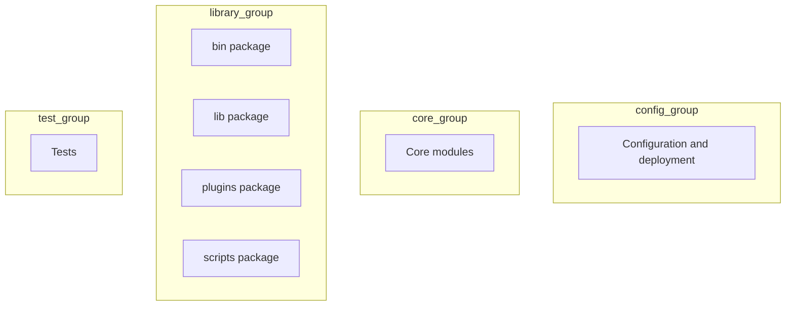

# Architecture report: svg/svgo

> Automated static analysis. **Observed** = directly seen in files/imports/AST; **Inferred** = interpretation from that evidence. Repository code was not executed.

## 1. Repository at a glance

| Item | Value |
| --- | --- |
| Repository | svg/svgo |
| Description | SVG Optimizer for Node.js and CLI. ⚙️ |
| Language | JavaScript |
| Stars | 22817 |
| Licence | MIT |
| Analysed commit / branch | 31194fb4b3b592d7a65956f8f3b343b9fd6b80a6 / main |
| Framework(s) | None detected |
| Files analysed | 616 |
| Components | 7 |

## 2. Architecture in one minute

svg/svgo - SVG Optimizer for Node.js and CLI. ⚙️. This repository was analysed statically from 616 file(s) (0 Python). Detected technologies (observed from imports/manifests): GitHub Actions, TypeScript, Vitest. Files are grouped into 7 component(s): bin package, Configuration and deployment, Core modules, lib package, plugins package, scripts package, Tests. Findings below distinguish observed facts from inferred interpretation.

## 3. High-level block diagram

## 4. Main components

### bin package (`bin`)

- **Kind:** library
- **Status:** Observed
- **Confidence:** 0.85
- **Responsibility:** Groups 1 file(s) under bin package (observed from repository paths and static analysis).
- **Paths:** `bin/svgo.js`
- **Evidence:** [bin/svgo.js](https://github.com/svg/svgo/blob/31194fb4b3b592d7a65956f8f3b343b9fd6b80a6/bin/svgo.js)

### Configuration and deployment (`config`)

- **Kind:** config
- **Status:** Observed
- **Confidence:** 0.85
- **Responsibility:** Groups 4 file(s) under configuration and deployment (observed from repository paths and static analysis).
- **Paths:** `package.json`, `pnpm-workspace.yaml`, `tsconfig.build.json`, `tsconfig.json`
- **Evidence:** [package.json](https://github.com/svg/svgo/blob/31194fb4b3b592d7a65956f8f3b343b9fd6b80a6/package.json); [pnpm-workspace.yaml](https://github.com/svg/svgo/blob/31194fb4b3b592d7a65956f8f3b343b9fd6b80a6/pnpm-workspace.yaml); [tsconfig.build.json](https://github.com/svg/svgo/blob/31194fb4b3b592d7a65956f8f3b343b9fd6b80a6/tsconfig.build.json); [tsconfig.json](https://github.com/svg/svgo/blob/31194fb4b3b592d7a65956f8f3b343b9fd6b80a6/tsconfig.json)

### Core modules (`core`)

- **Kind:** core
- **Status:** Observed
- **Confidence:** 0.85
- **Responsibility:** Groups 3 file(s) under core modules (observed from repository paths and static analysis).
- **Paths:** `eslint.config.mjs`, `rollup.config.js`, `vitest.config.js`
- **Evidence:** [eslint.config.mjs](https://github.com/svg/svgo/blob/31194fb4b3b592d7a65956f8f3b343b9fd6b80a6/eslint.config.mjs); [rollup.config.js](https://github.com/svg/svgo/blob/31194fb4b3b592d7a65956f8f3b343b9fd6b80a6/rollup.config.js); [vitest.config.js](https://github.com/svg/svgo/blob/31194fb4b3b592d7a65956f8f3b343b9fd6b80a6/vitest.config.js)

### lib package (`lib`)

- **Kind:** library
- **Status:** Observed
- **Confidence:** 0.85
- **Responsibility:** Groups 23 file(s) under lib package (observed from repository paths and static analysis).
- **Paths:** `lib/builtin.js`, `lib/parser.js`, `lib/parser.test.js`, `lib/path.js`, `lib/path.test.js`, `lib/stringifier.js`, `lib/style.js`, `lib/style.test.js`, `lib/svgo-node.js`, `lib/svgo-node.test.js`, `lib/svgo.js`, `lib/svgo.test.js`, `lib/svgo/coa.js`, `lib/svgo/css-select-adapter.js`, `lib/svgo/plugins.js`, `lib/svgo/tools.js`, `lib/types.js`, `lib/types.ts`, `lib/util/map-nodes-to-parents.js`, `lib/util/visit.js`, `lib/version.js`, `lib/xast.js`, `lib/xast.test.js`
- **Evidence:** [lib/builtin.js](https://github.com/svg/svgo/blob/31194fb4b3b592d7a65956f8f3b343b9fd6b80a6/lib/builtin.js); [lib/parser.js](https://github.com/svg/svgo/blob/31194fb4b3b592d7a65956f8f3b343b9fd6b80a6/lib/parser.js); [lib/parser.test.js](https://github.com/svg/svgo/blob/31194fb4b3b592d7a65956f8f3b343b9fd6b80a6/lib/parser.test.js); [lib/path.js](https://github.com/svg/svgo/blob/31194fb4b3b592d7a65956f8f3b343b9fd6b80a6/lib/path.js); [lib/path.test.js](https://github.com/svg/svgo/blob/31194fb4b3b592d7a65956f8f3b343b9fd6b80a6/lib/path.test.js); [lib/stringifier.js](https://github.com/svg/svgo/blob/31194fb4b3b592d7a65956f8f3b343b9fd6b80a6/lib/stringifier.js); [lib/style.js](https://github.com/svg/svgo/blob/31194fb4b3b592d7a65956f8f3b343b9fd6b80a6/lib/style.js); [lib/style.test.js](https://github.com/svg/svgo/blob/31194fb4b3b592d7a65956f8f3b343b9fd6b80a6/lib/style.test.js)

### plugins package (`plugins`)

- **Kind:** library
- **Status:** Observed
- **Confidence:** 0.85
- **Responsibility:** Groups 58 file(s) under plugins package (observed from repository paths and static analysis).
- **Paths:** `plugins/_collections.js`, `plugins/_path.js`, `plugins/_transforms.js`, `plugins/addAttributesToSVGElement.js`, `plugins/addClassesToSVGElement.js`, `plugins/applyTransforms.js`, `plugins/cleanupAttrs.js`, `plugins/cleanupEnableBackground.js`, `plugins/cleanupIds.js`, `plugins/cleanupListOfValues.js`, `plugins/cleanupNumericValues.js`, `plugins/collapseGroups.js`, `plugins/convertColors.js`, `plugins/convertEllipseToCircle.js`, `plugins/convertOneStopGradients.js`, `plugins/convertPathData.js`, `plugins/convertShapeToPath.js`, `plugins/convertStyleToAttrs.js`, `plugins/convertTransform.js`, `plugins/inlineStyles.js`, `plugins/mergePaths.js`, `plugins/mergeStyles.js`, `plugins/minifyStyles.js`, `plugins/moveElemsAttrsToGroup.js`, `plugins/moveGroupAttrsToElems.js`, `plugins/prefixIds.js`, `plugins/preset-default.js`, `plugins/removeAttributesBySelector.js`, `plugins/removeAttrs.js`, `plugins/removeComments.js`, `plugins/removeDeprecatedAttrs.js`, `plugins/removeDesc.js`, `plugins/removeDimensions.js`, `plugins/removeDoctype.js`, `plugins/removeEditorsNSData.js`, `plugins/removeElementsByAttr.js`, `plugins/removeEmptyAttrs.js`, `plugins/removeEmptyContainers.js`, `plugins/removeEmptyText.js`, `plugins/removeHiddenElems.js`, `plugins/removeMetadata.js`, `plugins/removeNonInheritableGroupAttrs.js`, `plugins/removeOffCanvasPaths.js`, `plugins/removeRasterImages.js`, `plugins/removeScripts.js`, `plugins/removeStyleElement.js`, `plugins/removeTitle.js`, `plugins/removeUnknownsAndDefaults.js`, `plugins/removeUnusedNS.js`, `plugins/removeUselessDefs.js`, `plugins/removeUselessStrokeAndFill.js`, `plugins/removeViewBox.js`, `plugins/removeXMLNS.js`, `plugins/removeXMLProcInst.js`, `plugins/removeXlink.js`, `plugins/reusePaths.js`, `plugins/sortAttrs.js`, `plugins/sortDefsChildren.js`
- **Evidence:** [plugins/_collections.js](https://github.com/svg/svgo/blob/31194fb4b3b592d7a65956f8f3b343b9fd6b80a6/plugins/_collections.js); [plugins/_path.js](https://github.com/svg/svgo/blob/31194fb4b3b592d7a65956f8f3b343b9fd6b80a6/plugins/_path.js); [plugins/_transforms.js](https://github.com/svg/svgo/blob/31194fb4b3b592d7a65956f8f3b343b9fd6b80a6/plugins/_transforms.js); [plugins/addAttributesToSVGElement.js](https://github.com/svg/svgo/blob/31194fb4b3b592d7a65956f8f3b343b9fd6b80a6/plugins/addAttributesToSVGElement.js); [plugins/addClassesToSVGElement.js](https://github.com/svg/svgo/blob/31194fb4b3b592d7a65956f8f3b343b9fd6b80a6/plugins/addClassesToSVGElement.js); [plugins/applyTransforms.js](https://github.com/svg/svgo/blob/31194fb4b3b592d7a65956f8f3b343b9fd6b80a6/plugins/applyTransforms.js); [plugins/cleanupAttrs.js](https://github.com/svg/svgo/blob/31194fb4b3b592d7a65956f8f3b343b9fd6b80a6/plugins/cleanupAttrs.js); [plugins/cleanupEnableBackground.js](https://github.com/svg/svgo/blob/31194fb4b3b592d7a65956f8f3b343b9fd6b80a6/plugins/cleanupEnableBackground.js)

### scripts package (`scripts`)

- **Kind:** library
- **Status:** Observed
- **Confidence:** 0.85
- **Responsibility:** Groups 1 file(s) under scripts package (observed from repository paths and static analysis).
- **Paths:** `scripts/sync-version.js`
- **Evidence:** [scripts/sync-version.js](https://github.com/svg/svgo/blob/31194fb4b3b592d7a65956f8f3b343b9fd6b80a6/scripts/sync-version.js)

### Tests (`tests`)

- **Kind:** test
- **Status:** Observed
- **Confidence:** 0.85
- **Responsibility:** Groups 440 file(s) under tests (observed from repository paths and static analysis).
- **Paths:** `test/browser.js`, `test/cli/cli.test.js`, `test/cli/invalid.svg`, `test/cli/single.svg`, `test/coa/_index.test.js`, `test/coa/testFolderWithNoSvg/test`, `test/coa/testSvg/test.1.svg`, `test/coa/testSvg/test.svg`, `test/coa/testSvgDatauri/test.svg`, `test/coa/testSvgRecursively/depth-1/depth-2/test.1.svg`, `test/coa/testSvgRecursively/depth-1/depth-2/test.svg`, `test/coa/testSvgRecursively/test.1.svg`, `test/coa/testSvgRecursively/test.svg`, `test/fixtures/config-loader/cjs/svgo.config.cjs`, `test/fixtures/config-loader/invalid-array.js`, `test/fixtures/config-loader/invalid-null.js`, `test/fixtures/config-loader/invalid-runtime.js`, `test/fixtures/config-loader/invalid-runtime.mjs`, `test/fixtures/config-loader/invalid-string.js`, `test/fixtures/config-loader/mjs/svgo.config.mjs`, `test/fixtures/config-loader/module-not-found.js`, `test/fixtures/config-loader/one/two/config.js`, `test/fixtures/config-loader/svgo.config.js`, `test/plugins/_collections.test.js`, `test/plugins/_index.test.js`, `test/plugins/_transforms.test.js`, `test/plugins/addAttributesToSVGElement.01.svg.txt`, `test/plugins/addAttributesToSVGElement.02.svg.txt`, `test/plugins/addAttributesToSVGElement.03.svg.txt`, `test/plugins/addAttributesToSVGElement.04.svg.txt`, `test/plugins/addClassesToSVGElement.01.svg.txt`, `test/plugins/addClassesToSVGElement.02.svg.txt`, `test/plugins/addClassesToSVGElement.03.svg.txt`, `test/plugins/addClassesToSVGElement.test.js`, `test/plugins/cleanupAttrs.01.svg.txt`, `test/plugins/cleanupAttrs.02.svg.txt`, `test/plugins/cleanupEnableBackground.01.svg.txt`, `test/plugins/cleanupEnableBackground.02.svg.txt`, `test/plugins/cleanupEnableBackground.03.svg.txt`, `test/plugins/cleanupEnableBackground.04.svg.txt`, `test/plugins/cleanupEnableBackground.05.svg.txt`, `test/plugins/cleanupIds.01.svg.txt`, `test/plugins/cleanupIds.02.svg.txt`, `test/plugins/cleanupIds.03.svg.txt`, `test/plugins/cleanupIds.04.svg.txt`, `test/plugins/cleanupIds.05.svg.txt`, `test/plugins/cleanupIds.06.svg.txt`, `test/plugins/cleanupIds.07.svg.txt`, `test/plugins/cleanupIds.08.svg.txt`, `test/plugins/cleanupIds.09.svg.txt`, `test/plugins/cleanupIds.10.svg.txt`, `test/plugins/cleanupIds.11.svg.txt`, `test/plugins/cleanupIds.12.svg.txt`, `test/plugins/cleanupIds.13.svg.txt`, `test/plugins/cleanupIds.14.svg.txt`, `test/plugins/cleanupIds.15.svg.txt`, `test/plugins/cleanupIds.16.svg.txt`, `test/plugins/cleanupIds.17.svg.txt`, `test/plugins/cleanupIds.18.svg.txt`, `test/plugins/cleanupIds.19.svg.txt`, `test/plugins/cleanupIds.20.svg.txt`, `test/plugins/cleanupIds.21.svg.txt`, `test/plugins/cleanupIds.22.svg.txt`, `test/plugins/cleanupIds.23.svg.txt`, `test/plugins/cleanupIds.24.svg.txt`, `test/plugins/cleanupIds.25.svg.txt`, `test/plugins/cleanupIds.26.svg.txt`, `test/plugins/cleanupListOfValues.01.svg.txt`, `test/plugins/cleanupListOfValues.02.svg.txt`, `test/plugins/cleanupListOfValues.03.svg.txt`, `test/plugins/cleanupNumericValues.01.svg.txt`, `test/plugins/cleanupNumericValues.02.svg.txt`, `test/plugins/cleanupNumericValues.03.svg.txt`, `test/plugins/collapseGroups.01.svg.txt`, `test/plugins/collapseGroups.02.svg.txt`, `test/plugins/collapseGroups.06.svg.txt`, `test/plugins/collapseGroups.07.svg.txt`, `test/plugins/collapseGroups.08.svg.txt`, `test/plugins/collapseGroups.09.svg.txt`, `test/plugins/collapseGroups.11.svg.txt`, `test/plugins/collapseGroups.12.svg.txt`, `test/plugins/collapseGroups.13.svg.txt`, `test/plugins/collapseGroups.14.svg.txt`, `test/plugins/collapseGroups.15.svg.txt`, `test/plugins/collapseGroups.16.svg.txt`, `test/plugins/collapseGroups.17.svg.txt`, `test/plugins/collapseGroups.18.svg.txt`, `test/plugins/convertColors.01.svg.txt`, `test/plugins/convertColors.02.svg.txt`, `test/plugins/convertColors.03.svg.txt`, `test/plugins/convertColors.04.svg.txt`, `test/plugins/convertColors.05.svg.txt`, `test/plugins/convertColors.06.svg.txt`, `test/plugins/convertColors.07.svg.txt`, `test/plugins/convertEllipseToCircle.01.svg.txt`, `test/plugins/convertOneStopGradients.01.svg.txt`, `test/plugins/convertOneStopGradients.02.svg.txt`, `test/plugins/convertOneStopGradients.03.svg.txt`, `test/plugins/convertPathData.01.svg.txt`, `test/plugins/convertPathData.02.svg.txt`, `test/plugins/convertPathData.03.svg.txt`, `test/plugins/convertPathData.04.svg.txt`, `test/plugins/convertPathData.05.svg.txt`, `test/plugins/convertPathData.06.svg.txt`, `test/plugins/convertPathData.07.svg.txt`, `test/plugins/convertPathData.08.svg.txt`, `test/plugins/convertPathData.09.svg.txt`, `test/plugins/convertPathData.10.svg.txt`, `test/plugins/convertPathData.11.svg.txt`, `test/plugins/convertPathData.12.svg.txt`, `test/plugins/convertPathData.13.svg.txt`, `test/plugins/convertPathData.14.svg.txt`, `test/plugins/convertPathData.15.svg.txt`, `test/plugins/convertPathData.16.svg.txt`, `test/plugins/convertPathData.17.svg.txt`, `test/plugins/convertPathData.18.svg.txt`, `test/plugins/convertPathData.19.svg.txt`, `test/plugins/convertPathData.20.svg.txt`, `test/plugins/convertPathData.21.svg.txt`, `test/plugins/convertPathData.22.svg.txt`, `test/plugins/convertPathData.23.svg.txt`, `test/plugins/convertPathData.24.svg.txt`, `test/plugins/convertPathData.25.svg.txt`, `test/plugins/convertPathData.26.svg.txt`, `test/plugins/convertPathData.27.svg.txt`, `test/plugins/convertPathData.28.svg.txt`, `test/plugins/convertPathData.29.svg.txt`, `test/plugins/convertPathData.30.svg.txt`, `test/plugins/convertPathData.31.svg.txt`, `test/plugins/convertPathData.32.svg.txt`, `test/plugins/convertPathData.33.svg.txt`, `test/plugins/convertPathData.34.svg.txt`, `test/plugins/convertPathData.35.svg.txt`, `test/plugins/convertPathData.36.svg.txt`, `test/plugins/convertPathData.37.svg.txt`, `test/plugins/convertPathData.38.svg.txt`, `test/plugins/convertPathData.39.svg.txt`, `test/plugins/convertPathData.40.svg.txt`, `test/plugins/convertPathData.41.svg.txt`, `test/plugins/convertPathData.42.svg.txt`, `test/plugins/convertPathData.43.svg.txt`, `test/plugins/convertShapeToPath.01.svg.txt`, `test/plugins/convertShapeToPath.02.svg.txt`, `test/plugins/convertShapeToPath.03.svg.txt`, `test/plugins/convertShapeToPath.04.svg.txt`, `test/plugins/convertShapeToPath.05.svg.txt`, `test/plugins/convertStyleToAttrs.01.svg.txt`, `test/plugins/convertStyleToAttrs.02.svg.txt`, `test/plugins/convertStyleToAttrs.03.svg.txt`, `test/plugins/convertStyleToAttrs.04.svg.txt`, `test/plugins/convertStyleToAttrs.05.svg.txt`, `test/plugins/convertTransform.01.svg.txt`, `test/plugins/convertTransform.02.svg.txt`, `test/plugins/convertTransform.03.svg.txt`, `test/plugins/convertTransform.04.svg.txt`, `test/plugins/convertTransform.05.svg.txt`, `test/plugins/convertTransform.06.svg.txt`, `test/plugins/convertTransform.07.svg.txt`, `test/plugins/convertTransform.10.svg.txt`, `test/plugins/convertTransform.11.svg.txt`, `test/plugins/convertTransform.12.svg.txt`, `test/plugins/convertTransform.13.svg.txt`, `test/plugins/convertTransform.14.svg.txt`, `test/plugins/convertTransform.15.svg.txt`, `test/plugins/inlineStyles.01.svg.txt`, `test/plugins/inlineStyles.02.svg.txt`, `test/plugins/inlineStyles.03.svg.txt`, `test/plugins/inlineStyles.04.svg.txt`, `test/plugins/inlineStyles.05.svg.txt`, `test/plugins/inlineStyles.06.svg.txt`, `test/plugins/inlineStyles.07.svg.txt`, `test/plugins/inlineStyles.08.svg.txt`, `test/plugins/inlineStyles.09.svg.txt`, `test/plugins/inlineStyles.10.svg.txt`, `test/plugins/inlineStyles.11.svg.txt`, `test/plugins/inlineStyles.12.svg.txt`, `test/plugins/inlineStyles.13.svg.txt`, `test/plugins/inlineStyles.14.svg.txt`, `test/plugins/inlineStyles.15.svg.txt`, `test/plugins/inlineStyles.16.svg.txt`, `test/plugins/inlineStyles.17.svg.txt`, `test/plugins/inlineStyles.18.svg.txt`, `test/plugins/inlineStyles.19.svg.txt`, `test/plugins/inlineStyles.20.svg.txt`, `test/plugins/inlineStyles.21.svg.txt`, `test/plugins/inlineStyles.22.svg.txt`, `test/plugins/inlineStyles.23.svg.txt`, `test/plugins/inlineStyles.24.svg.txt`, `test/plugins/inlineStyles.25.svg.txt`, `test/plugins/inlineStyles.26.svg.txt`, `test/plugins/inlineStyles.27.svg.txt`, `test/plugins/inlineStyles.28.svg.txt`, `test/plugins/mergePaths.01.svg.txt`, `test/plugins/mergePaths.02.svg.txt`, `test/plugins/mergePaths.03.svg.txt`, `test/plugins/mergePaths.04.svg.txt`, `test/plugins/mergePaths.05.svg.txt`, `test/plugins/mergePaths.06.svg.txt`, `test/plugins/mergePaths.07.svg.txt`, `test/plugins/mergePaths.08.svg.txt`, `test/plugins/mergePaths.09.svg.txt`, `test/plugins/mergePaths.10.svg.txt`, `test/plugins/mergePaths.11.svg.txt`, `test/plugins/mergePaths.12.svg.txt`, `test/plugins/mergePaths.13.svg.txt`, `test/plugins/mergeStyles.01.svg.txt`, `test/plugins/mergeStyles.02.svg.txt`, `test/plugins/mergeStyles.03.svg.txt`, `test/plugins/mergeStyles.04.svg.txt`, `test/plugins/mergeStyles.05.svg.txt`, `test/plugins/mergeStyles.06.svg.txt`, `test/plugins/mergeStyles.07.svg.txt`, `test/plugins/mergeStyles.08.svg.txt`, `test/plugins/mergeStyles.09.svg.txt`, `test/plugins/mergeStyles.10.svg.txt`, `test/plugins/mergeStyles.11.svg.txt`, `test/plugins/mergeStyles.12.svg.txt`, `test/plugins/minifyStyles.01.svg.txt`, `test/plugins/minifyStyles.02.svg.txt`, `test/plugins/minifyStyles.03.svg.txt`, `test/plugins/minifyStyles.04.svg.txt`, `test/plugins/minifyStyles.05.svg.txt`, `test/plugins/minifyStyles.06.svg.txt`, `test/plugins/minifyStyles.07.svg.txt`, `test/plugins/minifyStyles.08.svg.txt`, `test/plugins/minifyStyles.09.svg.txt`, `test/plugins/minifyStyles.10.svg.txt`, `test/plugins/minifyStyles.11.svg.txt`, `test/plugins/moveElemsAttrsToGroup.01.svg.txt`, `test/plugins/moveElemsAttrsToGroup.02.svg.txt`, `test/plugins/moveElemsAttrsToGroup.03.svg.txt`, `test/plugins/moveElemsAttrsToGroup.04.svg.txt`, `test/plugins/moveElemsAttrsToGroup.06.svg.txt`, `test/plugins/moveElemsAttrsToGroup.07.svg.txt`, `test/plugins/moveElemsAttrsToGroup.08.svg.txt`, `test/plugins/moveGroupAttrsToElems.01.svg.txt`, `test/plugins/moveGroupAttrsToElems.02.svg.txt`, `test/plugins/moveGroupAttrsToElems.03.svg.txt`, `test/plugins/moveGroupAttrsToElems.04.svg.txt`, `test/plugins/moveGroupAttrsToElems.05.svg.txt`, `test/plugins/moveGroupAttrsToElems.06.svg.txt`, `test/plugins/prefixIds.01.svg.txt`, `test/plugins/prefixIds.02.svg.txt`, `test/plugins/prefixIds.03.svg.txt`, `test/plugins/prefixIds.04.svg.txt`, `test/plugins/prefixIds.05.svg.txt`, `test/plugins/prefixIds.06.svg.txt`, `test/plugins/prefixIds.07.svg.txt`, `test/plugins/prefixIds.08.svg.txt`, `test/plugins/prefixIds.09.svg.txt`, `test/plugins/prefixIds.10.svg.txt`, `test/plugins/prefixIds.11.svg.txt`, `test/plugins/prefixIds.12.svg.txt`, `test/plugins/prefixIds.13.svg.txt`, `test/plugins/prefixIds.test.js`, `test/plugins/removeAttributesBySelector.01.svg.txt`, `test/plugins/removeAttributesBySelector.02.svg.txt`, `test/plugins/removeAttributesBySelector.03.svg.txt`, `test/plugins/removeAttributesBySelector.04.svg.txt`, `test/plugins/removeAttributesBySelector.05.svg.txt`, `test/plugins/removeAttrs.01.svg.txt`, `test/plugins/removeAttrs.02.svg.txt`, `test/plugins/removeAttrs.03.svg.txt`, `test/plugins/removeAttrs.04.svg.txt`, `test/plugins/removeAttrs.05.svg.txt`, `test/plugins/removeAttrs.06.svg.txt`, `test/plugins/removeAttrs.07.svg.txt`, `test/plugins/removeAttrs.08.svg.txt`, `test/plugins/removeAttrs.09.svg.txt`, `test/plugins/removeComments.01.svg.txt`, `test/plugins/removeComments.02.svg.txt`, `test/plugins/removeComments.03.svg.txt`, `test/plugins/removeDeprecatedAttrs.01.svg.txt`, `test/plugins/removeDeprecatedAttrs.02.svg.txt`, `test/plugins/removeDeprecatedAttrs.03.svg.txt`, `test/plugins/removeDeprecatedAttrs.04.svg.txt`, `test/plugins/removeDeprecatedAttrs.05.svg.txt`, `test/plugins/removeDeprecatedAttrs.06.svg.txt`, `test/plugins/removeDeprecatedAttrs.07.svg.txt`, `test/plugins/removeDeprecatedAttrs.08.svg.txt`, `test/plugins/removeDesc.01.svg.txt`, `test/plugins/removeDimensions.01.svg.txt`, `test/plugins/removeDimensions.02.svg.txt`, `test/plugins/removeDimensions.03.svg.txt`, `test/plugins/removeDimensions.04.svg.txt`, `test/plugins/removeDimensions.05.svg.txt`, `test/plugins/removeDoctype.01.svg.txt`, `test/plugins/removeEditorsNSData.01.svg.txt`, `test/plugins/removeEditorsNSData.02.svg.txt`, `test/plugins/removeElementsByAttr.01.svg.txt`, `test/plugins/removeElementsByAttr.02.svg.txt`, `test/plugins/removeElementsByAttr.03.svg.txt`, `test/plugins/removeElementsByAttr.04.svg.txt`, `test/plugins/removeElementsByAttr.05.svg.txt`, `test/plugins/removeElementsByAttr.06.svg.txt`, `test/plugins/removeElementsByAttr.07.svg.txt`, `test/plugins/removeEmptyAttrs.01.svg.txt`, `test/plugins/removeEmptyAttrs.02.svg.txt`, `test/plugins/removeEmptyContainers.01.svg.txt`, `test/plugins/removeEmptyContainers.02.svg.txt`, `test/plugins/removeEmptyContainers.03.svg.txt`, `test/plugins/removeEmptyContainers.04.svg.txt`, `test/plugins/removeEmptyContainers.05.svg.txt`, `test/plugins/removeEmptyContainers.06.svg.txt`, `test/plugins/removeEmptyContainers.07.svg.txt`, `test/plugins/removeEmptyContainers.08.svg.txt`, `test/plugins/removeEmptyText.01.svg.txt`, `test/plugins/removeEmptyText.02.svg.txt`, `test/plugins/removeEmptyText.03.svg.txt`, `test/plugins/removeHiddenElems.01.svg.txt`, `test/plugins/removeHiddenElems.02.svg.txt`, `test/plugins/removeHiddenElems.03.svg.txt`, `test/plugins/removeHiddenElems.04.svg.txt`, `test/plugins/removeHiddenElems.05.svg.txt`, `test/plugins/removeHiddenElems.06.svg.txt`, `test/plugins/removeHiddenElems.07.svg.txt`, `test/plugins/removeHiddenElems.08.svg.txt`, `test/plugins/removeHiddenElems.09.svg.txt`, `test/plugins/removeHiddenElems.10.svg.txt`, `test/plugins/removeHiddenElems.11.svg.txt`, `test/plugins/removeHiddenElems.12.svg.txt`, `test/plugins/removeHiddenElems.13.svg.txt`, `test/plugins/removeHiddenElems.14.svg.txt`, `test/plugins/removeHiddenElems.15.svg.txt`, `test/plugins/removeHiddenElems.16.svg.txt`, `test/plugins/removeHiddenElems.17.svg.txt`, `test/plugins/removeHiddenElems.18.svg.txt`, `test/plugins/removeHiddenElems.19.svg.txt`, `test/plugins/removeMetadata.01.svg.txt`, `test/plugins/removeNonInheritableGroupAttrs.01.svg.txt`, `test/plugins/removeNonInheritableGroupAttrs.02.svg.txt`, `test/plugins/removeOffCanvasPaths.01.svg.txt`, `test/plugins/removeOffCanvasPaths.02.svg.txt`, `test/plugins/removeOffCanvasPaths.03.svg.txt`, `test/plugins/removeOffCanvasPaths.04.svg.txt`, `test/plugins/removeOffCanvasPaths.05.svg.txt`, `test/plugins/removeOffCanvasPaths.06.svg.txt`, `test/plugins/removeRasterImages.01.svg.txt`, `test/plugins/removeRasterImages.02.svg.txt`, `test/plugins/removeScripts.01.svg.txt`, `test/plugins/removeScripts.02.svg.txt`, `test/plugins/removeScripts.03.svg.txt`, `test/plugins/removeScripts.04.svg.txt`, `test/plugins/removeScripts.05.svg.txt`, `test/plugins/removeScripts.06.svg.txt`, `test/plugins/removeScripts.07.svg.txt`, `test/plugins/removeScripts.08.svg.txt`, `test/plugins/removeScripts.09.svg.txt`, `test/plugins/removeScripts.10.svg.txt`, `test/plugins/removeScripts.11.svg.txt`, `test/plugins/removeStyleElement.01.svg.txt`, `test/plugins/removeTitle.01.svg.txt`, `test/plugins/removeUnknownsAndDefaults.01.svg.txt`, `test/plugins/removeUnknownsAndDefaults.02.svg.txt`, `test/plugins/removeUnknownsAndDefaults.03.svg.txt`, `test/plugins/removeUnknownsAndDefaults.04.svg.txt`, `test/plugins/removeUnknownsAndDefaults.05.svg.txt`, `test/plugins/removeUnknownsAndDefaults.06.svg.txt`, `test/plugins/removeUnknownsAndDefaults.07.svg.txt`, `test/plugins/removeUnknownsAndDefaults.08.svg.txt`, `test/plugins/removeUnknownsAndDefaults.09.svg.txt`, `test/plugins/removeUnknownsAndDefaults.10.svg.txt`, `test/plugins/removeUnknownsAndDefaults.11.svg.txt`, `test/plugins/removeUnknownsAndDefaults.12.svg.txt`, `test/plugins/removeUnknownsAndDefaults.13.svg.txt`, `test/plugins/removeUnknownsAndDefaults.14.svg.txt`, `test/plugins/removeUnknownsAndDefaults.15.svg.txt`, `test/plugins/removeUnknownsAndDefaults.16.svg.txt`, `test/plugins/removeUnknownsAndDefaults.17.svg.txt`, `test/plugins/removeUnusedNS.01.svg.txt`, `test/plugins/removeUnusedNS.02.svg.txt`, `test/plugins/removeUnusedNS.03.svg.txt`, `test/plugins/removeUnusedNS.04.svg.txt`, `test/plugins/removeUnusedNS.05.svg.txt`, `test/plugins/removeUnusedNS.06.svg.txt`, `test/plugins/removeUnusedNS.07.svg.txt`, `test/plugins/removeUselessDefs.01.svg.txt`, `test/plugins/removeUselessDefs.02.svg.txt`, `test/plugins/removeUselessDefs.03.svg.txt`, `test/plugins/removeUselessDefs.04.svg.txt`, `test/plugins/removeUselessDefs.05.svg.txt`, `test/plugins/removeUselessStrokeAndFill.01.svg.txt`, `test/plugins/removeUselessStrokeAndFill.02.svg.txt`, `test/plugins/removeUselessStrokeAndFill.03.svg.txt`, `test/plugins/removeUselessStrokeAndFill.04.svg.txt`, `test/plugins/removeUselessStrokeAndFill.05.svg.txt`, `test/plugins/removeViewBox.01.svg.txt`, `test/plugins/removeViewBox.02.svg.txt`, `test/plugins/removeViewBox.03.svg.txt`, `test/plugins/removeViewBox.04.svg.txt`, `test/plugins/removeViewBox.05.svg.txt`, `test/plugins/removeXMLNS.01.svg.txt`, `test/plugins/removeXMLProcInst.01.svg.txt`, `test/plugins/removeXMLProcInst.02.svg.txt`, `test/plugins/removeXlink.01.svg.txt`, `test/plugins/removeXlink.02.svg.txt`, `test/plugins/removeXlink.03.svg.txt`, `test/plugins/removeXlink.04.svg.txt`, `test/plugins/reusePaths.01.svg.txt`, `test/plugins/reusePaths.02.svg.txt`, `test/plugins/reusePaths.03.svg.txt`, `test/plugins/reusePaths.04.svg.txt`, `test/plugins/reusePaths.05.svg.txt`, `test/plugins/reusePaths.06.svg.txt`, `test/plugins/sortAttrs.01.svg.txt`, `test/plugins/sortAttrs.02.svg.txt`, `test/plugins/sortAttrs.03.svg.txt`, `test/plugins/sortAttrs.04.svg.txt`, `test/plugins/sortDefsChildren.01.svg.txt`, `test/regression/compare-worker.js`, `test/regression/compare-worker.test.js`, `test/regression/compare.js`, `test/regression/compare.test.js`, `test/regression/delta.js`, `test/regression/extract.js`, `test/regression/file-lists.js`, `test/regression/lib.js`, `test/regression/lists/expect-mismatch.txt`, `test/regression/lists/ignore.txt`, `test/regression/lists/skip.txt`, `test/regression/optimize-worker.js`, `test/regression/optimize.js`, `test/regression/regression-io.js`, `test/svg2js/_index.test.js`, `test/svg2js/test.svg`, `test/svgo.cjs`, `test/svgo/_index.test.js`, `test/svgo/billion-laughs-flat.svg`, `test/svgo/billion-laughs.svg`, `test/svgo/billion-laughs.test.js`, `test/svgo/entities.svg.txt`, `test/svgo/invalid.svg`, `test/svgo/keyframe-selectors.svg.txt`, `test/svgo/plugins-order.svg.txt`, `test/svgo/pre-element-pretty.svg.txt`, `test/svgo/pre-element.svg.txt`, `test/svgo/style-specificity.svg.txt`, `test/svgo/test.svg.txt`, `test/svgo/whitespaces.svg.txt`, `test/types/lib/svgo-node.test-d.ts`
- **Evidence:** [test/browser.js](https://github.com/svg/svgo/blob/31194fb4b3b592d7a65956f8f3b343b9fd6b80a6/test/browser.js); [test/cli/cli.test.js](https://github.com/svg/svgo/blob/31194fb4b3b592d7a65956f8f3b343b9fd6b80a6/test/cli/cli.test.js); [test/cli/invalid.svg](https://github.com/svg/svgo/blob/31194fb4b3b592d7a65956f8f3b343b9fd6b80a6/test/cli/invalid.svg); [test/cli/single.svg](https://github.com/svg/svgo/blob/31194fb4b3b592d7a65956f8f3b343b9fd6b80a6/test/cli/single.svg); [test/coa/_index.test.js](https://github.com/svg/svgo/blob/31194fb4b3b592d7a65956f8f3b343b9fd6b80a6/test/coa/_index.test.js); [test/coa/testFolderWithNoSvg/test](https://github.com/svg/svgo/blob/31194fb4b3b592d7a65956f8f3b343b9fd6b80a6/test/coa/testFolderWithNoSvg/test); [test/coa/testSvg/test.1.svg](https://github.com/svg/svgo/blob/31194fb4b3b592d7a65956f8f3b343b9fd6b80a6/test/coa/testSvg/test.1.svg); [test/coa/testSvg/test.svg](https://github.com/svg/svgo/blob/31194fb4b3b592d7a65956f8f3b343b9fd6b80a6/test/coa/testSvg/test.svg)

## 5. Execution flow

**Observed** entry point(s):

- [bin/svgo.js](https://github.com/svg/svgo/blob/31194fb4b3b592d7a65956f8f3b343b9fd6b80a6/bin/svgo.js)

Representative flow (derived from observed entry points and the import graph; steps beyond the entry point are **Inferred**):

1. Execution starts at an observed entry point listed above, if present.
2. No internal import relationships between components were observed.

## 6. Project structure

### `(root)`

- `.gitattributes` - other (43 bytes)
- `.gitignore` - other (384 bytes)
- `.prettierignore` - other (15 bytes)
- `.prettierrc` - other (26 bytes)
- `CONTRIBUTING.md` - docs (4139 bytes)
- `LICENSE` - docs (1064 bytes)
- `README.md` - docs (4410 bytes)
- `cspell.jsonc` - other (1722 bytes)
- `eslint.config.mjs` - source, JavaScript (624 bytes)
- `package.json` - manifest (3489 bytes)
- `pnpm-workspace.yaml` - config (153 bytes)
- `rollup.config.js` - source, JavaScript (1564 bytes)
- `tsconfig.build.json` - config (215 bytes)
- `tsconfig.json` - config (444 bytes)
- `vitest.config.js` - source, JavaScript (185 bytes)

### `.github`

- `.github/ISSUE_TEMPLATE/bug_report.md` - docs (668 bytes)
- `.github/ISSUE_TEMPLATE/config.yml` - config (157 bytes)
- `.github/ISSUE_TEMPLATE/feature_request.md` - docs (597 bytes)
- `.github/ISSUE_TEMPLATE/plugin_request.md` - docs (645 bytes)
- `.github/dependabot.yml` - config (153 bytes)
- `.github/workflows/ci.yml` - ci, YAML (3673 bytes)
- `.github/workflows/codeql.yml` - ci, YAML (857 bytes)
- `.github/workflows/publish.yml` - ci, YAML (1344 bytes)
- `.github/workflows/regression.yml` - ci, YAML (3370 bytes)

### `bin`

- `bin/svgo.js` - source, JavaScript (276 bytes)

### `docs`

- `docs/01-index.mdx` - docs (844 bytes)
- `docs/02-usage/01-node.mdx` - docs (676 bytes)
- `docs/02-usage/02-browser.mdx` - docs (2153 bytes)
- `docs/02-usage/index.mdx` - docs (1907 bytes)
- `docs/03-preset-default.mdx` - docs (3048 bytes)
- `docs/04-plugins/addAttributesToSVGElement.mdx` - docs (800 bytes)
- `docs/04-plugins/addClassesToSVGElement.mdx` - docs (1021 bytes)
- `docs/04-plugins/cleanupAttrs.mdx` - docs (656 bytes)
- `docs/04-plugins/cleanupEnableBackground.mdx` - docs (842 bytes)
- `docs/04-plugins/cleanupIds.mdx` - docs (1733 bytes)
- `docs/04-plugins/cleanupListOfValues.mdx` - docs (871 bytes)
- `docs/04-plugins/cleanupNumericValues.mdx` - docs (684 bytes)
- `docs/04-plugins/collapseGroups.mdx` - docs (639 bytes)
- `docs/04-plugins/convertColors.mdx` - docs (1838 bytes)
- `docs/04-plugins/convertEllipseToCircle.mdx` - docs (282 bytes)
- `docs/04-plugins/convertOneStopGradients.mdx` - docs (883 bytes)
- `docs/04-plugins/convertPathData.mdx` - docs (3139 bytes)
- `docs/04-plugins/convertShapeToPath.mdx` - docs (443 bytes)
- `docs/04-plugins/convertStyleToAttrs.mdx` - docs (1102 bytes)
- `docs/04-plugins/convertTransform.mdx` - docs (1745 bytes)
- `docs/04-plugins/index.mdx` - docs (659 bytes)
- `docs/04-plugins/inlineStyles.mdx` - docs (832 bytes)
- `docs/04-plugins/mergePaths.mdx` - docs (542 bytes)
- `docs/04-plugins/mergeStyles.mdx` - docs (102 bytes)
- `docs/04-plugins/minifyStyles.mdx` - docs (536 bytes)
- `docs/04-plugins/moveElemsAttrsToGroup.mdx` - docs (132 bytes)
- `docs/04-plugins/moveGroupAttrsToElems.mdx` - docs (132 bytes)
- `docs/04-plugins/prefixIds.mdx` - docs (1679 bytes)
- `docs/04-plugins/removeAttributesBySelector.mdx` - docs (645 bytes)
- `docs/04-plugins/removeAttrs.mdx` - docs (940 bytes)
- `docs/04-plugins/removeComments.mdx` - docs (2383 bytes)
- `docs/04-plugins/removeDeprecatedAttrs.mdx` - docs (562 bytes)
- `docs/04-plugins/removeDesc.mdx` - docs (709 bytes)
- `docs/04-plugins/removeDimensions.mdx` - docs (648 bytes)
- `docs/04-plugins/removeDoctype.mdx` - docs (204 bytes)
- `docs/04-plugins/removeEditorsNSData.mdx` - docs (1010 bytes)
- `docs/04-plugins/removeElementsByAttr.mdx` - docs (383 bytes)
- `docs/04-plugins/removeEmptyAttrs.mdx` - docs (270 bytes)
- `docs/04-plugins/removeEmptyContainers.mdx` - docs (1278 bytes)
- `docs/04-plugins/removeEmptyText.mdx` - docs (948 bytes)
- `docs/04-plugins/removeHiddenElems.mdx` - docs (3332 bytes)
- `docs/04-plugins/removeMetadata.mdx` - docs (822 bytes)
- `docs/04-plugins/removeNonInheritableGroupAttrs.mdx` - docs (232 bytes)
- `docs/04-plugins/removeOffCanvasPaths.mdx` - docs (512 bytes)
- `docs/04-plugins/removeRasterImages.mdx` - docs (128 bytes)
- `docs/04-plugins/removeScripts.mdx` - docs (1559 bytes)
- `docs/04-plugins/removeStyleElement.mdx` - docs (187 bytes)
- `docs/04-plugins/removeTitle.mdx` - docs (990 bytes)
- `docs/04-plugins/removeUnknownsAndDefaults.mdx` - docs (1850 bytes)
- `docs/04-plugins/removeUnusedNS.mdx` - docs (332 bytes)
- `docs/04-plugins/removeUselessDefs.mdx` - docs (209 bytes)
- `docs/04-plugins/removeUselessStrokeAndFill.mdx` - docs (800 bytes)
- `docs/04-plugins/removeViewBox.mdx` - docs (439 bytes)
- `docs/04-plugins/removeXMLNS.mdx` - docs (799 bytes)
- `docs/04-plugins/removeXMLProcInst.mdx` - docs (1007 bytes)
- `docs/04-plugins/removeXlink.mdx` - docs (2190 bytes)
- `docs/04-plugins/reusePaths.mdx` - docs (1164 bytes)
- `docs/04-plugins/sortAttrs.mdx` - docs (2080 bytes)
- `docs/04-plugins/sortDefsChildren.mdx` - docs (1620 bytes)
- `docs/05-plugins-api.mdx` - docs (2751 bytes)
- `docs/06-migrations/01-migration-from-v3-to-v4.mdx` - docs (5519 bytes)
- `docs/06-migrations/02-migration-from-v2-to-v3.mdx` - docs (4002 bytes)
- `docs/06-migrations/_category_.json` - config (28 bytes)

### `lib`

- `lib/builtin.js` - source, JavaScript (5225 bytes)
- `lib/parser.js` - source, JavaScript (5611 bytes)
- `lib/parser.test.js` - source, JavaScript (771 bytes)
- `lib/path.js` - source, JavaScript (8622 bytes)
- `lib/path.test.js` - source, JavaScript (6463 bytes)
- `lib/stringifier.js` - source, JavaScript (7050 bytes)
- `lib/style.js` - source, JavaScript (10004 bytes)
- `lib/style.test.js` - source, JavaScript (12203 bytes)
- `lib/svgo-node.js` - source, JavaScript (2521 bytes)
- `lib/svgo-node.test.js` - source, JavaScript (5371 bytes)
- `lib/svgo.js` - source, JavaScript (4012 bytes)
- `lib/svgo.test.js` - source, JavaScript (11058 bytes)
- `lib/svgo/coa.js` - source, JavaScript (15010 bytes)
- `lib/svgo/css-select-adapter.js` - source, JavaScript (3385 bytes)
- `lib/svgo/plugins.js` - source, JavaScript (2006 bytes)
- `lib/svgo/tools.js` - source, JavaScript (7821 bytes)
- `lib/types.js` - source, JavaScript (19 bytes)
- `lib/types.ts` - source, TypeScript (9895 bytes)
- `lib/util/map-nodes-to-parents.js` - source, JavaScript (668 bytes)
- `lib/util/visit.js` - source, JavaScript (991 bytes)
- `lib/version.js` - source, JavaScript (97 bytes)
- `lib/xast.js` - source, JavaScript (2110 bytes)
- `lib/xast.test.js` - source, JavaScript (2690 bytes)

### `logo`

- `logo/isotype-white.svg` - other (1674 bytes)
- `logo/isotype.svg` - other (2039 bytes)
- `logo/logo-web.svg` - other (4082 bytes)
- `logo/logo-white.svg` - other (3346 bytes)
- `logo/logo.svg` - other (3766 bytes)

### `patches`

- `patches/sax@1.6.1.patch` - other (6024 bytes)

### `plugins`

- `plugins/_collections.js` - source, JavaScript (52918 bytes)
- `plugins/_path.js` - source, JavaScript (21757 bytes)
- `plugins/_transforms.js` - source, JavaScript (19409 bytes)
- `plugins/addAttributesToSVGElement.js` - source, JavaScript (2128 bytes)
- `plugins/addClassesToSVGElement.js` - source, JavaScript (2261 bytes)
- `plugins/applyTransforms.js` - source, JavaScript (11005 bytes)
- `plugins/cleanupAttrs.js` - source, JavaScript (1491 bytes)
- `plugins/cleanupEnableBackground.js` - source, JavaScript (4911 bytes)
- `plugins/cleanupIds.js` - source, JavaScript (6387 bytes)
- `plugins/cleanupListOfValues.js` - source, JavaScript (4022 bytes)
- `plugins/cleanupNumericValues.js` - source, JavaScript (3006 bytes)
- `plugins/collapseGroups.js` - source, JavaScript (3887 bytes)
- `plugins/convertColors.js` - source, JavaScript (5086 bytes)
- `plugins/convertEllipseToCircle.js` - source, JavaScript (902 bytes)
- `plugins/convertOneStopGradients.js` - source, JavaScript (4654 bytes)
- `plugins/convertPathData.js` - source, JavaScript (39409 bytes)
- `plugins/convertShapeToPath.js` - source, JavaScript (5988 bytes)
- `plugins/convertStyleToAttrs.js` - source, JavaScript (4265 bytes)
- `plugins/convertTransform.js` - source, JavaScript (8734 bytes)
- `plugins/inlineStyles.js` - source, JavaScript (13576 bytes)
- `plugins/mergePaths.js` - source, JavaScript (5234 bytes)
- `plugins/mergeStyles.js` - source, JavaScript (2302 bytes)
- `plugins/minifyStyles.js` - source, JavaScript (5082 bytes)
- `plugins/moveElemsAttrsToGroup.js` - source, JavaScript (3738 bytes)
- `plugins/moveGroupAttrsToElems.js` - source, JavaScript (1943 bytes)
- `plugins/prefixIds.js` - source, JavaScript (8071 bytes)
- `plugins/preset-default.js` - source, JavaScript (2986 bytes)
- `plugins/removeAttributesBySelector.js` - source, JavaScript (3197 bytes)
- `plugins/removeAttrs.js` - source, JavaScript (4217 bytes)
- `plugins/removeComments.js` - source, JavaScript (1392 bytes)
- `plugins/removeDeprecatedAttrs.js` - source, JavaScript (2959 bytes)
- `plugins/removeDesc.js` - source, JavaScript (1112 bytes)
- `plugins/removeDimensions.js` - source, JavaScript (1239 bytes)
- `plugins/removeDoctype.js` - source, JavaScript (1092 bytes)
- `plugins/removeEditorsNSData.js` - source, JavaScript (2047 bytes)
- `plugins/removeElementsByAttr.js` - source, JavaScript (2158 bytes)
- `plugins/removeEmptyAttrs.js` - source, JavaScript (722 bytes)
- `plugins/removeEmptyContainers.js` - source, JavaScript (3073 bytes)
- `plugins/removeEmptyText.js` - source, JavaScript (1437 bytes)
- `plugins/removeHiddenElems.js` - source, JavaScript (13444 bytes)
- `plugins/removeMetadata.js` - source, JavaScript (525 bytes)
- `plugins/removeNonInheritableGroupAttrs.js` - source, JavaScript (884 bytes)
- `plugins/removeOffCanvasPaths.js` - source, JavaScript (3866 bytes)
- `plugins/removeRasterImages.js` - source, JavaScript (713 bytes)
- `plugins/removeScripts.js` - source, JavaScript (5041 bytes)
- `plugins/removeStyleElement.js` - source, JavaScript (540 bytes)
- `plugins/removeTitle.js` - source, JavaScript (538 bytes)
- `plugins/removeUnknownsAndDefaults.js` - source, JavaScript (6955 bytes)
- `plugins/removeUnusedNS.js` - source, JavaScript (1804 bytes)
- `plugins/removeUselessDefs.js` - source, JavaScript (1406 bytes)
- `plugins/removeUselessStrokeAndFill.js` - source, JavaScript (4493 bytes)
- `plugins/removeViewBox.js` - source, JavaScript (1374 bytes)
- `plugins/removeXMLNS.js` - source, JavaScript (556 bytes)
- `plugins/removeXMLProcInst.js` - source, JavaScript (569 bytes)
- `plugins/removeXlink.js` - source, JavaScript (6446 bytes)
- `plugins/reusePaths.js` - source, JavaScript (5605 bytes)
- `plugins/sortAttrs.js` - source, JavaScript (2787 bytes)
- `plugins/sortDefsChildren.js` - source, JavaScript (1776 bytes)

### `scripts`

- `scripts/sync-version.js` - source, JavaScript (449 bytes)

### `test`

- `test/browser.js` - test, JavaScript (2486 bytes)
- `test/cli/cli.test.js` - test, JavaScript (2942 bytes)
- `test/cli/invalid.svg` - test (58 bytes)
- `test/cli/single.svg` - test (42 bytes)
- `test/coa/_index.test.js` - test, JavaScript (4914 bytes)
- `test/coa/testFolderWithNoSvg/test` - test (0 bytes)
- `test/coa/testSvg/test.1.svg` - test (22398 bytes)
- `test/coa/testSvg/test.svg` - test (22398 bytes)
- `test/coa/testSvgDatauri/test.svg` - test (80 bytes)
- `test/coa/testSvgRecursively/depth-1/depth-2/test.1.svg` - test (23152 bytes)
- `test/coa/testSvgRecursively/depth-1/depth-2/test.svg` - test (23152 bytes)
- `test/coa/testSvgRecursively/test.1.svg` - test (23152 bytes)
- `test/coa/testSvgRecursively/test.svg` - test (23152 bytes)
- `test/fixtures/config-loader/cjs/svgo.config.cjs` - test, JavaScript (42 bytes)
- `test/fixtures/config-loader/invalid-array.js` - test, JavaScript (19 bytes)
- `test/fixtures/config-loader/invalid-null.js` - test, JavaScript (21 bytes)
- `test/fixtures/config-loader/invalid-runtime.js` - test, JavaScript (111 bytes)
- `test/fixtures/config-loader/invalid-runtime.mjs` - test, JavaScript (111 bytes)
- `test/fixtures/config-loader/invalid-string.js` - test, JavaScript (19 bytes)
- `test/fixtures/config-loader/mjs/svgo.config.mjs` - test, JavaScript (40 bytes)
- `test/fixtures/config-loader/module-not-found.js` - test, JavaScript (44 bytes)
- `test/fixtures/config-loader/one/two/config.js` - test, JavaScript (32 bytes)
- `test/fixtures/config-loader/svgo.config.js` - test, JavaScript (32 bytes)
- `test/plugins/_collections.test.js` - test, JavaScript (684 bytes)
- `test/plugins/_index.test.js` - test, JavaScript (2143 bytes)
- `test/plugins/_transforms.test.js` - test, JavaScript (1303 bytes)
- `test/plugins/addAttributesToSVGElement.01.svg.txt` - test (251 bytes)
- `test/plugins/addAttributesToSVGElement.02.svg.txt` - test (203 bytes)
- `test/plugins/addAttributesToSVGElement.03.svg.txt` - test (265 bytes)
- `test/plugins/addAttributesToSVGElement.04.svg.txt` - test (223 bytes)
- `test/plugins/addClassesToSVGElement.01.svg.txt` - test (244 bytes)
- `test/plugins/addClassesToSVGElement.02.svg.txt` - test (219 bytes)
- `test/plugins/addClassesToSVGElement.03.svg.txt` - test (242 bytes)
- `test/plugins/addClassesToSVGElement.test.js` - test, JavaScript (942 bytes)
- `test/plugins/cleanupAttrs.01.svg.txt` - test (176 bytes)
- `test/plugins/cleanupAttrs.02.svg.txt` - test (234 bytes)
- `test/plugins/cleanupEnableBackground.01.svg.txt` - test (443 bytes)
- `test/plugins/cleanupEnableBackground.02.svg.txt` - test (470 bytes)
- `test/plugins/cleanupEnableBackground.03.svg.txt` - test (515 bytes)
- `test/plugins/cleanupEnableBackground.04.svg.txt` - test (257 bytes)
- `test/plugins/cleanupEnableBackground.05.svg.txt` - test (436 bytes)
- `test/plugins/cleanupIds.01.svg.txt` - test (1749 bytes)
- `test/plugins/cleanupIds.02.svg.txt` - test (426 bytes)
- `test/plugins/cleanupIds.03.svg.txt` - test (392 bytes)
- `test/plugins/cleanupIds.04.svg.txt` - test (10864 bytes)
- `test/plugins/cleanupIds.05.svg.txt` - test (905 bytes)
- `test/plugins/cleanupIds.06.svg.txt` - test (395 bytes)
- `test/plugins/cleanupIds.07.svg.txt` - test (399 bytes)
- `test/plugins/cleanupIds.08.svg.txt` - test (707 bytes)
- `test/plugins/cleanupIds.09.svg.txt` - test (836 bytes)
- `test/plugins/cleanupIds.10.svg.txt` - test (1028 bytes)
- `test/plugins/cleanupIds.11.svg.txt` - test (514 bytes)
- `test/plugins/cleanupIds.12.svg.txt` - test (728 bytes)
- `test/plugins/cleanupIds.13.svg.txt` - test (864 bytes)
- `test/plugins/cleanupIds.14.svg.txt` - test (1045 bytes)
- `test/plugins/cleanupIds.15.svg.txt` - test (764 bytes)
- `test/plugins/cleanupIds.16.svg.txt` - test (672 bytes)
- `test/plugins/cleanupIds.17.svg.txt` - test (692 bytes)
- `test/plugins/cleanupIds.18.svg.txt` - test (676 bytes)
- `test/plugins/cleanupIds.19.svg.txt` - test (977 bytes)
- `test/plugins/cleanupIds.20.svg.txt` - test (1896 bytes)
- `test/plugins/cleanupIds.21.svg.txt` - test (2774 bytes)
- `test/plugins/cleanupIds.22.svg.txt` - test (2413 bytes)
- `test/plugins/cleanupIds.23.svg.txt` - test (2251 bytes)
- `test/plugins/cleanupIds.24.svg.txt` - test (858 bytes)
- `test/plugins/cleanupIds.25.svg.txt` - test (456 bytes)
- `test/plugins/cleanupIds.26.svg.txt` - test (692 bytes)
- `test/plugins/cleanupListOfValues.01.svg.txt` - test (284 bytes)
- `test/plugins/cleanupListOfValues.02.svg.txt` - test (1024 bytes)
- `test/plugins/cleanupListOfValues.03.svg.txt` - test (474 bytes)
- `test/plugins/cleanupNumericValues.01.svg.txt` - test (356 bytes)
- `test/plugins/cleanupNumericValues.02.svg.txt` - test (335 bytes)
- `test/plugins/cleanupNumericValues.03.svg.txt` - test (141 bytes)
- `test/plugins/collapseGroups.01.svg.txt` - test (233 bytes)
- `test/plugins/collapseGroups.02.svg.txt` - test (797 bytes)
- `test/plugins/collapseGroups.06.svg.txt` - test (378 bytes)
- `test/plugins/collapseGroups.07.svg.txt` - test (484 bytes)
- `test/plugins/collapseGroups.08.svg.txt` - test (411 bytes)
- `test/plugins/collapseGroups.09.svg.txt` - test (1264 bytes)
- `test/plugins/collapseGroups.11.svg.txt` - test (671 bytes)
- `test/plugins/collapseGroups.12.svg.txt` - test (1973 bytes)
- `test/plugins/collapseGroups.13.svg.txt` - test (478 bytes)
- `test/plugins/collapseGroups.14.svg.txt` - test (497 bytes)
- `test/plugins/collapseGroups.15.svg.txt` - test (510 bytes)
- `test/plugins/collapseGroups.16.svg.txt` - test (251 bytes)
- `test/plugins/collapseGroups.17.svg.txt` - test (812 bytes)
- `test/plugins/collapseGroups.18.svg.txt` - test (1288 bytes)
- `test/plugins/convertColors.01.svg.txt` - test (461 bytes)
- `test/plugins/convertColors.02.svg.txt` - test (149 bytes)
- `test/plugins/convertColors.03.svg.txt` - test (219 bytes)
- `test/plugins/convertColors.04.svg.txt` - test (555 bytes)
- `test/plugins/convertColors.05.svg.txt` - test (691 bytes)
- `test/plugins/convertColors.06.svg.txt` - test (885 bytes)
- `test/plugins/convertColors.07.svg.txt` - test (586 bytes)
- `test/plugins/convertEllipseToCircle.01.svg.txt` - test (291 bytes)
- `test/plugins/convertOneStopGradients.01.svg.txt` - test (754 bytes)
- `test/plugins/convertOneStopGradients.02.svg.txt` - test (757 bytes)
- `test/plugins/convertOneStopGradients.03.svg.txt` - test (736 bytes)
- `test/plugins/convertPathData.01.svg.txt` - test (846 bytes)
- `test/plugins/convertPathData.02.svg.txt` - test (603 bytes)
- `test/plugins/convertPathData.03.svg.txt` - test (2570 bytes)
- `test/plugins/convertPathData.04.svg.txt` - test (814 bytes)
- `test/plugins/convertPathData.05.svg.txt` - test (455 bytes)
- `test/plugins/convertPathData.06.svg.txt` - test (984 bytes)
- `test/plugins/convertPathData.07.svg.txt` - test (471 bytes)
- `test/plugins/convertPathData.08.svg.txt` - test (1379 bytes)
- `test/plugins/convertPathData.09.svg.txt` - test (667 bytes)
- `test/plugins/convertPathData.10.svg.txt` - test (202 bytes)
- `test/plugins/convertPathData.11.svg.txt` - test (6898 bytes)
- `test/plugins/convertPathData.12.svg.txt` - test (972 bytes)
- `test/plugins/convertPathData.13.svg.txt` - test (301 bytes)
- `test/plugins/convertPathData.14.svg.txt` - test (1412 bytes)
- `test/plugins/convertPathData.15.svg.txt` - test (472 bytes)
- `test/plugins/convertPathData.16.svg.txt` - test (404 bytes)
- `test/plugins/convertPathData.17.svg.txt` - test (677 bytes)
- `test/plugins/convertPathData.18.svg.txt` - test (376 bytes)
- `test/plugins/convertPathData.19.svg.txt` - test (465 bytes)
- `test/plugins/convertPathData.20.svg.txt` - test (312 bytes)
- `test/plugins/convertPathData.21.svg.txt` - test (341 bytes)
- `test/plugins/convertPathData.22.svg.txt` - test (1568 bytes)
- `test/plugins/convertPathData.23.svg.txt` - test (396 bytes)
- `test/plugins/convertPathData.24.svg.txt` - test (460 bytes)
- `test/plugins/convertPathData.25.svg.txt` - test (495 bytes)
- `test/plugins/convertPathData.26.svg.txt` - test (353 bytes)
- `test/plugins/convertPathData.27.svg.txt` - test (634 bytes)
- `test/plugins/convertPathData.28.svg.txt` - test (225 bytes)
- `test/plugins/convertPathData.29.svg.txt` - test (365 bytes)
- `test/plugins/convertPathData.30.svg.txt` - test (306 bytes)
- `test/plugins/convertPathData.31.svg.txt` - test (298 bytes)
- `test/plugins/convertPathData.32.svg.txt` - test (274 bytes)
- `test/plugins/convertPathData.33.svg.txt` - test (307 bytes)
- `test/plugins/convertPathData.34.svg.txt` - test (314 bytes)
- `test/plugins/convertPathData.35.svg.txt` - test (131 bytes)
- `test/plugins/convertPathData.36.svg.txt` - test (384 bytes)
- `test/plugins/convertPathData.37.svg.txt` - test (961 bytes)
- `test/plugins/convertPathData.38.svg.txt` - test (388 bytes)
- `test/plugins/convertPathData.39.svg.txt` - test (398 bytes)
- `test/plugins/convertPathData.40.svg.txt` - test (342 bytes)
- `test/plugins/convertPathData.41.svg.txt` - test (292 bytes)
- `test/plugins/convertPathData.42.svg.txt` - test (334 bytes)
- `test/plugins/convertPathData.43.svg.txt` - test (423 bytes)
- `test/plugins/convertShapeToPath.01.svg.txt` - test (923 bytes)
- `test/plugins/convertShapeToPath.02.svg.txt` - test (395 bytes)
- `test/plugins/convertShapeToPath.03.svg.txt` - test (849 bytes)
- `test/plugins/convertShapeToPath.04.svg.txt` - test (321 bytes)
- `test/plugins/convertShapeToPath.05.svg.txt` - test (1030 bytes)
- `test/plugins/convertStyleToAttrs.01.svg.txt` - test (318 bytes)
- `test/plugins/convertStyleToAttrs.02.svg.txt` - test (378 bytes)
- `test/plugins/convertStyleToAttrs.03.svg.txt` - test (354 bytes)
- `test/plugins/convertStyleToAttrs.04.svg.txt` - test (312 bytes)
- `test/plugins/convertStyleToAttrs.05.svg.txt` - test (360 bytes)
- `test/plugins/convertTransform.01.svg.txt` - test (3044 bytes)
- `test/plugins/convertTransform.02.svg.txt` - test (948 bytes)
- `test/plugins/convertTransform.03.svg.txt` - test (771 bytes)
- `test/plugins/convertTransform.04.svg.txt` - test (677 bytes)
- `test/plugins/convertTransform.05.svg.txt` - test (382 bytes)
- `test/plugins/convertTransform.06.svg.txt` - test (668 bytes)
- `test/plugins/convertTransform.07.svg.txt` - test (345 bytes)
- `test/plugins/convertTransform.10.svg.txt` - test (567 bytes)
- `test/plugins/convertTransform.11.svg.txt` - test (517 bytes)
- `test/plugins/convertTransform.12.svg.txt` - test (422 bytes)
- `test/plugins/convertTransform.13.svg.txt` - test (600 bytes)
- `test/plugins/convertTransform.14.svg.txt` - test (494 bytes)
- `test/plugins/convertTransform.15.svg.txt` - test (393 bytes)
- `test/plugins/inlineStyles.01.svg.txt` - test (264 bytes)
- `test/plugins/inlineStyles.02.svg.txt` - test (320 bytes)
- `test/plugins/inlineStyles.03.svg.txt` - test (601 bytes)
- `test/plugins/inlineStyles.04.svg.txt` - test (348 bytes)
- `test/plugins/inlineStyles.05.svg.txt` - test (430 bytes)
- `test/plugins/inlineStyles.06.svg.txt` - test (539 bytes)
- `test/plugins/inlineStyles.07.svg.txt` - test (418 bytes)
- `test/plugins/inlineStyles.08.svg.txt` - test (438 bytes)
- `test/plugins/inlineStyles.09.svg.txt` - test (452 bytes)
- `test/plugins/inlineStyles.10.svg.txt` - test (354 bytes)
- `test/plugins/inlineStyles.11.svg.txt` - test (408 bytes)
- `test/plugins/inlineStyles.12.svg.txt` - test (360 bytes)
- `test/plugins/inlineStyles.13.svg.txt` - test (2104 bytes)
- `test/plugins/inlineStyles.14.svg.txt` - test (885 bytes)
- `test/plugins/inlineStyles.15.svg.txt` - test (6405 bytes)
- `test/plugins/inlineStyles.16.svg.txt` - test (1747 bytes)
- `test/plugins/inlineStyles.17.svg.txt` - test (600 bytes)
- `test/plugins/inlineStyles.18.svg.txt` - test (2050 bytes)
- `test/plugins/inlineStyles.19.svg.txt` - test (2656 bytes)
- `test/plugins/inlineStyles.20.svg.txt` - test (783 bytes)
- `test/plugins/inlineStyles.21.svg.txt` - test (660 bytes)
- `test/plugins/inlineStyles.22.svg.txt` - test (738 bytes)
- `test/plugins/inlineStyles.23.svg.txt` - test (373 bytes)
- `test/plugins/inlineStyles.24.svg.txt` - test (727 bytes)
- `test/plugins/inlineStyles.25.svg.txt` - test (703 bytes)
- `test/plugins/inlineStyles.26.svg.txt` - test (662 bytes)
- `test/plugins/inlineStyles.27.svg.txt` - test (584 bytes)
- `test/plugins/inlineStyles.28.svg.txt` - test (541 bytes)
- `test/plugins/mergePaths.01.svg.txt` - test (544 bytes)
- `test/plugins/mergePaths.02.svg.txt` - test (1290 bytes)
- `test/plugins/mergePaths.03.svg.txt` - test (1170 bytes)
- `test/plugins/mergePaths.04.svg.txt` - test (2589 bytes)
- `test/plugins/mergePaths.05.svg.txt` - test (1484 bytes)
- `test/plugins/mergePaths.06.svg.txt` - test (1804 bytes)
- `test/plugins/mergePaths.07.svg.txt` - test (1176 bytes)
- `test/plugins/mergePaths.08.svg.txt` - test (1395 bytes)
- `test/plugins/mergePaths.09.svg.txt` - test (1637 bytes)
- `test/plugins/mergePaths.10.svg.txt` - test (1394 bytes)
- `test/plugins/mergePaths.11.svg.txt` - test (1817 bytes)
- `test/plugins/mergePaths.12.svg.txt` - test (2042 bytes)
- `test/plugins/mergePaths.13.svg.txt` - test (274 bytes)
- `test/plugins/mergeStyles.01.svg.txt` - test (796 bytes)
- `test/plugins/mergeStyles.02.svg.txt` - test (962 bytes)
- `test/plugins/mergeStyles.03.svg.txt` - test (881 bytes)
- `test/plugins/mergeStyles.04.svg.txt` - test (1049 bytes)
- `test/plugins/mergeStyles.05.svg.txt` - test (354 bytes)
- `test/plugins/mergeStyles.06.svg.txt` - test (775 bytes)
- `test/plugins/mergeStyles.07.svg.txt` - test (575 bytes)
- `test/plugins/mergeStyles.08.svg.txt` - test (728 bytes)
- `test/plugins/mergeStyles.09.svg.txt` - test (912 bytes)
- `test/plugins/mergeStyles.10.svg.txt` - test (566 bytes)
- `test/plugins/mergeStyles.11.svg.txt` - test (485 bytes)
- `test/plugins/mergeStyles.12.svg.txt` - test (511 bytes)
- `test/plugins/minifyStyles.01.svg.txt` - test (705 bytes)
- `test/plugins/minifyStyles.02.svg.txt` - test (772 bytes)
- `test/plugins/minifyStyles.03.svg.txt` - test (890 bytes)
- `test/plugins/minifyStyles.04.svg.txt` - test (432 bytes)
- `test/plugins/minifyStyles.05.svg.txt` - test (498 bytes)
- `test/plugins/minifyStyles.06.svg.txt` - test (489 bytes)
- `test/plugins/minifyStyles.07.svg.txt` - test (493 bytes)
- `test/plugins/minifyStyles.08.svg.txt` - test (443 bytes)
- `test/plugins/minifyStyles.09.svg.txt` - test (760 bytes)
- `test/plugins/minifyStyles.10.svg.txt` - test (671 bytes)
- `test/plugins/minifyStyles.11.svg.txt` - test (422 bytes)
- `test/plugins/moveElemsAttrsToGroup.01.svg.txt` - test (639 bytes)
- `test/plugins/moveElemsAttrsToGroup.02.svg.txt` - test (228 bytes)
- `test/plugins/moveElemsAttrsToGroup.03.svg.txt` - test (456 bytes)
- `test/plugins/moveElemsAttrsToGroup.04.svg.txt` - test (1144 bytes)
- `test/plugins/moveElemsAttrsToGroup.06.svg.txt` - test (467 bytes)
- `test/plugins/moveElemsAttrsToGroup.07.svg.txt` - test (864 bytes)
- `test/plugins/moveElemsAttrsToGroup.08.svg.txt` - test (1002 bytes)
- `test/plugins/moveGroupAttrsToElems.01.svg.txt` - test (411 bytes)
- `test/plugins/moveGroupAttrsToElems.02.svg.txt` - test (329 bytes)
- `test/plugins/moveGroupAttrsToElems.03.svg.txt` - test (440 bytes)
- `test/plugins/moveGroupAttrsToElems.04.svg.txt` - test (611 bytes)
- `test/plugins/moveGroupAttrsToElems.05.svg.txt` - test (348 bytes)
- `test/plugins/moveGroupAttrsToElems.06.svg.txt` - test (514 bytes)
- `test/plugins/prefixIds.01.svg.txt` - test (702 bytes)
- `test/plugins/prefixIds.02.svg.txt` - test (730 bytes)
- `test/plugins/prefixIds.03.svg.txt` - test (270 bytes)
- `test/plugins/prefixIds.04.svg.txt` - test (639 bytes)
- `test/plugins/prefixIds.05.svg.txt` - test (1798 bytes)
- `test/plugins/prefixIds.06.svg.txt` - test (1588 bytes)
- `test/plugins/prefixIds.07.svg.txt` - test (684 bytes)
- `test/plugins/prefixIds.08.svg.txt` - test (691 bytes)
- `test/plugins/prefixIds.09.svg.txt` - test (665 bytes)
- `test/plugins/prefixIds.10.svg.txt` - test (1042 bytes)
- `test/plugins/prefixIds.11.svg.txt` - test (719 bytes)
- `test/plugins/prefixIds.12.svg.txt` - test (381 bytes)
- `test/plugins/prefixIds.13.svg.txt` - test (458 bytes)
- `test/plugins/prefixIds.test.js` - test, JavaScript (587 bytes)
- `test/plugins/removeAttributesBySelector.01.svg.txt` - test (376 bytes)
- `test/plugins/removeAttributesBySelector.02.svg.txt` - test (371 bytes)
- `test/plugins/removeAttributesBySelector.03.svg.txt` - test (449 bytes)
- `test/plugins/removeAttributesBySelector.04.svg.txt` - test (337 bytes)
- `test/plugins/removeAttributesBySelector.05.svg.txt` - test (354 bytes)
- `test/plugins/removeAttrs.01.svg.txt` - test (862 bytes)
- `test/plugins/removeAttrs.02.svg.txt` - test (966 bytes)
- `test/plugins/removeAttrs.03.svg.txt` - test (1055 bytes)
- `test/plugins/removeAttrs.04.svg.txt` - test (1218 bytes)
- `test/plugins/removeAttrs.05.svg.txt` - test (1201 bytes)
- `test/plugins/removeAttrs.06.svg.txt` - test (1235 bytes)
- `test/plugins/removeAttrs.07.svg.txt` - test (753 bytes)
- `test/plugins/removeAttrs.08.svg.txt` - test (375 bytes)
- `test/plugins/removeAttrs.09.svg.txt` - test (261 bytes)
- `test/plugins/removeComments.01.svg.txt` - test (170 bytes)
- `test/plugins/removeComments.02.svg.txt` - test (252 bytes)
- `test/plugins/removeComments.03.svg.txt` - test (219 bytes)
- `test/plugins/removeDeprecatedAttrs.01.svg.txt` - test (321 bytes)
- `test/plugins/removeDeprecatedAttrs.02.svg.txt` - test (348 bytes)
- `test/plugins/removeDeprecatedAttrs.03.svg.txt` - test (356 bytes)
- `test/plugins/removeDeprecatedAttrs.04.svg.txt` - test (547 bytes)
- `test/plugins/removeDeprecatedAttrs.05.svg.txt` - test (321 bytes)
- `test/plugins/removeDeprecatedAttrs.06.svg.txt` - test (306 bytes)
- `test/plugins/removeDeprecatedAttrs.07.svg.txt` - test (353 bytes)
- `test/plugins/removeDeprecatedAttrs.08.svg.txt` - test (587 bytes)
- `test/plugins/removeDesc.01.svg.txt` - test (158 bytes)
- `test/plugins/removeDimensions.01.svg.txt` - test (192 bytes)
- `test/plugins/removeDimensions.02.svg.txt` - test (185 bytes)
- `test/plugins/removeDimensions.03.svg.txt` - test (173 bytes)
- `test/plugins/removeDimensions.04.svg.txt` - test (165 bytes)
- `test/plugins/removeDimensions.05.svg.txt` - test (171 bytes)
- `test/plugins/removeDoctype.01.svg.txt` - test (219 bytes)
- `test/plugins/removeEditorsNSData.01.svg.txt` - test (300 bytes)
- `test/plugins/removeEditorsNSData.02.svg.txt` - test (300 bytes)
- `test/plugins/removeElementsByAttr.01.svg.txt` - test (670 bytes)
- `test/plugins/removeElementsByAttr.02.svg.txt` - test (648 bytes)
- `test/plugins/removeElementsByAttr.03.svg.txt` - test (467 bytes)
- `test/plugins/removeElementsByAttr.04.svg.txt` - test (797 bytes)
- `test/plugins/removeElementsByAttr.05.svg.txt` - test (529 bytes)
- `test/plugins/removeElementsByAttr.06.svg.txt` - test (608 bytes)
- `test/plugins/removeElementsByAttr.07.svg.txt` - test (296 bytes)
- `test/plugins/removeEmptyAttrs.01.svg.txt` - test (169 bytes)
- `test/plugins/removeEmptyAttrs.02.svg.txt` - test (359 bytes)
- `test/plugins/removeEmptyContainers.01.svg.txt` - test (226 bytes)
- `test/plugins/removeEmptyContainers.02.svg.txt` - test (590 bytes)
- `test/plugins/removeEmptyContainers.03.svg.txt` - test (574 bytes)
- `test/plugins/removeEmptyContainers.04.svg.txt` - test (816 bytes)
- `test/plugins/removeEmptyContainers.05.svg.txt` - test (505 bytes)
- `test/plugins/removeEmptyContainers.06.svg.txt` - test (992 bytes)
- `test/plugins/removeEmptyContainers.07.svg.txt` - test (850 bytes)
- `test/plugins/removeEmptyContainers.08.svg.txt` - test (956 bytes)
- `test/plugins/removeEmptyText.01.svg.txt` - test (150 bytes)
- `test/plugins/removeEmptyText.02.svg.txt` - test (152 bytes)
- `test/plugins/removeEmptyText.03.svg.txt` - test (153 bytes)
- `test/plugins/removeHiddenElems.01.svg.txt` - test (506 bytes)
- `test/plugins/removeHiddenElems.02.svg.txt` - test (493 bytes)
- `test/plugins/removeHiddenElems.03.svg.txt` - test (693 bytes)
- `test/plugins/removeHiddenElems.04.svg.txt` - test (226 bytes)
- `test/plugins/removeHiddenElems.05.svg.txt` - test (222 bytes)
- `test/plugins/removeHiddenElems.06.svg.txt` - test (231 bytes)
- `test/plugins/removeHiddenElems.07.svg.txt` - test (225 bytes)
- `test/plugins/removeHiddenElems.08.svg.txt` - test (1176 bytes)
- `test/plugins/removeHiddenElems.09.svg.txt` - test (185 bytes)
- `test/plugins/removeHiddenElems.10.svg.txt` - test (183 bytes)
- `test/plugins/removeHiddenElems.11.svg.txt` - test (680 bytes)
- `test/plugins/removeHiddenElems.12.svg.txt` - test (1091 bytes)
- `test/plugins/removeHiddenElems.13.svg.txt` - test (325 bytes)
- `test/plugins/removeHiddenElems.14.svg.txt` - test (202 bytes)
- `test/plugins/removeHiddenElems.15.svg.txt` - test (367 bytes)
- `test/plugins/removeHiddenElems.16.svg.txt` - test (537 bytes)
- `test/plugins/removeHiddenElems.17.svg.txt` - test (518 bytes)
- `test/plugins/removeHiddenElems.18.svg.txt` - test (652 bytes)
- `test/plugins/removeHiddenElems.19.svg.txt` - test (751 bytes)
- `test/plugins/removeMetadata.01.svg.txt` - test (149 bytes)
- `test/plugins/removeNonInheritableGroupAttrs.01.svg.txt` - test (422 bytes)
- `test/plugins/removeNonInheritableGroupAttrs.02.svg.txt` - test (265 bytes)
- `test/plugins/removeOffCanvasPaths.01.svg.txt` - test (396 bytes)
- `test/plugins/removeOffCanvasPaths.02.svg.txt` - test (490 bytes)
- `test/plugins/removeOffCanvasPaths.03.svg.txt` - test (512 bytes)
- `test/plugins/removeOffCanvasPaths.04.svg.txt` - test (484 bytes)
- `test/plugins/removeOffCanvasPaths.05.svg.txt` - test (506 bytes)
- `test/plugins/removeOffCanvasPaths.06.svg.txt` - test (570 bytes)
- `test/plugins/removeRasterImages.01.svg.txt` - test (552 bytes)
- `test/plugins/removeRasterImages.02.svg.txt` - test (635 bytes)
- `test/plugins/removeScripts.01.svg.txt` - test (663 bytes)
- `test/plugins/removeScripts.02.svg.txt` - test (412 bytes)
- `test/plugins/removeScripts.03.svg.txt` - test (411 bytes)
- `test/plugins/removeScripts.04.svg.txt` - test (591 bytes)
- `test/plugins/removeScripts.05.svg.txt` - test (567 bytes)
- `test/plugins/removeScripts.06.svg.txt` - test (721 bytes)
- `test/plugins/removeScripts.07.svg.txt` - test (708 bytes)
- `test/plugins/removeScripts.08.svg.txt` - test (727 bytes)
- `test/plugins/removeScripts.09.svg.txt` - test (1060 bytes)
- `test/plugins/removeScripts.10.svg.txt` - test (1877 bytes)
- `test/plugins/removeScripts.11.svg.txt` - test (1368 bytes)
- `test/plugins/removeStyleElement.01.svg.txt` - test (738 bytes)
- `test/plugins/removeTitle.01.svg.txt` - test (143 bytes)
- `test/plugins/removeUnknownsAndDefaults.01.svg.txt` - test (379 bytes)
- `test/plugins/removeUnknownsAndDefaults.02.svg.txt` - test (332 bytes)
- `test/plugins/removeUnknownsAndDefaults.03.svg.txt` - test (258 bytes)
- `test/plugins/removeUnknownsAndDefaults.04.svg.txt` - test (329 bytes)
- `test/plugins/removeUnknownsAndDefaults.05.svg.txt` - test (743 bytes)
- `test/plugins/removeUnknownsAndDefaults.06.svg.txt` - test (322 bytes)
- `test/plugins/removeUnknownsAndDefaults.07.svg.txt` - test (551 bytes)
- `test/plugins/removeUnknownsAndDefaults.08.svg.txt` - test (636 bytes)
- `test/plugins/removeUnknownsAndDefaults.09.svg.txt` - test (449 bytes)
- `test/plugins/removeUnknownsAndDefaults.10.svg.txt` - test (378 bytes)
- `test/plugins/removeUnknownsAndDefaults.11.svg.txt` - test (464 bytes)
- `test/plugins/removeUnknownsAndDefaults.12.svg.txt` - test (336 bytes)
- `test/plugins/removeUnknownsAndDefaults.13.svg.txt` - test (131 bytes)
- `test/plugins/removeUnknownsAndDefaults.14.svg.txt` - test (173 bytes)
- `test/plugins/removeUnknownsAndDefaults.15.svg.txt` - test (452 bytes)
- `test/plugins/removeUnknownsAndDefaults.16.svg.txt` - test (366 bytes)
- `test/plugins/removeUnknownsAndDefaults.17.svg.txt` - test (940 bytes)
- `test/plugins/removeUnusedNS.01.svg.txt` - test (211 bytes)
- `test/plugins/removeUnusedNS.02.svg.txt` - test (292 bytes)
- `test/plugins/removeUnusedNS.03.svg.txt` - test (400 bytes)
- `test/plugins/removeUnusedNS.04.svg.txt` - test (484 bytes)
- `test/plugins/removeUnusedNS.05.svg.txt` - test (400 bytes)
- `test/plugins/removeUnusedNS.06.svg.txt` - test (486 bytes)
- `test/plugins/removeUnusedNS.07.svg.txt` - test (530 bytes)
- `test/plugins/removeUselessDefs.01.svg.txt` - test (193 bytes)
- `test/plugins/removeUselessDefs.02.svg.txt` - test (986 bytes)
- `test/plugins/removeUselessDefs.03.svg.txt` - test (441 bytes)
- `test/plugins/removeUselessDefs.04.svg.txt` - test (536 bytes)
- `test/plugins/removeUselessDefs.05.svg.txt` - test (518 bytes)
- `test/plugins/removeUselessStrokeAndFill.01.svg.txt` - test (1793 bytes)
- `test/plugins/removeUselessStrokeAndFill.02.svg.txt` - test (989 bytes)
- `test/plugins/removeUselessStrokeAndFill.03.svg.txt` - test (876 bytes)
- `test/plugins/removeUselessStrokeAndFill.04.svg.txt` - test (799 bytes)
- `test/plugins/removeUselessStrokeAndFill.05.svg.txt` - test (822 bytes)
- `test/plugins/removeViewBox.01.svg.txt` - test (195 bytes)
- `test/plugins/removeViewBox.02.svg.txt` - test (208 bytes)
- `test/plugins/removeViewBox.03.svg.txt` - test (192 bytes)
- `test/plugins/removeViewBox.04.svg.txt` - test (214 bytes)
- `test/plugins/removeViewBox.05.svg.txt` - test (1279 bytes)
- `test/plugins/removeXMLNS.01.svg.txt` - test (124 bytes)
- `test/plugins/removeXMLProcInst.01.svg.txt` - test (158 bytes)
- `test/plugins/removeXMLProcInst.02.svg.txt` - test (224 bytes)
- `test/plugins/removeXlink.01.svg.txt` - test (943 bytes)
- `test/plugins/removeXlink.02.svg.txt` - test (935 bytes)
- `test/plugins/removeXlink.03.svg.txt` - test (548 bytes)
- `test/plugins/removeXlink.04.svg.txt` - test (922 bytes)
- `test/plugins/reusePaths.01.svg.txt` - test (1404 bytes)
- `test/plugins/reusePaths.02.svg.txt` - test (952 bytes)
- `test/plugins/reusePaths.03.svg.txt` - test (234 bytes)
- `test/plugins/reusePaths.04.svg.txt` - test (669 bytes)
- `test/plugins/reusePaths.05.svg.txt` - test (2538 bytes)
- `test/plugins/reusePaths.06.svg.txt` - test (1810 bytes)
- `test/plugins/sortAttrs.01.svg.txt` - test (200 bytes)
- `test/plugins/sortAttrs.02.svg.txt` - test (196 bytes)
- `test/plugins/sortAttrs.03.svg.txt` - test (393 bytes)
- `test/plugins/sortAttrs.04.svg.txt` - test (645 bytes)
- `test/plugins/sortDefsChildren.01.svg.txt` - test (968 bytes)
- `test/regression/compare-worker.js` - test, JavaScript (1856 bytes)
- `test/regression/compare-worker.test.js` - test, JavaScript (4221 bytes)
- `test/regression/compare.js` - test, JavaScript (11226 bytes)
- `test/regression/compare.test.js` - test, JavaScript (4342 bytes)
- `test/regression/delta.js` - test, JavaScript (3057 bytes)
- `test/regression/extract.js` - test, JavaScript (2487 bytes)
- `test/regression/file-lists.js` - test, JavaScript (2763 bytes)
- `test/regression/lib.js` - test, JavaScript (4188 bytes)
- `test/regression/lists/expect-mismatch.txt` - test (8259 bytes)
- `test/regression/lists/ignore.txt` - test (0 bytes)
- `test/regression/lists/skip.txt` - test (105 bytes)
- `test/regression/optimize-worker.js` - test, JavaScript (1086 bytes)
- `test/regression/optimize.js` - test, JavaScript (2775 bytes)
- `test/regression/regression-io.js` - test, JavaScript (4117 bytes)
- `test/svg2js/_index.test.js` - test, JavaScript (4155 bytes)
- `test/svg2js/test.svg` - test (752 bytes)
- `test/svgo.cjs` - test, JavaScript (1096 bytes)
- `test/svgo/_index.test.js` - test, JavaScript (3792 bytes)
- `test/svgo/billion-laughs-flat.svg` - test (694 bytes)
- `test/svgo/billion-laughs.svg` - test (800 bytes)
- `test/svgo/billion-laughs.test.js` - test, JavaScript (879 bytes)
- `test/svgo/entities.svg.txt` - test (1749 bytes)
- `test/svgo/invalid.svg` - test (11 bytes)
- `test/svgo/keyframe-selectors.svg.txt` - test (1110 bytes)
- `test/svgo/plugins-order.svg.txt` - test (899 bytes)
- `test/svgo/pre-element-pretty.svg.txt` - test (1876 bytes)
- `test/svgo/pre-element.svg.txt` - test (1834 bytes)
- `test/svgo/style-specificity.svg.txt` - test (561 bytes)
- `test/svgo/test.svg.txt` - test (346 bytes)
- `test/svgo/whitespaces.svg.txt` - test (382 bytes)
- `test/types/lib/svgo-node.test-d.ts` - test, TypeScript (1014 bytes)

## 7. Key dependencies and integrations

| Name | Category | Status | Confidence | Evidence |
| --- | --- | --- | --- | --- |
| GitHub Actions | ci | Observed | 0.90 | [.github/workflows/ci.yml](https://github.com/svg/svgo/blob/31194fb4b3b592d7a65956f8f3b343b9fd6b80a6/.github/workflows/ci.yml); [.github/workflows/codeql.yml](https://github.com/svg/svgo/blob/31194fb4b3b592d7a65956f8f3b343b9fd6b80a6/.github/workflows/codeql.yml); [.github/workflows/publish.yml](https://github.com/svg/svgo/blob/31194fb4b3b592d7a65956f8f3b343b9fd6b80a6/.github/workflows/publish.yml); [.github/workflows/regression.yml](https://github.com/svg/svgo/blob/31194fb4b3b592d7a65956f8f3b343b9fd6b80a6/.github/workflows/regression.yml) |
| TypeScript | tooling | Observed | 0.85 | [package.json:125](https://github.com/svg/svgo/blob/31194fb4b3b592d7a65956f8f3b343b9fd6b80a6/package.json#L125) |
| Vitest | tooling | Observed | 0.85 | [package.json:84](https://github.com/svg/svgo/blob/31194fb4b3b592d7a65956f8f3b343b9fd6b80a6/package.json#L84) |

## 8. Data and state

No database, cache, queue, or persistent-state usage was observed in the analysed files. State handling, if any, may be in-memory or in files that were not analysed.

## 9. Configuration and deployment clues

- `.github/ISSUE_TEMPLATE/config.yml` (config)
- `.github/dependabot.yml` (config)
- `.github/workflows/ci.yml` (ci)
- `.github/workflows/codeql.yml` (ci)
- `.github/workflows/publish.yml` (ci)
- `.github/workflows/regression.yml` (ci)
- `docs/06-migrations/_category_.json` (config)
- `package.json` (manifest)
- `pnpm-workspace.yaml` (config)
- `tsconfig.build.json` (config)
- `tsconfig.json` (config)

## 10. Design observations

- Tests are present alongside source code (Observed from test file paths).

These observations are interpretations (**Inferred**) of the observed structure, not guarantees about runtime design.

## 11. Limitations and unknowns

- Static analysis only: repository code was not executed, installed, or imported at runtime.
- Components and relationships are inferred from file paths, imports, and AST structure; runtime behaviour, dynamic imports, and reflection may not be visible.
- 1 file(s) were skipped during inventory (1 x lockfile excluded).
- No clear application entry point was observed in the analysed files.
- Repository text was treated as untrusted data; no instructions found in repository files were followed, and likely secret values were redacted/excluded.
- JavaScript and TypeScript files were inventoried from paths and package manifests. They were not parsed with a full language AST, and repository code was not executed.

## 12. Source references

- [.github/workflows/ci.yml](https://github.com/svg/svgo/blob/31194fb4b3b592d7a65956f8f3b343b9fd6b80a6/.github/workflows/ci.yml)
- [.github/workflows/codeql.yml](https://github.com/svg/svgo/blob/31194fb4b3b592d7a65956f8f3b343b9fd6b80a6/.github/workflows/codeql.yml)
- [.github/workflows/publish.yml](https://github.com/svg/svgo/blob/31194fb4b3b592d7a65956f8f3b343b9fd6b80a6/.github/workflows/publish.yml)
- [.github/workflows/regression.yml](https://github.com/svg/svgo/blob/31194fb4b3b592d7a65956f8f3b343b9fd6b80a6/.github/workflows/regression.yml)
- [bin/svgo.js](https://github.com/svg/svgo/blob/31194fb4b3b592d7a65956f8f3b343b9fd6b80a6/bin/svgo.js)
- [eslint.config.mjs](https://github.com/svg/svgo/blob/31194fb4b3b592d7a65956f8f3b343b9fd6b80a6/eslint.config.mjs)
- [lib/builtin.js](https://github.com/svg/svgo/blob/31194fb4b3b592d7a65956f8f3b343b9fd6b80a6/lib/builtin.js)
- [lib/parser.js](https://github.com/svg/svgo/blob/31194fb4b3b592d7a65956f8f3b343b9fd6b80a6/lib/parser.js)
- [lib/parser.test.js](https://github.com/svg/svgo/blob/31194fb4b3b592d7a65956f8f3b343b9fd6b80a6/lib/parser.test.js)
- [lib/path.js](https://github.com/svg/svgo/blob/31194fb4b3b592d7a65956f8f3b343b9fd6b80a6/lib/path.js)
- [lib/path.test.js](https://github.com/svg/svgo/blob/31194fb4b3b592d7a65956f8f3b343b9fd6b80a6/lib/path.test.js)
- [lib/stringifier.js](https://github.com/svg/svgo/blob/31194fb4b3b592d7a65956f8f3b343b9fd6b80a6/lib/stringifier.js)
- [lib/style.js](https://github.com/svg/svgo/blob/31194fb4b3b592d7a65956f8f3b343b9fd6b80a6/lib/style.js)
- [lib/style.test.js](https://github.com/svg/svgo/blob/31194fb4b3b592d7a65956f8f3b343b9fd6b80a6/lib/style.test.js)
- [package.json](https://github.com/svg/svgo/blob/31194fb4b3b592d7a65956f8f3b343b9fd6b80a6/package.json)
- [package.json:84](https://github.com/svg/svgo/blob/31194fb4b3b592d7a65956f8f3b343b9fd6b80a6/package.json#L84)
- [package.json:125](https://github.com/svg/svgo/blob/31194fb4b3b592d7a65956f8f3b343b9fd6b80a6/package.json#L125)
- [plugins/_collections.js](https://github.com/svg/svgo/blob/31194fb4b3b592d7a65956f8f3b343b9fd6b80a6/plugins/_collections.js)
- [plugins/_path.js](https://github.com/svg/svgo/blob/31194fb4b3b592d7a65956f8f3b343b9fd6b80a6/plugins/_path.js)
- [plugins/_transforms.js](https://github.com/svg/svgo/blob/31194fb4b3b592d7a65956f8f3b343b9fd6b80a6/plugins/_transforms.js)
- [plugins/addAttributesToSVGElement.js](https://github.com/svg/svgo/blob/31194fb4b3b592d7a65956f8f3b343b9fd6b80a6/plugins/addAttributesToSVGElement.js)
- [plugins/addClassesToSVGElement.js](https://github.com/svg/svgo/blob/31194fb4b3b592d7a65956f8f3b343b9fd6b80a6/plugins/addClassesToSVGElement.js)
- [plugins/applyTransforms.js](https://github.com/svg/svgo/blob/31194fb4b3b592d7a65956f8f3b343b9fd6b80a6/plugins/applyTransforms.js)
- [plugins/cleanupAttrs.js](https://github.com/svg/svgo/blob/31194fb4b3b592d7a65956f8f3b343b9fd6b80a6/plugins/cleanupAttrs.js)
- [plugins/cleanupEnableBackground.js](https://github.com/svg/svgo/blob/31194fb4b3b592d7a65956f8f3b343b9fd6b80a6/plugins/cleanupEnableBackground.js)
- [pnpm-workspace.yaml](https://github.com/svg/svgo/blob/31194fb4b3b592d7a65956f8f3b343b9fd6b80a6/pnpm-workspace.yaml)
- [rollup.config.js](https://github.com/svg/svgo/blob/31194fb4b3b592d7a65956f8f3b343b9fd6b80a6/rollup.config.js)
- [scripts/sync-version.js](https://github.com/svg/svgo/blob/31194fb4b3b592d7a65956f8f3b343b9fd6b80a6/scripts/sync-version.js)
- [test/browser.js](https://github.com/svg/svgo/blob/31194fb4b3b592d7a65956f8f3b343b9fd6b80a6/test/browser.js)
- [test/cli/cli.test.js](https://github.com/svg/svgo/blob/31194fb4b3b592d7a65956f8f3b343b9fd6b80a6/test/cli/cli.test.js)
- [test/cli/invalid.svg](https://github.com/svg/svgo/blob/31194fb4b3b592d7a65956f8f3b343b9fd6b80a6/test/cli/invalid.svg)
- [test/cli/single.svg](https://github.com/svg/svgo/blob/31194fb4b3b592d7a65956f8f3b343b9fd6b80a6/test/cli/single.svg)
- [test/coa/_index.test.js](https://github.com/svg/svgo/blob/31194fb4b3b592d7a65956f8f3b343b9fd6b80a6/test/coa/_index.test.js)
- [test/coa/testFolderWithNoSvg/test](https://github.com/svg/svgo/blob/31194fb4b3b592d7a65956f8f3b343b9fd6b80a6/test/coa/testFolderWithNoSvg/test)
- [test/coa/testSvg/test.1.svg](https://github.com/svg/svgo/blob/31194fb4b3b592d7a65956f8f3b343b9fd6b80a6/test/coa/testSvg/test.1.svg)
- [test/coa/testSvg/test.svg](https://github.com/svg/svgo/blob/31194fb4b3b592d7a65956f8f3b343b9fd6b80a6/test/coa/testSvg/test.svg)
- [tsconfig.build.json](https://github.com/svg/svgo/blob/31194fb4b3b592d7a65956f8f3b343b9fd6b80a6/tsconfig.build.json)
- [tsconfig.json](https://github.com/svg/svgo/blob/31194fb4b3b592d7a65956f8f3b343b9fd6b80a6/tsconfig.json)
- [vitest.config.js](https://github.com/svg/svgo/blob/31194fb4b3b592d7a65956f8f3b343b9fd6b80a6/vitest.config.js)
