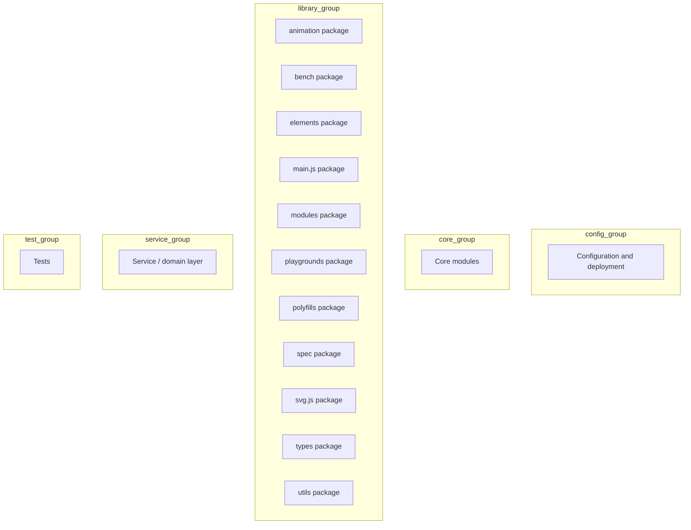

# Architecture report: svgdotjs/svg.js

> Automated static analysis. **Observed** = directly seen in files/imports/AST; **Inferred** = interpretation from that evidence. Repository code was not executed.

## 1. Repository at a glance

| Item | Value |
| --- | --- |
| Repository | svgdotjs/svg.js |
| Description | The lightweight library for manipulating and animating SVG |
| Language | JavaScript |
| Stars | 11924 |
| Licence | Other |
| Analysed commit / branch | 4b8809b1554c44a84f8992cdbda60480336cc040 / master |
| Framework(s) | None detected |
| Files analysed | 209 |
| Components | 15 |

## 2. Architecture in one minute

svgdotjs/svg.js - The lightweight library for manipulating and animating SVG. This repository was analysed statically from 209 file(s) (0 Python). Detected technologies (observed from imports/manifests): TypeScript. Files are grouped into 15 component(s): animation package, bench package, Configuration and deployment, Core modules, elements package, main.js package, modules package, playgrounds package. Findings below distinguish observed facts from inferred interpretation.

## 3. High-level block diagram

## 4. Main components

### animation package (`animation`)

- **Kind:** library
- **Status:** Observed
- **Confidence:** 0.85
- **Responsibility:** Groups 6 file(s) under animation package (observed from repository paths and static analysis).
- **Paths:** `src/animation/Animator.js`, `src/animation/Controller.js`, `src/animation/Morphable.js`, `src/animation/Queue.js`, `src/animation/Runner.js`, `src/animation/Timeline.js`
- **Evidence:** [src/animation/Animator.js](https://github.com/svgdotjs/svg.js/blob/4b8809b1554c44a84f8992cdbda60480336cc040/src/animation/Animator.js); [src/animation/Controller.js](https://github.com/svgdotjs/svg.js/blob/4b8809b1554c44a84f8992cdbda60480336cc040/src/animation/Controller.js); [src/animation/Morphable.js](https://github.com/svgdotjs/svg.js/blob/4b8809b1554c44a84f8992cdbda60480336cc040/src/animation/Morphable.js); [src/animation/Queue.js](https://github.com/svgdotjs/svg.js/blob/4b8809b1554c44a84f8992cdbda60480336cc040/src/animation/Queue.js); [src/animation/Runner.js](https://github.com/svgdotjs/svg.js/blob/4b8809b1554c44a84f8992cdbda60480336cc040/src/animation/Runner.js); [src/animation/Timeline.js](https://github.com/svgdotjs/svg.js/blob/4b8809b1554c44a84f8992cdbda60480336cc040/src/animation/Timeline.js)

### bench package (`bench`)

- **Kind:** library
- **Status:** Observed
- **Confidence:** 0.85
- **Responsibility:** Groups 1 file(s) under bench package (observed from repository paths and static analysis).
- **Paths:** `bench/svg.bench.js`
- **Evidence:** [bench/svg.bench.js](https://github.com/svgdotjs/svg.js/blob/4b8809b1554c44a84f8992cdbda60480336cc040/bench/svg.bench.js)

### Configuration and deployment (`config`)

- **Kind:** config
- **Status:** Observed
- **Confidence:** 0.85
- **Responsibility:** Groups 3 file(s) under configuration and deployment (observed from repository paths and static analysis).
- **Paths:** `package.json`, `pnpm-workspace.yaml`, `tsconfig.json`
- **Evidence:** [package.json](https://github.com/svgdotjs/svg.js/blob/4b8809b1554c44a84f8992cdbda60480336cc040/package.json); [pnpm-workspace.yaml](https://github.com/svgdotjs/svg.js/blob/4b8809b1554c44a84f8992cdbda60480336cc040/pnpm-workspace.yaml); [tsconfig.json](https://github.com/svgdotjs/svg.js/blob/4b8809b1554c44a84f8992cdbda60480336cc040/tsconfig.json)

### Core modules (`core`)

- **Kind:** core
- **Status:** Observed
- **Confidence:** 0.85
- **Responsibility:** Groups 1 file(s) under core modules (observed from repository paths and static analysis).
- **Paths:** `svg.js.d.ts`
- **Evidence:** [svg.js.d.ts](https://github.com/svgdotjs/svg.js/blob/4b8809b1554c44a84f8992cdbda60480336cc040/svg.js.d.ts)

### elements package (`elements`)

- **Kind:** library
- **Status:** Observed
- **Confidence:** 0.85
- **Responsibility:** Groups 30 file(s) under elements package (observed from repository paths and static analysis).
- **Paths:** `src/elements/A.js`, `src/elements/Circle.js`, `src/elements/ClipPath.js`, `src/elements/Container.js`, `src/elements/Defs.js`, `src/elements/Dom.js`, `src/elements/Element.js`, `src/elements/Ellipse.js`, `src/elements/ForeignObject.js`, `src/elements/Fragment.js`, `src/elements/G.js`, `src/elements/Gradient.js`, `src/elements/Image.js`, `src/elements/Line.js`, `src/elements/Marker.js`, `src/elements/Mask.js`, `src/elements/Path.js`, `src/elements/Pattern.js`, `src/elements/Polygon.js`, `src/elements/Polyline.js`, `src/elements/Rect.js`, `src/elements/Shape.js`, `src/elements/Stop.js`, `src/elements/Style.js`, `src/elements/Svg.js`, `src/elements/Symbol.js`, `src/elements/Text.js`, `src/elements/TextPath.js`, `src/elements/Tspan.js`, `src/elements/Use.js`
- **Evidence:** [src/elements/A.js](https://github.com/svgdotjs/svg.js/blob/4b8809b1554c44a84f8992cdbda60480336cc040/src/elements/A.js); [src/elements/Circle.js](https://github.com/svgdotjs/svg.js/blob/4b8809b1554c44a84f8992cdbda60480336cc040/src/elements/Circle.js); [src/elements/ClipPath.js](https://github.com/svgdotjs/svg.js/blob/4b8809b1554c44a84f8992cdbda60480336cc040/src/elements/ClipPath.js); [src/elements/Container.js](https://github.com/svgdotjs/svg.js/blob/4b8809b1554c44a84f8992cdbda60480336cc040/src/elements/Container.js); [src/elements/Defs.js](https://github.com/svgdotjs/svg.js/blob/4b8809b1554c44a84f8992cdbda60480336cc040/src/elements/Defs.js); [src/elements/Dom.js](https://github.com/svgdotjs/svg.js/blob/4b8809b1554c44a84f8992cdbda60480336cc040/src/elements/Dom.js); [src/elements/Element.js](https://github.com/svgdotjs/svg.js/blob/4b8809b1554c44a84f8992cdbda60480336cc040/src/elements/Element.js); [src/elements/Ellipse.js](https://github.com/svgdotjs/svg.js/blob/4b8809b1554c44a84f8992cdbda60480336cc040/src/elements/Ellipse.js)

### main.js package (`main_js`)

- **Kind:** library
- **Status:** Observed
- **Confidence:** 0.85
- **Responsibility:** Groups 1 file(s) under main.js package (observed from repository paths and static analysis).
- **Paths:** `src/main.js`
- **Evidence:** [src/main.js](https://github.com/svgdotjs/svg.js/blob/4b8809b1554c44a84f8992cdbda60480336cc040/src/main.js)

### modules package (`modules`)

- **Kind:** library
- **Status:** Observed
- **Confidence:** 0.85
- **Responsibility:** Groups 7 file(s) under modules package (observed from repository paths and static analysis).
- **Paths:** `src/modules/optional/arrange.js`, `src/modules/optional/class.js`, `src/modules/optional/css.js`, `src/modules/optional/data.js`, `src/modules/optional/memory.js`, `src/modules/optional/sugar.js`, `src/modules/optional/transform.js`
- **Evidence:** [src/modules/optional/arrange.js](https://github.com/svgdotjs/svg.js/blob/4b8809b1554c44a84f8992cdbda60480336cc040/src/modules/optional/arrange.js); [src/modules/optional/class.js](https://github.com/svgdotjs/svg.js/blob/4b8809b1554c44a84f8992cdbda60480336cc040/src/modules/optional/class.js); [src/modules/optional/css.js](https://github.com/svgdotjs/svg.js/blob/4b8809b1554c44a84f8992cdbda60480336cc040/src/modules/optional/css.js); [src/modules/optional/data.js](https://github.com/svgdotjs/svg.js/blob/4b8809b1554c44a84f8992cdbda60480336cc040/src/modules/optional/data.js); [src/modules/optional/memory.js](https://github.com/svgdotjs/svg.js/blob/4b8809b1554c44a84f8992cdbda60480336cc040/src/modules/optional/memory.js); [src/modules/optional/sugar.js](https://github.com/svgdotjs/svg.js/blob/4b8809b1554c44a84f8992cdbda60480336cc040/src/modules/optional/sugar.js); [src/modules/optional/transform.js](https://github.com/svgdotjs/svg.js/blob/4b8809b1554c44a84f8992cdbda60480336cc040/src/modules/optional/transform.js)

### playgrounds package (`playgrounds`)

- **Kind:** library
- **Status:** Observed
- **Confidence:** 0.85
- **Responsibility:** Groups 5 file(s) under playgrounds package (observed from repository paths and static analysis).
- **Paths:** `playgrounds/colors/main.js`, `playgrounds/matrix/drag.js`, `playgrounds/matrix/matrix.js`, `playgrounds/transforms/transforms.js`, `playgrounds/webpack.config.js`
- **Evidence:** [playgrounds/colors/main.js](https://github.com/svgdotjs/svg.js/blob/4b8809b1554c44a84f8992cdbda60480336cc040/playgrounds/colors/main.js); [playgrounds/matrix/drag.js](https://github.com/svgdotjs/svg.js/blob/4b8809b1554c44a84f8992cdbda60480336cc040/playgrounds/matrix/drag.js); [playgrounds/matrix/matrix.js](https://github.com/svgdotjs/svg.js/blob/4b8809b1554c44a84f8992cdbda60480336cc040/playgrounds/matrix/matrix.js); [playgrounds/transforms/transforms.js](https://github.com/svgdotjs/svg.js/blob/4b8809b1554c44a84f8992cdbda60480336cc040/playgrounds/transforms/transforms.js); [playgrounds/webpack.config.js](https://github.com/svgdotjs/svg.js/blob/4b8809b1554c44a84f8992cdbda60480336cc040/playgrounds/webpack.config.js)

### polyfills package (`polyfills`)

- **Kind:** library
- **Status:** Observed
- **Confidence:** 0.85
- **Responsibility:** Groups 2 file(s) under polyfills package (observed from repository paths and static analysis).
- **Paths:** `src/polyfills/children.js`, `src/polyfills/innerHTML.js`
- **Evidence:** [src/polyfills/children.js](https://github.com/svgdotjs/svg.js/blob/4b8809b1554c44a84f8992cdbda60480336cc040/src/polyfills/children.js); [src/polyfills/innerHTML.js](https://github.com/svgdotjs/svg.js/blob/4b8809b1554c44a84f8992cdbda60480336cc040/src/polyfills/innerHTML.js)

### Service / domain layer (`service_layer`)

- **Kind:** service
- **Status:** Observed
- **Confidence:** 0.85
- **Responsibility:** Groups 25 file(s) under service / domain layer (observed from repository paths and static analysis).
- **Paths:** `spec/spec/modules/core/attr.js`, `spec/spec/modules/core/circled.js`, `spec/spec/modules/core/containerGeometry.js`, `spec/spec/modules/core/event.js`, `spec/spec/modules/core/gradiented.js`, `spec/spec/modules/core/parser.js`, `spec/spec/modules/core/pointed.js`, `spec/spec/modules/core/poly.js`, `spec/spec/modules/core/regex.js`, `spec/spec/modules/core/selector.js`, `spec/spec/modules/core/textable.js`, `src/modules/core/attr.js`, `src/modules/core/circled.js`, `src/modules/core/containerGeometry.js`, `src/modules/core/defaults.js`, `src/modules/core/event.js`, `src/modules/core/gradiented.js`, `src/modules/core/namespaces.js`, `src/modules/core/parser.js`, `src/modules/core/pointed.js`, `src/modules/core/poly.js`, `src/modules/core/references.js`, `src/modules/core/regex.js`, `src/modules/core/selector.js`, `src/modules/core/textable.js`
- **Evidence:** [spec/spec/modules/core/attr.js](https://github.com/svgdotjs/svg.js/blob/4b8809b1554c44a84f8992cdbda60480336cc040/spec/spec/modules/core/attr.js); [spec/spec/modules/core/circled.js](https://github.com/svgdotjs/svg.js/blob/4b8809b1554c44a84f8992cdbda60480336cc040/spec/spec/modules/core/circled.js); [spec/spec/modules/core/containerGeometry.js](https://github.com/svgdotjs/svg.js/blob/4b8809b1554c44a84f8992cdbda60480336cc040/spec/spec/modules/core/containerGeometry.js); [spec/spec/modules/core/event.js](https://github.com/svgdotjs/svg.js/blob/4b8809b1554c44a84f8992cdbda60480336cc040/spec/spec/modules/core/event.js); [spec/spec/modules/core/gradiented.js](https://github.com/svgdotjs/svg.js/blob/4b8809b1554c44a84f8992cdbda60480336cc040/spec/spec/modules/core/gradiented.js); [spec/spec/modules/core/parser.js](https://github.com/svgdotjs/svg.js/blob/4b8809b1554c44a84f8992cdbda60480336cc040/spec/spec/modules/core/parser.js); [spec/spec/modules/core/pointed.js](https://github.com/svgdotjs/svg.js/blob/4b8809b1554c44a84f8992cdbda60480336cc040/spec/spec/modules/core/pointed.js); [spec/spec/modules/core/poly.js](https://github.com/svgdotjs/svg.js/blob/4b8809b1554c44a84f8992cdbda60480336cc040/spec/spec/modules/core/poly.js)

### spec package (`spec`)

- **Kind:** library
- **Status:** Observed
- **Confidence:** 0.85
- **Responsibility:** Groups 69 file(s) under spec package (observed from repository paths and static analysis).
- **Paths:** `spec/RAFPlugin.js`, `spec/helpers.js`, `spec/package/fixtures/browser-global.mjs`, `spec/package/fixtures/commonjs.cjs`, `spec/package/fixtures/esm.mjs`, `spec/package/package-contract.mjs`, `spec/runSVGDomTest.js`, `spec/setupBrowser.js`, `spec/setupSVGDom.js`, `spec/spec/animation/Animator.js`, `spec/spec/animation/Controller.js`, `spec/spec/animation/Morphable.js`, `spec/spec/animation/Queue.js`, `spec/spec/animation/Runner.js`, `spec/spec/animation/Timeline.js`, `spec/spec/elements/A.js`, `spec/spec/elements/Circle.js`, `spec/spec/elements/ClipPath.js`, `spec/spec/elements/Container.js`, `spec/spec/elements/Defs.js`, `spec/spec/elements/Dom.js`, `spec/spec/elements/Element.js`, `spec/spec/elements/Ellipse.js`, `spec/spec/elements/ForeignObject.js`, `spec/spec/elements/Fragment.js`, `spec/spec/elements/G.js`, `spec/spec/elements/Gradient.js`, `spec/spec/elements/Image.js`, `spec/spec/elements/Line.js`, `spec/spec/elements/Marker.js`, `spec/spec/elements/Mask.js`, `spec/spec/elements/Path.js`, `spec/spec/elements/Pattern.js`, `spec/spec/elements/Polygon.js`, `spec/spec/elements/Polyline.js`, `spec/spec/elements/Rect.js`, `spec/spec/elements/Shape.js`, `spec/spec/elements/Stop.js`, `spec/spec/elements/Style.js`, `spec/spec/elements/Svg.js`, `spec/spec/elements/Symbol.js`, `spec/spec/elements/Text.js`, `spec/spec/elements/TextPath.js`, `spec/spec/elements/Tspan.js`, `spec/spec/elements/Use.js`, `spec/spec/modules/optional/arrange.js`, `spec/spec/modules/optional/class.js`, `spec/spec/modules/optional/css.js`, `spec/spec/modules/optional/data.js`, `spec/spec/modules/optional/memory.js`, `spec/spec/modules/optional/sugar.js`, `spec/spec/modules/optional/transform.js`, `spec/spec/polyfills/innerHTML.js`, `spec/spec/types/Base.js`, `spec/spec/types/Box.js`, `spec/spec/types/Color.js`, `spec/spec/types/EventTarget.js`, `spec/spec/types/List.js`, `spec/spec/types/Matrix.js`, `spec/spec/types/PathArray.js`, `spec/spec/types/Point.js`, `spec/spec/types/PointArray.js`, `spec/spec/types/SVGArray.js`, `spec/spec/types/SVGNumber.js`, `spec/spec/utils/adopter.js`, `spec/spec/utils/methods.js`, `spec/spec/utils/pathParser.js`, `spec/spec/utils/utils.js`, `spec/spec/utils/window.js`
- **Evidence:** [spec/RAFPlugin.js](https://github.com/svgdotjs/svg.js/blob/4b8809b1554c44a84f8992cdbda60480336cc040/spec/RAFPlugin.js); [spec/helpers.js](https://github.com/svgdotjs/svg.js/blob/4b8809b1554c44a84f8992cdbda60480336cc040/spec/helpers.js); [spec/package/fixtures/browser-global.mjs](https://github.com/svgdotjs/svg.js/blob/4b8809b1554c44a84f8992cdbda60480336cc040/spec/package/fixtures/browser-global.mjs); [spec/package/fixtures/commonjs.cjs](https://github.com/svgdotjs/svg.js/blob/4b8809b1554c44a84f8992cdbda60480336cc040/spec/package/fixtures/commonjs.cjs); [spec/package/fixtures/esm.mjs](https://github.com/svgdotjs/svg.js/blob/4b8809b1554c44a84f8992cdbda60480336cc040/spec/package/fixtures/esm.mjs); [spec/package/package-contract.mjs](https://github.com/svgdotjs/svg.js/blob/4b8809b1554c44a84f8992cdbda60480336cc040/spec/package/package-contract.mjs); [spec/runSVGDomTest.js](https://github.com/svgdotjs/svg.js/blob/4b8809b1554c44a84f8992cdbda60480336cc040/spec/runSVGDomTest.js); [spec/setupBrowser.js](https://github.com/svgdotjs/svg.js/blob/4b8809b1554c44a84f8992cdbda60480336cc040/spec/setupBrowser.js)

### svg.js package (`svg_js`)

- **Kind:** library
- **Status:** Observed
- **Confidence:** 0.85
- **Responsibility:** Groups 1 file(s) under svg.js package (observed from repository paths and static analysis).
- **Paths:** `src/svg.js`
- **Evidence:** [src/svg.js](https://github.com/svgdotjs/svg.js/blob/4b8809b1554c44a84f8992cdbda60480336cc040/src/svg.js)

### Tests (`tests`)

- **Kind:** test
- **Status:** Observed
- **Confidence:** 0.85
- **Responsibility:** Groups 11 file(s) under tests (observed from repository paths and static analysis).
- **Paths:** `bench/tests/10000-accesses.js`, `bench/tests/10000-boxes.js`, `bench/tests/10000-circles.js`, `bench/tests/10000-each.js`, `bench/tests/10000-pathArray-bbox.js`, `bench/tests/10000-pathArrays.js`, `bench/tests/10000-paths.js`, `bench/tests/10000-pointArray-bbox.js`, `bench/tests/10000-rects.js`, `bench/tests/10000-textContent.js`, `bench/tests/10000-transform.js`
- **Evidence:** [bench/tests/10000-accesses.js](https://github.com/svgdotjs/svg.js/blob/4b8809b1554c44a84f8992cdbda60480336cc040/bench/tests/10000-accesses.js); [bench/tests/10000-boxes.js](https://github.com/svgdotjs/svg.js/blob/4b8809b1554c44a84f8992cdbda60480336cc040/bench/tests/10000-boxes.js); [bench/tests/10000-circles.js](https://github.com/svgdotjs/svg.js/blob/4b8809b1554c44a84f8992cdbda60480336cc040/bench/tests/10000-circles.js); [bench/tests/10000-each.js](https://github.com/svgdotjs/svg.js/blob/4b8809b1554c44a84f8992cdbda60480336cc040/bench/tests/10000-each.js); [bench/tests/10000-pathArray-bbox.js](https://github.com/svgdotjs/svg.js/blob/4b8809b1554c44a84f8992cdbda60480336cc040/bench/tests/10000-pathArray-bbox.js); [bench/tests/10000-pathArrays.js](https://github.com/svgdotjs/svg.js/blob/4b8809b1554c44a84f8992cdbda60480336cc040/bench/tests/10000-pathArrays.js); [bench/tests/10000-paths.js](https://github.com/svgdotjs/svg.js/blob/4b8809b1554c44a84f8992cdbda60480336cc040/bench/tests/10000-paths.js); [bench/tests/10000-pointArray-bbox.js](https://github.com/svgdotjs/svg.js/blob/4b8809b1554c44a84f8992cdbda60480336cc040/bench/tests/10000-pointArray-bbox.js)

### types package (`types`)

- **Kind:** library
- **Status:** Observed
- **Confidence:** 0.85
- **Responsibility:** Groups 11 file(s) under types package (observed from repository paths and static analysis).
- **Paths:** `src/types/Base.js`, `src/types/Box.js`, `src/types/Color.js`, `src/types/EventTarget.js`, `src/types/List.js`, `src/types/Matrix.js`, `src/types/PathArray.js`, `src/types/Point.js`, `src/types/PointArray.js`, `src/types/SVGArray.js`, `src/types/SVGNumber.js`
- **Evidence:** [src/types/Base.js](https://github.com/svgdotjs/svg.js/blob/4b8809b1554c44a84f8992cdbda60480336cc040/src/types/Base.js); [src/types/Box.js](https://github.com/svgdotjs/svg.js/blob/4b8809b1554c44a84f8992cdbda60480336cc040/src/types/Box.js); [src/types/Color.js](https://github.com/svgdotjs/svg.js/blob/4b8809b1554c44a84f8992cdbda60480336cc040/src/types/Color.js); [src/types/EventTarget.js](https://github.com/svgdotjs/svg.js/blob/4b8809b1554c44a84f8992cdbda60480336cc040/src/types/EventTarget.js); [src/types/List.js](https://github.com/svgdotjs/svg.js/blob/4b8809b1554c44a84f8992cdbda60480336cc040/src/types/List.js); [src/types/Matrix.js](https://github.com/svgdotjs/svg.js/blob/4b8809b1554c44a84f8992cdbda60480336cc040/src/types/Matrix.js); [src/types/PathArray.js](https://github.com/svgdotjs/svg.js/blob/4b8809b1554c44a84f8992cdbda60480336cc040/src/types/PathArray.js); [src/types/Point.js](https://github.com/svgdotjs/svg.js/blob/4b8809b1554c44a84f8992cdbda60480336cc040/src/types/Point.js)

### utils package (`utils`)

- **Kind:** library
- **Status:** Observed
- **Confidence:** 0.85
- **Responsibility:** Groups 5 file(s) under utils package (observed from repository paths and static analysis).
- **Paths:** `src/utils/adopter.js`, `src/utils/methods.js`, `src/utils/pathParser.js`, `src/utils/utils.js`, `src/utils/window.js`
- **Evidence:** [src/utils/adopter.js](https://github.com/svgdotjs/svg.js/blob/4b8809b1554c44a84f8992cdbda60480336cc040/src/utils/adopter.js); [src/utils/methods.js](https://github.com/svgdotjs/svg.js/blob/4b8809b1554c44a84f8992cdbda60480336cc040/src/utils/methods.js); [src/utils/pathParser.js](https://github.com/svgdotjs/svg.js/blob/4b8809b1554c44a84f8992cdbda60480336cc040/src/utils/pathParser.js); [src/utils/utils.js](https://github.com/svgdotjs/svg.js/blob/4b8809b1554c44a84f8992cdbda60480336cc040/src/utils/utils.js); [src/utils/window.js](https://github.com/svgdotjs/svg.js/blob/4b8809b1554c44a84f8992cdbda60480336cc040/src/utils/window.js)

## 5. Execution flow

**Observed** entry point(s):

- [playgrounds/colors/main.js](https://github.com/svgdotjs/svg.js/blob/4b8809b1554c44a84f8992cdbda60480336cc040/playgrounds/colors/main.js)
- [src/main.js](https://github.com/svgdotjs/svg.js/blob/4b8809b1554c44a84f8992cdbda60480336cc040/src/main.js)

Representative flow (derived from observed entry points and the import graph; steps beyond the entry point are **Inferred**):

1. Execution starts at an observed entry point listed above, if present.
2. No internal import relationships between components were observed.

## 6. Project structure

### `(root)`

- `.gitignore` - other (144 bytes)
- `.oxfmtrc.json` - config (416 bytes)
- `.oxlintrc.json` - config (337 bytes)
- `.travis.yml` - ci, YAML (339 bytes)
- `CHANGELOG.md` - docs (45428 bytes)
- `LICENSE.txt` - docs (1089 bytes)
- `README.md` - docs (1740 bytes)
- `package.json` - manifest (3433 bytes)
- `pnpm-workspace.yaml` - config (54 bytes)
- `svg.js.d.ts` - source, TypeScript (55349 bytes)
- `tsconfig.json` - config (3 bytes)

### `.config`

- `.config/karma.conf.cjs` - source, JavaScript (2905 bytes)
- `.config/karma.conf.common.cjs` - source, JavaScript (1675 bytes)
- `.config/polyfillListIE.js` - source, JavaScript (858 bytes)
- `.config/pretest.js` - source, JavaScript (498 bytes)
- `.config/rolldown.config.js` - source, JavaScript (2334 bytes)
- `.config/rolldown.polyfills.js` - source, JavaScript (247 bytes)
- `.config/rolldown.tests.js` - source, JavaScript (757 bytes)

### `.github`

- `.github/CONTRIBUTING.md` - docs (1803 bytes)
- `.github/FUNDING.yml` - config (65 bytes)
- `.github/ISSUE_TEMPLATE/bug-report.md` - docs (695 bytes)
- `.github/ISSUE_TEMPLATE/feature-request.md` - docs (1342 bytes)
- `.github/ISSUE_TEMPLATE/other.md` - docs (323 bytes)

### `bench`

- `bench/runner.html` - other (1628 bytes)
- `bench/svg.bench.js` - source, JavaScript (2004 bytes)
- `bench/tests/10000-accesses.js` - test, JavaScript (1009 bytes)
- `bench/tests/10000-boxes.js` - test, JavaScript (1565 bytes)
- `bench/tests/10000-circles.js` - test, JavaScript (1295 bytes)
- `bench/tests/10000-each.js` - test, JavaScript (520 bytes)
- `bench/tests/10000-pathArray-bbox.js` - test, JavaScript (17302 bytes)
- `bench/tests/10000-pathArrays.js` - test, JavaScript (16170 bytes)
- `bench/tests/10000-paths.js` - test, JavaScript (631 bytes)
- `bench/tests/10000-pointArray-bbox.js` - test, JavaScript (1336 bytes)
- `bench/tests/10000-rects.js` - test, JavaScript (3721 bytes)
- `bench/tests/10000-textContent.js` - test, JavaScript (603 bytes)
- `bench/tests/10000-transform.js` - test, JavaScript (753 bytes)

### `playgrounds`

- `playgrounds/colors/index.html` - other (461 bytes)
- `playgrounds/colors/main.js` - source, JavaScript (722 bytes)
- `playgrounds/colors/style.css` - other (907 bytes)
- `playgrounds/matrix/drag.js` - source, JavaScript (1613 bytes)
- `playgrounds/matrix/index.html` - other (1239 bytes)
- `playgrounds/matrix/matrix.js` - source, JavaScript (886 bytes)
- `playgrounds/matrix/style.css` - other (907 bytes)
- `playgrounds/transforms/index.html` - other (545 bytes)
- `playgrounds/transforms/style.css` - other (907 bytes)
- `playgrounds/transforms/transforms.js` - source, JavaScript (516 bytes)
- `playgrounds/webpack.config.js` - source, JavaScript (555 bytes)

### `spec`

- `spec/RAFPlugin.js` - source, JavaScript (1925 bytes)
- `spec/SpecRunner.html` - other (889 bytes)
- `spec/SpecRunnerEs6.html` - other (2227 bytes)
- `spec/fixtures/fixture.css` - other (80 bytes)
- `spec/fixtures/fixture.svg` - other (1285 bytes)
- `spec/helpers.js` - source, JavaScript (4213 bytes)
- `spec/package/fixtures/browser-global.mjs` - source, JavaScript (737 bytes)
- `spec/package/fixtures/commonjs.cjs` - source, JavaScript (604 bytes)
- `spec/package/fixtures/esm.mjs` - source, JavaScript (594 bytes)
- `spec/package/fixtures/typescript.mts` - other (2956 bytes)
- `spec/package/package-contract.mjs` - source, JavaScript (2674 bytes)
- `spec/runSVGDomTest.js` - source, JavaScript (241 bytes)
- `spec/setupBrowser.js` - source, JavaScript (308 bytes)
- `spec/setupSVGDom.js` - source, JavaScript (556 bytes)
- `spec/spec/animation/Animator.js` - source, JavaScript (3823 bytes)
- `spec/spec/animation/Controller.js` - source, JavaScript (12164 bytes)
- `spec/spec/animation/Morphable.js` - source, JavaScript (16046 bytes)
- `spec/spec/animation/Queue.js` - source, JavaScript (2544 bytes)
- `spec/spec/animation/Runner.js` - source, JavaScript (92316 bytes)
- `spec/spec/animation/Timeline.js` - source, JavaScript (25550 bytes)
- `spec/spec/elements/A.js` - source, JavaScript (3154 bytes)
- `spec/spec/elements/Circle.js` - source, JavaScript (1818 bytes)
- `spec/spec/elements/ClipPath.js` - source, JavaScript (4613 bytes)
- `spec/spec/elements/Container.js` - source, JavaScript (3582 bytes)
- `spec/spec/elements/Defs.js` - source, JavaScript (758 bytes)
- `spec/spec/elements/Dom.js` - source, JavaScript (22652 bytes)
- `spec/spec/elements/Element.js` - source, JavaScript (12884 bytes)
- `spec/spec/elements/Ellipse.js` - source, JavaScript (2770 bytes)
- `spec/spec/elements/ForeignObject.js` - source, JavaScript (1594 bytes)
- `spec/spec/elements/Fragment.js` - source, JavaScript (2043 bytes)
- `spec/spec/elements/G.js` - source, JavaScript (688 bytes)
- `spec/spec/elements/Gradient.js` - source, JavaScript (4125 bytes)
- `spec/spec/elements/Image.js` - source, JavaScript (4389 bytes)
- `spec/spec/elements/Line.js` - source, JavaScript (4274 bytes)
- `spec/spec/elements/Marker.js` - source, JavaScript (5295 bytes)
- `spec/spec/elements/Mask.js` - source, JavaScript (3687 bytes)
- `spec/spec/elements/Path.js` - source, JavaScript (5518 bytes)
- `spec/spec/elements/Pattern.js` - source, JavaScript (3802 bytes)
- `spec/spec/elements/Polygon.js` - source, JavaScript (1007 bytes)
- `spec/spec/elements/Polyline.js` - source, JavaScript (1038 bytes)
- `spec/spec/elements/Rect.js` - source, JavaScript (761 bytes)
- `spec/spec/elements/Shape.js` - source, JavaScript (441 bytes)
- `spec/spec/elements/Stop.js` - source, JavaScript (2602 bytes)
- `spec/spec/elements/Style.js` - source, JavaScript (2780 bytes)
- `spec/spec/elements/Svg.js` - source, JavaScript (4231 bytes)
- `spec/spec/elements/Symbol.js` - source, JavaScript (705 bytes)
- `spec/spec/elements/Text.js` - source, JavaScript (6480 bytes)
- `spec/spec/elements/TextPath.js` - source, JavaScript (5637 bytes)
- `spec/spec/elements/Tspan.js` - source, JavaScript (3977 bytes)
- `spec/spec/elements/Use.js` - source, JavaScript (1157 bytes)
- `spec/spec/modules/core/attr.js` - source, JavaScript (4300 bytes)
- `spec/spec/modules/core/circled.js` - source, JavaScript (2737 bytes)
- `spec/spec/modules/core/containerGeometry.js` - source, JavaScript (10882 bytes)
- `spec/spec/modules/core/event.js` - source, JavaScript (10242 bytes)
- `spec/spec/modules/core/gradiented.js` - source, JavaScript (1242 bytes)
- `spec/spec/modules/core/parser.js` - source, JavaScript (2178 bytes)
- `spec/spec/modules/core/pointed.js` - source, JavaScript (1847 bytes)
- `spec/spec/modules/core/poly.js` - source, JavaScript (3402 bytes)
- `spec/spec/modules/core/regex.js` - source, JavaScript (7458 bytes)
- `spec/spec/modules/core/selector.js` - source, JavaScript (2110 bytes)
- `spec/spec/modules/core/textable.js` - source, JavaScript (11559 bytes)
- `spec/spec/modules/optional/arrange.js` - source, JavaScript (6137 bytes)
- `spec/spec/modules/optional/class.js` - source, JavaScript (3011 bytes)
- `spec/spec/modules/optional/css.js` - source, JavaScript (6728 bytes)
- `spec/spec/modules/optional/data.js` - source, JavaScript (3990 bytes)
- `spec/spec/modules/optional/memory.js` - source, JavaScript (3188 bytes)
- `spec/spec/modules/optional/sugar.js` - source, JavaScript (14949 bytes)
- `spec/spec/modules/optional/transform.js` - source, JavaScript (6549 bytes)
- `spec/spec/polyfills/innerHTML.js` - source, JavaScript (4105 bytes)
- `spec/spec/types/Base.js` - source, JavaScript (245 bytes)
- `spec/spec/types/Box.js` - source, JavaScript (12575 bytes)
- `spec/spec/types/Color.js` - source, JavaScript (14179 bytes)
- `spec/spec/types/EventTarget.js` - source, JavaScript (5374 bytes)
- `spec/spec/types/List.js` - source, JavaScript (3523 bytes)
- `spec/spec/types/Matrix.js` - source, JavaScript (21453 bytes)
- `spec/spec/types/PathArray.js` - source, JavaScript (3036 bytes)
- `spec/spec/types/Point.js` - source, JavaScript (2682 bytes)
- `spec/spec/types/PointArray.js` - source, JavaScript (6012 bytes)
- `spec/spec/types/SVGArray.js` - source, JavaScript (2548 bytes)
- `spec/spec/types/SVGNumber.js` - source, JavaScript (6480 bytes)
- `spec/spec/utils/adopter.js` - source, JavaScript (8097 bytes)
- `spec/spec/utils/methods.js` - source, JavaScript (860 bytes)
- `spec/spec/utils/pathParser.js` - source, JavaScript (4878 bytes)
- `spec/spec/utils/utils.js` - source, JavaScript (5107 bytes)
- `spec/spec/utils/window.js` - source, JavaScript (1707 bytes)

### `src`

- `src/animation/Animator.js` - source, JavaScript (3047 bytes)
- `src/animation/Controller.js` - source, JavaScript (5200 bytes)
- `src/animation/Morphable.js` - source, JavaScript (6766 bytes)
- `src/animation/Queue.js` - source, JavaScript (1442 bytes)
- `src/animation/Runner.js` - source, JavaScript (33146 bytes)
- `src/animation/Timeline.js` - source, JavaScript (13189 bytes)
- `src/elements/A.js` - source, JavaScript (1584 bytes)
- `src/elements/Circle.js` - source, JavaScript (945 bytes)
- `src/elements/ClipPath.js` - source, JavaScript (1361 bytes)
- `src/elements/Container.js` - source, JavaScript (687 bytes)
- `src/elements/Defs.js` - source, JavaScript (322 bytes)
- `src/elements/Dom.js` - source, JavaScript (8191 bytes)
- `src/elements/Element.js` - source, JavaScript (3987 bytes)
- `src/elements/Ellipse.js` - source, JavaScript (902 bytes)
- `src/elements/ForeignObject.js` - source, JavaScript (530 bytes)
- `src/elements/Fragment.js` - source, JavaScript (892 bytes)
- `src/elements/G.js` - source, JavaScript (585 bytes)
- `src/elements/Gradient.js` - source, JavaScript (1507 bytes)
- `src/elements/Image.js` - source, JavaScript (2077 bytes)
- `src/elements/Line.js` - source, JavaScript (1639 bytes)
- `src/elements/Marker.js` - source, JavaScript (1973 bytes)
- `src/elements/Mask.js` - source, JavaScript (1275 bytes)
- `src/elements/Path.js` - source, JavaScript (1968 bytes)
- `src/elements/Pattern.js` - source, JavaScript (1484 bytes)
- `src/elements/Polygon.js` - source, JavaScript (804 bytes)
- `src/elements/Polyline.js` - source, JavaScript (812 bytes)
- `src/elements/Rect.js` - source, JavaScript (614 bytes)
- `src/elements/Shape.js` - source, JavaScript (155 bytes)
- `src/elements/Stop.js` - source, JavaScript (974 bytes)
- `src/elements/Style.js` - source, JavaScript (1073 bytes)
- `src/elements/Svg.js` - source, JavaScript (1562 bytes)
- `src/elements/Symbol.js` - source, JavaScript (482 bytes)
- `src/elements/Text.js` - source, JavaScript (3774 bytes)
- `src/elements/TextPath.js` - source, JavaScript (2476 bytes)
- `src/elements/Tspan.js` - source, JavaScript (1991 bytes)
- `src/elements/Use.js` - source, JavaScript (696 bytes)
- `src/main.js` - source, JavaScript (5975 bytes)
- `src/modules/core/attr.js` - source, JavaScript (2601 bytes)
- `src/modules/core/circled.js` - source, JavaScript (888 bytes)
- `src/modules/core/containerGeometry.js` - source, JavaScript (2688 bytes)
- `src/modules/core/defaults.js` - source, JavaScript (612 bytes)
- `src/modules/core/event.js` - source, JavaScript (3989 bytes)
- `src/modules/core/gradiented.js` - source, JavaScript (485 bytes)
- `src/modules/core/namespaces.js` - source, JavaScript (226 bytes)
- `src/modules/core/parser.js` - source, JavaScript (793 bytes)
- `src/modules/core/pointed.js` - source, JavaScript (642 bytes)
- `src/modules/core/poly.js` - source, JavaScript (832 bytes)
- `src/modules/core/references.js` - source, JavaScript (2034 bytes)
- `src/modules/core/regex.js` - source, JavaScript (934 bytes)
- `src/modules/core/selector.js` - source, JavaScript (539 bytes)
- `src/modules/core/textable.js` - source, JavaScript (1564 bytes)
- `src/modules/optional/arrange.js` - source, JavaScript (2125 bytes)
- `src/modules/optional/class.js` - source, JavaScript (1126 bytes)
- `src/modules/optional/css.js` - source, JavaScript (1906 bytes)
- `src/modules/optional/data.js` - source, JavaScript (1058 bytes)
- `src/modules/optional/memory.js` - source, JavaScript (991 bytes)
- `src/modules/optional/sugar.js` - source, JavaScript (4665 bytes)
- `src/modules/optional/transform.js` - source, JavaScript (2352 bytes)
- `src/polyfills/children.js` - source, JavaScript (222 bytes)
- `src/polyfills/innerHTML.js` - source, JavaScript (2474 bytes)
- `src/svg.js` - source, JavaScript (240 bytes)
- `src/types/Base.js` - source, JavaScript (268 bytes)
- `src/types/Box.js` - source, JavaScript (7553 bytes)
- `src/types/Color.js` - source, JavaScript (13126 bytes)
- `src/types/EventTarget.js` - source, JavaScript (1232 bytes)
- `src/types/List.js` - source, JavaScript (1515 bytes)
- `src/types/Matrix.js` - source, JavaScript (12856 bytes)
- `src/types/PathArray.js` - source, JavaScript (3944 bytes)
- `src/types/Point.js` - source, JavaScript (1051 bytes)
- `src/types/PointArray.js` - source, JavaScript (2923 bytes)
- `src/types/SVGArray.js` - source, JavaScript (937 bytes)
- `src/types/SVGNumber.js` - source, JavaScript (2161 bytes)
- `src/utils/adopter.js` - source, JavaScript (3546 bytes)
- `src/utils/methods.js` - source, JavaScript (636 bytes)
- `src/utils/pathParser.js` - source, JavaScript (5433 bytes)
- `src/utils/utils.js` - source, JavaScript (3270 bytes)
- `src/utils/window.js` - source, JavaScript (565 bytes)

## 7. Key dependencies and integrations

| Name | Category | Status | Confidence | Evidence |
| --- | --- | --- | --- | --- |
| TypeScript | tooling | Observed | 0.85 | [package.json:107](https://github.com/svgdotjs/svg.js/blob/4b8809b1554c44a84f8992cdbda60480336cc040/package.json#L107) |

## 8. Data and state

No database, cache, queue, or persistent-state usage was observed in the analysed files. State handling, if any, may be in-memory or in files that were not analysed.

## 9. Configuration and deployment clues

- `.github/FUNDING.yml` (config)
- `.oxfmtrc.json` (config)
- `.oxlintrc.json` (config)
- `.travis.yml` (ci)
- `package.json` (manifest)
- `pnpm-workspace.yaml` (config)
- `tsconfig.json` (config)

## 10. Design observations

- Service/domain code is distinct from entry and data code, suggesting layered separation (Inferred).
- Tests are present alongside source code (Observed from test file paths).

These observations are interpretations (**Inferred**) of the observed structure, not guarantees about runtime design.

## 11. Limitations and unknowns

- Static analysis only: repository code was not executed, installed, or imported at runtime.
- Components and relationships are inferred from file paths, imports, and AST structure; runtime behaviour, dynamic imports, and reflection may not be visible.
- 1 file(s) were skipped during inventory (1 x lockfile excluded).
- No clear application entry point was observed in the analysed files.
- Repository text was treated as untrusted data; no instructions found in repository files were followed, and likely secret values were redacted/excluded.
- JavaScript and TypeScript files were inventoried from paths and package manifests. They were not parsed with a full language AST, and repository code was not executed.

## 12. Source references

- [bench/svg.bench.js](https://github.com/svgdotjs/svg.js/blob/4b8809b1554c44a84f8992cdbda60480336cc040/bench/svg.bench.js)
- [bench/tests/10000-accesses.js](https://github.com/svgdotjs/svg.js/blob/4b8809b1554c44a84f8992cdbda60480336cc040/bench/tests/10000-accesses.js)
- [bench/tests/10000-boxes.js](https://github.com/svgdotjs/svg.js/blob/4b8809b1554c44a84f8992cdbda60480336cc040/bench/tests/10000-boxes.js)
- [bench/tests/10000-circles.js](https://github.com/svgdotjs/svg.js/blob/4b8809b1554c44a84f8992cdbda60480336cc040/bench/tests/10000-circles.js)
- [bench/tests/10000-each.js](https://github.com/svgdotjs/svg.js/blob/4b8809b1554c44a84f8992cdbda60480336cc040/bench/tests/10000-each.js)
- [bench/tests/10000-pathArray-bbox.js](https://github.com/svgdotjs/svg.js/blob/4b8809b1554c44a84f8992cdbda60480336cc040/bench/tests/10000-pathArray-bbox.js)
- [bench/tests/10000-pathArrays.js](https://github.com/svgdotjs/svg.js/blob/4b8809b1554c44a84f8992cdbda60480336cc040/bench/tests/10000-pathArrays.js)
- [bench/tests/10000-paths.js](https://github.com/svgdotjs/svg.js/blob/4b8809b1554c44a84f8992cdbda60480336cc040/bench/tests/10000-paths.js)
- [bench/tests/10000-pointArray-bbox.js](https://github.com/svgdotjs/svg.js/blob/4b8809b1554c44a84f8992cdbda60480336cc040/bench/tests/10000-pointArray-bbox.js)
- [package.json](https://github.com/svgdotjs/svg.js/blob/4b8809b1554c44a84f8992cdbda60480336cc040/package.json)
- [package.json:107](https://github.com/svgdotjs/svg.js/blob/4b8809b1554c44a84f8992cdbda60480336cc040/package.json#L107)
- [playgrounds/colors/main.js](https://github.com/svgdotjs/svg.js/blob/4b8809b1554c44a84f8992cdbda60480336cc040/playgrounds/colors/main.js)
- [playgrounds/matrix/drag.js](https://github.com/svgdotjs/svg.js/blob/4b8809b1554c44a84f8992cdbda60480336cc040/playgrounds/matrix/drag.js)
- [playgrounds/matrix/matrix.js](https://github.com/svgdotjs/svg.js/blob/4b8809b1554c44a84f8992cdbda60480336cc040/playgrounds/matrix/matrix.js)
- [playgrounds/transforms/transforms.js](https://github.com/svgdotjs/svg.js/blob/4b8809b1554c44a84f8992cdbda60480336cc040/playgrounds/transforms/transforms.js)
- [playgrounds/webpack.config.js](https://github.com/svgdotjs/svg.js/blob/4b8809b1554c44a84f8992cdbda60480336cc040/playgrounds/webpack.config.js)
- [pnpm-workspace.yaml](https://github.com/svgdotjs/svg.js/blob/4b8809b1554c44a84f8992cdbda60480336cc040/pnpm-workspace.yaml)
- [spec/RAFPlugin.js](https://github.com/svgdotjs/svg.js/blob/4b8809b1554c44a84f8992cdbda60480336cc040/spec/RAFPlugin.js)
- [spec/helpers.js](https://github.com/svgdotjs/svg.js/blob/4b8809b1554c44a84f8992cdbda60480336cc040/spec/helpers.js)
- [spec/package/fixtures/browser-global.mjs](https://github.com/svgdotjs/svg.js/blob/4b8809b1554c44a84f8992cdbda60480336cc040/spec/package/fixtures/browser-global.mjs)
- [spec/package/fixtures/commonjs.cjs](https://github.com/svgdotjs/svg.js/blob/4b8809b1554c44a84f8992cdbda60480336cc040/spec/package/fixtures/commonjs.cjs)
- [spec/package/fixtures/esm.mjs](https://github.com/svgdotjs/svg.js/blob/4b8809b1554c44a84f8992cdbda60480336cc040/spec/package/fixtures/esm.mjs)
- [spec/package/package-contract.mjs](https://github.com/svgdotjs/svg.js/blob/4b8809b1554c44a84f8992cdbda60480336cc040/spec/package/package-contract.mjs)
- [spec/runSVGDomTest.js](https://github.com/svgdotjs/svg.js/blob/4b8809b1554c44a84f8992cdbda60480336cc040/spec/runSVGDomTest.js)
- [spec/setupBrowser.js](https://github.com/svgdotjs/svg.js/blob/4b8809b1554c44a84f8992cdbda60480336cc040/spec/setupBrowser.js)
- [spec/spec/modules/core/attr.js](https://github.com/svgdotjs/svg.js/blob/4b8809b1554c44a84f8992cdbda60480336cc040/spec/spec/modules/core/attr.js)
- [spec/spec/modules/core/circled.js](https://github.com/svgdotjs/svg.js/blob/4b8809b1554c44a84f8992cdbda60480336cc040/spec/spec/modules/core/circled.js)
- [spec/spec/modules/core/containerGeometry.js](https://github.com/svgdotjs/svg.js/blob/4b8809b1554c44a84f8992cdbda60480336cc040/spec/spec/modules/core/containerGeometry.js)
- [spec/spec/modules/core/event.js](https://github.com/svgdotjs/svg.js/blob/4b8809b1554c44a84f8992cdbda60480336cc040/spec/spec/modules/core/event.js)
- [spec/spec/modules/core/gradiented.js](https://github.com/svgdotjs/svg.js/blob/4b8809b1554c44a84f8992cdbda60480336cc040/spec/spec/modules/core/gradiented.js)
- [spec/spec/modules/core/parser.js](https://github.com/svgdotjs/svg.js/blob/4b8809b1554c44a84f8992cdbda60480336cc040/spec/spec/modules/core/parser.js)
- [spec/spec/modules/core/pointed.js](https://github.com/svgdotjs/svg.js/blob/4b8809b1554c44a84f8992cdbda60480336cc040/spec/spec/modules/core/pointed.js)
- [spec/spec/modules/core/poly.js](https://github.com/svgdotjs/svg.js/blob/4b8809b1554c44a84f8992cdbda60480336cc040/spec/spec/modules/core/poly.js)
- [src/animation/Animator.js](https://github.com/svgdotjs/svg.js/blob/4b8809b1554c44a84f8992cdbda60480336cc040/src/animation/Animator.js)
- [src/animation/Controller.js](https://github.com/svgdotjs/svg.js/blob/4b8809b1554c44a84f8992cdbda60480336cc040/src/animation/Controller.js)
- [src/animation/Morphable.js](https://github.com/svgdotjs/svg.js/blob/4b8809b1554c44a84f8992cdbda60480336cc040/src/animation/Morphable.js)
- [src/animation/Queue.js](https://github.com/svgdotjs/svg.js/blob/4b8809b1554c44a84f8992cdbda60480336cc040/src/animation/Queue.js)
- [src/animation/Runner.js](https://github.com/svgdotjs/svg.js/blob/4b8809b1554c44a84f8992cdbda60480336cc040/src/animation/Runner.js)
- [src/animation/Timeline.js](https://github.com/svgdotjs/svg.js/blob/4b8809b1554c44a84f8992cdbda60480336cc040/src/animation/Timeline.js)
- [src/elements/A.js](https://github.com/svgdotjs/svg.js/blob/4b8809b1554c44a84f8992cdbda60480336cc040/src/elements/A.js)
- [src/elements/Circle.js](https://github.com/svgdotjs/svg.js/blob/4b8809b1554c44a84f8992cdbda60480336cc040/src/elements/Circle.js)
- [src/elements/ClipPath.js](https://github.com/svgdotjs/svg.js/blob/4b8809b1554c44a84f8992cdbda60480336cc040/src/elements/ClipPath.js)
- [src/elements/Container.js](https://github.com/svgdotjs/svg.js/blob/4b8809b1554c44a84f8992cdbda60480336cc040/src/elements/Container.js)
- [src/elements/Defs.js](https://github.com/svgdotjs/svg.js/blob/4b8809b1554c44a84f8992cdbda60480336cc040/src/elements/Defs.js)
- [src/elements/Dom.js](https://github.com/svgdotjs/svg.js/blob/4b8809b1554c44a84f8992cdbda60480336cc040/src/elements/Dom.js)
- [src/elements/Element.js](https://github.com/svgdotjs/svg.js/blob/4b8809b1554c44a84f8992cdbda60480336cc040/src/elements/Element.js)
- [src/elements/Ellipse.js](https://github.com/svgdotjs/svg.js/blob/4b8809b1554c44a84f8992cdbda60480336cc040/src/elements/Ellipse.js)
- [src/main.js](https://github.com/svgdotjs/svg.js/blob/4b8809b1554c44a84f8992cdbda60480336cc040/src/main.js)
- [src/modules/optional/arrange.js](https://github.com/svgdotjs/svg.js/blob/4b8809b1554c44a84f8992cdbda60480336cc040/src/modules/optional/arrange.js)
- [src/modules/optional/class.js](https://github.com/svgdotjs/svg.js/blob/4b8809b1554c44a84f8992cdbda60480336cc040/src/modules/optional/class.js)
- [src/modules/optional/css.js](https://github.com/svgdotjs/svg.js/blob/4b8809b1554c44a84f8992cdbda60480336cc040/src/modules/optional/css.js)
- [src/modules/optional/data.js](https://github.com/svgdotjs/svg.js/blob/4b8809b1554c44a84f8992cdbda60480336cc040/src/modules/optional/data.js)
- [src/modules/optional/memory.js](https://github.com/svgdotjs/svg.js/blob/4b8809b1554c44a84f8992cdbda60480336cc040/src/modules/optional/memory.js)
- [src/modules/optional/sugar.js](https://github.com/svgdotjs/svg.js/blob/4b8809b1554c44a84f8992cdbda60480336cc040/src/modules/optional/sugar.js)
- [src/modules/optional/transform.js](https://github.com/svgdotjs/svg.js/blob/4b8809b1554c44a84f8992cdbda60480336cc040/src/modules/optional/transform.js)
- [src/polyfills/children.js](https://github.com/svgdotjs/svg.js/blob/4b8809b1554c44a84f8992cdbda60480336cc040/src/polyfills/children.js)
- [src/polyfills/innerHTML.js](https://github.com/svgdotjs/svg.js/blob/4b8809b1554c44a84f8992cdbda60480336cc040/src/polyfills/innerHTML.js)
- [src/svg.js](https://github.com/svgdotjs/svg.js/blob/4b8809b1554c44a84f8992cdbda60480336cc040/src/svg.js)
- [src/types/Base.js](https://github.com/svgdotjs/svg.js/blob/4b8809b1554c44a84f8992cdbda60480336cc040/src/types/Base.js)
- [src/types/Box.js](https://github.com/svgdotjs/svg.js/blob/4b8809b1554c44a84f8992cdbda60480336cc040/src/types/Box.js)
- [src/types/Color.js](https://github.com/svgdotjs/svg.js/blob/4b8809b1554c44a84f8992cdbda60480336cc040/src/types/Color.js)
- [src/types/EventTarget.js](https://github.com/svgdotjs/svg.js/blob/4b8809b1554c44a84f8992cdbda60480336cc040/src/types/EventTarget.js)
- [src/types/List.js](https://github.com/svgdotjs/svg.js/blob/4b8809b1554c44a84f8992cdbda60480336cc040/src/types/List.js)
- [src/types/Matrix.js](https://github.com/svgdotjs/svg.js/blob/4b8809b1554c44a84f8992cdbda60480336cc040/src/types/Matrix.js)
- [src/types/PathArray.js](https://github.com/svgdotjs/svg.js/blob/4b8809b1554c44a84f8992cdbda60480336cc040/src/types/PathArray.js)
- [src/types/Point.js](https://github.com/svgdotjs/svg.js/blob/4b8809b1554c44a84f8992cdbda60480336cc040/src/types/Point.js)
- [src/utils/adopter.js](https://github.com/svgdotjs/svg.js/blob/4b8809b1554c44a84f8992cdbda60480336cc040/src/utils/adopter.js)
- [src/utils/methods.js](https://github.com/svgdotjs/svg.js/blob/4b8809b1554c44a84f8992cdbda60480336cc040/src/utils/methods.js)
- [src/utils/pathParser.js](https://github.com/svgdotjs/svg.js/blob/4b8809b1554c44a84f8992cdbda60480336cc040/src/utils/pathParser.js)
- [src/utils/utils.js](https://github.com/svgdotjs/svg.js/blob/4b8809b1554c44a84f8992cdbda60480336cc040/src/utils/utils.js)
- [src/utils/window.js](https://github.com/svgdotjs/svg.js/blob/4b8809b1554c44a84f8992cdbda60480336cc040/src/utils/window.js)
- [svg.js.d.ts](https://github.com/svgdotjs/svg.js/blob/4b8809b1554c44a84f8992cdbda60480336cc040/svg.js.d.ts)
- [tsconfig.json](https://github.com/svgdotjs/svg.js/blob/4b8809b1554c44a84f8992cdbda60480336cc040/tsconfig.json)
