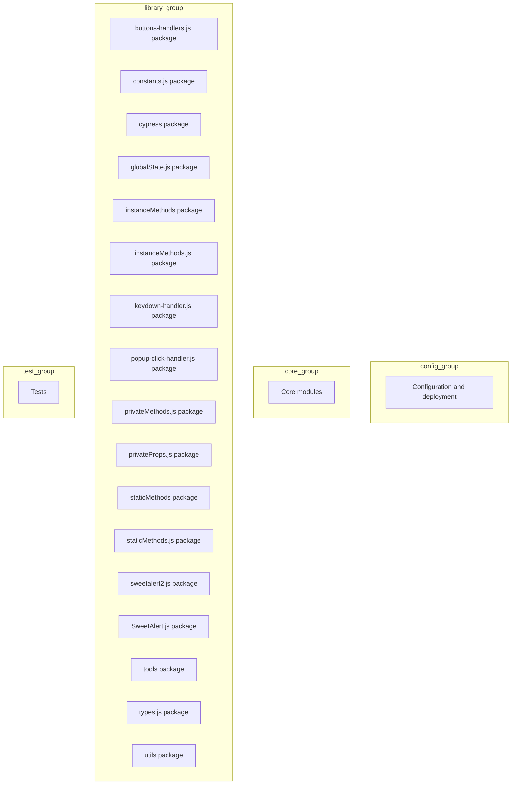

# Architecture report: sweetalert2/sweetalert2

> Automated static analysis. **Observed** = directly seen in files/imports/AST; **Inferred** = interpretation from that evidence. Repository code was not executed.

## 1. Repository at a glance

| Item | Value |
| --- | --- |
| Repository | sweetalert2/sweetalert2 |
| Description | ✨ A beautiful, responsive, highly customizable and accessible (WAI-ARIA) replacement for JavaScript's popup boxes. Zero dependencies. 🇺🇦🇪🇺 |
| Language | JavaScript |
| Stars | 18102 |
| Licence | MIT |
| Analysed commit / branch | 5a57eebd3a42c8f9d5f1a66918d283dae7b0df2a / main |
| Framework(s) | None detected |
| Files analysed | 114 |
| Components | 20 |

## 2. Architecture in one minute

sweetalert2/sweetalert2 - ✨ A beautiful, responsive, highly customizable and accessible (WAI-ARIA) replacement for JavaScript's popup boxes. Zero dependencies. 🇺🇦🇪🇺. This repository was analysed statically from 114 file(s) (0 Python). Detected technologies (observed from imports/manifests): GitHub Actions, TypeScript, Vite. Files are grouped into 20 component(s): buttons-handlers.js package, Configuration and deployment, constants.js package, Core modules, cypress package, globalState.js package, instanceMethods package, instanceMethods.js package. Findings below distinguish observed facts from inferred interpretation.

## 3. High-level block diagram

## 4. Main components

### buttons-handlers.js package (`buttons_handlers_js`)

- **Kind:** library
- **Status:** Observed
- **Confidence:** 0.85
- **Responsibility:** Groups 1 file(s) under buttons-handlers.js package (observed from repository paths and static analysis).
- **Paths:** `src/buttons-handlers.js`
- **Evidence:** [src/buttons-handlers.js](https://github.com/sweetalert2/sweetalert2/blob/5a57eebd3a42c8f9d5f1a66918d283dae7b0df2a/src/buttons-handlers.js)

### Configuration and deployment (`config`)

- **Kind:** config
- **Status:** Observed
- **Confidence:** 0.85
- **Responsibility:** Groups 3 file(s) under configuration and deployment (observed from repository paths and static analysis).
- **Paths:** `bunfig.toml`, `jsconfig.json`, `package.json`
- **Evidence:** [bunfig.toml](https://github.com/sweetalert2/sweetalert2/blob/5a57eebd3a42c8f9d5f1a66918d283dae7b0df2a/bunfig.toml); [jsconfig.json](https://github.com/sweetalert2/sweetalert2/blob/5a57eebd3a42c8f9d5f1a66918d283dae7b0df2a/jsconfig.json); [package.json](https://github.com/sweetalert2/sweetalert2/blob/5a57eebd3a42c8f9d5f1a66918d283dae7b0df2a/package.json)

### constants.js package (`constants_js`)

- **Kind:** library
- **Status:** Observed
- **Confidence:** 0.85
- **Responsibility:** Groups 1 file(s) under constants.js package (observed from repository paths and static analysis).
- **Paths:** `src/constants.js`
- **Evidence:** [src/constants.js](https://github.com/sweetalert2/sweetalert2/blob/5a57eebd3a42c8f9d5f1a66918d283dae7b0df2a/src/constants.js)

### Core modules (`core`)

- **Kind:** core
- **Status:** Observed
- **Confidence:** 0.85
- **Responsibility:** Groups 4 file(s) under core modules (observed from repository paths and static analysis).
- **Paths:** `cypress.config.mjs`, `release.config.js`, `rollup.config.js`, `sweetalert2.d.ts`
- **Evidence:** [cypress.config.mjs](https://github.com/sweetalert2/sweetalert2/blob/5a57eebd3a42c8f9d5f1a66918d283dae7b0df2a/cypress.config.mjs); [release.config.js](https://github.com/sweetalert2/sweetalert2/blob/5a57eebd3a42c8f9d5f1a66918d283dae7b0df2a/release.config.js); [rollup.config.js](https://github.com/sweetalert2/sweetalert2/blob/5a57eebd3a42c8f9d5f1a66918d283dae7b0df2a/rollup.config.js); [sweetalert2.d.ts](https://github.com/sweetalert2/sweetalert2/blob/5a57eebd3a42c8f9d5f1a66918d283dae7b0df2a/sweetalert2.d.ts)

### cypress package (`cypress`)

- **Kind:** library
- **Status:** Observed
- **Confidence:** 0.85
- **Responsibility:** Groups 4 file(s) under cypress package (observed from repository paths and static analysis).
- **Paths:** `cypress/e2e/tests.cy.js`, `cypress/support/commands.js`, `cypress/support/index.js`, `cypress/utils.js`
- **Evidence:** [cypress/e2e/tests.cy.js](https://github.com/sweetalert2/sweetalert2/blob/5a57eebd3a42c8f9d5f1a66918d283dae7b0df2a/cypress/e2e/tests.cy.js); [cypress/support/commands.js](https://github.com/sweetalert2/sweetalert2/blob/5a57eebd3a42c8f9d5f1a66918d283dae7b0df2a/cypress/support/commands.js); [cypress/support/index.js](https://github.com/sweetalert2/sweetalert2/blob/5a57eebd3a42c8f9d5f1a66918d283dae7b0df2a/cypress/support/index.js); [cypress/utils.js](https://github.com/sweetalert2/sweetalert2/blob/5a57eebd3a42c8f9d5f1a66918d283dae7b0df2a/cypress/utils.js)

### globalState.js package (`globalstate_js`)

- **Kind:** library
- **Status:** Observed
- **Confidence:** 0.85
- **Responsibility:** Groups 1 file(s) under globalstate.js package (observed from repository paths and static analysis).
- **Paths:** `src/globalState.js`
- **Evidence:** [src/globalState.js](https://github.com/sweetalert2/sweetalert2/blob/5a57eebd3a42c8f9d5f1a66918d283dae7b0df2a/src/globalState.js)

### instanceMethods package (`instancemethods`)

- **Kind:** library
- **Status:** Observed
- **Confidence:** 0.85
- **Responsibility:** Groups 7 file(s) under instancemethods package (observed from repository paths and static analysis).
- **Paths:** `src/instanceMethods/_destroy.js`, `src/instanceMethods/close.js`, `src/instanceMethods/enable-disable-elements.js`, `src/instanceMethods/getInput.js`, `src/instanceMethods/hideLoading.js`, `src/instanceMethods/update.js`, `src/instanceMethods/validation-message.js`
- **Evidence:** [src/instanceMethods/_destroy.js](https://github.com/sweetalert2/sweetalert2/blob/5a57eebd3a42c8f9d5f1a66918d283dae7b0df2a/src/instanceMethods/_destroy.js); [src/instanceMethods/close.js](https://github.com/sweetalert2/sweetalert2/blob/5a57eebd3a42c8f9d5f1a66918d283dae7b0df2a/src/instanceMethods/close.js); [src/instanceMethods/enable-disable-elements.js](https://github.com/sweetalert2/sweetalert2/blob/5a57eebd3a42c8f9d5f1a66918d283dae7b0df2a/src/instanceMethods/enable-disable-elements.js); [src/instanceMethods/getInput.js](https://github.com/sweetalert2/sweetalert2/blob/5a57eebd3a42c8f9d5f1a66918d283dae7b0df2a/src/instanceMethods/getInput.js); [src/instanceMethods/hideLoading.js](https://github.com/sweetalert2/sweetalert2/blob/5a57eebd3a42c8f9d5f1a66918d283dae7b0df2a/src/instanceMethods/hideLoading.js); [src/instanceMethods/update.js](https://github.com/sweetalert2/sweetalert2/blob/5a57eebd3a42c8f9d5f1a66918d283dae7b0df2a/src/instanceMethods/update.js); [src/instanceMethods/validation-message.js](https://github.com/sweetalert2/sweetalert2/blob/5a57eebd3a42c8f9d5f1a66918d283dae7b0df2a/src/instanceMethods/validation-message.js)

### instanceMethods.js package (`instancemethods_js`)

- **Kind:** library
- **Status:** Observed
- **Confidence:** 0.85
- **Responsibility:** Groups 1 file(s) under instancemethods.js package (observed from repository paths and static analysis).
- **Paths:** `src/instanceMethods.js`
- **Evidence:** [src/instanceMethods.js](https://github.com/sweetalert2/sweetalert2/blob/5a57eebd3a42c8f9d5f1a66918d283dae7b0df2a/src/instanceMethods.js)

### keydown-handler.js package (`keydown_handler_js`)

- **Kind:** library
- **Status:** Observed
- **Confidence:** 0.85
- **Responsibility:** Groups 1 file(s) under keydown-handler.js package (observed from repository paths and static analysis).
- **Paths:** `src/keydown-handler.js`
- **Evidence:** [src/keydown-handler.js](https://github.com/sweetalert2/sweetalert2/blob/5a57eebd3a42c8f9d5f1a66918d283dae7b0df2a/src/keydown-handler.js)

### popup-click-handler.js package (`popup_click_handler_js`)

- **Kind:** library
- **Status:** Observed
- **Confidence:** 0.85
- **Responsibility:** Groups 1 file(s) under popup-click-handler.js package (observed from repository paths and static analysis).
- **Paths:** `src/popup-click-handler.js`
- **Evidence:** [src/popup-click-handler.js](https://github.com/sweetalert2/sweetalert2/blob/5a57eebd3a42c8f9d5f1a66918d283dae7b0df2a/src/popup-click-handler.js)

### privateMethods.js package (`privatemethods_js`)

- **Kind:** library
- **Status:** Observed
- **Confidence:** 0.85
- **Responsibility:** Groups 1 file(s) under privatemethods.js package (observed from repository paths and static analysis).
- **Paths:** `src/privateMethods.js`
- **Evidence:** [src/privateMethods.js](https://github.com/sweetalert2/sweetalert2/blob/5a57eebd3a42c8f9d5f1a66918d283dae7b0df2a/src/privateMethods.js)

### privateProps.js package (`privateprops_js`)

- **Kind:** library
- **Status:** Observed
- **Confidence:** 0.85
- **Responsibility:** Groups 1 file(s) under privateprops.js package (observed from repository paths and static analysis).
- **Paths:** `src/privateProps.js`
- **Evidence:** [src/privateProps.js](https://github.com/sweetalert2/sweetalert2/blob/5a57eebd3a42c8f9d5f1a66918d283dae7b0df2a/src/privateProps.js)

### staticMethods package (`staticmethods`)

- **Kind:** library
- **Status:** Observed
- **Confidence:** 0.85
- **Responsibility:** Groups 8 file(s) under staticmethods package (observed from repository paths and static analysis).
- **Paths:** `src/staticMethods/argsToParams.js`, `src/staticMethods/bindClickHandler.js`, `src/staticMethods/dom.js`, `src/staticMethods/eventHandlers.js`, `src/staticMethods/fire.js`, `src/staticMethods/mixin.js`, `src/staticMethods/showLoading.js`, `src/staticMethods/timer.js`
- **Evidence:** [src/staticMethods/argsToParams.js](https://github.com/sweetalert2/sweetalert2/blob/5a57eebd3a42c8f9d5f1a66918d283dae7b0df2a/src/staticMethods/argsToParams.js); [src/staticMethods/bindClickHandler.js](https://github.com/sweetalert2/sweetalert2/blob/5a57eebd3a42c8f9d5f1a66918d283dae7b0df2a/src/staticMethods/bindClickHandler.js); [src/staticMethods/dom.js](https://github.com/sweetalert2/sweetalert2/blob/5a57eebd3a42c8f9d5f1a66918d283dae7b0df2a/src/staticMethods/dom.js); [src/staticMethods/eventHandlers.js](https://github.com/sweetalert2/sweetalert2/blob/5a57eebd3a42c8f9d5f1a66918d283dae7b0df2a/src/staticMethods/eventHandlers.js); [src/staticMethods/fire.js](https://github.com/sweetalert2/sweetalert2/blob/5a57eebd3a42c8f9d5f1a66918d283dae7b0df2a/src/staticMethods/fire.js); [src/staticMethods/mixin.js](https://github.com/sweetalert2/sweetalert2/blob/5a57eebd3a42c8f9d5f1a66918d283dae7b0df2a/src/staticMethods/mixin.js); [src/staticMethods/showLoading.js](https://github.com/sweetalert2/sweetalert2/blob/5a57eebd3a42c8f9d5f1a66918d283dae7b0df2a/src/staticMethods/showLoading.js); [src/staticMethods/timer.js](https://github.com/sweetalert2/sweetalert2/blob/5a57eebd3a42c8f9d5f1a66918d283dae7b0df2a/src/staticMethods/timer.js)

### staticMethods.js package (`staticmethods_js`)

- **Kind:** library
- **Status:** Observed
- **Confidence:** 0.85
- **Responsibility:** Groups 1 file(s) under staticmethods.js package (observed from repository paths and static analysis).
- **Paths:** `src/staticMethods.js`
- **Evidence:** [src/staticMethods.js](https://github.com/sweetalert2/sweetalert2/blob/5a57eebd3a42c8f9d5f1a66918d283dae7b0df2a/src/staticMethods.js)

### sweetalert2.js package (`sweetalert2_js`)

- **Kind:** library
- **Status:** Observed
- **Confidence:** 0.85
- **Responsibility:** Groups 1 file(s) under sweetalert2.js package (observed from repository paths and static analysis).
- **Paths:** `src/sweetalert2.js`
- **Evidence:** [src/sweetalert2.js](https://github.com/sweetalert2/sweetalert2/blob/5a57eebd3a42c8f9d5f1a66918d283dae7b0df2a/src/sweetalert2.js)

### SweetAlert.js package (`sweetalert_js`)

- **Kind:** library
- **Status:** Observed
- **Confidence:** 0.85
- **Responsibility:** Groups 1 file(s) under sweetalert.js package (observed from repository paths and static analysis).
- **Paths:** `src/SweetAlert.js`
- **Evidence:** [src/SweetAlert.js](https://github.com/sweetalert2/sweetalert2/blob/5a57eebd3a42c8f9d5f1a66918d283dae7b0df2a/src/SweetAlert.js)

### Tests (`tests`)

- **Kind:** test
- **Status:** Observed
- **Confidence:** 0.85
- **Responsibility:** Groups 8 file(s) under tests (observed from repository paths and static analysis).
- **Paths:** `test/require-in-commonjs.cjs`, `test/sandbox/index.html`, `test/ts/dist-sweetalert2.ts`, `test/ts/inputValidator.ts`, `test/ts/simple-usage.ts`, `test/ts/src-sweetalert2.ts`, `test/webpack/index.js`, `test/webpack/webpack.config.js`
- **Evidence:** [test/require-in-commonjs.cjs](https://github.com/sweetalert2/sweetalert2/blob/5a57eebd3a42c8f9d5f1a66918d283dae7b0df2a/test/require-in-commonjs.cjs); [test/sandbox/index.html](https://github.com/sweetalert2/sweetalert2/blob/5a57eebd3a42c8f9d5f1a66918d283dae7b0df2a/test/sandbox/index.html); [test/ts/dist-sweetalert2.ts](https://github.com/sweetalert2/sweetalert2/blob/5a57eebd3a42c8f9d5f1a66918d283dae7b0df2a/test/ts/dist-sweetalert2.ts); [test/ts/inputValidator.ts](https://github.com/sweetalert2/sweetalert2/blob/5a57eebd3a42c8f9d5f1a66918d283dae7b0df2a/test/ts/inputValidator.ts); [test/ts/simple-usage.ts](https://github.com/sweetalert2/sweetalert2/blob/5a57eebd3a42c8f9d5f1a66918d283dae7b0df2a/test/ts/simple-usage.ts); [test/ts/src-sweetalert2.ts](https://github.com/sweetalert2/sweetalert2/blob/5a57eebd3a42c8f9d5f1a66918d283dae7b0df2a/test/ts/src-sweetalert2.ts); [test/webpack/index.js](https://github.com/sweetalert2/sweetalert2/blob/5a57eebd3a42c8f9d5f1a66918d283dae7b0df2a/test/webpack/index.js); [test/webpack/webpack.config.js](https://github.com/sweetalert2/sweetalert2/blob/5a57eebd3a42c8f9d5f1a66918d283dae7b0df2a/test/webpack/webpack.config.js)

### tools package (`tools`)

- **Kind:** library
- **Status:** Observed
- **Confidence:** 0.85
- **Responsibility:** Groups 3 file(s) under tools package (observed from repository paths and static analysis).
- **Paths:** `tools/build-dist.mjs`, `tools/build.mjs`, `tools/purge-jsdelivr.mjs`
- **Evidence:** [tools/build-dist.mjs](https://github.com/sweetalert2/sweetalert2/blob/5a57eebd3a42c8f9d5f1a66918d283dae7b0df2a/tools/build-dist.mjs); [tools/build.mjs](https://github.com/sweetalert2/sweetalert2/blob/5a57eebd3a42c8f9d5f1a66918d283dae7b0df2a/tools/build.mjs); [tools/purge-jsdelivr.mjs](https://github.com/sweetalert2/sweetalert2/blob/5a57eebd3a42c8f9d5f1a66918d283dae7b0df2a/tools/purge-jsdelivr.mjs)

### types.js package (`types_js`)

- **Kind:** library
- **Status:** Observed
- **Confidence:** 0.85
- **Responsibility:** Groups 1 file(s) under types.js package (observed from repository paths and static analysis).
- **Paths:** `src/types.js`
- **Evidence:** [src/types.js](https://github.com/sweetalert2/sweetalert2/blob/5a57eebd3a42c8f9d5f1a66918d283dae7b0df2a/src/types.js)

### utils package (`utils`)

- **Kind:** library
- **Status:** Observed
- **Confidence:** 0.85
- **Responsibility:** Groups 33 file(s) under utils package (observed from repository paths and static analysis).
- **Paths:** `src/utils/DismissReason.js`, `src/utils/EventEmitter.js`, `src/utils/Timer.js`, `src/utils/aria.js`, `src/utils/classes.js`, `src/utils/defaultInputValidators.js`, `src/utils/dom/domUtils.js`, `src/utils/dom/getters.js`, `src/utils/dom/index.js`, `src/utils/dom/init.js`, `src/utils/dom/inputUtils.js`, `src/utils/dom/parseHtmlToContainer.js`, `src/utils/dom/renderers/render.js`, `src/utils/dom/renderers/renderActions.js`, `src/utils/dom/renderers/renderCloseButton.js`, `src/utils/dom/renderers/renderContainer.js`, `src/utils/dom/renderers/renderContent.js`, `src/utils/dom/renderers/renderFooter.js`, `src/utils/dom/renderers/renderIcon.js`, `src/utils/dom/renderers/renderImage.js`, `src/utils/dom/renderers/renderInput.js`, `src/utils/dom/renderers/renderPopup.js`, `src/utils/dom/renderers/renderProgressSteps.js`, `src/utils/dom/renderers/renderTitle.js`, `src/utils/draggable.js`, `src/utils/getTemplateParams.js`, `src/utils/iosFix.js`, `src/utils/isNodeEnv.js`, `src/utils/openPopup.js`, `src/utils/params.js`, `src/utils/scrollbar.js`, `src/utils/setParameters.js`, `src/utils/utils.js`
- **Evidence:** [src/utils/DismissReason.js](https://github.com/sweetalert2/sweetalert2/blob/5a57eebd3a42c8f9d5f1a66918d283dae7b0df2a/src/utils/DismissReason.js); [src/utils/EventEmitter.js](https://github.com/sweetalert2/sweetalert2/blob/5a57eebd3a42c8f9d5f1a66918d283dae7b0df2a/src/utils/EventEmitter.js); [src/utils/Timer.js](https://github.com/sweetalert2/sweetalert2/blob/5a57eebd3a42c8f9d5f1a66918d283dae7b0df2a/src/utils/Timer.js); [src/utils/aria.js](https://github.com/sweetalert2/sweetalert2/blob/5a57eebd3a42c8f9d5f1a66918d283dae7b0df2a/src/utils/aria.js); [src/utils/classes.js](https://github.com/sweetalert2/sweetalert2/blob/5a57eebd3a42c8f9d5f1a66918d283dae7b0df2a/src/utils/classes.js); [src/utils/defaultInputValidators.js](https://github.com/sweetalert2/sweetalert2/blob/5a57eebd3a42c8f9d5f1a66918d283dae7b0df2a/src/utils/defaultInputValidators.js); [src/utils/dom/domUtils.js](https://github.com/sweetalert2/sweetalert2/blob/5a57eebd3a42c8f9d5f1a66918d283dae7b0df2a/src/utils/dom/domUtils.js); [src/utils/dom/getters.js](https://github.com/sweetalert2/sweetalert2/blob/5a57eebd3a42c8f9d5f1a66918d283dae7b0df2a/src/utils/dom/getters.js)

## 5. Execution flow

**Observed** entry point(s):

- [cypress/support/index.js](https://github.com/sweetalert2/sweetalert2/blob/5a57eebd3a42c8f9d5f1a66918d283dae7b0df2a/cypress/support/index.js)
- [src/utils/dom/index.js](https://github.com/sweetalert2/sweetalert2/blob/5a57eebd3a42c8f9d5f1a66918d283dae7b0df2a/src/utils/dom/index.js)

Representative flow (derived from observed entry points and the import graph; steps beyond the entry point are **Inferred**):

1. Execution starts at an observed entry point listed above, if present.
2. No internal import relationships between components were observed.

## 6. Project structure

### `(root)`

- `.editorconfig` - config (167 bytes)
- `.gitignore` - other (87 bytes)
- `.oxfmtrc.json` - config (182 bytes)
- `.oxlintrc.json` - config (27 bytes)
- `.stylelintrc.json` - config (49 bytes)
- `CHANGELOG.md` - docs (164238 bytes)
- `LICENSE` - docs (1097 bytes)
- `README.md` - docs (9311 bytes)
- `SECURITY.md` - docs (280 bytes)
- `SPONSORS.md` - docs (9609 bytes)
- `bun.lock` - other (141506 bytes)
- `bunfig.toml` - config (99 bytes)
- `cypress.config.mjs` - source, JavaScript (221 bytes)
- `jsconfig.json` - config (174 bytes)
- `package.json` - manifest (2436 bytes)
- `release.config.js` - source, JavaScript (1514 bytes)
- `rollup.config.js` - source, JavaScript (1415 bytes)
- `sweetalert2.d.ts` - source, TypeScript (35763 bytes)

### `.github`

- `.github/CODE_OF_CONDUCT.md` - docs (1423 bytes)
- `.github/FUNDING.yml` - config (63 bytes)
- `.github/ISSUE_TEMPLATE/01_bug_report.yml` - config (1099 bytes)
- `.github/ISSUE_TEMPLATE/02_feature_request.yml` - config (812 bytes)
- `.github/ISSUE_TEMPLATE/03_question.md` - docs (206 bytes)
- `.github/copilot-instructions.md` - docs (476 bytes)
- `.github/workflows/chrome.yml` - ci, YAML (2185 bytes)
- `.github/workflows/copilot-setup-steps.yml` - ci, YAML (1021 bytes)
- `.github/workflows/firefox.yml` - ci, YAML (308 bytes)
- `.github/workflows/webkit.yml` - ci, YAML (304 bytes)

### `.vscode`

- `.vscode/extensions.json` - config (74 bytes)
- `.vscode/settings.json` - config (314 bytes)

### `cypress`

- `cypress/e2e/tests.cy.js` - source, JavaScript (145324 bytes)
- `cypress/styles.css` - other (232 bytes)
- `cypress/support/commands.js` - source, JavaScript (1341 bytes)
- `cypress/support/index.js` - source, JavaScript (598 bytes)
- `cypress/utils.js` - source, JavaScript (1551 bytes)

### `src`

- `src/SweetAlert.js` - source, JavaScript (11292 bytes)
- `src/buttons-handlers.js` - source, JavaScript (5514 bytes)
- `src/constants.js` - source, JavaScript (41 bytes)
- `src/globalState.js` - source, JavaScript (903 bytes)
- `src/instanceMethods.js` - source, JavaScript (345 bytes)
- `src/instanceMethods/_destroy.js` - source, JavaScript (2885 bytes)
- `src/instanceMethods/close.js` - source, JavaScript (6465 bytes)
- `src/instanceMethods/enable-disable-elements.js` - source, JavaScript (1819 bytes)
- `src/instanceMethods/getInput.js` - source, JavaScript (466 bytes)
- `src/instanceMethods/hideLoading.js` - source, JavaScript (1333 bytes)
- `src/instanceMethods/update.js` - source, JavaScript (1744 bytes)
- `src/instanceMethods/validation-message.js` - source, JavaScript (1404 bytes)
- `src/keydown-handler.js` - source, JavaScript (6699 bytes)
- `src/popup-click-handler.js` - source, JavaScript (3121 bytes)
- `src/privateMethods.js` - source, JavaScript (646 bytes)
- `src/privateProps.js` - source, JavaScript (663 bytes)
- `src/staticMethods.js` - source, JavaScript (455 bytes)
- `src/staticMethods/argsToParams.js` - source, JavaScript (990 bytes)
- `src/staticMethods/bindClickHandler.js` - source, JavaScript (754 bytes)
- `src/staticMethods/dom.js` - source, JavaScript (969 bytes)
- `src/staticMethods/eventHandlers.js` - source, JavaScript (1133 bytes)
- `src/staticMethods/fire.js` - source, JavaScript (239 bytes)
- `src/staticMethods/mixin.js` - source, JavaScript (1191 bytes)
- `src/staticMethods/showLoading.js` - source, JavaScript (1450 bytes)
- `src/staticMethods/timer.js` - source, JavaScript (2037 bytes)
- `src/sweetalert2.js` - source, JavaScript (121 bytes)
- `src/sweetalert2.scss` - other (44374 bytes)
- `src/types.js` - source, JavaScript (4861 bytes)
- `src/utils/DismissReason.js` - source, JavaScript (194 bytes)
- `src/utils/EventEmitter.js` - source, JavaScript (2248 bytes)
- `src/utils/Timer.js` - source, JavaScript (1195 bytes)
- `src/utils/aria.js` - source, JavaScript (1229 bytes)
- `src/utils/classes.js` - source, JavaScript (1733 bytes)
- `src/utils/defaultInputValidators.js` - source, JavaScript (822 bytes)
- `src/utils/dom/domUtils.js` - source, JavaScript (9317 bytes)
- `src/utils/dom/getters.js` - source, JavaScript (4926 bytes)
- `src/utils/dom/index.js` - source, JavaScript (165 bytes)
- `src/utils/dom/init.js` - source, JavaScript (5726 bytes)
- `src/utils/dom/inputUtils.js` - source, JavaScript (6759 bytes)
- `src/utils/dom/parseHtmlToContainer.js` - source, JavaScript (1063 bytes)
- `src/utils/dom/renderers/render.js` - source, JavaScript (1245 bytes)
- `src/utils/dom/renderers/renderActions.js` - source, JavaScript (3989 bytes)
- `src/utils/dom/renderers/renderCloseButton.js` - source, JavaScript (527 bytes)
- `src/utils/dom/renderers/renderContainer.js` - source, JavaScript (1521 bytes)
- `src/utils/dom/renderers/renderContent.js` - source, JavaScript (790 bytes)
- `src/utils/dom/renderers/renderFooter.js` - source, JavaScript (482 bytes)
- `src/utils/dom/renderers/renderIcon.js` - source, JavaScript (4631 bytes)
- `src/utils/dom/renderers/renderImage.js` - source, JavaScript (719 bytes)
- `src/utils/dom/renderers/renderInput.js` - source, JavaScript (9929 bytes)
- `src/utils/dom/renderers/renderPopup.js` - source, JavaScript (2170 bytes)
- `src/utils/dom/renderers/renderProgressSteps.js` - source, JavaScript (1878 bytes)
- `src/utils/dom/renderers/renderTitle.js` - source, JavaScript (560 bytes)
- `src/utils/draggable.js` - source, JavaScript (2466 bytes)
- `src/utils/getTemplateParams.js` - source, JavaScript (8020 bytes)
- `src/utils/iosFix.js` - source, JavaScript (2866 bytes)
- `src/utils/isNodeEnv.js` - source, JavaScript (148 bytes)
- `src/utils/openPopup.js` - source, JavaScript (4266 bytes)
- `src/utils/params.js` - source, JavaScript (5626 bytes)
- `src/utils/scrollbar.js` - source, JavaScript (1581 bytes)
- `src/utils/setParameters.js` - source, JavaScript (1702 bytes)
- `src/utils/utils.js` - source, JavaScript (2150 bytes)

### `test`

- `test/require-in-commonjs.cjs` - test, JavaScript (72 bytes)
- `test/sandbox/index.html` - test (1017 bytes)
- `test/ts/dist-sweetalert2.ts` - test, TypeScript (64 bytes)
- `test/ts/inputValidator.ts` - test, TypeScript (496 bytes)
- `test/ts/simple-usage.ts` - test, TypeScript (169 bytes)
- `test/ts/src-sweetalert2.ts` - test, TypeScript (63 bytes)
- `test/webpack/index.js` - test, JavaScript (75 bytes)
- `test/webpack/webpack.config.js` - test, JavaScript (154 bytes)

### `themes`

- `themes/bootstrap-4.css` - other (5132 bytes)
- `themes/bootstrap-5.css` - other (5268 bytes)
- `themes/borderless.css` - other (964 bytes)
- `themes/bulma.css` - other (2791 bytes)
- `themes/embed-iframe.css` - other (695 bytes)
- `themes/material-ui.css` - other (5505 bytes)
- `themes/minimal.css` - other (1604 bytes)

### `tools`

- `tools/build-dist.mjs` - source, JavaScript (597 bytes)
- `tools/build.mjs` - source, JavaScript (1242 bytes)
- `tools/purge-jsdelivr.mjs` - source, JavaScript (472 bytes)

## 7. Key dependencies and integrations

| Name | Category | Status | Confidence | Evidence |
| --- | --- | --- | --- | --- |
| GitHub Actions | ci | Observed | 0.90 | [.github/workflows/chrome.yml](https://github.com/sweetalert2/sweetalert2/blob/5a57eebd3a42c8f9d5f1a66918d283dae7b0df2a/.github/workflows/chrome.yml); [.github/workflows/copilot-setup-steps.yml](https://github.com/sweetalert2/sweetalert2/blob/5a57eebd3a42c8f9d5f1a66918d283dae7b0df2a/.github/workflows/copilot-setup-steps.yml); [.github/workflows/firefox.yml](https://github.com/sweetalert2/sweetalert2/blob/5a57eebd3a42c8f9d5f1a66918d283dae7b0df2a/.github/workflows/firefox.yml); [.github/workflows/webkit.yml](https://github.com/sweetalert2/sweetalert2/blob/5a57eebd3a42c8f9d5f1a66918d283dae7b0df2a/.github/workflows/webkit.yml) |
| TypeScript | tooling | Observed | 0.85 | [package.json:28](https://github.com/sweetalert2/sweetalert2/blob/5a57eebd3a42c8f9d5f1a66918d283dae7b0df2a/package.json#L28) |
| Vite | tooling | Observed | 0.85 | [package.json:29](https://github.com/sweetalert2/sweetalert2/blob/5a57eebd3a42c8f9d5f1a66918d283dae7b0df2a/package.json#L29) |

## 8. Data and state

No database, cache, queue, or persistent-state usage was observed in the analysed files. State handling, if any, may be in-memory or in files that were not analysed.

## 9. Configuration and deployment clues

- `.editorconfig` (config)
- `.github/FUNDING.yml` (config)
- `.github/ISSUE_TEMPLATE/01_bug_report.yml` (config)
- `.github/ISSUE_TEMPLATE/02_feature_request.yml` (config)
- `.github/workflows/chrome.yml` (ci)
- `.github/workflows/copilot-setup-steps.yml` (ci)
- `.github/workflows/firefox.yml` (ci)
- `.github/workflows/webkit.yml` (ci)
- `.oxfmtrc.json` (config)
- `.oxlintrc.json` (config)
- `.stylelintrc.json` (config)
- `.vscode/extensions.json` (config)
- `.vscode/settings.json` (config)
- `bunfig.toml` (config)
- `jsconfig.json` (config)
- `package.json` (manifest)

## 10. Design observations

- Tests are present alongside source code (Observed from test file paths).

These observations are interpretations (**Inferred**) of the observed structure, not guarantees about runtime design.

## 11. Limitations and unknowns

- Static analysis only: repository code was not executed, installed, or imported at runtime.
- Components and relationships are inferred from file paths, imports, and AST structure; runtime behaviour, dynamic imports, and reflection may not be visible.
- No clear application entry point was observed in the analysed files.
- Repository text was treated as untrusted data; no instructions found in repository files were followed, and likely secret values were redacted/excluded.
- JavaScript and TypeScript files were inventoried from paths and package manifests. They were not parsed with a full language AST, and repository code was not executed.

## 12. Source references

- [.github/workflows/chrome.yml](https://github.com/sweetalert2/sweetalert2/blob/5a57eebd3a42c8f9d5f1a66918d283dae7b0df2a/.github/workflows/chrome.yml)
- [.github/workflows/copilot-setup-steps.yml](https://github.com/sweetalert2/sweetalert2/blob/5a57eebd3a42c8f9d5f1a66918d283dae7b0df2a/.github/workflows/copilot-setup-steps.yml)
- [.github/workflows/firefox.yml](https://github.com/sweetalert2/sweetalert2/blob/5a57eebd3a42c8f9d5f1a66918d283dae7b0df2a/.github/workflows/firefox.yml)
- [.github/workflows/webkit.yml](https://github.com/sweetalert2/sweetalert2/blob/5a57eebd3a42c8f9d5f1a66918d283dae7b0df2a/.github/workflows/webkit.yml)
- [bunfig.toml](https://github.com/sweetalert2/sweetalert2/blob/5a57eebd3a42c8f9d5f1a66918d283dae7b0df2a/bunfig.toml)
- [cypress.config.mjs](https://github.com/sweetalert2/sweetalert2/blob/5a57eebd3a42c8f9d5f1a66918d283dae7b0df2a/cypress.config.mjs)
- [cypress/e2e/tests.cy.js](https://github.com/sweetalert2/sweetalert2/blob/5a57eebd3a42c8f9d5f1a66918d283dae7b0df2a/cypress/e2e/tests.cy.js)
- [cypress/support/commands.js](https://github.com/sweetalert2/sweetalert2/blob/5a57eebd3a42c8f9d5f1a66918d283dae7b0df2a/cypress/support/commands.js)
- [cypress/support/index.js](https://github.com/sweetalert2/sweetalert2/blob/5a57eebd3a42c8f9d5f1a66918d283dae7b0df2a/cypress/support/index.js)
- [cypress/utils.js](https://github.com/sweetalert2/sweetalert2/blob/5a57eebd3a42c8f9d5f1a66918d283dae7b0df2a/cypress/utils.js)
- [jsconfig.json](https://github.com/sweetalert2/sweetalert2/blob/5a57eebd3a42c8f9d5f1a66918d283dae7b0df2a/jsconfig.json)
- [package.json](https://github.com/sweetalert2/sweetalert2/blob/5a57eebd3a42c8f9d5f1a66918d283dae7b0df2a/package.json)
- [package.json:28](https://github.com/sweetalert2/sweetalert2/blob/5a57eebd3a42c8f9d5f1a66918d283dae7b0df2a/package.json#L28)
- [package.json:29](https://github.com/sweetalert2/sweetalert2/blob/5a57eebd3a42c8f9d5f1a66918d283dae7b0df2a/package.json#L29)
- [release.config.js](https://github.com/sweetalert2/sweetalert2/blob/5a57eebd3a42c8f9d5f1a66918d283dae7b0df2a/release.config.js)
- [rollup.config.js](https://github.com/sweetalert2/sweetalert2/blob/5a57eebd3a42c8f9d5f1a66918d283dae7b0df2a/rollup.config.js)
- [src/SweetAlert.js](https://github.com/sweetalert2/sweetalert2/blob/5a57eebd3a42c8f9d5f1a66918d283dae7b0df2a/src/SweetAlert.js)
- [src/buttons-handlers.js](https://github.com/sweetalert2/sweetalert2/blob/5a57eebd3a42c8f9d5f1a66918d283dae7b0df2a/src/buttons-handlers.js)
- [src/constants.js](https://github.com/sweetalert2/sweetalert2/blob/5a57eebd3a42c8f9d5f1a66918d283dae7b0df2a/src/constants.js)
- [src/globalState.js](https://github.com/sweetalert2/sweetalert2/blob/5a57eebd3a42c8f9d5f1a66918d283dae7b0df2a/src/globalState.js)
- [src/instanceMethods.js](https://github.com/sweetalert2/sweetalert2/blob/5a57eebd3a42c8f9d5f1a66918d283dae7b0df2a/src/instanceMethods.js)
- [src/instanceMethods/_destroy.js](https://github.com/sweetalert2/sweetalert2/blob/5a57eebd3a42c8f9d5f1a66918d283dae7b0df2a/src/instanceMethods/_destroy.js)
- [src/instanceMethods/close.js](https://github.com/sweetalert2/sweetalert2/blob/5a57eebd3a42c8f9d5f1a66918d283dae7b0df2a/src/instanceMethods/close.js)
- [src/instanceMethods/enable-disable-elements.js](https://github.com/sweetalert2/sweetalert2/blob/5a57eebd3a42c8f9d5f1a66918d283dae7b0df2a/src/instanceMethods/enable-disable-elements.js)
- [src/instanceMethods/getInput.js](https://github.com/sweetalert2/sweetalert2/blob/5a57eebd3a42c8f9d5f1a66918d283dae7b0df2a/src/instanceMethods/getInput.js)
- [src/instanceMethods/hideLoading.js](https://github.com/sweetalert2/sweetalert2/blob/5a57eebd3a42c8f9d5f1a66918d283dae7b0df2a/src/instanceMethods/hideLoading.js)
- [src/instanceMethods/update.js](https://github.com/sweetalert2/sweetalert2/blob/5a57eebd3a42c8f9d5f1a66918d283dae7b0df2a/src/instanceMethods/update.js)
- [src/instanceMethods/validation-message.js](https://github.com/sweetalert2/sweetalert2/blob/5a57eebd3a42c8f9d5f1a66918d283dae7b0df2a/src/instanceMethods/validation-message.js)
- [src/keydown-handler.js](https://github.com/sweetalert2/sweetalert2/blob/5a57eebd3a42c8f9d5f1a66918d283dae7b0df2a/src/keydown-handler.js)
- [src/popup-click-handler.js](https://github.com/sweetalert2/sweetalert2/blob/5a57eebd3a42c8f9d5f1a66918d283dae7b0df2a/src/popup-click-handler.js)
- [src/privateMethods.js](https://github.com/sweetalert2/sweetalert2/blob/5a57eebd3a42c8f9d5f1a66918d283dae7b0df2a/src/privateMethods.js)
- [src/privateProps.js](https://github.com/sweetalert2/sweetalert2/blob/5a57eebd3a42c8f9d5f1a66918d283dae7b0df2a/src/privateProps.js)
- [src/staticMethods.js](https://github.com/sweetalert2/sweetalert2/blob/5a57eebd3a42c8f9d5f1a66918d283dae7b0df2a/src/staticMethods.js)
- [src/staticMethods/argsToParams.js](https://github.com/sweetalert2/sweetalert2/blob/5a57eebd3a42c8f9d5f1a66918d283dae7b0df2a/src/staticMethods/argsToParams.js)
- [src/staticMethods/bindClickHandler.js](https://github.com/sweetalert2/sweetalert2/blob/5a57eebd3a42c8f9d5f1a66918d283dae7b0df2a/src/staticMethods/bindClickHandler.js)
- [src/staticMethods/dom.js](https://github.com/sweetalert2/sweetalert2/blob/5a57eebd3a42c8f9d5f1a66918d283dae7b0df2a/src/staticMethods/dom.js)
- [src/staticMethods/eventHandlers.js](https://github.com/sweetalert2/sweetalert2/blob/5a57eebd3a42c8f9d5f1a66918d283dae7b0df2a/src/staticMethods/eventHandlers.js)
- [src/staticMethods/fire.js](https://github.com/sweetalert2/sweetalert2/blob/5a57eebd3a42c8f9d5f1a66918d283dae7b0df2a/src/staticMethods/fire.js)
- [src/staticMethods/mixin.js](https://github.com/sweetalert2/sweetalert2/blob/5a57eebd3a42c8f9d5f1a66918d283dae7b0df2a/src/staticMethods/mixin.js)
- [src/staticMethods/showLoading.js](https://github.com/sweetalert2/sweetalert2/blob/5a57eebd3a42c8f9d5f1a66918d283dae7b0df2a/src/staticMethods/showLoading.js)
- [src/staticMethods/timer.js](https://github.com/sweetalert2/sweetalert2/blob/5a57eebd3a42c8f9d5f1a66918d283dae7b0df2a/src/staticMethods/timer.js)
- [src/sweetalert2.js](https://github.com/sweetalert2/sweetalert2/blob/5a57eebd3a42c8f9d5f1a66918d283dae7b0df2a/src/sweetalert2.js)
- [src/types.js](https://github.com/sweetalert2/sweetalert2/blob/5a57eebd3a42c8f9d5f1a66918d283dae7b0df2a/src/types.js)
- [src/utils/DismissReason.js](https://github.com/sweetalert2/sweetalert2/blob/5a57eebd3a42c8f9d5f1a66918d283dae7b0df2a/src/utils/DismissReason.js)
- [src/utils/EventEmitter.js](https://github.com/sweetalert2/sweetalert2/blob/5a57eebd3a42c8f9d5f1a66918d283dae7b0df2a/src/utils/EventEmitter.js)
- [src/utils/Timer.js](https://github.com/sweetalert2/sweetalert2/blob/5a57eebd3a42c8f9d5f1a66918d283dae7b0df2a/src/utils/Timer.js)
- [src/utils/aria.js](https://github.com/sweetalert2/sweetalert2/blob/5a57eebd3a42c8f9d5f1a66918d283dae7b0df2a/src/utils/aria.js)
- [src/utils/classes.js](https://github.com/sweetalert2/sweetalert2/blob/5a57eebd3a42c8f9d5f1a66918d283dae7b0df2a/src/utils/classes.js)
- [src/utils/defaultInputValidators.js](https://github.com/sweetalert2/sweetalert2/blob/5a57eebd3a42c8f9d5f1a66918d283dae7b0df2a/src/utils/defaultInputValidators.js)
- [src/utils/dom/domUtils.js](https://github.com/sweetalert2/sweetalert2/blob/5a57eebd3a42c8f9d5f1a66918d283dae7b0df2a/src/utils/dom/domUtils.js)
- [src/utils/dom/getters.js](https://github.com/sweetalert2/sweetalert2/blob/5a57eebd3a42c8f9d5f1a66918d283dae7b0df2a/src/utils/dom/getters.js)
- [src/utils/dom/index.js](https://github.com/sweetalert2/sweetalert2/blob/5a57eebd3a42c8f9d5f1a66918d283dae7b0df2a/src/utils/dom/index.js)
- [sweetalert2.d.ts](https://github.com/sweetalert2/sweetalert2/blob/5a57eebd3a42c8f9d5f1a66918d283dae7b0df2a/sweetalert2.d.ts)
- [test/require-in-commonjs.cjs](https://github.com/sweetalert2/sweetalert2/blob/5a57eebd3a42c8f9d5f1a66918d283dae7b0df2a/test/require-in-commonjs.cjs)
- [test/sandbox/index.html](https://github.com/sweetalert2/sweetalert2/blob/5a57eebd3a42c8f9d5f1a66918d283dae7b0df2a/test/sandbox/index.html)
- [test/ts/dist-sweetalert2.ts](https://github.com/sweetalert2/sweetalert2/blob/5a57eebd3a42c8f9d5f1a66918d283dae7b0df2a/test/ts/dist-sweetalert2.ts)
- [test/ts/inputValidator.ts](https://github.com/sweetalert2/sweetalert2/blob/5a57eebd3a42c8f9d5f1a66918d283dae7b0df2a/test/ts/inputValidator.ts)
- [test/ts/simple-usage.ts](https://github.com/sweetalert2/sweetalert2/blob/5a57eebd3a42c8f9d5f1a66918d283dae7b0df2a/test/ts/simple-usage.ts)
- [test/ts/src-sweetalert2.ts](https://github.com/sweetalert2/sweetalert2/blob/5a57eebd3a42c8f9d5f1a66918d283dae7b0df2a/test/ts/src-sweetalert2.ts)
- [test/webpack/index.js](https://github.com/sweetalert2/sweetalert2/blob/5a57eebd3a42c8f9d5f1a66918d283dae7b0df2a/test/webpack/index.js)
- [test/webpack/webpack.config.js](https://github.com/sweetalert2/sweetalert2/blob/5a57eebd3a42c8f9d5f1a66918d283dae7b0df2a/test/webpack/webpack.config.js)
- [tools/build-dist.mjs](https://github.com/sweetalert2/sweetalert2/blob/5a57eebd3a42c8f9d5f1a66918d283dae7b0df2a/tools/build-dist.mjs)
- [tools/build.mjs](https://github.com/sweetalert2/sweetalert2/blob/5a57eebd3a42c8f9d5f1a66918d283dae7b0df2a/tools/build.mjs)
- [tools/purge-jsdelivr.mjs](https://github.com/sweetalert2/sweetalert2/blob/5a57eebd3a42c8f9d5f1a66918d283dae7b0df2a/tools/purge-jsdelivr.mjs)
