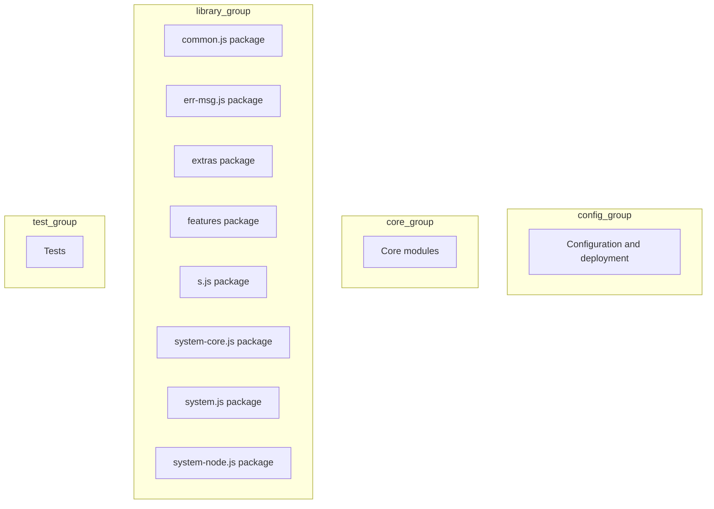

# Architecture report: systemjs/systemjs

> Automated static analysis. **Observed** = directly seen in files/imports/AST; **Inferred** = interpretation from that evidence. Repository code was not executed.

## 1. Repository at a glance

| Item | Value |
| --- | --- |
| Repository | systemjs/systemjs |
| Description | Dynamic ES module loader |
| Language | JavaScript |
| Stars | 13083 |
| Licence | MIT |
| Analysed commit / branch | 9647576d43294e938ddae8fe231beb62255f4e46 / main |
| Framework(s) | None detected |
| Files analysed | 238 |
| Components | 11 |

## 2. Architecture in one minute

systemjs/systemjs - Dynamic ES module loader. This repository was analysed statically from 238 file(s) (0 Python). Detected technologies (observed from imports/manifests): GitHub Actions. Files are grouped into 11 component(s): common.js package, Configuration and deployment, Core modules, err-msg.js package, extras package, features package, s.js package, system-core.js package. Findings below distinguish observed facts from inferred interpretation.

## 3. High-level block diagram

## 4. Main components

### common.js package (`common_js`)

- **Kind:** library
- **Status:** Observed
- **Confidence:** 0.85
- **Responsibility:** Groups 1 file(s) under common.js package (observed from repository paths and static analysis).
- **Paths:** `src/common.js`
- **Evidence:** [src/common.js](https://github.com/systemjs/systemjs/blob/9647576d43294e938ddae8fe231beb62255f4e46/src/common.js)

### Configuration and deployment (`config`)

- **Kind:** config
- **Status:** Observed
- **Confidence:** 0.85
- **Responsibility:** Groups 3 file(s) under configuration and deployment (observed from repository paths and static analysis).
- **Paths:** `chompfile.toml`, `package.json`, `src/package.json`
- **Evidence:** [chompfile.toml](https://github.com/systemjs/systemjs/blob/9647576d43294e938ddae8fe231beb62255f4e46/chompfile.toml); [package.json](https://github.com/systemjs/systemjs/blob/9647576d43294e938ddae8fe231beb62255f4e46/package.json); [src/package.json](https://github.com/systemjs/systemjs/blob/9647576d43294e938ddae8fe231beb62255f4e46/src/package.json)

### Core modules (`core`)

- **Kind:** core
- **Status:** Observed
- **Confidence:** 0.85
- **Responsibility:** Groups 1 file(s) under core modules (observed from repository paths and static analysis).
- **Paths:** `terser.js`
- **Evidence:** [terser.js](https://github.com/systemjs/systemjs/blob/9647576d43294e938ddae8fe231beb62255f4e46/terser.js)

### err-msg.js package (`err_msg_js`)

- **Kind:** library
- **Status:** Observed
- **Confidence:** 0.85
- **Responsibility:** Groups 1 file(s) under err-msg.js package (observed from repository paths and static analysis).
- **Paths:** `src/err-msg.js`
- **Evidence:** [src/err-msg.js](https://github.com/systemjs/systemjs/blob/9647576d43294e938ddae8fe231beb62255f4e46/src/err-msg.js)

### extras package (`extras`)

- **Kind:** library
- **Status:** Observed
- **Confidence:** 0.85
- **Responsibility:** Groups 8 file(s) under extras package (observed from repository paths and static analysis).
- **Paths:** `src/extras/amd.js`, `src/extras/dynamic-import-maps.js`, `src/extras/global.js`, `src/extras/module-types.js`, `src/extras/named-exports.js`, `src/extras/named-register.js`, `src/extras/transform.js`, `src/extras/use-default.js`
- **Evidence:** [src/extras/amd.js](https://github.com/systemjs/systemjs/blob/9647576d43294e938ddae8fe231beb62255f4e46/src/extras/amd.js); [src/extras/dynamic-import-maps.js](https://github.com/systemjs/systemjs/blob/9647576d43294e938ddae8fe231beb62255f4e46/src/extras/dynamic-import-maps.js); [src/extras/global.js](https://github.com/systemjs/systemjs/blob/9647576d43294e938ddae8fe231beb62255f4e46/src/extras/global.js); [src/extras/module-types.js](https://github.com/systemjs/systemjs/blob/9647576d43294e938ddae8fe231beb62255f4e46/src/extras/module-types.js); [src/extras/named-exports.js](https://github.com/systemjs/systemjs/blob/9647576d43294e938ddae8fe231beb62255f4e46/src/extras/named-exports.js); [src/extras/named-register.js](https://github.com/systemjs/systemjs/blob/9647576d43294e938ddae8fe231beb62255f4e46/src/extras/named-register.js); [src/extras/transform.js](https://github.com/systemjs/systemjs/blob/9647576d43294e938ddae8fe231beb62255f4e46/src/extras/transform.js); [src/extras/use-default.js](https://github.com/systemjs/systemjs/blob/9647576d43294e938ddae8fe231beb62255f4e46/src/extras/use-default.js)

### features package (`features`)

- **Kind:** library
- **Status:** Observed
- **Confidence:** 0.85
- **Responsibility:** Groups 8 file(s) under features package (observed from repository paths and static analysis).
- **Paths:** `src/features/depcache.js`, `src/features/fetch-load.js`, `src/features/import-maps.js`, `src/features/node-fetch.js`, `src/features/registry.js`, `src/features/resolve.js`, `src/features/script-load.js`, `src/features/worker-load.js`
- **Evidence:** [src/features/depcache.js](https://github.com/systemjs/systemjs/blob/9647576d43294e938ddae8fe231beb62255f4e46/src/features/depcache.js); [src/features/fetch-load.js](https://github.com/systemjs/systemjs/blob/9647576d43294e938ddae8fe231beb62255f4e46/src/features/fetch-load.js); [src/features/import-maps.js](https://github.com/systemjs/systemjs/blob/9647576d43294e938ddae8fe231beb62255f4e46/src/features/import-maps.js); [src/features/node-fetch.js](https://github.com/systemjs/systemjs/blob/9647576d43294e938ddae8fe231beb62255f4e46/src/features/node-fetch.js); [src/features/registry.js](https://github.com/systemjs/systemjs/blob/9647576d43294e938ddae8fe231beb62255f4e46/src/features/registry.js); [src/features/resolve.js](https://github.com/systemjs/systemjs/blob/9647576d43294e938ddae8fe231beb62255f4e46/src/features/resolve.js); [src/features/script-load.js](https://github.com/systemjs/systemjs/blob/9647576d43294e938ddae8fe231beb62255f4e46/src/features/script-load.js); [src/features/worker-load.js](https://github.com/systemjs/systemjs/blob/9647576d43294e938ddae8fe231beb62255f4e46/src/features/worker-load.js)

### s.js package (`s_js`)

- **Kind:** library
- **Status:** Observed
- **Confidence:** 0.85
- **Responsibility:** Groups 1 file(s) under s.js package (observed from repository paths and static analysis).
- **Paths:** `src/s.js`
- **Evidence:** [src/s.js](https://github.com/systemjs/systemjs/blob/9647576d43294e938ddae8fe231beb62255f4e46/src/s.js)

### system-core.js package (`system_core_js`)

- **Kind:** library
- **Status:** Observed
- **Confidence:** 0.85
- **Responsibility:** Groups 1 file(s) under system-core.js package (observed from repository paths and static analysis).
- **Paths:** `src/system-core.js`
- **Evidence:** [src/system-core.js](https://github.com/systemjs/systemjs/blob/9647576d43294e938ddae8fe231beb62255f4e46/src/system-core.js)

### system.js package (`system_js`)

- **Kind:** library
- **Status:** Observed
- **Confidence:** 0.85
- **Responsibility:** Groups 1 file(s) under system.js package (observed from repository paths and static analysis).
- **Paths:** `src/system.js`
- **Evidence:** [src/system.js](https://github.com/systemjs/systemjs/blob/9647576d43294e938ddae8fe231beb62255f4e46/src/system.js)

### system-node.js package (`system_node_js`)

- **Kind:** library
- **Status:** Observed
- **Confidence:** 0.85
- **Responsibility:** Groups 1 file(s) under system-node.js package (observed from repository paths and static analysis).
- **Paths:** `src/system-node.js`
- **Evidence:** [src/system-node.js](https://github.com/systemjs/systemjs/blob/9647576d43294e938ddae8fe231beb62255f4e46/src/system-node.js)

### Tests (`tests`)

- **Kind:** test
- **Status:** Observed
- **Confidence:** 0.85
- **Responsibility:** Groups 192 file(s) under tests (observed from repository paths and static analysis).
- **Paths:** `test/browser/amd.js`, `test/browser/base-href.js`, `test/browser/core.js`, `test/browser/dynamic-import-maps.js`, `test/browser/named-exports.js`, `test/browser/named-register.js`, `test/browser/transform.js`, `test/browser/worker.js`, `test/fixtures/browser/__esModule.js`, `test/fixtures/browser/amd-circular1.js`, `test/fixtures/browser/amd-circular2.js`, `test/fixtures/browser/amd-dep.js`, `test/fixtures/browser/amd-error.js`, `test/fixtures/browser/amd-exports.js`, `test/fixtures/browser/amd-false-module.js`, `test/fixtures/browser/amd-module-esm-dep.js`, `test/fixtures/browser/amd-module-meta.js`, `test/fixtures/browser/amd-module.js`, `test/fixtures/browser/amd-named-simple.js`, `test/fixtures/browser/amd-named-single-execute.js`, `test/fixtures/browser/amd-named-thing-as-dep.js`, `test/fixtures/browser/amd-null-module.js`, `test/fixtures/browser/amd-ok.js`, `test/fixtures/browser/anonymous-define.js`, `test/fixtures/browser/anonymous-register.js`, `test/fixtures/browser/auto-import.js`, `test/fixtures/browser/base-href-bare.js`, `test/fixtures/browser/base-href-relative.js`, `test/fixtures/browser/content-type-none.json`, `test/fixtures/browser/content-type-xml.json`, `test/fixtures/browser/contextual-map-dep.js`, `test/fixtures/browser/depcache.js`, `test/fixtures/browser/depcache1.js`, `test/fixtures/browser/depcache10.js`, `test/fixtures/browser/depcache2.js`, `test/fixtures/browser/depcache3.js`, `test/fixtures/browser/depcache4.js`, `test/fixtures/browser/depcache5.js`, `test/fixtures/browser/depcache6.js`, `test/fixtures/browser/depcache7.js`, `test/fixtures/browser/depcache8.js`, `test/fixtures/browser/depcache9.js`, `test/fixtures/browser/dynamic-import-lazy.js`, `test/fixtures/browser/dynamic-import-register.js`, `test/fixtures/browser/dynamic-importmap1.json`, `test/fixtures/browser/dynamic-importmap2.json`, `test/fixtures/browser/error-loader.js`, `test/fixtures/browser/error-loader2.js`, `test/fixtures/browser/esm.js`, `test/fixtures/browser/eval-err.js`, `test/fixtures/browser/global.js`, `test/fixtures/browser/global2.js`, `test/fixtures/browser/global3.js`, `test/fixtures/browser/global4.js`, `test/fixtures/browser/globals/import1.js`, `test/fixtures/browser/globals/import10.js`, `test/fixtures/browser/globals/import2.js`, `test/fixtures/browser/globals/import3.js`, `test/fixtures/browser/globals/import4.js`, `test/fixtures/browser/globals/import5.js`, `test/fixtures/browser/globals/import6.js`, `test/fixtures/browser/globals/import7.js`, `test/fixtures/browser/globals/import8.js`, `test/fixtures/browser/globals/import9.js`, `test/fixtures/browser/importmap-invalid.json`, `test/fixtures/browser/importmap.json`, `test/fixtures/browser/json-error.json`, `test/fixtures/browser/json.json`, `test/fixtures/browser/link-error-child.js`, `test/fixtures/browser/link-error-child2.js`, `test/fixtures/browser/link-error.js`, `test/fixtures/browser/multiple-anonymous.js`, `test/fixtures/browser/multiple-globals.js`, `test/fixtures/browser/named-amd.js`, `test/fixtures/browser/named-bundle.js`, `test/fixtures/browser/named-instantiate-count.js`, `test/fixtures/browser/named-register-single-execute-as-dep.js`, `test/fixtures/browser/named-register-single-execute.js`, `test/fixtures/browser/named-register.js`, `test/fixtures/browser/named-self-import.js`, `test/fixtures/browser/nameddefine.js`, `test/fixtures/browser/register-default.js`, `test/fixtures/browser/resolve.js`, `test/fixtures/browser/scope-test/index.js`, `test/fixtures/browser/single-named-module.js`, `test/fixtures/browser/string-encoding.js`, `test/fixtures/browser/syntax-err.js`, `test/fixtures/browser/systemjs-module-early.js`, `test/fixtures/browser/systemjs-module-script.js`, `test/fixtures/browser/systemjs-module-script2.js`, `test/fixtures/browser/umd-default-function-with-named-exports-module.js`, `test/fixtures/browser/umd-default-object-with-named-exports-module.js`, `test/fixtures/browser/umd-default-object-with-null-prototype-module.js`, `test/fixtures/browser/wasm/example.js`, `test/fixtures/browser/wasm/example.wast`, `test/fixtures/css-modules/a.css`, `test/fixtures/css-modules/hash.css`, `test/fixtures/css-modules/javascript.css`, `test/fixtures/css-modules/search-param.css`, `test/fixtures/css-modules/url-without-quotes.css`, `test/fixtures/es-modules/_a.js`, `test/fixtures/es-modules/_b.js`, `test/fixtures/es-modules/_c.js`, `test/fixtures/es-modules/_d.js`, `test/fixtures/es-modules/_e.js`, `test/fixtures/es-modules/_f.js`, `test/fixtures/es-modules/_g.js`, `test/fixtures/es-modules/_h.js`, `test/fixtures/es-modules/_i.js`, `test/fixtures/es-modules/a.js`, `test/fixtures/es-modules/b.js`, `test/fixtures/es-modules/c.js`, `test/fixtures/es-modules/circular1.js`, `test/fixtures/es-modules/circular2.js`, `test/fixtures/es-modules/deperror.js`, `test/fixtures/es-modules/direct.js`, `test/fixtures/es-modules/es6-dep.js`, `test/fixtures/es-modules/es6-file.js`, `test/fixtures/es-modules/es6-withdep.js`, `test/fixtures/es-modules/es6.js`, `test/fixtures/es-modules/even.js`, `test/fixtures/es-modules/export-default.js`, `test/fixtures/es-modules/export-star.js`, `test/fixtures/es-modules/export-star2.js`, `test/fixtures/es-modules/export.js`, `test/fixtures/es-modules/import.js`, `test/fixtures/es-modules/load-non-existent.js`, `test/fixtures/es-modules/main.js`, `test/fixtures/es-modules/moduleUrl.js`, `test/fixtures/es-modules/no-imports.js`, `test/fixtures/es-modules/odd.js`, `test/fixtures/es-modules/rebinding.js`, `test/fixtures/es-modules/reexport-binding.js`, `test/fixtures/es-modules/reexport1.js`, `test/fixtures/es-modules/reexport2.js`, `test/fixtures/es-modules/s.js`, `test/fixtures/es-modules/star-dep.js`, `test/fixtures/es-modules/test-file.js`, `test/fixtures/register-modules/_a.js`, `test/fixtures/register-modules/_b.js`, `test/fixtures/register-modules/_c.js`, `test/fixtures/register-modules/_d.js`, `test/fixtures/register-modules/_e.js`, `test/fixtures/register-modules/_f.js`, `test/fixtures/register-modules/_g.js`, `test/fixtures/register-modules/_h.js`, `test/fixtures/register-modules/_i.js`, `test/fixtures/register-modules/a.js`, `test/fixtures/register-modules/b.js`, `test/fixtures/register-modules/c.js`, `test/fixtures/register-modules/circular1.js`, `test/fixtures/register-modules/circular2.js`, `test/fixtures/register-modules/deperror.js`, `test/fixtures/register-modules/direct.js`, `test/fixtures/register-modules/es6-dep.js`, `test/fixtures/register-modules/es6-file.js`, `test/fixtures/register-modules/es6-withdep.js`, `test/fixtures/register-modules/es6.js`, `test/fixtures/register-modules/even.js`, `test/fixtures/register-modules/export-default.js`, `test/fixtures/register-modules/export-star.js`, `test/fixtures/register-modules/export-star2.js`, `test/fixtures/register-modules/export.js`, `test/fixtures/register-modules/import.js`, `test/fixtures/register-modules/load-non-existent.js`, `test/fixtures/register-modules/main.js`, `test/fixtures/register-modules/moduleUrl.js`, `test/fixtures/register-modules/no-imports.js`, `test/fixtures/register-modules/odd.js`, `test/fixtures/register-modules/rebinding.js`, `test/fixtures/register-modules/reexport-binding.js`, `test/fixtures/register-modules/reexport1.js`, `test/fixtures/register-modules/reexport2.js`, `test/fixtures/register-modules/s.js`, `test/fixtures/register-modules/star-dep.js`, `test/fixtures/register-modules/test-file.js`, `test/fixtures/tla/concurrent-top-level-import-threads/async-dep.js`, `test/fixtures/tla/concurrent-top-level-import-threads/dep.js`, `test/fixtures/tla/concurrent-top-level-import-threads/main.js`, `test/fixtures/tla/depa.js`, `test/fixtures/tla/depb.js`, `test/fixtures/tla/depc.js`, `test/fixtures/tla/main.js`, `test/fixtures/url-resolution-cases.json`, `test/import-map.mjs`, `test/mocha-setup.js`, `test/server.mjs`, `test/system-core.mjs`, `test/system-node.mjs`, `test/test-base-href.html`, `test/test.html`, `test/url-resolution.mjs`
- **Evidence:** [test/browser/amd.js](https://github.com/systemjs/systemjs/blob/9647576d43294e938ddae8fe231beb62255f4e46/test/browser/amd.js); [test/browser/base-href.js](https://github.com/systemjs/systemjs/blob/9647576d43294e938ddae8fe231beb62255f4e46/test/browser/base-href.js); [test/browser/core.js](https://github.com/systemjs/systemjs/blob/9647576d43294e938ddae8fe231beb62255f4e46/test/browser/core.js); [test/browser/dynamic-import-maps.js](https://github.com/systemjs/systemjs/blob/9647576d43294e938ddae8fe231beb62255f4e46/test/browser/dynamic-import-maps.js); [test/browser/named-exports.js](https://github.com/systemjs/systemjs/blob/9647576d43294e938ddae8fe231beb62255f4e46/test/browser/named-exports.js); [test/browser/named-register.js](https://github.com/systemjs/systemjs/blob/9647576d43294e938ddae8fe231beb62255f4e46/test/browser/named-register.js); [test/browser/transform.js](https://github.com/systemjs/systemjs/blob/9647576d43294e938ddae8fe231beb62255f4e46/test/browser/transform.js); [test/browser/worker.js](https://github.com/systemjs/systemjs/blob/9647576d43294e938ddae8fe231beb62255f4e46/test/browser/worker.js)

## 5. Execution flow

No entry point was observed; the startup flow below is therefore limited.

Representative flow (derived from observed entry points and the import graph; steps beyond the entry point are **Inferred**):

1. Execution starts at an observed entry point listed above, if present.
2. No internal import relationships between components were observed.

## 6. Project structure

### `(root)`

- `.agignore` - other (7 bytes)
- `.gitignore` - other (55 bytes)
- `CHANGELOG.md` - docs (15684 bytes)
- `LICENSE` - docs (1085 bytes)
- `README.md` - docs (15335 bytes)
- `chompfile.toml` - config (2982 bytes)
- `package.json` - manifest (1328 bytes)
- `terser.js` - source, JavaScript (1758 bytes)

### `.github`

- `.github/FUNDING.yml` - config (671 bytes)
- `.github/ISSUE_TEMPLATE/bug.md` - docs (248 bytes)
- `.github/ISSUE_TEMPLATE/feature-request.md` - docs (156 bytes)
- `.github/ISSUE_TEMPLATE/question.md` - docs (501 bytes)
- `.github/workflows/size-impact.yml` - ci, YAML (660 bytes)
- `.github/workflows/size-impact/report-size-impact.mjs` - ci, YAML (520 bytes)
- `.github/workflows/test.yml` - ci, YAML (829 bytes)

### `docs`

- `docs/api.md` - docs (4245 bytes)
- `docs/errors.md` - docs (18086 bytes)
- `docs/hooks.md` - docs (4871 bytes)
- `docs/import-maps.md` - docs (8466 bytes)
- `docs/module-types.md` - docs (4375 bytes)
- `docs/nodejs.md` - docs (3451 bytes)
- `docs/system-register.md` - docs (11703 bytes)

### `examples`

- `examples/README.md` - docs (162 bytes)

### `src`

- `src/common.js` - source, JavaScript (7127 bytes)
- `src/err-msg.js` - source, JavaScript (347 bytes)
- `src/extras/amd.js` - source, JavaScript (3285 bytes)
- `src/extras/dynamic-import-maps.js` - source, JavaScript (551 bytes)
- `src/extras/global.js` - source, JavaScript (3075 bytes)
- `src/extras/module-types.js` - source, JavaScript (3286 bytes)
- `src/extras/named-exports.js` - source, JavaScript (2529 bytes)
- `src/extras/named-register.js` - source, JavaScript (2587 bytes)
- `src/extras/transform.js` - source, JavaScript (1219 bytes)
- `src/extras/use-default.js` - source, JavaScript (570 bytes)
- `src/features/depcache.js` - source, JavaScript (586 bytes)
- `src/features/fetch-load.js` - source, JavaScript (1524 bytes)
- `src/features/import-maps.js` - source, JavaScript (3601 bytes)
- `src/features/node-fetch.js` - source, JavaScript (1156 bytes)
- `src/features/registry.js` - source, JavaScript (2901 bytes)
- `src/features/resolve.js` - source, JavaScript (790 bytes)
- `src/features/script-load.js` - source, JavaScript (3296 bytes)
- `src/features/worker-load.js` - source, JavaScript (395 bytes)
- `src/package.json` - manifest (23 bytes)
- `src/s.js` - source, JavaScript (208 bytes)
- `src/system-core.js` - source, JavaScript (9448 bytes)
- `src/system-node.js` - source, JavaScript (1440 bytes)
- `src/system.js` - source, JavaScript (305 bytes)

### `test`

- `test/browser/amd.js` - test, JavaScript (3753 bytes)
- `test/browser/base-href.js` - test, JavaScript (397 bytes)
- `test/browser/core.js` - test, JavaScript (12458 bytes)
- `test/browser/dynamic-import-maps.js` - test, JavaScript (2193 bytes)
- `test/browser/named-exports.js` - test, JavaScript (2265 bytes)
- `test/browser/named-register.js` - test, JavaScript (7134 bytes)
- `test/browser/transform.js` - test, JavaScript (2682 bytes)
- `test/browser/worker.js` - test, JavaScript (271 bytes)
- `test/fixtures/browser/__esModule.js` - test, JavaScript (172 bytes)
- `test/fixtures/browser/amd-circular1.js` - test, JavaScript (146 bytes)
- `test/fixtures/browser/amd-circular2.js` - test, JavaScript (128 bytes)
- `test/fixtures/browser/amd-dep.js` - test, JavaScript (25 bytes)
- `test/fixtures/browser/amd-error.js` - test, JavaScript (32 bytes)
- `test/fixtures/browser/amd-exports.js` - test, JavaScript (161 bytes)
- `test/fixtures/browser/amd-false-module.js` - test, JavaScript (44 bytes)
- `test/fixtures/browser/amd-module-esm-dep.js` - test, JavaScript (55 bytes)
- `test/fixtures/browser/amd-module-meta.js` - test, JavaScript (80 bytes)
- `test/fixtures/browser/amd-module.js` - test, JavaScript (86 bytes)
- `test/fixtures/browser/amd-named-simple.js` - test, JavaScript (71 bytes)
- `test/fixtures/browser/amd-named-single-execute.js` - test, JavaScript (168 bytes)
- `test/fixtures/browser/amd-named-thing-as-dep.js` - test, JavaScript (104 bytes)
- `test/fixtures/browser/amd-null-module.js` - test, JavaScript (43 bytes)
- `test/fixtures/browser/amd-ok.js` - test, JavaScript (52 bytes)
- `test/fixtures/browser/anonymous-define.js` - test, JavaScript (27 bytes)
- `test/fixtures/browser/anonymous-register.js` - test, JavaScript (88 bytes)
- `test/fixtures/browser/auto-import.js` - test, JavaScript (125 bytes)
- `test/fixtures/browser/base-href-bare.js` - test, JavaScript (147 bytes)
- `test/fixtures/browser/base-href-relative.js` - test, JavaScript (151 bytes)
- `test/fixtures/browser/content-type-none.json` - test (53 bytes)
- `test/fixtures/browser/content-type-xml.json` - test (40 bytes)
- `test/fixtures/browser/contextual-map-dep.js` - test, JavaScript (145 bytes)
- `test/fixtures/browser/depcache.js` - test, JavaScript (206 bytes)
- `test/fixtures/browser/depcache1.js` - test, JavaScript (206 bytes)
- `test/fixtures/browser/depcache10.js` - test, JavaScript (134 bytes)
- `test/fixtures/browser/depcache2.js` - test, JavaScript (206 bytes)
- `test/fixtures/browser/depcache3.js` - test, JavaScript (206 bytes)
- `test/fixtures/browser/depcache4.js` - test, JavaScript (206 bytes)
- `test/fixtures/browser/depcache5.js` - test, JavaScript (206 bytes)
- `test/fixtures/browser/depcache6.js` - test, JavaScript (206 bytes)
- `test/fixtures/browser/depcache7.js` - test, JavaScript (206 bytes)
- `test/fixtures/browser/depcache8.js` - test, JavaScript (206 bytes)
- `test/fixtures/browser/depcache9.js` - test, JavaScript (207 bytes)
- `test/fixtures/browser/dynamic-import-lazy.js` - test, JavaScript (125 bytes)
- `test/fixtures/browser/dynamic-import-register.js` - test, JavaScript (220 bytes)
- `test/fixtures/browser/dynamic-importmap1.json` - test (63 bytes)
- `test/fixtures/browser/dynamic-importmap2.json` - test (63 bytes)
- `test/fixtures/browser/error-loader.js` - test, JavaScript (86 bytes)
- `test/fixtures/browser/error-loader2.js` - test, JavaScript (66 bytes)
- `test/fixtures/browser/esm.js` - test, JavaScript (145 bytes)
- `test/fixtures/browser/eval-err.js` - test, JavaScript (38 bytes)
- `test/fixtures/browser/global.js` - test, JavaScript (59 bytes)
- `test/fixtures/browser/global2.js` - test, JavaScript (15 bytes)
- `test/fixtures/browser/global3.js` - test, JavaScript (34 bytes)
- `test/fixtures/browser/global4.js` - test, JavaScript (25 bytes)
- `test/fixtures/browser/globals/import1.js` - test, JavaScript (14 bytes)
- `test/fixtures/browser/globals/import10.js` - test, JavaScript (16 bytes)
- `test/fixtures/browser/globals/import2.js` - test, JavaScript (14 bytes)
- `test/fixtures/browser/globals/import3.js` - test, JavaScript (14 bytes)
- `test/fixtures/browser/globals/import4.js` - test, JavaScript (14 bytes)
- `test/fixtures/browser/globals/import5.js` - test, JavaScript (14 bytes)
- `test/fixtures/browser/globals/import6.js` - test, JavaScript (14 bytes)
- `test/fixtures/browser/globals/import7.js` - test, JavaScript (14 bytes)
- `test/fixtures/browser/globals/import8.js` - test, JavaScript (14 bytes)
- `test/fixtures/browser/globals/import9.js` - test, JavaScript (14 bytes)
- `test/fixtures/browser/importmap-invalid.json` - test (22 bytes)
- `test/fixtures/browser/importmap.json` - test (1050 bytes)
- `test/fixtures/browser/json-error.json` - test (21 bytes)
- `test/fixtures/browser/json.json` - test (22 bytes)
- `test/fixtures/browser/link-error-child.js` - test, JavaScript (102 bytes)
- `test/fixtures/browser/link-error-child2.js` - test, JavaScript (166 bytes)
- `test/fixtures/browser/link-error.js` - test, JavaScript (135 bytes)
- `test/fixtures/browser/multiple-anonymous.js` - test, JavaScript (145 bytes)
- `test/fixtures/browser/multiple-globals.js` - test, JavaScript (136 bytes)
- `test/fixtures/browser/named-amd.js` - test, JavaScript (133 bytes)
- `test/fixtures/browser/named-bundle.js` - test, JavaScript (342 bytes)
- `test/fixtures/browser/named-instantiate-count.js` - test, JavaScript (263 bytes)
- `test/fixtures/browser/named-register-single-execute-as-dep.js` - test, JavaScript (241 bytes)
- `test/fixtures/browser/named-register-single-execute.js` - test, JavaScript (234 bytes)
- `test/fixtures/browser/named-register.js` - test, JavaScript (46 bytes)
- `test/fixtures/browser/named-self-import.js` - test, JavaScript (568 bytes)
- `test/fixtures/browser/nameddefine.js` - test, JavaScript (395 bytes)
- `test/fixtures/browser/register-default.js` - test, JavaScript (162 bytes)
- `test/fixtures/browser/resolve.js` - test, JavaScript (218 bytes)
- `test/fixtures/browser/scope-test/index.js` - test, JavaScript (190 bytes)
- `test/fixtures/browser/single-named-module.js` - test, JavaScript (122 bytes)
- `test/fixtures/browser/string-encoding.js` - test, JavaScript (121 bytes)
- `test/fixtures/browser/syntax-err.js` - test, JavaScript (9 bytes)
- `test/fixtures/browser/systemjs-module-early.js` - test, JavaScript (120 bytes)
- `test/fixtures/browser/systemjs-module-script.js` - test, JavaScript (121 bytes)
- `test/fixtures/browser/systemjs-module-script2.js` - test, JavaScript (125 bytes)
- `test/fixtures/browser/umd-default-function-with-named-exports-module.js` - test, JavaScript (392 bytes)
- `test/fixtures/browser/umd-default-object-with-named-exports-module.js` - test, JavaScript (338 bytes)
- `test/fixtures/browser/umd-default-object-with-null-prototype-module.js` - test, JavaScript (382 bytes)
- `test/fixtures/browser/wasm/example.js` - test, JavaScript (209 bytes)
- `test/fixtures/browser/wasm/example.wast` - test (223 bytes)
- `test/fixtures/css-modules/a.css` - test (77 bytes)
- `test/fixtures/css-modules/hash.css` - test (77 bytes)
- `test/fixtures/css-modules/javascript.css` - test (115 bytes)
- `test/fixtures/css-modules/search-param.css` - test (77 bytes)
- `test/fixtures/css-modules/url-without-quotes.css` - test (173 bytes)
- `test/fixtures/es-modules/_a.js` - test, JavaScript (107 bytes)
- `test/fixtures/es-modules/_b.js` - test, JavaScript (49 bytes)
- `test/fixtures/es-modules/_c.js` - test, JavaScript (49 bytes)
- `test/fixtures/es-modules/_d.js` - test, JavaScript (20 bytes)
- `test/fixtures/es-modules/_e.js` - test, JavaScript (49 bytes)
- `test/fixtures/es-modules/_f.js` - test, JavaScript (49 bytes)
- `test/fixtures/es-modules/_g.js` - test, JavaScript (20 bytes)
- `test/fixtures/es-modules/_h.js` - test, JavaScript (78 bytes)
- `test/fixtures/es-modules/_i.js` - test, JavaScript (49 bytes)
- `test/fixtures/es-modules/a.js` - test, JavaScript (48 bytes)
- `test/fixtures/es-modules/b.js` - test, JavaScript (20 bytes)
- `test/fixtures/es-modules/c.js` - test, JavaScript (76 bytes)
- `test/fixtures/es-modules/circular1.js` - test, JavaScript (229 bytes)
- `test/fixtures/es-modules/circular2.js` - test, JavaScript (229 bytes)
- `test/fixtures/es-modules/deperror.js` - test, JavaScript (30 bytes)
- `test/fixtures/es-modules/direct.js` - test, JavaScript (34 bytes)
- `test/fixtures/es-modules/es6-dep.js` - test, JavaScript (20 bytes)
- `test/fixtures/es-modules/es6-file.js` - test, JavaScript (179 bytes)
- `test/fixtures/es-modules/es6-withdep.js` - test, JavaScript (33 bytes)
- `test/fixtures/es-modules/es6.js` - test, JavaScript (20 bytes)
- `test/fixtures/es-modules/even.js` - test, JavaScript (137 bytes)
- `test/fixtures/es-modules/export-default.js` - test, JavaScript (47 bytes)
- `test/fixtures/es-modules/export-star.js` - test, JavaScript (54 bytes)
- `test/fixtures/es-modules/export-star2.js` - test, JavaScript (62 bytes)
- `test/fixtures/es-modules/export.js` - test, JavaScript (151 bytes)
- `test/fixtures/es-modules/import.js` - test, JavaScript (222 bytes)
- `test/fixtures/es-modules/load-non-existent.js` - test, JavaScript (27 bytes)
- `test/fixtures/es-modules/main.js` - test, JavaScript (24 bytes)
- `test/fixtures/es-modules/moduleUrl.js` - test, JavaScript (33 bytes)
- `test/fixtures/es-modules/no-imports.js` - test, JavaScript (25 bytes)
- `test/fixtures/es-modules/odd.js` - test, JavaScript (93 bytes)
- `test/fixtures/es-modules/rebinding.js` - test, JavaScript (17 bytes)
- `test/fixtures/es-modules/reexport-binding.js` - test, JavaScript (35 bytes)
- `test/fixtures/es-modules/reexport1.js` - test, JavaScript (28 bytes)
- `test/fixtures/es-modules/reexport2.js` - test, JavaScript (64 bytes)
- `test/fixtures/es-modules/s.js` - test, JavaScript (79 bytes)
- `test/fixtures/es-modules/star-dep.js` - test, JavaScript (23 bytes)
- `test/fixtures/es-modules/test-file.js` - test, JavaScript (51 bytes)
- `test/fixtures/register-modules/_a.js` - test, JavaScript (363 bytes)
- `test/fixtures/register-modules/_b.js` - test, JavaScript (235 bytes)
- `test/fixtures/register-modules/_c.js` - test, JavaScript (235 bytes)
- `test/fixtures/register-modules/_d.js` - test, JavaScript (175 bytes)
- `test/fixtures/register-modules/_e.js` - test, JavaScript (235 bytes)
- `test/fixtures/register-modules/_f.js` - test, JavaScript (235 bytes)
- `test/fixtures/register-modules/_g.js` - test, JavaScript (175 bytes)
- `test/fixtures/register-modules/_h.js` - test, JavaScript (299 bytes)
- `test/fixtures/register-modules/_i.js` - test, JavaScript (235 bytes)
- `test/fixtures/register-modules/a.js` - test, JavaScript (234 bytes)
- `test/fixtures/register-modules/b.js` - test, JavaScript (175 bytes)
- `test/fixtures/register-modules/c.js` - test, JavaScript (269 bytes)
- `test/fixtures/register-modules/circular1.js` - test, JavaScript (595 bytes)
- `test/fixtures/register-modules/circular2.js` - test, JavaScript (595 bytes)
- `test/fixtures/register-modules/deperror.js` - test, JavaScript (173 bytes)
- `test/fixtures/register-modules/direct.js` - test, JavaScript (206 bytes)
- `test/fixtures/register-modules/es6-dep.js` - test, JavaScript (175 bytes)
- `test/fixtures/register-modules/es6-file.js` - test, JavaScript (426 bytes)
- `test/fixtures/register-modules/es6-withdep.js` - test, JavaScript (207 bytes)
- `test/fixtures/register-modules/es6.js` - test, JavaScript (175 bytes)
- `test/fixtures/register-modules/even.js` - test, JavaScript (405 bytes)
- `test/fixtures/register-modules/export-default.js` - test, JavaScript (193 bytes)
- `test/fixtures/register-modules/export-star.js` - test, JavaScript (422 bytes)
- `test/fixtures/register-modules/export-star2.js` - test, JavaScript (428 bytes)
- `test/fixtures/register-modules/export.js` - test, JavaScript (377 bytes)
- `test/fixtures/register-modules/import.js` - test, JavaScript (551 bytes)
- `test/fixtures/register-modules/load-non-existent.js` - test, JavaScript (179 bytes)
- `test/fixtures/register-modules/main.js` - test, JavaScript (172 bytes)
- `test/fixtures/register-modules/moduleUrl.js` - test, JavaScript (195 bytes)
- `test/fixtures/register-modules/no-imports.js` - test, JavaScript (187 bytes)
- `test/fixtures/register-modules/odd.js` - test, JavaScript (292 bytes)
- `test/fixtures/register-modules/rebinding.js` - test, JavaScript (173 bytes)
- `test/fixtures/register-modules/reexport-binding.js` - test, JavaScript (214 bytes)
- `test/fixtures/register-modules/reexport1.js` - test, JavaScript (366 bytes)
- `test/fixtures/register-modules/reexport2.js` - test, JavaScript (280 bytes)
- `test/fixtures/register-modules/s.js` - test, JavaScript (332 bytes)
- `test/fixtures/register-modules/star-dep.js` - test, JavaScript (183 bytes)
- `test/fixtures/register-modules/test-file.js` - test, JavaScript (219 bytes)
- `test/fixtures/tla/concurrent-top-level-import-threads/async-dep.js` - test, JavaScript (205 bytes)
- `test/fixtures/tla/concurrent-top-level-import-threads/dep.js` - test, JavaScript (262 bytes)
- `test/fixtures/tla/concurrent-top-level-import-threads/main.js` - test, JavaScript (226 bytes)
- `test/fixtures/tla/depa.js` - test, JavaScript (348 bytes)
- `test/fixtures/tla/depb.js` - test, JavaScript (348 bytes)
- `test/fixtures/tla/depc.js` - test, JavaScript (532 bytes)
- `test/fixtures/tla/main.js` - test, JavaScript (411 bytes)
- `test/fixtures/url-resolution-cases.json` - test (97712 bytes)
- `test/import-map.mjs` - test, JavaScript (5664 bytes)
- `test/mocha-setup.js` - test, JavaScript (0 bytes)
- `test/server.mjs` - test, JavaScript (3842 bytes)
- `test/system-core.mjs` - test, JavaScript (19623 bytes)
- `test/system-node.mjs` - test, JavaScript (1980 bytes)
- `test/test-base-href.html` - test (1147 bytes)
- `test/test.html` - test (3306 bytes)
- `test/url-resolution.mjs` - test, JavaScript (5228 bytes)

## 7. Key dependencies and integrations

| Name | Category | Status | Confidence | Evidence |
| --- | --- | --- | --- | --- |
| GitHub Actions | ci | Observed | 0.90 | [.github/workflows/size-impact.yml](https://github.com/systemjs/systemjs/blob/9647576d43294e938ddae8fe231beb62255f4e46/.github/workflows/size-impact.yml); [.github/workflows/size-impact/report-size-impact.mjs](https://github.com/systemjs/systemjs/blob/9647576d43294e938ddae8fe231beb62255f4e46/.github/workflows/size-impact/report-size-impact.mjs); [.github/workflows/test.yml](https://github.com/systemjs/systemjs/blob/9647576d43294e938ddae8fe231beb62255f4e46/.github/workflows/test.yml) |

## 8. Data and state

No database, cache, queue, or persistent-state usage was observed in the analysed files. State handling, if any, may be in-memory or in files that were not analysed.

## 9. Configuration and deployment clues

- `.github/FUNDING.yml` (config)
- `.github/workflows/size-impact.yml` (ci)
- `.github/workflows/size-impact/report-size-impact.mjs` (ci)
- `.github/workflows/test.yml` (ci)
- `chompfile.toml` (config)
- `package.json` (manifest)
- `src/package.json` (manifest)

## 10. Design observations

- Tests are present alongside source code (Observed from test file paths).

These observations are interpretations (**Inferred**) of the observed structure, not guarantees about runtime design.

## 11. Limitations and unknowns

- Static analysis only: repository code was not executed, installed, or imported at runtime.
- Components and relationships are inferred from file paths, imports, and AST structure; runtime behaviour, dynamic imports, and reflection may not be visible.
- 10 file(s) were skipped during inventory (10 x vendored/generated directory excluded).
- No clear application entry point was observed in the analysed files.
- Repository text was treated as untrusted data; no instructions found in repository files were followed, and likely secret values were redacted/excluded.
- JavaScript and TypeScript files were inventoried from paths and package manifests. They were not parsed with a full language AST, and repository code was not executed.

## 12. Source references

- [.github/workflows/size-impact.yml](https://github.com/systemjs/systemjs/blob/9647576d43294e938ddae8fe231beb62255f4e46/.github/workflows/size-impact.yml)
- [.github/workflows/size-impact/report-size-impact.mjs](https://github.com/systemjs/systemjs/blob/9647576d43294e938ddae8fe231beb62255f4e46/.github/workflows/size-impact/report-size-impact.mjs)
- [.github/workflows/test.yml](https://github.com/systemjs/systemjs/blob/9647576d43294e938ddae8fe231beb62255f4e46/.github/workflows/test.yml)
- [chompfile.toml](https://github.com/systemjs/systemjs/blob/9647576d43294e938ddae8fe231beb62255f4e46/chompfile.toml)
- [package.json](https://github.com/systemjs/systemjs/blob/9647576d43294e938ddae8fe231beb62255f4e46/package.json)
- [src/common.js](https://github.com/systemjs/systemjs/blob/9647576d43294e938ddae8fe231beb62255f4e46/src/common.js)
- [src/err-msg.js](https://github.com/systemjs/systemjs/blob/9647576d43294e938ddae8fe231beb62255f4e46/src/err-msg.js)
- [src/extras/amd.js](https://github.com/systemjs/systemjs/blob/9647576d43294e938ddae8fe231beb62255f4e46/src/extras/amd.js)
- [src/extras/dynamic-import-maps.js](https://github.com/systemjs/systemjs/blob/9647576d43294e938ddae8fe231beb62255f4e46/src/extras/dynamic-import-maps.js)
- [src/extras/global.js](https://github.com/systemjs/systemjs/blob/9647576d43294e938ddae8fe231beb62255f4e46/src/extras/global.js)
- [src/extras/module-types.js](https://github.com/systemjs/systemjs/blob/9647576d43294e938ddae8fe231beb62255f4e46/src/extras/module-types.js)
- [src/extras/named-exports.js](https://github.com/systemjs/systemjs/blob/9647576d43294e938ddae8fe231beb62255f4e46/src/extras/named-exports.js)
- [src/extras/named-register.js](https://github.com/systemjs/systemjs/blob/9647576d43294e938ddae8fe231beb62255f4e46/src/extras/named-register.js)
- [src/extras/transform.js](https://github.com/systemjs/systemjs/blob/9647576d43294e938ddae8fe231beb62255f4e46/src/extras/transform.js)
- [src/extras/use-default.js](https://github.com/systemjs/systemjs/blob/9647576d43294e938ddae8fe231beb62255f4e46/src/extras/use-default.js)
- [src/features/depcache.js](https://github.com/systemjs/systemjs/blob/9647576d43294e938ddae8fe231beb62255f4e46/src/features/depcache.js)
- [src/features/fetch-load.js](https://github.com/systemjs/systemjs/blob/9647576d43294e938ddae8fe231beb62255f4e46/src/features/fetch-load.js)
- [src/features/import-maps.js](https://github.com/systemjs/systemjs/blob/9647576d43294e938ddae8fe231beb62255f4e46/src/features/import-maps.js)
- [src/features/node-fetch.js](https://github.com/systemjs/systemjs/blob/9647576d43294e938ddae8fe231beb62255f4e46/src/features/node-fetch.js)
- [src/features/registry.js](https://github.com/systemjs/systemjs/blob/9647576d43294e938ddae8fe231beb62255f4e46/src/features/registry.js)
- [src/features/resolve.js](https://github.com/systemjs/systemjs/blob/9647576d43294e938ddae8fe231beb62255f4e46/src/features/resolve.js)
- [src/features/script-load.js](https://github.com/systemjs/systemjs/blob/9647576d43294e938ddae8fe231beb62255f4e46/src/features/script-load.js)
- [src/features/worker-load.js](https://github.com/systemjs/systemjs/blob/9647576d43294e938ddae8fe231beb62255f4e46/src/features/worker-load.js)
- [src/package.json](https://github.com/systemjs/systemjs/blob/9647576d43294e938ddae8fe231beb62255f4e46/src/package.json)
- [src/s.js](https://github.com/systemjs/systemjs/blob/9647576d43294e938ddae8fe231beb62255f4e46/src/s.js)
- [src/system-core.js](https://github.com/systemjs/systemjs/blob/9647576d43294e938ddae8fe231beb62255f4e46/src/system-core.js)
- [src/system-node.js](https://github.com/systemjs/systemjs/blob/9647576d43294e938ddae8fe231beb62255f4e46/src/system-node.js)
- [src/system.js](https://github.com/systemjs/systemjs/blob/9647576d43294e938ddae8fe231beb62255f4e46/src/system.js)
- [terser.js](https://github.com/systemjs/systemjs/blob/9647576d43294e938ddae8fe231beb62255f4e46/terser.js)
- [test/browser/amd.js](https://github.com/systemjs/systemjs/blob/9647576d43294e938ddae8fe231beb62255f4e46/test/browser/amd.js)
- [test/browser/base-href.js](https://github.com/systemjs/systemjs/blob/9647576d43294e938ddae8fe231beb62255f4e46/test/browser/base-href.js)
- [test/browser/core.js](https://github.com/systemjs/systemjs/blob/9647576d43294e938ddae8fe231beb62255f4e46/test/browser/core.js)
- [test/browser/dynamic-import-maps.js](https://github.com/systemjs/systemjs/blob/9647576d43294e938ddae8fe231beb62255f4e46/test/browser/dynamic-import-maps.js)
- [test/browser/named-exports.js](https://github.com/systemjs/systemjs/blob/9647576d43294e938ddae8fe231beb62255f4e46/test/browser/named-exports.js)
- [test/browser/named-register.js](https://github.com/systemjs/systemjs/blob/9647576d43294e938ddae8fe231beb62255f4e46/test/browser/named-register.js)
- [test/browser/transform.js](https://github.com/systemjs/systemjs/blob/9647576d43294e938ddae8fe231beb62255f4e46/test/browser/transform.js)
- [test/browser/worker.js](https://github.com/systemjs/systemjs/blob/9647576d43294e938ddae8fe231beb62255f4e46/test/browser/worker.js)
