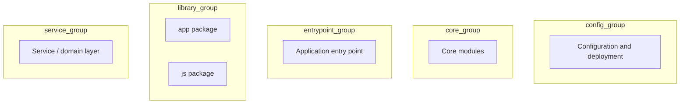

# Architecture report: tariqbuilds/linux-dash

> Automated static analysis. **Observed** = directly seen in files/imports/AST; **Inferred** = interpretation from that evidence. Repository code was not executed.

## 1. Repository at a glance

| Item | Value |
| --- | --- |
| Repository | tariqbuilds/linux-dash |
| Description | A beautiful web dashboard for Linux |
| Language | JavaScript |
| Stars | 10575 |
| Licence | MIT |
| Analysed commit / branch | 186a802ea76e8bfcab7e8e7ebc533b74f80306fc / master |
| Framework(s) | Express |
| Files analysed | 57 |
| Components | 6 |

## 2. Architecture in one minute

tariqbuilds/linux-dash - A beautiful web dashboard for Linux. This repository was analysed statically from 57 file(s) (1 Python). Detected technologies (observed from imports/manifests): Express. Files are grouped into 6 component(s): app package, Configuration and deployment, Core modules, Application entry point, js package, Service / domain layer. Observed entry point(s): app/server/index.py. Findings below distinguish observed facts from inferred interpretation.

## 3. High-level block diagram

## 4. Main components

### app package (`app`)

- **Kind:** library
- **Status:** Observed
- **Confidence:** 0.85
- **Responsibility:** Groups 4 file(s) under app package (observed from repository paths and static analysis).
- **Paths:** `app/server/index.go`, `app/server/index.js`, `app/server/index.php`, `app/server/linux_json_api.sh`
- **Evidence:** [app/server/index.go](https://github.com/tariqbuilds/linux-dash/blob/186a802ea76e8bfcab7e8e7ebc533b74f80306fc/app/server/index.go); [app/server/index.js](https://github.com/tariqbuilds/linux-dash/blob/186a802ea76e8bfcab7e8e7ebc533b74f80306fc/app/server/index.js); [app/server/index.php](https://github.com/tariqbuilds/linux-dash/blob/186a802ea76e8bfcab7e8e7ebc533b74f80306fc/app/server/index.php); [app/server/linux_json_api.sh](https://github.com/tariqbuilds/linux-dash/blob/186a802ea76e8bfcab7e8e7ebc533b74f80306fc/app/server/linux_json_api.sh)

### Configuration and deployment (`config`)

- **Kind:** config
- **Status:** Observed
- **Confidence:** 0.85
- **Responsibility:** Groups 1 file(s) under configuration and deployment (observed from repository paths and static analysis).
- **Paths:** `package.json`
- **Evidence:** [package.json](https://github.com/tariqbuilds/linux-dash/blob/186a802ea76e8bfcab7e8e7ebc533b74f80306fc/package.json)

### Core modules (`core`)

- **Kind:** core
- **Status:** Observed
- **Confidence:** 0.85
- **Responsibility:** Groups 3 file(s) under core modules (observed from repository paths and static analysis).
- **Paths:** `demo.js`, `ecosystem.config.js`, `gulpfile.js`
- **Evidence:** [demo.js](https://github.com/tariqbuilds/linux-dash/blob/186a802ea76e8bfcab7e8e7ebc533b74f80306fc/demo.js); [ecosystem.config.js](https://github.com/tariqbuilds/linux-dash/blob/186a802ea76e8bfcab7e8e7ebc533b74f80306fc/ecosystem.config.js); [gulpfile.js](https://github.com/tariqbuilds/linux-dash/blob/186a802ea76e8bfcab7e8e7ebc533b74f80306fc/gulpfile.js)

### Application entry point (`entrypoint`)

- **Kind:** entrypoint
- **Status:** Observed
- **Confidence:** 0.85
- **Responsibility:** Groups 1 file(s) under application entry point (observed from repository paths and static analysis). Observed top-level classes: MainHandler, ThreadedHTTPServer.
- **Paths:** `app/server/index.py`
- **Evidence:** [app/server/index.py:19](https://github.com/tariqbuilds/linux-dash/blob/186a802ea76e8bfcab7e8e7ebc533b74f80306fc/app/server/index.py#L19)

### js package (`js`)

- **Kind:** library
- **Status:** Observed
- **Confidence:** 0.85
- **Responsibility:** Groups 8 file(s) under js package (observed from repository paths and static analysis).
- **Paths:** `src/js/plugins/cpu-avg-load-chart.directive.js`, `src/js/plugins/cpu-temp.directive.js`, `src/js/plugins/cpu-utilization-chart.directive.js`, `src/js/plugins/disk-space/disk-space.directive.js`, `src/js/plugins/download-transfer-rate-chart.directive.js`, `src/js/plugins/ram-chart.directive.js`, `src/js/plugins/simple-table-data-plugins.directive.js`, `src/js/plugins/upload-transfer-rate-chart.directive.js`
- **Evidence:** [src/js/plugins/cpu-avg-load-chart.directive.js](https://github.com/tariqbuilds/linux-dash/blob/186a802ea76e8bfcab7e8e7ebc533b74f80306fc/src/js/plugins/cpu-avg-load-chart.directive.js); [src/js/plugins/cpu-temp.directive.js](https://github.com/tariqbuilds/linux-dash/blob/186a802ea76e8bfcab7e8e7ebc533b74f80306fc/src/js/plugins/cpu-temp.directive.js); [src/js/plugins/cpu-utilization-chart.directive.js](https://github.com/tariqbuilds/linux-dash/blob/186a802ea76e8bfcab7e8e7ebc533b74f80306fc/src/js/plugins/cpu-utilization-chart.directive.js); [src/js/plugins/disk-space/disk-space.directive.js](https://github.com/tariqbuilds/linux-dash/blob/186a802ea76e8bfcab7e8e7ebc533b74f80306fc/src/js/plugins/disk-space/disk-space.directive.js); [src/js/plugins/download-transfer-rate-chart.directive.js](https://github.com/tariqbuilds/linux-dash/blob/186a802ea76e8bfcab7e8e7ebc533b74f80306fc/src/js/plugins/download-transfer-rate-chart.directive.js); [src/js/plugins/ram-chart.directive.js](https://github.com/tariqbuilds/linux-dash/blob/186a802ea76e8bfcab7e8e7ebc533b74f80306fc/src/js/plugins/ram-chart.directive.js); [src/js/plugins/simple-table-data-plugins.directive.js](https://github.com/tariqbuilds/linux-dash/blob/186a802ea76e8bfcab7e8e7ebc533b74f80306fc/src/js/plugins/simple-table-data-plugins.directive.js); [src/js/plugins/upload-transfer-rate-chart.directive.js](https://github.com/tariqbuilds/linux-dash/blob/186a802ea76e8bfcab7e8e7ebc533b74f80306fc/src/js/plugins/upload-transfer-rate-chart.directive.js)

### Service / domain layer (`service_layer`)

- **Kind:** service
- **Status:** Observed
- **Confidence:** 0.85
- **Responsibility:** Groups 14 file(s) under service / domain layer (observed from repository paths and static analysis).
- **Paths:** `src/js/core/app.js`, `src/js/core/features/key-value-list/key-value-list.directive.js`, `src/js/core/features/line-chart/line-chart-plugin.directive.js`, `src/js/core/features/loader/loader.directive.js`, `src/js/core/features/multi-line-chart/multi-line-chart-plugin.directive.js`, `src/js/core/features/navbar/navbar.directive.js`, `src/js/core/features/plugin/plugin.directive.js`, `src/js/core/features/progress-bar/progress-bar-plugin.directive.js`, `src/js/core/features/table-data/table-data.directive.js`, `src/js/core/features/top-bar/topbar.directive.js`, `src/js/core/rootscope-event-handlers/hide-plugin.run.js`, `src/js/core/rootscope-event-handlers/make-plugins-draggable.run.js`, `src/js/core/routes.js`, `src/js/core/server.service.js`
- **Evidence:** [src/js/core/app.js](https://github.com/tariqbuilds/linux-dash/blob/186a802ea76e8bfcab7e8e7ebc533b74f80306fc/src/js/core/app.js); [src/js/core/features/key-value-list/key-value-list.directive.js](https://github.com/tariqbuilds/linux-dash/blob/186a802ea76e8bfcab7e8e7ebc533b74f80306fc/src/js/core/features/key-value-list/key-value-list.directive.js); [src/js/core/features/line-chart/line-chart-plugin.directive.js](https://github.com/tariqbuilds/linux-dash/blob/186a802ea76e8bfcab7e8e7ebc533b74f80306fc/src/js/core/features/line-chart/line-chart-plugin.directive.js); [src/js/core/features/loader/loader.directive.js](https://github.com/tariqbuilds/linux-dash/blob/186a802ea76e8bfcab7e8e7ebc533b74f80306fc/src/js/core/features/loader/loader.directive.js); [src/js/core/features/multi-line-chart/multi-line-chart-plugin.directive.js](https://github.com/tariqbuilds/linux-dash/blob/186a802ea76e8bfcab7e8e7ebc533b74f80306fc/src/js/core/features/multi-line-chart/multi-line-chart-plugin.directive.js); [src/js/core/features/navbar/navbar.directive.js](https://github.com/tariqbuilds/linux-dash/blob/186a802ea76e8bfcab7e8e7ebc533b74f80306fc/src/js/core/features/navbar/navbar.directive.js); [src/js/core/features/plugin/plugin.directive.js](https://github.com/tariqbuilds/linux-dash/blob/186a802ea76e8bfcab7e8e7ebc533b74f80306fc/src/js/core/features/plugin/plugin.directive.js); [src/js/core/features/progress-bar/progress-bar-plugin.directive.js](https://github.com/tariqbuilds/linux-dash/blob/186a802ea76e8bfcab7e8e7ebc533b74f80306fc/src/js/core/features/progress-bar/progress-bar-plugin.directive.js)

## 5. Execution flow

**Observed** entry point(s):

- [app/server/index.js](https://github.com/tariqbuilds/linux-dash/blob/186a802ea76e8bfcab7e8e7ebc533b74f80306fc/app/server/index.js)
- [app/server/index.py:50](https://github.com/tariqbuilds/linux-dash/blob/186a802ea76e8bfcab7e8e7ebc533b74f80306fc/app/server/index.py#L50)
- [bin/linux-dash](https://github.com/tariqbuilds/linux-dash/blob/186a802ea76e8bfcab7e8e7ebc533b74f80306fc/bin/linux-dash)
- [src/js/core/app.js](https://github.com/tariqbuilds/linux-dash/blob/186a802ea76e8bfcab7e8e7ebc533b74f80306fc/src/js/core/app.js)

Representative flow (derived from observed entry points and the import graph; steps beyond the entry point are **Inferred**):

1. Execution starts at an observed entry point listed above, if present.
2. No internal import relationships between components were observed.

## 6. Project structure

### `(root)`

- `.gitignore` - other (47 bytes)
- `LICENSE.md` - docs (1074 bytes)
- `README.md` - docs (3392 bytes)
- `demo.js` - source, JavaScript (14633 bytes)
- `ecosystem.config.js` - source, JavaScript (174 bytes)
- `gulpfile.js` - source, JavaScript (1411 bytes)
- `index.html` - other (1334 bytes)
- `package.json` - manifest (1052 bytes)

### `app`

- `app/index.html` - other (1161 bytes)
- `app/server/config/ping_hosts` - other (33 bytes)
- `app/server/index.go` - source, Go (1245 bytes)
- `app/server/index.js` - source, JavaScript (1880 bytes)
- `app/server/index.php` - source, PHP (265 bytes)
- `app/server/index.py` - source, Python (1904 bytes)
- `app/server/linux_json_api.sh` - source, Shell (18530 bytes)

### `bin`

- `bin/linux-dash` - other (54 bytes)

### `src`

- `src/css/README.md` - docs (391 bytes)
- `src/css/buttons.css` - other (28 bytes)
- `src/css/main.css` - other (347 bytes)
- `src/css/plugins-cotnainer.css` - other (181 bytes)
- `src/css/tables.css` - other (603 bytes)
- `src/js/README.md` - docs (578 bytes)
- `src/js/core/app.js` - source, JavaScript (548 bytes)
- `src/js/core/features/key-value-list/key-value-list.directive.js` - source, JavaScript (783 bytes)
- `src/js/core/features/key-value-list/key-value-list.html` - other (461 bytes)
- `src/js/core/features/line-chart/line-chart-plugin.directive.js` - source, JavaScript (5114 bytes)
- `src/js/core/features/line-chart/line-chart-plugin.html` - other (514 bytes)
- `src/js/core/features/loader/loader.css` - other (969 bytes)
- `src/js/core/features/loader/loader.directive.js` - source, JavaScript (352 bytes)
- `src/js/core/features/multi-line-chart/multi-line-chart-plugin.directive.js` - source, JavaScript (4869 bytes)
- `src/js/core/features/multi-line-chart/multi-line-chart-plugin.html` - other (529 bytes)
- `src/js/core/features/navbar/navbar.css` - other (965 bytes)
- `src/js/core/features/navbar/navbar.directive.js` - source, JavaScript (1086 bytes)
- `src/js/core/features/plugin/plugin.css` - other (1683 bytes)
- `src/js/core/features/plugin/plugin.directive.js` - source, JavaScript (1055 bytes)
- `src/js/core/features/plugin/plugin.html` - other (558 bytes)
- `src/js/core/features/progress-bar/progress-bar-plugin.directive.js` - source, JavaScript (423 bytes)
- `src/js/core/features/progress-bar/progress-bar.css` - other (270 bytes)
- `src/js/core/features/table-data/table-data.css` - other (640 bytes)
- `src/js/core/features/table-data/table-data.directive.js` - source, JavaScript (1979 bytes)
- `src/js/core/features/table-data/table-data.html` - other (1238 bytes)
- `src/js/core/features/top-bar/topbar.css` - other (981 bytes)
- `src/js/core/features/top-bar/topbar.directive.js` - source, JavaScript (916 bytes)
- `src/js/core/rootscope-event-handlers/hide-plugin.run.js` - source, JavaScript (953 bytes)
- `src/js/core/rootscope-event-handlers/make-plugins-draggable.run.js` - source, JavaScript (1074 bytes)
- `src/js/core/routes.js` - source, JavaScript (3169 bytes)
- `src/js/core/server.service.js` - source, JavaScript (3939 bytes)
- `src/js/plugins/README.md` - docs (250 bytes)
- `src/js/plugins/cpu-avg-load-chart.directive.js` - source, JavaScript (387 bytes)
- `src/js/plugins/cpu-temp.directive.js` - source, JavaScript (816 bytes)
- `src/js/plugins/cpu-utilization-chart.directive.js` - source, JavaScript (852 bytes)
- `src/js/plugins/disk-space/disk-space.directive.js` - source, JavaScript (1465 bytes)
- `src/js/plugins/disk-space/disk-space.html` - other (895 bytes)
- `src/js/plugins/download-transfer-rate-chart.directive.js` - source, JavaScript (444 bytes)
- `src/js/plugins/ram-chart.directive.js` - source, JavaScript (1853 bytes)
- `src/js/plugins/simple-table-data-plugins.directive.js` - source, JavaScript (3967 bytes)
- `src/js/plugins/upload-transfer-rate-chart.directive.js` - source, JavaScript (444 bytes)

## 7. Key dependencies and integrations

| Name | Category | Status | Confidence | Evidence |
| --- | --- | --- | --- | --- |
| Express | framework | Observed | 0.85 | [package.json:28](https://github.com/tariqbuilds/linux-dash/blob/186a802ea76e8bfcab7e8e7ebc533b74f80306fc/package.json#L28) |

## 8. Data and state

No database, cache, queue, or persistent-state usage was observed in the analysed files. State handling, if any, may be in-memory or in files that were not analysed.

## 9. Configuration and deployment clues

- `package.json` (manifest)

## 10. Design observations

- An entry/API layer is separated from other code (Inferred from paths and decorators).
- Service/domain code is distinct from entry and data code, suggesting layered separation (Inferred).

These observations are interpretations (**Inferred**) of the observed structure, not guarantees about runtime design.

## 11. Limitations and unknowns

- Static analysis only: repository code was not executed, installed, or imported at runtime.
- Components and relationships are inferred from file paths, imports, and AST structure; runtime behaviour, dynamic imports, and reflection may not be visible.
- 1 file(s) were skipped during inventory (1 x generated/minified file excluded).
- Repository text was treated as untrusted data; no instructions found in repository files were followed, and likely secret values were redacted/excluded.

## 12. Source references

- [app/server/index.go](https://github.com/tariqbuilds/linux-dash/blob/186a802ea76e8bfcab7e8e7ebc533b74f80306fc/app/server/index.go)
- [app/server/index.js](https://github.com/tariqbuilds/linux-dash/blob/186a802ea76e8bfcab7e8e7ebc533b74f80306fc/app/server/index.js)
- [app/server/index.php](https://github.com/tariqbuilds/linux-dash/blob/186a802ea76e8bfcab7e8e7ebc533b74f80306fc/app/server/index.php)
- [app/server/index.py:19](https://github.com/tariqbuilds/linux-dash/blob/186a802ea76e8bfcab7e8e7ebc533b74f80306fc/app/server/index.py#L19)
- [app/server/index.py:50](https://github.com/tariqbuilds/linux-dash/blob/186a802ea76e8bfcab7e8e7ebc533b74f80306fc/app/server/index.py#L50)
- [app/server/linux_json_api.sh](https://github.com/tariqbuilds/linux-dash/blob/186a802ea76e8bfcab7e8e7ebc533b74f80306fc/app/server/linux_json_api.sh)
- [bin/linux-dash](https://github.com/tariqbuilds/linux-dash/blob/186a802ea76e8bfcab7e8e7ebc533b74f80306fc/bin/linux-dash)
- [demo.js](https://github.com/tariqbuilds/linux-dash/blob/186a802ea76e8bfcab7e8e7ebc533b74f80306fc/demo.js)
- [ecosystem.config.js](https://github.com/tariqbuilds/linux-dash/blob/186a802ea76e8bfcab7e8e7ebc533b74f80306fc/ecosystem.config.js)
- [gulpfile.js](https://github.com/tariqbuilds/linux-dash/blob/186a802ea76e8bfcab7e8e7ebc533b74f80306fc/gulpfile.js)
- [package.json](https://github.com/tariqbuilds/linux-dash/blob/186a802ea76e8bfcab7e8e7ebc533b74f80306fc/package.json)
- [package.json:28](https://github.com/tariqbuilds/linux-dash/blob/186a802ea76e8bfcab7e8e7ebc533b74f80306fc/package.json#L28)
- [src/js/core/app.js](https://github.com/tariqbuilds/linux-dash/blob/186a802ea76e8bfcab7e8e7ebc533b74f80306fc/src/js/core/app.js)
- [src/js/core/features/key-value-list/key-value-list.directive.js](https://github.com/tariqbuilds/linux-dash/blob/186a802ea76e8bfcab7e8e7ebc533b74f80306fc/src/js/core/features/key-value-list/key-value-list.directive.js)
- [src/js/core/features/line-chart/line-chart-plugin.directive.js](https://github.com/tariqbuilds/linux-dash/blob/186a802ea76e8bfcab7e8e7ebc533b74f80306fc/src/js/core/features/line-chart/line-chart-plugin.directive.js)
- [src/js/core/features/loader/loader.directive.js](https://github.com/tariqbuilds/linux-dash/blob/186a802ea76e8bfcab7e8e7ebc533b74f80306fc/src/js/core/features/loader/loader.directive.js)
- [src/js/core/features/multi-line-chart/multi-line-chart-plugin.directive.js](https://github.com/tariqbuilds/linux-dash/blob/186a802ea76e8bfcab7e8e7ebc533b74f80306fc/src/js/core/features/multi-line-chart/multi-line-chart-plugin.directive.js)
- [src/js/core/features/navbar/navbar.directive.js](https://github.com/tariqbuilds/linux-dash/blob/186a802ea76e8bfcab7e8e7ebc533b74f80306fc/src/js/core/features/navbar/navbar.directive.js)
- [src/js/core/features/plugin/plugin.directive.js](https://github.com/tariqbuilds/linux-dash/blob/186a802ea76e8bfcab7e8e7ebc533b74f80306fc/src/js/core/features/plugin/plugin.directive.js)
- [src/js/core/features/progress-bar/progress-bar-plugin.directive.js](https://github.com/tariqbuilds/linux-dash/blob/186a802ea76e8bfcab7e8e7ebc533b74f80306fc/src/js/core/features/progress-bar/progress-bar-plugin.directive.js)
- [src/js/plugins/cpu-avg-load-chart.directive.js](https://github.com/tariqbuilds/linux-dash/blob/186a802ea76e8bfcab7e8e7ebc533b74f80306fc/src/js/plugins/cpu-avg-load-chart.directive.js)
- [src/js/plugins/cpu-temp.directive.js](https://github.com/tariqbuilds/linux-dash/blob/186a802ea76e8bfcab7e8e7ebc533b74f80306fc/src/js/plugins/cpu-temp.directive.js)
- [src/js/plugins/cpu-utilization-chart.directive.js](https://github.com/tariqbuilds/linux-dash/blob/186a802ea76e8bfcab7e8e7ebc533b74f80306fc/src/js/plugins/cpu-utilization-chart.directive.js)
- [src/js/plugins/disk-space/disk-space.directive.js](https://github.com/tariqbuilds/linux-dash/blob/186a802ea76e8bfcab7e8e7ebc533b74f80306fc/src/js/plugins/disk-space/disk-space.directive.js)
- [src/js/plugins/download-transfer-rate-chart.directive.js](https://github.com/tariqbuilds/linux-dash/blob/186a802ea76e8bfcab7e8e7ebc533b74f80306fc/src/js/plugins/download-transfer-rate-chart.directive.js)
- [src/js/plugins/ram-chart.directive.js](https://github.com/tariqbuilds/linux-dash/blob/186a802ea76e8bfcab7e8e7ebc533b74f80306fc/src/js/plugins/ram-chart.directive.js)
- [src/js/plugins/simple-table-data-plugins.directive.js](https://github.com/tariqbuilds/linux-dash/blob/186a802ea76e8bfcab7e8e7ebc533b74f80306fc/src/js/plugins/simple-table-data-plugins.directive.js)
- [src/js/plugins/upload-transfer-rate-chart.directive.js](https://github.com/tariqbuilds/linux-dash/blob/186a802ea76e8bfcab7e8e7ebc533b74f80306fc/src/js/plugins/upload-transfer-rate-chart.directive.js)
