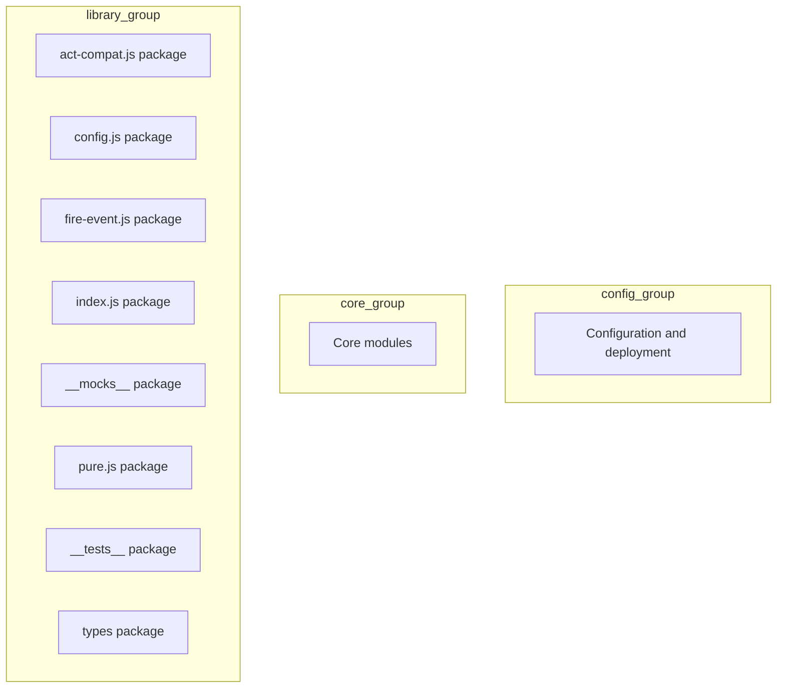

# Architecture report: testing-library/react-testing-library

> Automated static analysis. **Observed** = directly seen in files/imports/AST; **Inferred** = interpretation from that evidence. Repository code was not executed.

## 1. Repository at a glance

| Item | Value |
| --- | --- |
| Repository | testing-library/react-testing-library |
| Description | 🐐 Simple and complete React DOM testing utilities that encourage good testing practices. |
| Language | JavaScript |
| Stars | 19681 |
| Licence | MIT |
| Analysed commit / branch | 20ce75f2907ca0e5c5a8ae595c0e9a4e368c7800 / main |
| Framework(s) | React |
| Files analysed | 63 |
| Components | 10 |

## 2. Architecture in one minute

testing-library/react-testing-library - 🐐 Simple and complete React DOM testing utilities that encourage good testing practices.. This repository was analysed statically from 63 file(s) (0 Python). Detected technologies (observed from imports/manifests): GitHub Actions, React, TypeScript. Files are grouped into 10 component(s): act-compat.js package, Configuration and deployment, config.js package, Core modules, fire-event.js package, index.js package, __mocks__ package, pure.js package. Findings below distinguish observed facts from inferred interpretation.

## 3. High-level block diagram

## 4. Main components

### act-compat.js package (`act_compat_js`)

- **Kind:** library
- **Status:** Observed
- **Confidence:** 0.85
- **Responsibility:** Groups 1 file(s) under act-compat.js package (observed from repository paths and static analysis).
- **Paths:** `src/act-compat.js`
- **Evidence:** [src/act-compat.js](https://github.com/testing-library/react-testing-library/blob/20ce75f2907ca0e5c5a8ae595c0e9a4e368c7800/src/act-compat.js)

### Configuration and deployment (`config`)

- **Kind:** config
- **Status:** Observed
- **Confidence:** 0.85
- **Responsibility:** Groups 4 file(s) under configuration and deployment (observed from repository paths and static analysis).
- **Paths:** `codecov.yml`, `package.json`, `tsconfig.json`, `types/tsconfig.json`
- **Evidence:** [codecov.yml](https://github.com/testing-library/react-testing-library/blob/20ce75f2907ca0e5c5a8ae595c0e9a4e368c7800/codecov.yml); [package.json](https://github.com/testing-library/react-testing-library/blob/20ce75f2907ca0e5c5a8ae595c0e9a4e368c7800/package.json); [tsconfig.json](https://github.com/testing-library/react-testing-library/blob/20ce75f2907ca0e5c5a8ae595c0e9a4e368c7800/tsconfig.json); [types/tsconfig.json](https://github.com/testing-library/react-testing-library/blob/20ce75f2907ca0e5c5a8ae595c0e9a4e368c7800/types/tsconfig.json)

### config.js package (`config_js`)

- **Kind:** library
- **Status:** Observed
- **Confidence:** 0.85
- **Responsibility:** Groups 1 file(s) under config.js package (observed from repository paths and static analysis).
- **Paths:** `src/config.js`
- **Evidence:** [src/config.js](https://github.com/testing-library/react-testing-library/blob/20ce75f2907ca0e5c5a8ae595c0e9a4e368c7800/src/config.js)

### Core modules (`core`)

- **Kind:** core
- **Status:** Observed
- **Confidence:** 0.85
- **Responsibility:** Groups 4 file(s) under core modules (observed from repository paths and static analysis).
- **Paths:** `dont-cleanup-after-each.js`, `jest.config.js`, `pure.d.ts`, `pure.js`
- **Evidence:** [dont-cleanup-after-each.js](https://github.com/testing-library/react-testing-library/blob/20ce75f2907ca0e5c5a8ae595c0e9a4e368c7800/dont-cleanup-after-each.js); [jest.config.js](https://github.com/testing-library/react-testing-library/blob/20ce75f2907ca0e5c5a8ae595c0e9a4e368c7800/jest.config.js); [pure.d.ts](https://github.com/testing-library/react-testing-library/blob/20ce75f2907ca0e5c5a8ae595c0e9a4e368c7800/pure.d.ts); [pure.js](https://github.com/testing-library/react-testing-library/blob/20ce75f2907ca0e5c5a8ae595c0e9a4e368c7800/pure.js)

### fire-event.js package (`fire_event_js`)

- **Kind:** library
- **Status:** Observed
- **Confidence:** 0.85
- **Responsibility:** Groups 1 file(s) under fire-event.js package (observed from repository paths and static analysis).
- **Paths:** `src/fire-event.js`
- **Evidence:** [src/fire-event.js](https://github.com/testing-library/react-testing-library/blob/20ce75f2907ca0e5c5a8ae595c0e9a4e368c7800/src/fire-event.js)

### index.js package (`index_js`)

- **Kind:** library
- **Status:** Observed
- **Confidence:** 0.85
- **Responsibility:** Groups 1 file(s) under index.js package (observed from repository paths and static analysis).
- **Paths:** `src/index.js`
- **Evidence:** [src/index.js](https://github.com/testing-library/react-testing-library/blob/20ce75f2907ca0e5c5a8ae595c0e9a4e368c7800/src/index.js)

### __mocks__ package (`mocks`)

- **Kind:** library
- **Status:** Observed
- **Confidence:** 0.85
- **Responsibility:** Groups 1 file(s) under __mocks__ package (observed from repository paths and static analysis).
- **Paths:** `src/__mocks__/axios.js`
- **Evidence:** [src/__mocks__/axios.js](https://github.com/testing-library/react-testing-library/blob/20ce75f2907ca0e5c5a8ae595c0e9a4e368c7800/src/__mocks__/axios.js)

### pure.js package (`pure_js`)

- **Kind:** library
- **Status:** Observed
- **Confidence:** 0.85
- **Responsibility:** Groups 1 file(s) under pure.js package (observed from repository paths and static analysis).
- **Paths:** `src/pure.js`
- **Evidence:** [src/pure.js](https://github.com/testing-library/react-testing-library/blob/20ce75f2907ca0e5c5a8ae595c0e9a4e368c7800/src/pure.js)

### __tests__ package (`tests`)

- **Kind:** library
- **Status:** Observed
- **Confidence:** 0.85
- **Responsibility:** Groups 20 file(s) under __tests__ package (observed from repository paths and static analysis).
- **Paths:** `src/__tests__/act.js`, `src/__tests__/auto-cleanup-skip.js`, `src/__tests__/auto-cleanup.js`, `src/__tests__/cleanup.js`, `src/__tests__/config.js`, `src/__tests__/debug.js`, `src/__tests__/end-to-end.js`, `src/__tests__/error-handlers.js`, `src/__tests__/event-wrapper-nesting.js`, `src/__tests__/events.js`, `src/__tests__/multi-base.js`, `src/__tests__/new-act.js`, `src/__tests__/render.js`, `src/__tests__/renderHook.js`, `src/__tests__/rerender.js`, `src/__tests__/stopwatch.js`, `tests/failOnUnexpectedConsoleCalls.js`, `tests/setup-env.js`, `tests/shouldIgnoreConsoleError.js`, `tests/toWarnDev.js`
- **Evidence:** [src/__tests__/act.js](https://github.com/testing-library/react-testing-library/blob/20ce75f2907ca0e5c5a8ae595c0e9a4e368c7800/src/__tests__/act.js); [src/__tests__/auto-cleanup-skip.js](https://github.com/testing-library/react-testing-library/blob/20ce75f2907ca0e5c5a8ae595c0e9a4e368c7800/src/__tests__/auto-cleanup-skip.js); [src/__tests__/auto-cleanup.js](https://github.com/testing-library/react-testing-library/blob/20ce75f2907ca0e5c5a8ae595c0e9a4e368c7800/src/__tests__/auto-cleanup.js); [src/__tests__/cleanup.js](https://github.com/testing-library/react-testing-library/blob/20ce75f2907ca0e5c5a8ae595c0e9a4e368c7800/src/__tests__/cleanup.js); [src/__tests__/config.js](https://github.com/testing-library/react-testing-library/blob/20ce75f2907ca0e5c5a8ae595c0e9a4e368c7800/src/__tests__/config.js); [src/__tests__/debug.js](https://github.com/testing-library/react-testing-library/blob/20ce75f2907ca0e5c5a8ae595c0e9a4e368c7800/src/__tests__/debug.js); [src/__tests__/end-to-end.js](https://github.com/testing-library/react-testing-library/blob/20ce75f2907ca0e5c5a8ae595c0e9a4e368c7800/src/__tests__/end-to-end.js); [src/__tests__/error-handlers.js](https://github.com/testing-library/react-testing-library/blob/20ce75f2907ca0e5c5a8ae595c0e9a4e368c7800/src/__tests__/error-handlers.js)

### types package (`types`)

- **Kind:** library
- **Status:** Observed
- **Confidence:** 0.85
- **Responsibility:** Groups 3 file(s) under types package (observed from repository paths and static analysis).
- **Paths:** `types/index.d.ts`, `types/pure.d.ts`, `types/test.tsx`
- **Evidence:** [types/index.d.ts](https://github.com/testing-library/react-testing-library/blob/20ce75f2907ca0e5c5a8ae595c0e9a4e368c7800/types/index.d.ts); [types/pure.d.ts](https://github.com/testing-library/react-testing-library/blob/20ce75f2907ca0e5c5a8ae595c0e9a4e368c7800/types/pure.d.ts); [types/test.tsx](https://github.com/testing-library/react-testing-library/blob/20ce75f2907ca0e5c5a8ae595c0e9a4e368c7800/types/test.tsx)

## 5. Execution flow

**Observed** entry point(s):

- [src/index.js](https://github.com/testing-library/react-testing-library/blob/20ce75f2907ca0e5c5a8ae595c0e9a4e368c7800/src/index.js)

Representative flow (derived from observed entry points and the import graph; steps beyond the entry point are **Inferred**):

1. Execution starts at an observed entry point listed above, if present.
2. No internal import relationships between components were observed.

## 6. Project structure

### `(root)`

- `.all-contributorsrc` - other (36789 bytes)
- `.bundle.main.env` - other (96 bytes)
- `.bundle.pure.env` - other (53 bytes)
- `.gitattributes` - other (19 bytes)
- `.gitignore` - other (133 bytes)
- `.huskyrc.js` - source, JavaScript (46 bytes)
- `.prettierignore` - other (27 bytes)
- `.prettierrc.js` - source, JavaScript (49 bytes)
- `CHANGELOG.md` - docs (187 bytes)
- `CODE_OF_CONDUCT.md` - docs (5222 bytes)
- `CONTRIBUTING.md` - docs (2210 bytes)
- `LICENSE` - docs (1087 bytes)
- `README.md` - docs (78902 bytes)
- `codecov.yml` - config (387 bytes)
- `dont-cleanup-after-each.js` - source, JavaScript (41 bytes)
- `jest.config.js` - source, JavaScript (515 bytes)
- `package.json` - manifest (3490 bytes)
- `pure.d.ts` - source, TypeScript (29 bytes)
- `pure.js` - source, JavaScript (108 bytes)
- `tsconfig.json` - config (1085 bytes)

### `.codesandbox`

- `.codesandbox/ci.json` - config (130 bytes)

### `.github`

- `.github/ISSUE_TEMPLATE.md` - docs (3071 bytes)
- `.github/ISSUE_TEMPLATE/Bug_Report.md` - docs (2272 bytes)
- `.github/ISSUE_TEMPLATE/Feature_Request.md` - docs (1489 bytes)
- `.github/ISSUE_TEMPLATE/Question.md` - docs (824 bytes)
- `.github/PULL_REQUEST_TEMPLATE.md` - docs (1343 bytes)
- `.github/workflows/release.yml` - ci, YAML (3513 bytes)
- `.github/workflows/validate.yml` - ci, YAML (1917 bytes)

### `other`

- `other/MAINTAINING.md` - docs (3289 bytes)
- `other/USERS.md` - docs (336 bytes)
- `other/design files/README.txt` - docs (295 bytes)
- `other/manual-releases.md` - docs (1313 bytes)

### `src`

- `src/__mocks__/axios.js` - source, JavaScript (319 bytes)
- `src/__tests__/__snapshots__/render.js.snap` - other (217 bytes)
- `src/__tests__/act.js` - source, JavaScript (1859 bytes)
- `src/__tests__/auto-cleanup-skip.js` - source, JavaScript (419 bytes)
- `src/__tests__/auto-cleanup.js` - source, JavaScript (329 bytes)
- `src/__tests__/cleanup.js` - source, JavaScript (3023 bytes)
- `src/__tests__/config.js` - source, JavaScript (1840 bytes)
- `src/__tests__/debug.js` - source, JavaScript (1336 bytes)
- `src/__tests__/end-to-end.js` - source, JavaScript (6944 bytes)
- `src/__tests__/error-handlers.js` - source, JavaScript (4561 bytes)
- `src/__tests__/event-wrapper-nesting.js` - source, JavaScript (1526 bytes)
- `src/__tests__/events.js` - source, JavaScript (5678 bytes)
- `src/__tests__/multi-base.js` - source, JavaScript (1233 bytes)
- `src/__tests__/new-act.js` - source, JavaScript (1653 bytes)
- `src/__tests__/render.js` - source, JavaScript (8772 bytes)
- `src/__tests__/renderHook.js` - source, JavaScript (3917 bytes)
- `src/__tests__/rerender.js` - source, JavaScript (2576 bytes)
- `src/__tests__/stopwatch.js` - source, JavaScript (1637 bytes)
- `src/act-compat.js` - source, JavaScript (2527 bytes)
- `src/config.js` - source, JavaScript (631 bytes)
- `src/fire-event.js` - source, JavaScript (2217 bytes)
- `src/index.js` - source, JavaScript (1434 bytes)
- `src/pure.js` - source, JavaScript (10132 bytes)

### `tests`

- `tests/failOnUnexpectedConsoleCalls.js` - test, JavaScript (4261 bytes)
- `tests/setup-env.js` - test, JavaScript (357 bytes)
- `tests/shouldIgnoreConsoleError.js` - test, JavaScript (2154 bytes)
- `tests/toWarnDev.js` - test, JavaScript (11839 bytes)

### `types`

- `types/index.d.ts` - source, TypeScript (10408 bytes)
- `types/pure.d.ts` - source, TypeScript (19 bytes)
- `types/test.tsx` - source, TypeScript (9679 bytes)
- `types/tsconfig.json` - config (182 bytes)

## 7. Key dependencies and integrations

| Name | Category | Status | Confidence | Evidence |
| --- | --- | --- | --- | --- |
| GitHub Actions | ci | Observed | 0.90 | [.github/workflows/release.yml](https://github.com/testing-library/react-testing-library/blob/20ce75f2907ca0e5c5a8ae595c0e9a4e368c7800/.github/workflows/release.yml); [.github/workflows/validate.yml](https://github.com/testing-library/react-testing-library/blob/20ce75f2907ca0e5c5a8ae595c0e9a4e368c7800/.github/workflows/validate.yml) |
| React | framework | Observed | 0.90 | [package.json:2](https://github.com/testing-library/react-testing-library/blob/20ce75f2907ca0e5c5a8ae595c0e9a4e368c7800/package.json#L2); [package.json:54](https://github.com/testing-library/react-testing-library/blob/20ce75f2907ca0e5c5a8ae595c0e9a4e368c7800/package.json#L54) |
| TypeScript | tooling | Observed | 0.85 | [package.json:63](https://github.com/testing-library/react-testing-library/blob/20ce75f2907ca0e5c5a8ae595c0e9a4e368c7800/package.json#L63) |

## 8. Data and state

No database, cache, queue, or persistent-state usage was observed in the analysed files. State handling, if any, may be in-memory or in files that were not analysed.

## 9. Configuration and deployment clues

- `.codesandbox/ci.json` (config)
- `.github/workflows/release.yml` (ci)
- `.github/workflows/validate.yml` (ci)
- `codecov.yml` (config)
- `package.json` (manifest)
- `tsconfig.json` (config)
- `types/tsconfig.json` (config)

## 10. Design observations

- No strong design patterns could be established from the available evidence.

These observations are interpretations (**Inferred**) of the observed structure, not guarantees about runtime design.

## 11. Limitations and unknowns

- Static analysis only: repository code was not executed, installed, or imported at runtime.
- Components and relationships are inferred from file paths, imports, and AST structure; runtime behaviour, dynamic imports, and reflection may not be visible.
- 1 file(s) were skipped during inventory (1 x likely secret file excluded).
- No clear application entry point was observed in the analysed files.
- Repository text was treated as untrusted data; no instructions found in repository files were followed, and likely secret values were redacted/excluded.
- JavaScript and TypeScript files were inventoried from paths and package manifests. They were not parsed with a full language AST, and repository code was not executed.

## 12. Source references

- [.github/workflows/release.yml](https://github.com/testing-library/react-testing-library/blob/20ce75f2907ca0e5c5a8ae595c0e9a4e368c7800/.github/workflows/release.yml)
- [.github/workflows/validate.yml](https://github.com/testing-library/react-testing-library/blob/20ce75f2907ca0e5c5a8ae595c0e9a4e368c7800/.github/workflows/validate.yml)
- [codecov.yml](https://github.com/testing-library/react-testing-library/blob/20ce75f2907ca0e5c5a8ae595c0e9a4e368c7800/codecov.yml)
- [dont-cleanup-after-each.js](https://github.com/testing-library/react-testing-library/blob/20ce75f2907ca0e5c5a8ae595c0e9a4e368c7800/dont-cleanup-after-each.js)
- [jest.config.js](https://github.com/testing-library/react-testing-library/blob/20ce75f2907ca0e5c5a8ae595c0e9a4e368c7800/jest.config.js)
- [package.json](https://github.com/testing-library/react-testing-library/blob/20ce75f2907ca0e5c5a8ae595c0e9a4e368c7800/package.json)
- [package.json:2](https://github.com/testing-library/react-testing-library/blob/20ce75f2907ca0e5c5a8ae595c0e9a4e368c7800/package.json#L2)
- [package.json:54](https://github.com/testing-library/react-testing-library/blob/20ce75f2907ca0e5c5a8ae595c0e9a4e368c7800/package.json#L54)
- [package.json:63](https://github.com/testing-library/react-testing-library/blob/20ce75f2907ca0e5c5a8ae595c0e9a4e368c7800/package.json#L63)
- [pure.d.ts](https://github.com/testing-library/react-testing-library/blob/20ce75f2907ca0e5c5a8ae595c0e9a4e368c7800/pure.d.ts)
- [pure.js](https://github.com/testing-library/react-testing-library/blob/20ce75f2907ca0e5c5a8ae595c0e9a4e368c7800/pure.js)
- [src/__mocks__/axios.js](https://github.com/testing-library/react-testing-library/blob/20ce75f2907ca0e5c5a8ae595c0e9a4e368c7800/src/__mocks__/axios.js)
- [src/__tests__/act.js](https://github.com/testing-library/react-testing-library/blob/20ce75f2907ca0e5c5a8ae595c0e9a4e368c7800/src/__tests__/act.js)
- [src/__tests__/auto-cleanup-skip.js](https://github.com/testing-library/react-testing-library/blob/20ce75f2907ca0e5c5a8ae595c0e9a4e368c7800/src/__tests__/auto-cleanup-skip.js)
- [src/__tests__/auto-cleanup.js](https://github.com/testing-library/react-testing-library/blob/20ce75f2907ca0e5c5a8ae595c0e9a4e368c7800/src/__tests__/auto-cleanup.js)
- [src/__tests__/cleanup.js](https://github.com/testing-library/react-testing-library/blob/20ce75f2907ca0e5c5a8ae595c0e9a4e368c7800/src/__tests__/cleanup.js)
- [src/__tests__/config.js](https://github.com/testing-library/react-testing-library/blob/20ce75f2907ca0e5c5a8ae595c0e9a4e368c7800/src/__tests__/config.js)
- [src/__tests__/debug.js](https://github.com/testing-library/react-testing-library/blob/20ce75f2907ca0e5c5a8ae595c0e9a4e368c7800/src/__tests__/debug.js)
- [src/__tests__/end-to-end.js](https://github.com/testing-library/react-testing-library/blob/20ce75f2907ca0e5c5a8ae595c0e9a4e368c7800/src/__tests__/end-to-end.js)
- [src/__tests__/error-handlers.js](https://github.com/testing-library/react-testing-library/blob/20ce75f2907ca0e5c5a8ae595c0e9a4e368c7800/src/__tests__/error-handlers.js)
- [src/act-compat.js](https://github.com/testing-library/react-testing-library/blob/20ce75f2907ca0e5c5a8ae595c0e9a4e368c7800/src/act-compat.js)
- [src/config.js](https://github.com/testing-library/react-testing-library/blob/20ce75f2907ca0e5c5a8ae595c0e9a4e368c7800/src/config.js)
- [src/fire-event.js](https://github.com/testing-library/react-testing-library/blob/20ce75f2907ca0e5c5a8ae595c0e9a4e368c7800/src/fire-event.js)
- [src/index.js](https://github.com/testing-library/react-testing-library/blob/20ce75f2907ca0e5c5a8ae595c0e9a4e368c7800/src/index.js)
- [src/pure.js](https://github.com/testing-library/react-testing-library/blob/20ce75f2907ca0e5c5a8ae595c0e9a4e368c7800/src/pure.js)
- [tsconfig.json](https://github.com/testing-library/react-testing-library/blob/20ce75f2907ca0e5c5a8ae595c0e9a4e368c7800/tsconfig.json)
- [types/index.d.ts](https://github.com/testing-library/react-testing-library/blob/20ce75f2907ca0e5c5a8ae595c0e9a4e368c7800/types/index.d.ts)
- [types/pure.d.ts](https://github.com/testing-library/react-testing-library/blob/20ce75f2907ca0e5c5a8ae595c0e9a4e368c7800/types/pure.d.ts)
- [types/test.tsx](https://github.com/testing-library/react-testing-library/blob/20ce75f2907ca0e5c5a8ae595c0e9a4e368c7800/types/test.tsx)
- [types/tsconfig.json](https://github.com/testing-library/react-testing-library/blob/20ce75f2907ca0e5c5a8ae595c0e9a4e368c7800/types/tsconfig.json)
