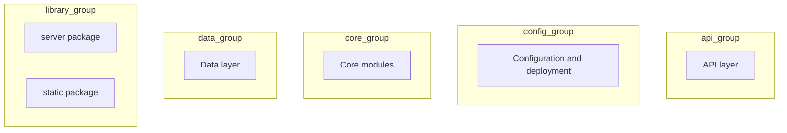

# Architecture report: thedevs-network/kutt

> Automated static analysis. **Observed** = directly seen in files/imports/AST; **Inferred** = interpretation from that evidence. Repository code was not executed.

## 1. Repository at a glance

| Item | Value |
| --- | --- |
| Repository | thedevs-network/kutt |
| Description | Free Modern URL Shortener. |
| Language | JavaScript |
| Stars | 11206 |
| Licence | MIT |
| Analysed commit / branch | 029da42b2459693681886665589fd9512d6b473c / main |
| Framework(s) | Express |
| Files analysed | 209 |
| Components | 6 |

## 2. Architecture in one minute

thedevs-network/kutt - Free Modern URL Shortener.. This repository was analysed statically from 209 file(s) (0 Python). Detected technologies (observed from imports/manifests): GitHub Actions, Express, Docker, Docker Compose. Files are grouped into 6 component(s): API layer, Configuration and deployment, Core modules, Data layer, server package, static package. Findings below distinguish observed facts from inferred interpretation.

## 3. High-level block diagram

## 4. Main components

### API layer (`api_layer`)

- **Kind:** api
- **Status:** Observed
- **Confidence:** 0.85
- **Responsibility:** Groups 16 file(s) under api layer (observed from repository paths and static analysis).
- **Paths:** `server/handlers/auth.handler.js`, `server/handlers/domains.handler.js`, `server/handlers/helpers.handler.js`, `server/handlers/links.handler.js`, `server/handlers/locals.handler.js`, `server/handlers/renders.handler.js`, `server/handlers/users.handler.js`, `server/handlers/validators.handler.js`, `server/routes/auth.routes.js`, `server/routes/domain.routes.js`, `server/routes/health.routes.js`, `server/routes/index.js`, `server/routes/link.routes.js`, `server/routes/renders.routes.js`, `server/routes/routes.js`, `server/routes/user.routes.js`
- **Evidence:** [server/handlers/auth.handler.js](https://github.com/thedevs-network/kutt/blob/029da42b2459693681886665589fd9512d6b473c/server/handlers/auth.handler.js); [server/handlers/domains.handler.js](https://github.com/thedevs-network/kutt/blob/029da42b2459693681886665589fd9512d6b473c/server/handlers/domains.handler.js); [server/handlers/helpers.handler.js](https://github.com/thedevs-network/kutt/blob/029da42b2459693681886665589fd9512d6b473c/server/handlers/helpers.handler.js); [server/handlers/links.handler.js](https://github.com/thedevs-network/kutt/blob/029da42b2459693681886665589fd9512d6b473c/server/handlers/links.handler.js); [server/handlers/locals.handler.js](https://github.com/thedevs-network/kutt/blob/029da42b2459693681886665589fd9512d6b473c/server/handlers/locals.handler.js); [server/handlers/renders.handler.js](https://github.com/thedevs-network/kutt/blob/029da42b2459693681886665589fd9512d6b473c/server/handlers/renders.handler.js); [server/handlers/users.handler.js](https://github.com/thedevs-network/kutt/blob/029da42b2459693681886665589fd9512d6b473c/server/handlers/users.handler.js); [server/handlers/validators.handler.js](https://github.com/thedevs-network/kutt/blob/029da42b2459693681886665589fd9512d6b473c/server/handlers/validators.handler.js)

### Configuration and deployment (`config`)

- **Kind:** config
- **Status:** Observed
- **Confidence:** 0.85
- **Responsibility:** Groups 8 file(s) under configuration and deployment (observed from repository paths and static analysis).
- **Paths:** `Dockerfile`, `docker-compose.mariadb.yml`, `docker-compose.postgres.yml`, `docker-compose.sqlite-redis.yml`, `docker-compose.yml`, `jsconfig.json`, `package.json`, `server/utils/map.json`
- **Evidence:** [Dockerfile](https://github.com/thedevs-network/kutt/blob/029da42b2459693681886665589fd9512d6b473c/Dockerfile); [docker-compose.mariadb.yml](https://github.com/thedevs-network/kutt/blob/029da42b2459693681886665589fd9512d6b473c/docker-compose.mariadb.yml); [docker-compose.postgres.yml](https://github.com/thedevs-network/kutt/blob/029da42b2459693681886665589fd9512d6b473c/docker-compose.postgres.yml); [docker-compose.sqlite-redis.yml](https://github.com/thedevs-network/kutt/blob/029da42b2459693681886665589fd9512d6b473c/docker-compose.sqlite-redis.yml); [docker-compose.yml](https://github.com/thedevs-network/kutt/blob/029da42b2459693681886665589fd9512d6b473c/docker-compose.yml); [jsconfig.json](https://github.com/thedevs-network/kutt/blob/029da42b2459693681886665589fd9512d6b473c/jsconfig.json); [package.json](https://github.com/thedevs-network/kutt/blob/029da42b2459693681886665589fd9512d6b473c/package.json); [server/utils/map.json](https://github.com/thedevs-network/kutt/blob/029da42b2459693681886665589fd9512d6b473c/server/utils/map.json)

### Core modules (`core`)

- **Kind:** core
- **Status:** Observed
- **Confidence:** 0.85
- **Responsibility:** Groups 1 file(s) under core modules (observed from repository paths and static analysis).
- **Paths:** `knexfile.js`
- **Evidence:** [knexfile.js](https://github.com/thedevs-network/kutt/blob/029da42b2459693681886665589fd9512d6b473c/knexfile.js)

### Data layer (`data_layer`)

- **Kind:** data
- **Status:** Observed
- **Confidence:** 0.85
- **Responsibility:** Groups 7 file(s) under data layer (observed from repository paths and static analysis).
- **Paths:** `server/models/domain.model.js`, `server/models/host.model.js`, `server/models/index.js`, `server/models/ip.model.js`, `server/models/link.model.js`, `server/models/user.model.js`, `server/models/visit.model.js`
- **Evidence:** [server/models/domain.model.js](https://github.com/thedevs-network/kutt/blob/029da42b2459693681886665589fd9512d6b473c/server/models/domain.model.js); [server/models/host.model.js](https://github.com/thedevs-network/kutt/blob/029da42b2459693681886665589fd9512d6b473c/server/models/host.model.js); [server/models/index.js](https://github.com/thedevs-network/kutt/blob/029da42b2459693681886665589fd9512d6b473c/server/models/index.js); [server/models/ip.model.js](https://github.com/thedevs-network/kutt/blob/029da42b2459693681886665589fd9512d6b473c/server/models/ip.model.js); [server/models/link.model.js](https://github.com/thedevs-network/kutt/blob/029da42b2459693681886665589fd9512d6b473c/server/models/link.model.js); [server/models/user.model.js](https://github.com/thedevs-network/kutt/blob/029da42b2459693681886665589fd9512d6b473c/server/models/user.model.js); [server/models/visit.model.js](https://github.com/thedevs-network/kutt/blob/029da42b2459693681886665589fd9512d6b473c/server/models/visit.model.js)

### server package (`server`)

- **Kind:** library
- **Status:** Observed
- **Confidence:** 0.85
- **Responsibility:** Groups 33 file(s) under server package (observed from repository paths and static analysis).
- **Paths:** `server/consts.js`, `server/cron.js`, `server/env.js`, `server/knex.js`, `server/mail/index.js`, `server/mail/mail.js`, `server/mail/text.js`, `server/migrations/20200211220920_constraints.js`, `server/migrations/20200510140704_domains.js`, `server/migrations/20200718124944_description.js`, `server/migrations/20200730203154_expire_in.js`, `server/migrations/20200810195255_change_email.js`, `server/migrations/20241103083933_user-roles.js`, `server/migrations/20241223062111_indexes.js`, `server/migrations/20241223103044_visits_user_id.js`, `server/migrations/20241223155527_visits_user_id_index.js`, `server/migrations/20250106070444_remove_cooldown.js`, `server/passport.js`, `server/queries/domain.queries.js`, `server/queries/host.queries.js`, `server/queries/index.js`, `server/queries/link.queries.js`, `server/queries/user.queries.js`, `server/queries/visit.queries.js`, `server/queues/index.js`, `server/queues/queues.js`, `server/queues/visit.js`, `server/redis.js`, `server/server.js`, `server/utils/asyncHandler.js`, `server/utils/index.js`, `server/utils/knex.js`, `server/utils/utils.js`
- **Evidence:** [server/consts.js](https://github.com/thedevs-network/kutt/blob/029da42b2459693681886665589fd9512d6b473c/server/consts.js); [server/cron.js](https://github.com/thedevs-network/kutt/blob/029da42b2459693681886665589fd9512d6b473c/server/cron.js); [server/env.js](https://github.com/thedevs-network/kutt/blob/029da42b2459693681886665589fd9512d6b473c/server/env.js); [server/knex.js](https://github.com/thedevs-network/kutt/blob/029da42b2459693681886665589fd9512d6b473c/server/knex.js); [server/mail/index.js](https://github.com/thedevs-network/kutt/blob/029da42b2459693681886665589fd9512d6b473c/server/mail/index.js); [server/mail/mail.js](https://github.com/thedevs-network/kutt/blob/029da42b2459693681886665589fd9512d6b473c/server/mail/mail.js); [server/mail/text.js](https://github.com/thedevs-network/kutt/blob/029da42b2459693681886665589fd9512d6b473c/server/mail/text.js); [server/migrations/20200211220920_constraints.js](https://github.com/thedevs-network/kutt/blob/029da42b2459693681886665589fd9512d6b473c/server/migrations/20200211220920_constraints.js)

### static package (`static`)

- **Kind:** library
- **Status:** Observed
- **Confidence:** 0.85
- **Responsibility:** Groups 2 file(s) under static package (observed from repository paths and static analysis).
- **Paths:** `static/scripts/main.js`, `static/scripts/stats.js`
- **Evidence:** [static/scripts/main.js](https://github.com/thedevs-network/kutt/blob/029da42b2459693681886665589fd9512d6b473c/static/scripts/main.js); [static/scripts/stats.js](https://github.com/thedevs-network/kutt/blob/029da42b2459693681886665589fd9512d6b473c/static/scripts/stats.js)

## 5. Execution flow

**Observed** entry point(s):

- [server/mail/index.js](https://github.com/thedevs-network/kutt/blob/029da42b2459693681886665589fd9512d6b473c/server/mail/index.js)
- [server/models/index.js](https://github.com/thedevs-network/kutt/blob/029da42b2459693681886665589fd9512d6b473c/server/models/index.js)
- [server/queries/index.js](https://github.com/thedevs-network/kutt/blob/029da42b2459693681886665589fd9512d6b473c/server/queries/index.js)
- [server/queues/index.js](https://github.com/thedevs-network/kutt/blob/029da42b2459693681886665589fd9512d6b473c/server/queues/index.js)
- [server/routes/index.js](https://github.com/thedevs-network/kutt/blob/029da42b2459693681886665589fd9512d6b473c/server/routes/index.js)
- [server/server.js](https://github.com/thedevs-network/kutt/blob/029da42b2459693681886665589fd9512d6b473c/server/server.js)
- [server/utils/index.js](https://github.com/thedevs-network/kutt/blob/029da42b2459693681886665589fd9512d6b473c/server/utils/index.js)
- [static/scripts/main.js](https://github.com/thedevs-network/kutt/blob/029da42b2459693681886665589fd9512d6b473c/static/scripts/main.js)

Representative flow (derived from observed entry points and the import graph; steps beyond the entry point are **Inferred**):

1. Execution starts at an observed entry point listed above, if present.
2. No internal import relationships between components were observed.

## 6. Project structure

### `(root)`

- `.dockerignore` - container (18 bytes)
- `.example.env` - other (3045 bytes)
- `.gitignore` - other (204 bytes)
- `Dockerfile` - container (621 bytes)
- `LICENSE` - docs (1061 bytes)
- `README.md` - docs (16280 bytes)
- `docker-compose.mariadb.yml` - config (1001 bytes)
- `docker-compose.postgres.yml` - config (860 bytes)
- `docker-compose.sqlite-redis.yml` - config (470 bytes)
- `docker-compose.yml` - container (257 bytes)
- `jsconfig.json` - config (160 bytes)
- `knexfile.js` - source, JavaScript (768 bytes)
- `package.json` - manifest (2020 bytes)

### `.github`

- `.github/workflows/docker-build-development.yaml` - ci, YAML (1168 bytes)
- `.github/workflows/docker-build-latest.yaml` - ci, YAML (1153 bytes)
- `.github/workflows/docker-build-release.yaml` - ci, YAML (908 bytes)

### `custom`

- `custom/.gitkeep` - other (137 bytes)

### `db`

- `db/.gitkeep` - other (118 bytes)

### `docs`

- `docs/api/api.js` - docs (13486 bytes)
- `docs/api/generate.js` - docs (1079 bytes)

### `server`

- `server/consts.js` - source, JavaScript (82 bytes)
- `server/cron.js` - source, JavaScript (232 bytes)
- `server/env.js` - source, JavaScript (3122 bytes)
- `server/handlers/auth.handler.js` - source, JavaScript (10377 bytes)
- `server/handlers/domains.handler.js` - source, JavaScript (5032 bytes)
- `server/handlers/helpers.handler.js` - source, JavaScript (3490 bytes)
- `server/handlers/links.handler.js` - source, JavaScript (16789 bytes)
- `server/handlers/locals.handler.js` - source, JavaScript (2290 bytes)
- `server/handlers/renders.handler.js` - source, JavaScript (7106 bytes)
- `server/handlers/users.handler.js` - source, JavaScript (4419 bytes)
- `server/handlers/validators.handler.js` - source, JavaScript (16698 bytes)
- `server/knex.js` - source, JavaScript (829 bytes)
- `server/mail/index.js` - source, JavaScript (35 bytes)
- `server/mail/mail.js` - source, JavaScript (4432 bytes)
- `server/mail/template-change-email.html` - other (21514 bytes)
- `server/mail/template-reset.html` - other (21609 bytes)
- `server/mail/template-verify.html` - other (21458 bytes)
- `server/mail/text.js` - source, JavaScript (655 bytes)
- `server/migrations/20200211220920_constraints.js` - source, JavaScript (373 bytes)
- `server/migrations/20200510140704_domains.js` - source, JavaScript (1102 bytes)
- `server/migrations/20200718124944_description.js` - source, JavaScript (308 bytes)
- `server/migrations/20200730203154_expire_in.js` - source, JavaScript (300 bytes)
- `server/migrations/20200810195255_change_email.js` - source, JavaScript (425 bytes)
- `server/migrations/20241103083933_user-roles.js` - source, JavaScript (1113 bytes)
- `server/migrations/20241223062111_indexes.js` - source, JavaScript (2004 bytes)
- `server/migrations/20241223103044_visits_user_id.js` - source, JavaScript (1633 bytes)
- `server/migrations/20241223155527_visits_user_id_index.js` - source, JavaScript (707 bytes)
- `server/migrations/20250106070444_remove_cooldown.js` - source, JavaScript (721 bytes)
- `server/models/domain.model.js` - source, JavaScript (969 bytes)
- `server/models/host.model.js` - source, JavaScript (586 bytes)
- `server/models/index.js` - source, JavaScript (202 bytes)
- `server/models/ip.model.js` - source, JavaScript (366 bytes)
- `server/models/link.model.js` - source, JavaScript (1473 bytes)
- `server/models/user.model.js` - source, JavaScript (1220 bytes)
- `server/models/visit.model.js` - source, JavaScript (2396 bytes)
- `server/passport.js` - source, JavaScript (4006 bytes)
- `server/queries/domain.queries.js` - source, JavaScript (5700 bytes)
- `server/queries/host.queries.js` - source, JavaScript (1543 bytes)
- `server/queries/index.js` - source, JavaScript (271 bytes)
- `server/queries/link.queries.js` - source, JavaScript (7576 bytes)
- `server/queries/user.queries.js` - source, JavaScript (6660 bytes)
- `server/queries/visit.queries.js` - source, JavaScript (5934 bytes)
- `server/queues/index.js` - source, JavaScript (71 bytes)
- `server/queues/queues.js` - source, JavaScript (841 bytes)
- `server/queues/visit.js` - source, JavaScript (1128 bytes)
- `server/redis.js` - source, JavaScript (1047 bytes)
- `server/routes/auth.routes.js` - source, JavaScript (2593 bytes)
- `server/routes/domain.routes.js` - source, JavaScript (1930 bytes)
- `server/routes/health.routes.js` - source, JavaScript (137 bytes)
- `server/routes/index.js` - source, JavaScript (37 bytes)
- `server/routes/link.routes.js` - source, JavaScript (2774 bytes)
- `server/routes/renders.routes.js` - source, JavaScript (4793 bytes)
- `server/routes/routes.js` - source, JavaScript (750 bytes)
- `server/routes/user.routes.js` - source, JavaScript (1779 bytes)
- `server/server.js` - source, JavaScript (2695 bytes)
- `server/utils/asyncHandler.js` - source, JavaScript (232 bytes)
- `server/utils/index.js` - source, JavaScript (36 bytes)
- `server/utils/knex.js` - source, JavaScript (1474 bytes)
- `server/utils/map.json` - config (120870 bytes)
- `server/utils/utils.js` - source, JavaScript (12690 bytes)
- `server/views/404.hbs` - other (196 bytes)
- `server/views/admin.hbs` - other (44 bytes)
- `server/views/banned.hbs` - other (369 bytes)
- `server/views/create_admin.hbs` - other (48 bytes)
- `server/views/error.hbs` - other (195 bytes)
- `server/views/homepage.hbs` - other (83 bytes)
- `server/views/layout.hbs` - other (1927 bytes)
- `server/views/login.hbs` - other (112 bytes)
- `server/views/logout.hbs` - other (196 bytes)
- `server/views/partials/admin/dialog/add_domain.hbs` - other (1473 bytes)
- `server/views/partials/admin/dialog/add_domain_success.hbs` - other (272 bytes)
- `server/views/partials/admin/dialog/ban_domain.hbs` - other (1161 bytes)
- `server/views/partials/admin/dialog/ban_domain_success.hbs` - other (252 bytes)
- `server/views/partials/admin/dialog/ban_user.hbs` - other (1087 bytes)
- `server/views/partials/admin/dialog/ban_user_success.hbs` - other (248 bytes)
- `server/views/partials/admin/dialog/create_user.hbs` - other (2383 bytes)
- `server/views/partials/admin/dialog/create_user_success.hbs` - other (268 bytes)
- `server/views/partials/admin/dialog/delete_domain.hbs` - other (1063 bytes)
- `server/views/partials/admin/dialog/delete_domain_success.hbs` - other (259 bytes)
- `server/views/partials/admin/dialog/delete_user.hbs` - other (809 bytes)
- `server/views/partials/admin/dialog/delete_user_success.hbs` - other (255 bytes)
- `server/views/partials/admin/dialog/frame.hbs` - other (183 bytes)
- `server/views/partials/admin/dialog/message.hbs` - other (212 bytes)
- `server/views/partials/admin/domains/actions.hbs` - other (811 bytes)
- `server/views/partials/admin/domains/loading.hbs` - other (306 bytes)
- `server/views/partials/admin/domains/table.hbs` - other (874 bytes)
- `server/views/partials/admin/domains/tbody.hbs` - other (111 bytes)
- `server/views/partials/admin/domains/tfoot.hbs` - other (91 bytes)
- `server/views/partials/admin/domains/thead.hbs` - other (3319 bytes)
- `server/views/partials/admin/domains/tr.hbs` - other (2472 bytes)
- `server/views/partials/admin/index.hbs` - other (195 bytes)
- `server/views/partials/admin/links/actions.hbs` - other (1825 bytes)
- `server/views/partials/admin/links/edit.hbs` - other (3484 bytes)
- `server/views/partials/admin/links/loading.hbs` - other (286 bytes)
- `server/views/partials/admin/links/table.hbs` - other (928 bytes)
- `server/views/partials/admin/links/tbody.hbs` - other (99 bytes)
- `server/views/partials/admin/links/tfoot.hbs` - other (89 bytes)
- `server/views/partials/admin/links/thead.hbs` - other (3699 bytes)
- `server/views/partials/admin/links/tr.hbs` - other (2755 bytes)
- `server/views/partials/admin/table_nav.hbs` - other (670 bytes)
- `server/views/partials/admin/table_tab.hbs` - other (1653 bytes)
- `server/views/partials/admin/users/actions.hbs` - other (799 bytes)
- `server/views/partials/admin/users/loading.hbs` - other (286 bytes)
- `server/views/partials/admin/users/table.hbs` - other (896 bytes)
- `server/views/partials/admin/users/tbody.hbs` - other (99 bytes)
- `server/views/partials/admin/users/tfoot.hbs` - other (89 bytes)
- `server/views/partials/admin/users/thead.hbs` - other (3526 bytes)
- `server/views/partials/admin/users/tr.hbs` - other (1711 bytes)
- `server/views/partials/auth/form.hbs` - other (2342 bytes)
- `server/views/partials/auth/form_admin.hbs` - other (1085 bytes)
- `server/views/partials/auth/login_disabled.hbs` - other (78 bytes)
- `server/views/partials/auth/verify.hbs` - other (103 bytes)
- `server/views/partials/auth/welcome.hbs` - other (167 bytes)
- `server/views/partials/footer.hbs` - other (578 bytes)
- `server/views/partials/header.hbs` - other (1430 bytes)
- `server/views/partials/icons/arrow_left.hbs` - other (222 bytes)
- `server/views/partials/icons/chart.hbs` - other (159 bytes)
- `server/views/partials/icons/check.hbs` - other (133 bytes)
- `server/views/partials/icons/chevron_left.hbs` - other (126 bytes)
- `server/views/partials/icons/chevron_right.hbs` - other (125 bytes)
- `server/views/partials/icons/cog.hbs` - other (961 bytes)
- `server/views/partials/icons/copy.hbs` - other (236 bytes)
- `server/views/partials/icons/eye.hbs` - other (265 bytes)
- `server/views/partials/icons/heart.hbs` - other (213 bytes)
- `server/views/partials/icons/key.hbs` - other (219 bytes)
- `server/views/partials/icons/login.hbs` - other (189 bytes)
- `server/views/partials/icons/new_user.hbs` - other (202 bytes)
- `server/views/partials/icons/pencil.hbs` - other (127 bytes)
- `server/views/partials/icons/plus.hbs` - other (128 bytes)
- `server/views/partials/icons/qrcode.hbs` - other (405 bytes)
- `server/views/partials/icons/reload.hbs` - other (205 bytes)
- `server/views/partials/icons/send.hbs` - other (138 bytes)
- `server/views/partials/icons/shield.hbs` - other (265 bytes)
- `server/views/partials/icons/shuffle.hbs` - other (160 bytes)
- `server/views/partials/icons/spinner.hbs` - other (213 bytes)
- `server/views/partials/icons/stop.hbs` - other (168 bytes)
- `server/views/partials/icons/trash.hbs` - other (210 bytes)
- `server/views/partials/icons/write.hbs` - other (198 bytes)
- `server/views/partials/icons/x.hbs` - other (124 bytes)
- `server/views/partials/icons/zap.hbs` - other (139 bytes)
- `server/views/partials/links/actions.hbs` - other (1456 bytes)
- `server/views/partials/links/dialog/ban.hbs` - other (1282 bytes)
- `server/views/partials/links/dialog/ban_success.hbs` - other (247 bytes)
- `server/views/partials/links/dialog/delete.hbs` - other (732 bytes)
- `server/views/partials/links/dialog/delete_success.hbs` - other (255 bytes)
- `server/views/partials/links/dialog/frame.hbs` - other (176 bytes)
- `server/views/partials/links/dialog/message.hbs` - other (213 bytes)
- `server/views/partials/links/edit.hbs` - other (3472 bytes)
- `server/views/partials/links/loading.hbs` - other (286 bytes)
- `server/views/partials/links/nav.hbs` - other (670 bytes)
- `server/views/partials/links/table.hbs` - other (639 bytes)
- `server/views/partials/links/tbody.hbs` - other (87 bytes)
- `server/views/partials/links/tfoot.hbs` - other (83 bytes)
- `server/views/partials/links/thead.hbs` - other (662 bytes)
- `server/views/partials/links/tr.hbs` - other (1037 bytes)
- `server/views/partials/protected/form.hbs` - other (808 bytes)
- `server/views/partials/report/email.hbs` - other (405 bytes)
- `server/views/partials/report/form.hbs` - other (719 bytes)
- `server/views/partials/reset_password/new_password_form.hbs` - other (1200 bytes)
- `server/views/partials/reset_password/new_password_success.hbs` - other (158 bytes)
- `server/views/partials/reset_password/request_form.hbs` - other (755 bytes)
- `server/views/partials/settings/apikey.hbs` - other (1278 bytes)
- `server/views/partials/settings/change_email.hbs` - other (1384 bytes)
- `server/views/partials/settings/change_password.hbs` - other (1469 bytes)
- `server/views/partials/settings/delete_account.hbs` - other (1091 bytes)
- `server/views/partials/settings/domain/add_form.hbs` - other (1580 bytes)
- `server/views/partials/settings/domain/delete.hbs` - other (741 bytes)
- `server/views/partials/settings/domain/delete_success.hbs` - other (286 bytes)
- `server/views/partials/settings/domain/dialog.hbs` - other (178 bytes)
- `server/views/partials/settings/domain/index.hbs` - other (1322 bytes)
- `server/views/partials/settings/domain/table.hbs` - other (1022 bytes)
- `server/views/partials/shortener.hbs` - other (4258 bytes)
- `server/views/partials/stats.hbs` - other (5146 bytes)
- `server/views/partials/support_email.hbs` - other (59 bytes)
- `server/views/protected.hbs` - other (211 bytes)
- `server/views/report.hbs` - other (362 bytes)
- `server/views/reset_password.hbs` - other (268 bytes)
- `server/views/reset_password_set_new_password.hbs` - other (475 bytes)
- `server/views/settings.hbs` - other (399 bytes)
- `server/views/stats.hbs` - other (586 bytes)
- `server/views/terms.hbs` - other (2265 bytes)
- `server/views/url_info.hbs` - other (145 bytes)
- `server/views/verify.hbs` - other (454 bytes)
- `server/views/verify_change_email.hbs` - other (579 bytes)

### `static`

- `static/css/styles.css` - other (53442 bytes)
- `static/manifest.webmanifest` - other (1188 bytes)
- `static/robots.txt` - docs (26 bytes)
- `static/scripts/main.js` - source, JavaScript (11688 bytes)
- `static/scripts/stats.js` - source, JavaScript (13150 bytes)

## 7. Key dependencies and integrations

| Name | Category | Status | Confidence | Evidence |
| --- | --- | --- | --- | --- |
| GitHub Actions | ci | Observed | 0.90 | [.github/workflows/docker-build-development.yaml](https://github.com/thedevs-network/kutt/blob/029da42b2459693681886665589fd9512d6b473c/.github/workflows/docker-build-development.yaml); [.github/workflows/docker-build-latest.yaml](https://github.com/thedevs-network/kutt/blob/029da42b2459693681886665589fd9512d6b473c/.github/workflows/docker-build-latest.yaml); [.github/workflows/docker-build-release.yaml](https://github.com/thedevs-network/kutt/blob/029da42b2459693681886665589fd9512d6b473c/.github/workflows/docker-build-release.yaml) |
| Express | framework | Observed | 0.85 | [package.json:36](https://github.com/thedevs-network/kutt/blob/029da42b2459693681886665589fd9512d6b473c/package.json#L36) |
| Docker | tooling | Observed | 0.90 | [.github/workflows/docker-build-development.yaml:1](https://github.com/thedevs-network/kutt/blob/029da42b2459693681886665589fd9512d6b473c/.github/workflows/docker-build-development.yaml#L1); [.github/workflows/docker-build-latest.yaml:1](https://github.com/thedevs-network/kutt/blob/029da42b2459693681886665589fd9512d6b473c/.github/workflows/docker-build-latest.yaml#L1); [.github/workflows/docker-build-release.yaml:1](https://github.com/thedevs-network/kutt/blob/029da42b2459693681886665589fd9512d6b473c/.github/workflows/docker-build-release.yaml#L1); [Dockerfile](https://github.com/thedevs-network/kutt/blob/029da42b2459693681886665589fd9512d6b473c/Dockerfile) |
| Docker Compose | tooling | Observed | 0.85 | [docker-compose.yml](https://github.com/thedevs-network/kutt/blob/029da42b2459693681886665589fd9512d6b473c/docker-compose.yml) |

## 8. Data and state

- Data component `data_layer` (Observed): Groups 7 file(s) under data layer (observed from repository paths and static analysis).

## 9. Configuration and deployment clues

- `.dockerignore` (container)
- `.github/workflows/docker-build-development.yaml` (ci)
- `.github/workflows/docker-build-latest.yaml` (ci)
- `.github/workflows/docker-build-release.yaml` (ci)
- `Dockerfile` (container)
- `docker-compose.mariadb.yml` (config)
- `docker-compose.postgres.yml` (config)
- `docker-compose.sqlite-redis.yml` (config)
- `docker-compose.yml` (container)
- `jsconfig.json` (config)
- `package.json` (manifest)
- `server/utils/map.json` (config)

## 10. Design observations

- An entry/API layer is separated from other code (Inferred from paths and decorators).
- Data-related code is grouped separately, suggesting a data-layer boundary (Inferred).

These observations are interpretations (**Inferred**) of the observed structure, not guarantees about runtime design.

## 11. Limitations and unknowns

- Static analysis only: repository code was not executed, installed, or imported at runtime.
- Components and relationships are inferred from file paths, imports, and AST structure; runtime behaviour, dynamic imports, and reflection may not be visible.
- 1 file(s) were skipped during inventory (1 x lockfile excluded).
- No clear application entry point was observed in the analysed files.
- Repository text was treated as untrusted data; no instructions found in repository files were followed, and likely secret values were redacted/excluded.
- JavaScript and TypeScript files were inventoried from paths and package manifests. They were not parsed with a full language AST, and repository code was not executed.

## 12. Source references

- [.github/workflows/docker-build-development.yaml](https://github.com/thedevs-network/kutt/blob/029da42b2459693681886665589fd9512d6b473c/.github/workflows/docker-build-development.yaml)
- [.github/workflows/docker-build-development.yaml:1](https://github.com/thedevs-network/kutt/blob/029da42b2459693681886665589fd9512d6b473c/.github/workflows/docker-build-development.yaml#L1)
- [.github/workflows/docker-build-latest.yaml](https://github.com/thedevs-network/kutt/blob/029da42b2459693681886665589fd9512d6b473c/.github/workflows/docker-build-latest.yaml)
- [.github/workflows/docker-build-latest.yaml:1](https://github.com/thedevs-network/kutt/blob/029da42b2459693681886665589fd9512d6b473c/.github/workflows/docker-build-latest.yaml#L1)
- [.github/workflows/docker-build-release.yaml](https://github.com/thedevs-network/kutt/blob/029da42b2459693681886665589fd9512d6b473c/.github/workflows/docker-build-release.yaml)
- [.github/workflows/docker-build-release.yaml:1](https://github.com/thedevs-network/kutt/blob/029da42b2459693681886665589fd9512d6b473c/.github/workflows/docker-build-release.yaml#L1)
- [Dockerfile](https://github.com/thedevs-network/kutt/blob/029da42b2459693681886665589fd9512d6b473c/Dockerfile)
- [docker-compose.mariadb.yml](https://github.com/thedevs-network/kutt/blob/029da42b2459693681886665589fd9512d6b473c/docker-compose.mariadb.yml)
- [docker-compose.postgres.yml](https://github.com/thedevs-network/kutt/blob/029da42b2459693681886665589fd9512d6b473c/docker-compose.postgres.yml)
- [docker-compose.sqlite-redis.yml](https://github.com/thedevs-network/kutt/blob/029da42b2459693681886665589fd9512d6b473c/docker-compose.sqlite-redis.yml)
- [docker-compose.yml](https://github.com/thedevs-network/kutt/blob/029da42b2459693681886665589fd9512d6b473c/docker-compose.yml)
- [jsconfig.json](https://github.com/thedevs-network/kutt/blob/029da42b2459693681886665589fd9512d6b473c/jsconfig.json)
- [knexfile.js](https://github.com/thedevs-network/kutt/blob/029da42b2459693681886665589fd9512d6b473c/knexfile.js)
- [package.json](https://github.com/thedevs-network/kutt/blob/029da42b2459693681886665589fd9512d6b473c/package.json)
- [package.json:36](https://github.com/thedevs-network/kutt/blob/029da42b2459693681886665589fd9512d6b473c/package.json#L36)
- [server/consts.js](https://github.com/thedevs-network/kutt/blob/029da42b2459693681886665589fd9512d6b473c/server/consts.js)
- [server/cron.js](https://github.com/thedevs-network/kutt/blob/029da42b2459693681886665589fd9512d6b473c/server/cron.js)
- [server/env.js](https://github.com/thedevs-network/kutt/blob/029da42b2459693681886665589fd9512d6b473c/server/env.js)
- [server/handlers/auth.handler.js](https://github.com/thedevs-network/kutt/blob/029da42b2459693681886665589fd9512d6b473c/server/handlers/auth.handler.js)
- [server/handlers/domains.handler.js](https://github.com/thedevs-network/kutt/blob/029da42b2459693681886665589fd9512d6b473c/server/handlers/domains.handler.js)
- [server/handlers/helpers.handler.js](https://github.com/thedevs-network/kutt/blob/029da42b2459693681886665589fd9512d6b473c/server/handlers/helpers.handler.js)
- [server/handlers/links.handler.js](https://github.com/thedevs-network/kutt/blob/029da42b2459693681886665589fd9512d6b473c/server/handlers/links.handler.js)
- [server/handlers/locals.handler.js](https://github.com/thedevs-network/kutt/blob/029da42b2459693681886665589fd9512d6b473c/server/handlers/locals.handler.js)
- [server/handlers/renders.handler.js](https://github.com/thedevs-network/kutt/blob/029da42b2459693681886665589fd9512d6b473c/server/handlers/renders.handler.js)
- [server/handlers/users.handler.js](https://github.com/thedevs-network/kutt/blob/029da42b2459693681886665589fd9512d6b473c/server/handlers/users.handler.js)
- [server/handlers/validators.handler.js](https://github.com/thedevs-network/kutt/blob/029da42b2459693681886665589fd9512d6b473c/server/handlers/validators.handler.js)
- [server/knex.js](https://github.com/thedevs-network/kutt/blob/029da42b2459693681886665589fd9512d6b473c/server/knex.js)
- [server/mail/index.js](https://github.com/thedevs-network/kutt/blob/029da42b2459693681886665589fd9512d6b473c/server/mail/index.js)
- [server/mail/mail.js](https://github.com/thedevs-network/kutt/blob/029da42b2459693681886665589fd9512d6b473c/server/mail/mail.js)
- [server/mail/text.js](https://github.com/thedevs-network/kutt/blob/029da42b2459693681886665589fd9512d6b473c/server/mail/text.js)
- [server/migrations/20200211220920_constraints.js](https://github.com/thedevs-network/kutt/blob/029da42b2459693681886665589fd9512d6b473c/server/migrations/20200211220920_constraints.js)
- [server/models/domain.model.js](https://github.com/thedevs-network/kutt/blob/029da42b2459693681886665589fd9512d6b473c/server/models/domain.model.js)
- [server/models/host.model.js](https://github.com/thedevs-network/kutt/blob/029da42b2459693681886665589fd9512d6b473c/server/models/host.model.js)
- [server/models/index.js](https://github.com/thedevs-network/kutt/blob/029da42b2459693681886665589fd9512d6b473c/server/models/index.js)
- [server/models/ip.model.js](https://github.com/thedevs-network/kutt/blob/029da42b2459693681886665589fd9512d6b473c/server/models/ip.model.js)
- [server/models/link.model.js](https://github.com/thedevs-network/kutt/blob/029da42b2459693681886665589fd9512d6b473c/server/models/link.model.js)
- [server/models/user.model.js](https://github.com/thedevs-network/kutt/blob/029da42b2459693681886665589fd9512d6b473c/server/models/user.model.js)
- [server/models/visit.model.js](https://github.com/thedevs-network/kutt/blob/029da42b2459693681886665589fd9512d6b473c/server/models/visit.model.js)
- [server/queries/index.js](https://github.com/thedevs-network/kutt/blob/029da42b2459693681886665589fd9512d6b473c/server/queries/index.js)
- [server/queues/index.js](https://github.com/thedevs-network/kutt/blob/029da42b2459693681886665589fd9512d6b473c/server/queues/index.js)
- [server/routes/index.js](https://github.com/thedevs-network/kutt/blob/029da42b2459693681886665589fd9512d6b473c/server/routes/index.js)
- [server/server.js](https://github.com/thedevs-network/kutt/blob/029da42b2459693681886665589fd9512d6b473c/server/server.js)
- [server/utils/index.js](https://github.com/thedevs-network/kutt/blob/029da42b2459693681886665589fd9512d6b473c/server/utils/index.js)
- [server/utils/map.json](https://github.com/thedevs-network/kutt/blob/029da42b2459693681886665589fd9512d6b473c/server/utils/map.json)
- [static/scripts/main.js](https://github.com/thedevs-network/kutt/blob/029da42b2459693681886665589fd9512d6b473c/static/scripts/main.js)
- [static/scripts/stats.js](https://github.com/thedevs-network/kutt/blob/029da42b2459693681886665589fd9512d6b473c/static/scripts/stats.js)
