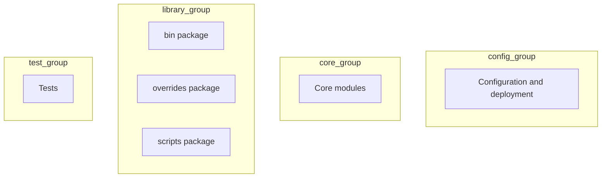

# Architecture report: timarney/react-app-rewired

> Automated static analysis. **Observed** = directly seen in files/imports/AST; **Inferred** = interpretation from that evidence. Repository code was not executed.

## 1. Repository at a glance

| Item | Value |
| --- | --- |
| Repository | timarney/react-app-rewired |
| Description | Override create-react-app webpack configs without ejecting |
| Language | JavaScript |
| Stars | 9836 |
| Licence | MIT |
| Analysed commit / branch | bfe2390b92bb2f32864bdd09b1b6bbecdc261960 / master |
| Framework(s) | React |
| Files analysed | 37 |
| Components | 6 |

## 2. Architecture in one minute

timarney/react-app-rewired - Override create-react-app webpack configs without ejecting. This repository was analysed statically from 37 file(s) (0 Python). Detected technologies (observed from imports/manifests): React. Files are grouped into 6 component(s): bin package, Configuration and deployment, Core modules, overrides package, scripts package, Tests. Findings below distinguish observed facts from inferred interpretation.

## 3. High-level block diagram

## 4. Main components

### bin package (`bin`)

- **Kind:** library
- **Status:** Observed
- **Confidence:** 0.85
- **Responsibility:** Groups 2 file(s) under bin package (observed from repository paths and static analysis).
- **Paths:** `bin/index.js`, `bin/jest.js`
- **Evidence:** [bin/index.js](https://github.com/timarney/react-app-rewired/blob/bfe2390b92bb2f32864bdd09b1b6bbecdc261960/bin/index.js); [bin/jest.js](https://github.com/timarney/react-app-rewired/blob/bfe2390b92bb2f32864bdd09b1b6bbecdc261960/bin/jest.js)

### Configuration and deployment (`config`)

- **Kind:** config
- **Status:** Observed
- **Confidence:** 0.85
- **Responsibility:** Groups 4 file(s) under configuration and deployment (observed from repository paths and static analysis).
- **Paths:** `config/paths.js`, `config/webpack.config.js`, `config/webpackDevServer.config.js`, `package.json`
- **Evidence:** [config/paths.js](https://github.com/timarney/react-app-rewired/blob/bfe2390b92bb2f32864bdd09b1b6bbecdc261960/config/paths.js); [config/webpack.config.js](https://github.com/timarney/react-app-rewired/blob/bfe2390b92bb2f32864bdd09b1b6bbecdc261960/config/webpack.config.js); [config/webpackDevServer.config.js](https://github.com/timarney/react-app-rewired/blob/bfe2390b92bb2f32864bdd09b1b6bbecdc261960/config/webpackDevServer.config.js); [package.json](https://github.com/timarney/react-app-rewired/blob/bfe2390b92bb2f32864bdd09b1b6bbecdc261960/package.json)

### Core modules (`core`)

- **Kind:** core
- **Status:** Observed
- **Confidence:** 0.85
- **Responsibility:** Groups 2 file(s) under core modules (observed from repository paths and static analysis).
- **Paths:** `config-overrides.js`, `index.js`
- **Evidence:** [config-overrides.js](https://github.com/timarney/react-app-rewired/blob/bfe2390b92bb2f32864bdd09b1b6bbecdc261960/config-overrides.js); [index.js](https://github.com/timarney/react-app-rewired/blob/bfe2390b92bb2f32864bdd09b1b6bbecdc261960/index.js)

### overrides package (`overrides`)

- **Kind:** library
- **Status:** Observed
- **Confidence:** 0.85
- **Responsibility:** Groups 4 file(s) under overrides package (observed from repository paths and static analysis).
- **Paths:** `overrides/devServer.js`, `overrides/jest.js`, `overrides/paths.js`, `overrides/webpack.js`
- **Evidence:** [overrides/devServer.js](https://github.com/timarney/react-app-rewired/blob/bfe2390b92bb2f32864bdd09b1b6bbecdc261960/overrides/devServer.js); [overrides/jest.js](https://github.com/timarney/react-app-rewired/blob/bfe2390b92bb2f32864bdd09b1b6bbecdc261960/overrides/jest.js); [overrides/paths.js](https://github.com/timarney/react-app-rewired/blob/bfe2390b92bb2f32864bdd09b1b6bbecdc261960/overrides/paths.js); [overrides/webpack.js](https://github.com/timarney/react-app-rewired/blob/bfe2390b92bb2f32864bdd09b1b6bbecdc261960/overrides/webpack.js)

### scripts package (`scripts`)

- **Kind:** library
- **Status:** Observed
- **Confidence:** 0.85
- **Responsibility:** Groups 7 file(s) under scripts package (observed from repository paths and static analysis).
- **Paths:** `scripts/build.js`, `scripts/start.js`, `scripts/test.js`, `scripts/utils/babelTransform.js`, `scripts/utils/dependRequire.js`, `scripts/utils/paths.js`, `scripts/utils/rewireJestConfig.js`
- **Evidence:** [scripts/build.js](https://github.com/timarney/react-app-rewired/blob/bfe2390b92bb2f32864bdd09b1b6bbecdc261960/scripts/build.js); [scripts/start.js](https://github.com/timarney/react-app-rewired/blob/bfe2390b92bb2f32864bdd09b1b6bbecdc261960/scripts/start.js); [scripts/test.js](https://github.com/timarney/react-app-rewired/blob/bfe2390b92bb2f32864bdd09b1b6bbecdc261960/scripts/test.js); [scripts/utils/babelTransform.js](https://github.com/timarney/react-app-rewired/blob/bfe2390b92bb2f32864bdd09b1b6bbecdc261960/scripts/utils/babelTransform.js); [scripts/utils/dependRequire.js](https://github.com/timarney/react-app-rewired/blob/bfe2390b92bb2f32864bdd09b1b6bbecdc261960/scripts/utils/dependRequire.js); [scripts/utils/paths.js](https://github.com/timarney/react-app-rewired/blob/bfe2390b92bb2f32864bdd09b1b6bbecdc261960/scripts/utils/paths.js); [scripts/utils/rewireJestConfig.js](https://github.com/timarney/react-app-rewired/blob/bfe2390b92bb2f32864bdd09b1b6bbecdc261960/scripts/utils/rewireJestConfig.js)

### Tests (`tests`)

- **Kind:** test
- **Status:** Observed
- **Confidence:** 0.85
- **Responsibility:** Groups 13 file(s) under tests (observed from repository paths and static analysis).
- **Paths:** `test/react-app/.gitignore`, `test/react-app/README.md`, `test/react-app/config-overrides.js`, `test/react-app/package.json`, `test/react-app/public/index.html`, `test/react-app/public/manifest.json`, `test/react-app/src/App.css`, `test/react-app/src/App.js`, `test/react-app/src/App.test.js`, `test/react-app/src/index.css`, `test/react-app/src/index.js`, `test/react-app/src/logo.svg`, `test/react-app/src/serviceWorker.js`
- **Evidence:** [test/react-app/.gitignore](https://github.com/timarney/react-app-rewired/blob/bfe2390b92bb2f32864bdd09b1b6bbecdc261960/test/react-app/.gitignore); [test/react-app/README.md](https://github.com/timarney/react-app-rewired/blob/bfe2390b92bb2f32864bdd09b1b6bbecdc261960/test/react-app/README.md); [test/react-app/config-overrides.js](https://github.com/timarney/react-app-rewired/blob/bfe2390b92bb2f32864bdd09b1b6bbecdc261960/test/react-app/config-overrides.js); [test/react-app/package.json](https://github.com/timarney/react-app-rewired/blob/bfe2390b92bb2f32864bdd09b1b6bbecdc261960/test/react-app/package.json); [test/react-app/public/index.html](https://github.com/timarney/react-app-rewired/blob/bfe2390b92bb2f32864bdd09b1b6bbecdc261960/test/react-app/public/index.html); [test/react-app/public/manifest.json](https://github.com/timarney/react-app-rewired/blob/bfe2390b92bb2f32864bdd09b1b6bbecdc261960/test/react-app/public/manifest.json); [test/react-app/src/App.css](https://github.com/timarney/react-app-rewired/blob/bfe2390b92bb2f32864bdd09b1b6bbecdc261960/test/react-app/src/App.css); [test/react-app/src/App.js](https://github.com/timarney/react-app-rewired/blob/bfe2390b92bb2f32864bdd09b1b6bbecdc261960/test/react-app/src/App.js)

## 5. Execution flow

**Observed** entry point(s):

- [bin/index.js](https://github.com/timarney/react-app-rewired/blob/bfe2390b92bb2f32864bdd09b1b6bbecdc261960/bin/index.js)
- [index.js](https://github.com/timarney/react-app-rewired/blob/bfe2390b92bb2f32864bdd09b1b6bbecdc261960/index.js)

Representative flow (derived from observed entry points and the import graph; steps beyond the entry point are **Inferred**):

1. Execution starts at an observed entry point listed above, if present.
2. No internal import relationships between components were observed.

## 6. Project structure

### `(root)`

- `.gitignore` - other (593 bytes)
- `.travis.yml` - ci, YAML (117 bytes)
- `LICENSE` - docs (1066 bytes)
- `README.md` - docs (24318 bytes)
- `README_zh.md` - docs (22731 bytes)
- `config-overrides.js` - source, JavaScript (904 bytes)
- `index.js` - source, JavaScript (671 bytes)
- `package.json` - manifest (1130 bytes)

### `bin`

- `bin/index.js` - source, JavaScript (1659 bytes)
- `bin/jest.js` - source, JavaScript (1255 bytes)

### `config`

- `config/paths.js` - source, JavaScript (48 bytes)
- `config/webpack.config.js` - source, JavaScript (110 bytes)
- `config/webpackDevServer.config.js` - source, JavaScript (112 bytes)

### `overrides`

- `overrides/devServer.js` - source, JavaScript (449 bytes)
- `overrides/jest.js` - source, JavaScript (1453 bytes)
- `overrides/paths.js` - source, JavaScript (491 bytes)
- `overrides/webpack.js` - source, JavaScript (994 bytes)

### `scripts`

- `scripts/build.js` - source, JavaScript (280 bytes)
- `scripts/start.js` - source, JavaScript (340 bytes)
- `scripts/test.js` - source, JavaScript (304 bytes)
- `scripts/utils/babelTransform.js` - source, JavaScript (670 bytes)
- `scripts/utils/dependRequire.js` - source, JavaScript (262 bytes)
- `scripts/utils/paths.js` - source, JavaScript (1333 bytes)
- `scripts/utils/rewireJestConfig.js` - source, JavaScript (1144 bytes)

### `test`

- `test/react-app/.gitignore` - test (310 bytes)
- `test/react-app/README.md` - test (2881 bytes)
- `test/react-app/config-overrides.js` - test, JavaScript (423 bytes)
- `test/react-app/package.json` - test (589 bytes)
- `test/react-app/public/index.html` - test (1586 bytes)
- `test/react-app/public/manifest.json` - test (306 bytes)
- `test/react-app/src/App.css` - test (468 bytes)
- `test/react-app/src/App.js` - test, JavaScript (636 bytes)
- `test/react-app/src/App.test.js` - test, JavaScript (248 bytes)
- `test/react-app/src/index.css` - test (380 bytes)
- `test/react-app/src/index.js` - test, JavaScript (451 bytes)
- `test/react-app/src/logo.svg` - test (2671 bytes)
- `test/react-app/src/serviceWorker.js` - test, JavaScript (4948 bytes)

## 7. Key dependencies and integrations

| Name | Category | Status | Confidence | Evidence |
| --- | --- | --- | --- | --- |
| React | framework | Observed | 0.90 | [test/react-app/package.json:2](https://github.com/timarney/react-app-rewired/blob/bfe2390b92bb2f32864bdd09b1b6bbecdc261960/test/react-app/package.json#L2); [test/react-app/package.json:7](https://github.com/timarney/react-app-rewired/blob/bfe2390b92bb2f32864bdd09b1b6bbecdc261960/test/react-app/package.json#L7) |

## 8. Data and state

No database, cache, queue, or persistent-state usage was observed in the analysed files. State handling, if any, may be in-memory or in files that were not analysed.

## 9. Configuration and deployment clues

- `.travis.yml` (ci)
- `package.json` (manifest)

## 10. Design observations

- Tests are present alongside source code (Observed from test file paths).

These observations are interpretations (**Inferred**) of the observed structure, not guarantees about runtime design.

## 11. Limitations and unknowns

- Static analysis only: repository code was not executed, installed, or imported at runtime.
- Components and relationships are inferred from file paths, imports, and AST structure; runtime behaviour, dynamic imports, and reflection may not be visible.
- No clear application entry point was observed in the analysed files.
- Repository text was treated as untrusted data; no instructions found in repository files were followed, and likely secret values were redacted/excluded.
- JavaScript and TypeScript files were inventoried from paths and package manifests. They were not parsed with a full language AST, and repository code was not executed.

## 12. Source references

- [bin/index.js](https://github.com/timarney/react-app-rewired/blob/bfe2390b92bb2f32864bdd09b1b6bbecdc261960/bin/index.js)
- [bin/jest.js](https://github.com/timarney/react-app-rewired/blob/bfe2390b92bb2f32864bdd09b1b6bbecdc261960/bin/jest.js)
- [config-overrides.js](https://github.com/timarney/react-app-rewired/blob/bfe2390b92bb2f32864bdd09b1b6bbecdc261960/config-overrides.js)
- [config/paths.js](https://github.com/timarney/react-app-rewired/blob/bfe2390b92bb2f32864bdd09b1b6bbecdc261960/config/paths.js)
- [config/webpack.config.js](https://github.com/timarney/react-app-rewired/blob/bfe2390b92bb2f32864bdd09b1b6bbecdc261960/config/webpack.config.js)
- [config/webpackDevServer.config.js](https://github.com/timarney/react-app-rewired/blob/bfe2390b92bb2f32864bdd09b1b6bbecdc261960/config/webpackDevServer.config.js)
- [index.js](https://github.com/timarney/react-app-rewired/blob/bfe2390b92bb2f32864bdd09b1b6bbecdc261960/index.js)
- [overrides/devServer.js](https://github.com/timarney/react-app-rewired/blob/bfe2390b92bb2f32864bdd09b1b6bbecdc261960/overrides/devServer.js)
- [overrides/jest.js](https://github.com/timarney/react-app-rewired/blob/bfe2390b92bb2f32864bdd09b1b6bbecdc261960/overrides/jest.js)
- [overrides/paths.js](https://github.com/timarney/react-app-rewired/blob/bfe2390b92bb2f32864bdd09b1b6bbecdc261960/overrides/paths.js)
- [overrides/webpack.js](https://github.com/timarney/react-app-rewired/blob/bfe2390b92bb2f32864bdd09b1b6bbecdc261960/overrides/webpack.js)
- [package.json](https://github.com/timarney/react-app-rewired/blob/bfe2390b92bb2f32864bdd09b1b6bbecdc261960/package.json)
- [scripts/build.js](https://github.com/timarney/react-app-rewired/blob/bfe2390b92bb2f32864bdd09b1b6bbecdc261960/scripts/build.js)
- [scripts/start.js](https://github.com/timarney/react-app-rewired/blob/bfe2390b92bb2f32864bdd09b1b6bbecdc261960/scripts/start.js)
- [scripts/test.js](https://github.com/timarney/react-app-rewired/blob/bfe2390b92bb2f32864bdd09b1b6bbecdc261960/scripts/test.js)
- [scripts/utils/babelTransform.js](https://github.com/timarney/react-app-rewired/blob/bfe2390b92bb2f32864bdd09b1b6bbecdc261960/scripts/utils/babelTransform.js)
- [scripts/utils/dependRequire.js](https://github.com/timarney/react-app-rewired/blob/bfe2390b92bb2f32864bdd09b1b6bbecdc261960/scripts/utils/dependRequire.js)
- [scripts/utils/paths.js](https://github.com/timarney/react-app-rewired/blob/bfe2390b92bb2f32864bdd09b1b6bbecdc261960/scripts/utils/paths.js)
- [scripts/utils/rewireJestConfig.js](https://github.com/timarney/react-app-rewired/blob/bfe2390b92bb2f32864bdd09b1b6bbecdc261960/scripts/utils/rewireJestConfig.js)
- [test/react-app/.gitignore](https://github.com/timarney/react-app-rewired/blob/bfe2390b92bb2f32864bdd09b1b6bbecdc261960/test/react-app/.gitignore)
- [test/react-app/README.md](https://github.com/timarney/react-app-rewired/blob/bfe2390b92bb2f32864bdd09b1b6bbecdc261960/test/react-app/README.md)
- [test/react-app/config-overrides.js](https://github.com/timarney/react-app-rewired/blob/bfe2390b92bb2f32864bdd09b1b6bbecdc261960/test/react-app/config-overrides.js)
- [test/react-app/package.json](https://github.com/timarney/react-app-rewired/blob/bfe2390b92bb2f32864bdd09b1b6bbecdc261960/test/react-app/package.json)
- [test/react-app/package.json:2](https://github.com/timarney/react-app-rewired/blob/bfe2390b92bb2f32864bdd09b1b6bbecdc261960/test/react-app/package.json#L2)
- [test/react-app/package.json:7](https://github.com/timarney/react-app-rewired/blob/bfe2390b92bb2f32864bdd09b1b6bbecdc261960/test/react-app/package.json#L7)
- [test/react-app/public/index.html](https://github.com/timarney/react-app-rewired/blob/bfe2390b92bb2f32864bdd09b1b6bbecdc261960/test/react-app/public/index.html)
- [test/react-app/public/manifest.json](https://github.com/timarney/react-app-rewired/blob/bfe2390b92bb2f32864bdd09b1b6bbecdc261960/test/react-app/public/manifest.json)
- [test/react-app/src/App.css](https://github.com/timarney/react-app-rewired/blob/bfe2390b92bb2f32864bdd09b1b6bbecdc261960/test/react-app/src/App.css)
- [test/react-app/src/App.js](https://github.com/timarney/react-app-rewired/blob/bfe2390b92bb2f32864bdd09b1b6bbecdc261960/test/react-app/src/App.js)
