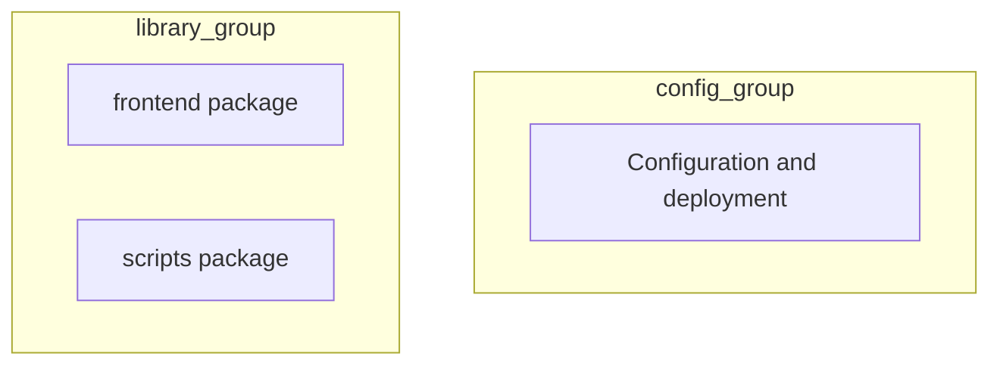

# Architecture report: timqian/chinese-independent-blogs

> Automated static analysis. **Observed** = directly seen in files/imports/AST; **Inferred** = interpretation from that evidence. Repository code was not executed.

## 1. Repository at a glance

| Item | Value |
| --- | --- |
| Repository | timqian/chinese-independent-blogs |
| Description | 中文独立博客列表 |
| Language | JavaScript |
| Stars | 24470 |
| Licence | MIT |
| Analysed commit / branch | 6efc52fec8a2dc34650ba126ecd7b366d9ec109b / master |
| Framework(s) | None detected |
| Files analysed | 37 |
| Components | 3 |

## 2. Architecture in one minute

timqian/chinese-independent-blogs - 中文独立博客列表. This repository was analysed statically from 37 file(s) (0 Python). Detected technologies (observed from imports/manifests): GitHub Actions. Files are grouped into 3 component(s): Configuration and deployment, frontend package, scripts package. Findings below distinguish observed facts from inferred interpretation.

## 3. High-level block diagram

## 4. Main components

### Configuration and deployment (`config`)

- **Kind:** config
- **Status:** Observed
- **Confidence:** 0.85
- **Responsibility:** Groups 2 file(s) under configuration and deployment (observed from repository paths and static analysis).
- **Paths:** `frontend/package.json`, `package.json`
- **Evidence:** [frontend/package.json](https://github.com/timqian/chinese-independent-blogs/blob/6efc52fec8a2dc34650ba126ecd7b366d9ec109b/frontend/package.json); [package.json](https://github.com/timqian/chinese-independent-blogs/blob/6efc52fec8a2dc34650ba126ecd7b366d9ec109b/package.json)

### frontend package (`frontend`)

- **Kind:** library
- **Status:** Observed
- **Confidence:** 0.85
- **Responsibility:** Groups 9 file(s) under frontend package (observed from repository paths and static analysis).
- **Paths:** `frontend/public/app.js`, `frontend/worker/auth.js`, `frontend/worker/categories.js`, `frontend/worker/crawl.js`, `frontend/worker/discuss.js`, `frontend/worker/favicon.js`, `frontend/worker/index.js`, `frontend/worker/telegram.js`, `frontend/worker/views.js`
- **Evidence:** [frontend/public/app.js](https://github.com/timqian/chinese-independent-blogs/blob/6efc52fec8a2dc34650ba126ecd7b366d9ec109b/frontend/public/app.js); [frontend/worker/auth.js](https://github.com/timqian/chinese-independent-blogs/blob/6efc52fec8a2dc34650ba126ecd7b366d9ec109b/frontend/worker/auth.js); [frontend/worker/categories.js](https://github.com/timqian/chinese-independent-blogs/blob/6efc52fec8a2dc34650ba126ecd7b366d9ec109b/frontend/worker/categories.js); [frontend/worker/crawl.js](https://github.com/timqian/chinese-independent-blogs/blob/6efc52fec8a2dc34650ba126ecd7b366d9ec109b/frontend/worker/crawl.js); [frontend/worker/discuss.js](https://github.com/timqian/chinese-independent-blogs/blob/6efc52fec8a2dc34650ba126ecd7b366d9ec109b/frontend/worker/discuss.js); [frontend/worker/favicon.js](https://github.com/timqian/chinese-independent-blogs/blob/6efc52fec8a2dc34650ba126ecd7b366d9ec109b/frontend/worker/favicon.js); [frontend/worker/index.js](https://github.com/timqian/chinese-independent-blogs/blob/6efc52fec8a2dc34650ba126ecd7b366d9ec109b/frontend/worker/index.js); [frontend/worker/telegram.js](https://github.com/timqian/chinese-independent-blogs/blob/6efc52fec8a2dc34650ba126ecd7b366d9ec109b/frontend/worker/telegram.js)

### scripts package (`scripts`)

- **Kind:** library
- **Status:** Observed
- **Confidence:** 0.85
- **Responsibility:** Groups 4 file(s) under scripts package (observed from repository paths and static analysis).
- **Paths:** `scripts/generate-opml.mjs`, `scripts/lib/feed.mjs`, `scripts/lint.mjs`, `scripts/render-readme.mjs`
- **Evidence:** [scripts/generate-opml.mjs](https://github.com/timqian/chinese-independent-blogs/blob/6efc52fec8a2dc34650ba126ecd7b366d9ec109b/scripts/generate-opml.mjs); [scripts/lib/feed.mjs](https://github.com/timqian/chinese-independent-blogs/blob/6efc52fec8a2dc34650ba126ecd7b366d9ec109b/scripts/lib/feed.mjs); [scripts/lint.mjs](https://github.com/timqian/chinese-independent-blogs/blob/6efc52fec8a2dc34650ba126ecd7b366d9ec109b/scripts/lint.mjs); [scripts/render-readme.mjs](https://github.com/timqian/chinese-independent-blogs/blob/6efc52fec8a2dc34650ba126ecd7b366d9ec109b/scripts/render-readme.mjs)

## 5. Execution flow

**Observed** entry point(s):

- [frontend/public/app.js](https://github.com/timqian/chinese-independent-blogs/blob/6efc52fec8a2dc34650ba126ecd7b366d9ec109b/frontend/public/app.js)
- [frontend/worker/index.js](https://github.com/timqian/chinese-independent-blogs/blob/6efc52fec8a2dc34650ba126ecd7b366d9ec109b/frontend/worker/index.js)

Representative flow (derived from observed entry points and the import graph; steps beyond the entry point are **Inferred**):

1. Execution starts at an observed entry point listed above, if present.
2. No internal import relationships between components were observed.

## 6. Project structure

### `(root)`

- `.gitignore` - other (89 bytes)
- `LICENSE` - docs (1065 bytes)
- `README.md` - docs (159467 bytes)
- `blogs-original.csv` - data (159428 bytes)
- `package.json` - manifest (465 bytes)

### `.github`

- `.github/FUNDING.yml` - config (63 bytes)
- `.github/workflows/pr_lint.yml` - ci, YAML (272 bytes)
- `.github/workflows/updateInfo.yml` - ci, YAML (1292 bytes)

### `frontend`

- `frontend/README.md` - docs (8367 bytes)
- `frontend/migrations/0001_init.sql` - data, SQL (1897 bytes)
- `frontend/migrations/0002_blog_num.sql` - data, SQL (270 bytes)
- `frontend/migrations/0003_users.sql` - data, SQL (2515 bytes)
- `frontend/migrations/0004_notifications.sql` - data, SQL (615 bytes)
- `frontend/migrations/0005_follows.sql` - data, SQL (240 bytes)
- `frontend/migrations/0006_avatars.sql` - data, SQL (291 bytes)
- `frontend/migrations/0007_next_check.sql` - data, SQL (435 bytes)
- `frontend/migrations/0008_conditional_get.sql` - data, SQL (237 bytes)
- `frontend/migrations/0009_dead_since.sql` - data, SQL (473 bytes)
- `frontend/migrations/0010_blocked_blogs.sql` - data, SQL (247 bytes)
- `frontend/package.json` - manifest (699 bytes)
- `frontend/public/app.js` - source, JavaScript (6390 bytes)
- `frontend/public/favicon.svg` - other (293 bytes)
- `frontend/public/style.css` - other (25420 bytes)
- `frontend/scripts/seed-dev.sql` - data, SQL (1314 bytes)
- `frontend/worker/auth.js` - source, JavaScript (17264 bytes)
- `frontend/worker/categories.js` - source, JavaScript (1643 bytes)
- `frontend/worker/crawl.js` - source, JavaScript (15381 bytes)
- `frontend/worker/discuss.js` - source, JavaScript (12830 bytes)
- `frontend/worker/favicon.js` - source, JavaScript (3804 bytes)
- `frontend/worker/index.js` - source, JavaScript (32620 bytes)
- `frontend/worker/telegram.js` - source, JavaScript (3624 bytes)
- `frontend/worker/views.js` - source, JavaScript (49320 bytes)
- `frontend/wrangler.jsonc` - other (2535 bytes)

### `scripts`

- `scripts/generate-opml.mjs` - source, JavaScript (988 bytes)
- `scripts/lib/feed.mjs` - source, JavaScript (10547 bytes)
- `scripts/lint.mjs` - source, JavaScript (3666 bytes)
- `scripts/render-readme.mjs` - source, JavaScript (4009 bytes)

## 7. Key dependencies and integrations

| Name | Category | Status | Confidence | Evidence |
| --- | --- | --- | --- | --- |
| GitHub Actions | ci | Observed | 0.90 | [.github/workflows/pr_lint.yml](https://github.com/timqian/chinese-independent-blogs/blob/6efc52fec8a2dc34650ba126ecd7b366d9ec109b/.github/workflows/pr_lint.yml); [.github/workflows/updateInfo.yml](https://github.com/timqian/chinese-independent-blogs/blob/6efc52fec8a2dc34650ba126ecd7b366d9ec109b/.github/workflows/updateInfo.yml) |

## 8. Data and state

No database, cache, queue, or persistent-state usage was observed in the analysed files. State handling, if any, may be in-memory or in files that were not analysed.

## 9. Configuration and deployment clues

- `.github/FUNDING.yml` (config)
- `.github/workflows/pr_lint.yml` (ci)
- `.github/workflows/updateInfo.yml` (ci)
- `frontend/package.json` (manifest)
- `package.json` (manifest)

## 10. Design observations

- No strong design patterns could be established from the available evidence.

These observations are interpretations (**Inferred**) of the observed structure, not guarantees about runtime design.

## 11. Limitations and unknowns

- Static analysis only: repository code was not executed, installed, or imported at runtime.
- Components and relationships are inferred from file paths, imports, and AST structure; runtime behaviour, dynamic imports, and reflection may not be visible.
- 1 file(s) were skipped during inventory (1 x lockfile excluded).
- No clear application entry point was observed in the analysed files.
- Repository text was treated as untrusted data; no instructions found in repository files were followed, and likely secret values were redacted/excluded.
- JavaScript and TypeScript files were inventoried from paths and package manifests. They were not parsed with a full language AST, and repository code was not executed.

## 12. Source references

- [.github/workflows/pr_lint.yml](https://github.com/timqian/chinese-independent-blogs/blob/6efc52fec8a2dc34650ba126ecd7b366d9ec109b/.github/workflows/pr_lint.yml)
- [.github/workflows/updateInfo.yml](https://github.com/timqian/chinese-independent-blogs/blob/6efc52fec8a2dc34650ba126ecd7b366d9ec109b/.github/workflows/updateInfo.yml)
- [frontend/package.json](https://github.com/timqian/chinese-independent-blogs/blob/6efc52fec8a2dc34650ba126ecd7b366d9ec109b/frontend/package.json)
- [frontend/public/app.js](https://github.com/timqian/chinese-independent-blogs/blob/6efc52fec8a2dc34650ba126ecd7b366d9ec109b/frontend/public/app.js)
- [frontend/worker/auth.js](https://github.com/timqian/chinese-independent-blogs/blob/6efc52fec8a2dc34650ba126ecd7b366d9ec109b/frontend/worker/auth.js)
- [frontend/worker/categories.js](https://github.com/timqian/chinese-independent-blogs/blob/6efc52fec8a2dc34650ba126ecd7b366d9ec109b/frontend/worker/categories.js)
- [frontend/worker/crawl.js](https://github.com/timqian/chinese-independent-blogs/blob/6efc52fec8a2dc34650ba126ecd7b366d9ec109b/frontend/worker/crawl.js)
- [frontend/worker/discuss.js](https://github.com/timqian/chinese-independent-blogs/blob/6efc52fec8a2dc34650ba126ecd7b366d9ec109b/frontend/worker/discuss.js)
- [frontend/worker/favicon.js](https://github.com/timqian/chinese-independent-blogs/blob/6efc52fec8a2dc34650ba126ecd7b366d9ec109b/frontend/worker/favicon.js)
- [frontend/worker/index.js](https://github.com/timqian/chinese-independent-blogs/blob/6efc52fec8a2dc34650ba126ecd7b366d9ec109b/frontend/worker/index.js)
- [frontend/worker/telegram.js](https://github.com/timqian/chinese-independent-blogs/blob/6efc52fec8a2dc34650ba126ecd7b366d9ec109b/frontend/worker/telegram.js)
- [package.json](https://github.com/timqian/chinese-independent-blogs/blob/6efc52fec8a2dc34650ba126ecd7b366d9ec109b/package.json)
- [scripts/generate-opml.mjs](https://github.com/timqian/chinese-independent-blogs/blob/6efc52fec8a2dc34650ba126ecd7b366d9ec109b/scripts/generate-opml.mjs)
- [scripts/lib/feed.mjs](https://github.com/timqian/chinese-independent-blogs/blob/6efc52fec8a2dc34650ba126ecd7b366d9ec109b/scripts/lib/feed.mjs)
- [scripts/lint.mjs](https://github.com/timqian/chinese-independent-blogs/blob/6efc52fec8a2dc34650ba126ecd7b366d9ec109b/scripts/lint.mjs)
- [scripts/render-readme.mjs](https://github.com/timqian/chinese-independent-blogs/blob/6efc52fec8a2dc34650ba126ecd7b366d9ec109b/scripts/render-readme.mjs)
