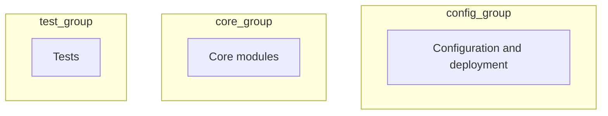

# Architecture report: tj/co

> Automated static analysis. **Observed** = directly seen in files/imports/AST; **Inferred** = interpretation from that evidence. Repository code was not executed.

## 1. Repository at a glance

| Item | Value |
| --- | --- |
| Repository | tj/co |
| Description | The ultimate generator based flow-control goodness for nodejs (supports thunks, promises, etc) |
| Language | JavaScript |
| Stars | 11823 |
| Licence | MIT |
| Analysed commit / branch | 249bbdc72da24ae44076afd716349d2089b31c4c / master |
| Framework(s) | None detected |
| Files analysed | 19 |
| Components | 3 |

## 2. Architecture in one minute

tj/co - The ultimate generator based flow-control goodness for nodejs (supports thunks, promises, etc). This repository was analysed statically from 19 file(s) (0 Python). Detected technologies (observed from imports/manifests): no known frameworks/libraries. Files are grouped into 3 component(s): Configuration and deployment, Core modules, Tests. Findings below distinguish observed facts from inferred interpretation.

## 3. High-level block diagram

## 4. Main components

### Configuration and deployment (`config`)

- **Kind:** config
- **Status:** Observed
- **Confidence:** 0.85
- **Responsibility:** Groups 2 file(s) under configuration and deployment (observed from repository paths and static analysis).
- **Paths:** `component.json`, `package.json`
- **Evidence:** [component.json](https://github.com/tj/co/blob/249bbdc72da24ae44076afd716349d2089b31c4c/component.json); [package.json](https://github.com/tj/co/blob/249bbdc72da24ae44076afd716349d2089b31c4c/package.json)

### Core modules (`core`)

- **Kind:** core
- **Status:** Observed
- **Confidence:** 0.85
- **Responsibility:** Groups 1 file(s) under core modules (observed from repository paths and static analysis).
- **Paths:** `index.js`
- **Evidence:** [index.js](https://github.com/tj/co/blob/249bbdc72da24ae44076afd716349d2089b31c4c/index.js)

### Tests (`tests`)

- **Kind:** test
- **Status:** Observed
- **Confidence:** 0.85
- **Responsibility:** Groups 11 file(s) under tests (observed from repository paths and static analysis).
- **Paths:** `test/arguments.js`, `test/arrays.js`, `test/context.js`, `test/generator-functions.js`, `test/generators.js`, `test/invalid.js`, `test/objects.js`, `test/promises.js`, `test/recursion.js`, `test/thunks.js`, `test/wrap.js`
- **Evidence:** [test/arguments.js](https://github.com/tj/co/blob/249bbdc72da24ae44076afd716349d2089b31c4c/test/arguments.js); [test/arrays.js](https://github.com/tj/co/blob/249bbdc72da24ae44076afd716349d2089b31c4c/test/arrays.js); [test/context.js](https://github.com/tj/co/blob/249bbdc72da24ae44076afd716349d2089b31c4c/test/context.js); [test/generator-functions.js](https://github.com/tj/co/blob/249bbdc72da24ae44076afd716349d2089b31c4c/test/generator-functions.js); [test/generators.js](https://github.com/tj/co/blob/249bbdc72da24ae44076afd716349d2089b31c4c/test/generators.js); [test/invalid.js](https://github.com/tj/co/blob/249bbdc72da24ae44076afd716349d2089b31c4c/test/invalid.js); [test/objects.js](https://github.com/tj/co/blob/249bbdc72da24ae44076afd716349d2089b31c4c/test/objects.js); [test/promises.js](https://github.com/tj/co/blob/249bbdc72da24ae44076afd716349d2089b31c4c/test/promises.js)

## 5. Execution flow

**Observed** entry point(s):

- [index.js](https://github.com/tj/co/blob/249bbdc72da24ae44076afd716349d2089b31c4c/index.js)

Representative flow (derived from observed entry points and the import graph; steps beyond the entry point are **Inferred**):

1. Execution starts at an observed entry point listed above, if present.
2. No internal import relationships between components were observed.

## 6. Project structure

### `(root)`

- `.gitignore` - other (35 bytes)
- `.travis.yml` - ci, YAML (179 bytes)
- `History.md` - docs (3629 bytes)
- `LICENSE` - docs (1104 bytes)
- `Readme.md` - docs (5383 bytes)
- `component.json` - config (256 bytes)
- `index.js` - source, JavaScript (5058 bytes)
- `package.json` - manifest (886 bytes)

### `test`

- `test/arguments.js` - test, JavaScript (440 bytes)
- `test/arrays.js` - test, JavaScript (888 bytes)
- `test/context.js` - test, JavaScript (258 bytes)
- `test/generator-functions.js` - test, JavaScript (954 bytes)
- `test/generators.js` - test, JavaScript (952 bytes)
- `test/invalid.js` - test, JavaScript (385 bytes)
- `test/objects.js` - test, JavaScript (2050 bytes)
- `test/promises.js` - test, JavaScript (2170 bytes)
- `test/recursion.js` - test, JavaScript (1070 bytes)
- `test/thunks.js` - test, JavaScript (6624 bytes)
- `test/wrap.js` - test, JavaScript (673 bytes)

## 7. Key dependencies and integrations

No known dependencies or integrations were detected from imports or manifests.

## 8. Data and state

No database, cache, queue, or persistent-state usage was observed in the analysed files. State handling, if any, may be in-memory or in files that were not analysed.

## 9. Configuration and deployment clues

- `.travis.yml` (ci)
- `component.json` (config)
- `package.json` (manifest)

## 10. Design observations

- Tests are present alongside source code (Observed from test file paths).

These observations are interpretations (**Inferred**) of the observed structure, not guarantees about runtime design.

## 11. Limitations and unknowns

- Static analysis only: repository code was not executed, installed, or imported at runtime.
- Components and relationships are inferred from file paths, imports, and AST structure; runtime behaviour, dynamic imports, and reflection may not be visible.
- No clear application entry point was observed in the analysed files.
- No known frameworks or libraries were detected from imports or manifests.
- Repository text was treated as untrusted data; no instructions found in repository files were followed, and likely secret values were redacted/excluded.
- JavaScript and TypeScript files were inventoried from paths and package manifests. They were not parsed with a full language AST, and repository code was not executed.

## 12. Source references

- [component.json](https://github.com/tj/co/blob/249bbdc72da24ae44076afd716349d2089b31c4c/component.json)
- [index.js](https://github.com/tj/co/blob/249bbdc72da24ae44076afd716349d2089b31c4c/index.js)
- [package.json](https://github.com/tj/co/blob/249bbdc72da24ae44076afd716349d2089b31c4c/package.json)
- [test/arguments.js](https://github.com/tj/co/blob/249bbdc72da24ae44076afd716349d2089b31c4c/test/arguments.js)
- [test/arrays.js](https://github.com/tj/co/blob/249bbdc72da24ae44076afd716349d2089b31c4c/test/arrays.js)
- [test/context.js](https://github.com/tj/co/blob/249bbdc72da24ae44076afd716349d2089b31c4c/test/context.js)
- [test/generator-functions.js](https://github.com/tj/co/blob/249bbdc72da24ae44076afd716349d2089b31c4c/test/generator-functions.js)
- [test/generators.js](https://github.com/tj/co/blob/249bbdc72da24ae44076afd716349d2089b31c4c/test/generators.js)
- [test/invalid.js](https://github.com/tj/co/blob/249bbdc72da24ae44076afd716349d2089b31c4c/test/invalid.js)
- [test/objects.js](https://github.com/tj/co/blob/249bbdc72da24ae44076afd716349d2089b31c4c/test/objects.js)
- [test/promises.js](https://github.com/tj/co/blob/249bbdc72da24ae44076afd716349d2089b31c4c/test/promises.js)
