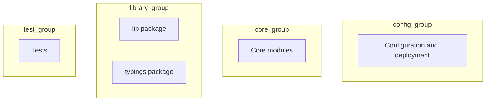

# Architecture report: tj/commander.js

> Automated static analysis. **Observed** = directly seen in files/imports/AST; **Inferred** = interpretation from that evidence. Repository code was not executed.

## 1. Repository at a glance

| Item | Value |
| --- | --- |
| Repository | tj/commander.js |
| Description | node.js command-line interfaces made easy |
| Language | JavaScript |
| Stars | 28453 |
| Licence | MIT |
| Analysed commit / branch | a5a7dc084d4d2b7932e85ca049c5204e50a2c721 / master |
| Framework(s) | None detected |
| Files analysed | 216 |
| Components | 5 |

## 2. Architecture in one minute

tj/commander.js - node.js command-line interfaces made easy. This repository was analysed statically from 216 file(s) (0 Python). Detected technologies (observed from imports/manifests): GitHub Actions, TypeScript. Files are grouped into 5 component(s): Configuration and deployment, Core modules, lib package, Tests, typings package. Findings below distinguish observed facts from inferred interpretation.

## 3. High-level block diagram

## 4. Main components

### Configuration and deployment (`config`)

- **Kind:** config
- **Status:** Observed
- **Confidence:** 0.85
- **Responsibility:** Groups 5 file(s) under configuration and deployment (observed from repository paths and static analysis).
- **Paths:** `package-support.json`, `package.json`, `tsconfig.js.json`, `tsconfig.json`, `tsconfig.ts.json`
- **Evidence:** [package-support.json](https://github.com/tj/commander.js/blob/a5a7dc084d4d2b7932e85ca049c5204e50a2c721/package-support.json); [package.json](https://github.com/tj/commander.js/blob/a5a7dc084d4d2b7932e85ca049c5204e50a2c721/package.json); [tsconfig.js.json](https://github.com/tj/commander.js/blob/a5a7dc084d4d2b7932e85ca049c5204e50a2c721/tsconfig.js.json); [tsconfig.json](https://github.com/tj/commander.js/blob/a5a7dc084d4d2b7932e85ca049c5204e50a2c721/tsconfig.json); [tsconfig.ts.json](https://github.com/tj/commander.js/blob/a5a7dc084d4d2b7932e85ca049c5204e50a2c721/tsconfig.ts.json)

### Core modules (`core`)

- **Kind:** core
- **Status:** Observed
- **Confidence:** 0.85
- **Responsibility:** Groups 2 file(s) under core modules (observed from repository paths and static analysis).
- **Paths:** `eslint.config.js`, `index.js`
- **Evidence:** [eslint.config.js](https://github.com/tj/commander.js/blob/a5a7dc084d4d2b7932e85ca049c5204e50a2c721/eslint.config.js); [index.js](https://github.com/tj/commander.js/blob/a5a7dc084d4d2b7932e85ca049c5204e50a2c721/index.js)

### lib package (`lib`)

- **Kind:** library
- **Status:** Observed
- **Confidence:** 0.85
- **Responsibility:** Groups 6 file(s) under lib package (observed from repository paths and static analysis).
- **Paths:** `lib/argument.js`, `lib/command.js`, `lib/error.js`, `lib/help.js`, `lib/option.js`, `lib/suggestSimilar.js`
- **Evidence:** [lib/argument.js](https://github.com/tj/commander.js/blob/a5a7dc084d4d2b7932e85ca049c5204e50a2c721/lib/argument.js); [lib/command.js](https://github.com/tj/commander.js/blob/a5a7dc084d4d2b7932e85ca049c5204e50a2c721/lib/command.js); [lib/error.js](https://github.com/tj/commander.js/blob/a5a7dc084d4d2b7932e85ca049c5204e50a2c721/lib/error.js); [lib/help.js](https://github.com/tj/commander.js/blob/a5a7dc084d4d2b7932e85ca049c5204e50a2c721/lib/help.js); [lib/option.js](https://github.com/tj/commander.js/blob/a5a7dc084d4d2b7932e85ca049c5204e50a2c721/lib/option.js); [lib/suggestSimilar.js](https://github.com/tj/commander.js/blob/a5a7dc084d4d2b7932e85ca049c5204e50a2c721/lib/suggestSimilar.js)

### Tests (`tests`)

- **Kind:** test
- **Status:** Observed
- **Confidence:** 0.85
- **Responsibility:** Groups 130 file(s) under tests (observed from repository paths and static analysis).
- **Paths:** `tests/args.literal.test.js`, `tests/args.variadic.test.js`, `tests/argument.chain.test.js`, `tests/argument.choices.test.js`, `tests/argument.custom-processing.test.js`, `tests/argument.required.test.js`, `tests/argument.variadic.test.js`, `tests/command.action.test.js`, `tests/command.addCommand.test.js`, `tests/command.addHelpOption.test.js`, `tests/command.addHelpText.test.js`, `tests/command.alias.test.js`, `tests/command.allowExcessArguments.test.js`, `tests/command.allowUnknownOption.test.js`, `tests/command.argumentVariations.test.js`, `tests/command.asterisk.test.js`, `tests/command.chain.test.js`, `tests/command.commandHelp.test.js`, `tests/command.configureHelp.test.js`, `tests/command.configureOutput.test.js`, `tests/command.copySettings.test.js`, `tests/command.createArgument.test.js`, `tests/command.createHelp.test.js`, `tests/command.createOption.test.js`, `tests/command.default.test.js`, `tests/command.description.test.js`, `tests/command.error.test.js`, `tests/command.executableSubcommand.inspect.test.js`, `tests/command.executableSubcommand.lookup.test.js`, `tests/command.executableSubcommand.mock.test.cjs`, `tests/command.executableSubcommand.search.test.cjs`, `tests/command.executableSubcommand.signals.test.js`, `tests/command.executableSubcommand.test.js`, `tests/command.exitOverride.test.js`, `tests/command.help.test.js`, `tests/command.helpCommand.test.js`, `tests/command.helpOption.test.js`, `tests/command.hook.test.js`, `tests/command.name.test.js`, `tests/command.nested.test.js`, `tests/command.onCommand.test.js`, `tests/command.option-misuse.test.js`, `tests/command.parse.test.js`, `tests/command.parseOptions.test.js`, `tests/command.positionalOptions.test.js`, `tests/command.registerClash.test.js`, `tests/command.showHelpAfterError.test.js`, `tests/command.showSuggestionAfterError.test.js`, `tests/command.summary.test.js`, `tests/command.unknownCommand.test.js`, `tests/command.unknownOption.test.js`, `tests/command.usage.test.js`, `tests/commander.storeOptionsAsProperties.test.js`, `tests/createCommand.test.js`, `tests/deprecated.test.js`, `tests/fixtures-extensions/pm-try-cjs.cjs`, `tests/fixtures-extensions/pm-try-mjs.mjs`, `tests/fixtures-extensions/pm-try-ts.ts`, `tests/fixtures-extensions/pm.js`, `tests/fixtures/inspect-sub.js`, `tests/fixtures/inspect.js`, `tests/fixtures/pm`, `tests/fixtures/pm-cache-clear.js`, `tests/fixtures/pm-cache-validate.js`, `tests/fixtures/pm-cache.js`, `tests/fixtures/pm-default`, `tests/fixtures/pm-echo.js`, `tests/fixtures/pm-fail.js`, `tests/fixtures/pm-install`, `tests/fixtures/pm-listen`, `tests/fixtures/pm-publish.js`, `tests/fixtures/pm-search`, `tests/fixtures/pm-silent`, `tests/fixtures/pm-terminate.js`, `tests/fixtures/pmlink-install`, `tests/help.argumentDescription.test.js`, `tests/help.boxWrap.test.js`, `tests/help.commandTerm.test.js`, `tests/help.commandUsage.test.js`, `tests/help.longestArgumentTermLength.test.js`, `tests/help.longestCommandTermLength.test.js`, `tests/help.longestOptionTermLength.test.js`, `tests/help.minWidthToWrap.test.js`, `tests/help.optionDescription.test.js`, `tests/help.optionTerm.test.js`, `tests/help.padWidth.test.js`, `tests/help.preformatted.test.js`, `tests/help.showGlobalOptions.test.js`, `tests/help.sortCommands.test.js`, `tests/help.sortOptions.test.js`, `tests/help.style.test.js`, `tests/help.subcommandDescription.test.js`, `tests/help.suggestion.test.js`, `tests/help.visibleArguments.test.js`, `tests/help.visibleCommands.test.js`, `tests/help.visibleGlobalOptions.test.js`, `tests/help.visibleOptions.test.js`, `tests/helpGroup.test.js`, `tests/imports.test.cjs`, `tests/imports.test.mjs`, `tests/incrementNodeInspectorPort.test.cjs`, `tests/negatives.test.js`, `tests/option.bad-flags.test.js`, `tests/option.chain.test.js`, `tests/options.bool.combo.test.js`, `tests/options.bool.small.combined.test.js`, `tests/options.bool.test.js`, `tests/options.camelcase.test.js`, `tests/options.choices.test.js`, `tests/options.conflicts.test.js`, `tests/options.custom-processing.test.js`, `tests/options.default.test.js`, `tests/options.dual-options.test.js`, `tests/options.env.test.js`, `tests/options.flags.test.js`, `tests/options.getset.test.js`, `tests/options.implies.test.js`, `tests/options.mandatory.test.js`, `tests/options.optional.test.js`, `tests/options.opts.test.js`, `tests/options.optsWithGlobals.test.js`, `tests/options.preset.test.js`, `tests/options.registerClash.test.js`, `tests/options.required.test.js`, `tests/options.twice.test.js`, `tests/options.values.test.js`, `tests/options.variadic.test.js`, `tests/options.version.test.js`, `tests/testHelpers.js`, `tests/useColor.test.js`
- **Evidence:** [tests/args.literal.test.js](https://github.com/tj/commander.js/blob/a5a7dc084d4d2b7932e85ca049c5204e50a2c721/tests/args.literal.test.js); [tests/args.variadic.test.js](https://github.com/tj/commander.js/blob/a5a7dc084d4d2b7932e85ca049c5204e50a2c721/tests/args.variadic.test.js); [tests/argument.chain.test.js](https://github.com/tj/commander.js/blob/a5a7dc084d4d2b7932e85ca049c5204e50a2c721/tests/argument.chain.test.js); [tests/argument.choices.test.js](https://github.com/tj/commander.js/blob/a5a7dc084d4d2b7932e85ca049c5204e50a2c721/tests/argument.choices.test.js); [tests/argument.custom-processing.test.js](https://github.com/tj/commander.js/blob/a5a7dc084d4d2b7932e85ca049c5204e50a2c721/tests/argument.custom-processing.test.js); [tests/argument.required.test.js](https://github.com/tj/commander.js/blob/a5a7dc084d4d2b7932e85ca049c5204e50a2c721/tests/argument.required.test.js); [tests/argument.variadic.test.js](https://github.com/tj/commander.js/blob/a5a7dc084d4d2b7932e85ca049c5204e50a2c721/tests/argument.variadic.test.js); [tests/command.action.test.js](https://github.com/tj/commander.js/blob/a5a7dc084d4d2b7932e85ca049c5204e50a2c721/tests/command.action.test.js)

### typings package (`typings`)

- **Kind:** library
- **Status:** Observed
- **Confidence:** 0.85
- **Responsibility:** Groups 2 file(s) under typings package (observed from repository paths and static analysis).
- **Paths:** `typings/index.d.ts`, `typings/index.test-d.ts`
- **Evidence:** [typings/index.d.ts](https://github.com/tj/commander.js/blob/a5a7dc084d4d2b7932e85ca049c5204e50a2c721/typings/index.d.ts); [typings/index.test-d.ts](https://github.com/tj/commander.js/blob/a5a7dc084d4d2b7932e85ca049c5204e50a2c721/typings/index.test-d.ts)

## 5. Execution flow

**Observed** entry point(s):

- [index.js](https://github.com/tj/commander.js/blob/a5a7dc084d4d2b7932e85ca049c5204e50a2c721/index.js)

Representative flow (derived from observed entry points and the import graph; steps beyond the entry point are **Inferred**):

1. Execution starts at an observed entry point listed above, if present.
2. No internal import relationships between components were observed.

## 6. Project structure

### `(root)`

- `.editorconfig` - config (228 bytes)
- `.gitattributes` - other (147 bytes)
- `.gitignore` - other (55 bytes)
- `.prettierignore` - other (158 bytes)
- `.prettierrc.js` - source, JavaScript (143 bytes)
- `AI_POLICY.md` - docs (1340 bytes)
- `CHANGELOG.md` - docs (63673 bytes)
- `CONTRIBUTING.md` - docs (2196 bytes)
- `LICENSE` - docs (1098 bytes)
- `Readme.md` - docs (42062 bytes)
- `Readme_zh-CN.md` - docs (38900 bytes)
- `SECURITY.md` - docs (273 bytes)
- `eslint.config.js` - source, JavaScript (2829 bytes)
- `index.js` - source, JavaScript (697 bytes)
- `package-support.json` - config (337 bytes)
- `package.json` - manifest (1668 bytes)
- `tsconfig.js.json` - config (411 bytes)
- `tsconfig.json` - config (1396 bytes)
- `tsconfig.ts.json` - config (624 bytes)

### `.github`

- `.github/FUNDING.yml` - config (59 bytes)
- `.github/PULL_REQUEST_TEMPLATE.md` - docs (1324 bytes)
- `.github/dependabot.yml` - config (468 bytes)
- `.github/workflows/codeql-analysis.yml` - ci, YAML (1347 bytes)
- `.github/workflows/tests.yml` - ci, YAML (872 bytes)

### `docs`

- `docs/deprecated.md` - docs (7985 bytes)
- `docs/help-in-depth.md` - docs (4328 bytes)
- `docs/options-in-depth.md` - docs (5419 bytes)
- `docs/parsing-and-hooks.md` - docs (883 bytes)
- `docs/release-policy.md` - docs (1027 bytes)
- `docs/terminology.md` - docs (735 bytes)
- `docs/zh-CN/不再推荐使用的功能.md` - docs (5118 bytes)
- `docs/zh-CN/可变参数的选项.md` - docs (5688 bytes)
- `docs/zh-CN/术语表.md` - docs (824 bytes)

### `examples`

- `examples/action-this.js` - source, JavaScript (476 bytes)
- `examples/alias.cjs` - source, JavaScript (865 bytes)
- `examples/argument.js` - source, JavaScript (643 bytes)
- `examples/arguments-custom-processing.js` - source, JavaScript (1335 bytes)
- `examples/arguments-extra.js` - source, JavaScript (736 bytes)
- `examples/color-help-replacement.mjs` - source, JavaScript (3210 bytes)
- `examples/color-help.mjs` - source, JavaScript (1237 bytes)
- `examples/configure-help.js` - source, JavaScript (803 bytes)
- `examples/configure-output.js` - source, JavaScript (730 bytes)
- `examples/custom-command-class.js` - source, JavaScript (1376 bytes)
- `examples/custom-help` - other (398 bytes)
- `examples/custom-help-description` - other (640 bytes)
- `examples/custom-help-text.js` - source, JavaScript (742 bytes)
- `examples/custom-version` - other (482 bytes)
- `examples/defaultCommand.js` - source, JavaScript (830 bytes)
- `examples/deploy` - other (1106 bytes)
- `examples/description` - other (558 bytes)
- `examples/global-options-added.js` - source, JavaScript (1696 bytes)
- `examples/global-options-nested.js` - source, JavaScript (811 bytes)
- `examples/help-centered.mjs` - source, JavaScript (1038 bytes)
- `examples/help-groups.js` - source, JavaScript (2703 bytes)
- `examples/help-subcommands-usage.js` - source, JavaScript (1009 bytes)
- `examples/hook.js` - source, JavaScript (2225 bytes)
- `examples/man-style-help.mjs` - source, JavaScript (1033 bytes)
- `examples/nestedCommands.js` - source, JavaScript (995 bytes)
- `examples/options-boolean-or-value.js` - source, JavaScript (766 bytes)
- `examples/options-common.js` - source, JavaScript (751 bytes)
- `examples/options-conflicts.js` - source, JavaScript (2595 bytes)
- `examples/options-custom-processing.js` - source, JavaScript (1758 bytes)
- `examples/options-defaults.js` - source, JavaScript (429 bytes)
- `examples/options-env.js` - source, JavaScript (1058 bytes)
- `examples/options-extra.js` - source, JavaScript (1418 bytes)
- `examples/options-implies.js` - source, JavaScript (898 bytes)
- `examples/options-negatable.js` - source, JavaScript (931 bytes)
- `examples/options-required.js` - source, JavaScript (570 bytes)
- `examples/options-variadic.js` - source, JavaScript (612 bytes)
- `examples/pass-through-options.js` - source, JavaScript (628 bytes)
- `examples/pizza` - other (748 bytes)
- `examples/pm` - other (1075 bytes)
- `examples/pm-install` - other (483 bytes)
- `examples/pm-list.js` - source, JavaScript (42 bytes)
- `examples/positional-options.js` - source, JavaScript (726 bytes)
- `examples/split.js` - source, JavaScript (474 bytes)
- `examples/string-util.js` - source, JavaScript (1176 bytes)
- `examples/thank.js` - source, JavaScript (715 bytes)

### `lib`

- `lib/argument.js` - source, JavaScript (3134 bytes)
- `lib/command.js` - source, JavaScript (88266 bytes)
- `lib/error.js` - source, JavaScript (1089 bytes)
- `lib/help.js` - source, JavaScript (20942 bytes)
- `lib/option.js` - source, JavaScript (10251 bytes)
- `lib/suggestSimilar.js` - source, JavaScript (2735 bytes)

### `tests`

- `tests/args.literal.test.js` - test, JavaScript (1483 bytes)
- `tests/args.variadic.test.js` - test, JavaScript (2834 bytes)
- `tests/argument.chain.test.js` - test, JavaScript (1162 bytes)
- `tests/argument.choices.test.js` - test, JavaScript (2247 bytes)
- `tests/argument.custom-processing.test.js` - test, JavaScript (7573 bytes)
- `tests/argument.required.test.js` - test, JavaScript (1335 bytes)
- `tests/argument.variadic.test.js` - test, JavaScript (4220 bytes)
- `tests/command.action.test.js` - test, JavaScript (6344 bytes)
- `tests/command.addCommand.test.js` - test, JavaScript (2240 bytes)
- `tests/command.addHelpOption.test.js` - test, JavaScript (1296 bytes)
- `tests/command.addHelpText.test.js` - test, JavaScript (8259 bytes)
- `tests/command.alias.test.js` - test, JavaScript (4149 bytes)
- `tests/command.allowExcessArguments.test.js` - test, JavaScript (5184 bytes)
- `tests/command.allowUnknownOption.test.js` - test, JavaScript (2514 bytes)
- `tests/command.argumentVariations.test.js` - test, JavaScript (5079 bytes)
- `tests/command.asterisk.test.js` - test, JavaScript (5425 bytes)
- `tests/command.chain.test.js` - test, JavaScript (9299 bytes)
- `tests/command.commandHelp.test.js` - test, JavaScript (752 bytes)
- `tests/command.configureHelp.test.js` - test, JavaScript (1406 bytes)
- `tests/command.configureOutput.test.js` - test, JavaScript (11650 bytes)
- `tests/command.copySettings.test.js` - test, JavaScript (5482 bytes)
- `tests/command.createArgument.test.js` - test, JavaScript (1479 bytes)
- `tests/command.createHelp.test.js` - test, JavaScript (620 bytes)
- `tests/command.createOption.test.js` - test, JavaScript (1559 bytes)
- `tests/command.default.test.js` - test, JavaScript (3422 bytes)
- `tests/command.description.test.js` - test, JavaScript (411 bytes)
- `tests/command.error.test.js` - test, JavaScript (1710 bytes)
- `tests/command.executableSubcommand.inspect.test.js` - test, JavaScript (2923 bytes)
- `tests/command.executableSubcommand.lookup.test.js` - test, JavaScript (4852 bytes)
- `tests/command.executableSubcommand.mock.test.cjs` - test, JavaScript (4053 bytes)
- `tests/command.executableSubcommand.search.test.cjs` - test, JavaScript (12541 bytes)
- `tests/command.executableSubcommand.signals.test.js` - test, JavaScript (2385 bytes)
- `tests/command.executableSubcommand.test.js` - test, JavaScript (588 bytes)
- `tests/command.exitOverride.test.js` - test, JavaScript (13309 bytes)
- `tests/command.help.test.js` - test, JavaScript (11841 bytes)
- `tests/command.helpCommand.test.js` - test, JavaScript (5677 bytes)
- `tests/command.helpOption.test.js` - test, JavaScript (4447 bytes)
- `tests/command.hook.test.js` - test, JavaScript (13921 bytes)
- `tests/command.name.test.js` - test, JavaScript (2125 bytes)
- `tests/command.nested.test.js` - test, JavaScript (418 bytes)
- `tests/command.onCommand.test.js` - test, JavaScript (1516 bytes)
- `tests/command.option-misuse.test.js` - test, JavaScript (935 bytes)
- `tests/command.parse.test.js` - test, JavaScript (16651 bytes)
- `tests/command.parseOptions.test.js` - test, JavaScript (14263 bytes)
- `tests/command.positionalOptions.test.js` - test, JavaScript (20938 bytes)
- `tests/command.registerClash.test.js` - test, JavaScript (1889 bytes)
- `tests/command.showHelpAfterError.test.js` - test, JavaScript (4319 bytes)
- `tests/command.showSuggestionAfterError.test.js` - test, JavaScript (1782 bytes)
- `tests/command.summary.test.js` - test, JavaScript (334 bytes)
- `tests/command.unknownCommand.test.js` - test, JavaScript (1799 bytes)
- `tests/command.unknownOption.test.js` - test, JavaScript (2297 bytes)
- `tests/command.usage.test.js` - test, JavaScript (2886 bytes)
- `tests/commander.storeOptionsAsProperties.test.js` - test, JavaScript (3805 bytes)
- `tests/createCommand.test.js` - test, JavaScript (1200 bytes)
- `tests/deprecated.test.js` - test, JavaScript (1388 bytes)
- `tests/fixtures-extensions/pm-try-cjs.cjs` - test, JavaScript (27 bytes)
- `tests/fixtures-extensions/pm-try-mjs.mjs` - test, JavaScript (27 bytes)
- `tests/fixtures-extensions/pm-try-ts.ts` - test, TypeScript (26 bytes)
- `tests/fixtures-extensions/pm.js` - test, JavaScript (251 bytes)
- `tests/fixtures/inspect-sub.js` - test, JavaScript (47 bytes)
- `tests/fixtures/inspect.js` - test, JavaScript (140 bytes)
- `tests/fixtures/pm` - test (1389 bytes)
- `tests/fixtures/pm-cache-clear.js` - test, JavaScript (28 bytes)
- `tests/fixtures/pm-cache-validate.js` - test, JavaScript (31 bytes)
- `tests/fixtures/pm-cache.js` - test, JavaScript (180 bytes)
- `tests/fixtures/pm-default` - test (131 bytes)
- `tests/fixtures/pm-echo.js` - test, JavaScript (52 bytes)
- `tests/fixtures/pm-fail.js` - test, JavaScript (18 bytes)
- `tests/fixtures/pm-install` - test (44 bytes)
- `tests/fixtures/pm-listen` - test (587 bytes)
- `tests/fixtures/pm-publish.js` - test, JavaScript (24 bytes)
- `tests/fixtures/pm-search` - test (43 bytes)
- `tests/fixtures/pm-silent` - test (116 bytes)
- `tests/fixtures/pm-terminate.js` - test, JavaScript (37 bytes)
- `tests/fixtures/pmlink-install` - test (44 bytes)
- `tests/help.argumentDescription.test.js` - test, JavaScript (1811 bytes)
- `tests/help.boxWrap.test.js` - test, JavaScript (4429 bytes)
- `tests/help.commandTerm.test.js` - test, JavaScript (1804 bytes)
- `tests/help.commandUsage.test.js` - test, JavaScript (1758 bytes)
- `tests/help.longestArgumentTermLength.test.js` - test, JavaScript (1274 bytes)
- `tests/help.longestCommandTermLength.test.js` - test, JavaScript (2153 bytes)
- `tests/help.longestOptionTermLength.test.js` - test, JavaScript (1312 bytes)
- `tests/help.minWidthToWrap.test.js` - test, JavaScript (1625 bytes)
- `tests/help.optionDescription.test.js` - test, JavaScript (3883 bytes)
- `tests/help.optionTerm.test.js` - test, JavaScript (1250 bytes)
- `tests/help.padWidth.test.js` - test, JavaScript (1938 bytes)
- `tests/help.preformatted.test.js` - test, JavaScript (2186 bytes)
- `tests/help.showGlobalOptions.test.js` - test, JavaScript (2018 bytes)
- `tests/help.sortCommands.test.js` - test, JavaScript (1266 bytes)
- `tests/help.sortOptions.test.js` - test, JavaScript (3304 bytes)
- `tests/help.style.test.js` - test, JavaScript (8601 bytes)
- `tests/help.subcommandDescription.test.js` - test, JavaScript (1493 bytes)
- `tests/help.suggestion.test.js` - test, JavaScript (8998 bytes)
- `tests/help.visibleArguments.test.js` - test, JavaScript (2897 bytes)
- `tests/help.visibleCommands.test.js` - test, JavaScript (1361 bytes)
- `tests/help.visibleGlobalOptions.test.js` - test, JavaScript (1910 bytes)
- `tests/help.visibleOptions.test.js` - test, JavaScript (2969 bytes)
- `tests/helpGroup.test.js` - test, JavaScript (10127 bytes)
- `tests/imports.test.cjs` - test, JavaScript (3040 bytes)
- `tests/imports.test.mjs` - test, JavaScript (1646 bytes)
- `tests/incrementNodeInspectorPort.test.cjs` - test, JavaScript (7384 bytes)
- `tests/negatives.test.js` - test, JavaScript (7807 bytes)
- `tests/option.bad-flags.test.js` - test, JavaScript (1741 bytes)
- `tests/option.chain.test.js` - test, JavaScript (1788 bytes)
- `tests/options.bool.combo.test.js` - test, JavaScript (7418 bytes)
- `tests/options.bool.small.combined.test.js` - test, JavaScript (485 bytes)
- `tests/options.bool.test.js` - test, JavaScript (4915 bytes)
- `tests/options.camelcase.test.js` - test, JavaScript (2072 bytes)
- `tests/options.choices.test.js` - test, JavaScript (2316 bytes)
- `tests/options.conflicts.test.js` - test, JavaScript (11983 bytes)
- `tests/options.custom-processing.test.js` - test, JavaScript (5378 bytes)
- `tests/options.default.test.js` - test, JavaScript (8251 bytes)
- `tests/options.dual-options.test.js` - test, JavaScript (3912 bytes)
- `tests/options.env.test.js` - test, JavaScript (14687 bytes)
- `tests/options.flags.test.js` - test, JavaScript (3016 bytes)
- `tests/options.getset.test.js` - test, JavaScript (3137 bytes)
- `tests/options.implies.test.js` - test, JavaScript (8506 bytes)
- `tests/options.mandatory.test.js` - test, JavaScript (8366 bytes)
- `tests/options.optional.test.js` - test, JavaScript (2914 bytes)
- `tests/options.opts.test.js` - test, JavaScript (3631 bytes)
- `tests/options.optsWithGlobals.test.js` - test, JavaScript (4658 bytes)
- `tests/options.preset.test.js` - test, JavaScript (2543 bytes)
- `tests/options.registerClash.test.js` - test, JavaScript (1846 bytes)
- `tests/options.required.test.js` - test, JavaScript (2453 bytes)
- `tests/options.twice.test.js` - test, JavaScript (2037 bytes)
- `tests/options.values.test.js` - test, JavaScript (3428 bytes)
- `tests/options.variadic.test.js` - test, JavaScript (6898 bytes)
- `tests/options.version.test.js` - test, JavaScript (6140 bytes)
- `tests/testHelpers.js` - test, JavaScript (463 bytes)
- `tests/useColor.test.js` - test, JavaScript (3222 bytes)

### `typings`

- `typings/index.d.ts` - source, TypeScript (34773 bytes)
- `typings/index.test-d.ts` - source, TypeScript (25329 bytes)

## 7. Key dependencies and integrations

| Name | Category | Status | Confidence | Evidence |
| --- | --- | --- | --- | --- |
| GitHub Actions | ci | Observed | 0.90 | [.github/workflows/codeql-analysis.yml](https://github.com/tj/commander.js/blob/a5a7dc084d4d2b7932e85ca049c5204e50a2c721/.github/workflows/codeql-analysis.yml); [.github/workflows/tests.yml](https://github.com/tj/commander.js/blob/a5a7dc084d4d2b7932e85ca049c5204e50a2c721/.github/workflows/tests.yml) |
| TypeScript | tooling | Observed | 0.85 | [package.json:57](https://github.com/tj/commander.js/blob/a5a7dc084d4d2b7932e85ca049c5204e50a2c721/package.json#L57) |

## 8. Data and state

No database, cache, queue, or persistent-state usage was observed in the analysed files. State handling, if any, may be in-memory or in files that were not analysed.

## 9. Configuration and deployment clues

- `.editorconfig` (config)
- `.github/FUNDING.yml` (config)
- `.github/dependabot.yml` (config)
- `.github/workflows/codeql-analysis.yml` (ci)
- `.github/workflows/tests.yml` (ci)
- `package-support.json` (config)
- `package.json` (manifest)
- `tsconfig.js.json` (config)
- `tsconfig.json` (config)
- `tsconfig.ts.json` (config)

## 10. Design observations

- Tests are present alongside source code (Observed from test file paths).

These observations are interpretations (**Inferred**) of the observed structure, not guarantees about runtime design.

## 11. Limitations and unknowns

- Static analysis only: repository code was not executed, installed, or imported at runtime.
- Components and relationships are inferred from file paths, imports, and AST structure; runtime behaviour, dynamic imports, and reflection may not be visible.
- 1 file(s) were skipped during inventory (1 x lockfile excluded).
- No clear application entry point was observed in the analysed files.
- Repository text was treated as untrusted data; no instructions found in repository files were followed, and likely secret values were redacted/excluded.
- JavaScript and TypeScript files were inventoried from paths and package manifests. They were not parsed with a full language AST, and repository code was not executed.

## 12. Source references

- [.github/workflows/codeql-analysis.yml](https://github.com/tj/commander.js/blob/a5a7dc084d4d2b7932e85ca049c5204e50a2c721/.github/workflows/codeql-analysis.yml)
- [.github/workflows/tests.yml](https://github.com/tj/commander.js/blob/a5a7dc084d4d2b7932e85ca049c5204e50a2c721/.github/workflows/tests.yml)
- [eslint.config.js](https://github.com/tj/commander.js/blob/a5a7dc084d4d2b7932e85ca049c5204e50a2c721/eslint.config.js)
- [index.js](https://github.com/tj/commander.js/blob/a5a7dc084d4d2b7932e85ca049c5204e50a2c721/index.js)
- [lib/argument.js](https://github.com/tj/commander.js/blob/a5a7dc084d4d2b7932e85ca049c5204e50a2c721/lib/argument.js)
- [lib/command.js](https://github.com/tj/commander.js/blob/a5a7dc084d4d2b7932e85ca049c5204e50a2c721/lib/command.js)
- [lib/error.js](https://github.com/tj/commander.js/blob/a5a7dc084d4d2b7932e85ca049c5204e50a2c721/lib/error.js)
- [lib/help.js](https://github.com/tj/commander.js/blob/a5a7dc084d4d2b7932e85ca049c5204e50a2c721/lib/help.js)
- [lib/option.js](https://github.com/tj/commander.js/blob/a5a7dc084d4d2b7932e85ca049c5204e50a2c721/lib/option.js)
- [lib/suggestSimilar.js](https://github.com/tj/commander.js/blob/a5a7dc084d4d2b7932e85ca049c5204e50a2c721/lib/suggestSimilar.js)
- [package-support.json](https://github.com/tj/commander.js/blob/a5a7dc084d4d2b7932e85ca049c5204e50a2c721/package-support.json)
- [package.json](https://github.com/tj/commander.js/blob/a5a7dc084d4d2b7932e85ca049c5204e50a2c721/package.json)
- [package.json:57](https://github.com/tj/commander.js/blob/a5a7dc084d4d2b7932e85ca049c5204e50a2c721/package.json#L57)
- [tests/args.literal.test.js](https://github.com/tj/commander.js/blob/a5a7dc084d4d2b7932e85ca049c5204e50a2c721/tests/args.literal.test.js)
- [tests/args.variadic.test.js](https://github.com/tj/commander.js/blob/a5a7dc084d4d2b7932e85ca049c5204e50a2c721/tests/args.variadic.test.js)
- [tests/argument.chain.test.js](https://github.com/tj/commander.js/blob/a5a7dc084d4d2b7932e85ca049c5204e50a2c721/tests/argument.chain.test.js)
- [tests/argument.choices.test.js](https://github.com/tj/commander.js/blob/a5a7dc084d4d2b7932e85ca049c5204e50a2c721/tests/argument.choices.test.js)
- [tests/argument.custom-processing.test.js](https://github.com/tj/commander.js/blob/a5a7dc084d4d2b7932e85ca049c5204e50a2c721/tests/argument.custom-processing.test.js)
- [tests/argument.required.test.js](https://github.com/tj/commander.js/blob/a5a7dc084d4d2b7932e85ca049c5204e50a2c721/tests/argument.required.test.js)
- [tests/argument.variadic.test.js](https://github.com/tj/commander.js/blob/a5a7dc084d4d2b7932e85ca049c5204e50a2c721/tests/argument.variadic.test.js)
- [tests/command.action.test.js](https://github.com/tj/commander.js/blob/a5a7dc084d4d2b7932e85ca049c5204e50a2c721/tests/command.action.test.js)
- [tsconfig.js.json](https://github.com/tj/commander.js/blob/a5a7dc084d4d2b7932e85ca049c5204e50a2c721/tsconfig.js.json)
- [tsconfig.json](https://github.com/tj/commander.js/blob/a5a7dc084d4d2b7932e85ca049c5204e50a2c721/tsconfig.json)
- [tsconfig.ts.json](https://github.com/tj/commander.js/blob/a5a7dc084d4d2b7932e85ca049c5204e50a2c721/tsconfig.ts.json)
- [typings/index.d.ts](https://github.com/tj/commander.js/blob/a5a7dc084d4d2b7932e85ca049c5204e50a2c721/typings/index.d.ts)
- [typings/index.test-d.ts](https://github.com/tj/commander.js/blob/a5a7dc084d4d2b7932e85ca049c5204e50a2c721/typings/index.test-d.ts)
