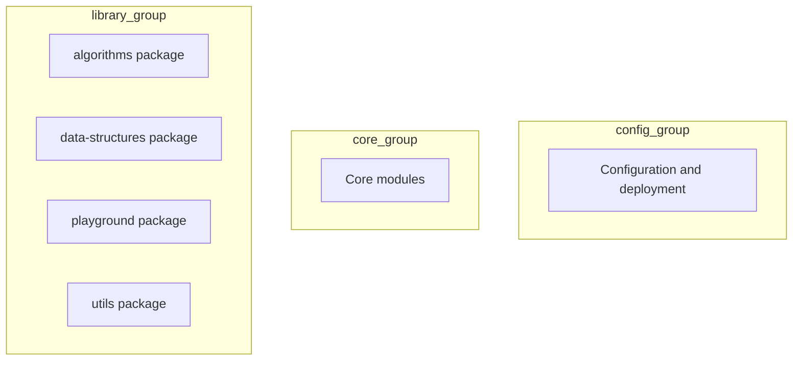

# Architecture report: trekhleb/javascript-algorithms

> Automated static analysis. **Observed** = directly seen in files/imports/AST; **Inferred** = interpretation from that evidence. Repository code was not executed.

## 1. Repository at a glance

| Item | Value |
| --- | --- |
| Repository | trekhleb/javascript-algorithms |
| Description | 📝 Algorithms and data structures implemented in JavaScript with explanations and links to further readings |
| Language | JavaScript |
| Stars | 196726 |
| Licence | MIT |
| Analysed commit / branch | 85293e3e2b88f4d2ce330d956b139cf628aa1e82 / master |
| Framework(s) | None detected |
| Files analysed | 629 |
| Components | 6 |

## 2. Architecture in one minute

trekhleb/javascript-algorithms - 📝 Algorithms and data structures implemented in JavaScript with explanations and links to further readings. This repository was analysed statically from 629 file(s) (0 Python). Detected technologies (observed from imports/manifests): GitHub Actions, Jest. Files are grouped into 6 component(s): algorithms package, Configuration and deployment, Core modules, data-structures package, playground package, utils package. Findings below distinguish observed facts from inferred interpretation.

## 3. High-level block diagram

## 4. Main components

### algorithms package (`algorithms`)

- **Kind:** library
- **Status:** Observed
- **Confidence:** 0.85
- **Responsibility:** Groups 292 file(s) under algorithms package (observed from repository paths and static analysis).
- **Paths:** `src/algorithms/cryptography/caesar-cipher/__test__/caesarCipher.test.js`, `src/algorithms/cryptography/caesar-cipher/caesarCipher.js`, `src/algorithms/cryptography/hill-cipher/_test_/hillCipher.test.js`, `src/algorithms/cryptography/hill-cipher/hillCipher.js`, `src/algorithms/cryptography/polynomial-hash/PolynomialHash.js`, `src/algorithms/cryptography/polynomial-hash/SimplePolynomialHash.js`, `src/algorithms/cryptography/polynomial-hash/__test__/PolynomialHash.test.js`, `src/algorithms/cryptography/polynomial-hash/__test__/SimplePolynomialHash.test.js`, `src/algorithms/cryptography/rail-fence-cipher/__test__/railFenceCipher.test.js`, `src/algorithms/cryptography/rail-fence-cipher/railFenceCipher.js`, `src/algorithms/graph/articulation-points/__test__/articulationPoints.test.js`, `src/algorithms/graph/articulation-points/articulationPoints.js`, `src/algorithms/graph/bellman-ford/__test__/bellmanFord.test.js`, `src/algorithms/graph/bellman-ford/bellmanFord.js`, `src/algorithms/graph/breadth-first-search/__test__/breadthFirstSearch.test.js`, `src/algorithms/graph/breadth-first-search/breadthFirstSearch.js`, `src/algorithms/graph/bridges/__test__/graphBridges.test.js`, `src/algorithms/graph/bridges/graphBridges.js`, `src/algorithms/graph/depth-first-search/__test__/depthFirstSearch.test.js`, `src/algorithms/graph/depth-first-search/depthFirstSearch.js`, `src/algorithms/graph/detect-cycle/__test__/detectDirectedCycle.test.js`, `src/algorithms/graph/detect-cycle/__test__/detectUndirectedCycle.test.js`, `src/algorithms/graph/detect-cycle/__test__/detectUndirectedCycleUsingDisjointSet.test.js`, `src/algorithms/graph/detect-cycle/detectDirectedCycle.js`, `src/algorithms/graph/detect-cycle/detectUndirectedCycle.js`, `src/algorithms/graph/detect-cycle/detectUndirectedCycleUsingDisjointSet.js`, `src/algorithms/graph/dijkstra/__test__/dijkstra.test.js`, `src/algorithms/graph/dijkstra/dijkstra.js`, `src/algorithms/graph/eulerian-path/__test__/eulerianPath.test.js`, `src/algorithms/graph/eulerian-path/eulerianPath.js`, `src/algorithms/graph/floyd-warshall/__test__/floydWarshall.test.js`, `src/algorithms/graph/floyd-warshall/floydWarshall.js`, `src/algorithms/graph/hamiltonian-cycle/__test__/hamiltonianCycle.test.js`, `src/algorithms/graph/hamiltonian-cycle/hamiltonianCycle.js`, `src/algorithms/graph/kruskal/__test__/kruskal.test.js`, `src/algorithms/graph/kruskal/kruskal.js`, `src/algorithms/graph/prim/__test__/prim.test.js`, `src/algorithms/graph/prim/prim.js`, `src/algorithms/graph/strongly-connected-components/__test__/stronglyConnectedComponents.test.js`, `src/algorithms/graph/strongly-connected-components/stronglyConnectedComponents.js`, `src/algorithms/graph/topological-sorting/__test__/topologicalSort.test.js`, `src/algorithms/graph/topological-sorting/topologicalSort.js`, `src/algorithms/graph/travelling-salesman/__test__/bfTravellingSalesman.test.js`, `src/algorithms/graph/travelling-salesman/bfTravellingSalesman.js`, `src/algorithms/image-processing/seam-carving/__tests__/resizeImageWidth.node.js`, `src/algorithms/image-processing/seam-carving/resizeImageWidth.js`, `src/algorithms/image-processing/utils/imageData.js`, `src/algorithms/linked-list/reverse-traversal/__test__/reverseTraversal.test.js`, `src/algorithms/linked-list/reverse-traversal/reverseTraversal.js`, `src/algorithms/linked-list/traversal/__test__/traversal.test.js`, `src/algorithms/linked-list/traversal/traversal.js`, `src/algorithms/math/binary-floating-point/__tests__/bitsToFloat.test.js`, `src/algorithms/math/binary-floating-point/__tests__/floatAsBinaryString.test.js`, `src/algorithms/math/binary-floating-point/bitsToFloat.js`, `src/algorithms/math/binary-floating-point/floatAsBinaryString.js`, `src/algorithms/math/binary-floating-point/testCases.js`, `src/algorithms/math/bits/__test__/bitLength.test.js`, `src/algorithms/math/bits/__test__/bitsDiff.test.js`, `src/algorithms/math/bits/__test__/clearBit.test.js`, `src/algorithms/math/bits/__test__/countSetBits.test.js`, `src/algorithms/math/bits/__test__/divideByTwo.test.js`, `src/algorithms/math/bits/__test__/fullAdder.test.js`, `src/algorithms/math/bits/__test__/getBit.test.js`, `src/algorithms/math/bits/__test__/isEven.test.js`, `src/algorithms/math/bits/__test__/isPositive.test.js`, `src/algorithms/math/bits/__test__/isPowerOfTwo.test.js`, `src/algorithms/math/bits/__test__/multiply.test.js`, `src/algorithms/math/bits/__test__/multiplyByTwo.test.js`, `src/algorithms/math/bits/__test__/multiplyUnsigned.test.js`, `src/algorithms/math/bits/__test__/setBit.test.js`, `src/algorithms/math/bits/__test__/switchSign.test.js`, `src/algorithms/math/bits/__test__/updateBit.test.js`, `src/algorithms/math/bits/bitLength.js`, `src/algorithms/math/bits/bitsDiff.js`, `src/algorithms/math/bits/clearBit.js`, `src/algorithms/math/bits/countSetBits.js`, `src/algorithms/math/bits/divideByTwo.js`, `src/algorithms/math/bits/fullAdder.js`, `src/algorithms/math/bits/getBit.js`, `src/algorithms/math/bits/isEven.js`, `src/algorithms/math/bits/isPositive.js`, `src/algorithms/math/bits/isPowerOfTwo.js`, `src/algorithms/math/bits/multiply.js`, `src/algorithms/math/bits/multiplyByTwo.js`, `src/algorithms/math/bits/multiplyUnsigned.js`, `src/algorithms/math/bits/setBit.js`, `src/algorithms/math/bits/switchSign.js`, `src/algorithms/math/bits/updateBit.js`, `src/algorithms/math/complex-number/ComplexNumber.js`, `src/algorithms/math/complex-number/__test__/ComplexNumber.test.js`, `src/algorithms/math/euclidean-algorithm/__test__/euclideanAlgorithm.test.js`, `src/algorithms/math/euclidean-algorithm/__test__/euclideanAlgorithmIterative.test.js`, `src/algorithms/math/euclidean-algorithm/euclideanAlgorithm.js`, `src/algorithms/math/euclidean-algorithm/euclideanAlgorithmIterative.js`, `src/algorithms/math/euclidean-distance/__tests__/euclideanDistance.test.js`, `src/algorithms/math/euclidean-distance/euclideanDistance.js`, `src/algorithms/math/factorial/__test__/factorial.test.js`, `src/algorithms/math/factorial/__test__/factorialRecursive.test.js`, `src/algorithms/math/factorial/factorial.js`, `src/algorithms/math/factorial/factorialRecursive.js`, `src/algorithms/math/fast-powering/__test__/fastPowering.test.js`, `src/algorithms/math/fast-powering/fastPowering.js`, `src/algorithms/math/fibonacci/__test__/fibonacci.test.js`, `src/algorithms/math/fibonacci/__test__/fibonacciNth.test.js`, `src/algorithms/math/fibonacci/__test__/fibonacciNthClosedForm.test.js`, `src/algorithms/math/fibonacci/fibonacci.js`, `src/algorithms/math/fibonacci/fibonacciNth.js`, `src/algorithms/math/fibonacci/fibonacciNthClosedForm.js`, `src/algorithms/math/fourier-transform/__test__/FourierTester.js`, `src/algorithms/math/fourier-transform/__test__/discreteFourierTransform.test.js`, `src/algorithms/math/fourier-transform/__test__/fastFourierTransform.test.js`, `src/algorithms/math/fourier-transform/__test__/inverseDiscreteFourierTransform.test.js`, `src/algorithms/math/fourier-transform/discreteFourierTransform.js`, `src/algorithms/math/fourier-transform/fastFourierTransform.js`, `src/algorithms/math/fourier-transform/inverseDiscreteFourierTransform.js`, `src/algorithms/math/horner-method/__test__/classicPolynome.test.js`, `src/algorithms/math/horner-method/__test__/hornerMethod.test.js`, `src/algorithms/math/horner-method/classicPolynome.js`, `src/algorithms/math/horner-method/hornerMethod.js`, `src/algorithms/math/integer-partition/__test__/integerPartition.test.js`, `src/algorithms/math/integer-partition/integerPartition.js`, `src/algorithms/math/is-power-of-two/__test__/isPowerOfTwo.test.js`, `src/algorithms/math/is-power-of-two/__test__/isPowerOfTwoBitwise.test.js`, `src/algorithms/math/is-power-of-two/isPowerOfTwo.js`, `src/algorithms/math/is-power-of-two/isPowerOfTwoBitwise.js`, `src/algorithms/math/least-common-multiple/__test__/leastCommonMultiple.test.js`, `src/algorithms/math/least-common-multiple/leastCommonMultiple.js`, `src/algorithms/math/liu-hui/__test__/liuHui.test.js`, `src/algorithms/math/liu-hui/liuHui.js`, `src/algorithms/math/matrix/Matrix.js`, `src/algorithms/math/matrix/__tests__/Matrix.test.js`, `src/algorithms/math/pascal-triangle/__test__/pascalTriangle.test.js`, `src/algorithms/math/pascal-triangle/__test__/pascalTriangleRecursive.test.js`, `src/algorithms/math/pascal-triangle/pascalTriangle.js`, `src/algorithms/math/pascal-triangle/pascalTriangleRecursive.js`, `src/algorithms/math/primality-test/__test__/trialDivision.test.js`, `src/algorithms/math/primality-test/trialDivision.js`, `src/algorithms/math/prime-factors/__test__/primeFactors.test.js`, `src/algorithms/math/prime-factors/primeFactors.js`, `src/algorithms/math/radian/__test__/degreeToRadian.test.js`, `src/algorithms/math/radian/__test__/radianToDegree.test.js`, `src/algorithms/math/radian/degreeToRadian.js`, `src/algorithms/math/radian/radianToDegree.js`, `src/algorithms/math/sieve-of-eratosthenes/__test__/sieveOfEratosthenes.test.js`, `src/algorithms/math/sieve-of-eratosthenes/sieveOfEratosthenes.js`, `src/algorithms/math/square-root/__test__/squareRoot.test.js`, `src/algorithms/math/square-root/squareRoot.js`, `src/algorithms/ml/k-means/__test__/kMeans.test.js`, `src/algorithms/ml/k-means/kMeans.js`, `src/algorithms/ml/knn/__test__/knn.test.js`, `src/algorithms/ml/knn/kNN.js`, `src/algorithms/search/binary-search/__test__/binarySearch.test.js`, `src/algorithms/search/binary-search/binarySearch.js`, `src/algorithms/search/interpolation-search/__test__/interpolationSearch.test.js`, `src/algorithms/search/interpolation-search/interpolationSearch.js`, `src/algorithms/search/jump-search/__test__/jumpSearch.test.js`, `src/algorithms/search/jump-search/jumpSearch.js`, `src/algorithms/search/linear-search/__test__/linearSearch.test.js`, `src/algorithms/search/linear-search/linearSearch.js`, `src/algorithms/sets/cartesian-product/__test__/cartesianProduct.test.js`, `src/algorithms/sets/cartesian-product/cartesianProduct.js`, `src/algorithms/sets/combination-sum/__test__/combinationSum.test.js`, `src/algorithms/sets/combination-sum/combinationSum.js`, `src/algorithms/sets/combinations/__test__/combineWithRepetitions.test.js`, `src/algorithms/sets/combinations/__test__/combineWithoutRepetitions.test.js`, `src/algorithms/sets/combinations/combineWithRepetitions.js`, `src/algorithms/sets/combinations/combineWithoutRepetitions.js`, `src/algorithms/sets/fisher-yates/__test__/fisherYates.test.js`, `src/algorithms/sets/fisher-yates/fisherYates.js`, `src/algorithms/sets/knapsack-problem/Knapsack.js`, `src/algorithms/sets/knapsack-problem/KnapsackItem.js`, `src/algorithms/sets/knapsack-problem/__test__/Knapsack.test.js`, `src/algorithms/sets/knapsack-problem/__test__/KnapsackItem.test.js`, `src/algorithms/sets/longest-common-subsequence/__test__/longestCommonSubsequence.test.js`, `src/algorithms/sets/longest-common-subsequence/__test__/longestCommonSubsequenceRecursive.test.js`, `src/algorithms/sets/longest-common-subsequence/longestCommonSubsequence.js`, `src/algorithms/sets/longest-common-subsequence/longestCommonSubsequenceRecursive.js`, `src/algorithms/sets/longest-increasing-subsequence/__test__/dpLongestIncreasingSubsequence.test.js`, `src/algorithms/sets/longest-increasing-subsequence/dpLongestIncreasingSubsequence.js`, `src/algorithms/sets/maximum-subarray/__test__/bfMaximumSubarray.test.js`, `src/algorithms/sets/maximum-subarray/__test__/dcMaximumSubarraySum.test.js`, `src/algorithms/sets/maximum-subarray/__test__/dpMaximumSubarray.test.js`, `src/algorithms/sets/maximum-subarray/bfMaximumSubarray.js`, `src/algorithms/sets/maximum-subarray/dcMaximumSubarraySum.js`, `src/algorithms/sets/maximum-subarray/dpMaximumSubarray.js`, `src/algorithms/sets/permutations/__test__/permutateWithRepetitions.test.js`, `src/algorithms/sets/permutations/__test__/permutateWithoutRepetitions.test.js`, `src/algorithms/sets/permutations/permutateWithRepetitions.js`, `src/algorithms/sets/permutations/permutateWithoutRepetitions.js`, `src/algorithms/sets/power-set/__test__/btPowerSet.test.js`, `src/algorithms/sets/power-set/__test__/bwPowerSet.test.js`, `src/algorithms/sets/power-set/__test__/caPowerSet.test.js`, `src/algorithms/sets/power-set/btPowerSet.js`, `src/algorithms/sets/power-set/bwPowerSet.js`, `src/algorithms/sets/power-set/caPowerSet.js`, `src/algorithms/sets/shortest-common-supersequence/__test__/shortestCommonSupersequence.test.js`, `src/algorithms/sets/shortest-common-supersequence/shortestCommonSupersequence.js`, `src/algorithms/sorting/Sort.js`, `src/algorithms/sorting/SortTester.js`, `src/algorithms/sorting/__test__/Sort.test.js`, `src/algorithms/sorting/bubble-sort/BubbleSort.js`, `src/algorithms/sorting/bubble-sort/__test__/BubbleSort.test.js`, `src/algorithms/sorting/bucket-sort/BucketSort.js`, `src/algorithms/sorting/bucket-sort/__test__/BucketSort.test.js`, `src/algorithms/sorting/counting-sort/CountingSort.js`, `src/algorithms/sorting/counting-sort/__test__/CountingSort.test.js`, `src/algorithms/sorting/heap-sort/HeapSort.js`, `src/algorithms/sorting/heap-sort/__test__/HeapSort.test.js`, `src/algorithms/sorting/insertion-sort/InsertionSort.js`, `src/algorithms/sorting/insertion-sort/__test__/InsertionSort.test.js`, `src/algorithms/sorting/merge-sort/MergeSort.js`, `src/algorithms/sorting/merge-sort/__test__/MergeSort.test.js`, `src/algorithms/sorting/quick-sort/QuickSort.js`, `src/algorithms/sorting/quick-sort/QuickSortInPlace.js`, `src/algorithms/sorting/quick-sort/__test__/QuickSort.test.js`, `src/algorithms/sorting/quick-sort/__test__/QuickSortInPlace.test.js`, `src/algorithms/sorting/radix-sort/RadixSort.js`, `src/algorithms/sorting/radix-sort/__test__/RadixSort.test.js`, `src/algorithms/sorting/selection-sort/SelectionSort.js`, `src/algorithms/sorting/selection-sort/__test__/SelectionSort.test.js`, `src/algorithms/sorting/shell-sort/ShellSort.js`, `src/algorithms/sorting/shell-sort/__test__/ShellSort.test.js`, `src/algorithms/stack/valid-parentheses/__test__/validParentheses.test.js`, `src/algorithms/stack/valid-parentheses/validParentheses.js`, `src/algorithms/statistics/weighted-random/__test__/weightedRandom.test.js`, `src/algorithms/statistics/weighted-random/weightedRandom.js`, `src/algorithms/string/hamming-distance/__test__/hammingDistance.test.js`, `src/algorithms/string/hamming-distance/hammingDistance.js`, `src/algorithms/string/knuth-morris-pratt/__test__/knuthMorrisPratt.test.js`, `src/algorithms/string/knuth-morris-pratt/knuthMorrisPratt.js`, `src/algorithms/string/levenshtein-distance/__test__/levenshteinDistance.test.js`, `src/algorithms/string/levenshtein-distance/levenshteinDistance.js`, `src/algorithms/string/longest-common-substring/__test__/longestCommonSubstring.test.js`, `src/algorithms/string/longest-common-substring/longestCommonSubstring.js`, `src/algorithms/string/palindrome/__test__/isPalindrome.test.js`, `src/algorithms/string/palindrome/isPalindrome.js`, `src/algorithms/string/rabin-karp/__test__/rabinKarp.test.js`, `src/algorithms/string/rabin-karp/rabinKarp.js`, `src/algorithms/string/regular-expression-matching/__test__/regularExpressionMatching.test.js`, `src/algorithms/string/regular-expression-matching/regularExpressionMatching.js`, `src/algorithms/string/z-algorithm/__test__/zAlgorithm.test.js`, `src/algorithms/string/z-algorithm/zAlgorithm.js`, `src/algorithms/tree/breadth-first-search/__test__/breadthFirstSearch.test.js`, `src/algorithms/tree/breadth-first-search/breadthFirstSearch.js`, `src/algorithms/tree/depth-first-search/__test__/depthFirstSearch.test.js`, `src/algorithms/tree/depth-first-search/depthFirstSearch.js`, `src/algorithms/uncategorized/best-time-to-buy-sell-stocks/__tests__/accumulatorBestTimeToBuySellStocks.test.js`, `src/algorithms/uncategorized/best-time-to-buy-sell-stocks/__tests__/dpBestTimeToBuySellStocks.test.js`, `src/algorithms/uncategorized/best-time-to-buy-sell-stocks/__tests__/dqBestTimeToBuySellStocks.test.js`, `src/algorithms/uncategorized/best-time-to-buy-sell-stocks/__tests__/peakvalleyBestTimeToBuySellStocks.test.js`, `src/algorithms/uncategorized/best-time-to-buy-sell-stocks/accumulatorBestTimeToBuySellStocks.js`, `src/algorithms/uncategorized/best-time-to-buy-sell-stocks/dpBestTimeToBuySellStocks.js`, `src/algorithms/uncategorized/best-time-to-buy-sell-stocks/dqBestTimeToBuySellStocks.js`, `src/algorithms/uncategorized/best-time-to-buy-sell-stocks/peakvalleyBestTimeToBuySellStocks.js`, `src/algorithms/uncategorized/hanoi-tower/__test__/hanoiTower.test.js`, `src/algorithms/uncategorized/hanoi-tower/hanoiTower.js`, `src/algorithms/uncategorized/jump-game/__test__/backtrackingJumpGame.test.js`, `src/algorithms/uncategorized/jump-game/__test__/dpBottomUpJumpGame.test.js`, `src/algorithms/uncategorized/jump-game/__test__/dpTopDownJumpGame.test.js`, `src/algorithms/uncategorized/jump-game/__test__/greedyJumpGame.test.js`, `src/algorithms/uncategorized/jump-game/backtrackingJumpGame.js`, `src/algorithms/uncategorized/jump-game/dpBottomUpJumpGame.js`, `src/algorithms/uncategorized/jump-game/dpTopDownJumpGame.js`, `src/algorithms/uncategorized/jump-game/greedyJumpGame.js`, `src/algorithms/uncategorized/knight-tour/__test__/knightTour.test.js`, `src/algorithms/uncategorized/knight-tour/knightTour.js`, `src/algorithms/uncategorized/n-queens/QueenPosition.js`, `src/algorithms/uncategorized/n-queens/__test__/QueensPosition.test.js`, `src/algorithms/uncategorized/n-queens/__test__/nQueens.test.js`, `src/algorithms/uncategorized/n-queens/__test__/nQueensBitwise.test.js`, `src/algorithms/uncategorized/n-queens/nQueens.js`, `src/algorithms/uncategorized/n-queens/nQueensBitwise.js`, `src/algorithms/uncategorized/rain-terraces/__test__/bfRainTerraces.test.js`, `src/algorithms/uncategorized/rain-terraces/__test__/dpRainTerraces.test.js`, `src/algorithms/uncategorized/rain-terraces/bfRainTerraces.js`, `src/algorithms/uncategorized/rain-terraces/dpRainTerraces.js`, `src/algorithms/uncategorized/recursive-staircase/__test__/recursiveStaircaseBF.test.js`, `src/algorithms/uncategorized/recursive-staircase/__test__/recursiveStaircaseDP.test.js`, `src/algorithms/uncategorized/recursive-staircase/__test__/recursiveStaircaseIT.test.js`, `src/algorithms/uncategorized/recursive-staircase/__test__/recursiveStaircaseMEM.test.js`, `src/algorithms/uncategorized/recursive-staircase/recursiveStaircaseBF.js`, `src/algorithms/uncategorized/recursive-staircase/recursiveStaircaseDP.js`, `src/algorithms/uncategorized/recursive-staircase/recursiveStaircaseIT.js`, `src/algorithms/uncategorized/recursive-staircase/recursiveStaircaseMEM.js`, `src/algorithms/uncategorized/square-matrix-rotation/__test__/squareMatrixRotation.test.js`, `src/algorithms/uncategorized/square-matrix-rotation/squareMatrixRotation.js`, `src/algorithms/uncategorized/unique-paths/__test__/btUniquePaths.test.js`, `src/algorithms/uncategorized/unique-paths/__test__/dpUniquePaths.test.js`, `src/algorithms/uncategorized/unique-paths/__test__/uniquePaths.test.js`, `src/algorithms/uncategorized/unique-paths/btUniquePaths.js`, `src/algorithms/uncategorized/unique-paths/dpUniquePaths.js`, `src/algorithms/uncategorized/unique-paths/uniquePaths.js`
- **Evidence:** [src/algorithms/cryptography/caesar-cipher/__test__/caesarCipher.test.js](https://github.com/trekhleb/javascript-algorithms/blob/85293e3e2b88f4d2ce330d956b139cf628aa1e82/src/algorithms/cryptography/caesar-cipher/__test__/caesarCipher.test.js); [src/algorithms/cryptography/caesar-cipher/caesarCipher.js](https://github.com/trekhleb/javascript-algorithms/blob/85293e3e2b88f4d2ce330d956b139cf628aa1e82/src/algorithms/cryptography/caesar-cipher/caesarCipher.js); [src/algorithms/cryptography/hill-cipher/_test_/hillCipher.test.js](https://github.com/trekhleb/javascript-algorithms/blob/85293e3e2b88f4d2ce330d956b139cf628aa1e82/src/algorithms/cryptography/hill-cipher/_test_/hillCipher.test.js); [src/algorithms/cryptography/hill-cipher/hillCipher.js](https://github.com/trekhleb/javascript-algorithms/blob/85293e3e2b88f4d2ce330d956b139cf628aa1e82/src/algorithms/cryptography/hill-cipher/hillCipher.js); [src/algorithms/cryptography/polynomial-hash/PolynomialHash.js](https://github.com/trekhleb/javascript-algorithms/blob/85293e3e2b88f4d2ce330d956b139cf628aa1e82/src/algorithms/cryptography/polynomial-hash/PolynomialHash.js); [src/algorithms/cryptography/polynomial-hash/SimplePolynomialHash.js](https://github.com/trekhleb/javascript-algorithms/blob/85293e3e2b88f4d2ce330d956b139cf628aa1e82/src/algorithms/cryptography/polynomial-hash/SimplePolynomialHash.js); [src/algorithms/cryptography/polynomial-hash/__test__/PolynomialHash.test.js](https://github.com/trekhleb/javascript-algorithms/blob/85293e3e2b88f4d2ce330d956b139cf628aa1e82/src/algorithms/cryptography/polynomial-hash/__test__/PolynomialHash.test.js); [src/algorithms/cryptography/polynomial-hash/__test__/SimplePolynomialHash.test.js](https://github.com/trekhleb/javascript-algorithms/blob/85293e3e2b88f4d2ce330d956b139cf628aa1e82/src/algorithms/cryptography/polynomial-hash/__test__/SimplePolynomialHash.test.js)

### Configuration and deployment (`config`)

- **Kind:** config
- **Status:** Observed
- **Confidence:** 0.85
- **Responsibility:** Groups 1 file(s) under configuration and deployment (observed from repository paths and static analysis).
- **Paths:** `package.json`
- **Evidence:** [package.json](https://github.com/trekhleb/javascript-algorithms/blob/85293e3e2b88f4d2ce330d956b139cf628aa1e82/package.json)

### Core modules (`core`)

- **Kind:** core
- **Status:** Observed
- **Confidence:** 0.85
- **Responsibility:** Groups 1 file(s) under core modules (observed from repository paths and static analysis).
- **Paths:** `jest.config.js`
- **Evidence:** [jest.config.js](https://github.com/trekhleb/javascript-algorithms/blob/85293e3e2b88f4d2ce330d956b139cf628aa1e82/jest.config.js)

### data-structures package (`data_structures`)

- **Kind:** library
- **Status:** Observed
- **Confidence:** 0.85
- **Responsibility:** Groups 64 file(s) under data-structures package (observed from repository paths and static analysis).
- **Paths:** `src/data-structures/bloom-filter/BloomFilter.js`, `src/data-structures/bloom-filter/__test__/BloomFilter.test.js`, `src/data-structures/deque/Deque.js`, `src/data-structures/deque/__test__/Deque.test.js`, `src/data-structures/disjoint-set/DisjointSet.js`, `src/data-structures/disjoint-set/DisjointSetAdhoc.js`, `src/data-structures/disjoint-set/DisjointSetItem.js`, `src/data-structures/disjoint-set/__test__/DisjointSet.test.js`, `src/data-structures/disjoint-set/__test__/DisjointSetAdhoc.test.js`, `src/data-structures/disjoint-set/__test__/DisjointSetItem.test.js`, `src/data-structures/doubly-linked-list/DoublyLinkedList.js`, `src/data-structures/doubly-linked-list/DoublyLinkedListNode.js`, `src/data-structures/doubly-linked-list/__test__/DoublyLinkedList.test.js`, `src/data-structures/doubly-linked-list/__test__/DoublyLinkedListNode.test.js`, `src/data-structures/graph/Graph.js`, `src/data-structures/graph/GraphEdge.js`, `src/data-structures/graph/GraphVertex.js`, `src/data-structures/graph/__test__/Graph.test.js`, `src/data-structures/graph/__test__/GraphEdge.test.js`, `src/data-structures/graph/__test__/GraphVertex.test.js`, `src/data-structures/hash-table/HashTable.js`, `src/data-structures/hash-table/__test__/HashTable.test.js`, `src/data-structures/heap/Heap.js`, `src/data-structures/heap/MaxHeap.js`, `src/data-structures/heap/MaxHeapAdhoc.js`, `src/data-structures/heap/MinHeap.js`, `src/data-structures/heap/MinHeapAdhoc.js`, `src/data-structures/heap/__test__/Heap.test.js`, `src/data-structures/heap/__test__/MaxHeap.test.js`, `src/data-structures/heap/__test__/MaxHeapAdhoc.test.js`, `src/data-structures/heap/__test__/MinHeap.test.js`, `src/data-structures/heap/__test__/MinHeapAdhoc.test.js`, `src/data-structures/linked-list/LinkedList.js`, `src/data-structures/linked-list/LinkedListNode.js`, `src/data-structures/linked-list/__test__/LinkedList.test.js`, `src/data-structures/linked-list/__test__/LinkedListNode.test.js`, `src/data-structures/lru-cache/LRUCache.js`, `src/data-structures/lru-cache/LRUCacheOnMap.js`, `src/data-structures/lru-cache/__test__/LRUCache.test.js`, `src/data-structures/lru-cache/__test__/LRUCacheOnMap.test.js`, `src/data-structures/priority-queue/PriorityQueue.js`, `src/data-structures/priority-queue/__test__/PriorityQueue.test.js`, `src/data-structures/queue/Queue.js`, `src/data-structures/queue/__test__/Queue.test.js`, `src/data-structures/stack/Stack.js`, `src/data-structures/stack/__test__/Stack.test.js`, `src/data-structures/tree/BinaryTreeNode.js`, `src/data-structures/tree/__test__/BinaryTreeNode.test.js`, `src/data-structures/tree/avl-tree/AvlTree.js`, `src/data-structures/tree/avl-tree/__test__/AvlTRee.test.js`, `src/data-structures/tree/binary-search-tree/BinarySearchTree.js`, `src/data-structures/tree/binary-search-tree/BinarySearchTreeNode.js`, `src/data-structures/tree/binary-search-tree/__test__/BinarySearchTree.test.js`, `src/data-structures/tree/binary-search-tree/__test__/BinarySearchTreeNode.test.js`, `src/data-structures/tree/fenwick-tree/FenwickTree.js`, `src/data-structures/tree/fenwick-tree/__test__/FenwickTree.test.js`, `src/data-structures/tree/red-black-tree/RedBlackTree.js`, `src/data-structures/tree/red-black-tree/__test__/RedBlackTree.test.js`, `src/data-structures/tree/segment-tree/SegmentTree.js`, `src/data-structures/tree/segment-tree/__test__/SegmentTree.test.js`, `src/data-structures/trie/Trie.js`, `src/data-structures/trie/TrieNode.js`, `src/data-structures/trie/__test__/Trie.test.js`, `src/data-structures/trie/__test__/TrieNode.test.js`
- **Evidence:** [src/data-structures/bloom-filter/BloomFilter.js](https://github.com/trekhleb/javascript-algorithms/blob/85293e3e2b88f4d2ce330d956b139cf628aa1e82/src/data-structures/bloom-filter/BloomFilter.js); [src/data-structures/bloom-filter/__test__/BloomFilter.test.js](https://github.com/trekhleb/javascript-algorithms/blob/85293e3e2b88f4d2ce330d956b139cf628aa1e82/src/data-structures/bloom-filter/__test__/BloomFilter.test.js); [src/data-structures/deque/Deque.js](https://github.com/trekhleb/javascript-algorithms/blob/85293e3e2b88f4d2ce330d956b139cf628aa1e82/src/data-structures/deque/Deque.js); [src/data-structures/deque/__test__/Deque.test.js](https://github.com/trekhleb/javascript-algorithms/blob/85293e3e2b88f4d2ce330d956b139cf628aa1e82/src/data-structures/deque/__test__/Deque.test.js); [src/data-structures/disjoint-set/DisjointSet.js](https://github.com/trekhleb/javascript-algorithms/blob/85293e3e2b88f4d2ce330d956b139cf628aa1e82/src/data-structures/disjoint-set/DisjointSet.js); [src/data-structures/disjoint-set/DisjointSetAdhoc.js](https://github.com/trekhleb/javascript-algorithms/blob/85293e3e2b88f4d2ce330d956b139cf628aa1e82/src/data-structures/disjoint-set/DisjointSetAdhoc.js); [src/data-structures/disjoint-set/DisjointSetItem.js](https://github.com/trekhleb/javascript-algorithms/blob/85293e3e2b88f4d2ce330d956b139cf628aa1e82/src/data-structures/disjoint-set/DisjointSetItem.js); [src/data-structures/disjoint-set/__test__/DisjointSet.test.js](https://github.com/trekhleb/javascript-algorithms/blob/85293e3e2b88f4d2ce330d956b139cf628aa1e82/src/data-structures/disjoint-set/__test__/DisjointSet.test.js)

### playground package (`playground`)

- **Kind:** library
- **Status:** Observed
- **Confidence:** 0.85
- **Responsibility:** Groups 2 file(s) under playground package (observed from repository paths and static analysis).
- **Paths:** `src/playground/__test__/playground.test.js`, `src/playground/playground.js`
- **Evidence:** [src/playground/__test__/playground.test.js](https://github.com/trekhleb/javascript-algorithms/blob/85293e3e2b88f4d2ce330d956b139cf628aa1e82/src/playground/__test__/playground.test.js); [src/playground/playground.js](https://github.com/trekhleb/javascript-algorithms/blob/85293e3e2b88f4d2ce330d956b139cf628aa1e82/src/playground/playground.js)

### utils package (`utils`)

- **Kind:** library
- **Status:** Observed
- **Confidence:** 0.85
- **Responsibility:** Groups 2 file(s) under utils package (observed from repository paths and static analysis).
- **Paths:** `src/utils/comparator/Comparator.js`, `src/utils/comparator/__test__/Comparator.test.js`
- **Evidence:** [src/utils/comparator/Comparator.js](https://github.com/trekhleb/javascript-algorithms/blob/85293e3e2b88f4d2ce330d956b139cf628aa1e82/src/utils/comparator/Comparator.js); [src/utils/comparator/__test__/Comparator.test.js](https://github.com/trekhleb/javascript-algorithms/blob/85293e3e2b88f4d2ce330d956b139cf628aa1e82/src/utils/comparator/__test__/Comparator.test.js)

## 5. Execution flow

No entry point was observed; the startup flow below is therefore limited.

Representative flow (derived from observed entry points and the import graph; steps beyond the entry point are **Inferred**):

1. Execution starts at an observed entry point listed above, if present.
2. No internal import relationships between components were observed.

## 6. Project structure

### `(root)`

- `.babelrc` - other (39 bytes)
- `.editorconfig` - config (201 bytes)
- `.eslintrc` - other (396 bytes)
- `.gitignore` - other (46 bytes)
- `.nvmrc` - other (4 bytes)
- `BACKERS.md` - docs (764 bytes)
- `CODE_OF_CONDUCT.md` - docs (2558 bytes)
- `CONTRIBUTING.md` - docs (1117 bytes)
- `LICENSE` - docs (1083 bytes)
- `README.ar-AR.md` - docs (25701 bytes)
- `README.de-DE.md` - docs (29478 bytes)
- `README.es-ES.md` - docs (23188 bytes)
- `README.fr-FR.md` - docs (22707 bytes)
- `README.he-IL.md` - docs (29515 bytes)
- `README.id-ID.md` - docs (24428 bytes)
- `README.it-IT.md` - docs (21875 bytes)
- `README.ja-JP.md` - docs (23340 bytes)
- `README.ko-KR.md` - docs (20326 bytes)
- `README.md` - docs (25792 bytes)
- `README.pl-PL.md` - docs (20557 bytes)
- `README.pt-BR.md` - docs (22578 bytes)
- `README.ru-RU.md` - docs (34652 bytes)
- `README.tr-TR.md` - docs (22384 bytes)
- `README.uk-UA.md` - docs (36397 bytes)
- `README.uz-UZ.md` - docs (27910 bytes)
- `README.vi-VN.md` - docs (25873 bytes)
- `README.zh-CN.md` - docs (18910 bytes)
- `README.zh-TW.md` - docs (13447 bytes)
- `jest.config.js` - source, JavaScript (1292 bytes)
- `package.json` - manifest (1408 bytes)

### `.github`

- `.github/workflows/CI.yml` - ci, YAML (671 bytes)

### `.husky`

- `.husky/pre-commit` - other (13 bytes)

### `src`

- `src/algorithms/cryptography/caesar-cipher/README.md` - docs (1572 bytes)
- `src/algorithms/cryptography/caesar-cipher/README.ru-RU.md` - docs (2485 bytes)
- `src/algorithms/cryptography/caesar-cipher/__test__/caesarCipher.test.js` - source, JavaScript (1458 bytes)
- `src/algorithms/cryptography/caesar-cipher/caesarCipher.js` - source, JavaScript (1808 bytes)
- `src/algorithms/cryptography/hill-cipher/README.md` - docs (4062 bytes)
- `src/algorithms/cryptography/hill-cipher/_test_/hillCipher.test.js` - source, JavaScript (1767 bytes)
- `src/algorithms/cryptography/hill-cipher/hillCipher.js` - source, JavaScript (2834 bytes)
- `src/algorithms/cryptography/polynomial-hash/PolynomialHash.js` - source, JavaScript (2270 bytes)
- `src/algorithms/cryptography/polynomial-hash/README.md` - docs (4774 bytes)
- `src/algorithms/cryptography/polynomial-hash/SimplePolynomialHash.js` - source, JavaScript (1861 bytes)
- `src/algorithms/cryptography/polynomial-hash/__test__/PolynomialHash.test.js` - source, JavaScript (2517 bytes)
- `src/algorithms/cryptography/polynomial-hash/__test__/SimplePolynomialHash.test.js` - source, JavaScript (2182 bytes)
- `src/algorithms/cryptography/rail-fence-cipher/README.md` - docs (1992 bytes)
- `src/algorithms/cryptography/rail-fence-cipher/__test__/railFenceCipher.test.js` - source, JavaScript (1367 bytes)
- `src/algorithms/cryptography/rail-fence-cipher/railFenceCipher.js` - source, JavaScript (5852 bytes)
- `src/algorithms/graph/articulation-points/README.md` - docs (1037 bytes)
- `src/algorithms/graph/articulation-points/__test__/articulationPoints.test.js` - source, JavaScript (8081 bytes)
- `src/algorithms/graph/articulation-points/articulationPoints.js` - source, JavaScript (4130 bytes)
- `src/algorithms/graph/bellman-ford/README.md` - docs (801 bytes)
- `src/algorithms/graph/bellman-ford/__test__/bellmanFord.test.js` - source, JavaScript (3877 bytes)
- `src/algorithms/graph/bellman-ford/bellmanFord.js` - source, JavaScript (1538 bytes)
- `src/algorithms/graph/breadth-first-search/README.md` - docs (799 bytes)
- `src/algorithms/graph/breadth-first-search/__test__/breadthFirstSearch.test.js` - source, JavaScript (6958 bytes)
- `src/algorithms/graph/breadth-first-search/breadthFirstSearch.js` - source, JavaScript (2225 bytes)
- `src/algorithms/graph/bridges/README.md` - docs (1179 bytes)
- `src/algorithms/graph/bridges/__test__/graphBridges.test.js` - source, JavaScript (6602 bytes)
- `src/algorithms/graph/bridges/graphBridges.js` - source, JavaScript (3377 bytes)
- `src/algorithms/graph/depth-first-search/README.md` - docs (759 bytes)
- `src/algorithms/graph/depth-first-search/__test__/depthFirstSearch.test.js` - source, JavaScript (6652 bytes)
- `src/algorithms/graph/depth-first-search/depthFirstSearch.js` - source, JavaScript (2059 bytes)
- `src/algorithms/graph/detect-cycle/README.md` - docs (2791 bytes)
- `src/algorithms/graph/detect-cycle/__test__/detectDirectedCycle.test.js` - source, JavaScript (1351 bytes)
- `src/algorithms/graph/detect-cycle/__test__/detectUndirectedCycle.test.js` - source, JavaScript (1302 bytes)
- `src/algorithms/graph/detect-cycle/__test__/detectUndirectedCycleUsingDisjointSet.test.js` - source, JavaScript (1305 bytes)
- `src/algorithms/graph/detect-cycle/detectDirectedCycle.js` - source, JavaScript (3307 bytes)
- `src/algorithms/graph/detect-cycle/detectUndirectedCycle.js` - source, JavaScript (1922 bytes)
- `src/algorithms/graph/detect-cycle/detectUndirectedCycleUsingDisjointSet.js` - source, JavaScript (1185 bytes)
- `src/algorithms/graph/dijkstra/README.de-DE.md` - docs (7319 bytes)
- `src/algorithms/graph/dijkstra/README.es-ES.md` - docs (7215 bytes)
- `src/algorithms/graph/dijkstra/README.fr-FR.md` - docs (7583 bytes)
- `src/algorithms/graph/dijkstra/README.he-IL.md` - docs (7880 bytes)
- `src/algorithms/graph/dijkstra/README.ja-JP.md` - docs (7271 bytes)
- `src/algorithms/graph/dijkstra/README.ko-KR.md` - docs (7026 bytes)
- `src/algorithms/graph/dijkstra/README.md` - docs (7215 bytes)
- `src/algorithms/graph/dijkstra/README.uk-UA.md` - docs (9263 bytes)
- `src/algorithms/graph/dijkstra/README.zh-CN.md` - docs (5917 bytes)
- `src/algorithms/graph/dijkstra/README.zh-TW.md` - docs (5947 bytes)
- `src/algorithms/graph/dijkstra/__test__/dijkstra.test.js` - source, JavaScript (3862 bytes)
- `src/algorithms/graph/dijkstra/dijkstra.js` - source, JavaScript (2974 bytes)
- `src/algorithms/graph/eulerian-path/README.md` - docs (1571 bytes)
- `src/algorithms/graph/eulerian-path/__test__/eulerianPath.test.js` - source, JavaScript (5116 bytes)
- `src/algorithms/graph/eulerian-path/eulerianPath.js` - source, JavaScript (3494 bytes)
- `src/algorithms/graph/floyd-warshall/README.md` - docs (3472 bytes)
- `src/algorithms/graph/floyd-warshall/__test__/floydWarshall.test.js` - source, JavaScript (8456 bytes)
- `src/algorithms/graph/floyd-warshall/floydWarshall.js` - source, JavaScript (3000 bytes)
- `src/algorithms/graph/hamiltonian-cycle/README.md` - docs (1755 bytes)
- `src/algorithms/graph/hamiltonian-cycle/__test__/hamiltonianCycle.test.js` - source, JavaScript (3632 bytes)
- `src/algorithms/graph/hamiltonian-cycle/hamiltonianCycle.js` - source, JavaScript (4278 bytes)
- `src/algorithms/graph/kruskal/README.ko-KR.md` - docs (2569 bytes)
- `src/algorithms/graph/kruskal/README.md` - docs (2490 bytes)
- `src/algorithms/graph/kruskal/__test__/kruskal.test.js` - source, JavaScript (3136 bytes)
- `src/algorithms/graph/kruskal/kruskal.js` - source, JavaScript (2148 bytes)
- `src/algorithms/graph/prim/README.md` - docs (2271 bytes)
- `src/algorithms/graph/prim/__test__/prim.test.js` - source, JavaScript (3118 bytes)
- `src/algorithms/graph/prim/prim.js` - source, JavaScript (2565 bytes)
- `src/algorithms/graph/strongly-connected-components/README.md` - docs (682 bytes)
- `src/algorithms/graph/strongly-connected-components/__test__/stronglyConnectedComponents.test.js` - source, JavaScript (4646 bytes)
- `src/algorithms/graph/strongly-connected-components/stronglyConnectedComponents.js` - source, JavaScript (4667 bytes)
- `src/algorithms/graph/topological-sorting/README.md` - docs (2720 bytes)
- `src/algorithms/graph/topological-sorting/__test__/topologicalSort.test.js` - source, JavaScript (1671 bytes)
- `src/algorithms/graph/topological-sorting/topologicalSort.js` - source, JavaScript (1487 bytes)
- `src/algorithms/graph/travelling-salesman/README.md` - docs (1226 bytes)
- `src/algorithms/graph/travelling-salesman/__test__/bfTravellingSalesman.test.js` - source, JavaScript (1876 bytes)
- `src/algorithms/graph/travelling-salesman/bfTravellingSalesman.js` - source, JavaScript (3337 bytes)
- `src/algorithms/image-processing/seam-carving/README.md` - docs (31948 bytes)
- `src/algorithms/image-processing/seam-carving/README.ru-RU.md` - docs (46292 bytes)
- `src/algorithms/image-processing/seam-carving/__tests__/resizeImageWidth.node.js` - source, JavaScript (2847 bytes)
- `src/algorithms/image-processing/seam-carving/resizeImageWidth.js` - source, JavaScript (8055 bytes)
- `src/algorithms/image-processing/utils/imageData.js` - source, JavaScript (1248 bytes)
- `src/algorithms/linked-list/reverse-traversal/README.md` - docs (526 bytes)
- `src/algorithms/linked-list/reverse-traversal/README.pt-BR.md` - docs (534 bytes)
- `src/algorithms/linked-list/reverse-traversal/README.zh-CN.md` - docs (378 bytes)
- `src/algorithms/linked-list/reverse-traversal/__test__/reverseTraversal.test.js` - source, JavaScript (1010 bytes)
- `src/algorithms/linked-list/reverse-traversal/reverseTraversal.js` - source, JavaScript (531 bytes)
- `src/algorithms/linked-list/traversal/README.md` - docs (571 bytes)
- `src/algorithms/linked-list/traversal/README.pt-BR.md` - docs (580 bytes)
- `src/algorithms/linked-list/traversal/README.ru-RU.md` - docs (712 bytes)
- `src/algorithms/linked-list/traversal/README.zh-CN.md` - docs (389 bytes)
- `src/algorithms/linked-list/traversal/__test__/traversal.test.js` - source, JavaScript (543 bytes)
- `src/algorithms/linked-list/traversal/traversal.js` - source, JavaScript (372 bytes)
- `src/algorithms/math/binary-floating-point/README.md` - docs (7201 bytes)
- `src/algorithms/math/binary-floating-point/__tests__/bitsToFloat.test.js` - source, JavaScript (1481 bytes)
- `src/algorithms/math/binary-floating-point/__tests__/floatAsBinaryString.test.js` - source, JavaScript (848 bytes)
- `src/algorithms/math/binary-floating-point/bitsToFloat.js` - source, JavaScript (3720 bytes)
- `src/algorithms/math/binary-floating-point/floatAsBinaryString.js` - source, JavaScript (2102 bytes)
- `src/algorithms/math/binary-floating-point/testCases.js` - source, JavaScript (3001 bytes)
- `src/algorithms/math/bits/README.fr-FR.md` - docs (10128 bytes)
- `src/algorithms/math/bits/README.md` - docs (8731 bytes)
- `src/algorithms/math/bits/README.zh-CN.md` - docs (8132 bytes)
- `src/algorithms/math/bits/__test__/bitLength.test.js` - source, JavaScript (473 bytes)
- `src/algorithms/math/bits/__test__/bitsDiff.test.js` - source, JavaScript (401 bytes)
- `src/algorithms/math/bits/__test__/clearBit.test.js` - source, JavaScript (388 bytes)
- `src/algorithms/math/bits/__test__/countSetBits.test.js` - source, JavaScript (686 bytes)
- `src/algorithms/math/bits/__test__/divideByTwo.test.js` - source, JavaScript (376 bytes)
- `src/algorithms/math/bits/__test__/fullAdder.test.js` - source, JavaScript (581 bytes)
- `src/algorithms/math/bits/__test__/getBit.test.js` - source, JavaScript (542 bytes)
- `src/algorithms/math/bits/__test__/isEven.test.js` - source, JavaScript (582 bytes)
- `src/algorithms/math/bits/__test__/isPositive.test.js` - source, JavaScript (628 bytes)
- `src/algorithms/math/bits/__test__/isPowerOfTwo.test.js` - source, JavaScript (722 bytes)
- `src/algorithms/math/bits/__test__/multiply.test.js` - source, JavaScript (571 bytes)
- `src/algorithms/math/bits/__test__/multiplyByTwo.test.js` - source, JavaScript (399 bytes)
- `src/algorithms/math/bits/__test__/multiplyUnsigned.test.js` - source, JavaScript (567 bytes)
- `src/algorithms/math/bits/__test__/setBit.test.js` - source, JavaScript (370 bytes)
- `src/algorithms/math/bits/__test__/switchSign.test.js` - source, JavaScript (425 bytes)
- `src/algorithms/math/bits/__test__/updateBit.test.js` - source, JavaScript (583 bytes)
- `src/algorithms/math/bits/bitLength.js` - source, JavaScript (295 bytes)
- `src/algorithms/math/bits/bitsDiff.js` - source, JavaScript (321 bytes)
- `src/algorithms/math/bits/clearBit.js` - source, JavaScript (218 bytes)
- `src/algorithms/math/bits/countSetBits.js` - source, JavaScript (396 bytes)
- `src/algorithms/math/bits/divideByTwo.js` - source, JavaScript (124 bytes)
- `src/algorithms/math/bits/fullAdder.js` - source, JavaScript (2150 bytes)
- `src/algorithms/math/bits/getBit.js` - source, JavaScript (193 bytes)
- `src/algorithms/math/bits/isEven.js` - source, JavaScript (127 bytes)
- `src/algorithms/math/bits/isPositive.js` - source, JavaScript (349 bytes)
- `src/algorithms/math/bits/isPowerOfTwo.js` - source, JavaScript (139 bytes)
- `src/algorithms/math/bits/multiply.js` - source, JavaScript (1299 bytes)
- `src/algorithms/math/bits/multiplyByTwo.js` - source, JavaScript (126 bytes)
- `src/algorithms/math/bits/multiplyUnsigned.js` - source, JavaScript (1156 bytes)
- `src/algorithms/math/bits/setBit.js` - source, JavaScript (193 bytes)
- `src/algorithms/math/bits/switchSign.js` - source, JavaScript (190 bytes)
- `src/algorithms/math/bits/updateBit.js` - source, JavaScript (473 bytes)
- `src/algorithms/math/complex-number/ComplexNumber.js` - source, JavaScript (4036 bytes)
- `src/algorithms/math/complex-number/README.fr-FR.md` - docs (7845 bytes)
- `src/algorithms/math/complex-number/README.md` - docs (6995 bytes)
- `src/algorithms/math/complex-number/__test__/ComplexNumber.test.js` - source, JavaScript (7076 bytes)
- `src/algorithms/math/euclidean-algorithm/README.fr-FR.md` - docs (3192 bytes)
- `src/algorithms/math/euclidean-algorithm/README.md` - docs (2793 bytes)
- `src/algorithms/math/euclidean-algorithm/__test__/euclideanAlgorithm.test.js` - source, JavaScript (1123 bytes)
- `src/algorithms/math/euclidean-algorithm/__test__/euclideanAlgorithmIterative.test.js` - source, JavaScript (1330 bytes)
- `src/algorithms/math/euclidean-algorithm/euclideanAlgorithm.js` - source, JavaScript (515 bytes)
- `src/algorithms/math/euclidean-algorithm/euclideanAlgorithmIterative.js` - source, JavaScript (698 bytes)
- `src/algorithms/math/euclidean-distance/README.md` - docs (1698 bytes)
- `src/algorithms/math/euclidean-distance/__tests__/euclideanDistance.test.js` - source, JavaScript (973 bytes)
- `src/algorithms/math/euclidean-distance/euclideanDistance.js` - source, JavaScript (603 bytes)
- `src/algorithms/math/factorial/README.fr-FR.md` - docs (920 bytes)
- `src/algorithms/math/factorial/README.ka-GE.md` - docs (1220 bytes)
- `src/algorithms/math/factorial/README.md` - docs (1001 bytes)
- `src/algorithms/math/factorial/README.tr-TR.md` - docs (1111 bytes)
- `src/algorithms/math/factorial/README.uk-UA.md` - docs (1154 bytes)
- `src/algorithms/math/factorial/README.zh-CN.md` - docs (890 bytes)
- `src/algorithms/math/factorial/__test__/factorial.test.js` - source, JavaScript (305 bytes)
- `src/algorithms/math/factorial/__test__/factorialRecursive.test.js` - source, JavaScript (377 bytes)
- `src/algorithms/math/factorial/factorial.js` - source, JavaScript (199 bytes)
- `src/algorithms/math/factorial/factorialRecursive.js` - source, JavaScript (176 bytes)
- `src/algorithms/math/fast-powering/README.fr-FR.md` - docs (2171 bytes)
- `src/algorithms/math/fast-powering/README.md` - docs (1804 bytes)
- `src/algorithms/math/fast-powering/__test__/fastPowering.test.js` - source, JavaScript (929 bytes)
- `src/algorithms/math/fast-powering/fastPowering.js` - source, JavaScript (893 bytes)
- `src/algorithms/math/fibonacci/README.fr-FR.md` - docs (999 bytes)
- `src/algorithms/math/fibonacci/README.ka-GE.md` - docs (1692 bytes)
- `src/algorithms/math/fibonacci/README.md` - docs (1004 bytes)
- `src/algorithms/math/fibonacci/README.zh-CN.md` - docs (903 bytes)
- `src/algorithms/math/fibonacci/__test__/fibonacci.test.js` - source, JavaScript (668 bytes)
- `src/algorithms/math/fibonacci/__test__/fibonacciNth.test.js` - source, JavaScript (885 bytes)
- `src/algorithms/math/fibonacci/__test__/fibonacciNthClosedForm.test.js` - source, JavaScript (1041 bytes)
- `src/algorithms/math/fibonacci/fibonacci.js` - source, JavaScript (496 bytes)
- `src/algorithms/math/fibonacci/fibonacciNth.js` - source, JavaScript (466 bytes)
- `src/algorithms/math/fibonacci/fibonacciNthClosedForm.js` - source, JavaScript (862 bytes)
- `src/algorithms/math/fourier-transform/README.fr-FR.md` - docs (8807 bytes)
- `src/algorithms/math/fourier-transform/README.md` - docs (7082 bytes)
- `src/algorithms/math/fourier-transform/__test__/FourierTester.js` - source, JavaScript (7534 bytes)
- `src/algorithms/math/fourier-transform/__test__/discreteFourierTransform.test.js` - source, JavaScript (294 bytes)
- `src/algorithms/math/fourier-transform/__test__/fastFourierTransform.test.js` - source, JavaScript (4288 bytes)
- `src/algorithms/math/fourier-transform/__test__/inverseDiscreteFourierTransform.test.js` - source, JavaScript (342 bytes)
- `src/algorithms/math/fourier-transform/discreteFourierTransform.js` - source, JavaScript (2635 bytes)
- `src/algorithms/math/fourier-transform/fastFourierTransform.js` - source, JavaScript (2177 bytes)
- `src/algorithms/math/fourier-transform/inverseDiscreteFourierTransform.js` - source, JavaScript (1743 bytes)
- `src/algorithms/math/horner-method/README.md` - docs (1919 bytes)
- `src/algorithms/math/horner-method/__test__/classicPolynome.test.js` - source, JavaScript (788 bytes)
- `src/algorithms/math/horner-method/__test__/hornerMethod.test.js` - source, JavaScript (1137 bytes)
- `src/algorithms/math/horner-method/classicPolynome.js` - source, JavaScript (487 bytes)
- `src/algorithms/math/horner-method/hornerMethod.js` - source, JavaScript (433 bytes)
- `src/algorithms/math/integer-partition/README.md` - docs (1075 bytes)
- `src/algorithms/math/integer-partition/__test__/integerPartition.test.js` - source, JavaScript (475 bytes)
- `src/algorithms/math/integer-partition/integerPartition.js` - source, JavaScript (2654 bytes)
- `src/algorithms/math/is-power-of-two/README.md` - docs (1224 bytes)
- `src/algorithms/math/is-power-of-two/__test__/isPowerOfTwo.test.js` - source, JavaScript (861 bytes)
- `src/algorithms/math/is-power-of-two/__test__/isPowerOfTwoBitwise.test.js` - source, JavaScript (1001 bytes)
- `src/algorithms/math/is-power-of-two/isPowerOfTwo.js` - source, JavaScript (573 bytes)
- `src/algorithms/math/is-power-of-two/isPowerOfTwoBitwise.js` - source, JavaScript (675 bytes)
- `src/algorithms/math/least-common-multiple/README.md` - docs (1894 bytes)
- `src/algorithms/math/least-common-multiple/__test__/leastCommonMultiple.test.js` - source, JavaScript (750 bytes)
- `src/algorithms/math/least-common-multiple/leastCommonMultiple.js` - source, JavaScript (286 bytes)
- `src/algorithms/math/liu-hui/README.md` - docs (4314 bytes)
- `src/algorithms/math/liu-hui/__test__/liuHui.test.js` - source, JavaScript (483 bytes)
- `src/algorithms/math/liu-hui/liuHui.js` - source, JavaScript (1681 bytes)
- `src/algorithms/math/matrix/Matrix.js` - source, JavaScript (7459 bytes)
- `src/algorithms/math/matrix/README.md` - docs (2475 bytes)
- `src/algorithms/math/matrix/__tests__/Matrix.test.js` - source, JavaScript (8727 bytes)
- `src/algorithms/math/pascal-triangle/README.md` - docs (2647 bytes)
- `src/algorithms/math/pascal-triangle/__test__/pascalTriangle.test.js` - source, JavaScript (626 bytes)
- `src/algorithms/math/pascal-triangle/__test__/pascalTriangleRecursive.test.js` - source, JavaScript (725 bytes)
- `src/algorithms/math/pascal-triangle/pascalTriangle.js` - source, JavaScript (445 bytes)
- `src/algorithms/math/pascal-triangle/pascalTriangleRecursive.js` - source, JavaScript (998 bytes)
- `src/algorithms/math/primality-test/README.md` - docs (1212 bytes)
- `src/algorithms/math/primality-test/__test__/trialDivision.test.js` - source, JavaScript (1140 bytes)
- `src/algorithms/math/primality-test/trialDivision.js` - source, JavaScript (803 bytes)
- `src/algorithms/math/prime-factors/README.md` - docs (2473 bytes)
- `src/algorithms/math/prime-factors/README.zh-CN.md` - docs (2071 bytes)
- `src/algorithms/math/prime-factors/__test__/primeFactors.test.js` - source, JavaScript (3569 bytes)
- `src/algorithms/math/prime-factors/primeFactors.js` - source, JavaScript (1123 bytes)
- `src/algorithms/math/radian/README.md` - docs (1101 bytes)
- `src/algorithms/math/radian/__test__/degreeToRadian.test.js` - source, JavaScript (436 bytes)
- `src/algorithms/math/radian/__test__/radianToDegree.test.js` - source, JavaScript (436 bytes)
- `src/algorithms/math/radian/degreeToRadian.js` - source, JavaScript (140 bytes)
- `src/algorithms/math/radian/radianToDegree.js` - source, JavaScript (140 bytes)
- `src/algorithms/math/sieve-of-eratosthenes/README.md` - docs (1356 bytes)
- `src/algorithms/math/sieve-of-eratosthenes/__test__/sieveOfEratosthenes.test.js` - source, JavaScript (449 bytes)
- `src/algorithms/math/sieve-of-eratosthenes/sieveOfEratosthenes.js` - source, JavaScript (986 bytes)
- `src/algorithms/math/square-root/README.md` - docs (3000 bytes)
- `src/algorithms/math/square-root/__test__/squareRoot.test.js` - source, JavaScript (2562 bytes)
- `src/algorithms/math/square-root/squareRoot.js` - source, JavaScript (1513 bytes)
- `src/algorithms/ml/k-means/README.md` - docs (2266 bytes)
- `src/algorithms/ml/k-means/README.pt-BR.md` - docs (2271 bytes)
- `src/algorithms/ml/k-means/__test__/kMeans.test.js` - source, JavaScript (1168 bytes)
- `src/algorithms/ml/k-means/kMeans.js` - source, JavaScript (3220 bytes)
- `src/algorithms/ml/knn/README.md` - docs (2613 bytes)
- `src/algorithms/ml/knn/README.pt-BR.md` - docs (2826 bytes)
- `src/algorithms/ml/knn/__test__/knn.test.js` - source, JavaScript (2212 bytes)
- `src/algorithms/ml/knn/kNN.js` - source, JavaScript (1934 bytes)
- `src/algorithms/search/binary-search/README.es-ES.md` - docs (1146 bytes)
- `src/algorithms/search/binary-search/README.md` - docs (1027 bytes)
- `src/algorithms/search/binary-search/README.pt-BR.md` - docs (1087 bytes)
- `src/algorithms/search/binary-search/__test__/binarySearch.test.js` - source, JavaScript (1361 bytes)
- `src/algorithms/search/binary-search/binarySearch.js` - source, JavaScript (1494 bytes)
- `src/algorithms/search/interpolation-search/README.md` - docs (1574 bytes)
- `src/algorithms/search/interpolation-search/__test__/interpolationSearch.test.js` - source, JavaScript (1545 bytes)
- `src/algorithms/search/interpolation-search/interpolationSearch.js` - source, JavaScript (1750 bytes)
- `src/algorithms/search/jump-search/README.md` - docs (1288 bytes)
- `src/algorithms/search/jump-search/__test__/jumpSearch.test.js` - source, JavaScript (1661 bytes)
- `src/algorithms/search/jump-search/jumpSearch.js` - source, JavaScript (1545 bytes)
- `src/algorithms/search/linear-search/README.md` - docs (907 bytes)
- `src/algorithms/search/linear-search/README.pt-BR.md` - docs (897 bytes)
- `src/algorithms/search/linear-search/__test__/linearSearch.test.js` - source, JavaScript (1117 bytes)
- `src/algorithms/search/linear-search/linearSearch.js` - source, JavaScript (548 bytes)
- `src/algorithms/sets/cartesian-product/README.md` - docs (537 bytes)
- `src/algorithms/sets/cartesian-product/__test__/cartesianProduct.test.js` - source, JavaScript (618 bytes)
- `src/algorithms/sets/cartesian-product/cartesianProduct.js` - source, JavaScript (799 bytes)
- `src/algorithms/sets/combination-sum/README.md` - docs (1288 bytes)
- `src/algorithms/sets/combination-sum/__test__/combinationSum.test.js` - source, JavaScript (532 bytes)
- `src/algorithms/sets/combination-sum/combinationSum.js` - source, JavaScript (2098 bytes)
- `src/algorithms/sets/combinations/README.md` - docs (2256 bytes)
- `src/algorithms/sets/combinations/__test__/combineWithRepetitions.test.js` - source, JavaScript (1771 bytes)
- `src/algorithms/sets/combinations/__test__/combineWithoutRepetitions.test.js` - source, JavaScript (2118 bytes)
- `src/algorithms/sets/combinations/combineWithRepetitions.js` - source, JavaScript (1111 bytes)
- `src/algorithms/sets/combinations/combineWithoutRepetitions.js` - source, JavaScript (1139 bytes)
- `src/algorithms/sets/fisher-yates/README.md` - docs (678 bytes)
- `src/algorithms/sets/fisher-yates/__test__/fisherYates.test.js` - source, JavaScript (639 bytes)
- `src/algorithms/sets/fisher-yates/fisherYates.js` - source, JavaScript (443 bytes)
- `src/algorithms/sets/knapsack-problem/Knapsack.js` - source, JavaScript (7107 bytes)
- `src/algorithms/sets/knapsack-problem/KnapsackItem.js` - source, JavaScript (938 bytes)
- `src/algorithms/sets/knapsack-problem/README.md` - docs (3193 bytes)
- `src/algorithms/sets/knapsack-problem/__test__/Knapsack.test.js` - source, JavaScript (6629 bytes)
- `src/algorithms/sets/knapsack-problem/__test__/KnapsackItem.test.js` - source, JavaScript (1282 bytes)
- `src/algorithms/sets/longest-common-subsequence/README.md` - docs (1075 bytes)
- `src/algorithms/sets/longest-common-subsequence/__test__/longestCommonSubsequence.test.js` - source, JavaScript (973 bytes)
- `src/algorithms/sets/longest-common-subsequence/__test__/longestCommonSubsequenceRecursive.test.js` - source, JavaScript (931 bytes)
- `src/algorithms/sets/longest-common-subsequence/longestCommonSubsequence.js` - source, JavaScript (1854 bytes)
- `src/algorithms/sets/longest-common-subsequence/longestCommonSubsequenceRecursive.js` - source, JavaScript (917 bytes)
- `src/algorithms/sets/longest-increasing-subsequence/README.md` - docs (1272 bytes)
- `src/algorithms/sets/longest-increasing-subsequence/__test__/dpLongestIncreasingSubsequence.test.js` - source, JavaScript (915 bytes)
- `src/algorithms/sets/longest-increasing-subsequence/dpLongestIncreasingSubsequence.js` - source, JavaScript (1925 bytes)
- `src/algorithms/sets/maximum-subarray/README.md` - docs (1412 bytes)
- `src/algorithms/sets/maximum-subarray/__test__/bfMaximumSubarray.test.js` - source, JavaScript (890 bytes)
- `src/algorithms/sets/maximum-subarray/__test__/dcMaximumSubarraySum.test.js` - source, JavaScript (827 bytes)
- `src/algorithms/sets/maximum-subarray/__test__/dpMaximumSubarray.test.js` - source, JavaScript (898 bytes)
- `src/algorithms/sets/maximum-subarray/bfMaximumSubarray.js` - source, JavaScript (823 bytes)
- `src/algorithms/sets/maximum-subarray/dcMaximumSubarraySum.js` - source, JavaScript (1247 bytes)
- `src/algorithms/sets/maximum-subarray/dpMaximumSubarray.js` - source, JavaScript (1477 bytes)
- `src/algorithms/sets/permutations/README.md` - docs (1626 bytes)
- `src/algorithms/sets/permutations/__test__/permutateWithRepetitions.test.js` - source, JavaScript (1341 bytes)
- `src/algorithms/sets/permutations/__test__/permutateWithoutRepetitions.test.js` - source, JavaScript (2027 bytes)
- `src/algorithms/sets/permutations/permutateWithRepetitions.js` - source, JavaScript (827 bytes)
- `src/algorithms/sets/permutations/permutateWithoutRepetitions.js` - source, JavaScript (1163 bytes)
- `src/algorithms/sets/power-set/README.md` - docs (3158 bytes)
- `src/algorithms/sets/power-set/__test__/btPowerSet.test.js` - source, JavaScript (388 bytes)
- `src/algorithms/sets/power-set/__test__/bwPowerSet.test.js` - source, JavaScript (383 bytes)
- `src/algorithms/sets/power-set/__test__/caPowerSet.test.js` - source, JavaScript (481 bytes)
- `src/algorithms/sets/power-set/btPowerSet.js` - source, JavaScript (1735 bytes)
- `src/algorithms/sets/power-set/bwPowerSet.js` - source, JavaScript (1307 bytes)
- `src/algorithms/sets/power-set/caPowerSet.js` - source, JavaScript (1038 bytes)
- `src/algorithms/sets/shortest-common-supersequence/README.md` - docs (616 bytes)
- `src/algorithms/sets/shortest-common-supersequence/__test__/shortestCommonSupersequence.test.js` - source, JavaScript (1297 bytes)
- `src/algorithms/sets/shortest-common-supersequence/shortestCommonSupersequence.js` - source, JavaScript (1958 bytes)
- `src/algorithms/sorting/Sort.js` - source, JavaScript (1068 bytes)
- `src/algorithms/sorting/SortTester.js` - source, JavaScript (2667 bytes)
- `src/algorithms/sorting/__test__/Sort.test.js` - source, JavaScript (283 bytes)
- `src/algorithms/sorting/bubble-sort/BubbleSort.js` - source, JavaScript (1030 bytes)
- `src/algorithms/sorting/bubble-sort/README.md` - docs (1126 bytes)
- `src/algorithms/sorting/bubble-sort/README.pt-BR.md` - docs (1145 bytes)
- `src/algorithms/sorting/bubble-sort/__test__/BubbleSort.test.js` - source, JavaScript (1617 bytes)
- `src/algorithms/sorting/bucket-sort/BucketSort.js` - source, JavaScript (1297 bytes)
- `src/algorithms/sorting/bucket-sort/README.md` - docs (1840 bytes)
- `src/algorithms/sorting/bucket-sort/__test__/BucketSort.test.js` - source, JavaScript (1257 bytes)
- `src/algorithms/sorting/counting-sort/CountingSort.js` - source, JavaScript (2970 bytes)
- `src/algorithms/sorting/counting-sort/README.md` - docs (3283 bytes)
- `src/algorithms/sorting/counting-sort/README.pt-br.md` - docs (3627 bytes)
- `src/algorithms/sorting/counting-sort/__test__/CountingSort.test.js` - source, JavaScript (2133 bytes)
- `src/algorithms/sorting/heap-sort/HeapSort.js` - source, JavaScript (850 bytes)
- `src/algorithms/sorting/heap-sort/README.md` - docs (1166 bytes)
- `src/algorithms/sorting/heap-sort/README.pt-BR.md` - docs (1230 bytes)
- `src/algorithms/sorting/heap-sort/__test__/HeapSort.test.js` - source, JavaScript (1618 bytes)
- `src/algorithms/sorting/insertion-sort/InsertionSort.js` - source, JavaScript (1004 bytes)
- `src/algorithms/sorting/insertion-sort/README.md` - docs (988 bytes)
- `src/algorithms/sorting/insertion-sort/README.pt-BR.md` - docs (1027 bytes)
- `src/algorithms/sorting/insertion-sort/__test__/InsertionSort.test.js` - source, JavaScript (1650 bytes)
- `src/algorithms/sorting/merge-sort/MergeSort.js` - source, JavaScript (2012 bytes)
- `src/algorithms/sorting/merge-sort/README.ko-KR.md` - docs (1711 bytes)
- `src/algorithms/sorting/merge-sort/README.md` - docs (1622 bytes)
- `src/algorithms/sorting/merge-sort/README.pt-BR.md` - docs (1791 bytes)
- `src/algorithms/sorting/merge-sort/__test__/MergeSort.test.js` - source, JavaScript (1605 bytes)
- `src/algorithms/sorting/quick-sort/QuickSort.js` - source, JavaScript (1443 bytes)
- `src/algorithms/sorting/quick-sort/QuickSortInPlace.js` - source, JavaScript (2918 bytes)
- `src/algorithms/sorting/quick-sort/README.md` - docs (1661 bytes)
- `src/algorithms/sorting/quick-sort/README.pt-BR.md` - docs (1762 bytes)
- `src/algorithms/sorting/quick-sort/README.zh-CN.md` - docs (1471 bytes)
- `src/algorithms/sorting/quick-sort/__test__/QuickSort.test.js` - source, JavaScript (1606 bytes)
- `src/algorithms/sorting/quick-sort/__test__/QuickSortInPlace.test.js` - source, JavaScript (1581 bytes)
- `src/algorithms/sorting/radix-sort/README.md` - docs (2623 bytes)
- `src/algorithms/sorting/radix-sort/README.pt-BR.md` - docs (3079 bytes)
- `src/algorithms/sorting/radix-sort/RadixSort.js` - source, JavaScript (4390 bytes)
- `src/algorithms/sorting/radix-sort/__test__/RadixSort.test.js` - source, JavaScript (849 bytes)
- `src/algorithms/sorting/selection-sort/README.md` - docs (1166 bytes)
- `src/algorithms/sorting/selection-sort/README.pt-BR.md` - docs (1299 bytes)
- `src/algorithms/sorting/selection-sort/SelectionSort.js` - source, JavaScript (883 bytes)
- `src/algorithms/sorting/selection-sort/__test__/SelectionSort.test.js` - source, JavaScript (1555 bytes)
- `src/algorithms/sorting/shell-sort/README.md` - docs (2719 bytes)
- `src/algorithms/sorting/shell-sort/README.pt-BR.md` - docs (2871 bytes)
- `src/algorithms/sorting/shell-sort/ShellSort.js` - source, JavaScript (1200 bytes)
- `src/algorithms/sorting/shell-sort/__test__/ShellSort.test.js` - source, JavaScript (1515 bytes)
- `src/algorithms/stack/valid-parentheses/README.md` - docs (1895 bytes)
- `src/algorithms/stack/valid-parentheses/__test__/validParentheses.test.js` - source, JavaScript (763 bytes)
- `src/algorithms/stack/valid-parentheses/validParentheses.js` - source, JavaScript (1411 bytes)
- `src/algorithms/statistics/weighted-random/README.md` - docs (6727 bytes)
- `src/algorithms/statistics/weighted-random/__test__/weightedRandom.test.js` - source, JavaScript (2928 bytes)
- `src/algorithms/statistics/weighted-random/weightedRandom.js` - source, JavaScript (1753 bytes)
- `src/algorithms/string/hamming-distance/README.md` - docs (806 bytes)
- `src/algorithms/string/hamming-distance/__test__/hammingDistance.test.js` - source, JavaScript (792 bytes)
- `src/algorithms/string/hamming-distance/hammingDistance.js` - source, JavaScript (354 bytes)
- `src/algorithms/string/knuth-morris-pratt/README.md` - docs (723 bytes)
- `src/algorithms/string/knuth-morris-pratt/__test__/knuthMorrisPratt.test.js` - source, JavaScript (744 bytes)
- `src/algorithms/string/knuth-morris-pratt/knuthMorrisPratt.js` - source, JavaScript (1289 bytes)
- `src/algorithms/string/levenshtein-distance/README.md` - docs (5662 bytes)
- `src/algorithms/string/levenshtein-distance/__test__/levenshteinDistance.test.js` - source, JavaScript (1141 bytes)
- `src/algorithms/string/levenshtein-distance/levenshteinDistance.js` - source, JavaScript (1288 bytes)
- `src/algorithms/string/longest-common-substring/README.md` - docs (595 bytes)
- `src/algorithms/string/longest-common-substring/__test__/longestCommonSubstring.test.js` - source, JavaScript (1264 bytes)
- `src/algorithms/string/longest-common-substring/longestCommonSubstring.js` - source, JavaScript (2316 bytes)
- `src/algorithms/string/palindrome/README.md` - docs (639 bytes)
- `src/algorithms/string/palindrome/__test__/isPalindrome.test.js` - source, JavaScript (526 bytes)
- `src/algorithms/string/palindrome/isPalindrome.js` - source, JavaScript (299 bytes)
- `src/algorithms/string/rabin-karp/README.md` - docs (2577 bytes)
- `src/algorithms/string/rabin-karp/__test__/rabinKarp.test.js` - source, JavaScript (2074 bytes)
- `src/algorithms/string/rabin-karp/rabinKarp.js` - source, JavaScript (1407 bytes)
- `src/algorithms/string/regular-expression-matching/README.md` - docs (1318 bytes)
- `src/algorithms/string/regular-expression-matching/__test__/regularExpressionMatching.test.js` - source, JavaScript (1954 bytes)
- `src/algorithms/string/regular-expression-matching/regularExpressionMatching.js` - source, JavaScript (4645 bytes)
- `src/algorithms/string/z-algorithm/README.md` - docs (2017 bytes)
- `src/algorithms/string/z-algorithm/__test__/zAlgorithm.test.js` - source, JavaScript (803 bytes)
- `src/algorithms/string/z-algorithm/zAlgorithm.js` - source, JavaScript (5051 bytes)
- `src/algorithms/tree/breadth-first-search/README.md` - docs (1144 bytes)
- `src/algorithms/tree/breadth-first-search/__test__/breadthFirstSearch.test.js` - source, JavaScript (3940 bytes)
- `src/algorithms/tree/breadth-first-search/breadthFirstSearch.js` - source, JavaScript (1799 bytes)
- `src/algorithms/tree/depth-first-search/README.md` - docs (680 bytes)
- `src/algorithms/tree/depth-first-search/__test__/depthFirstSearch.test.js` - source, JavaScript (3926 bytes)
- `src/algorithms/tree/depth-first-search/depthFirstSearch.js` - source, JavaScript (3196 bytes)
- `src/algorithms/uncategorized/best-time-to-buy-sell-stocks/README.md` - docs (4940 bytes)
- `src/algorithms/uncategorized/best-time-to-buy-sell-stocks/__tests__/accumulatorBestTimeToBuySellStocks.test.js` - source, JavaScript (1714 bytes)
- `src/algorithms/uncategorized/best-time-to-buy-sell-stocks/__tests__/dpBestTimeToBuySellStocks.test.js` - source, JavaScript (1597 bytes)
- `src/algorithms/uncategorized/best-time-to-buy-sell-stocks/__tests__/dqBestTimeToBuySellStocks.test.js` - source, JavaScript (1609 bytes)
- `src/algorithms/uncategorized/best-time-to-buy-sell-stocks/__tests__/peakvalleyBestTimeToBuySellStocks.test.js` - source, JavaScript (1701 bytes)
- `src/algorithms/uncategorized/best-time-to-buy-sell-stocks/accumulatorBestTimeToBuySellStocks.js` - source, JavaScript (710 bytes)
- `src/algorithms/uncategorized/best-time-to-buy-sell-stocks/dpBestTimeToBuySellStocks.js` - source, JavaScript (750 bytes)
- `src/algorithms/uncategorized/best-time-to-buy-sell-stocks/dqBestTimeToBuySellStocks.js` - source, JavaScript (1463 bytes)
- `src/algorithms/uncategorized/best-time-to-buy-sell-stocks/peakvalleyBestTimeToBuySellStocks.js` - source, JavaScript (1024 bytes)
- `src/algorithms/uncategorized/hanoi-tower/README.md` - docs (1268 bytes)
- `src/algorithms/uncategorized/hanoi-tower/__test__/hanoiTower.test.js` - source, JavaScript (1701 bytes)
- `src/algorithms/uncategorized/hanoi-tower/hanoiTower.js` - source, JavaScript (2118 bytes)
- `src/algorithms/uncategorized/jump-game/README.md` - docs (4807 bytes)
- `src/algorithms/uncategorized/jump-game/__test__/backtrackingJumpGame.test.js` - source, JavaScript (798 bytes)
- `src/algorithms/uncategorized/jump-game/__test__/dpBottomUpJumpGame.test.js` - source, JavaScript (789 bytes)
- `src/algorithms/uncategorized/jump-game/__test__/dpTopDownJumpGame.test.js` - source, JavaScript (775 bytes)
- `src/algorithms/uncategorized/jump-game/__test__/greedyJumpGame.test.js` - source, JavaScript (714 bytes)
- `src/algorithms/uncategorized/jump-game/backtrackingJumpGame.js` - source, JavaScript (1684 bytes)
- `src/algorithms/uncategorized/jump-game/dpBottomUpJumpGame.js` - source, JavaScript (1836 bytes)
- `src/algorithms/uncategorized/jump-game/dpTopDownJumpGame.js` - source, JavaScript (2750 bytes)
- `src/algorithms/uncategorized/jump-game/greedyJumpGame.js` - source, JavaScript (1774 bytes)
- `src/algorithms/uncategorized/knight-tour/README.md` - docs (1376 bytes)
- `src/algorithms/uncategorized/knight-tour/__test__/knightTour.test.js` - source, JavaScript (739 bytes)
- `src/algorithms/uncategorized/knight-tour/knightTour.js` - source, JavaScript (3286 bytes)
- `src/algorithms/uncategorized/n-queens/QueenPosition.js` - source, JavaScript (1097 bytes)
- `src/algorithms/uncategorized/n-queens/README.md` - docs (5002 bytes)
- `src/algorithms/uncategorized/n-queens/__test__/QueensPosition.test.js` - source, JavaScript (551 bytes)
- `src/algorithms/uncategorized/n-queens/__test__/nQueens.test.js` - source, JavaScript (1287 bytes)
- `src/algorithms/uncategorized/n-queens/__test__/nQueensBitwise.test.js` - source, JavaScript (474 bytes)
- `src/algorithms/uncategorized/n-queens/nQueens.js` - source, JavaScript (3412 bytes)
- `src/algorithms/uncategorized/n-queens/nQueensBitwise.js` - source, JavaScript (4803 bytes)
- `src/algorithms/uncategorized/rain-terraces/README.md` - docs (3629 bytes)
- `src/algorithms/uncategorized/rain-terraces/__test__/bfRainTerraces.test.js` - source, JavaScript (968 bytes)
- `src/algorithms/uncategorized/rain-terraces/__test__/dpRainTerraces.test.js` - source, JavaScript (968 bytes)
- `src/algorithms/uncategorized/rain-terraces/bfRainTerraces.js` - source, JavaScript (1180 bytes)
- `src/algorithms/uncategorized/rain-terraces/dpRainTerraces.js` - source, JavaScript (1712 bytes)
- `src/algorithms/uncategorized/recursive-staircase/README.md` - docs (1070 bytes)
- `src/algorithms/uncategorized/recursive-staircase/__test__/recursiveStaircaseBF.test.js` - source, JavaScript (738 bytes)
- `src/algorithms/uncategorized/recursive-staircase/__test__/recursiveStaircaseDP.test.js` - source, JavaScript (746 bytes)
- `src/algorithms/uncategorized/recursive-staircase/__test__/recursiveStaircaseIT.test.js` - source, JavaScript (736 bytes)
- `src/algorithms/uncategorized/recursive-staircase/__test__/recursiveStaircaseMEM.test.js` - source, JavaScript (761 bytes)
- `src/algorithms/uncategorized/recursive-staircase/recursiveStaircaseBF.js` - source, JavaScript (891 bytes)
- `src/algorithms/uncategorized/recursive-staircase/recursiveStaircaseDP.js` - source, JavaScript (1053 bytes)
- `src/algorithms/uncategorized/recursive-staircase/recursiveStaircaseIT.js` - source, JavaScript (1085 bytes)
- `src/algorithms/uncategorized/recursive-staircase/recursiveStaircaseMEM.js` - source, JavaScript (1384 bytes)
- `src/algorithms/uncategorized/square-matrix-rotation/README.md` - docs (1853 bytes)
- `src/algorithms/uncategorized/square-matrix-rotation/__test__/squareMatrixRotation.test.js` - source, JavaScript (1177 bytes)
- `src/algorithms/uncategorized/square-matrix-rotation/squareMatrixRotation.js` - source, JavaScript (1083 bytes)
- `src/algorithms/uncategorized/unique-paths/README.md` - docs (2775 bytes)
- `src/algorithms/uncategorized/unique-paths/__test__/btUniquePaths.test.js` - source, JavaScript (413 bytes)
- `src/algorithms/uncategorized/unique-paths/__test__/dpUniquePaths.test.js` - source, JavaScript (413 bytes)
- `src/algorithms/uncategorized/unique-paths/__test__/uniquePaths.test.js` - source, JavaScript (395 bytes)
- `src/algorithms/uncategorized/unique-paths/btUniquePaths.js` - source, JavaScript (1779 bytes)
- `src/algorithms/uncategorized/unique-paths/dpUniquePaths.js` - source, JavaScript (1490 bytes)
- `src/algorithms/uncategorized/unique-paths/uniquePaths.js` - source, JavaScript (364 bytes)
- `src/data-structures/bloom-filter/BloomFilter.js` - source, JavaScript (2989 bytes)
- `src/data-structures/bloom-filter/README.md` - docs (4858 bytes)
- `src/data-structures/bloom-filter/README.pt-BR.md` - docs (5275 bytes)
- `src/data-structures/bloom-filter/README.ru-RU.md` - docs (6346 bytes)
- `src/data-structures/bloom-filter/README.uk-UA.md` - docs (5962 bytes)
- `src/data-structures/bloom-filter/__test__/BloomFilter.test.js` - source, JavaScript (2110 bytes)
- `src/data-structures/deque/Deque.js` - source, JavaScript (2338 bytes)
- `src/data-structures/deque/README.md` - docs (3685 bytes)
- `src/data-structures/deque/__test__/Deque.test.js` - source, JavaScript (4944 bytes)
- `src/data-structures/disjoint-set/DisjointSet.js` - source, JavaScript (2236 bytes)
- `src/data-structures/disjoint-set/DisjointSetAdhoc.js` - source, JavaScript (2098 bytes)
- `src/data-structures/disjoint-set/DisjointSetItem.js` - source, JavaScript (1845 bytes)
- `src/data-structures/disjoint-set/README.md` - docs (1612 bytes)
- `src/data-structures/disjoint-set/README.pt-BR.md` - docs (1283 bytes)
- `src/data-structures/disjoint-set/README.ru-RU.md` - docs (2036 bytes)
- `src/data-structures/disjoint-set/README.uk-UA.md` - docs (1843 bytes)
- `src/data-structures/disjoint-set/__test__/DisjointSet.test.js` - source, JavaScript (3956 bytes)
- `src/data-structures/disjoint-set/__test__/DisjointSetAdhoc.test.js` - source, JavaScript (1273 bytes)
- `src/data-structures/disjoint-set/__test__/DisjointSetItem.test.js` - source, JavaScript (3604 bytes)
- `src/data-structures/doubly-linked-list/DoublyLinkedList.js` - source, JavaScript (5959 bytes)
- `src/data-structures/doubly-linked-list/DoublyLinkedListNode.js` - source, JavaScript (269 bytes)
- `src/data-structures/doubly-linked-list/README.es-ES.md` - docs (3337 bytes)
- `src/data-structures/doubly-linked-list/README.ja-JP.md` - docs (3257 bytes)
- `src/data-structures/doubly-linked-list/README.ko-KR.md` - docs (3366 bytes)
- `src/data-structures/doubly-linked-list/README.md` - docs (3207 bytes)
- `src/data-structures/doubly-linked-list/README.pt-BR.md` - docs (3245 bytes)
- `src/data-structures/doubly-linked-list/README.ru-RU.md` - docs (4462 bytes)
- `src/data-structures/doubly-linked-list/README.uk-UA.md` - docs (4540 bytes)
- `src/data-structures/doubly-linked-list/README.zh-CN.md` - docs (2730 bytes)
- `src/data-structures/doubly-linked-list/__test__/DoublyLinkedList.test.js` - source, JavaScript (8549 bytes)
- `src/data-structures/doubly-linked-list/__test__/DoublyLinkedListNode.test.js` - source, JavaScript (1796 bytes)
- `src/data-structures/graph/Graph.js` - source, JavaScript (4812 bytes)
- `src/data-structures/graph/GraphEdge.js` - source, JavaScript (1270 bytes)
- `src/data-structures/graph/GraphVertex.js` - source, JavaScript (2819 bytes)
- `src/data-structures/graph/README.fr-FR.md` - docs (902 bytes)
- `src/data-structures/graph/README.md` - docs (1349 bytes)
- `src/data-structures/graph/README.pt-BR.md` - docs (1293 bytes)
- `src/data-structures/graph/README.ru-RU.md` - docs (2701 bytes)
- `src/data-structures/graph/README.uk-UA.md` - docs (2416 bytes)
- `src/data-structures/graph/README.zh-CN.md` - docs (915 bytes)
- `src/data-structures/graph/__test__/Graph.test.js` - source, JavaScript (14045 bytes)
- `src/data-structures/graph/__test__/GraphEdge.test.js` - source, JavaScript (2660 bytes)
- `src/data-structures/graph/__test__/GraphVertex.test.js` - source, JavaScript (5990 bytes)
- `src/data-structures/hash-table/HashTable.js` - source, JavaScript (3261 bytes)
- `src/data-structures/hash-table/README.fr-FR.md` - docs (1194 bytes)
- `src/data-structures/hash-table/README.ja-JP.md` - docs (1198 bytes)
- `src/data-structures/hash-table/README.ko-KR.md` - docs (1334 bytes)
- `src/data-structures/hash-table/README.md` - docs (1238 bytes)
- `src/data-structures/hash-table/README.pt-BR.md` - docs (1113 bytes)
- `src/data-structures/hash-table/README.ru-RU.md` - docs (2555 bytes)
- `src/data-structures/hash-table/README.uk-UA.md` - docs (2438 bytes)
- `src/data-structures/hash-table/README.zh-CN.md` - docs (1048 bytes)
- `src/data-structures/hash-table/__test__/HashTable.test.js` - source, JavaScript (3608 bytes)
- `src/data-structures/heap/Heap.js` - source, JavaScript (7062 bytes)
- `src/data-structures/heap/MaxHeap.js` - source, JavaScript (497 bytes)
- `src/data-structures/heap/MaxHeapAdhoc.js` - source, JavaScript (2798 bytes)
- `src/data-structures/heap/MinHeap.js` - source, JavaScript (494 bytes)
- `src/data-structures/heap/MinHeapAdhoc.js` - source, JavaScript (2810 bytes)
- `src/data-structures/heap/README.fr-FR.md` - docs (882 bytes)
- `src/data-structures/heap/README.ja-JP.md` - docs (932 bytes)
- `src/data-structures/heap/README.ko-KR.md` - docs (807 bytes)
- `src/data-structures/heap/README.md` - docs (3499 bytes)
- `src/data-structures/heap/README.pt-BR.md` - docs (842 bytes)
- `src/data-structures/heap/README.ru-RU.md` - docs (1775 bytes)
- `src/data-structures/heap/README.tr-TR.md` - docs (861 bytes)
- `src/data-structures/heap/README.uk-UA.md` - docs (1706 bytes)
- `src/data-structures/heap/README.zh-CN.md` - docs (819 bytes)
- `src/data-structures/heap/__test__/Heap.test.js` - source, JavaScript (270 bytes)
- `src/data-structures/heap/__test__/MaxHeap.test.js` - source, JavaScript (4780 bytes)
- `src/data-structures/heap/__test__/MaxHeapAdhoc.test.js` - source, JavaScript (2351 bytes)
- `src/data-structures/heap/__test__/MinHeap.test.js` - source, JavaScript (5305 bytes)
- `src/data-structures/heap/__test__/MinHeapAdhoc.test.js` - source, JavaScript (2381 bytes)
- `src/data-structures/linked-list/LinkedList.js` - source, JavaScript (5839 bytes)
- `src/data-structures/linked-list/LinkedListNode.js` - source, JavaScript (216 bytes)
- `src/data-structures/linked-list/README.es-ES.md` - docs (3885 bytes)
- `src/data-structures/linked-list/README.ja-JP.md` - docs (3802 bytes)
- `src/data-structures/linked-list/README.ko-KR.md` - docs (3809 bytes)
- `src/data-structures/linked-list/README.md` - docs (3832 bytes)
- `src/data-structures/linked-list/README.pt-BR.md` - docs (3714 bytes)
- `src/data-structures/linked-list/README.ru-RU.md` - docs (4871 bytes)
- `src/data-structures/linked-list/README.tr-TR.md` - docs (3624 bytes)
- `src/data-structures/linked-list/README.uk-UA.md` - docs (4685 bytes)
- `src/data-structures/linked-list/README.vi-VN.md` - docs (4529 bytes)
- `src/data-structures/linked-list/README.zh-CN.md` - docs (3362 bytes)
- `src/data-structures/linked-list/__test__/LinkedList.test.js` - source, JavaScript (8032 bytes)
- `src/data-structures/linked-list/__test__/LinkedListNode.test.js` - source, JavaScript (1366 bytes)
- `src/data-structures/lru-cache/LRUCache.js` - source, JavaScript (3817 bytes)
- `src/data-structures/lru-cache/LRUCacheOnMap.js` - source, JavaScript (1374 bytes)
- `src/data-structures/lru-cache/README.ko-KR.md` - docs (3470 bytes)
- `src/data-structures/lru-cache/README.md` - docs (2984 bytes)
- `src/data-structures/lru-cache/__test__/LRUCache.test.js` - source, JavaScript (4568 bytes)
- `src/data-structures/lru-cache/__test__/LRUCacheOnMap.test.js` - source, JavaScript (4514 bytes)
- `src/data-structures/priority-queue/PriorityQueue.js` - source, JavaScript (2485 bytes)
- `src/data-structures/priority-queue/README.fr-FR.md` - docs (1079 bytes)
- `src/data-structures/priority-queue/README.ja-JP.md` - docs (1116 bytes)
- `src/data-structures/priority-queue/README.ko-KR.md` - docs (1007 bytes)
- `src/data-structures/priority-queue/README.md` - docs (1201 bytes)
- `src/data-structures/priority-queue/README.pt-BR.md` - docs (1174 bytes)
- `src/data-structures/priority-queue/README.ru-RU.md` - docs (1948 bytes)
- `src/data-structures/priority-queue/README.uk-UA.md` - docs (1761 bytes)
- `src/data-structures/priority-queue/README.zh-CN.md` - docs (868 bytes)
- `src/data-structures/priority-queue/__test__/PriorityQueue.test.js` - source, JavaScript (3543 bytes)
- `src/data-structures/queue/Queue.js` - source, JavaScript (1444 bytes)
- `src/data-structures/queue/README.fr-FR.md` - docs (1586 bytes)
- `src/data-structures/queue/README.ja-JP.md` - docs (1425 bytes)
- `src/data-structures/queue/README.ko-KR.md` - docs (1477 bytes)
- `src/data-structures/queue/README.md` - docs (1502 bytes)
- `src/data-structures/queue/README.pt-BR.md` - docs (1382 bytes)
- `src/data-structures/queue/README.ru-RU.md` - docs (1347 bytes)
- `src/data-structures/queue/README.uk-UA.md` - docs (1293 bytes)
- `src/data-structures/queue/README.vi-VN.md` - docs (1974 bytes)
- `src/data-structures/queue/README.zh-CN.md` - docs (636 bytes)
- `src/data-structures/queue/__test__/Queue.test.js` - source, JavaScript (1551 bytes)
- `src/data-structures/stack/README.fr-FR.md` - docs (1302 bytes)
- `src/data-structures/stack/README.ja-JP.md` - docs (1189 bytes)
- `src/data-structures/stack/README.ko-KR.md` - docs (1387 bytes)
- `src/data-structures/stack/README.md` - docs (1373 bytes)
- `src/data-structures/stack/README.pt-BR.md` - docs (1143 bytes)
- `src/data-structures/stack/README.ru-RU.md` - docs (1239 bytes)
- `src/data-structures/stack/README.uk-UA.md` - docs (1237 bytes)
- `src/data-structures/stack/README.vi-VN.md` - docs (1742 bytes)
- `src/data-structures/stack/README.zh-CN.md` - docs (792 bytes)
- `src/data-structures/stack/Stack.js` - source, JavaScript (1608 bytes)
- `src/data-structures/stack/__test__/Stack.test.js` - source, JavaScript (1726 bytes)
- `src/data-structures/tree/BinaryTreeNode.js` - source, JavaScript (4504 bytes)
- `src/data-structures/tree/README.md` - docs (1344 bytes)
- `src/data-structures/tree/README.pt-BR.md` - docs (1602 bytes)
- `src/data-structures/tree/README.zh-CN.md` - docs (1131 bytes)
- `src/data-structures/tree/__test__/BinaryTreeNode.test.js` - source, JavaScript (8476 bytes)
- `src/data-structures/tree/avl-tree/AvlTree.js` - source, JavaScript (4347 bytes)
- `src/data-structures/tree/avl-tree/README.md` - docs (2030 bytes)
- `src/data-structures/tree/avl-tree/README.pt-BR.md` - docs (2106 bytes)
- `src/data-structures/tree/avl-tree/__test__/AvlTRee.test.js` - source, JavaScript (7537 bytes)
- `src/data-structures/tree/binary-search-tree/BinarySearchTree.js` - source, JavaScript (833 bytes)
- `src/data-structures/tree/binary-search-tree/BinarySearchTreeNode.js` - source, JavaScript (4059 bytes)
- `src/data-structures/tree/binary-search-tree/README.md` - docs (6821 bytes)
- `src/data-structures/tree/binary-search-tree/README.pt-BR.md` - docs (7190 bytes)
- `src/data-structures/tree/binary-search-tree/__test__/BinarySearchTree.test.js` - source, JavaScript (2499 bytes)
- `src/data-structures/tree/binary-search-tree/__test__/BinarySearchTreeNode.test.js` - source, JavaScript (7163 bytes)
- `src/data-structures/tree/fenwick-tree/FenwickTree.js` - source, JavaScript (1618 bytes)
- `src/data-structures/tree/fenwick-tree/README.md` - docs (1935 bytes)
- `src/data-structures/tree/fenwick-tree/README.pt-BR.md` - docs (2154 bytes)
- `src/data-structures/tree/fenwick-tree/__test__/FenwickTree.test.js` - source, JavaScript (3193 bytes)
- `src/data-structures/tree/red-black-tree/README.md` - docs (4213 bytes)
- `src/data-structures/tree/red-black-tree/README.pt-BR.md` - docs (4697 bytes)
- `src/data-structures/tree/red-black-tree/RedBlackTree.js` - source, JavaScript (9797 bytes)
- `src/data-structures/tree/red-black-tree/__test__/RedBlackTree.test.js` - source, JavaScript (10254 bytes)
- `src/data-structures/tree/segment-tree/README.md` - docs (2266 bytes)
- `src/data-structures/tree/segment-tree/README.pt-BR.md` - docs (2577 bytes)
- `src/data-structures/tree/segment-tree/SegmentTree.js` - source, JavaScript (5339 bytes)
- `src/data-structures/tree/segment-tree/__test__/SegmentTree.test.js` - source, JavaScript (3910 bytes)
- `src/data-structures/trie/README.ko-KO.md` - docs (1524 bytes)
- `src/data-structures/trie/README.md` - docs (1317 bytes)
- `src/data-structures/trie/README.pt-BR.md` - docs (1349 bytes)
- `src/data-structures/trie/README.ru-RU.md` - docs (2999 bytes)
- `src/data-structures/trie/README.uk-UA.md` - docs (2812 bytes)
- `src/data-structures/trie/README.zh-CN.md` - docs (1060 bytes)
- `src/data-structures/trie/Trie.js` - source, JavaScript (2635 bytes)
- `src/data-structures/trie/TrieNode.js` - source, JavaScript (2148 bytes)
- `src/data-structures/trie/__test__/Trie.test.js` - source, JavaScript (2985 bytes)
- `src/data-structures/trie/__test__/TrieNode.test.js` - source, JavaScript (2471 bytes)
- `src/playground/README.md` - docs (240 bytes)
- `src/playground/__test__/playground.test.js` - source, JavaScript (236 bytes)
- `src/playground/playground.js` - source, JavaScript (455 bytes)
- `src/utils/comparator/Comparator.js` - source, JavaScript (1748 bytes)
- `src/utils/comparator/__test__/Comparator.test.js` - source, JavaScript (2029 bytes)

## 7. Key dependencies and integrations

| Name | Category | Status | Confidence | Evidence |
| --- | --- | --- | --- | --- |
| GitHub Actions | ci | Observed | 0.85 | [.github/workflows/CI.yml](https://github.com/trekhleb/javascript-algorithms/blob/85293e3e2b88f4d2ce330d956b139cf628aa1e82/.github/workflows/CI.yml) |
| Jest | tooling | Observed | 0.85 | [package.json:32](https://github.com/trekhleb/javascript-algorithms/blob/85293e3e2b88f4d2ce330d956b139cf628aa1e82/package.json#L32) |

## 8. Data and state

No database, cache, queue, or persistent-state usage was observed in the analysed files. State handling, if any, may be in-memory or in files that were not analysed.

## 9. Configuration and deployment clues

- `.editorconfig` (config)
- `.github/workflows/CI.yml` (ci)
- `package.json` (manifest)

## 10. Design observations

- No strong design patterns could be established from the available evidence.

These observations are interpretations (**Inferred**) of the observed structure, not guarantees about runtime design.

## 11. Limitations and unknowns

- Static analysis only: repository code was not executed, installed, or imported at runtime.
- Components and relationships are inferred from file paths, imports, and AST structure; runtime behaviour, dynamic imports, and reflection may not be visible.
- 1 file(s) were skipped during inventory (1 x likely secret file excluded).
- No clear application entry point was observed in the analysed files.
- Repository text was treated as untrusted data; no instructions found in repository files were followed, and likely secret values were redacted/excluded.
- JavaScript and TypeScript files were inventoried from paths and package manifests. They were not parsed with a full language AST, and repository code was not executed.

## 12. Source references

- [.github/workflows/CI.yml](https://github.com/trekhleb/javascript-algorithms/blob/85293e3e2b88f4d2ce330d956b139cf628aa1e82/.github/workflows/CI.yml)
- [jest.config.js](https://github.com/trekhleb/javascript-algorithms/blob/85293e3e2b88f4d2ce330d956b139cf628aa1e82/jest.config.js)
- [package.json](https://github.com/trekhleb/javascript-algorithms/blob/85293e3e2b88f4d2ce330d956b139cf628aa1e82/package.json)
- [package.json:32](https://github.com/trekhleb/javascript-algorithms/blob/85293e3e2b88f4d2ce330d956b139cf628aa1e82/package.json#L32)
- [src/algorithms/cryptography/caesar-cipher/__test__/caesarCipher.test.js](https://github.com/trekhleb/javascript-algorithms/blob/85293e3e2b88f4d2ce330d956b139cf628aa1e82/src/algorithms/cryptography/caesar-cipher/__test__/caesarCipher.test.js)
- [src/algorithms/cryptography/caesar-cipher/caesarCipher.js](https://github.com/trekhleb/javascript-algorithms/blob/85293e3e2b88f4d2ce330d956b139cf628aa1e82/src/algorithms/cryptography/caesar-cipher/caesarCipher.js)
- [src/algorithms/cryptography/hill-cipher/_test_/hillCipher.test.js](https://github.com/trekhleb/javascript-algorithms/blob/85293e3e2b88f4d2ce330d956b139cf628aa1e82/src/algorithms/cryptography/hill-cipher/_test_/hillCipher.test.js)
- [src/algorithms/cryptography/hill-cipher/hillCipher.js](https://github.com/trekhleb/javascript-algorithms/blob/85293e3e2b88f4d2ce330d956b139cf628aa1e82/src/algorithms/cryptography/hill-cipher/hillCipher.js)
- [src/algorithms/cryptography/polynomial-hash/PolynomialHash.js](https://github.com/trekhleb/javascript-algorithms/blob/85293e3e2b88f4d2ce330d956b139cf628aa1e82/src/algorithms/cryptography/polynomial-hash/PolynomialHash.js)
- [src/algorithms/cryptography/polynomial-hash/SimplePolynomialHash.js](https://github.com/trekhleb/javascript-algorithms/blob/85293e3e2b88f4d2ce330d956b139cf628aa1e82/src/algorithms/cryptography/polynomial-hash/SimplePolynomialHash.js)
- [src/algorithms/cryptography/polynomial-hash/__test__/PolynomialHash.test.js](https://github.com/trekhleb/javascript-algorithms/blob/85293e3e2b88f4d2ce330d956b139cf628aa1e82/src/algorithms/cryptography/polynomial-hash/__test__/PolynomialHash.test.js)
- [src/algorithms/cryptography/polynomial-hash/__test__/SimplePolynomialHash.test.js](https://github.com/trekhleb/javascript-algorithms/blob/85293e3e2b88f4d2ce330d956b139cf628aa1e82/src/algorithms/cryptography/polynomial-hash/__test__/SimplePolynomialHash.test.js)
- [src/data-structures/bloom-filter/BloomFilter.js](https://github.com/trekhleb/javascript-algorithms/blob/85293e3e2b88f4d2ce330d956b139cf628aa1e82/src/data-structures/bloom-filter/BloomFilter.js)
- [src/data-structures/bloom-filter/__test__/BloomFilter.test.js](https://github.com/trekhleb/javascript-algorithms/blob/85293e3e2b88f4d2ce330d956b139cf628aa1e82/src/data-structures/bloom-filter/__test__/BloomFilter.test.js)
- [src/data-structures/deque/Deque.js](https://github.com/trekhleb/javascript-algorithms/blob/85293e3e2b88f4d2ce330d956b139cf628aa1e82/src/data-structures/deque/Deque.js)
- [src/data-structures/deque/__test__/Deque.test.js](https://github.com/trekhleb/javascript-algorithms/blob/85293e3e2b88f4d2ce330d956b139cf628aa1e82/src/data-structures/deque/__test__/Deque.test.js)
- [src/data-structures/disjoint-set/DisjointSet.js](https://github.com/trekhleb/javascript-algorithms/blob/85293e3e2b88f4d2ce330d956b139cf628aa1e82/src/data-structures/disjoint-set/DisjointSet.js)
- [src/data-structures/disjoint-set/DisjointSetAdhoc.js](https://github.com/trekhleb/javascript-algorithms/blob/85293e3e2b88f4d2ce330d956b139cf628aa1e82/src/data-structures/disjoint-set/DisjointSetAdhoc.js)
- [src/data-structures/disjoint-set/DisjointSetItem.js](https://github.com/trekhleb/javascript-algorithms/blob/85293e3e2b88f4d2ce330d956b139cf628aa1e82/src/data-structures/disjoint-set/DisjointSetItem.js)
- [src/data-structures/disjoint-set/__test__/DisjointSet.test.js](https://github.com/trekhleb/javascript-algorithms/blob/85293e3e2b88f4d2ce330d956b139cf628aa1e82/src/data-structures/disjoint-set/__test__/DisjointSet.test.js)
- [src/playground/__test__/playground.test.js](https://github.com/trekhleb/javascript-algorithms/blob/85293e3e2b88f4d2ce330d956b139cf628aa1e82/src/playground/__test__/playground.test.js)
- [src/playground/playground.js](https://github.com/trekhleb/javascript-algorithms/blob/85293e3e2b88f4d2ce330d956b139cf628aa1e82/src/playground/playground.js)
- [src/utils/comparator/Comparator.js](https://github.com/trekhleb/javascript-algorithms/blob/85293e3e2b88f4d2ce330d956b139cf628aa1e82/src/utils/comparator/Comparator.js)
- [src/utils/comparator/__test__/Comparator.test.js](https://github.com/trekhleb/javascript-algorithms/blob/85293e3e2b88f4d2ce330d956b139cf628aa1e82/src/utils/comparator/__test__/Comparator.test.js)
