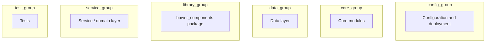

# Architecture report: tsayen/dom-to-image

> Automated static analysis. **Observed** = directly seen in files/imports/AST; **Inferred** = interpretation from that evidence. Repository code was not executed.

## 1. Repository at a glance

| Item | Value |
| --- | --- |
| Repository | tsayen/dom-to-image |
| Description | Generates an image from a DOM node using HTML5 canvas |
| Language | JavaScript |
| Stars | 10768 |
| Licence | Other |
| Analysed commit / branch | fae625bce0970b3a039671ea7f338d05ecb3d0e8 / master |
| Framework(s) | None detected |
| Files analysed | 220 |
| Components | 6 |

## 2. Architecture in one minute

tsayen/dom-to-image - Generates an image from a DOM node using HTML5 canvas. This repository was analysed statically from 220 file(s) (0 Python). Detected technologies (observed from imports/manifests): no known frameworks/libraries. Files are grouped into 6 component(s): bower_components package, Configuration and deployment, Core modules, Data layer, Service / domain layer, Tests. Findings below distinguish observed facts from inferred interpretation.

## 3. High-level block diagram

## 4. Main components

### bower_components package (`bower_components`)

- **Kind:** library
- **Status:** Observed
- **Confidence:** 0.85
- **Responsibility:** Groups 102 file(s) under bower_components package (observed from repository paths and static analysis).
- **Paths:** `bower_components/jquery/src/ajax.js`, `bower_components/jquery/src/ajax/jsonp.js`, `bower_components/jquery/src/ajax/load.js`, `bower_components/jquery/src/ajax/parseJSON.js`, `bower_components/jquery/src/ajax/parseXML.js`, `bower_components/jquery/src/ajax/script.js`, `bower_components/jquery/src/ajax/var/nonce.js`, `bower_components/jquery/src/ajax/var/rquery.js`, `bower_components/jquery/src/ajax/xhr.js`, `bower_components/jquery/src/attributes.js`, `bower_components/jquery/src/attributes/attr.js`, `bower_components/jquery/src/attributes/classes.js`, `bower_components/jquery/src/attributes/prop.js`, `bower_components/jquery/src/attributes/support.js`, `bower_components/jquery/src/attributes/val.js`, `bower_components/jquery/src/callbacks.js`, `bower_components/jquery/src/core.js`, `bower_components/jquery/src/css.js`, `bower_components/jquery/src/css/addGetHookIf.js`, `bower_components/jquery/src/css/curCSS.js`, `bower_components/jquery/src/css/defaultDisplay.js`, `bower_components/jquery/src/css/hiddenVisibleSelectors.js`, `bower_components/jquery/src/css/support.js`, `bower_components/jquery/src/css/swap.js`, `bower_components/jquery/src/css/var/cssExpand.js`, `bower_components/jquery/src/css/var/getStyles.js`, `bower_components/jquery/src/css/var/isHidden.js`, `bower_components/jquery/src/css/var/rmargin.js`, `bower_components/jquery/src/css/var/rnumnonpx.js`, `bower_components/jquery/src/data.js`, `bower_components/jquery/src/deferred.js`, `bower_components/jquery/src/deprecated.js`, `bower_components/jquery/src/dimensions.js`, `bower_components/jquery/src/effects.js`, `bower_components/jquery/src/effects/Tween.js`, `bower_components/jquery/src/effects/animatedSelector.js`, `bower_components/jquery/src/event.js`, `bower_components/jquery/src/event/ajax.js`, `bower_components/jquery/src/event/alias.js`, `bower_components/jquery/src/event/support.js`, `bower_components/jquery/src/exports/amd.js`, `bower_components/jquery/src/exports/global.js`, `bower_components/jquery/src/intro.js`, `bower_components/jquery/src/jquery.js`, `bower_components/jquery/src/manipulation.js`, `bower_components/jquery/src/manipulation/_evalUrl.js`, `bower_components/jquery/src/manipulation/support.js`, `bower_components/jquery/src/manipulation/var/rcheckableType.js`, `bower_components/jquery/src/offset.js`, `bower_components/jquery/src/outro.js`, `bower_components/jquery/src/queue.js`, `bower_components/jquery/src/queue/delay.js`, `bower_components/jquery/src/selector-native.js`, `bower_components/jquery/src/selector-sizzle.js`, `bower_components/jquery/src/selector.js`, `bower_components/jquery/src/serialize.js`, `bower_components/jquery/src/traversing.js`, `bower_components/jquery/src/traversing/findFilter.js`, `bower_components/jquery/src/traversing/var/rneedsContext.js`, `bower_components/jquery/src/var/arr.js`, `bower_components/jquery/src/var/class2type.js`, `bower_components/jquery/src/var/concat.js`, `bower_components/jquery/src/var/hasOwn.js`, `bower_components/jquery/src/var/indexOf.js`, `bower_components/jquery/src/var/pnum.js`, `bower_components/jquery/src/var/push.js`, `bower_components/jquery/src/var/rnotwhite.js`, `bower_components/jquery/src/var/slice.js`, `bower_components/jquery/src/var/strundefined.js`, `bower_components/jquery/src/var/support.js`, `bower_components/jquery/src/var/toString.js`, `bower_components/jquery/src/wrap.js`, `bower_components/js-imagediff/browser/canvas.js`, `bower_components/js-imagediff/imagediff.js`, `bower_components/js-imagediff/js/imagediff.js`, `bower_components/js-imagediff/js/license.js`, `bower_components/js-imagediff/lib/jasmine/jasmine-html.js`, `bower_components/js-imagediff/lib/jasmine/jasmine.js`, `bower_components/js-imagediff/spec/ImageDiffSpec.js`, `bower_components/ocrad-bower/build.sh`, `bower_components/ocrad-bower/ocrad-0.23-pre1/arg_parser.h`, `bower_components/ocrad-bower/ocrad-0.23-pre1/bitmap.h`, `bower_components/ocrad-bower/ocrad-0.23-pre1/blob.h`, `bower_components/ocrad-bower/ocrad-0.23-pre1/character.h`, `bower_components/ocrad-bower/ocrad-0.23-pre1/common.h`, `bower_components/ocrad-bower/ocrad-0.23-pre1/feats.h`, `bower_components/ocrad-bower/ocrad-0.23-pre1/mask.h`, `bower_components/ocrad-bower/ocrad-0.23-pre1/ocradlib.h`, `bower_components/ocrad-bower/ocrad-0.23-pre1/page_image.h`, `bower_components/ocrad-bower/ocrad-0.23-pre1/profile.h`, `bower_components/ocrad-bower/ocrad-0.23-pre1/rational.h`, `bower_components/ocrad-bower/ocrad-0.23-pre1/rectangle.h`, `bower_components/ocrad-bower/ocrad-0.23-pre1/segment.h`, `bower_components/ocrad-bower/ocrad-0.23-pre1/testsuite/check.sh`, `bower_components/ocrad-bower/ocrad-0.23-pre1/textblock.h`, `bower_components/ocrad-bower/ocrad-0.23-pre1/textline.h`, `bower_components/ocrad-bower/ocrad-0.23-pre1/textpage.h`, `bower_components/ocrad-bower/ocrad-0.23-pre1/track.h`, `bower_components/ocrad-bower/ocrad-0.23-pre1/ucs.h`, `bower_components/ocrad-bower/post.js`, `bower_components/ocrad-bower/pre.js`, `bower_components/ocrad-bower/worker.js`
- **Evidence:** [bower_components/jquery/src/ajax.js](https://github.com/tsayen/dom-to-image/blob/fae625bce0970b3a039671ea7f338d05ecb3d0e8/bower_components/jquery/src/ajax.js); [bower_components/jquery/src/ajax/jsonp.js](https://github.com/tsayen/dom-to-image/blob/fae625bce0970b3a039671ea7f338d05ecb3d0e8/bower_components/jquery/src/ajax/jsonp.js); [bower_components/jquery/src/ajax/load.js](https://github.com/tsayen/dom-to-image/blob/fae625bce0970b3a039671ea7f338d05ecb3d0e8/bower_components/jquery/src/ajax/load.js); [bower_components/jquery/src/ajax/parseJSON.js](https://github.com/tsayen/dom-to-image/blob/fae625bce0970b3a039671ea7f338d05ecb3d0e8/bower_components/jquery/src/ajax/parseJSON.js); [bower_components/jquery/src/ajax/parseXML.js](https://github.com/tsayen/dom-to-image/blob/fae625bce0970b3a039671ea7f338d05ecb3d0e8/bower_components/jquery/src/ajax/parseXML.js); [bower_components/jquery/src/ajax/script.js](https://github.com/tsayen/dom-to-image/blob/fae625bce0970b3a039671ea7f338d05ecb3d0e8/bower_components/jquery/src/ajax/script.js); [bower_components/jquery/src/ajax/var/nonce.js](https://github.com/tsayen/dom-to-image/blob/fae625bce0970b3a039671ea7f338d05ecb3d0e8/bower_components/jquery/src/ajax/var/nonce.js); [bower_components/jquery/src/ajax/var/rquery.js](https://github.com/tsayen/dom-to-image/blob/fae625bce0970b3a039671ea7f338d05ecb3d0e8/bower_components/jquery/src/ajax/var/rquery.js)

### Configuration and deployment (`config`)

- **Kind:** config
- **Status:** Observed
- **Confidence:** 0.85
- **Responsibility:** Groups 12 file(s) under configuration and deployment (observed from repository paths and static analysis).
- **Paths:** `bower.json`, `bower_components/fontawesome/.bower.json`, `bower_components/fontawesome/bower.json`, `bower_components/jquery/.bower.json`, `bower_components/jquery/bower.json`, `bower_components/js-imagediff/.bower.json`, `bower_components/js-imagediff/bower.json`, `bower_components/js-imagediff/make/build.json`, `bower_components/js-imagediff/package.json`, `bower_components/js-imagediff/spec/jasmine.yml`, `bower_components/ocrad-bower/.bower.json`, `bower_components/ocrad-bower/bower.json`
- **Evidence:** [bower.json](https://github.com/tsayen/dom-to-image/blob/fae625bce0970b3a039671ea7f338d05ecb3d0e8/bower.json); [bower_components/fontawesome/.bower.json](https://github.com/tsayen/dom-to-image/blob/fae625bce0970b3a039671ea7f338d05ecb3d0e8/bower_components/fontawesome/.bower.json); [bower_components/fontawesome/bower.json](https://github.com/tsayen/dom-to-image/blob/fae625bce0970b3a039671ea7f338d05ecb3d0e8/bower_components/fontawesome/bower.json); [bower_components/jquery/.bower.json](https://github.com/tsayen/dom-to-image/blob/fae625bce0970b3a039671ea7f338d05ecb3d0e8/bower_components/jquery/.bower.json); [bower_components/jquery/bower.json](https://github.com/tsayen/dom-to-image/blob/fae625bce0970b3a039671ea7f338d05ecb3d0e8/bower_components/jquery/bower.json); [bower_components/js-imagediff/.bower.json](https://github.com/tsayen/dom-to-image/blob/fae625bce0970b3a039671ea7f338d05ecb3d0e8/bower_components/js-imagediff/.bower.json); [bower_components/js-imagediff/bower.json](https://github.com/tsayen/dom-to-image/blob/fae625bce0970b3a039671ea7f338d05ecb3d0e8/bower_components/js-imagediff/bower.json); [bower_components/js-imagediff/make/build.json](https://github.com/tsayen/dom-to-image/blob/fae625bce0970b3a039671ea7f338d05ecb3d0e8/bower_components/js-imagediff/make/build.json)

### Core modules (`core`)

- **Kind:** core
- **Status:** Observed
- **Confidence:** 0.85
- **Responsibility:** Groups 2 file(s) under core modules (observed from repository paths and static analysis).
- **Paths:** `Gruntfile.js`, `karma.conf.js`
- **Evidence:** [Gruntfile.js](https://github.com/tsayen/dom-to-image/blob/fae625bce0970b3a039671ea7f338d05ecb3d0e8/Gruntfile.js); [karma.conf.js](https://github.com/tsayen/dom-to-image/blob/fae625bce0970b3a039671ea7f338d05ecb3d0e8/karma.conf.js)

### Data layer (`data_layer`)

- **Kind:** data
- **Status:** Observed
- **Confidence:** 0.85
- **Responsibility:** Groups 4 file(s) under data layer (observed from repository paths and static analysis).
- **Paths:** `bower_components/jquery/src/data/Data.js`, `bower_components/jquery/src/data/accepts.js`, `bower_components/jquery/src/data/var/data_priv.js`, `bower_components/jquery/src/data/var/data_user.js`
- **Evidence:** [bower_components/jquery/src/data/Data.js](https://github.com/tsayen/dom-to-image/blob/fae625bce0970b3a039671ea7f338d05ecb3d0e8/bower_components/jquery/src/data/Data.js); [bower_components/jquery/src/data/accepts.js](https://github.com/tsayen/dom-to-image/blob/fae625bce0970b3a039671ea7f338d05ecb3d0e8/bower_components/jquery/src/data/accepts.js); [bower_components/jquery/src/data/var/data_priv.js](https://github.com/tsayen/dom-to-image/blob/fae625bce0970b3a039671ea7f338d05ecb3d0e8/bower_components/jquery/src/data/var/data_priv.js); [bower_components/jquery/src/data/var/data_user.js](https://github.com/tsayen/dom-to-image/blob/fae625bce0970b3a039671ea7f338d05ecb3d0e8/bower_components/jquery/src/data/var/data_user.js)

### Service / domain layer (`service_layer`)

- **Kind:** service
- **Status:** Observed
- **Confidence:** 0.85
- **Responsibility:** Groups 5 file(s) under service / domain layer (observed from repository paths and static analysis).
- **Paths:** `bower_components/jquery/src/core/access.js`, `bower_components/jquery/src/core/init.js`, `bower_components/jquery/src/core/parseHTML.js`, `bower_components/jquery/src/core/ready.js`, `bower_components/jquery/src/core/var/rsingleTag.js`
- **Evidence:** [bower_components/jquery/src/core/access.js](https://github.com/tsayen/dom-to-image/blob/fae625bce0970b3a039671ea7f338d05ecb3d0e8/bower_components/jquery/src/core/access.js); [bower_components/jquery/src/core/init.js](https://github.com/tsayen/dom-to-image/blob/fae625bce0970b3a039671ea7f338d05ecb3d0e8/bower_components/jquery/src/core/init.js); [bower_components/jquery/src/core/parseHTML.js](https://github.com/tsayen/dom-to-image/blob/fae625bce0970b3a039671ea7f338d05ecb3d0e8/bower_components/jquery/src/core/parseHTML.js); [bower_components/jquery/src/core/ready.js](https://github.com/tsayen/dom-to-image/blob/fae625bce0970b3a039671ea7f338d05ecb3d0e8/bower_components/jquery/src/core/ready.js); [bower_components/jquery/src/core/var/rsingleTag.js](https://github.com/tsayen/dom-to-image/blob/fae625bce0970b3a039671ea7f338d05ecb3d0e8/bower_components/jquery/src/core/var/rsingleTag.js)

### Tests (`tests`)

- **Kind:** test
- **Status:** Observed
- **Confidence:** 0.85
- **Responsibility:** Groups 1 file(s) under tests (observed from repository paths and static analysis).
- **Paths:** `bower_components/ocrad-bower/ocrad-0.23-pre1/testsuite/test_utf8.txt`
- **Evidence:** [bower_components/ocrad-bower/ocrad-0.23-pre1/testsuite/test_utf8.txt](https://github.com/tsayen/dom-to-image/blob/fae625bce0970b3a039671ea7f338d05ecb3d0e8/bower_components/ocrad-bower/ocrad-0.23-pre1/testsuite/test_utf8.txt)

## 5. Execution flow

**Observed** entry point(s):

- [bower_components/js-imagediff/bin/imagediff](https://github.com/tsayen/dom-to-image/blob/fae625bce0970b3a039671ea7f338d05ecb3d0e8/bower_components/js-imagediff/bin/imagediff)
- [bower_components/js-imagediff/imagediff.js](https://github.com/tsayen/dom-to-image/blob/fae625bce0970b3a039671ea7f338d05ecb3d0e8/bower_components/js-imagediff/imagediff.js)

Representative flow (derived from observed entry points and the import graph; steps beyond the entry point are **Inferred**):

1. Execution starts at an observed entry point listed above, if present.
2. No internal import relationships between components were observed.

## 6. Project structure

### `(root)`

- `.gitattributes` - other (20 bytes)
- `.gitignore` - other (19 bytes)
- `.jsbeautifyrc` - other (1256 bytes)
- `.jshintrc` - other (106 bytes)
- `.stylelintrc` - other (49 bytes)
- `.travis.yml` - ci, YAML (268 bytes)
- `Gruntfile.js` - source, JavaScript (1163 bytes)
- `LICENSE` - docs (1156 bytes)
- `README.md` - docs (7671 bytes)
- `bower.json` - config (656 bytes)
- `karma.conf.js` - source, JavaScript (1325 bytes)

### `.github`

- `.github/ISSUE_TEMPLATE.md` - docs (240 bytes)

### `bower_components`

- `bower_components/fontawesome/.bower.json` - config (711 bytes)
- `bower_components/fontawesome/.gitignore` - other (301 bytes)
- `bower_components/fontawesome/.npmignore` - other (427 bytes)
- `bower_components/fontawesome/HELP-US-OUT.txt` - docs (318 bytes)
- `bower_components/fontawesome/bower.json` - config (403 bytes)
- `bower_components/fontawesome/css/font-awesome.css` - other (32318 bytes)
- `bower_components/fontawesome/less/animated.less` - other (713 bytes)
- `bower_components/fontawesome/less/bordered-pulled.less` - other (585 bytes)
- `bower_components/fontawesome/less/core.less` - other (452 bytes)
- `bower_components/fontawesome/less/fixed-width.less` - other (119 bytes)
- `bower_components/fontawesome/less/font-awesome.less` - other (465 bytes)
- `bower_components/fontawesome/less/icons.less` - other (42489 bytes)
- `bower_components/fontawesome/less/larger.less` - other (370 bytes)
- `bower_components/fontawesome/less/list.less` - other (377 bytes)
- `bower_components/fontawesome/less/mixins.less` - other (926 bytes)
- `bower_components/fontawesome/less/path.less` - other (770 bytes)
- `bower_components/fontawesome/less/rotated-flipped.less` - other (622 bytes)
- `bower_components/fontawesome/less/stacked.less` - other (476 bytes)
- `bower_components/fontawesome/less/variables.less` - other (19203 bytes)
- `bower_components/fontawesome/scss/_animated.scss` - other (715 bytes)
- `bower_components/fontawesome/scss/_bordered-pulled.scss` - other (592 bytes)
- `bower_components/fontawesome/scss/_core.scss` - other (459 bytes)
- `bower_components/fontawesome/scss/_fixed-width.scss` - other (120 bytes)
- `bower_components/fontawesome/scss/_icons.scss` - other (43163 bytes)
- `bower_components/fontawesome/scss/_larger.scss` - other (375 bytes)
- `bower_components/fontawesome/scss/_list.scss` - other (378 bytes)
- `bower_components/fontawesome/scss/_mixins.scss` - other (946 bytes)
- `bower_components/fontawesome/scss/_path.scss` - other (783 bytes)
- `bower_components/fontawesome/scss/_rotated-flipped.scss` - other (672 bytes)
- `bower_components/fontawesome/scss/_stacked.scss` - other (482 bytes)
- `bower_components/fontawesome/scss/_variables.scss` - other (19284 bytes)
- `bower_components/fontawesome/scss/font-awesome.scss` - other (405 bytes)
- `bower_components/jquery/.bower.json` - config (764 bytes)
- `bower_components/jquery/MIT-LICENSE.txt` - docs (1099 bytes)
- `bower_components/jquery/bower.json` - config (451 bytes)
- `bower_components/jquery/src/ajax.js` - source, JavaScript (21168 bytes)
- `bower_components/jquery/src/ajax/jsonp.js` - source, JavaScript (2516 bytes)
- `bower_components/jquery/src/ajax/load.js` - source, JavaScript (1669 bytes)
- `bower_components/jquery/src/ajax/parseJSON.js` - source, JavaScript (222 bytes)
- `bower_components/jquery/src/ajax/parseXML.js` - source, JavaScript (485 bytes)
- `bower_components/jquery/src/ajax/script.js` - source, JavaScript (1271 bytes)
- `bower_components/jquery/src/ajax/var/nonce.js` - source, JavaScript (73 bytes)
- `bower_components/jquery/src/ajax/var/rquery.js` - source, JavaScript (40 bytes)
- `bower_components/jquery/src/ajax/xhr.js` - source, JavaScript (3488 bytes)
- `bower_components/jquery/src/attributes.js` - source, JavaScript (200 bytes)
- `bower_components/jquery/src/attributes/attr.js` - source, JavaScript (3320 bytes)
- `bower_components/jquery/src/attributes/classes.js` - source, JavaScript (4155 bytes)
- `bower_components/jquery/src/attributes/prop.js` - source, JavaScript (1854 bytes)
- `bower_components/jquery/src/attributes/support.js` - source, JavaScript (893 bytes)
- `bower_components/jquery/src/attributes/val.js` - source, JavaScript (3839 bytes)
- `bower_components/jquery/src/callbacks.js` - source, JavaScript (5506 bytes)
- `bower_components/jquery/src/core.js` - source, JavaScript (11790 bytes)
- `bower_components/jquery/src/core/access.js` - source, JavaScript (1210 bytes)
- `bower_components/jquery/src/core/init.js` - source, JavaScript (3401 bytes)
- `bower_components/jquery/src/core/parseHTML.js` - source, JavaScript (938 bytes)
- `bower_components/jquery/src/core/ready.js` - source, JavaScript (2381 bytes)
- `bower_components/jquery/src/core/var/rsingleTag.js` - source, JavaScript (91 bytes)
- `bower_components/jquery/src/css.js` - source, JavaScript (12346 bytes)
- `bower_components/jquery/src/css/addGetHookIf.js` - source, JavaScript (509 bytes)
- `bower_components/jquery/src/css/curCSS.js` - source, JavaScript (1452 bytes)
- `bower_components/jquery/src/css/defaultDisplay.js` - source, JavaScript (1867 bytes)
- `bower_components/jquery/src/css/hiddenVisibleSelectors.js` - source, JavaScript (380 bytes)
- `bower_components/jquery/src/css/support.js` - source, JavaScript (3198 bytes)
- `bower_components/jquery/src/css/swap.js` - source, JavaScript (555 bytes)
- `bower_components/jquery/src/css/var/cssExpand.js` - source, JavaScript (70 bytes)
- `bower_components/jquery/src/css/var/getStyles.js` - source, JavaScript (410 bytes)
- `bower_components/jquery/src/css/var/isHidden.js` - source, JavaScript (355 bytes)
- `bower_components/jquery/src/css/var/rmargin.js` - source, JavaScript (45 bytes)
- `bower_components/jquery/src/css/var/rnumnonpx.js` - source, JavaScript (113 bytes)
- `bower_components/jquery/src/data.js` - source, JavaScript (4942 bytes)
- `bower_components/jquery/src/data/Data.js` - source, JavaScript (4882 bytes)
- `bower_components/jquery/src/data/accepts.js` - source, JavaScript (383 bytes)
- `bower_components/jquery/src/data/var/data_priv.js` - source, JavaScript (66 bytes)
- `bower_components/jquery/src/data/var/data_user.js` - source, JavaScript (66 bytes)
- `bower_components/jquery/src/deferred.js` - source, JavaScript (4414 bytes)
- `bower_components/jquery/src/deprecated.js` - source, JavaScript (223 bytes)
- `bower_components/jquery/src/dimensions.js` - source, JavaScript (1776 bytes)
- `bower_components/jquery/src/effects.js` - source, JavaScript (16914 bytes)
- `bower_components/jquery/src/effects/Tween.js` - source, JavaScript (3028 bytes)
- `bower_components/jquery/src/effects/animatedSelector.js` - source, JavaScript (225 bytes)
- `bower_components/jquery/src/event.js` - source, JavaScript (24475 bytes)
- `bower_components/jquery/src/event/ajax.js` - source, JavaScript (322 bytes)
- `bower_components/jquery/src/event/alias.js` - source, JavaScript (1094 bytes)
- `bower_components/jquery/src/event/support.js` - source, JavaScript (123 bytes)
- `bower_components/jquery/src/exports/amd.js` - source, JavaScript (1006 bytes)
- `bower_components/jquery/src/exports/global.js` - source, JavaScript (641 bytes)
- `bower_components/jquery/src/intro.js` - source, JavaScript (1393 bytes)
- `bower_components/jquery/src/jquery.js` - source, JavaScript (574 bytes)
- `bower_components/jquery/src/manipulation.js` - source, JavaScript (15039 bytes)
- `bower_components/jquery/src/manipulation/_evalUrl.js` - source, JavaScript (240 bytes)
- `bower_components/jquery/src/manipulation/support.js` - source, JavaScript (975 bytes)
- `bower_components/jquery/src/manipulation/var/rcheckableType.js` - source, JavaScript (59 bytes)
- `bower_components/jquery/src/offset.js` - source, JavaScript (5588 bytes)
- `bower_components/jquery/src/outro.js` - source, JavaScript (5 bytes)
- `bower_components/jquery/src/queue.js` - source, JavaScript (3063 bytes)
- `bower_components/jquery/src/queue/delay.js` - source, JavaScript (561 bytes)
- `bower_components/jquery/src/selector-native.js` - source, JavaScript (4434 bytes)
- `bower_components/jquery/src/selector-sizzle.js` - source, JavaScript (294 bytes)
- `bower_components/jquery/src/selector.js` - source, JavaScript (33 bytes)
- `bower_components/jquery/src/serialize.js` - source, JavaScript (3214 bytes)
- `bower_components/jquery/src/traversing.js` - source, JavaScript (4535 bytes)
- `bower_components/jquery/src/traversing/findFilter.js` - source, JavaScript (2464 bytes)
- `bower_components/jquery/src/traversing/var/rneedsContext.js` - source, JavaScript (110 bytes)
- `bower_components/jquery/src/var/arr.js` - source, JavaScript (36 bytes)
- `bower_components/jquery/src/var/class2type.js` - source, JavaScript (64 bytes)
- `bower_components/jquery/src/var/concat.js` - source, JavaScript (63 bytes)
- `bower_components/jquery/src/var/hasOwn.js` - source, JavaScript (92 bytes)
- `bower_components/jquery/src/var/indexOf.js` - source, JavaScript (64 bytes)
- `bower_components/jquery/src/var/pnum.js` - source, JavaScript (80 bytes)
- `bower_components/jquery/src/var/push.js` - source, JavaScript (61 bytes)
- `bower_components/jquery/src/var/rnotwhite.js` - source, JavaScript (42 bytes)
- `bower_components/jquery/src/var/slice.js` - source, JavaScript (62 bytes)
- `bower_components/jquery/src/var/strundefined.js` - source, JavaScript (50 bytes)
- `bower_components/jquery/src/var/support.js` - source, JavaScript (99 bytes)
- `bower_components/jquery/src/var/toString.js` - source, JavaScript (86 bytes)
- `bower_components/jquery/src/wrap.js` - source, JavaScript (1496 bytes)
- `bower_components/js-imagediff/.bower.json` - config (515 bytes)
- `bower_components/js-imagediff/LICENSE` - docs (1088 bytes)
- `bower_components/js-imagediff/Makefile` - other (169 bytes)
- `bower_components/js-imagediff/README.md` - docs (4449 bytes)
- `bower_components/js-imagediff/bin/imagediff` - other (2050 bytes)
- `bower_components/js-imagediff/bower.json` - config (177 bytes)
- `bower_components/js-imagediff/browser/canvas.js` - source, JavaScript (99 bytes)
- `bower_components/js-imagediff/examples/index.html` - other (2305 bytes)
- `bower_components/js-imagediff/examples/styles.css` - other (360 bytes)
- `bower_components/js-imagediff/imagediff.js` - source, JavaScript (10373 bytes)
- `bower_components/js-imagediff/js/imagediff.js` - source, JavaScript (10165 bytes)
- `bower_components/js-imagediff/js/license.js` - source, JavaScript (210 bytes)
- `bower_components/js-imagediff/lib/jasmine/MIT.LICENSE` - other (1061 bytes)
- `bower_components/js-imagediff/lib/jasmine/jasmine-html.js` - source, JavaScript (19065 bytes)
- `bower_components/js-imagediff/lib/jasmine/jasmine.css` - other (6444 bytes)
- `bower_components/js-imagediff/lib/jasmine/jasmine.js` - source, JavaScript (68641 bytes)
- `bower_components/js-imagediff/make/build.json` - config (124 bytes)
- `bower_components/js-imagediff/package.json` - manifest (865 bytes)
- `bower_components/js-imagediff/spec/ImageDiffSpec.js` - source, JavaScript (15165 bytes)
- `bower_components/js-imagediff/spec/SpecRunner.html` - other (1336 bytes)
- `bower_components/js-imagediff/spec/jasmine.yml` - config (113 bytes)
- `bower_components/ocrad-bower/.bower.json` - config (698 bytes)
- `bower_components/ocrad-bower/README.md` - docs (6576 bytes)
- `bower_components/ocrad-bower/bower.json` - config (455 bytes)
- `bower_components/ocrad-bower/build.sh` - source, Shell (898 bytes)
- `bower_components/ocrad-bower/demo.html` - other (19045 bytes)
- `bower_components/ocrad-bower/diff.patch` - other (1634 bytes)
- `bower_components/ocrad-bower/examples/file.html` - other (783 bytes)
- `bower_components/ocrad-bower/examples/image.html` - other (427 bytes)
- `bower_components/ocrad-bower/examples/url.html` - other (588 bytes)
- `bower_components/ocrad-bower/ocrad-0.23-pre1/AUTHORS` - other (111 bytes)
- `bower_components/ocrad-bower/ocrad-0.23-pre1/COPYING` - other (35068 bytes)
- `bower_components/ocrad-bower/ocrad-0.23-pre1/ChangeLog` - other (7368 bytes)
- `bower_components/ocrad-bower/ocrad-0.23-pre1/INSTALL` - other (1768 bytes)
- `bower_components/ocrad-bower/ocrad-0.23-pre1/Makefile.in` - other (5532 bytes)
- `bower_components/ocrad-bower/ocrad-0.23-pre1/NEWS` - other (77 bytes)
- `bower_components/ocrad-bower/ocrad-0.23-pre1/README` - other (2069 bytes)
- `bower_components/ocrad-bower/ocrad-0.23-pre1/arg_parser.cc` - other (6410 bytes)
- `bower_components/ocrad-bower/ocrad-0.23-pre1/arg_parser.h` - source, C/C++ (4036 bytes)
- `bower_components/ocrad-bower/ocrad-0.23-pre1/bitmap.cc` - other (13218 bytes)
- `bower_components/ocrad-bower/ocrad-0.23-pre1/bitmap.h` - source, C/C++ (2725 bytes)
- `bower_components/ocrad-bower/ocrad-0.23-pre1/blob.cc` - other (8349 bytes)
- `bower_components/ocrad-bower/ocrad-0.23-pre1/blob.h` - source, C/C++ (2004 bytes)
- `bower_components/ocrad-bower/ocrad-0.23-pre1/character.cc` - other (10583 bytes)
- `bower_components/ocrad-bower/ocrad-0.23-pre1/character.h` - source, C/C++ (3348 bytes)
- `bower_components/ocrad-bower/ocrad-0.23-pre1/character_r11.cc` - other (14764 bytes)
- `bower_components/ocrad-bower/ocrad-0.23-pre1/character_r12.cc` - other (9751 bytes)
- `bower_components/ocrad-bower/ocrad-0.23-pre1/character_r13.cc` - other (2448 bytes)
- `bower_components/ocrad-bower/ocrad-0.23-pre1/common.cc` - other (5154 bytes)
- `bower_components/ocrad-bower/ocrad-0.23-pre1/common.h` - source, C/C++ (2451 bytes)
- `bower_components/ocrad-bower/ocrad-0.23-pre1/configure` - other (6303 bytes)
- `bower_components/ocrad-bower/ocrad-0.23-pre1/doc/ocrad.1` - other (2897 bytes)
- `bower_components/ocrad-bower/ocrad-0.23-pre1/doc/ocrad.info` - other (21445 bytes)
- `bower_components/ocrad-bower/ocrad-0.23-pre1/doc/ocrad.texinfo` - other (20718 bytes)
- `bower_components/ocrad-bower/ocrad-0.23-pre1/feats.cc` - other (9601 bytes)
- `bower_components/ocrad-bower/ocrad-0.23-pre1/feats.h` - source, C/C++ (2402 bytes)
- `bower_components/ocrad-bower/ocrad-0.23-pre1/feats_test0.cc` - other (32000 bytes)
- `bower_components/ocrad-bower/ocrad-0.23-pre1/feats_test1.cc` - other (8562 bytes)
- `bower_components/ocrad-bower/ocrad-0.23-pre1/main.cc` - other (15176 bytes)
- `bower_components/ocrad-bower/ocrad-0.23-pre1/mask.cc` - other (4001 bytes)
- `bower_components/ocrad-bower/ocrad-0.23-pre1/mask.h` - source, C/C++ (1866 bytes)
- `bower_components/ocrad-bower/ocrad-0.23-pre1/ocradlib.cc` - other (9663 bytes)
- `bower_components/ocrad-bower/ocrad-0.23-pre1/ocradlib.h` - source, C/C++ (4304 bytes)
- `bower_components/ocrad-bower/ocrad-0.23-pre1/ocrcheck.cc` - other (3495 bytes)
- `bower_components/ocrad-bower/ocrad-0.23-pre1/page_image.cc` - other (20240 bytes)
- `bower_components/ocrad-bower/ocrad-0.23-pre1/page_image.h` - source, C/C++ (3051 bytes)
- `bower_components/ocrad-bower/ocrad-0.23-pre1/page_image_io.cc` - other (10092 bytes)
- `bower_components/ocrad-bower/ocrad-0.23-pre1/profile.cc` - other (18226 bytes)
- `bower_components/ocrad-bower/ocrad-0.23-pre1/profile.h` - source, C/C++ (2228 bytes)
- `bower_components/ocrad-bower/ocrad-0.23-pre1/rational.cc` - other (6983 bytes)
- `bower_components/ocrad-bower/ocrad-0.23-pre1/rational.h` - source, C/C++ (6295 bytes)
- `bower_components/ocrad-bower/ocrad-0.23-pre1/rectangle.cc` - other (7600 bytes)
- `bower_components/ocrad-bower/ocrad-0.23-pre1/rectangle.h` - source, C/C++ (3420 bytes)
- `bower_components/ocrad-bower/ocrad-0.23-pre1/segment.cc` - other (1669 bytes)
- `bower_components/ocrad-bower/ocrad-0.23-pre1/segment.h` - source, C/C++ (1556 bytes)
- `bower_components/ocrad-bower/ocrad-0.23-pre1/testsuite/check.sh` - source, Shell (4458 bytes)
- `bower_components/ocrad-bower/ocrad-0.23-pre1/testsuite/test.txt` - docs (271 bytes)
- `bower_components/ocrad-bower/ocrad-0.23-pre1/testsuite/test_utf8.txt` - test (220 bytes)
- `bower_components/ocrad-bower/ocrad-0.23-pre1/textblock.cc` - other (16336 bytes)
- `bower_components/ocrad-bower/ocrad-0.23-pre1/textblock.h` - source, C/C++ (1624 bytes)
- `bower_components/ocrad-bower/ocrad-0.23-pre1/textline.cc` - other (9438 bytes)
- `bower_components/ocrad-bower/ocrad-0.23-pre1/textline.h` - source, C/C++ (2328 bytes)
- `bower_components/ocrad-bower/ocrad-0.23-pre1/textline_r2.cc` - other (29166 bytes)
- `bower_components/ocrad-bower/ocrad-0.23-pre1/textpage.cc` - other (17012 bytes)
- `bower_components/ocrad-bower/ocrad-0.23-pre1/textpage.h` - source, C/C++ (1462 bytes)
- `bower_components/ocrad-bower/ocrad-0.23-pre1/track.cc` - other (9810 bytes)
- `bower_components/ocrad-bower/ocrad-0.23-pre1/track.h` - source, C/C++ (2717 bytes)
- `bower_components/ocrad-bower/ocrad-0.23-pre1/ucs.cc` - other (10622 bytes)
- `bower_components/ocrad-bower/ocrad-0.23-pre1/ucs.h` - source, C/C++ (6482 bytes)
- `bower_components/ocrad-bower/post.js` - source, JavaScript (3420 bytes)
- `bower_components/ocrad-bower/pre.js` - source, JavaScript (26 bytes)
- `bower_components/ocrad-bower/worker.js` - source, JavaScript (80 bytes)

## 7. Key dependencies and integrations

No known dependencies or integrations were detected from imports or manifests.

## 8. Data and state

- Data component `data_layer` (Observed): Groups 4 file(s) under data layer (observed from repository paths and static analysis).

## 9. Configuration and deployment clues

- `.travis.yml` (ci)
- `bower.json` (config)
- `bower_components/fontawesome/.bower.json` (config)
- `bower_components/fontawesome/bower.json` (config)
- `bower_components/jquery/.bower.json` (config)
- `bower_components/jquery/bower.json` (config)
- `bower_components/js-imagediff/.bower.json` (config)
- `bower_components/js-imagediff/bower.json` (config)
- `bower_components/js-imagediff/make/build.json` (config)
- `bower_components/js-imagediff/package.json` (manifest)
- `bower_components/js-imagediff/spec/jasmine.yml` (config)
- `bower_components/ocrad-bower/.bower.json` (config)
- `bower_components/ocrad-bower/bower.json` (config)

## 10. Design observations

- Data-related code is grouped separately, suggesting a data-layer boundary (Inferred).
- Service/domain code is distinct from entry and data code, suggesting layered separation (Inferred).
- Tests are present alongside source code (Observed from test file paths).

These observations are interpretations (**Inferred**) of the observed structure, not guarantees about runtime design.

## 11. Limitations and unknowns

- Static analysis only: repository code was not executed, installed, or imported at runtime.
- Components and relationships are inferred from file paths, imports, and AST structure; runtime behaviour, dynamic imports, and reflection may not be visible.
- 580 file(s) were skipped during inventory (1 x generated/minified file excluded; 579 x vendored/generated directory excluded).
- No clear application entry point was observed in the analysed files.
- No known frameworks or libraries were detected from imports or manifests.
- Repository text was treated as untrusted data; no instructions found in repository files were followed, and likely secret values were redacted/excluded.
- JavaScript and TypeScript files were inventoried from paths and package manifests. They were not parsed with a full language AST, and repository code was not executed.

## 12. Source references

- [Gruntfile.js](https://github.com/tsayen/dom-to-image/blob/fae625bce0970b3a039671ea7f338d05ecb3d0e8/Gruntfile.js)
- [bower.json](https://github.com/tsayen/dom-to-image/blob/fae625bce0970b3a039671ea7f338d05ecb3d0e8/bower.json)
- [bower_components/fontawesome/.bower.json](https://github.com/tsayen/dom-to-image/blob/fae625bce0970b3a039671ea7f338d05ecb3d0e8/bower_components/fontawesome/.bower.json)
- [bower_components/fontawesome/bower.json](https://github.com/tsayen/dom-to-image/blob/fae625bce0970b3a039671ea7f338d05ecb3d0e8/bower_components/fontawesome/bower.json)
- [bower_components/jquery/.bower.json](https://github.com/tsayen/dom-to-image/blob/fae625bce0970b3a039671ea7f338d05ecb3d0e8/bower_components/jquery/.bower.json)
- [bower_components/jquery/bower.json](https://github.com/tsayen/dom-to-image/blob/fae625bce0970b3a039671ea7f338d05ecb3d0e8/bower_components/jquery/bower.json)
- [bower_components/jquery/src/ajax.js](https://github.com/tsayen/dom-to-image/blob/fae625bce0970b3a039671ea7f338d05ecb3d0e8/bower_components/jquery/src/ajax.js)
- [bower_components/jquery/src/ajax/jsonp.js](https://github.com/tsayen/dom-to-image/blob/fae625bce0970b3a039671ea7f338d05ecb3d0e8/bower_components/jquery/src/ajax/jsonp.js)
- [bower_components/jquery/src/ajax/load.js](https://github.com/tsayen/dom-to-image/blob/fae625bce0970b3a039671ea7f338d05ecb3d0e8/bower_components/jquery/src/ajax/load.js)
- [bower_components/jquery/src/ajax/parseJSON.js](https://github.com/tsayen/dom-to-image/blob/fae625bce0970b3a039671ea7f338d05ecb3d0e8/bower_components/jquery/src/ajax/parseJSON.js)
- [bower_components/jquery/src/ajax/parseXML.js](https://github.com/tsayen/dom-to-image/blob/fae625bce0970b3a039671ea7f338d05ecb3d0e8/bower_components/jquery/src/ajax/parseXML.js)
- [bower_components/jquery/src/ajax/script.js](https://github.com/tsayen/dom-to-image/blob/fae625bce0970b3a039671ea7f338d05ecb3d0e8/bower_components/jquery/src/ajax/script.js)
- [bower_components/jquery/src/ajax/var/nonce.js](https://github.com/tsayen/dom-to-image/blob/fae625bce0970b3a039671ea7f338d05ecb3d0e8/bower_components/jquery/src/ajax/var/nonce.js)
- [bower_components/jquery/src/ajax/var/rquery.js](https://github.com/tsayen/dom-to-image/blob/fae625bce0970b3a039671ea7f338d05ecb3d0e8/bower_components/jquery/src/ajax/var/rquery.js)
- [bower_components/jquery/src/core/access.js](https://github.com/tsayen/dom-to-image/blob/fae625bce0970b3a039671ea7f338d05ecb3d0e8/bower_components/jquery/src/core/access.js)
- [bower_components/jquery/src/core/init.js](https://github.com/tsayen/dom-to-image/blob/fae625bce0970b3a039671ea7f338d05ecb3d0e8/bower_components/jquery/src/core/init.js)
- [bower_components/jquery/src/core/parseHTML.js](https://github.com/tsayen/dom-to-image/blob/fae625bce0970b3a039671ea7f338d05ecb3d0e8/bower_components/jquery/src/core/parseHTML.js)
- [bower_components/jquery/src/core/ready.js](https://github.com/tsayen/dom-to-image/blob/fae625bce0970b3a039671ea7f338d05ecb3d0e8/bower_components/jquery/src/core/ready.js)
- [bower_components/jquery/src/core/var/rsingleTag.js](https://github.com/tsayen/dom-to-image/blob/fae625bce0970b3a039671ea7f338d05ecb3d0e8/bower_components/jquery/src/core/var/rsingleTag.js)
- [bower_components/jquery/src/data/Data.js](https://github.com/tsayen/dom-to-image/blob/fae625bce0970b3a039671ea7f338d05ecb3d0e8/bower_components/jquery/src/data/Data.js)
- [bower_components/jquery/src/data/accepts.js](https://github.com/tsayen/dom-to-image/blob/fae625bce0970b3a039671ea7f338d05ecb3d0e8/bower_components/jquery/src/data/accepts.js)
- [bower_components/jquery/src/data/var/data_priv.js](https://github.com/tsayen/dom-to-image/blob/fae625bce0970b3a039671ea7f338d05ecb3d0e8/bower_components/jquery/src/data/var/data_priv.js)
- [bower_components/jquery/src/data/var/data_user.js](https://github.com/tsayen/dom-to-image/blob/fae625bce0970b3a039671ea7f338d05ecb3d0e8/bower_components/jquery/src/data/var/data_user.js)
- [bower_components/js-imagediff/.bower.json](https://github.com/tsayen/dom-to-image/blob/fae625bce0970b3a039671ea7f338d05ecb3d0e8/bower_components/js-imagediff/.bower.json)
- [bower_components/js-imagediff/bin/imagediff](https://github.com/tsayen/dom-to-image/blob/fae625bce0970b3a039671ea7f338d05ecb3d0e8/bower_components/js-imagediff/bin/imagediff)
- [bower_components/js-imagediff/bower.json](https://github.com/tsayen/dom-to-image/blob/fae625bce0970b3a039671ea7f338d05ecb3d0e8/bower_components/js-imagediff/bower.json)
- [bower_components/js-imagediff/imagediff.js](https://github.com/tsayen/dom-to-image/blob/fae625bce0970b3a039671ea7f338d05ecb3d0e8/bower_components/js-imagediff/imagediff.js)
- [bower_components/js-imagediff/make/build.json](https://github.com/tsayen/dom-to-image/blob/fae625bce0970b3a039671ea7f338d05ecb3d0e8/bower_components/js-imagediff/make/build.json)
- [bower_components/ocrad-bower/ocrad-0.23-pre1/testsuite/test_utf8.txt](https://github.com/tsayen/dom-to-image/blob/fae625bce0970b3a039671ea7f338d05ecb3d0e8/bower_components/ocrad-bower/ocrad-0.23-pre1/testsuite/test_utf8.txt)
- [karma.conf.js](https://github.com/tsayen/dom-to-image/blob/fae625bce0970b3a039671ea7f338d05ecb3d0e8/karma.conf.js)
