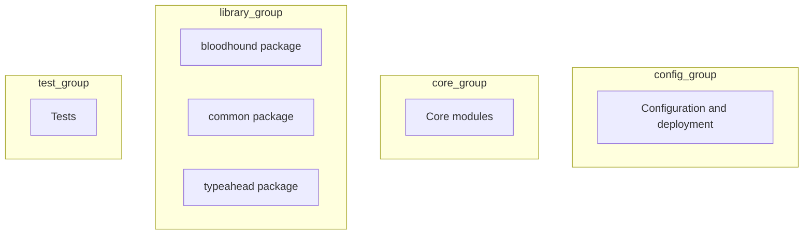

# Architecture report: twitter/typeahead.js

> Automated static analysis. **Observed** = directly seen in files/imports/AST; **Inferred** = interpretation from that evidence. Repository code was not executed.

## 1. Repository at a glance

| Item | Value |
| --- | --- |
| Repository | twitter/typeahead.js |
| Description | typeahead.js is a fast and fully-featured autocomplete library |
| Language | JavaScript |
| Stars | 16410 |
| Licence | MIT |
| Analysed commit / branch | 588440f66559714280628a4f9799f0c4eb880a4a / master |
| Framework(s) | None detected |
| Files analysed | 63 |
| Components | 6 |

## 2. Architecture in one minute

twitter/typeahead.js - typeahead.js is a fast and fully-featured autocomplete library. This repository was analysed statically from 63 file(s) (0 Python). Detected technologies (observed from imports/manifests): no known frameworks/libraries. Files are grouped into 6 component(s): bloodhound package, common package, Configuration and deployment, Core modules, Tests, typeahead package. Findings below distinguish observed facts from inferred interpretation.

## 3. High-level block diagram

## 4. Main components

### bloodhound package (`bloodhound`)

- **Kind:** library
- **Status:** Observed
- **Confidence:** 0.85
- **Responsibility:** Groups 10 file(s) under bloodhound package (observed from repository paths and static analysis).
- **Paths:** `src/bloodhound/bloodhound.js`, `src/bloodhound/lru_cache.js`, `src/bloodhound/options_parser.js`, `src/bloodhound/persistent_storage.js`, `src/bloodhound/prefetch.js`, `src/bloodhound/remote.js`, `src/bloodhound/search_index.js`, `src/bloodhound/tokenizers.js`, `src/bloodhound/transport.js`, `src/bloodhound/version.js`
- **Evidence:** [src/bloodhound/bloodhound.js](https://github.com/twitter/typeahead.js/blob/588440f66559714280628a4f9799f0c4eb880a4a/src/bloodhound/bloodhound.js); [src/bloodhound/lru_cache.js](https://github.com/twitter/typeahead.js/blob/588440f66559714280628a4f9799f0c4eb880a4a/src/bloodhound/lru_cache.js); [src/bloodhound/options_parser.js](https://github.com/twitter/typeahead.js/blob/588440f66559714280628a4f9799f0c4eb880a4a/src/bloodhound/options_parser.js); [src/bloodhound/persistent_storage.js](https://github.com/twitter/typeahead.js/blob/588440f66559714280628a4f9799f0c4eb880a4a/src/bloodhound/persistent_storage.js); [src/bloodhound/prefetch.js](https://github.com/twitter/typeahead.js/blob/588440f66559714280628a4f9799f0c4eb880a4a/src/bloodhound/prefetch.js); [src/bloodhound/remote.js](https://github.com/twitter/typeahead.js/blob/588440f66559714280628a4f9799f0c4eb880a4a/src/bloodhound/remote.js); [src/bloodhound/search_index.js](https://github.com/twitter/typeahead.js/blob/588440f66559714280628a4f9799f0c4eb880a4a/src/bloodhound/search_index.js); [src/bloodhound/tokenizers.js](https://github.com/twitter/typeahead.js/blob/588440f66559714280628a4f9799f0c4eb880a4a/src/bloodhound/tokenizers.js)

### common package (`common`)

- **Kind:** library
- **Status:** Observed
- **Confidence:** 0.85
- **Responsibility:** Groups 1 file(s) under common package (observed from repository paths and static analysis).
- **Paths:** `src/common/utils.js`
- **Evidence:** [src/common/utils.js](https://github.com/twitter/typeahead.js/blob/588440f66559714280628a4f9799f0c4eb880a4a/src/common/utils.js)

### Configuration and deployment (`config`)

- **Kind:** config
- **Status:** Observed
- **Confidence:** 0.85
- **Responsibility:** Groups 4 file(s) under configuration and deployment (observed from repository paths and static analysis).
- **Paths:** `bower.json`, `composer.json`, `package.json`, `typeahead.js.jquery.json`
- **Evidence:** [bower.json](https://github.com/twitter/typeahead.js/blob/588440f66559714280628a4f9799f0c4eb880a4a/bower.json); [composer.json](https://github.com/twitter/typeahead.js/blob/588440f66559714280628a4f9799f0c4eb880a4a/composer.json); [package.json](https://github.com/twitter/typeahead.js/blob/588440f66559714280628a4f9799f0c4eb880a4a/package.json); [typeahead.js.jquery.json](https://github.com/twitter/typeahead.js/blob/588440f66559714280628a4f9799f0c4eb880a4a/typeahead.js.jquery.json)

### Core modules (`core`)

- **Kind:** core
- **Status:** Observed
- **Confidence:** 0.85
- **Responsibility:** Groups 2 file(s) under core modules (observed from repository paths and static analysis).
- **Paths:** `Gruntfile.js`, `karma.conf.js`
- **Evidence:** [Gruntfile.js](https://github.com/twitter/typeahead.js/blob/588440f66559714280628a4f9799f0c4eb880a4a/Gruntfile.js); [karma.conf.js](https://github.com/twitter/typeahead.js/blob/588440f66559714280628a4f9799f0c4eb880a4a/karma.conf.js)

### Tests (`tests`)

- **Kind:** test
- **Status:** Observed
- **Confidence:** 0.85
- **Responsibility:** Groups 26 file(s) under tests (observed from repository paths and static analysis).
- **Paths:** `test/bloodhound/bloodhound_spec.js`, `test/bloodhound/lru_cache_spec.js`, `test/bloodhound/options_parser_spec.js`, `test/bloodhound/persistent_storage_spec.js`, `test/bloodhound/prefetch_spec.js`, `test/bloodhound/remote_spec.js`, `test/bloodhound/search_index_spec.js`, `test/bloodhound/tokenizers_spec.js`, `test/bloodhound/transport_spec.js`, `test/ci`, `test/fixtures/ajax_responses.js`, `test/fixtures/data.js`, `test/fixtures/html.js`, `test/helpers/typeahead_mocks.js`, `test/integration/test.html`, `test/integration/test.js`, `test/playground.html`, `test/typeahead/dataset_spec.js`, `test/typeahead/default_results_spec.js`, `test/typeahead/event_bus_spec.js`, `test/typeahead/event_emitter_spec.js`, `test/typeahead/highlight_spec.js`, `test/typeahead/input_spec.js`, `test/typeahead/plugin_spec.js`, `test/typeahead/results_spec.js`, `test/typeahead/typeahead_spec.js`
- **Evidence:** [test/bloodhound/bloodhound_spec.js](https://github.com/twitter/typeahead.js/blob/588440f66559714280628a4f9799f0c4eb880a4a/test/bloodhound/bloodhound_spec.js); [test/bloodhound/lru_cache_spec.js](https://github.com/twitter/typeahead.js/blob/588440f66559714280628a4f9799f0c4eb880a4a/test/bloodhound/lru_cache_spec.js); [test/bloodhound/options_parser_spec.js](https://github.com/twitter/typeahead.js/blob/588440f66559714280628a4f9799f0c4eb880a4a/test/bloodhound/options_parser_spec.js); [test/bloodhound/persistent_storage_spec.js](https://github.com/twitter/typeahead.js/blob/588440f66559714280628a4f9799f0c4eb880a4a/test/bloodhound/persistent_storage_spec.js); [test/bloodhound/prefetch_spec.js](https://github.com/twitter/typeahead.js/blob/588440f66559714280628a4f9799f0c4eb880a4a/test/bloodhound/prefetch_spec.js); [test/bloodhound/remote_spec.js](https://github.com/twitter/typeahead.js/blob/588440f66559714280628a4f9799f0c4eb880a4a/test/bloodhound/remote_spec.js); [test/bloodhound/search_index_spec.js](https://github.com/twitter/typeahead.js/blob/588440f66559714280628a4f9799f0c4eb880a4a/test/bloodhound/search_index_spec.js); [test/bloodhound/tokenizers_spec.js](https://github.com/twitter/typeahead.js/blob/588440f66559714280628a4f9799f0c4eb880a4a/test/bloodhound/tokenizers_spec.js)

### typeahead package (`typeahead`)

- **Kind:** library
- **Status:** Observed
- **Confidence:** 0.85
- **Responsibility:** Groups 10 file(s) under typeahead package (observed from repository paths and static analysis).
- **Paths:** `src/typeahead/dataset.js`, `src/typeahead/default_menu.js`, `src/typeahead/event_bus.js`, `src/typeahead/event_emitter.js`, `src/typeahead/highlight.js`, `src/typeahead/input.js`, `src/typeahead/menu.js`, `src/typeahead/plugin.js`, `src/typeahead/typeahead.js`, `src/typeahead/www.js`
- **Evidence:** [src/typeahead/dataset.js](https://github.com/twitter/typeahead.js/blob/588440f66559714280628a4f9799f0c4eb880a4a/src/typeahead/dataset.js); [src/typeahead/default_menu.js](https://github.com/twitter/typeahead.js/blob/588440f66559714280628a4f9799f0c4eb880a4a/src/typeahead/default_menu.js); [src/typeahead/event_bus.js](https://github.com/twitter/typeahead.js/blob/588440f66559714280628a4f9799f0c4eb880a4a/src/typeahead/event_bus.js); [src/typeahead/event_emitter.js](https://github.com/twitter/typeahead.js/blob/588440f66559714280628a4f9799f0c4eb880a4a/src/typeahead/event_emitter.js); [src/typeahead/highlight.js](https://github.com/twitter/typeahead.js/blob/588440f66559714280628a4f9799f0c4eb880a4a/src/typeahead/highlight.js); [src/typeahead/input.js](https://github.com/twitter/typeahead.js/blob/588440f66559714280628a4f9799f0c4eb880a4a/src/typeahead/input.js); [src/typeahead/menu.js](https://github.com/twitter/typeahead.js/blob/588440f66559714280628a4f9799f0c4eb880a4a/src/typeahead/menu.js); [src/typeahead/plugin.js](https://github.com/twitter/typeahead.js/blob/588440f66559714280628a4f9799f0c4eb880a4a/src/typeahead/plugin.js)

## 5. Execution flow

No entry point was observed; the startup flow below is therefore limited.

Representative flow (derived from observed entry points and the import graph; steps beyond the entry point are **Inferred**):

1. Execution starts at an observed entry point listed above, if present.
2. No internal import relationships between components were observed.

## 6. Project structure

### `(root)`

- `.gitignore` - other (125 bytes)
- `.jshintrc` - other (229 bytes)
- `.travis.yml` - ci, YAML (1201 bytes)
- `CHANGELOG.md` - docs (11563 bytes)
- `CONTRIBUTING.md` - docs (4093 bytes)
- `Gruntfile.js` - source, JavaScript (8598 bytes)
- `LICENSE` - docs (1061 bytes)
- `README.md` - docs (5915 bytes)
- `bower.json` - config (247 bytes)
- `composer.json` - config (491 bytes)
- `karma.conf.js` - source, JavaScript (1340 bytes)
- `package.json` - manifest (1801 bytes)
- `typeahead.js.jquery.json` - config (967 bytes)

### `doc`

- `doc/bloodhound.md` - docs (9755 bytes)
- `doc/jquery_typeahead.md` - docs (10292 bytes)
- `doc/migration/0.10.0.md` - docs (7670 bytes)

### `src`

- `src/bloodhound/bloodhound.js` - source, JavaScript (4530 bytes)
- `src/bloodhound/lru_cache.js` - source, JavaScript (2026 bytes)
- `src/bloodhound/options_parser.js` - source, JavaScript (4559 bytes)
- `src/bloodhound/persistent_storage.js` - source, JavaScript (3193 bytes)
- `src/bloodhound/prefetch.js` - source, JavaScript (2261 bytes)
- `src/bloodhound/remote.js` - source, JavaScript (1141 bytes)
- `src/bloodhound/search_index.js` - source, JavaScript (4028 bytes)
- `src/bloodhound/tokenizers.js` - source, JavaScript (915 bytes)
- `src/bloodhound/transport.js` - source, JavaScript (3030 bytes)
- `src/bloodhound/version.js` - source, JavaScript (168 bytes)
- `src/common/utils.js` - source, JavaScript (3775 bytes)
- `src/typeahead/dataset.js` - source, JavaScript (8819 bytes)
- `src/typeahead/default_menu.js` - source, JavaScript (1752 bytes)
- `src/typeahead/event_bus.js` - source, JavaScript (1562 bytes)
- `src/typeahead/event_emitter.js` - source, JavaScript (2626 bytes)
- `src/typeahead/highlight.js` - source, JavaScript (2170 bytes)
- `src/typeahead/input.js` - source, JavaScript (8612 bytes)
- `src/typeahead/menu.js` - source, JavaScript (5875 bytes)
- `src/typeahead/plugin.js` - source, JavaScript (7547 bytes)
- `src/typeahead/typeahead.js` - source, JavaScript (12069 bytes)
- `src/typeahead/www.js` - source, JavaScript (2469 bytes)

### `test`

- `test/bloodhound/bloodhound_spec.js` - test, JavaScript (8873 bytes)
- `test/bloodhound/lru_cache_spec.js` - test, JavaScript (1220 bytes)
- `test/bloodhound/options_parser_spec.js` - test, JavaScript (5685 bytes)
- `test/bloodhound/persistent_storage_spec.js` - test, JavaScript (5488 bytes)
- `test/bloodhound/prefetch_spec.js` - test, JavaScript (4837 bytes)
- `test/bloodhound/remote_spec.js` - test, JavaScript (1853 bytes)
- `test/bloodhound/search_index_spec.js` - test, JavaScript (2055 bytes)
- `test/bloodhound/tokenizers_spec.js` - test, JavaScript (2390 bytes)
- `test/bloodhound/transport_spec.js` - test, JavaScript (5076 bytes)
- `test/ci` - test (428 bytes)
- `test/fixtures/ajax_responses.js` - test, JavaScript (474 bytes)
- `test/fixtures/data.js` - test, JavaScript (5634 bytes)
- `test/fixtures/html.js` - test, JavaScript (475 bytes)
- `test/helpers/typeahead_mocks.js` - test, JavaScript (1826 bytes)
- `test/integration/test.html` - test (2798 bytes)
- `test/integration/test.js` - test, JavaScript (11866 bytes)
- `test/playground.html` - test (8392 bytes)
- `test/typeahead/dataset_spec.js` - test, JavaScript (12868 bytes)
- `test/typeahead/default_results_spec.js` - test, JavaScript (2623 bytes)
- `test/typeahead/event_bus_spec.js` - test, JavaScript (1046 bytes)
- `test/typeahead/event_emitter_spec.js` - test, JavaScript (3307 bytes)
- `test/typeahead/highlight_spec.js` - test, JavaScript (3683 bytes)
- `test/typeahead/input_spec.js` - test, JavaScript (15068 bytes)
- `test/typeahead/plugin_spec.js` - test, JavaScript (6086 bytes)
- `test/typeahead/results_spec.js` - test, JavaScript (9337 bytes)
- `test/typeahead/typeahead_spec.js` - test, JavaScript (38305 bytes)

## 7. Key dependencies and integrations

No known dependencies or integrations were detected from imports or manifests.

## 8. Data and state

No database, cache, queue, or persistent-state usage was observed in the analysed files. State handling, if any, may be in-memory or in files that were not analysed.

## 9. Configuration and deployment clues

- `.travis.yml` (ci)
- `bower.json` (config)
- `composer.json` (config)
- `package.json` (manifest)
- `typeahead.js.jquery.json` (config)

## 10. Design observations

- Tests are present alongside source code (Observed from test file paths).

These observations are interpretations (**Inferred**) of the observed structure, not guarantees about runtime design.

## 11. Limitations and unknowns

- Static analysis only: repository code was not executed, installed, or imported at runtime.
- Components and relationships are inferred from file paths, imports, and AST structure; runtime behaviour, dynamic imports, and reflection may not be visible.
- 3 file(s) were skipped during inventory (3 x vendored/generated directory excluded).
- No clear application entry point was observed in the analysed files.
- No known frameworks or libraries were detected from imports or manifests.
- Repository text was treated as untrusted data; no instructions found in repository files were followed, and likely secret values were redacted/excluded.
- JavaScript and TypeScript files were inventoried from paths and package manifests. They were not parsed with a full language AST, and repository code was not executed.

## 12. Source references

- [Gruntfile.js](https://github.com/twitter/typeahead.js/blob/588440f66559714280628a4f9799f0c4eb880a4a/Gruntfile.js)
- [bower.json](https://github.com/twitter/typeahead.js/blob/588440f66559714280628a4f9799f0c4eb880a4a/bower.json)
- [composer.json](https://github.com/twitter/typeahead.js/blob/588440f66559714280628a4f9799f0c4eb880a4a/composer.json)
- [karma.conf.js](https://github.com/twitter/typeahead.js/blob/588440f66559714280628a4f9799f0c4eb880a4a/karma.conf.js)
- [package.json](https://github.com/twitter/typeahead.js/blob/588440f66559714280628a4f9799f0c4eb880a4a/package.json)
- [src/bloodhound/bloodhound.js](https://github.com/twitter/typeahead.js/blob/588440f66559714280628a4f9799f0c4eb880a4a/src/bloodhound/bloodhound.js)
- [src/bloodhound/lru_cache.js](https://github.com/twitter/typeahead.js/blob/588440f66559714280628a4f9799f0c4eb880a4a/src/bloodhound/lru_cache.js)
- [src/bloodhound/options_parser.js](https://github.com/twitter/typeahead.js/blob/588440f66559714280628a4f9799f0c4eb880a4a/src/bloodhound/options_parser.js)
- [src/bloodhound/persistent_storage.js](https://github.com/twitter/typeahead.js/blob/588440f66559714280628a4f9799f0c4eb880a4a/src/bloodhound/persistent_storage.js)
- [src/bloodhound/prefetch.js](https://github.com/twitter/typeahead.js/blob/588440f66559714280628a4f9799f0c4eb880a4a/src/bloodhound/prefetch.js)
- [src/bloodhound/remote.js](https://github.com/twitter/typeahead.js/blob/588440f66559714280628a4f9799f0c4eb880a4a/src/bloodhound/remote.js)
- [src/bloodhound/search_index.js](https://github.com/twitter/typeahead.js/blob/588440f66559714280628a4f9799f0c4eb880a4a/src/bloodhound/search_index.js)
- [src/bloodhound/tokenizers.js](https://github.com/twitter/typeahead.js/blob/588440f66559714280628a4f9799f0c4eb880a4a/src/bloodhound/tokenizers.js)
- [src/common/utils.js](https://github.com/twitter/typeahead.js/blob/588440f66559714280628a4f9799f0c4eb880a4a/src/common/utils.js)
- [src/typeahead/dataset.js](https://github.com/twitter/typeahead.js/blob/588440f66559714280628a4f9799f0c4eb880a4a/src/typeahead/dataset.js)
- [src/typeahead/default_menu.js](https://github.com/twitter/typeahead.js/blob/588440f66559714280628a4f9799f0c4eb880a4a/src/typeahead/default_menu.js)
- [src/typeahead/event_bus.js](https://github.com/twitter/typeahead.js/blob/588440f66559714280628a4f9799f0c4eb880a4a/src/typeahead/event_bus.js)
- [src/typeahead/event_emitter.js](https://github.com/twitter/typeahead.js/blob/588440f66559714280628a4f9799f0c4eb880a4a/src/typeahead/event_emitter.js)
- [src/typeahead/highlight.js](https://github.com/twitter/typeahead.js/blob/588440f66559714280628a4f9799f0c4eb880a4a/src/typeahead/highlight.js)
- [src/typeahead/input.js](https://github.com/twitter/typeahead.js/blob/588440f66559714280628a4f9799f0c4eb880a4a/src/typeahead/input.js)
- [src/typeahead/menu.js](https://github.com/twitter/typeahead.js/blob/588440f66559714280628a4f9799f0c4eb880a4a/src/typeahead/menu.js)
- [src/typeahead/plugin.js](https://github.com/twitter/typeahead.js/blob/588440f66559714280628a4f9799f0c4eb880a4a/src/typeahead/plugin.js)
- [test/bloodhound/bloodhound_spec.js](https://github.com/twitter/typeahead.js/blob/588440f66559714280628a4f9799f0c4eb880a4a/test/bloodhound/bloodhound_spec.js)
- [test/bloodhound/lru_cache_spec.js](https://github.com/twitter/typeahead.js/blob/588440f66559714280628a4f9799f0c4eb880a4a/test/bloodhound/lru_cache_spec.js)
- [test/bloodhound/options_parser_spec.js](https://github.com/twitter/typeahead.js/blob/588440f66559714280628a4f9799f0c4eb880a4a/test/bloodhound/options_parser_spec.js)
- [test/bloodhound/persistent_storage_spec.js](https://github.com/twitter/typeahead.js/blob/588440f66559714280628a4f9799f0c4eb880a4a/test/bloodhound/persistent_storage_spec.js)
- [test/bloodhound/prefetch_spec.js](https://github.com/twitter/typeahead.js/blob/588440f66559714280628a4f9799f0c4eb880a4a/test/bloodhound/prefetch_spec.js)
- [test/bloodhound/remote_spec.js](https://github.com/twitter/typeahead.js/blob/588440f66559714280628a4f9799f0c4eb880a4a/test/bloodhound/remote_spec.js)
- [test/bloodhound/search_index_spec.js](https://github.com/twitter/typeahead.js/blob/588440f66559714280628a4f9799f0c4eb880a4a/test/bloodhound/search_index_spec.js)
- [test/bloodhound/tokenizers_spec.js](https://github.com/twitter/typeahead.js/blob/588440f66559714280628a4f9799f0c4eb880a4a/test/bloodhound/tokenizers_spec.js)
- [typeahead.js.jquery.json](https://github.com/twitter/typeahead.js/blob/588440f66559714280628a4f9799f0c4eb880a4a/typeahead.js.jquery.json)
