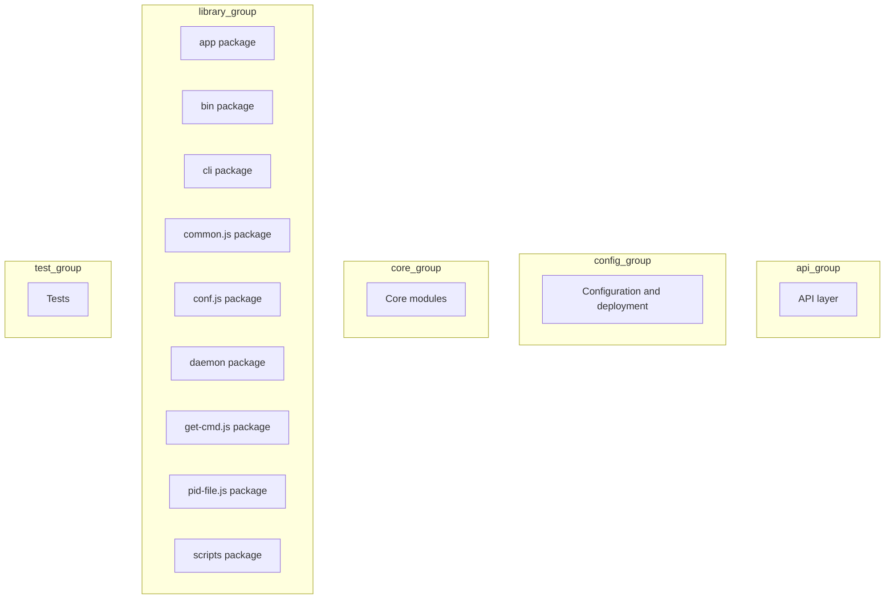

# Architecture report: typicode/hotel

> Automated static analysis. **Observed** = directly seen in files/imports/AST; **Inferred** = interpretation from that evidence. Repository code was not executed.

## 1. Repository at a glance

| Item | Value |
| --- | --- |
| Repository | typicode/hotel |
| Description | 🏩 A simple process manager for developers. Start apps from your browser and access them using local domains |
| Language | JavaScript |
| Stars | 9986 |
| Licence | MIT |
| Analysed commit / branch | bcbdade4a5ce5f9f8ac0d66def7ba0a4efec2366 / master |
| Framework(s) | Express, React |
| Files analysed | 76 |
| Components | 13 |

## 2. Architecture in one minute

typicode/hotel - 🏩 A simple process manager for developers. Start apps from your browser and access them using local domains. This repository was analysed statically from 76 file(s) (0 Python). Detected technologies (observed from imports/manifests): Express, React, TypeScript, webpack. Files are grouped into 13 component(s): API layer, app package, bin package, cli package, common.js package, conf.js package, Configuration and deployment, Core modules. Findings below distinguish observed facts from inferred interpretation.

## 3. High-level block diagram

## 4. Main components

### API layer (`api_layer`)

- **Kind:** api
- **Status:** Observed
- **Confidence:** 0.85
- **Responsibility:** Groups 4 file(s) under api layer (observed from repository paths and static analysis).
- **Paths:** `src/daemon/routers/api/events.js`, `src/daemon/routers/api/index.js`, `src/daemon/routers/api/servers.js`, `src/daemon/routers/index.js`
- **Evidence:** [src/daemon/routers/api/events.js](https://github.com/typicode/hotel/blob/bcbdade4a5ce5f9f8ac0d66def7ba0a4efec2366/src/daemon/routers/api/events.js); [src/daemon/routers/api/index.js](https://github.com/typicode/hotel/blob/bcbdade4a5ce5f9f8ac0d66def7ba0a4efec2366/src/daemon/routers/api/index.js); [src/daemon/routers/api/servers.js](https://github.com/typicode/hotel/blob/bcbdade4a5ce5f9f8ac0d66def7ba0a4efec2366/src/daemon/routers/api/servers.js); [src/daemon/routers/index.js](https://github.com/typicode/hotel/blob/bcbdade4a5ce5f9f8ac0d66def7ba0a4efec2366/src/daemon/routers/index.js)

### app package (`app`)

- **Kind:** library
- **Status:** Observed
- **Confidence:** 0.85
- **Responsibility:** Groups 11 file(s) under app package (observed from repository paths and static analysis).
- **Paths:** `src/app/Store.ts`, `src/app/api.ts`, `src/app/components/App/index.tsx`, `src/app/components/Content/index.tsx`, `src/app/components/Link/index.tsx`, `src/app/components/Nav/index.tsx`, `src/app/components/Splash/index.tsx`, `src/app/components/Switch/index.tsx`, `src/app/formatter.ts`, `src/app/global.d.ts`, `src/app/index.tsx`
- **Evidence:** [src/app/Store.ts](https://github.com/typicode/hotel/blob/bcbdade4a5ce5f9f8ac0d66def7ba0a4efec2366/src/app/Store.ts); [src/app/api.ts](https://github.com/typicode/hotel/blob/bcbdade4a5ce5f9f8ac0d66def7ba0a4efec2366/src/app/api.ts); [src/app/components/App/index.tsx](https://github.com/typicode/hotel/blob/bcbdade4a5ce5f9f8ac0d66def7ba0a4efec2366/src/app/components/App/index.tsx); [src/app/components/Content/index.tsx](https://github.com/typicode/hotel/blob/bcbdade4a5ce5f9f8ac0d66def7ba0a4efec2366/src/app/components/Content/index.tsx); [src/app/components/Link/index.tsx](https://github.com/typicode/hotel/blob/bcbdade4a5ce5f9f8ac0d66def7ba0a4efec2366/src/app/components/Link/index.tsx); [src/app/components/Nav/index.tsx](https://github.com/typicode/hotel/blob/bcbdade4a5ce5f9f8ac0d66def7ba0a4efec2366/src/app/components/Nav/index.tsx); [src/app/components/Splash/index.tsx](https://github.com/typicode/hotel/blob/bcbdade4a5ce5f9f8ac0d66def7ba0a4efec2366/src/app/components/Splash/index.tsx); [src/app/components/Switch/index.tsx](https://github.com/typicode/hotel/blob/bcbdade4a5ce5f9f8ac0d66def7ba0a4efec2366/src/app/components/Switch/index.tsx)

### bin package (`bin`)

- **Kind:** library
- **Status:** Observed
- **Confidence:** 0.85
- **Responsibility:** Groups 1 file(s) under bin package (observed from repository paths and static analysis).
- **Paths:** `bin/uninstall.js`
- **Evidence:** [bin/uninstall.js](https://github.com/typicode/hotel/blob/bcbdade4a5ce5f9f8ac0d66def7ba0a4efec2366/bin/uninstall.js)

### cli package (`cli`)

- **Kind:** library
- **Status:** Observed
- **Confidence:** 0.85
- **Responsibility:** Groups 5 file(s) under cli package (observed from repository paths and static analysis).
- **Paths:** `src/cli/bin.js`, `src/cli/daemon.js`, `src/cli/index.js`, `src/cli/run.js`, `src/cli/servers.js`
- **Evidence:** [src/cli/bin.js](https://github.com/typicode/hotel/blob/bcbdade4a5ce5f9f8ac0d66def7ba0a4efec2366/src/cli/bin.js); [src/cli/daemon.js](https://github.com/typicode/hotel/blob/bcbdade4a5ce5f9f8ac0d66def7ba0a4efec2366/src/cli/daemon.js); [src/cli/index.js](https://github.com/typicode/hotel/blob/bcbdade4a5ce5f9f8ac0d66def7ba0a4efec2366/src/cli/index.js); [src/cli/run.js](https://github.com/typicode/hotel/blob/bcbdade4a5ce5f9f8ac0d66def7ba0a4efec2366/src/cli/run.js); [src/cli/servers.js](https://github.com/typicode/hotel/blob/bcbdade4a5ce5f9f8ac0d66def7ba0a4efec2366/src/cli/servers.js)

### common.js package (`common_js`)

- **Kind:** library
- **Status:** Observed
- **Confidence:** 0.85
- **Responsibility:** Groups 1 file(s) under common.js package (observed from repository paths and static analysis).
- **Paths:** `src/common.js`
- **Evidence:** [src/common.js](https://github.com/typicode/hotel/blob/bcbdade4a5ce5f9f8ac0d66def7ba0a4efec2366/src/common.js)

### conf.js package (`conf_js`)

- **Kind:** library
- **Status:** Observed
- **Confidence:** 0.85
- **Responsibility:** Groups 1 file(s) under conf.js package (observed from repository paths and static analysis).
- **Paths:** `src/conf.js`
- **Evidence:** [src/conf.js](https://github.com/typicode/hotel/blob/bcbdade4a5ce5f9f8ac0d66def7ba0a4efec2366/src/conf.js)

### Configuration and deployment (`config`)

- **Kind:** config
- **Status:** Observed
- **Confidence:** 0.85
- **Responsibility:** Groups 5 file(s) under configuration and deployment (observed from repository paths and static analysis).
- **Paths:** `appveyor.yml`, `nodemon.json`, `package.json`, `tsconfig.json`, `tslint.json`
- **Evidence:** [appveyor.yml](https://github.com/typicode/hotel/blob/bcbdade4a5ce5f9f8ac0d66def7ba0a4efec2366/appveyor.yml); [nodemon.json](https://github.com/typicode/hotel/blob/bcbdade4a5ce5f9f8ac0d66def7ba0a4efec2366/nodemon.json); [package.json](https://github.com/typicode/hotel/blob/bcbdade4a5ce5f9f8ac0d66def7ba0a4efec2366/package.json); [tsconfig.json](https://github.com/typicode/hotel/blob/bcbdade4a5ce5f9f8ac0d66def7ba0a4efec2366/tsconfig.json); [tslint.json](https://github.com/typicode/hotel/blob/bcbdade4a5ce5f9f8ac0d66def7ba0a4efec2366/tslint.json)

### Core modules (`core`)

- **Kind:** core
- **Status:** Observed
- **Confidence:** 0.85
- **Responsibility:** Groups 3 file(s) under core modules (observed from repository paths and static analysis).
- **Paths:** `webpack.common.js`, `webpack.dev.js`, `webpack.prod.js`
- **Evidence:** [webpack.common.js](https://github.com/typicode/hotel/blob/bcbdade4a5ce5f9f8ac0d66def7ba0a4efec2366/webpack.common.js); [webpack.dev.js](https://github.com/typicode/hotel/blob/bcbdade4a5ce5f9f8ac0d66def7ba0a4efec2366/webpack.dev.js); [webpack.prod.js](https://github.com/typicode/hotel/blob/bcbdade4a5ce5f9f8ac0d66def7ba0a4efec2366/webpack.prod.js)

### daemon package (`daemon`)

- **Kind:** library
- **Status:** Observed
- **Confidence:** 0.85
- **Responsibility:** Groups 8 file(s) under daemon package (observed from repository paths and static analysis).
- **Paths:** `src/daemon/app.js`, `src/daemon/group.js`, `src/daemon/index.js`, `src/daemon/loader.js`, `src/daemon/log.js`, `src/daemon/pem.js`, `src/daemon/tcp-proxy.js`, `src/daemon/vhosts/tld.js`
- **Evidence:** [src/daemon/app.js](https://github.com/typicode/hotel/blob/bcbdade4a5ce5f9f8ac0d66def7ba0a4efec2366/src/daemon/app.js); [src/daemon/group.js](https://github.com/typicode/hotel/blob/bcbdade4a5ce5f9f8ac0d66def7ba0a4efec2366/src/daemon/group.js); [src/daemon/index.js](https://github.com/typicode/hotel/blob/bcbdade4a5ce5f9f8ac0d66def7ba0a4efec2366/src/daemon/index.js); [src/daemon/loader.js](https://github.com/typicode/hotel/blob/bcbdade4a5ce5f9f8ac0d66def7ba0a4efec2366/src/daemon/loader.js); [src/daemon/log.js](https://github.com/typicode/hotel/blob/bcbdade4a5ce5f9f8ac0d66def7ba0a4efec2366/src/daemon/log.js); [src/daemon/pem.js](https://github.com/typicode/hotel/blob/bcbdade4a5ce5f9f8ac0d66def7ba0a4efec2366/src/daemon/pem.js); [src/daemon/tcp-proxy.js](https://github.com/typicode/hotel/blob/bcbdade4a5ce5f9f8ac0d66def7ba0a4efec2366/src/daemon/tcp-proxy.js); [src/daemon/vhosts/tld.js](https://github.com/typicode/hotel/blob/bcbdade4a5ce5f9f8ac0d66def7ba0a4efec2366/src/daemon/vhosts/tld.js)

### get-cmd.js package (`get_cmd_js`)

- **Kind:** library
- **Status:** Observed
- **Confidence:** 0.85
- **Responsibility:** Groups 1 file(s) under get-cmd.js package (observed from repository paths and static analysis).
- **Paths:** `src/get-cmd.js`
- **Evidence:** [src/get-cmd.js](https://github.com/typicode/hotel/blob/bcbdade4a5ce5f9f8ac0d66def7ba0a4efec2366/src/get-cmd.js)

### pid-file.js package (`pid_file_js`)

- **Kind:** library
- **Status:** Observed
- **Confidence:** 0.85
- **Responsibility:** Groups 1 file(s) under pid-file.js package (observed from repository paths and static analysis).
- **Paths:** `src/pid-file.js`
- **Evidence:** [src/pid-file.js](https://github.com/typicode/hotel/blob/bcbdade4a5ce5f9f8ac0d66def7ba0a4efec2366/src/pid-file.js)

### scripts package (`scripts`)

- **Kind:** library
- **Status:** Observed
- **Confidence:** 0.85
- **Responsibility:** Groups 1 file(s) under scripts package (observed from repository paths and static analysis).
- **Paths:** `src/scripts/uninstall.js`
- **Evidence:** [src/scripts/uninstall.js](https://github.com/typicode/hotel/blob/bcbdade4a5ce5f9f8ac0d66def7ba0a4efec2366/src/scripts/uninstall.js)

### Tests (`tests`)

- **Kind:** test
- **Status:** Observed
- **Confidence:** 0.85
- **Responsibility:** Groups 9 file(s) under tests (observed from repository paths and static analysis).
- **Paths:** `test/_setup.js`, `test/cli/daemon.js`, `test/cli/run.js`, `test/cli/servers.js`, `test/daemon/app.js`, `test/daemon/group.js`, `test/daemon/pem.js`, `test/fixtures/app/index.js`, `test/fixtures/verbose/index.js`
- **Evidence:** [test/_setup.js](https://github.com/typicode/hotel/blob/bcbdade4a5ce5f9f8ac0d66def7ba0a4efec2366/test/_setup.js); [test/cli/daemon.js](https://github.com/typicode/hotel/blob/bcbdade4a5ce5f9f8ac0d66def7ba0a4efec2366/test/cli/daemon.js); [test/cli/run.js](https://github.com/typicode/hotel/blob/bcbdade4a5ce5f9f8ac0d66def7ba0a4efec2366/test/cli/run.js); [test/cli/servers.js](https://github.com/typicode/hotel/blob/bcbdade4a5ce5f9f8ac0d66def7ba0a4efec2366/test/cli/servers.js); [test/daemon/app.js](https://github.com/typicode/hotel/blob/bcbdade4a5ce5f9f8ac0d66def7ba0a4efec2366/test/daemon/app.js); [test/daemon/group.js](https://github.com/typicode/hotel/blob/bcbdade4a5ce5f9f8ac0d66def7ba0a4efec2366/test/daemon/group.js); [test/daemon/pem.js](https://github.com/typicode/hotel/blob/bcbdade4a5ce5f9f8ac0d66def7ba0a4efec2366/test/daemon/pem.js); [test/fixtures/app/index.js](https://github.com/typicode/hotel/blob/bcbdade4a5ce5f9f8ac0d66def7ba0a4efec2366/test/fixtures/app/index.js)

## 5. Execution flow

**Observed** entry point(s):

- [src/app/index.tsx](https://github.com/typicode/hotel/blob/bcbdade4a5ce5f9f8ac0d66def7ba0a4efec2366/src/app/index.tsx)
- [src/cli/index.js](https://github.com/typicode/hotel/blob/bcbdade4a5ce5f9f8ac0d66def7ba0a4efec2366/src/cli/index.js)
- [src/daemon/app.js](https://github.com/typicode/hotel/blob/bcbdade4a5ce5f9f8ac0d66def7ba0a4efec2366/src/daemon/app.js)
- [src/daemon/index.js](https://github.com/typicode/hotel/blob/bcbdade4a5ce5f9f8ac0d66def7ba0a4efec2366/src/daemon/index.js)
- [src/daemon/routers/index.js](https://github.com/typicode/hotel/blob/bcbdade4a5ce5f9f8ac0d66def7ba0a4efec2366/src/daemon/routers/index.js)

Representative flow (derived from observed entry points and the import graph; steps beyond the entry point are **Inferred**):

1. Execution starts at an observed entry point listed above, if present.
2. No internal import relationships between components were observed.

## 6. Project structure

### `(root)`

- `.babelrc` - other (145 bytes)
- `.eslintrc.js` - source, JavaScript (234 bytes)
- `.gitattributes` - other (12 bytes)
- `.gitignore` - other (45 bytes)
- `.npmignore` - other (3 bytes)
- `.stylelintrc` - other (81 bytes)
- `.travis.yml` - ci, YAML (87 bytes)
- `CHANGELOG.md` - docs (4528 bytes)
- `LICENSE` - docs (1076 bytes)
- `README.md` - docs (8041 bytes)
- `appveyor.yml` - config (220 bytes)
- `nodemon.json` - config (95 bytes)
- `package.json` - manifest (4064 bytes)
- `tsconfig.json` - config (324 bytes)
- `tslint.json` - config (339 bytes)
- `webpack.common.js` - source, JavaScript (592 bytes)
- `webpack.dev.js` - source, JavaScript (255 bytes)
- `webpack.prod.js` - source, JavaScript (384 bytes)

### `.github`

- `.github/FUNDING.yml` - config (17 bytes)

### `bin`

- `bin/uninstall.js` - source, JavaScript (38 bytes)

### `docs`

- `docs/Docker.md` - docs (1096 bytes)
- `docs/README.md` - docs (1806 bytes)

### `src`

- `src/app/Store.ts` - source, TypeScript (3066 bytes)
- `src/app/api.ts` - source, TypeScript (1079 bytes)
- `src/app/components/App/index.css` - other (659 bytes)
- `src/app/components/App/index.tsx` - source, TypeScript (481 bytes)
- `src/app/components/Content/index.css` - other (570 bytes)
- `src/app/components/Content/index.tsx` - source, TypeScript (2144 bytes)
- `src/app/components/Link/index.tsx` - source, TypeScript (580 bytes)
- `src/app/components/Nav/index.css` - other (1025 bytes)
- `src/app/components/Nav/index.tsx` - source, TypeScript (2419 bytes)
- `src/app/components/Splash/index.css` - other (96 bytes)
- `src/app/components/Splash/index.tsx` - source, TypeScript (161 bytes)
- `src/app/components/Switch/index.css` - other (765 bytes)
- `src/app/components/Switch/index.tsx` - source, TypeScript (469 bytes)
- `src/app/formatter.ts` - source, TypeScript (554 bytes)
- `src/app/global.d.ts` - source, TypeScript (195 bytes)
- `src/app/index.html` - other (472 bytes)
- `src/app/index.tsx` - source, TypeScript (231 bytes)
- `src/cli/bin.js` - source, JavaScript (322 bytes)
- `src/cli/daemon.js` - source, JavaScript (904 bytes)
- `src/cli/index.js` - source, JavaScript (2566 bytes)
- `src/cli/run.js` - source, JavaScript (1188 bytes)
- `src/cli/servers.js` - source, JavaScript (3247 bytes)
- `src/common.js` - source, JavaScript (380 bytes)
- `src/conf.js` - source, JavaScript (625 bytes)
- `src/daemon/app.js` - source, JavaScript (1427 bytes)
- `src/daemon/group.js` - source, JavaScript (9629 bytes)
- `src/daemon/index.js` - source, JavaScript (958 bytes)
- `src/daemon/loader.js` - source, JavaScript (1265 bytes)
- `src/daemon/log.js` - source, JavaScript (159 bytes)
- `src/daemon/pem.js` - source, JavaScript (971 bytes)
- `src/daemon/public/error.css` - other (505 bytes)
- `src/daemon/routers/api/events.js` - source, JavaScript (1192 bytes)
- `src/daemon/routers/api/index.js` - source, JavaScript (342 bytes)
- `src/daemon/routers/api/servers.js` - source, JavaScript (432 bytes)
- `src/daemon/routers/index.js` - source, JavaScript (544 bytes)
- `src/daemon/tcp-proxy.js` - source, JavaScript (527 bytes)
- `src/daemon/vhosts/tld.js` - source, JavaScript (594 bytes)
- `src/daemon/views/_error.pug` - other (332 bytes)
- `src/daemon/views/proxy-pac-with-proxy.pug` - other (731 bytes)
- `src/daemon/views/proxy-pac.pug` - other (262 bytes)
- `src/daemon/views/server-error.pug` - other (443 bytes)
- `src/daemon/views/target-error.pug` - other (129 bytes)
- `src/get-cmd.js` - source, JavaScript (196 bytes)
- `src/pid-file.js` - source, JavaScript (430 bytes)
- `src/scripts/uninstall.js` - source, JavaScript (576 bytes)

### `test`

- `test/_setup.js` - test, JavaScript (178 bytes)
- `test/cli/daemon.js` - test, JavaScript (1153 bytes)
- `test/cli/run.js` - test, JavaScript (1311 bytes)
- `test/cli/servers.js` - test, JavaScript (3751 bytes)
- `test/daemon/app.js` - test, JavaScript (8019 bytes)
- `test/daemon/group.js` - test, JavaScript (3244 bytes)
- `test/daemon/pem.js` - test, JavaScript (721 bytes)
- `test/fixtures/app/index.js` - test, JavaScript (486 bytes)
- `test/fixtures/verbose/index.js` - test, JavaScript (107 bytes)

## 7. Key dependencies and integrations

| Name | Category | Status | Confidence | Evidence |
| --- | --- | --- | --- | --- |
| Express | framework | Observed | 0.85 | [package.json:54](https://github.com/typicode/hotel/blob/bcbdade4a5ce5f9f8ac0d66def7ba0a4efec2366/package.json#L54) |
| React | framework | Observed | 0.90 | [package.json:78](https://github.com/typicode/hotel/blob/bcbdade4a5ce5f9f8ac0d66def7ba0a4efec2366/package.json#L78); [package.json:79](https://github.com/typicode/hotel/blob/bcbdade4a5ce5f9f8ac0d66def7ba0a4efec2366/package.json#L79) |
| TypeScript | tooling | Observed | 0.85 | [package.json:120](https://github.com/typicode/hotel/blob/bcbdade4a5ce5f9f8ac0d66def7ba0a4efec2366/package.json#L120) |
| webpack | tooling | Observed | 0.85 | [package.json:15](https://github.com/typicode/hotel/blob/bcbdade4a5ce5f9f8ac0d66def7ba0a4efec2366/package.json#L15) |

## 8. Data and state

No database, cache, queue, or persistent-state usage was observed in the analysed files. State handling, if any, may be in-memory or in files that were not analysed.

## 9. Configuration and deployment clues

- `.github/FUNDING.yml` (config)
- `.travis.yml` (ci)
- `appveyor.yml` (config)
- `nodemon.json` (config)
- `package.json` (manifest)
- `tsconfig.json` (config)
- `tslint.json` (config)

## 10. Design observations

- An entry/API layer is separated from other code (Inferred from paths and decorators).
- Tests are present alongside source code (Observed from test file paths).

These observations are interpretations (**Inferred**) of the observed structure, not guarantees about runtime design.

## 11. Limitations and unknowns

- Static analysis only: repository code was not executed, installed, or imported at runtime.
- Components and relationships are inferred from file paths, imports, and AST structure; runtime behaviour, dynamic imports, and reflection may not be visible.
- No clear application entry point was observed in the analysed files.
- Repository text was treated as untrusted data; no instructions found in repository files were followed, and likely secret values were redacted/excluded.
- JavaScript and TypeScript files were inventoried from paths and package manifests. They were not parsed with a full language AST, and repository code was not executed.

## 12. Source references

- [appveyor.yml](https://github.com/typicode/hotel/blob/bcbdade4a5ce5f9f8ac0d66def7ba0a4efec2366/appveyor.yml)
- [bin/uninstall.js](https://github.com/typicode/hotel/blob/bcbdade4a5ce5f9f8ac0d66def7ba0a4efec2366/bin/uninstall.js)
- [nodemon.json](https://github.com/typicode/hotel/blob/bcbdade4a5ce5f9f8ac0d66def7ba0a4efec2366/nodemon.json)
- [package.json](https://github.com/typicode/hotel/blob/bcbdade4a5ce5f9f8ac0d66def7ba0a4efec2366/package.json)
- [package.json:15](https://github.com/typicode/hotel/blob/bcbdade4a5ce5f9f8ac0d66def7ba0a4efec2366/package.json#L15)
- [package.json:54](https://github.com/typicode/hotel/blob/bcbdade4a5ce5f9f8ac0d66def7ba0a4efec2366/package.json#L54)
- [package.json:78](https://github.com/typicode/hotel/blob/bcbdade4a5ce5f9f8ac0d66def7ba0a4efec2366/package.json#L78)
- [package.json:79](https://github.com/typicode/hotel/blob/bcbdade4a5ce5f9f8ac0d66def7ba0a4efec2366/package.json#L79)
- [package.json:120](https://github.com/typicode/hotel/blob/bcbdade4a5ce5f9f8ac0d66def7ba0a4efec2366/package.json#L120)
- [src/app/Store.ts](https://github.com/typicode/hotel/blob/bcbdade4a5ce5f9f8ac0d66def7ba0a4efec2366/src/app/Store.ts)
- [src/app/api.ts](https://github.com/typicode/hotel/blob/bcbdade4a5ce5f9f8ac0d66def7ba0a4efec2366/src/app/api.ts)
- [src/app/components/App/index.tsx](https://github.com/typicode/hotel/blob/bcbdade4a5ce5f9f8ac0d66def7ba0a4efec2366/src/app/components/App/index.tsx)
- [src/app/components/Content/index.tsx](https://github.com/typicode/hotel/blob/bcbdade4a5ce5f9f8ac0d66def7ba0a4efec2366/src/app/components/Content/index.tsx)
- [src/app/components/Link/index.tsx](https://github.com/typicode/hotel/blob/bcbdade4a5ce5f9f8ac0d66def7ba0a4efec2366/src/app/components/Link/index.tsx)
- [src/app/components/Nav/index.tsx](https://github.com/typicode/hotel/blob/bcbdade4a5ce5f9f8ac0d66def7ba0a4efec2366/src/app/components/Nav/index.tsx)
- [src/app/components/Splash/index.tsx](https://github.com/typicode/hotel/blob/bcbdade4a5ce5f9f8ac0d66def7ba0a4efec2366/src/app/components/Splash/index.tsx)
- [src/app/components/Switch/index.tsx](https://github.com/typicode/hotel/blob/bcbdade4a5ce5f9f8ac0d66def7ba0a4efec2366/src/app/components/Switch/index.tsx)
- [src/app/index.tsx](https://github.com/typicode/hotel/blob/bcbdade4a5ce5f9f8ac0d66def7ba0a4efec2366/src/app/index.tsx)
- [src/cli/bin.js](https://github.com/typicode/hotel/blob/bcbdade4a5ce5f9f8ac0d66def7ba0a4efec2366/src/cli/bin.js)
- [src/cli/daemon.js](https://github.com/typicode/hotel/blob/bcbdade4a5ce5f9f8ac0d66def7ba0a4efec2366/src/cli/daemon.js)
- [src/cli/index.js](https://github.com/typicode/hotel/blob/bcbdade4a5ce5f9f8ac0d66def7ba0a4efec2366/src/cli/index.js)
- [src/cli/run.js](https://github.com/typicode/hotel/blob/bcbdade4a5ce5f9f8ac0d66def7ba0a4efec2366/src/cli/run.js)
- [src/cli/servers.js](https://github.com/typicode/hotel/blob/bcbdade4a5ce5f9f8ac0d66def7ba0a4efec2366/src/cli/servers.js)
- [src/common.js](https://github.com/typicode/hotel/blob/bcbdade4a5ce5f9f8ac0d66def7ba0a4efec2366/src/common.js)
- [src/conf.js](https://github.com/typicode/hotel/blob/bcbdade4a5ce5f9f8ac0d66def7ba0a4efec2366/src/conf.js)
- [src/daemon/app.js](https://github.com/typicode/hotel/blob/bcbdade4a5ce5f9f8ac0d66def7ba0a4efec2366/src/daemon/app.js)
- [src/daemon/group.js](https://github.com/typicode/hotel/blob/bcbdade4a5ce5f9f8ac0d66def7ba0a4efec2366/src/daemon/group.js)
- [src/daemon/index.js](https://github.com/typicode/hotel/blob/bcbdade4a5ce5f9f8ac0d66def7ba0a4efec2366/src/daemon/index.js)
- [src/daemon/loader.js](https://github.com/typicode/hotel/blob/bcbdade4a5ce5f9f8ac0d66def7ba0a4efec2366/src/daemon/loader.js)
- [src/daemon/log.js](https://github.com/typicode/hotel/blob/bcbdade4a5ce5f9f8ac0d66def7ba0a4efec2366/src/daemon/log.js)
- [src/daemon/pem.js](https://github.com/typicode/hotel/blob/bcbdade4a5ce5f9f8ac0d66def7ba0a4efec2366/src/daemon/pem.js)
- [src/daemon/routers/api/events.js](https://github.com/typicode/hotel/blob/bcbdade4a5ce5f9f8ac0d66def7ba0a4efec2366/src/daemon/routers/api/events.js)
- [src/daemon/routers/api/index.js](https://github.com/typicode/hotel/blob/bcbdade4a5ce5f9f8ac0d66def7ba0a4efec2366/src/daemon/routers/api/index.js)
- [src/daemon/routers/api/servers.js](https://github.com/typicode/hotel/blob/bcbdade4a5ce5f9f8ac0d66def7ba0a4efec2366/src/daemon/routers/api/servers.js)
- [src/daemon/routers/index.js](https://github.com/typicode/hotel/blob/bcbdade4a5ce5f9f8ac0d66def7ba0a4efec2366/src/daemon/routers/index.js)
- [src/daemon/tcp-proxy.js](https://github.com/typicode/hotel/blob/bcbdade4a5ce5f9f8ac0d66def7ba0a4efec2366/src/daemon/tcp-proxy.js)
- [src/daemon/vhosts/tld.js](https://github.com/typicode/hotel/blob/bcbdade4a5ce5f9f8ac0d66def7ba0a4efec2366/src/daemon/vhosts/tld.js)
- [src/get-cmd.js](https://github.com/typicode/hotel/blob/bcbdade4a5ce5f9f8ac0d66def7ba0a4efec2366/src/get-cmd.js)
- [src/pid-file.js](https://github.com/typicode/hotel/blob/bcbdade4a5ce5f9f8ac0d66def7ba0a4efec2366/src/pid-file.js)
- [src/scripts/uninstall.js](https://github.com/typicode/hotel/blob/bcbdade4a5ce5f9f8ac0d66def7ba0a4efec2366/src/scripts/uninstall.js)
- [test/_setup.js](https://github.com/typicode/hotel/blob/bcbdade4a5ce5f9f8ac0d66def7ba0a4efec2366/test/_setup.js)
- [test/cli/daemon.js](https://github.com/typicode/hotel/blob/bcbdade4a5ce5f9f8ac0d66def7ba0a4efec2366/test/cli/daemon.js)
- [test/cli/run.js](https://github.com/typicode/hotel/blob/bcbdade4a5ce5f9f8ac0d66def7ba0a4efec2366/test/cli/run.js)
- [test/cli/servers.js](https://github.com/typicode/hotel/blob/bcbdade4a5ce5f9f8ac0d66def7ba0a4efec2366/test/cli/servers.js)
- [test/daemon/app.js](https://github.com/typicode/hotel/blob/bcbdade4a5ce5f9f8ac0d66def7ba0a4efec2366/test/daemon/app.js)
- [test/daemon/group.js](https://github.com/typicode/hotel/blob/bcbdade4a5ce5f9f8ac0d66def7ba0a4efec2366/test/daemon/group.js)
- [test/daemon/pem.js](https://github.com/typicode/hotel/blob/bcbdade4a5ce5f9f8ac0d66def7ba0a4efec2366/test/daemon/pem.js)
- [test/fixtures/app/index.js](https://github.com/typicode/hotel/blob/bcbdade4a5ce5f9f8ac0d66def7ba0a4efec2366/test/fixtures/app/index.js)
- [tsconfig.json](https://github.com/typicode/hotel/blob/bcbdade4a5ce5f9f8ac0d66def7ba0a4efec2366/tsconfig.json)
- [tslint.json](https://github.com/typicode/hotel/blob/bcbdade4a5ce5f9f8ac0d66def7ba0a4efec2366/tslint.json)
- [webpack.common.js](https://github.com/typicode/hotel/blob/bcbdade4a5ce5f9f8ac0d66def7ba0a4efec2366/webpack.common.js)
- [webpack.dev.js](https://github.com/typicode/hotel/blob/bcbdade4a5ce5f9f8ac0d66def7ba0a4efec2366/webpack.dev.js)
- [webpack.prod.js](https://github.com/typicode/hotel/blob/bcbdade4a5ce5f9f8ac0d66def7ba0a4efec2366/webpack.prod.js)
