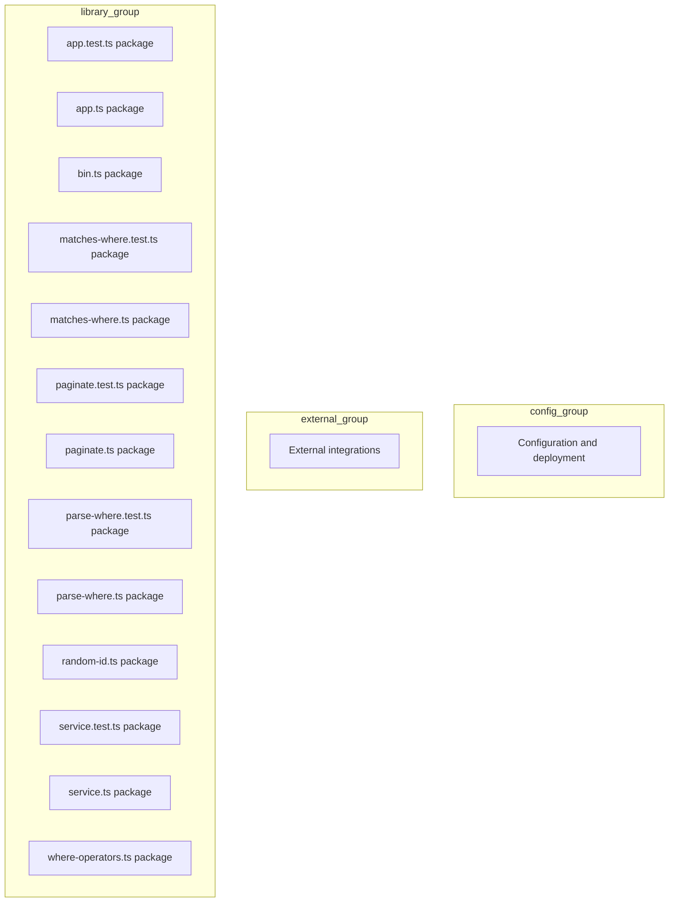

# Architecture report: typicode/json-server

> Automated static analysis. **Observed** = directly seen in files/imports/AST; **Inferred** = interpretation from that evidence. Repository code was not executed.

## 1. Repository at a glance

| Item | Value |
| --- | --- |
| Repository | typicode/json-server |
| Description | Get a full fake REST API with zero coding in less than 30 seconds (seriously) |
| Language | JavaScript |
| Stars | 75743 |
| Licence | MIT |
| Analysed commit / branch | 89a34a44b7a6a5311dc84f3b8a1b8b45c0905aea / main |
| Framework(s) | None detected |
| Files analysed | 32 |
| Components | 15 |

## 2. Architecture in one minute

typicode/json-server - Get a full fake REST API with zero coding in less than 30 seconds (seriously). This repository was analysed statically from 32 file(s) (0 Python). Detected technologies (observed from imports/manifests): GitHub Actions, TypeScript. Files are grouped into 15 component(s): app.test.ts package, app.ts package, bin.ts package, Configuration and deployment, External integrations, matches-where.test.ts package, matches-where.ts package, paginate.test.ts package. Findings below distinguish observed facts from inferred interpretation.

## 3. High-level block diagram

## 4. Main components

### app.test.ts package (`app_test_ts`)

- **Kind:** library
- **Status:** Observed
- **Confidence:** 0.85
- **Responsibility:** Groups 1 file(s) under app.test.ts package (observed from repository paths and static analysis).
- **Paths:** `src/app.test.ts`
- **Evidence:** [src/app.test.ts](https://github.com/typicode/json-server/blob/89a34a44b7a6a5311dc84f3b8a1b8b45c0905aea/src/app.test.ts)

### app.ts package (`app_ts`)

- **Kind:** library
- **Status:** Observed
- **Confidence:** 0.85
- **Responsibility:** Groups 1 file(s) under app.ts package (observed from repository paths and static analysis).
- **Paths:** `src/app.ts`
- **Evidence:** [src/app.ts](https://github.com/typicode/json-server/blob/89a34a44b7a6a5311dc84f3b8a1b8b45c0905aea/src/app.ts)

### bin.ts package (`bin_ts`)

- **Kind:** library
- **Status:** Observed
- **Confidence:** 0.85
- **Responsibility:** Groups 1 file(s) under bin.ts package (observed from repository paths and static analysis).
- **Paths:** `src/bin.ts`
- **Evidence:** [src/bin.ts](https://github.com/typicode/json-server/blob/89a34a44b7a6a5311dc84f3b8a1b8b45c0905aea/src/bin.ts)

### Configuration and deployment (`config`)

- **Kind:** config
- **Status:** Observed
- **Confidence:** 0.85
- **Responsibility:** Groups 4 file(s) under configuration and deployment (observed from repository paths and static analysis).
- **Paths:** `fixtures/db.json`, `package.json`, `schema.json`, `tsconfig.json`
- **Evidence:** [fixtures/db.json](https://github.com/typicode/json-server/blob/89a34a44b7a6a5311dc84f3b8a1b8b45c0905aea/fixtures/db.json); [package.json](https://github.com/typicode/json-server/blob/89a34a44b7a6a5311dc84f3b8a1b8b45c0905aea/package.json); [schema.json](https://github.com/typicode/json-server/blob/89a34a44b7a6a5311dc84f3b8a1b8b45c0905aea/schema.json); [tsconfig.json](https://github.com/typicode/json-server/blob/89a34a44b7a6a5311dc84f3b8a1b8b45c0905aea/tsconfig.json)

### External integrations (`external_integrations`)

- **Kind:** external
- **Status:** Observed
- **Confidence:** 0.85
- **Responsibility:** Groups 3 file(s) under external integrations (observed from repository paths and static analysis).
- **Paths:** `src/adapters/normalized-adapter.test.ts`, `src/adapters/normalized-adapter.ts`, `src/adapters/observer.ts`
- **Evidence:** [src/adapters/normalized-adapter.test.ts](https://github.com/typicode/json-server/blob/89a34a44b7a6a5311dc84f3b8a1b8b45c0905aea/src/adapters/normalized-adapter.test.ts); [src/adapters/normalized-adapter.ts](https://github.com/typicode/json-server/blob/89a34a44b7a6a5311dc84f3b8a1b8b45c0905aea/src/adapters/normalized-adapter.ts); [src/adapters/observer.ts](https://github.com/typicode/json-server/blob/89a34a44b7a6a5311dc84f3b8a1b8b45c0905aea/src/adapters/observer.ts)

### matches-where.test.ts package (`matches_where_test_ts`)

- **Kind:** library
- **Status:** Observed
- **Confidence:** 0.85
- **Responsibility:** Groups 1 file(s) under matches-where.test.ts package (observed from repository paths and static analysis).
- **Paths:** `src/matches-where.test.ts`
- **Evidence:** [src/matches-where.test.ts](https://github.com/typicode/json-server/blob/89a34a44b7a6a5311dc84f3b8a1b8b45c0905aea/src/matches-where.test.ts)

### matches-where.ts package (`matches_where_ts`)

- **Kind:** library
- **Status:** Observed
- **Confidence:** 0.85
- **Responsibility:** Groups 1 file(s) under matches-where.ts package (observed from repository paths and static analysis).
- **Paths:** `src/matches-where.ts`
- **Evidence:** [src/matches-where.ts](https://github.com/typicode/json-server/blob/89a34a44b7a6a5311dc84f3b8a1b8b45c0905aea/src/matches-where.ts)

### paginate.test.ts package (`paginate_test_ts`)

- **Kind:** library
- **Status:** Observed
- **Confidence:** 0.85
- **Responsibility:** Groups 1 file(s) under paginate.test.ts package (observed from repository paths and static analysis).
- **Paths:** `src/paginate.test.ts`
- **Evidence:** [src/paginate.test.ts](https://github.com/typicode/json-server/blob/89a34a44b7a6a5311dc84f3b8a1b8b45c0905aea/src/paginate.test.ts)

### paginate.ts package (`paginate_ts`)

- **Kind:** library
- **Status:** Observed
- **Confidence:** 0.85
- **Responsibility:** Groups 1 file(s) under paginate.ts package (observed from repository paths and static analysis).
- **Paths:** `src/paginate.ts`
- **Evidence:** [src/paginate.ts](https://github.com/typicode/json-server/blob/89a34a44b7a6a5311dc84f3b8a1b8b45c0905aea/src/paginate.ts)

### parse-where.test.ts package (`parse_where_test_ts`)

- **Kind:** library
- **Status:** Observed
- **Confidence:** 0.85
- **Responsibility:** Groups 1 file(s) under parse-where.test.ts package (observed from repository paths and static analysis).
- **Paths:** `src/parse-where.test.ts`
- **Evidence:** [src/parse-where.test.ts](https://github.com/typicode/json-server/blob/89a34a44b7a6a5311dc84f3b8a1b8b45c0905aea/src/parse-where.test.ts)

### parse-where.ts package (`parse_where_ts`)

- **Kind:** library
- **Status:** Observed
- **Confidence:** 0.85
- **Responsibility:** Groups 1 file(s) under parse-where.ts package (observed from repository paths and static analysis).
- **Paths:** `src/parse-where.ts`
- **Evidence:** [src/parse-where.ts](https://github.com/typicode/json-server/blob/89a34a44b7a6a5311dc84f3b8a1b8b45c0905aea/src/parse-where.ts)

### random-id.ts package (`random_id_ts`)

- **Kind:** library
- **Status:** Observed
- **Confidence:** 0.85
- **Responsibility:** Groups 1 file(s) under random-id.ts package (observed from repository paths and static analysis).
- **Paths:** `src/random-id.ts`
- **Evidence:** [src/random-id.ts](https://github.com/typicode/json-server/blob/89a34a44b7a6a5311dc84f3b8a1b8b45c0905aea/src/random-id.ts)

### service.test.ts package (`service_test_ts`)

- **Kind:** library
- **Status:** Observed
- **Confidence:** 0.85
- **Responsibility:** Groups 1 file(s) under service.test.ts package (observed from repository paths and static analysis).
- **Paths:** `src/service.test.ts`
- **Evidence:** [src/service.test.ts](https://github.com/typicode/json-server/blob/89a34a44b7a6a5311dc84f3b8a1b8b45c0905aea/src/service.test.ts)

### service.ts package (`service_ts`)

- **Kind:** library
- **Status:** Observed
- **Confidence:** 0.85
- **Responsibility:** Groups 1 file(s) under service.ts package (observed from repository paths and static analysis).
- **Paths:** `src/service.ts`
- **Evidence:** [src/service.ts](https://github.com/typicode/json-server/blob/89a34a44b7a6a5311dc84f3b8a1b8b45c0905aea/src/service.ts)

### where-operators.ts package (`where_operators_ts`)

- **Kind:** library
- **Status:** Observed
- **Confidence:** 0.85
- **Responsibility:** Groups 1 file(s) under where-operators.ts package (observed from repository paths and static analysis).
- **Paths:** `src/where-operators.ts`
- **Evidence:** [src/where-operators.ts](https://github.com/typicode/json-server/blob/89a34a44b7a6a5311dc84f3b8a1b8b45c0905aea/src/where-operators.ts)

## 5. Execution flow

**Observed** entry point(s):

- [src/app.ts](https://github.com/typicode/json-server/blob/89a34a44b7a6a5311dc84f3b8a1b8b45c0905aea/src/app.ts)

Representative flow (derived from observed entry points and the import graph; steps beyond the entry point are **Inferred**):

1. Execution starts at an observed entry point listed above, if present.
2. No internal import relationships between components were observed.

## 6. Project structure

### `(root)`

- `.gitattributes` - other (52 bytes)
- `.gitignore` - other (64 bytes)
- `.oxfmtrc.json` - config (44 bytes)
- `LICENSE` - docs (1065 bytes)
- `README.md` - docs (8202 bytes)
- `package.json` - manifest (1624 bytes)
- `schema.json` - config (192 bytes)
- `tsconfig.json` - config (335 bytes)

### `.github`

- `.github/FUNDING.yml` - config (17 bytes)
- `.github/workflows/node.js.yml` - ci, YAML (399 bytes)
- `.github/workflows/publish.yml` - ci, YAML (600 bytes)

### `.husky`

- `.husky/pre-commit` - other (10 bytes)

### `fixtures`

- `fixtures/db.json` - config (309 bytes)
- `fixtures/db.json5` - other (365 bytes)

### `public`

- `public/test.html` - other (73 bytes)

### `src`

- `src/adapters/normalized-adapter.test.ts` - source, TypeScript (1737 bytes)
- `src/adapters/normalized-adapter.ts` - source, TypeScript (1122 bytes)
- `src/adapters/observer.ts` - source, TypeScript (651 bytes)
- `src/app.test.ts` - source, TypeScript (6473 bytes)
- `src/app.ts` - source, TypeScript (4733 bytes)
- `src/bin.ts` - source, TypeScript (5767 bytes)
- `src/matches-where.test.ts` - source, TypeScript (2158 bytes)
- `src/matches-where.ts` - source, TypeScript (2870 bytes)
- `src/paginate.test.ts` - source, TypeScript (2095 bytes)
- `src/paginate.ts` - source, TypeScript (989 bytes)
- `src/parse-where.test.ts` - source, TypeScript (2207 bytes)
- `src/parse-where.ts` - source, TypeScript (1794 bytes)
- `src/random-id.ts` - source, TypeScript (128 bytes)
- `src/service.test.ts` - source, TypeScript (5333 bytes)
- `src/service.ts` - source, TypeScript (6028 bytes)
- `src/where-operators.ts` - source, TypeScript (348 bytes)

### `views`

- `views/index.html` - other (3925 bytes)

## 7. Key dependencies and integrations

| Name | Category | Status | Confidence | Evidence |
| --- | --- | --- | --- | --- |
| GitHub Actions | ci | Observed | 0.90 | [.github/workflows/node.js.yml](https://github.com/typicode/json-server/blob/89a34a44b7a6a5311dc84f3b8a1b8b45c0905aea/.github/workflows/node.js.yml); [.github/workflows/publish.yml](https://github.com/typicode/json-server/blob/89a34a44b7a6a5311dc84f3b8a1b8b45c0905aea/.github/workflows/publish.yml) |
| TypeScript | tooling | Observed | 0.85 | [package.json:70](https://github.com/typicode/json-server/blob/89a34a44b7a6a5311dc84f3b8a1b8b45c0905aea/package.json#L70) |

## 8. Data and state

No database, cache, queue, or persistent-state usage was observed in the analysed files. State handling, if any, may be in-memory or in files that were not analysed.

## 9. Configuration and deployment clues

- `.github/FUNDING.yml` (config)
- `.github/workflows/node.js.yml` (ci)
- `.github/workflows/publish.yml` (ci)
- `.oxfmtrc.json` (config)
- `fixtures/db.json` (config)
- `package.json` (manifest)
- `schema.json` (config)
- `tsconfig.json` (config)

## 10. Design observations

- External integrations appear isolated behind a boundary component (Inferred from imports/paths).

These observations are interpretations (**Inferred**) of the observed structure, not guarantees about runtime design.

## 11. Limitations and unknowns

- Static analysis only: repository code was not executed, installed, or imported at runtime.
- Components and relationships are inferred from file paths, imports, and AST structure; runtime behaviour, dynamic imports, and reflection may not be visible.
- 1 file(s) were skipped during inventory (1 x lockfile excluded).
- No clear application entry point was observed in the analysed files.
- Repository text was treated as untrusted data; no instructions found in repository files were followed, and likely secret values were redacted/excluded.
- JavaScript and TypeScript files were inventoried from paths and package manifests. They were not parsed with a full language AST, and repository code was not executed.

## 12. Source references

- [.github/workflows/node.js.yml](https://github.com/typicode/json-server/blob/89a34a44b7a6a5311dc84f3b8a1b8b45c0905aea/.github/workflows/node.js.yml)
- [.github/workflows/publish.yml](https://github.com/typicode/json-server/blob/89a34a44b7a6a5311dc84f3b8a1b8b45c0905aea/.github/workflows/publish.yml)
- [fixtures/db.json](https://github.com/typicode/json-server/blob/89a34a44b7a6a5311dc84f3b8a1b8b45c0905aea/fixtures/db.json)
- [package.json](https://github.com/typicode/json-server/blob/89a34a44b7a6a5311dc84f3b8a1b8b45c0905aea/package.json)
- [package.json:70](https://github.com/typicode/json-server/blob/89a34a44b7a6a5311dc84f3b8a1b8b45c0905aea/package.json#L70)
- [schema.json](https://github.com/typicode/json-server/blob/89a34a44b7a6a5311dc84f3b8a1b8b45c0905aea/schema.json)
- [src/adapters/normalized-adapter.test.ts](https://github.com/typicode/json-server/blob/89a34a44b7a6a5311dc84f3b8a1b8b45c0905aea/src/adapters/normalized-adapter.test.ts)
- [src/adapters/normalized-adapter.ts](https://github.com/typicode/json-server/blob/89a34a44b7a6a5311dc84f3b8a1b8b45c0905aea/src/adapters/normalized-adapter.ts)
- [src/adapters/observer.ts](https://github.com/typicode/json-server/blob/89a34a44b7a6a5311dc84f3b8a1b8b45c0905aea/src/adapters/observer.ts)
- [src/app.test.ts](https://github.com/typicode/json-server/blob/89a34a44b7a6a5311dc84f3b8a1b8b45c0905aea/src/app.test.ts)
- [src/app.ts](https://github.com/typicode/json-server/blob/89a34a44b7a6a5311dc84f3b8a1b8b45c0905aea/src/app.ts)
- [src/bin.ts](https://github.com/typicode/json-server/blob/89a34a44b7a6a5311dc84f3b8a1b8b45c0905aea/src/bin.ts)
- [src/matches-where.test.ts](https://github.com/typicode/json-server/blob/89a34a44b7a6a5311dc84f3b8a1b8b45c0905aea/src/matches-where.test.ts)
- [src/matches-where.ts](https://github.com/typicode/json-server/blob/89a34a44b7a6a5311dc84f3b8a1b8b45c0905aea/src/matches-where.ts)
- [src/paginate.test.ts](https://github.com/typicode/json-server/blob/89a34a44b7a6a5311dc84f3b8a1b8b45c0905aea/src/paginate.test.ts)
- [src/paginate.ts](https://github.com/typicode/json-server/blob/89a34a44b7a6a5311dc84f3b8a1b8b45c0905aea/src/paginate.ts)
- [src/parse-where.test.ts](https://github.com/typicode/json-server/blob/89a34a44b7a6a5311dc84f3b8a1b8b45c0905aea/src/parse-where.test.ts)
- [src/parse-where.ts](https://github.com/typicode/json-server/blob/89a34a44b7a6a5311dc84f3b8a1b8b45c0905aea/src/parse-where.ts)
- [src/random-id.ts](https://github.com/typicode/json-server/blob/89a34a44b7a6a5311dc84f3b8a1b8b45c0905aea/src/random-id.ts)
- [src/service.test.ts](https://github.com/typicode/json-server/blob/89a34a44b7a6a5311dc84f3b8a1b8b45c0905aea/src/service.test.ts)
- [src/service.ts](https://github.com/typicode/json-server/blob/89a34a44b7a6a5311dc84f3b8a1b8b45c0905aea/src/service.ts)
- [src/where-operators.ts](https://github.com/typicode/json-server/blob/89a34a44b7a6a5311dc84f3b8a1b8b45c0905aea/src/where-operators.ts)
- [tsconfig.json](https://github.com/typicode/json-server/blob/89a34a44b7a6a5311dc84f3b8a1b8b45c0905aea/tsconfig.json)
