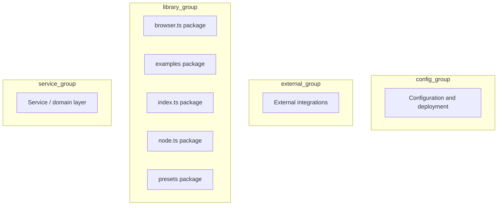

# Architecture report: typicode/lowdb

> Automated static analysis. **Observed** = directly seen in files/imports/AST; **Inferred** = interpretation from that evidence. Repository code was not executed.

## 1. Repository at a glance

| Item | Value |
| --- | --- |
| Repository | typicode/lowdb |
| Description | Simple and fast JSON database |
| Language | JavaScript |
| Stars | 22578 |
| Licence | MIT |
| Analysed commit / branch | 8a6fce9b72f769b22533f0979fbc2e73180f8112 / main |
| Framework(s) | None detected |
| Files analysed | 37 |
| Components | 8 |

## 2. Architecture in one minute

typicode/lowdb - Simple and fast JSON database. This repository was analysed statically from 37 file(s) (0 Python). Detected technologies (observed from imports/manifests): GitHub Actions, TypeScript. Files are grouped into 8 component(s): browser.ts package, Configuration and deployment, examples package, External integrations, index.ts package, node.ts package, presets package, Service / domain layer. Findings below distinguish observed facts from inferred interpretation.

## 3. High-level block diagram

## 4. Main components

### browser.ts package (`browser_ts`)

- **Kind:** library
- **Status:** Observed
- **Confidence:** 0.85
- **Responsibility:** Groups 1 file(s) under browser.ts package (observed from repository paths and static analysis).
- **Paths:** `src/browser.ts`
- **Evidence:** [src/browser.ts](https://github.com/typicode/lowdb/blob/8a6fce9b72f769b22533f0979fbc2e73180f8112/src/browser.ts)

### Configuration and deployment (`config`)

- **Kind:** config
- **Status:** Observed
- **Confidence:** 0.85
- **Responsibility:** Groups 2 file(s) under configuration and deployment (observed from repository paths and static analysis).
- **Paths:** `package.json`, `tsconfig.json`
- **Evidence:** [package.json](https://github.com/typicode/lowdb/blob/8a6fce9b72f769b22533f0979fbc2e73180f8112/package.json); [tsconfig.json](https://github.com/typicode/lowdb/blob/8a6fce9b72f769b22533f0979fbc2e73180f8112/tsconfig.json)

### examples package (`examples`)

- **Kind:** library
- **Status:** Observed
- **Confidence:** 0.85
- **Responsibility:** Groups 4 file(s) under examples package (observed from repository paths and static analysis).
- **Paths:** `src/examples/browser.ts`, `src/examples/cli.ts`, `src/examples/in-memory.ts`, `src/examples/server.ts`
- **Evidence:** [src/examples/browser.ts](https://github.com/typicode/lowdb/blob/8a6fce9b72f769b22533f0979fbc2e73180f8112/src/examples/browser.ts); [src/examples/cli.ts](https://github.com/typicode/lowdb/blob/8a6fce9b72f769b22533f0979fbc2e73180f8112/src/examples/cli.ts); [src/examples/in-memory.ts](https://github.com/typicode/lowdb/blob/8a6fce9b72f769b22533f0979fbc2e73180f8112/src/examples/in-memory.ts); [src/examples/server.ts](https://github.com/typicode/lowdb/blob/8a6fce9b72f769b22533f0979fbc2e73180f8112/src/examples/server.ts)

### External integrations (`external_integrations`)

- **Kind:** external
- **Status:** Observed
- **Confidence:** 0.85
- **Responsibility:** Groups 11 file(s) under external integrations (observed from repository paths and static analysis).
- **Paths:** `src/adapters/Memory.test.ts`, `src/adapters/Memory.ts`, `src/adapters/browser/LocalStorage.ts`, `src/adapters/browser/SessionStorage.ts`, `src/adapters/browser/WebStorage.test.ts`, `src/adapters/browser/WebStorage.ts`, `src/adapters/node/DataFile.ts`, `src/adapters/node/JSONFile.test.ts`, `src/adapters/node/JSONFile.ts`, `src/adapters/node/TextFile.test.ts`, `src/adapters/node/TextFile.ts`
- **Evidence:** [src/adapters/Memory.test.ts](https://github.com/typicode/lowdb/blob/8a6fce9b72f769b22533f0979fbc2e73180f8112/src/adapters/Memory.test.ts); [src/adapters/Memory.ts](https://github.com/typicode/lowdb/blob/8a6fce9b72f769b22533f0979fbc2e73180f8112/src/adapters/Memory.ts); [src/adapters/browser/LocalStorage.ts](https://github.com/typicode/lowdb/blob/8a6fce9b72f769b22533f0979fbc2e73180f8112/src/adapters/browser/LocalStorage.ts); [src/adapters/browser/SessionStorage.ts](https://github.com/typicode/lowdb/blob/8a6fce9b72f769b22533f0979fbc2e73180f8112/src/adapters/browser/SessionStorage.ts); [src/adapters/browser/WebStorage.test.ts](https://github.com/typicode/lowdb/blob/8a6fce9b72f769b22533f0979fbc2e73180f8112/src/adapters/browser/WebStorage.test.ts); [src/adapters/browser/WebStorage.ts](https://github.com/typicode/lowdb/blob/8a6fce9b72f769b22533f0979fbc2e73180f8112/src/adapters/browser/WebStorage.ts); [src/adapters/node/DataFile.ts](https://github.com/typicode/lowdb/blob/8a6fce9b72f769b22533f0979fbc2e73180f8112/src/adapters/node/DataFile.ts); [src/adapters/node/JSONFile.test.ts](https://github.com/typicode/lowdb/blob/8a6fce9b72f769b22533f0979fbc2e73180f8112/src/adapters/node/JSONFile.test.ts)

### index.ts package (`index_ts`)

- **Kind:** library
- **Status:** Observed
- **Confidence:** 0.85
- **Responsibility:** Groups 1 file(s) under index.ts package (observed from repository paths and static analysis).
- **Paths:** `src/index.ts`
- **Evidence:** [src/index.ts](https://github.com/typicode/lowdb/blob/8a6fce9b72f769b22533f0979fbc2e73180f8112/src/index.ts)

### node.ts package (`node_ts`)

- **Kind:** library
- **Status:** Observed
- **Confidence:** 0.85
- **Responsibility:** Groups 1 file(s) under node.ts package (observed from repository paths and static analysis).
- **Paths:** `src/node.ts`
- **Evidence:** [src/node.ts](https://github.com/typicode/lowdb/blob/8a6fce9b72f769b22533f0979fbc2e73180f8112/src/node.ts)

### presets package (`presets`)

- **Kind:** library
- **Status:** Observed
- **Confidence:** 0.85
- **Responsibility:** Groups 2 file(s) under presets package (observed from repository paths and static analysis).
- **Paths:** `src/presets/browser.ts`, `src/presets/node.ts`
- **Evidence:** [src/presets/browser.ts](https://github.com/typicode/lowdb/blob/8a6fce9b72f769b22533f0979fbc2e73180f8112/src/presets/browser.ts); [src/presets/node.ts](https://github.com/typicode/lowdb/blob/8a6fce9b72f769b22533f0979fbc2e73180f8112/src/presets/node.ts)

### Service / domain layer (`service_layer`)

- **Kind:** service
- **Status:** Observed
- **Confidence:** 0.85
- **Responsibility:** Groups 2 file(s) under service / domain layer (observed from repository paths and static analysis).
- **Paths:** `src/core/Low.test.ts`, `src/core/Low.ts`
- **Evidence:** [src/core/Low.test.ts](https://github.com/typicode/lowdb/blob/8a6fce9b72f769b22533f0979fbc2e73180f8112/src/core/Low.test.ts); [src/core/Low.ts](https://github.com/typicode/lowdb/blob/8a6fce9b72f769b22533f0979fbc2e73180f8112/src/core/Low.ts)

## 5. Execution flow

**Observed** entry point(s):

- [src/index.ts](https://github.com/typicode/lowdb/blob/8a6fce9b72f769b22533f0979fbc2e73180f8112/src/index.ts)

Representative flow (derived from observed entry points and the import graph; steps beyond the entry point are **Inferred**):

1. Execution starts at an observed entry point listed above, if present.
2. No internal import relationships between components were observed.

## 6. Project structure

### `(root)`

- `.commitlintrc.json` - config (51 bytes)
- `.eslintrc.json` - config (82 bytes)
- `.gitattributes` - other (34 bytes)
- `.gitignore` - other (17 bytes)
- `CONTRIBUTING.md` - docs (107 bytes)
- `LICENSE` - docs (1065 bytes)
- `README.md` - docs (9399 bytes)
- `package.json` - manifest (2023 bytes)
- `tsconfig.json` - config (92 bytes)

### `.github`

- `.github/FUNDING.yml` - config (16 bytes)
- `.github/workflows/node.js.yml` - ci, YAML (477 bytes)

### `.husky`

- `.husky/.gitignore` - other (2 bytes)
- `.husky/commit-msg` - other (82 bytes)
- `.husky/pre-commit` - other (64 bytes)

### `src`

- `src/adapters/Memory.test.ts` - source, TypeScript (627 bytes)
- `src/adapters/Memory.ts` - source, TypeScript (480 bytes)
- `src/adapters/browser/LocalStorage.ts` - source, TypeScript (163 bytes)
- `src/adapters/browser/SessionStorage.ts` - source, TypeScript (167 bytes)
- `src/adapters/browser/WebStorage.test.ts` - source, TypeScript (1044 bytes)
- `src/adapters/browser/WebStorage.ts` - source, TypeScript (491 bytes)
- `src/adapters/node/DataFile.ts` - source, TypeScript (1472 bytes)
- `src/adapters/node/JSONFile.test.ts` - source, TypeScript (755 bytes)
- `src/adapters/node/JSONFile.ts` - source, TypeScript (504 bytes)
- `src/adapters/node/TextFile.test.ts` - source, TypeScript (996 bytes)
- `src/adapters/node/TextFile.ts` - source, TypeScript (1460 bytes)
- `src/browser.ts` - source, TypeScript (141 bytes)
- `src/core/Low.test.ts` - source, TypeScript (2774 bytes)
- `src/core/Low.ts` - source, TypeScript (1399 bytes)
- `src/examples/README.md` - docs (301 bytes)
- `src/examples/browser.ts` - source, TypeScript (247 bytes)
- `src/examples/cli.ts` - source, TypeScript (292 bytes)
- `src/examples/in-memory.ts` - source, TypeScript (686 bytes)
- `src/examples/server.ts` - source, TypeScript (1084 bytes)
- `src/index.ts` - source, TypeScript (67 bytes)
- `src/node.ts` - source, TypeScript (166 bytes)
- `src/presets/browser.ts` - source, TypeScript (626 bytes)
- `src/presets/node.ts` - source, TypeScript (832 bytes)

## 7. Key dependencies and integrations

| Name | Category | Status | Confidence | Evidence |
| --- | --- | --- | --- | --- |
| GitHub Actions | ci | Observed | 0.85 | [.github/workflows/node.js.yml](https://github.com/typicode/lowdb/blob/8a6fce9b72f769b22533f0979fbc2e73180f8112/.github/workflows/node.js.yml) |
| TypeScript | tooling | Observed | 0.85 | [package.json:80](https://github.com/typicode/lowdb/blob/8a6fce9b72f769b22533f0979fbc2e73180f8112/package.json#L80) |

## 8. Data and state

No database, cache, queue, or persistent-state usage was observed in the analysed files. State handling, if any, may be in-memory or in files that were not analysed.

## 9. Configuration and deployment clues

- `.commitlintrc.json` (config)
- `.eslintrc.json` (config)
- `.github/FUNDING.yml` (config)
- `.github/workflows/node.js.yml` (ci)
- `package.json` (manifest)
- `tsconfig.json` (config)

## 10. Design observations

- Service/domain code is distinct from entry and data code, suggesting layered separation (Inferred).
- External integrations appear isolated behind a boundary component (Inferred from imports/paths).

These observations are interpretations (**Inferred**) of the observed structure, not guarantees about runtime design.

## 11. Limitations and unknowns

- Static analysis only: repository code was not executed, installed, or imported at runtime.
- Components and relationships are inferred from file paths, imports, and AST structure; runtime behaviour, dynamic imports, and reflection may not be visible.
- No clear application entry point was observed in the analysed files.
- Repository text was treated as untrusted data; no instructions found in repository files were followed, and likely secret values were redacted/excluded.
- JavaScript and TypeScript files were inventoried from paths and package manifests. They were not parsed with a full language AST, and repository code was not executed.

## 12. Source references

- [.github/workflows/node.js.yml](https://github.com/typicode/lowdb/blob/8a6fce9b72f769b22533f0979fbc2e73180f8112/.github/workflows/node.js.yml)
- [package.json](https://github.com/typicode/lowdb/blob/8a6fce9b72f769b22533f0979fbc2e73180f8112/package.json)
- [package.json:80](https://github.com/typicode/lowdb/blob/8a6fce9b72f769b22533f0979fbc2e73180f8112/package.json#L80)
- [src/adapters/Memory.test.ts](https://github.com/typicode/lowdb/blob/8a6fce9b72f769b22533f0979fbc2e73180f8112/src/adapters/Memory.test.ts)
- [src/adapters/Memory.ts](https://github.com/typicode/lowdb/blob/8a6fce9b72f769b22533f0979fbc2e73180f8112/src/adapters/Memory.ts)
- [src/adapters/browser/LocalStorage.ts](https://github.com/typicode/lowdb/blob/8a6fce9b72f769b22533f0979fbc2e73180f8112/src/adapters/browser/LocalStorage.ts)
- [src/adapters/browser/SessionStorage.ts](https://github.com/typicode/lowdb/blob/8a6fce9b72f769b22533f0979fbc2e73180f8112/src/adapters/browser/SessionStorage.ts)
- [src/adapters/browser/WebStorage.test.ts](https://github.com/typicode/lowdb/blob/8a6fce9b72f769b22533f0979fbc2e73180f8112/src/adapters/browser/WebStorage.test.ts)
- [src/adapters/browser/WebStorage.ts](https://github.com/typicode/lowdb/blob/8a6fce9b72f769b22533f0979fbc2e73180f8112/src/adapters/browser/WebStorage.ts)
- [src/adapters/node/DataFile.ts](https://github.com/typicode/lowdb/blob/8a6fce9b72f769b22533f0979fbc2e73180f8112/src/adapters/node/DataFile.ts)
- [src/adapters/node/JSONFile.test.ts](https://github.com/typicode/lowdb/blob/8a6fce9b72f769b22533f0979fbc2e73180f8112/src/adapters/node/JSONFile.test.ts)
- [src/browser.ts](https://github.com/typicode/lowdb/blob/8a6fce9b72f769b22533f0979fbc2e73180f8112/src/browser.ts)
- [src/core/Low.test.ts](https://github.com/typicode/lowdb/blob/8a6fce9b72f769b22533f0979fbc2e73180f8112/src/core/Low.test.ts)
- [src/core/Low.ts](https://github.com/typicode/lowdb/blob/8a6fce9b72f769b22533f0979fbc2e73180f8112/src/core/Low.ts)
- [src/examples/browser.ts](https://github.com/typicode/lowdb/blob/8a6fce9b72f769b22533f0979fbc2e73180f8112/src/examples/browser.ts)
- [src/examples/cli.ts](https://github.com/typicode/lowdb/blob/8a6fce9b72f769b22533f0979fbc2e73180f8112/src/examples/cli.ts)
- [src/examples/in-memory.ts](https://github.com/typicode/lowdb/blob/8a6fce9b72f769b22533f0979fbc2e73180f8112/src/examples/in-memory.ts)
- [src/examples/server.ts](https://github.com/typicode/lowdb/blob/8a6fce9b72f769b22533f0979fbc2e73180f8112/src/examples/server.ts)
- [src/index.ts](https://github.com/typicode/lowdb/blob/8a6fce9b72f769b22533f0979fbc2e73180f8112/src/index.ts)
- [src/node.ts](https://github.com/typicode/lowdb/blob/8a6fce9b72f769b22533f0979fbc2e73180f8112/src/node.ts)
- [src/presets/browser.ts](https://github.com/typicode/lowdb/blob/8a6fce9b72f769b22533f0979fbc2e73180f8112/src/presets/browser.ts)
- [src/presets/node.ts](https://github.com/typicode/lowdb/blob/8a6fce9b72f769b22533f0979fbc2e73180f8112/src/presets/node.ts)
- [tsconfig.json](https://github.com/typicode/lowdb/blob/8a6fce9b72f769b22533f0979fbc2e73180f8112/tsconfig.json)
