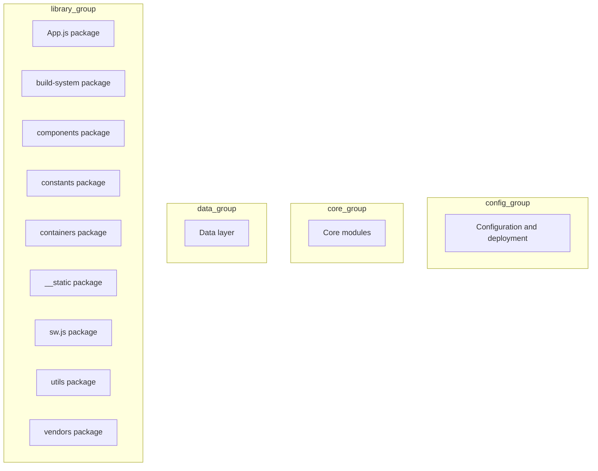

# Architecture report: unbug/codelf

> Automated static analysis. **Observed** = directly seen in files/imports/AST; **Inferred** = interpretation from that evidence. Repository code was not executed.

## 1. Repository at a glance

| Item | Value |
| --- | --- |
| Repository | unbug/codelf |
| Description | A search tool helps dev to solve the naming things problem. |
| Language | JavaScript |
| Stars | 14120 |
| Licence | Other |
| Analysed commit / branch | 0bfb88a8d297ca0f65abbf8f83f7826311df42a3 / master |
| Framework(s) | React |
| Files analysed | 116 |
| Components | 12 |

## 2. Architecture in one minute

unbug/codelf - A search tool helps dev to solve the naming things problem.. This repository was analysed statically from 116 file(s) (0 Python). Detected technologies (observed from imports/manifests): React, React Router, webpack. Files are grouped into 12 component(s): App.js package, build-system package, components package, Configuration and deployment, constants package, containers package, Core modules, Data layer. Findings below distinguish observed facts from inferred interpretation.

## 3. High-level block diagram

## 4. Main components

### App.js package (`app_js`)

- **Kind:** library
- **Status:** Observed
- **Confidence:** 0.85
- **Responsibility:** Groups 1 file(s) under app.js package (observed from repository paths and static analysis).
- **Paths:** `src/App.js`
- **Evidence:** [src/App.js](https://github.com/unbug/codelf/blob/0bfb88a8d297ca0f65abbf8f83f7826311df42a3/src/App.js)

### build-system package (`build_system`)

- **Kind:** library
- **Status:** Observed
- **Confidence:** 0.85
- **Responsibility:** Groups 7 file(s) under build-system package (observed from repository paths and static analysis).
- **Paths:** `build-system/build.js`, `build-system/clean.js`, `build-system/default.js`, `build-system/dist.js`, `build-system/lint.js`, `build-system/server.js`, `build-system/util.js`
- **Evidence:** [build-system/build.js](https://github.com/unbug/codelf/blob/0bfb88a8d297ca0f65abbf8f83f7826311df42a3/build-system/build.js); [build-system/clean.js](https://github.com/unbug/codelf/blob/0bfb88a8d297ca0f65abbf8f83f7826311df42a3/build-system/clean.js); [build-system/default.js](https://github.com/unbug/codelf/blob/0bfb88a8d297ca0f65abbf8f83f7826311df42a3/build-system/default.js); [build-system/dist.js](https://github.com/unbug/codelf/blob/0bfb88a8d297ca0f65abbf8f83f7826311df42a3/build-system/dist.js); [build-system/lint.js](https://github.com/unbug/codelf/blob/0bfb88a8d297ca0f65abbf8f83f7826311df42a3/build-system/lint.js); [build-system/server.js](https://github.com/unbug/codelf/blob/0bfb88a8d297ca0f65abbf8f83f7826311df42a3/build-system/server.js); [build-system/util.js](https://github.com/unbug/codelf/blob/0bfb88a8d297ca0f65abbf8f83f7826311df42a3/build-system/util.js)

### components package (`components`)

- **Kind:** library
- **Status:** Observed
- **Confidence:** 0.85
- **Responsibility:** Groups 13 file(s) under components package (observed from repository paths and static analysis).
- **Paths:** `src/components/Bookmark.js`, `src/components/Copybook.js`, `src/components/Donate.js`, `src/components/Doodle.js`, `src/components/Loading.js`, `src/components/SearchBar.js`, `src/components/SearchError.js`, `src/components/SourceCode.js`, `src/components/Suggestion.js`, `src/components/TitleLogo.js`, `src/components/VariableItem.js`, `src/components/VariableList.js`, `src/components/hooks/useCodeHighlighting.js`
- **Evidence:** [src/components/Bookmark.js](https://github.com/unbug/codelf/blob/0bfb88a8d297ca0f65abbf8f83f7826311df42a3/src/components/Bookmark.js); [src/components/Copybook.js](https://github.com/unbug/codelf/blob/0bfb88a8d297ca0f65abbf8f83f7826311df42a3/src/components/Copybook.js); [src/components/Donate.js](https://github.com/unbug/codelf/blob/0bfb88a8d297ca0f65abbf8f83f7826311df42a3/src/components/Donate.js); [src/components/Doodle.js](https://github.com/unbug/codelf/blob/0bfb88a8d297ca0f65abbf8f83f7826311df42a3/src/components/Doodle.js); [src/components/Loading.js](https://github.com/unbug/codelf/blob/0bfb88a8d297ca0f65abbf8f83f7826311df42a3/src/components/Loading.js); [src/components/SearchBar.js](https://github.com/unbug/codelf/blob/0bfb88a8d297ca0f65abbf8f83f7826311df42a3/src/components/SearchBar.js); [src/components/SearchError.js](https://github.com/unbug/codelf/blob/0bfb88a8d297ca0f65abbf8f83f7826311df42a3/src/components/SearchError.js); [src/components/SourceCode.js](https://github.com/unbug/codelf/blob/0bfb88a8d297ca0f65abbf8f83f7826311df42a3/src/components/SourceCode.js)

### Configuration and deployment (`config`)

- **Kind:** config
- **Status:** Observed
- **Confidence:** 0.85
- **Responsibility:** Groups 1 file(s) under configuration and deployment (observed from repository paths and static analysis).
- **Paths:** `package.json`
- **Evidence:** [package.json](https://github.com/unbug/codelf/blob/0bfb88a8d297ca0f65abbf8f83f7826311df42a3/package.json)

### constants package (`constants`)

- **Kind:** library
- **Status:** Observed
- **Confidence:** 0.85
- **Responsibility:** Groups 1 file(s) under constants package (observed from repository paths and static analysis).
- **Paths:** `src/constants/Configs.js`
- **Evidence:** [src/constants/Configs.js](https://github.com/unbug/codelf/blob/0bfb88a8d297ca0f65abbf8f83f7826311df42a3/src/constants/Configs.js)

### containers package (`containers`)

- **Kind:** library
- **Status:** Observed
- **Confidence:** 0.85
- **Responsibility:** Groups 4 file(s) under containers package (observed from repository paths and static analysis).
- **Paths:** `src/containers/CopybookContainer.js`, `src/containers/MainContainer.js`, `src/containers/NavBarContainer.js`, `src/containers/NoticeContainer.js`
- **Evidence:** [src/containers/CopybookContainer.js](https://github.com/unbug/codelf/blob/0bfb88a8d297ca0f65abbf8f83f7826311df42a3/src/containers/CopybookContainer.js); [src/containers/MainContainer.js](https://github.com/unbug/codelf/blob/0bfb88a8d297ca0f65abbf8f83f7826311df42a3/src/containers/MainContainer.js); [src/containers/NavBarContainer.js](https://github.com/unbug/codelf/blob/0bfb88a8d297ca0f65abbf8f83f7826311df42a3/src/containers/NavBarContainer.js); [src/containers/NoticeContainer.js](https://github.com/unbug/codelf/blob/0bfb88a8d297ca0f65abbf8f83f7826311df42a3/src/containers/NoticeContainer.js)

### Core modules (`core`)

- **Kind:** core
- **Status:** Observed
- **Confidence:** 0.85
- **Responsibility:** Groups 4 file(s) under core modules (observed from repository paths and static analysis).
- **Paths:** `babel.config.js`, `gulpfile.js`, `lib.config.js`, `webpack.config.js`
- **Evidence:** [babel.config.js](https://github.com/unbug/codelf/blob/0bfb88a8d297ca0f65abbf8f83f7826311df42a3/babel.config.js); [gulpfile.js](https://github.com/unbug/codelf/blob/0bfb88a8d297ca0f65abbf8f83f7826311df42a3/gulpfile.js); [lib.config.js](https://github.com/unbug/codelf/blob/0bfb88a8d297ca0f65abbf8f83f7826311df42a3/lib.config.js); [webpack.config.js](https://github.com/unbug/codelf/blob/0bfb88a8d297ca0f65abbf8f83f7826311df42a3/webpack.config.js)

### Data layer (`data_layer`)

- **Kind:** data
- **Status:** Observed
- **Confidence:** 0.85
- **Responsibility:** Groups 12 file(s) under data layer (observed from repository paths and static analysis).
- **Paths:** `src/models/AppModel.js`, `src/models/BaseModel.js`, `src/models/CopybookModel.js`, `src/models/DDMSModel.js`, `src/models/ErrorModel.js`, `src/models/SearchCodeModel.js`, `src/models/Store.js`, `src/models/metadata/BaiduTranslateData.js`, `src/models/metadata/BingTranslateData.js`, `src/models/metadata/BookmarkData.js`, `src/models/metadata/GitHubData.js`, `src/models/metadata/YoudaoTranslateData.js`
- **Evidence:** [src/models/AppModel.js](https://github.com/unbug/codelf/blob/0bfb88a8d297ca0f65abbf8f83f7826311df42a3/src/models/AppModel.js); [src/models/BaseModel.js](https://github.com/unbug/codelf/blob/0bfb88a8d297ca0f65abbf8f83f7826311df42a3/src/models/BaseModel.js); [src/models/CopybookModel.js](https://github.com/unbug/codelf/blob/0bfb88a8d297ca0f65abbf8f83f7826311df42a3/src/models/CopybookModel.js); [src/models/DDMSModel.js](https://github.com/unbug/codelf/blob/0bfb88a8d297ca0f65abbf8f83f7826311df42a3/src/models/DDMSModel.js); [src/models/ErrorModel.js](https://github.com/unbug/codelf/blob/0bfb88a8d297ca0f65abbf8f83f7826311df42a3/src/models/ErrorModel.js); [src/models/SearchCodeModel.js](https://github.com/unbug/codelf/blob/0bfb88a8d297ca0f65abbf8f83f7826311df42a3/src/models/SearchCodeModel.js); [src/models/Store.js](https://github.com/unbug/codelf/blob/0bfb88a8d297ca0f65abbf8f83f7826311df42a3/src/models/Store.js); [src/models/metadata/BaiduTranslateData.js](https://github.com/unbug/codelf/blob/0bfb88a8d297ca0f65abbf8f83f7826311df42a3/src/models/metadata/BaiduTranslateData.js)

### __static package (`static`)

- **Kind:** library
- **Status:** Observed
- **Confidence:** 0.85
- **Responsibility:** Groups 16 file(s) under __static package (observed from repository paths and static analysis).
- **Paths:** `__static/app/src/App.js`, `__static/app/src/AppBundle.js`, `__static/app/src/Util.js`, `__static/app/src/lib/all.js`, `__static/app/src/lib/fastclick.js`, `__static/app/src/lib/jquery.highlight.js`, `__static/app/src/lib/prettify.js`, `__static/app/src/model/BookmarkModel.js`, `__static/app/src/model/DDMSModel.js`, `__static/app/src/model/Database.js`, `__static/app/src/model/Model.js`, `__static/app/src/model/SearchcodeModel.js`, `__static/app/src/model/YoudaoTranslateModel.js`, `__static/app/src/view/BookmarkView.js`, `__static/app/src/view/View.js`, `__static/app/sw.js`
- **Evidence:** [__static/app/src/App.js](https://github.com/unbug/codelf/blob/0bfb88a8d297ca0f65abbf8f83f7826311df42a3/__static/app/src/App.js); [__static/app/src/AppBundle.js](https://github.com/unbug/codelf/blob/0bfb88a8d297ca0f65abbf8f83f7826311df42a3/__static/app/src/AppBundle.js); [__static/app/src/Util.js](https://github.com/unbug/codelf/blob/0bfb88a8d297ca0f65abbf8f83f7826311df42a3/__static/app/src/Util.js); [__static/app/src/lib/all.js](https://github.com/unbug/codelf/blob/0bfb88a8d297ca0f65abbf8f83f7826311df42a3/__static/app/src/lib/all.js); [__static/app/src/lib/fastclick.js](https://github.com/unbug/codelf/blob/0bfb88a8d297ca0f65abbf8f83f7826311df42a3/__static/app/src/lib/fastclick.js); [__static/app/src/lib/jquery.highlight.js](https://github.com/unbug/codelf/blob/0bfb88a8d297ca0f65abbf8f83f7826311df42a3/__static/app/src/lib/jquery.highlight.js); [__static/app/src/lib/prettify.js](https://github.com/unbug/codelf/blob/0bfb88a8d297ca0f65abbf8f83f7826311df42a3/__static/app/src/lib/prettify.js); [__static/app/src/model/BookmarkModel.js](https://github.com/unbug/codelf/blob/0bfb88a8d297ca0f65abbf8f83f7826311df42a3/__static/app/src/model/BookmarkModel.js)

### sw.js package (`sw_js`)

- **Kind:** library
- **Status:** Observed
- **Confidence:** 0.85
- **Responsibility:** Groups 1 file(s) under sw.js package (observed from repository paths and static analysis).
- **Paths:** `src/sw.js`
- **Evidence:** [src/sw.js](https://github.com/unbug/codelf/blob/0bfb88a8d297ca0f65abbf8f83f7826311df42a3/src/sw.js)

### utils package (`utils`)

- **Kind:** library
- **Status:** Observed
- **Confidence:** 0.85
- **Responsibility:** Groups 8 file(s) under utils package (observed from repository paths and static analysis).
- **Paths:** `src/utils/FormHandler.js`, `src/utils/HashHandler.js`, `src/utils/JSONP.js`, `src/utils/LocalStorage.js`, `src/utils/Navigator.js`, `src/utils/Param.js`, `src/utils/Tools.js`, `src/utils/TranslateHandler.js`
- **Evidence:** [src/utils/FormHandler.js](https://github.com/unbug/codelf/blob/0bfb88a8d297ca0f65abbf8f83f7826311df42a3/src/utils/FormHandler.js); [src/utils/HashHandler.js](https://github.com/unbug/codelf/blob/0bfb88a8d297ca0f65abbf8f83f7826311df42a3/src/utils/HashHandler.js); [src/utils/JSONP.js](https://github.com/unbug/codelf/blob/0bfb88a8d297ca0f65abbf8f83f7826311df42a3/src/utils/JSONP.js); [src/utils/LocalStorage.js](https://github.com/unbug/codelf/blob/0bfb88a8d297ca0f65abbf8f83f7826311df42a3/src/utils/LocalStorage.js); [src/utils/Navigator.js](https://github.com/unbug/codelf/blob/0bfb88a8d297ca0f65abbf8f83f7826311df42a3/src/utils/Navigator.js); [src/utils/Param.js](https://github.com/unbug/codelf/blob/0bfb88a8d297ca0f65abbf8f83f7826311df42a3/src/utils/Param.js); [src/utils/Tools.js](https://github.com/unbug/codelf/blob/0bfb88a8d297ca0f65abbf8f83f7826311df42a3/src/utils/Tools.js); [src/utils/TranslateHandler.js](https://github.com/unbug/codelf/blob/0bfb88a8d297ca0f65abbf8f83f7826311df42a3/src/utils/TranslateHandler.js)

### vendors package (`vendors`)

- **Kind:** library
- **Status:** Observed
- **Confidence:** 0.85
- **Responsibility:** Groups 1 file(s) under vendors package (observed from repository paths and static analysis).
- **Paths:** `src/vendors/prettify.js`
- **Evidence:** [src/vendors/prettify.js](https://github.com/unbug/codelf/blob/0bfb88a8d297ca0f65abbf8f83f7826311df42a3/src/vendors/prettify.js)

## 5. Execution flow

**Observed** entry point(s):

- [__static/app/src/App.js](https://github.com/unbug/codelf/blob/0bfb88a8d297ca0f65abbf8f83f7826311df42a3/__static/app/src/App.js)
- [build-system/server.js](https://github.com/unbug/codelf/blob/0bfb88a8d297ca0f65abbf8f83f7826311df42a3/build-system/server.js)
- [src/App.js](https://github.com/unbug/codelf/blob/0bfb88a8d297ca0f65abbf8f83f7826311df42a3/src/App.js)

Representative flow (derived from observed entry points and the import graph; steps beyond the entry point are **Inferred**):

1. Execution starts at an observed entry point listed above, if present.
2. No internal import relationships between components were observed.

## 6. Project structure

### `(root)`

- `.editorconfig` - config (197 bytes)
- `.eslintrc.js` - source, JavaScript (736 bytes)
- `.gitattributes` - other (24 bytes)
- `.gitignore` - other (496 bytes)
- `LICENSE` - docs (590 bytes)
- `README.md` - docs (4075 bytes)
- `babel.config.js` - source, JavaScript (205 bytes)
- `gulpfile.js` - source, JavaScript (1505 bytes)
- `lib.config.js` - source, JavaScript (1181 bytes)
- `package.json` - manifest (2617 bytes)
- `webpack.config.js` - source, JavaScript (701 bytes)

### `__static`

- `__static/app/cache.manifest` - other (68 bytes)
- `__static/app/ddms_frame_callback.html` - other (1035 bytes)
- `__static/app/html/bookmark.html` - other (10468 bytes)
- `__static/app/html/components.html` - other (995 bytes)
- `__static/app/html/donate.html` - other (859 bytes)
- `__static/app/html/main.html` - other (5174 bytes)
- `__static/app/html/scripts.html` - other (5345 bytes)
- `__static/app/html/sourcecode.html` - other (1834 bytes)
- `__static/app/html/styles.html` - other (195 bytes)
- `__static/app/index.html` - other (1503 bytes)
- `__static/app/resources/css/prettify.css` - other (1049 bytes)
- `__static/app/resources/css/style.css` - other (14538 bytes)
- `__static/app/resources/fonts/Dressedless_Three.svg` - other (31793 bytes)
- `__static/app/scss/_animate.scss` - other (491 bytes)
- `__static/app/scss/_bookmark.scss` - other (2400 bytes)
- `__static/app/scss/_components.scss` - other (2100 bytes)
- `__static/app/scss/_donate.scss` - other (582 bytes)
- `__static/app/scss/_main.scss` - other (4296 bytes)
- `__static/app/scss/_sourcecode.scss` - other (250 bytes)
- `__static/app/scss/_util.scss` - other (931 bytes)
- `__static/app/scss/style.scss` - other (502 bytes)
- `__static/app/src/App.js` - source, JavaScript (86 bytes)
- `__static/app/src/AppBundle.js` - source, JavaScript (70548 bytes)
- `__static/app/src/Util.js` - source, JavaScript (7320 bytes)
- `__static/app/src/lib/all.js` - source, JavaScript (228 bytes)
- `__static/app/src/lib/fastclick.js` - source, JavaScript (25965 bytes)
- `__static/app/src/lib/jquery.highlight.js` - source, JavaScript (3983 bytes)
- `__static/app/src/lib/prettify.js` - source, JavaScript (15261 bytes)
- `__static/app/src/model/BookmarkModel.js` - source, JavaScript (16520 bytes)
- `__static/app/src/model/DDMSModel.js` - source, JavaScript (2947 bytes)
- `__static/app/src/model/Database.js` - source, JavaScript (158 bytes)
- `__static/app/src/model/Model.js` - source, JavaScript (1715 bytes)
- `__static/app/src/model/SearchcodeModel.js` - source, JavaScript (3898 bytes)
- `__static/app/src/model/YoudaoTranslateModel.js` - source, JavaScript (528 bytes)
- `__static/app/src/view/BookmarkView.js` - source, JavaScript (17305 bytes)
- `__static/app/src/view/View.js` - source, JavaScript (16936 bytes)
- `__static/app/sw.js` - source, JavaScript (6753 bytes)

### `app`

- `app/ddms_frame_callback.html` - other (1035 bytes)
- `app/index.html` - other (6559 bytes)
- `app/opensearch.xml` - other (433 bytes)

### `assets`

- `assets/fonts/Dressedless_Three.svg` - other (31793 bytes)

### `build-system`

- `build-system/build.js` - source, JavaScript (2292 bytes)
- `build-system/clean.js` - source, JavaScript (243 bytes)
- `build-system/default.js` - source, JavaScript (605 bytes)
- `build-system/dist.js` - source, JavaScript (2778 bytes)
- `build-system/lint.js` - source, JavaScript (288 bytes)
- `build-system/server.js` - source, JavaScript (1690 bytes)
- `build-system/util.js` - source, JavaScript (628 bytes)

### `src`

- `src/App.js` - source, JavaScript (522 bytes)
- `src/components/Bookmark.js` - source, JavaScript (0 bytes)
- `src/components/Copybook.js` - source, JavaScript (2359 bytes)
- `src/components/Donate.js` - source, JavaScript (1413 bytes)
- `src/components/Doodle.js` - source, JavaScript (401 bytes)
- `src/components/Loading.js` - source, JavaScript (213 bytes)
- `src/components/SearchBar.js` - source, JavaScript (4948 bytes)
- `src/components/SearchError.js` - source, JavaScript (497 bytes)
- `src/components/SourceCode.js` - source, JavaScript (2061 bytes)
- `src/components/Suggestion.js` - source, JavaScript (470 bytes)
- `src/components/TitleLogo.js` - source, JavaScript (254 bytes)
- `src/components/VariableItem.js` - source, JavaScript (1349 bytes)
- `src/components/VariableList.js` - source, JavaScript (1863 bytes)
- `src/components/hooks/useCodeHighlighting.js` - source, JavaScript (896 bytes)
- `src/constants/Configs.js` - source, JavaScript (178 bytes)
- `src/containers/CopybookContainer.js` - source, JavaScript (2075 bytes)
- `src/containers/MainContainer.js` - source, JavaScript (6315 bytes)
- `src/containers/NavBarContainer.js` - source, JavaScript (1626 bytes)
- `src/containers/NoticeContainer.js` - source, JavaScript (4169 bytes)
- `src/models/AppModel.js` - source, JavaScript (1382 bytes)
- `src/models/BaseModel.js` - source, JavaScript (1615 bytes)
- `src/models/CopybookModel.js` - source, JavaScript (2597 bytes)
- `src/models/DDMSModel.js` - source, JavaScript (3758 bytes)
- `src/models/ErrorModel.js` - source, JavaScript (457 bytes)
- `src/models/SearchCodeModel.js` - source, JavaScript (7716 bytes)
- `src/models/Store.js` - source, JavaScript (2041 bytes)
- `src/models/metadata/BaiduTranslateData.js` - source, JavaScript (2261 bytes)
- `src/models/metadata/BingTranslateData.js` - source, JavaScript (2445 bytes)
- `src/models/metadata/BookmarkData.js` - source, JavaScript (16858 bytes)
- `src/models/metadata/GitHubData.js` - source, JavaScript (4139 bytes)
- `src/models/metadata/YoudaoTranslateData.js` - source, JavaScript (1914 bytes)
- `src/sw.js` - source, JavaScript (11421 bytes)
- `src/utils/FormHandler.js` - source, JavaScript (1219 bytes)
- `src/utils/HashHandler.js` - source, JavaScript (515 bytes)
- `src/utils/JSONP.js` - source, JavaScript (985 bytes)
- `src/utils/LocalStorage.js` - source, JavaScript (846 bytes)
- `src/utils/Navigator.js` - source, JavaScript (1700 bytes)
- `src/utils/Param.js` - source, JavaScript (574 bytes)
- `src/utils/Tools.js` - source, JavaScript (2456 bytes)
- `src/utils/TranslateHandler.js` - source, JavaScript (913 bytes)
- `src/vendors/prettify.css` - other (2185 bytes)
- `src/vendors/prettify.js` - source, JavaScript (65457 bytes)

### `styles`

- `styles/_animation.scss` - other (1035 bytes)
- `styles/_common.scss` - other (3487 bytes)
- `styles/_components.scss` - other (104 bytes)
- `styles/_constants.scss` - other (193 bytes)
- `styles/_containers.scss` - other (84 bytes)
- `styles/_copybook-container.scss` - other (1192 bytes)
- `styles/_donate.scss` - other (372 bytes)
- `styles/_doodle.scss` - other (3358 bytes)
- `styles/_logo.scss` - other (191 bytes)
- `styles/_main-container.scss` - other (4174 bytes)
- `styles/_nav-bar-container.scss` - other (1263 bytes)
- `styles/_notice-container.scss` - other (420 bytes)
- `styles/_source-code.scss` - other (435 bytes)
- `styles/_utils.scss` - other (1176 bytes)
- `styles/app.scss` - other (174 bytes)

## 7. Key dependencies and integrations

| Name | Category | Status | Confidence | Evidence |
| --- | --- | --- | --- | --- |
| React | framework | Observed | 0.90 | [package.json:24](https://github.com/unbug/codelf/blob/0bfb88a8d297ca0f65abbf8f83f7826311df42a3/package.json#L24); [package.json:79](https://github.com/unbug/codelf/blob/0bfb88a8d297ca0f65abbf8f83f7826311df42a3/package.json#L79) |
| React Router | library | Observed | 0.85 | [package.json:80](https://github.com/unbug/codelf/blob/0bfb88a8d297ca0f65abbf8f83f7826311df42a3/package.json#L80) |
| webpack | tooling | Observed | 0.85 | [package.json:61](https://github.com/unbug/codelf/blob/0bfb88a8d297ca0f65abbf8f83f7826311df42a3/package.json#L61) |

## 8. Data and state

- Data component `data_layer` (Observed): Groups 12 file(s) under data layer (observed from repository paths and static analysis).

## 9. Configuration and deployment clues

- `.editorconfig` (config)
- `package.json` (manifest)

## 10. Design observations

- Data-related code is grouped separately, suggesting a data-layer boundary (Inferred).

These observations are interpretations (**Inferred**) of the observed structure, not guarantees about runtime design.

## 11. Limitations and unknowns

- Static analysis only: repository code was not executed, installed, or imported at runtime.
- Components and relationships are inferred from file paths, imports, and AST structure; runtime behaviour, dynamic imports, and reflection may not be visible.
- 11 file(s) were skipped during inventory (2 x generated/minified file excluded; 9 x vendored/generated directory excluded).
- No clear application entry point was observed in the analysed files.
- Repository text was treated as untrusted data; no instructions found in repository files were followed, and likely secret values were redacted/excluded.
- JavaScript and TypeScript files were inventoried from paths and package manifests. They were not parsed with a full language AST, and repository code was not executed.

## 12. Source references

- [__static/app/src/App.js](https://github.com/unbug/codelf/blob/0bfb88a8d297ca0f65abbf8f83f7826311df42a3/__static/app/src/App.js)
- [__static/app/src/AppBundle.js](https://github.com/unbug/codelf/blob/0bfb88a8d297ca0f65abbf8f83f7826311df42a3/__static/app/src/AppBundle.js)
- [__static/app/src/Util.js](https://github.com/unbug/codelf/blob/0bfb88a8d297ca0f65abbf8f83f7826311df42a3/__static/app/src/Util.js)
- [__static/app/src/lib/all.js](https://github.com/unbug/codelf/blob/0bfb88a8d297ca0f65abbf8f83f7826311df42a3/__static/app/src/lib/all.js)
- [__static/app/src/lib/fastclick.js](https://github.com/unbug/codelf/blob/0bfb88a8d297ca0f65abbf8f83f7826311df42a3/__static/app/src/lib/fastclick.js)
- [__static/app/src/lib/jquery.highlight.js](https://github.com/unbug/codelf/blob/0bfb88a8d297ca0f65abbf8f83f7826311df42a3/__static/app/src/lib/jquery.highlight.js)
- [__static/app/src/lib/prettify.js](https://github.com/unbug/codelf/blob/0bfb88a8d297ca0f65abbf8f83f7826311df42a3/__static/app/src/lib/prettify.js)
- [__static/app/src/model/BookmarkModel.js](https://github.com/unbug/codelf/blob/0bfb88a8d297ca0f65abbf8f83f7826311df42a3/__static/app/src/model/BookmarkModel.js)
- [babel.config.js](https://github.com/unbug/codelf/blob/0bfb88a8d297ca0f65abbf8f83f7826311df42a3/babel.config.js)
- [build-system/build.js](https://github.com/unbug/codelf/blob/0bfb88a8d297ca0f65abbf8f83f7826311df42a3/build-system/build.js)
- [build-system/clean.js](https://github.com/unbug/codelf/blob/0bfb88a8d297ca0f65abbf8f83f7826311df42a3/build-system/clean.js)
- [build-system/default.js](https://github.com/unbug/codelf/blob/0bfb88a8d297ca0f65abbf8f83f7826311df42a3/build-system/default.js)
- [build-system/dist.js](https://github.com/unbug/codelf/blob/0bfb88a8d297ca0f65abbf8f83f7826311df42a3/build-system/dist.js)
- [build-system/lint.js](https://github.com/unbug/codelf/blob/0bfb88a8d297ca0f65abbf8f83f7826311df42a3/build-system/lint.js)
- [build-system/server.js](https://github.com/unbug/codelf/blob/0bfb88a8d297ca0f65abbf8f83f7826311df42a3/build-system/server.js)
- [build-system/util.js](https://github.com/unbug/codelf/blob/0bfb88a8d297ca0f65abbf8f83f7826311df42a3/build-system/util.js)
- [gulpfile.js](https://github.com/unbug/codelf/blob/0bfb88a8d297ca0f65abbf8f83f7826311df42a3/gulpfile.js)
- [lib.config.js](https://github.com/unbug/codelf/blob/0bfb88a8d297ca0f65abbf8f83f7826311df42a3/lib.config.js)
- [package.json](https://github.com/unbug/codelf/blob/0bfb88a8d297ca0f65abbf8f83f7826311df42a3/package.json)
- [package.json:24](https://github.com/unbug/codelf/blob/0bfb88a8d297ca0f65abbf8f83f7826311df42a3/package.json#L24)
- [package.json:61](https://github.com/unbug/codelf/blob/0bfb88a8d297ca0f65abbf8f83f7826311df42a3/package.json#L61)
- [package.json:79](https://github.com/unbug/codelf/blob/0bfb88a8d297ca0f65abbf8f83f7826311df42a3/package.json#L79)
- [package.json:80](https://github.com/unbug/codelf/blob/0bfb88a8d297ca0f65abbf8f83f7826311df42a3/package.json#L80)
- [src/App.js](https://github.com/unbug/codelf/blob/0bfb88a8d297ca0f65abbf8f83f7826311df42a3/src/App.js)
- [src/components/Bookmark.js](https://github.com/unbug/codelf/blob/0bfb88a8d297ca0f65abbf8f83f7826311df42a3/src/components/Bookmark.js)
- [src/components/Copybook.js](https://github.com/unbug/codelf/blob/0bfb88a8d297ca0f65abbf8f83f7826311df42a3/src/components/Copybook.js)
- [src/components/Donate.js](https://github.com/unbug/codelf/blob/0bfb88a8d297ca0f65abbf8f83f7826311df42a3/src/components/Donate.js)
- [src/components/Doodle.js](https://github.com/unbug/codelf/blob/0bfb88a8d297ca0f65abbf8f83f7826311df42a3/src/components/Doodle.js)
- [src/components/Loading.js](https://github.com/unbug/codelf/blob/0bfb88a8d297ca0f65abbf8f83f7826311df42a3/src/components/Loading.js)
- [src/components/SearchBar.js](https://github.com/unbug/codelf/blob/0bfb88a8d297ca0f65abbf8f83f7826311df42a3/src/components/SearchBar.js)
- [src/components/SearchError.js](https://github.com/unbug/codelf/blob/0bfb88a8d297ca0f65abbf8f83f7826311df42a3/src/components/SearchError.js)
- [src/components/SourceCode.js](https://github.com/unbug/codelf/blob/0bfb88a8d297ca0f65abbf8f83f7826311df42a3/src/components/SourceCode.js)
- [src/constants/Configs.js](https://github.com/unbug/codelf/blob/0bfb88a8d297ca0f65abbf8f83f7826311df42a3/src/constants/Configs.js)
- [src/containers/CopybookContainer.js](https://github.com/unbug/codelf/blob/0bfb88a8d297ca0f65abbf8f83f7826311df42a3/src/containers/CopybookContainer.js)
- [src/containers/MainContainer.js](https://github.com/unbug/codelf/blob/0bfb88a8d297ca0f65abbf8f83f7826311df42a3/src/containers/MainContainer.js)
- [src/containers/NavBarContainer.js](https://github.com/unbug/codelf/blob/0bfb88a8d297ca0f65abbf8f83f7826311df42a3/src/containers/NavBarContainer.js)
- [src/containers/NoticeContainer.js](https://github.com/unbug/codelf/blob/0bfb88a8d297ca0f65abbf8f83f7826311df42a3/src/containers/NoticeContainer.js)
- [src/models/AppModel.js](https://github.com/unbug/codelf/blob/0bfb88a8d297ca0f65abbf8f83f7826311df42a3/src/models/AppModel.js)
- [src/models/BaseModel.js](https://github.com/unbug/codelf/blob/0bfb88a8d297ca0f65abbf8f83f7826311df42a3/src/models/BaseModel.js)
- [src/models/CopybookModel.js](https://github.com/unbug/codelf/blob/0bfb88a8d297ca0f65abbf8f83f7826311df42a3/src/models/CopybookModel.js)
- [src/models/DDMSModel.js](https://github.com/unbug/codelf/blob/0bfb88a8d297ca0f65abbf8f83f7826311df42a3/src/models/DDMSModel.js)
- [src/models/ErrorModel.js](https://github.com/unbug/codelf/blob/0bfb88a8d297ca0f65abbf8f83f7826311df42a3/src/models/ErrorModel.js)
- [src/models/SearchCodeModel.js](https://github.com/unbug/codelf/blob/0bfb88a8d297ca0f65abbf8f83f7826311df42a3/src/models/SearchCodeModel.js)
- [src/models/Store.js](https://github.com/unbug/codelf/blob/0bfb88a8d297ca0f65abbf8f83f7826311df42a3/src/models/Store.js)
- [src/models/metadata/BaiduTranslateData.js](https://github.com/unbug/codelf/blob/0bfb88a8d297ca0f65abbf8f83f7826311df42a3/src/models/metadata/BaiduTranslateData.js)
- [src/sw.js](https://github.com/unbug/codelf/blob/0bfb88a8d297ca0f65abbf8f83f7826311df42a3/src/sw.js)
- [src/utils/FormHandler.js](https://github.com/unbug/codelf/blob/0bfb88a8d297ca0f65abbf8f83f7826311df42a3/src/utils/FormHandler.js)
- [src/utils/HashHandler.js](https://github.com/unbug/codelf/blob/0bfb88a8d297ca0f65abbf8f83f7826311df42a3/src/utils/HashHandler.js)
- [src/utils/JSONP.js](https://github.com/unbug/codelf/blob/0bfb88a8d297ca0f65abbf8f83f7826311df42a3/src/utils/JSONP.js)
- [src/utils/LocalStorage.js](https://github.com/unbug/codelf/blob/0bfb88a8d297ca0f65abbf8f83f7826311df42a3/src/utils/LocalStorage.js)
- [src/utils/Navigator.js](https://github.com/unbug/codelf/blob/0bfb88a8d297ca0f65abbf8f83f7826311df42a3/src/utils/Navigator.js)
- [src/utils/Param.js](https://github.com/unbug/codelf/blob/0bfb88a8d297ca0f65abbf8f83f7826311df42a3/src/utils/Param.js)
- [src/utils/Tools.js](https://github.com/unbug/codelf/blob/0bfb88a8d297ca0f65abbf8f83f7826311df42a3/src/utils/Tools.js)
- [src/utils/TranslateHandler.js](https://github.com/unbug/codelf/blob/0bfb88a8d297ca0f65abbf8f83f7826311df42a3/src/utils/TranslateHandler.js)
- [src/vendors/prettify.js](https://github.com/unbug/codelf/blob/0bfb88a8d297ca0f65abbf8f83f7826311df42a3/src/vendors/prettify.js)
- [webpack.config.js](https://github.com/unbug/codelf/blob/0bfb88a8d297ca0f65abbf8f83f7826311df42a3/webpack.config.js)
