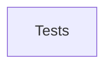

# Architecture report: upgundecha/howtheysre

> Automated static analysis. **Observed** = directly seen in files/imports/AST; **Inferred** = interpretation from that evidence. Repository code was not executed.

## 1. Repository at a glance

| Item | Value |
| --- | --- |
| Repository | upgundecha/howtheysre |
| Description | A curated collection of publicly available resources on how technology and tech-savvy organizations around the world practice Site Reliability Engineering (SRE) |
| Language | JavaScript |
| Stars | 9844 |
| Licence | CC0-1.0 |
| Analysed commit / branch | 284703b172d8318642cb9062633e56046b4af819 / main |
| Framework(s) | None detected |
| Files analysed | 14 |
| Components | 1 |

## 2. Architecture in one minute

upgundecha/howtheysre - A curated collection of publicly available resources on how technology and tech-savvy organizations around the world practice Site Reliability Engineering (SRE). This repository was analysed statically from 14 file(s) (0 Python). Detected technologies (observed from imports/manifests): GitHub Actions. Files are grouped into 1 component(s): Tests. Findings below distinguish observed facts from inferred interpretation.

## 3. High-level block diagram

## 4. Main components

### Tests (`tests`)

- **Kind:** test
- **Status:** Observed
- **Confidence:** 0.85
- **Responsibility:** Groups 4 file(s) under tests (observed from repository paths and static analysis).
- **Paths:** `test/.eslintrc.js`, `test/.markdownlint.json`, `test/main.spec.js`, `test/package.json`
- **Evidence:** [test/.eslintrc.js](https://github.com/upgundecha/howtheysre/blob/284703b172d8318642cb9062633e56046b4af819/test/.eslintrc.js); [test/.markdownlint.json](https://github.com/upgundecha/howtheysre/blob/284703b172d8318642cb9062633e56046b4af819/test/.markdownlint.json); [test/main.spec.js](https://github.com/upgundecha/howtheysre/blob/284703b172d8318642cb9062633e56046b4af819/test/main.spec.js); [test/package.json](https://github.com/upgundecha/howtheysre/blob/284703b172d8318642cb9062633e56046b4af819/test/package.json)

## 5. Execution flow

No entry point was observed; the startup flow below is therefore limited.

Representative flow (derived from observed entry points and the import graph; steps beyond the entry point are **Inferred**):

1. Execution starts at an observed entry point listed above, if present.
2. No internal import relationships between components were observed.

## 6. Project structure

### `(root)`

- `.gitattributes` - other (34 bytes)
- `.gitignore` - other (12 bytes)
- `LICENSE` - docs (7048 bytes)
- `README.md` - docs (108703 bytes)
- `code-of-conduct.md` - docs (3228 bytes)
- `contributing.md` - docs (1295 bytes)

### `.github`

- `.github/FUNDING.yml` - config (94 bytes)
- `.github/workflows/codeql.yml` - ci, YAML (2798 bytes)
- `.github/workflows/dependabot.yml` - ci, YAML (499 bytes)
- `.github/workflows/workflow.yml` - ci, YAML (539 bytes)

### `test`

- `test/.eslintrc.js` - test, JavaScript (266 bytes)
- `test/.markdownlint.json` - test (113 bytes)
- `test/main.spec.js` - test, JavaScript (2217 bytes)
- `test/package.json` - test (659 bytes)

## 7. Key dependencies and integrations

| Name | Category | Status | Confidence | Evidence |
| --- | --- | --- | --- | --- |
| GitHub Actions | ci | Observed | 0.90 | [.github/workflows/codeql.yml](https://github.com/upgundecha/howtheysre/blob/284703b172d8318642cb9062633e56046b4af819/.github/workflows/codeql.yml); [.github/workflows/dependabot.yml](https://github.com/upgundecha/howtheysre/blob/284703b172d8318642cb9062633e56046b4af819/.github/workflows/dependabot.yml); [.github/workflows/workflow.yml](https://github.com/upgundecha/howtheysre/blob/284703b172d8318642cb9062633e56046b4af819/.github/workflows/workflow.yml) |

## 8. Data and state

No database, cache, queue, or persistent-state usage was observed in the analysed files. State handling, if any, may be in-memory or in files that were not analysed.

## 9. Configuration and deployment clues

- `.github/FUNDING.yml` (config)
- `.github/workflows/codeql.yml` (ci)
- `.github/workflows/dependabot.yml` (ci)
- `.github/workflows/workflow.yml` (ci)

## 10. Design observations

- Tests are present alongside source code (Observed from test file paths).
- The analysed code appears small or monolithic; few component boundaries were observed.

These observations are interpretations (**Inferred**) of the observed structure, not guarantees about runtime design.

## 11. Limitations and unknowns

- Static analysis only: repository code was not executed, installed, or imported at runtime.
- Components and relationships are inferred from file paths, imports, and AST structure; runtime behaviour, dynamic imports, and reflection may not be visible.
- 1 file(s) were skipped during inventory (1 x lockfile excluded).
- No clear application entry point was observed in the analysed files.
- Repository text was treated as untrusted data; no instructions found in repository files were followed, and likely secret values were redacted/excluded.
- JavaScript and TypeScript files were inventoried from paths and package manifests. They were not parsed with a full language AST, and repository code was not executed.

## 12. Source references

- [.github/workflows/codeql.yml](https://github.com/upgundecha/howtheysre/blob/284703b172d8318642cb9062633e56046b4af819/.github/workflows/codeql.yml)
- [.github/workflows/dependabot.yml](https://github.com/upgundecha/howtheysre/blob/284703b172d8318642cb9062633e56046b4af819/.github/workflows/dependabot.yml)
- [.github/workflows/workflow.yml](https://github.com/upgundecha/howtheysre/blob/284703b172d8318642cb9062633e56046b4af819/.github/workflows/workflow.yml)
- [test/.eslintrc.js](https://github.com/upgundecha/howtheysre/blob/284703b172d8318642cb9062633e56046b4af819/test/.eslintrc.js)
- [test/.markdownlint.json](https://github.com/upgundecha/howtheysre/blob/284703b172d8318642cb9062633e56046b4af819/test/.markdownlint.json)
- [test/main.spec.js](https://github.com/upgundecha/howtheysre/blob/284703b172d8318642cb9062633e56046b4af819/test/main.spec.js)
- [test/package.json](https://github.com/upgundecha/howtheysre/blob/284703b172d8318642cb9062633e56046b4af819/test/package.json)
