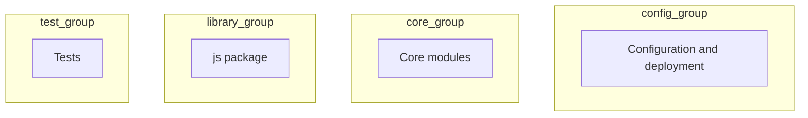

# Architecture report: uxsolutions/bootstrap-datepicker

> Automated static analysis. **Observed** = directly seen in files/imports/AST; **Inferred** = interpretation from that evidence. Repository code was not executed.

## 1. Repository at a glance

| Item | Value |
| --- | --- |
| Repository | uxsolutions/bootstrap-datepicker |
| Description | A datepicker for twitter bootstrap (@twbs) |
| Language | JavaScript |
| Stars | 12629 |
| Licence | Apache-2.0 |
| Analysed commit / branch | 722dc29432e89e048e5677b51fb4cfd8bbdab13c / master |
| Framework(s) | None detected |
| Files analysed | 165 |
| Components | 4 |

## 2. Architecture in one minute

uxsolutions/bootstrap-datepicker - A datepicker for twitter bootstrap (@twbs). This repository was analysed statically from 165 file(s) (1 Python). Detected technologies (observed from imports/manifests): GitHub Actions. Files are grouped into 4 component(s): Configuration and deployment, Core modules, js package, Tests. Findings below distinguish observed facts from inferred interpretation.

## 3. High-level block diagram

## 4. Main components

### Configuration and deployment (`config`)

- **Kind:** config
- **Status:** Observed
- **Confidence:** 0.85
- **Responsibility:** Groups 3 file(s) under configuration and deployment (observed from repository paths and static analysis).
- **Paths:** `bower.json`, `composer.json`, `package.json`
- **Evidence:** [bower.json](https://github.com/uxsolutions/bootstrap-datepicker/blob/722dc29432e89e048e5677b51fb4cfd8bbdab13c/bower.json); [composer.json](https://github.com/uxsolutions/bootstrap-datepicker/blob/722dc29432e89e048e5677b51fb4cfd8bbdab13c/composer.json); [package.json](https://github.com/uxsolutions/bootstrap-datepicker/blob/722dc29432e89e048e5677b51fb4cfd8bbdab13c/package.json)

### Core modules (`core`)

- **Kind:** core
- **Status:** Observed
- **Confidence:** 0.85
- **Responsibility:** Groups 1 file(s) under core modules (observed from repository paths and static analysis).
- **Paths:** `Gruntfile.js`
- **Evidence:** [Gruntfile.js](https://github.com/uxsolutions/bootstrap-datepicker/blob/722dc29432e89e048e5677b51fb4cfd8bbdab13c/Gruntfile.js)

### js package (`js`)

- **Kind:** library
- **Status:** Observed
- **Confidence:** 0.85
- **Responsibility:** Groups 87 file(s) under js package (observed from repository paths and static analysis).
- **Paths:** `js/bootstrap-datepicker.js`, `js/locales/bootstrap-datepicker-en-CA.js`, `js/locales/bootstrap-datepicker.ar-DZ.js`, `js/locales/bootstrap-datepicker.ar-tn.js`, `js/locales/bootstrap-datepicker.ar.js`, `js/locales/bootstrap-datepicker.az.js`, `js/locales/bootstrap-datepicker.bg.js`, `js/locales/bootstrap-datepicker.bm.js`, `js/locales/bootstrap-datepicker.bn.js`, `js/locales/bootstrap-datepicker.br.js`, `js/locales/bootstrap-datepicker.bs.js`, `js/locales/bootstrap-datepicker.ca.js`, `js/locales/bootstrap-datepicker.cs.js`, `js/locales/bootstrap-datepicker.cy.js`, `js/locales/bootstrap-datepicker.da.js`, `js/locales/bootstrap-datepicker.de.js`, `js/locales/bootstrap-datepicker.el.js`, `js/locales/bootstrap-datepicker.en-AU.js`, `js/locales/bootstrap-datepicker.en-CA.js`, `js/locales/bootstrap-datepicker.en-GB.js`, `js/locales/bootstrap-datepicker.en-IE.js`, `js/locales/bootstrap-datepicker.en-NZ.js`, `js/locales/bootstrap-datepicker.en-US.js`, `js/locales/bootstrap-datepicker.en-ZA.js`, `js/locales/bootstrap-datepicker.eo.js`, `js/locales/bootstrap-datepicker.es.js`, `js/locales/bootstrap-datepicker.et.js`, `js/locales/bootstrap-datepicker.eu.js`, `js/locales/bootstrap-datepicker.fa.js`, `js/locales/bootstrap-datepicker.fi.js`, `js/locales/bootstrap-datepicker.fo.js`, `js/locales/bootstrap-datepicker.fr-CH.js`, `js/locales/bootstrap-datepicker.fr.js`, `js/locales/bootstrap-datepicker.gl.js`, `js/locales/bootstrap-datepicker.he.js`, `js/locales/bootstrap-datepicker.hi.js`, `js/locales/bootstrap-datepicker.hr.js`, `js/locales/bootstrap-datepicker.hu.js`, `js/locales/bootstrap-datepicker.hy.js`, `js/locales/bootstrap-datepicker.id.js`, `js/locales/bootstrap-datepicker.is.js`, `js/locales/bootstrap-datepicker.it-CH.js`, `js/locales/bootstrap-datepicker.it.js`, `js/locales/bootstrap-datepicker.ja.js`, `js/locales/bootstrap-datepicker.ka.js`, `js/locales/bootstrap-datepicker.kh.js`, `js/locales/bootstrap-datepicker.kk.js`, `js/locales/bootstrap-datepicker.km.js`, `js/locales/bootstrap-datepicker.ko.js`, `js/locales/bootstrap-datepicker.kr.js`, `js/locales/bootstrap-datepicker.lt.js`, `js/locales/bootstrap-datepicker.lv.js`, `js/locales/bootstrap-datepicker.me.js`, `js/locales/bootstrap-datepicker.mk.js`, `js/locales/bootstrap-datepicker.mn.js`, `js/locales/bootstrap-datepicker.mr.js`, `js/locales/bootstrap-datepicker.ms.js`, `js/locales/bootstrap-datepicker.nl-BE.js`, `js/locales/bootstrap-datepicker.nl.js`, `js/locales/bootstrap-datepicker.no.js`, `js/locales/bootstrap-datepicker.oc.js`, `js/locales/bootstrap-datepicker.pl.js`, `js/locales/bootstrap-datepicker.pt-BR.js`, `js/locales/bootstrap-datepicker.pt.js`, `js/locales/bootstrap-datepicker.ro.js`, `js/locales/bootstrap-datepicker.rs-latin.js`, `js/locales/bootstrap-datepicker.rs.js`, `js/locales/bootstrap-datepicker.ru.js`, `js/locales/bootstrap-datepicker.si.js`, `js/locales/bootstrap-datepicker.sk.js`, `js/locales/bootstrap-datepicker.sl.js`, `js/locales/bootstrap-datepicker.sq.js`, `js/locales/bootstrap-datepicker.sr-latin.js`, `js/locales/bootstrap-datepicker.sr.js`, `js/locales/bootstrap-datepicker.sv.js`, `js/locales/bootstrap-datepicker.sw.js`, `js/locales/bootstrap-datepicker.ta.js`, `js/locales/bootstrap-datepicker.tg.js`, `js/locales/bootstrap-datepicker.th.js`, `js/locales/bootstrap-datepicker.tk.js`, `js/locales/bootstrap-datepicker.tr.js`, `js/locales/bootstrap-datepicker.uk.js`, `js/locales/bootstrap-datepicker.uz-cyrl.js`, `js/locales/bootstrap-datepicker.uz-latn.js`, `js/locales/bootstrap-datepicker.vi.js`, `js/locales/bootstrap-datepicker.zh-CN.js`, `js/locales/bootstrap-datepicker.zh-TW.js`
- **Evidence:** [js/bootstrap-datepicker.js](https://github.com/uxsolutions/bootstrap-datepicker/blob/722dc29432e89e048e5677b51fb4cfd8bbdab13c/js/bootstrap-datepicker.js); [js/locales/bootstrap-datepicker-en-CA.js](https://github.com/uxsolutions/bootstrap-datepicker/blob/722dc29432e89e048e5677b51fb4cfd8bbdab13c/js/locales/bootstrap-datepicker-en-CA.js); [js/locales/bootstrap-datepicker.ar-DZ.js](https://github.com/uxsolutions/bootstrap-datepicker/blob/722dc29432e89e048e5677b51fb4cfd8bbdab13c/js/locales/bootstrap-datepicker.ar-DZ.js); [js/locales/bootstrap-datepicker.ar-tn.js](https://github.com/uxsolutions/bootstrap-datepicker/blob/722dc29432e89e048e5677b51fb4cfd8bbdab13c/js/locales/bootstrap-datepicker.ar-tn.js); [js/locales/bootstrap-datepicker.ar.js](https://github.com/uxsolutions/bootstrap-datepicker/blob/722dc29432e89e048e5677b51fb4cfd8bbdab13c/js/locales/bootstrap-datepicker.ar.js); [js/locales/bootstrap-datepicker.az.js](https://github.com/uxsolutions/bootstrap-datepicker/blob/722dc29432e89e048e5677b51fb4cfd8bbdab13c/js/locales/bootstrap-datepicker.az.js); [js/locales/bootstrap-datepicker.bg.js](https://github.com/uxsolutions/bootstrap-datepicker/blob/722dc29432e89e048e5677b51fb4cfd8bbdab13c/js/locales/bootstrap-datepicker.bg.js); [js/locales/bootstrap-datepicker.bm.js](https://github.com/uxsolutions/bootstrap-datepicker/blob/722dc29432e89e048e5677b51fb4cfd8bbdab13c/js/locales/bootstrap-datepicker.bm.js)

### Tests (`tests`)

- **Kind:** test
- **Status:** Observed
- **Confidence:** 0.85
- **Responsibility:** Groups 27 file(s) under tests (observed from repository paths and static analysis).
- **Paths:** `tests/README.md`, `tests/assets/coverage.js`, `tests/assets/mock.js`, `tests/assets/qunit-logging.js`, `tests/assets/qunit.css`, `tests/assets/qunit.js`, `tests/assets/utils.js`, `tests/suites/calendar-weeks.js`, `tests/suites/component.js`, `tests/suites/data-api.js`, `tests/suites/events.js`, `tests/suites/formats.js`, `tests/suites/inline.js`, `tests/suites/keyboard_navigation/2011.js`, `tests/suites/keyboard_navigation/2012.js`, `tests/suites/keyboard_navigation/all.js`, `tests/suites/methods.js`, `tests/suites/methods_jquery.js`, `tests/suites/mouse_navigation/2011.js`, `tests/suites/mouse_navigation/2012.js`, `tests/suites/mouse_navigation/all.js`, `tests/suites/noconflict.js`, `tests/suites/options.js`, `tests/suites/timezone.js`, `tests/suites/touch_navigation/all.js`, `tests/tests.html`, `tests/timezone.html`
- **Evidence:** [tests/README.md](https://github.com/uxsolutions/bootstrap-datepicker/blob/722dc29432e89e048e5677b51fb4cfd8bbdab13c/tests/README.md); [tests/assets/coverage.js](https://github.com/uxsolutions/bootstrap-datepicker/blob/722dc29432e89e048e5677b51fb4cfd8bbdab13c/tests/assets/coverage.js); [tests/assets/mock.js](https://github.com/uxsolutions/bootstrap-datepicker/blob/722dc29432e89e048e5677b51fb4cfd8bbdab13c/tests/assets/mock.js); [tests/assets/qunit-logging.js](https://github.com/uxsolutions/bootstrap-datepicker/blob/722dc29432e89e048e5677b51fb4cfd8bbdab13c/tests/assets/qunit-logging.js); [tests/assets/qunit.css](https://github.com/uxsolutions/bootstrap-datepicker/blob/722dc29432e89e048e5677b51fb4cfd8bbdab13c/tests/assets/qunit.css); [tests/assets/qunit.js](https://github.com/uxsolutions/bootstrap-datepicker/blob/722dc29432e89e048e5677b51fb4cfd8bbdab13c/tests/assets/qunit.js); [tests/assets/utils.js](https://github.com/uxsolutions/bootstrap-datepicker/blob/722dc29432e89e048e5677b51fb4cfd8bbdab13c/tests/assets/utils.js); [tests/suites/calendar-weeks.js](https://github.com/uxsolutions/bootstrap-datepicker/blob/722dc29432e89e048e5677b51fb4cfd8bbdab13c/tests/suites/calendar-weeks.js)

## 5. Execution flow

No entry point was observed; the startup flow below is therefore limited.

Representative flow (derived from observed entry points and the import graph; steps beyond the entry point are **Inferred**):

1. Execution starts at an observed entry point listed above, if present.
2. No internal import relationships between components were observed.

## 6. Project structure

### `(root)`

- `.editorconfig` - config (200 bytes)
- `.gitignore` - other (114 bytes)
- `CHANGELOG.md` - docs (20137 bytes)
- `CODE_OF_CONDUCT.md` - docs (3201 bytes)
- `CONTRIBUTING.md` - docs (2564 bytes)
- `Gruntfile.js` - source, JavaScript (7636 bytes)
- `LICENSE` - docs (11360 bytes)
- `README.md` - docs (1944 bytes)
- `bower.json` - config (234 bytes)
- `composer.json` - config (1030 bytes)
- `package.json` - manifest (1287 bytes)

### `.github`

- `.github/ISSUE_TEMPLATE.md` - docs (206 bytes)
- `.github/PULL_REQUEST_TEMPLATE.md` - docs (211 bytes)
- `.github/workflows/ci.yaml` - ci, YAML (426 bytes)

### `docs`

- `docs/Makefile` - docs (5620 bytes)
- `docs/README.md` - docs (827 bytes)
- `docs/_screenshots/assets/common.css` - docs (316 bytes)
- `docs/_screenshots/assets/common.js` - docs (165 bytes)
- `docs/_screenshots/demo_head.html` - docs (1343 bytes)
- `docs/_screenshots/markup_component.html` - docs (875 bytes)
- `docs/_screenshots/markup_daterange.html` - docs (1313 bytes)
- `docs/_screenshots/markup_inline.html` - docs (414 bytes)
- `docs/_screenshots/markup_input.html` - docs (646 bytes)
- `docs/_screenshots/option_calendarweeks.html` - docs (817 bytes)
- `docs/_screenshots/option_clearbtn.html` - docs (682 bytes)
- `docs/_screenshots/option_daysofweekdisabled.html` - docs (694 bytes)
- `docs/_screenshots/option_enddate.html` - docs (689 bytes)
- `docs/_screenshots/option_language.html` - docs (1734 bytes)
- `docs/_screenshots/option_multidate.html` - docs (968 bytes)
- `docs/_screenshots/option_showweekdays.html` - docs (687 bytes)
- `docs/_screenshots/option_startdate.html` - docs (691 bytes)
- `docs/_screenshots/option_todaybtn.html` - docs (640 bytes)
- `docs/_screenshots/option_todayhighlight.html` - docs (2079 bytes)
- `docs/_screenshots/option_weekstart.html` - docs (937 bytes)
- `docs/conf.py` - docs (8002 bytes)
- `docs/events.rst` - docs (1519 bytes)
- `docs/i18n.rst` - docs (1615 bytes)
- `docs/index.rst` - docs (3727 bytes)
- `docs/keyboard.rst` - docs (1346 bytes)
- `docs/make.bat` - docs (5124 bytes)
- `docs/markup.rst` - docs (2379 bytes)
- `docs/methods.rst` - docs (4638 bytes)
- `docs/options.rst` - docs (18701 bytes)
- `docs/requirements.txt` - manifest (17 bytes)
- `docs/screenshots.js` - docs (2143 bytes)

### `grunt`

- `grunt/.jshintrc` - other (119 bytes)

### `js`

- `js/.jscsrc` - other (980 bytes)
- `js/.jshintrc` - other (673 bytes)
- `js/bootstrap-datepicker.js` - source, JavaScript (58890 bytes)
- `js/locales/bootstrap-datepicker-en-CA.js` - source, JavaScript (932 bytes)
- `js/locales/bootstrap-datepicker.ar-DZ.js` - source, JavaScript (1029 bytes)
- `js/locales/bootstrap-datepicker.ar-tn.js` - source, JavaScript (924 bytes)
- `js/locales/bootstrap-datepicker.ar.js` - source, JavaScript (949 bytes)
- `js/locales/bootstrap-datepicker.az.js` - source, JavaScript (696 bytes)
- `js/locales/bootstrap-datepicker.bg.js` - source, JavaScript (804 bytes)
- `js/locales/bootstrap-datepicker.bm.js` - source, JavaScript (740 bytes)
- `js/locales/bootstrap-datepicker.bn.js` - source, JavaScript (1404 bytes)
- `js/locales/bootstrap-datepicker.br.js` - source, JavaScript (697 bytes)
- `js/locales/bootstrap-datepicker.bs.js` - source, JavaScript (616 bytes)
- `js/locales/bootstrap-datepicker.ca.js` - source, JavaScript (711 bytes)
- `js/locales/bootstrap-datepicker.cs.js` - source, JavaScript (773 bytes)
- `js/locales/bootstrap-datepicker.cy.js` - source, JavaScript (602 bytes)
- `js/locales/bootstrap-datepicker.da.js` - source, JavaScript (774 bytes)
- `js/locales/bootstrap-datepicker.de.js` - source, JavaScript (691 bytes)
- `js/locales/bootstrap-datepicker.el.js` - source, JavaScript (928 bytes)
- `js/locales/bootstrap-datepicker.en-AU.js` - source, JavaScript (721 bytes)
- `js/locales/bootstrap-datepicker.en-CA.js` - source, JavaScript (707 bytes)
- `js/locales/bootstrap-datepicker.en-GB.js` - source, JavaScript (714 bytes)
- `js/locales/bootstrap-datepicker.en-IE.js` - source, JavaScript (671 bytes)
- `js/locales/bootstrap-datepicker.en-NZ.js` - source, JavaScript (676 bytes)
- `js/locales/bootstrap-datepicker.en-US.js` - source, JavaScript (672 bytes)
- `js/locales/bootstrap-datepicker.en-ZA.js` - source, JavaScript (678 bytes)
- `js/locales/bootstrap-datepicker.eo.js` - source, JavaScript (712 bytes)
- `js/locales/bootstrap-datepicker.es.js` - source, JavaScript (706 bytes)
- `js/locales/bootstrap-datepicker.et.js` - source, JavaScript (784 bytes)
- `js/locales/bootstrap-datepicker.eu.js` - source, JavaScript (786 bytes)
- `js/locales/bootstrap-datepicker.fa.js` - source, JavaScript (866 bytes)
- `js/locales/bootstrap-datepicker.fi.js` - source, JavaScript (745 bytes)
- `js/locales/bootstrap-datepicker.fo.js` - source, JavaScript (687 bytes)
- `js/locales/bootstrap-datepicker.fr-CH.js` - source, JavaScript (813 bytes)
- `js/locales/bootstrap-datepicker.fr.js` - source, JavaScript (724 bytes)
- `js/locales/bootstrap-datepicker.gl.js` - source, JavaScript (579 bytes)
- `js/locales/bootstrap-datepicker.he.js` - source, JavaScript (767 bytes)
- `js/locales/bootstrap-datepicker.hi.js` - source, JavaScript (1132 bytes)
- `js/locales/bootstrap-datepicker.hr.js` - source, JavaScript (573 bytes)
- `js/locales/bootstrap-datepicker.hu.js` - source, JavaScript (732 bytes)
- `js/locales/bootstrap-datepicker.hy.js` - source, JavaScript (946 bytes)
- `js/locales/bootstrap-datepicker.id.js` - source, JavaScript (723 bytes)
- `js/locales/bootstrap-datepicker.is.js` - source, JavaScript (682 bytes)
- `js/locales/bootstrap-datepicker.it-CH.js` - source, JavaScript (804 bytes)
- `js/locales/bootstrap-datepicker.it.js` - source, JavaScript (713 bytes)
- `js/locales/bootstrap-datepicker.ja.js` - source, JavaScript (694 bytes)
- `js/locales/bootstrap-datepicker.ka.js` - source, JavaScript (1222 bytes)
- `js/locales/bootstrap-datepicker.kh.js` - source, JavaScript (1489 bytes)
- `js/locales/bootstrap-datepicker.kk.js` - source, JavaScript (829 bytes)
- `js/locales/bootstrap-datepicker.km.js` - source, JavaScript (1268 bytes)
- `js/locales/bootstrap-datepicker.ko.js` - source, JavaScript (767 bytes)
- `js/locales/bootstrap-datepicker.kr.js` - source, JavaScript (972 bytes)
- `js/locales/bootstrap-datepicker.lt.js` - source, JavaScript (827 bytes)
- `js/locales/bootstrap-datepicker.lv.js` - source, JavaScript (766 bytes)
- `js/locales/bootstrap-datepicker.me.js` - source, JavaScript (683 bytes)
- `js/locales/bootstrap-datepicker.mk.js` - source, JavaScript (884 bytes)
- `js/locales/bootstrap-datepicker.mn.js` - source, JavaScript (893 bytes)
- `js/locales/bootstrap-datepicker.mr.js` - source, JavaScript (1185 bytes)
- `js/locales/bootstrap-datepicker.ms.js` - source, JavaScript (628 bytes)
- `js/locales/bootstrap-datepicker.nl-BE.js` - source, JavaScript (742 bytes)
- `js/locales/bootstrap-datepicker.nl.js` - source, JavaScript (706 bytes)
- `js/locales/bootstrap-datepicker.no.js` - source, JavaScript (732 bytes)
- `js/locales/bootstrap-datepicker.oc.js` - source, JavaScript (666 bytes)
- `js/locales/bootstrap-datepicker.pl.js` - source, JavaScript (784 bytes)
- `js/locales/bootstrap-datepicker.pt-BR.js` - source, JavaScript (686 bytes)
- `js/locales/bootstrap-datepicker.pt.js` - source, JavaScript (741 bytes)
- `js/locales/bootstrap-datepicker.ro.js` - source, JavaScript (694 bytes)
- `js/locales/bootstrap-datepicker.rs-latin.js` - source, JavaScript (973 bytes)
- `js/locales/bootstrap-datepicker.rs.js` - source, JavaScript (1128 bytes)
- `js/locales/bootstrap-datepicker.ru.js` - source, JavaScript (925 bytes)
- `js/locales/bootstrap-datepicker.si.js` - source, JavaScript (1189 bytes)
- `js/locales/bootstrap-datepicker.sk.js` - source, JavaScript (728 bytes)
- `js/locales/bootstrap-datepicker.sl.js` - source, JavaScript (636 bytes)
- `js/locales/bootstrap-datepicker.sq.js` - source, JavaScript (726 bytes)
- `js/locales/bootstrap-datepicker.sr-latin.js` - source, JavaScript (664 bytes)
- `js/locales/bootstrap-datepicker.sr.js` - source, JavaScript (843 bytes)
- `js/locales/bootstrap-datepicker.sv.js` - source, JavaScript (681 bytes)
- `js/locales/bootstrap-datepicker.sw.js` - source, JavaScript (750 bytes)
- `js/locales/bootstrap-datepicker.ta.js` - source, JavaScript (1129 bytes)
- `js/locales/bootstrap-datepicker.tg.js` - source, JavaScript (1005 bytes)
- `js/locales/bootstrap-datepicker.th.js` - source, JavaScript (1008 bytes)
- `js/locales/bootstrap-datepicker.tk.js` - source, JavaScript (730 bytes)
- `js/locales/bootstrap-datepicker.tr.js` - source, JavaScript (686 bytes)
- `js/locales/bootstrap-datepicker.uk.js` - source, JavaScript (888 bytes)
- `js/locales/bootstrap-datepicker.uz-cyrl.js` - source, JavaScript (945 bytes)
- `js/locales/bootstrap-datepicker.uz-latn.js` - source, JavaScript (780 bytes)
- `js/locales/bootstrap-datepicker.vi.js` - source, JavaScript (733 bytes)
- `js/locales/bootstrap-datepicker.zh-CN.js` - source, JavaScript (812 bytes)
- `js/locales/bootstrap-datepicker.zh-TW.js` - source, JavaScript (901 bytes)

### `less`

- `less/.csslintrc` - other (456 bytes)
- `less/datepicker.less` - other (4897 bytes)
- `less/datepicker3.less` - other (5308 bytes)

### `tests`

- `tests/README.md` - test (1447 bytes)
- `tests/assets/coverage.js` - test, JavaScript (1656 bytes)
- `tests/assets/mock.js` - test, JavaScript (1400 bytes)
- `tests/assets/qunit-logging.js` - test, JavaScript (1079 bytes)
- `tests/assets/qunit.css` - test (4654 bytes)
- `tests/assets/qunit.js` - test, JavaScript (43556 bytes)
- `tests/assets/utils.js` - test, JavaScript (617 bytes)
- `tests/suites/calendar-weeks.js` - test, JavaScript (1593 bytes)
- `tests/suites/component.js` - test, JavaScript (9771 bytes)
- `tests/suites/data-api.js` - test, JavaScript (4130 bytes)
- `tests/suites/events.js` - test, JavaScript (14448 bytes)
- `tests/suites/formats.js` - test, JavaScript (9997 bytes)
- `tests/suites/inline.js` - test, JavaScript (771 bytes)
- `tests/suites/keyboard_navigation/2011.js` - test, JavaScript (8424 bytes)
- `tests/suites/keyboard_navigation/2012.js` - test, JavaScript (17663 bytes)
- `tests/suites/keyboard_navigation/all.js` - test, JavaScript (1488 bytes)
- `tests/suites/methods.js` - test, JavaScript (9133 bytes)
- `tests/suites/methods_jquery.js` - test, JavaScript (697 bytes)
- `tests/suites/mouse_navigation/2011.js` - test, JavaScript (2523 bytes)
- `tests/suites/mouse_navigation/2012.js` - test, JavaScript (10372 bytes)
- `tests/suites/mouse_navigation/all.js` - test, JavaScript (1103 bytes)
- `tests/suites/noconflict.js` - test, JavaScript (651 bytes)
- `tests/suites/options.js` - test, JavaScript (80071 bytes)
- `tests/suites/timezone.js` - test, JavaScript (739 bytes)
- `tests/suites/touch_navigation/all.js` - test, JavaScript (875 bytes)
- `tests/tests.html` - test (2336 bytes)
- `tests/timezone.html` - test (1178 bytes)

## 7. Key dependencies and integrations

| Name | Category | Status | Confidence | Evidence |
| --- | --- | --- | --- | --- |
| GitHub Actions | ci | Observed | 0.85 | [.github/workflows/ci.yaml](https://github.com/uxsolutions/bootstrap-datepicker/blob/722dc29432e89e048e5677b51fb4cfd8bbdab13c/.github/workflows/ci.yaml) |

## 8. Data and state

No database, cache, queue, or persistent-state usage was observed in the analysed files. State handling, if any, may be in-memory or in files that were not analysed.

## 9. Configuration and deployment clues

- `.editorconfig` (config)
- `.github/workflows/ci.yaml` (ci)
- `bower.json` (config)
- `composer.json` (config)
- `docs/requirements.txt` (manifest)
- `package.json` (manifest)

## 10. Design observations

- Tests are present alongside source code (Observed from test file paths).

These observations are interpretations (**Inferred**) of the observed structure, not guarantees about runtime design.

## 11. Limitations and unknowns

- Static analysis only: repository code was not executed, installed, or imported at runtime.
- Components and relationships are inferred from file paths, imports, and AST structure; runtime behaviour, dynamic imports, and reflection may not be visible.
- 14 file(s) were skipped during inventory (1 x lockfile excluded; 13 x vendored/generated directory excluded).
- No clear application entry point was observed in the analysed files.
- Repository text was treated as untrusted data; no instructions found in repository files were followed, and likely secret values were redacted/excluded.

## 12. Source references

- [.github/workflows/ci.yaml](https://github.com/uxsolutions/bootstrap-datepicker/blob/722dc29432e89e048e5677b51fb4cfd8bbdab13c/.github/workflows/ci.yaml)
- [Gruntfile.js](https://github.com/uxsolutions/bootstrap-datepicker/blob/722dc29432e89e048e5677b51fb4cfd8bbdab13c/Gruntfile.js)
- [bower.json](https://github.com/uxsolutions/bootstrap-datepicker/blob/722dc29432e89e048e5677b51fb4cfd8bbdab13c/bower.json)
- [composer.json](https://github.com/uxsolutions/bootstrap-datepicker/blob/722dc29432e89e048e5677b51fb4cfd8bbdab13c/composer.json)
- [js/bootstrap-datepicker.js](https://github.com/uxsolutions/bootstrap-datepicker/blob/722dc29432e89e048e5677b51fb4cfd8bbdab13c/js/bootstrap-datepicker.js)
- [js/locales/bootstrap-datepicker-en-CA.js](https://github.com/uxsolutions/bootstrap-datepicker/blob/722dc29432e89e048e5677b51fb4cfd8bbdab13c/js/locales/bootstrap-datepicker-en-CA.js)
- [js/locales/bootstrap-datepicker.ar-DZ.js](https://github.com/uxsolutions/bootstrap-datepicker/blob/722dc29432e89e048e5677b51fb4cfd8bbdab13c/js/locales/bootstrap-datepicker.ar-DZ.js)
- [js/locales/bootstrap-datepicker.ar-tn.js](https://github.com/uxsolutions/bootstrap-datepicker/blob/722dc29432e89e048e5677b51fb4cfd8bbdab13c/js/locales/bootstrap-datepicker.ar-tn.js)
- [js/locales/bootstrap-datepicker.ar.js](https://github.com/uxsolutions/bootstrap-datepicker/blob/722dc29432e89e048e5677b51fb4cfd8bbdab13c/js/locales/bootstrap-datepicker.ar.js)
- [js/locales/bootstrap-datepicker.az.js](https://github.com/uxsolutions/bootstrap-datepicker/blob/722dc29432e89e048e5677b51fb4cfd8bbdab13c/js/locales/bootstrap-datepicker.az.js)
- [js/locales/bootstrap-datepicker.bg.js](https://github.com/uxsolutions/bootstrap-datepicker/blob/722dc29432e89e048e5677b51fb4cfd8bbdab13c/js/locales/bootstrap-datepicker.bg.js)
- [js/locales/bootstrap-datepicker.bm.js](https://github.com/uxsolutions/bootstrap-datepicker/blob/722dc29432e89e048e5677b51fb4cfd8bbdab13c/js/locales/bootstrap-datepicker.bm.js)
- [package.json](https://github.com/uxsolutions/bootstrap-datepicker/blob/722dc29432e89e048e5677b51fb4cfd8bbdab13c/package.json)
- [tests/README.md](https://github.com/uxsolutions/bootstrap-datepicker/blob/722dc29432e89e048e5677b51fb4cfd8bbdab13c/tests/README.md)
- [tests/assets/coverage.js](https://github.com/uxsolutions/bootstrap-datepicker/blob/722dc29432e89e048e5677b51fb4cfd8bbdab13c/tests/assets/coverage.js)
- [tests/assets/mock.js](https://github.com/uxsolutions/bootstrap-datepicker/blob/722dc29432e89e048e5677b51fb4cfd8bbdab13c/tests/assets/mock.js)
- [tests/assets/qunit-logging.js](https://github.com/uxsolutions/bootstrap-datepicker/blob/722dc29432e89e048e5677b51fb4cfd8bbdab13c/tests/assets/qunit-logging.js)
- [tests/assets/qunit.css](https://github.com/uxsolutions/bootstrap-datepicker/blob/722dc29432e89e048e5677b51fb4cfd8bbdab13c/tests/assets/qunit.css)
- [tests/assets/qunit.js](https://github.com/uxsolutions/bootstrap-datepicker/blob/722dc29432e89e048e5677b51fb4cfd8bbdab13c/tests/assets/qunit.js)
- [tests/assets/utils.js](https://github.com/uxsolutions/bootstrap-datepicker/blob/722dc29432e89e048e5677b51fb4cfd8bbdab13c/tests/assets/utils.js)
- [tests/suites/calendar-weeks.js](https://github.com/uxsolutions/bootstrap-datepicker/blob/722dc29432e89e048e5677b51fb4cfd8bbdab13c/tests/suites/calendar-weeks.js)
