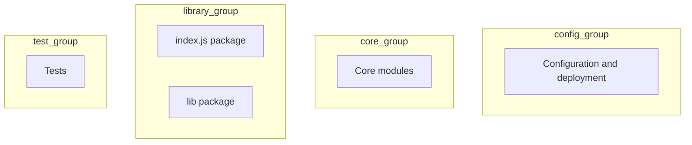

# Architecture report: validatorjs/validator.js

> Automated static analysis. **Observed** = directly seen in files/imports/AST; **Inferred** = interpretation from that evidence. Repository code was not executed.

## 1. Repository at a glance

| Item | Value |
| --- | --- |
| Repository | validatorjs/validator.js |
| Description | String validation |
| Language | JavaScript |
| Stars | 23741 |
| Licence | MIT |
| Analysed commit / branch | 9ff342479591ca5a43cb30000195bcf55c1bbed9 / master |
| Framework(s) | None detected |
| Files analysed | 149 |
| Components | 5 |

## 2. Architecture in one minute

validatorjs/validator.js - String validation. This repository was analysed statically from 149 file(s) (0 Python). Detected technologies (observed from imports/manifests): GitHub Actions. Files are grouped into 5 component(s): Configuration and deployment, Core modules, index.js package, lib package, Tests. Findings below distinguish observed facts from inferred interpretation.

## 3. High-level block diagram

## 4. Main components

### Configuration and deployment (`config`)

- **Kind:** config
- **Status:** Observed
- **Confidence:** 0.85
- **Responsibility:** Groups 3 file(s) under configuration and deployment (observed from repository paths and static analysis).
- **Paths:** `bower.json`, `jsconfig.json`, `package.json`
- **Evidence:** [bower.json](https://github.com/validatorjs/validator.js/blob/9ff342479591ca5a43cb30000195bcf55c1bbed9/bower.json); [jsconfig.json](https://github.com/validatorjs/validator.js/blob/9ff342479591ca5a43cb30000195bcf55c1bbed9/jsconfig.json); [package.json](https://github.com/validatorjs/validator.js/blob/9ff342479591ca5a43cb30000195bcf55c1bbed9/package.json)

### Core modules (`core`)

- **Kind:** core
- **Status:** Observed
- **Confidence:** 0.85
- **Responsibility:** Groups 1 file(s) under core modules (observed from repository paths and static analysis).
- **Paths:** `build-browser.mjs`
- **Evidence:** [build-browser.mjs](https://github.com/validatorjs/validator.js/blob/9ff342479591ca5a43cb30000195bcf55c1bbed9/build-browser.mjs)

### index.js package (`index_js`)

- **Kind:** library
- **Status:** Observed
- **Confidence:** 0.85
- **Responsibility:** Groups 1 file(s) under index.js package (observed from repository paths and static analysis).
- **Paths:** `src/index.js`
- **Evidence:** [src/index.js](https://github.com/validatorjs/validator.js/blob/9ff342479591ca5a43cb30000195bcf55c1bbed9/src/index.js)

### lib package (`lib`)

- **Kind:** library
- **Status:** Observed
- **Confidence:** 0.85
- **Responsibility:** Groups 113 file(s) under lib package (observed from repository paths and static analysis).
- **Paths:** `src/lib/alpha.js`, `src/lib/blacklist.js`, `src/lib/contains.js`, `src/lib/equals.js`, `src/lib/escape.js`, `src/lib/isAbaRouting.js`, `src/lib/isAfter.js`, `src/lib/isAlpha.js`, `src/lib/isAlphanumeric.js`, `src/lib/isAscii.js`, `src/lib/isBIC.js`, `src/lib/isBase32.js`, `src/lib/isBase58.js`, `src/lib/isBase64.js`, `src/lib/isBefore.js`, `src/lib/isBoolean.js`, `src/lib/isBtcAddress.js`, `src/lib/isByteLength.js`, `src/lib/isCreditCard.js`, `src/lib/isCurrency.js`, `src/lib/isDataURI.js`, `src/lib/isDate.js`, `src/lib/isDecimal.js`, `src/lib/isDivisibleBy.js`, `src/lib/isEAN.js`, `src/lib/isEmail.js`, `src/lib/isEmpty.js`, `src/lib/isEthereumAddress.js`, `src/lib/isFQDN.js`, `src/lib/isFloat.js`, `src/lib/isFullWidth.js`, `src/lib/isHSL.js`, `src/lib/isHalfWidth.js`, `src/lib/isHash.js`, `src/lib/isHexColor.js`, `src/lib/isHexadecimal.js`, `src/lib/isIBAN.js`, `src/lib/isIMEI.js`, `src/lib/isIP.js`, `src/lib/isIPRange.js`, `src/lib/isISBN.js`, `src/lib/isISIN.js`, `src/lib/isISO15924.js`, `src/lib/isISO31661Alpha2.js`, `src/lib/isISO31661Alpha3.js`, `src/lib/isISO31661Numeric.js`, `src/lib/isISO4217.js`, `src/lib/isISO6346.js`, `src/lib/isISO6391.js`, `src/lib/isISO8601.js`, `src/lib/isISRC.js`, `src/lib/isISSN.js`, `src/lib/isIdentityCard.js`, `src/lib/isIn.js`, `src/lib/isInt.js`, `src/lib/isJSON.js`, `src/lib/isJWT.js`, `src/lib/isLatLong.js`, `src/lib/isLength.js`, `src/lib/isLicensePlate.js`, `src/lib/isLocale.js`, `src/lib/isLowercase.js`, `src/lib/isLuhnNumber.js`, `src/lib/isMACAddress.js`, `src/lib/isMD5.js`, `src/lib/isMagnetURI.js`, `src/lib/isMailtoURI.js`, `src/lib/isMimeType.js`, `src/lib/isMobilePhone.js`, `src/lib/isMongoId.js`, `src/lib/isMultibyte.js`, `src/lib/isNumeric.js`, `src/lib/isOctal.js`, `src/lib/isPassportNumber.js`, `src/lib/isPort.js`, `src/lib/isPostalCode.js`, `src/lib/isRFC3339.js`, `src/lib/isRgbColor.js`, `src/lib/isSemVer.js`, `src/lib/isSlug.js`, `src/lib/isStrongPassword.js`, `src/lib/isSurrogatePair.js`, `src/lib/isTaxID.js`, `src/lib/isTime.js`, `src/lib/isULID.js`, `src/lib/isURL.js`, `src/lib/isUUID.js`, `src/lib/isUppercase.js`, `src/lib/isVAT.js`, `src/lib/isVariableWidth.js`, `src/lib/isWhitelisted.js`, `src/lib/ltrim.js`, `src/lib/matches.js`, `src/lib/normalizeEmail.js`, `src/lib/rtrim.js`, `src/lib/stripLow.js`, `src/lib/toBoolean.js`, `src/lib/toDate.js`, `src/lib/toFloat.js`, `src/lib/toInt.js`, `src/lib/trim.js`, `src/lib/unescape.js`, `src/lib/util/algorithms.js`, `src/lib/util/assertString.js`, `src/lib/util/checkHost.js`, `src/lib/util/includesArray.js`, `src/lib/util/includesString.js`, `src/lib/util/merge.js`, `src/lib/util/multilineRegex.js`, `src/lib/util/nullUndefinedCheck.js`, `src/lib/util/toString.js`, `src/lib/util/typeOf.js`, `src/lib/whitelist.js`
- **Evidence:** [src/lib/alpha.js](https://github.com/validatorjs/validator.js/blob/9ff342479591ca5a43cb30000195bcf55c1bbed9/src/lib/alpha.js); [src/lib/blacklist.js](https://github.com/validatorjs/validator.js/blob/9ff342479591ca5a43cb30000195bcf55c1bbed9/src/lib/blacklist.js); [src/lib/contains.js](https://github.com/validatorjs/validator.js/blob/9ff342479591ca5a43cb30000195bcf55c1bbed9/src/lib/contains.js); [src/lib/equals.js](https://github.com/validatorjs/validator.js/blob/9ff342479591ca5a43cb30000195bcf55c1bbed9/src/lib/equals.js); [src/lib/escape.js](https://github.com/validatorjs/validator.js/blob/9ff342479591ca5a43cb30000195bcf55c1bbed9/src/lib/escape.js); [src/lib/isAbaRouting.js](https://github.com/validatorjs/validator.js/blob/9ff342479591ca5a43cb30000195bcf55c1bbed9/src/lib/isAbaRouting.js); [src/lib/isAfter.js](https://github.com/validatorjs/validator.js/blob/9ff342479591ca5a43cb30000195bcf55c1bbed9/src/lib/isAfter.js); [src/lib/isAlpha.js](https://github.com/validatorjs/validator.js/blob/9ff342479591ca5a43cb30000195bcf55c1bbed9/src/lib/isAlpha.js)

### Tests (`tests`)

- **Kind:** test
- **Status:** Observed
- **Confidence:** 0.85
- **Responsibility:** Groups 14 file(s) under tests (observed from repository paths and static analysis).
- **Paths:** `test/clientSide.test.js`, `test/exports.test.js`, `test/sanitizers.test.js`, `test/testFunctions.js`, `test/util.test.js`, `test/validators/isAfter.test.js`, `test/validators/isBase64.test.js`, `test/validators/isBefore.test.js`, `test/validators/isFQDN.test.js`, `test/validators/isIP.test.js`, `test/validators/isISBN.test.js`, `test/validators/isISO31661Alpha2.test.js`, `test/validators/isISO31661Alpha3.test.js`, `test/validators/isLength.test.js`
- **Evidence:** [test/clientSide.test.js](https://github.com/validatorjs/validator.js/blob/9ff342479591ca5a43cb30000195bcf55c1bbed9/test/clientSide.test.js); [test/exports.test.js](https://github.com/validatorjs/validator.js/blob/9ff342479591ca5a43cb30000195bcf55c1bbed9/test/exports.test.js); [test/sanitizers.test.js](https://github.com/validatorjs/validator.js/blob/9ff342479591ca5a43cb30000195bcf55c1bbed9/test/sanitizers.test.js); [test/testFunctions.js](https://github.com/validatorjs/validator.js/blob/9ff342479591ca5a43cb30000195bcf55c1bbed9/test/testFunctions.js); [test/util.test.js](https://github.com/validatorjs/validator.js/blob/9ff342479591ca5a43cb30000195bcf55c1bbed9/test/util.test.js); [test/validators/isAfter.test.js](https://github.com/validatorjs/validator.js/blob/9ff342479591ca5a43cb30000195bcf55c1bbed9/test/validators/isAfter.test.js); [test/validators/isBase64.test.js](https://github.com/validatorjs/validator.js/blob/9ff342479591ca5a43cb30000195bcf55c1bbed9/test/validators/isBase64.test.js); [test/validators/isBefore.test.js](https://github.com/validatorjs/validator.js/blob/9ff342479591ca5a43cb30000195bcf55c1bbed9/test/validators/isBefore.test.js)

## 5. Execution flow

**Observed** entry point(s):

- [src/index.js](https://github.com/validatorjs/validator.js/blob/9ff342479591ca5a43cb30000195bcf55c1bbed9/src/index.js)

Representative flow (derived from observed entry points and the import graph; steps beyond the entry point are **Inferred**):

1. Execution starts at an observed entry point listed above, if present.
2. No internal import relationships between components were observed.

## 6. Project structure

### `(root)`

- `.babelrc` - other (544 bytes)
- `.eslintrc.json` - config (967 bytes)
- `.gitignore` - other (136 bytes)
- `.nycrc` - other (93 bytes)
- `AGENTS.md` - docs (5513 bytes)
- `CHANGELOG.md` - docs (70828 bytes)
- `CONTRIBUTING.md` - docs (1860 bytes)
- `LICENSE` - docs (1077 bytes)
- `README.md` - docs (43071 bytes)
- `SECURITY.md` - docs (588 bytes)
- `THREAT_MODEL.md` - docs (19292 bytes)
- `bower.json` - config (394 bytes)
- `build-browser.mjs` - source, JavaScript (891 bytes)
- `jsconfig.json` - config (74 bytes)
- `package.json` - manifest (2165 bytes)

### `.github`

- `.github/FUNDING.yml` - config (29 bytes)
- `.github/ISSUE_TEMPLATE/bug_report.md` - docs (482 bytes)
- `.github/pull_request_template.md` - docs (485 bytes)
- `.github/workflows/ci.yml` - ci, YAML (1608 bytes)
- `.github/workflows/codeql-analysis.yml` - ci, YAML (2342 bytes)
- `.github/workflows/npm-publish.yml` - ci, YAML (548 bytes)

### `src`

- `src/index.js` - source, JavaScript (6088 bytes)
- `src/lib/alpha.js` - source, JavaScript (7267 bytes)
- `src/lib/blacklist.js` - source, JavaScript (178 bytes)
- `src/lib/contains.js` - source, JavaScript (532 bytes)
- `src/lib/equals.js` - source, JavaScript (151 bytes)
- `src/lib/escape.js` - source, JavaScript (349 bytes)
- `src/lib/isAbaRouting.js` - source, JavaScript (701 bytes)
- `src/lib/isAfter.js` - source, JavaScript (462 bytes)
- `src/lib/isAlpha.js` - source, JavaScript (751 bytes)
- `src/lib/isAlphanumeric.js` - source, JavaScript (786 bytes)
- `src/lib/isAscii.js` - source, JavaScript (245 bytes)
- `src/lib/isBIC.js` - source, JavaScript (563 bytes)
- `src/lib/isBase32.js` - source, JavaScript (464 bytes)
- `src/lib/isBase58.js` - source, JavaScript (270 bytes)
- `src/lib/isBase64.js` - source, JavaScript (811 bytes)
- `src/lib/isBefore.js` - source, JavaScript (464 bytes)
- `src/lib/isBoolean.js` - source, JavaScript (458 bytes)
- `src/lib/isBtcAddress.js` - source, JavaScript (284 bytes)
- `src/lib/isByteLength.js` - source, JavaScript (1053 bytes)
- `src/lib/isCreditCard.js` - source, JavaScript (1428 bytes)
- `src/lib/isCurrency.js` - source, JavaScript (2880 bytes)
- `src/lib/isDataURI.js` - source, JavaScript (1013 bytes)
- `src/lib/isDate.js` - source, JavaScript (2615 bytes)
- `src/lib/isDecimal.js` - source, JavaScript (817 bytes)
- `src/lib/isDivisibleBy.js` - source, JavaScript (204 bytes)
- `src/lib/isEAN.js` - source, JavaScript (2146 bytes)
- `src/lib/isEmail.js` - source, JavaScript (6041 bytes)
- `src/lib/isEmpty.js` - source, JavaScript (353 bytes)
- `src/lib/isEthereumAddress.js` - source, JavaScript (181 bytes)
- `src/lib/isFQDN.js` - source, JavaScript (1796 bytes)
- `src/lib/isFloat.js` - source, JavaScript (994 bytes)
- `src/lib/isFullWidth.js` - source, JavaScript (239 bytes)
- `src/lib/isHSL.js` - source, JavaScript (997 bytes)
- `src/lib/isHalfWidth.js` - source, JavaScript (238 bytes)
- `src/lib/isHash.js` - source, JavaScript (419 bytes)
- `src/lib/isHexColor.js` - source, JavaScript (572 bytes)
- `src/lib/isHexadecimal.js` - source, JavaScript (194 bytes)
- `src/lib/isIBAN.js` - source, JavaScript (6358 bytes)
- `src/lib/isIMEI.js` - source, JavaScript (976 bytes)
- `src/lib/isIP.js` - source, JavaScript (2642 bytes)
- `src/lib/isIPRange.js` - source, JavaScript (995 bytes)
- `src/lib/isISBN.js` - source, JavaScript (1349 bytes)
- `src/lib/isISIN.js` - source, JavaScript (1539 bytes)
- `src/lib/isISO15924.js` - source, JavaScript (2521 bytes)
- `src/lib/isISO31661Alpha2.js` - source, JavaScript (2358 bytes)
- `src/lib/isISO31661Alpha3.js` - source, JavaScript (2525 bytes)
- `src/lib/isISO31661Numeric.js` - source, JavaScript (2065 bytes)
- `src/lib/isISO4217.js` - source, JavaScript (1630 bytes)
- `src/lib/isISO6346.js` - source, JavaScript (1253 bytes)
- `src/lib/isISO6391.js` - source, JavaScript (1343 bytes)
- `src/lib/isISO8601.js` - source, JavaScript (2113 bytes)
- `src/lib/isISRC.js` - source, JavaScript (241 bytes)
- `src/lib/isISSN.js` - source, JavaScript (639 bytes)
- `src/lib/isIdentityCard.js` - source, JavaScript (12383 bytes)
- `src/lib/isIn.js` - source, JavaScript (785 bytes)
- `src/lib/isInt.js` - source, JavaScript (1034 bytes)
- `src/lib/isJSON.js` - source, JavaScript (761 bytes)
- `src/lib/isJWT.js` - source, JavaScript (351 bytes)
- `src/lib/isLatLong.js` - source, JavaScript (981 bytes)
- `src/lib/isLength.js` - source, JavaScript (894 bytes)
- `src/lib/isLicensePlate.js` - source, JavaScript (4728 bytes)
- `src/lib/isLocale.js` - source, JavaScript (3375 bytes)
- `src/lib/isLowercase.js` - source, JavaScript (151 bytes)
- `src/lib/isLuhnNumber.js` - source, JavaScript (636 bytes)
- `src/lib/isMACAddress.js` - source, JavaScript (1305 bytes)
- `src/lib/isMD5.js` - source, JavaScript (164 bytes)
- `src/lib/isMagnetURI.js` - source, JavaScript (411 bytes)
- `src/lib/isMailtoURI.js` - source, JavaScript (1357 bytes)
- `src/lib/isMimeType.js` - source, JavaScript (1935 bytes)
- `src/lib/isMobilePhone.js` - source, JavaScript (9368 bytes)
- `src/lib/isMongoId.js` - source, JavaScript (209 bytes)
- `src/lib/isMultibyte.js` - source, JavaScript (255 bytes)
- `src/lib/isNumeric.js` - source, JavaScript (395 bytes)
- `src/lib/isOctal.js` - source, JavaScript (170 bytes)
- `src/lib/isPassportNumber.js` - source, JavaScript (3445 bytes)
- `src/lib/isPort.js` - source, JavaScript (144 bytes)
- `src/lib/isPostalCode.js` - source, JavaScript (2900 bytes)
- `src/lib/isRFC3339.js` - source, JavaScript (974 bytes)
- `src/lib/isRgbColor.js` - source, JavaScript (1560 bytes)
- `src/lib/isSemVer.js` - source, JavaScript (611 bytes)
- `src/lib/isSlug.js` - source, JavaScript (219 bytes)
- `src/lib/isStrongPassword.js` - source, JavaScript (2792 bytes)
- `src/lib/isSurrogatePair.js` - source, JavaScript (210 bytes)
- `src/lib/isTaxID.js` - source, JavaScript (39699 bytes)
- `src/lib/isTime.js` - source, JavaScript (793 bytes)
- `src/lib/isULID.js` - source, JavaScript (163 bytes)
- `src/lib/isURL.js` - source, JavaScript (8998 bytes)
- `src/lib/isUUID.js` - source, JavaScript (1313 bytes)
- `src/lib/isUppercase.js` - source, JavaScript (151 bytes)
- `src/lib/isVAT.js` - source, JavaScript (5303 bytes)
- `src/lib/isVariableWidth.js` - source, JavaScript (259 bytes)
- `src/lib/isWhitelisted.js` - source, JavaScript (255 bytes)
- `src/lib/ltrim.js` - source, JavaScript (355 bytes)
- `src/lib/matches.js` - source, JavaScript (283 bytes)
- `src/lib/normalizeEmail.js` - source, JavaScript (6689 bytes)
- `src/lib/rtrim.js` - source, JavaScript (619 bytes)
- `src/lib/stripLow.js` - source, JavaScript (293 bytes)
- `src/lib/toBoolean.js` - source, JavaScript (249 bytes)
- `src/lib/toDate.js` - source, JavaScript (187 bytes)
- `src/lib/toFloat.js` - source, JavaScript (135 bytes)
- `src/lib/toInt.js` - source, JavaScript (153 bytes)
- `src/lib/trim.js` - source, JavaScript (146 bytes)
- `src/lib/unescape.js` - source, JavaScript (537 bytes)
- `src/lib/util/algorithms.js` - source, JavaScript (2883 bytes)
- `src/lib/util/assertString.js` - source, JavaScript (285 bytes)
- `src/lib/util/checkHost.js` - source, JavaScript (334 bytes)
- `src/lib/util/includesArray.js` - source, JavaScript (93 bytes)
- `src/lib/util/includesString.js` - source, JavaScript (82 bytes)
- `src/lib/util/merge.js` - source, JavaScript (253 bytes)
- `src/lib/util/multilineRegex.js` - source, JavaScript (333 bytes)
- `src/lib/util/nullUndefinedCheck.js` - source, JavaScript (101 bytes)
- `src/lib/util/toString.js` - source, JavaScript (371 bytes)
- `src/lib/util/typeOf.js` - source, JavaScript (320 bytes)
- `src/lib/whitelist.js` - source, JavaScript (179 bytes)

### `test`

- `test/clientSide.test.js` - test, JavaScript (861 bytes)
- `test/exports.test.js` - test, JavaScript (2925 bytes)
- `test/sanitizers.test.js` - test, JavaScript (14854 bytes)
- `test/testFunctions.js` - test, JavaScript (1404 bytes)
- `test/util.test.js` - test, JavaScript (2209 bytes)
- `test/validators/isAfter.test.js` - test, JavaScript (2219 bytes)
- `test/validators/isBase64.test.js` - test, JavaScript (4610 bytes)
- `test/validators/isBefore.test.js` - test, JavaScript (3562 bytes)
- `test/validators/isFQDN.test.js` - test, JavaScript (462 bytes)
- `test/validators/isIP.test.js` - test, JavaScript (6893 bytes)
- `test/validators/isISBN.test.js` - test, JavaScript (2991 bytes)
- `test/validators/isISO31661Alpha2.test.js` - test, JavaScript (1622 bytes)
- `test/validators/isISO31661Alpha3.test.js` - test, JavaScript (1586 bytes)
- `test/validators/isLength.test.js` - test, JavaScript (4190 bytes)

## 7. Key dependencies and integrations

| Name | Category | Status | Confidence | Evidence |
| --- | --- | --- | --- | --- |
| GitHub Actions | ci | Observed | 0.90 | [.github/workflows/ci.yml](https://github.com/validatorjs/validator.js/blob/9ff342479591ca5a43cb30000195bcf55c1bbed9/.github/workflows/ci.yml); [.github/workflows/codeql-analysis.yml](https://github.com/validatorjs/validator.js/blob/9ff342479591ca5a43cb30000195bcf55c1bbed9/.github/workflows/codeql-analysis.yml); [.github/workflows/npm-publish.yml](https://github.com/validatorjs/validator.js/blob/9ff342479591ca5a43cb30000195bcf55c1bbed9/.github/workflows/npm-publish.yml) |

## 8. Data and state

No database, cache, queue, or persistent-state usage was observed in the analysed files. State handling, if any, may be in-memory or in files that were not analysed.

## 9. Configuration and deployment clues

- `.eslintrc.json` (config)
- `.github/FUNDING.yml` (config)
- `.github/workflows/ci.yml` (ci)
- `.github/workflows/codeql-analysis.yml` (ci)
- `.github/workflows/npm-publish.yml` (ci)
- `bower.json` (config)
- `jsconfig.json` (config)
- `package.json` (manifest)

## 10. Design observations

- Tests are present alongside source code (Observed from test file paths).

These observations are interpretations (**Inferred**) of the observed structure, not guarantees about runtime design.

## 11. Limitations and unknowns

- Static analysis only: repository code was not executed, installed, or imported at runtime.
- Components and relationships are inferred from file paths, imports, and AST structure; runtime behaviour, dynamic imports, and reflection may not be visible.
- No clear application entry point was observed in the analysed files.
- Repository text was treated as untrusted data; no instructions found in repository files were followed, and likely secret values were redacted/excluded.
- JavaScript and TypeScript files were inventoried from paths and package manifests. They were not parsed with a full language AST, and repository code was not executed.

## 12. Source references

- [.github/workflows/ci.yml](https://github.com/validatorjs/validator.js/blob/9ff342479591ca5a43cb30000195bcf55c1bbed9/.github/workflows/ci.yml)
- [.github/workflows/codeql-analysis.yml](https://github.com/validatorjs/validator.js/blob/9ff342479591ca5a43cb30000195bcf55c1bbed9/.github/workflows/codeql-analysis.yml)
- [.github/workflows/npm-publish.yml](https://github.com/validatorjs/validator.js/blob/9ff342479591ca5a43cb30000195bcf55c1bbed9/.github/workflows/npm-publish.yml)
- [bower.json](https://github.com/validatorjs/validator.js/blob/9ff342479591ca5a43cb30000195bcf55c1bbed9/bower.json)
- [build-browser.mjs](https://github.com/validatorjs/validator.js/blob/9ff342479591ca5a43cb30000195bcf55c1bbed9/build-browser.mjs)
- [jsconfig.json](https://github.com/validatorjs/validator.js/blob/9ff342479591ca5a43cb30000195bcf55c1bbed9/jsconfig.json)
- [package.json](https://github.com/validatorjs/validator.js/blob/9ff342479591ca5a43cb30000195bcf55c1bbed9/package.json)
- [src/index.js](https://github.com/validatorjs/validator.js/blob/9ff342479591ca5a43cb30000195bcf55c1bbed9/src/index.js)
- [src/lib/alpha.js](https://github.com/validatorjs/validator.js/blob/9ff342479591ca5a43cb30000195bcf55c1bbed9/src/lib/alpha.js)
- [src/lib/blacklist.js](https://github.com/validatorjs/validator.js/blob/9ff342479591ca5a43cb30000195bcf55c1bbed9/src/lib/blacklist.js)
- [src/lib/contains.js](https://github.com/validatorjs/validator.js/blob/9ff342479591ca5a43cb30000195bcf55c1bbed9/src/lib/contains.js)
- [src/lib/equals.js](https://github.com/validatorjs/validator.js/blob/9ff342479591ca5a43cb30000195bcf55c1bbed9/src/lib/equals.js)
- [src/lib/escape.js](https://github.com/validatorjs/validator.js/blob/9ff342479591ca5a43cb30000195bcf55c1bbed9/src/lib/escape.js)
- [src/lib/isAbaRouting.js](https://github.com/validatorjs/validator.js/blob/9ff342479591ca5a43cb30000195bcf55c1bbed9/src/lib/isAbaRouting.js)
- [src/lib/isAfter.js](https://github.com/validatorjs/validator.js/blob/9ff342479591ca5a43cb30000195bcf55c1bbed9/src/lib/isAfter.js)
- [src/lib/isAlpha.js](https://github.com/validatorjs/validator.js/blob/9ff342479591ca5a43cb30000195bcf55c1bbed9/src/lib/isAlpha.js)
- [test/clientSide.test.js](https://github.com/validatorjs/validator.js/blob/9ff342479591ca5a43cb30000195bcf55c1bbed9/test/clientSide.test.js)
- [test/exports.test.js](https://github.com/validatorjs/validator.js/blob/9ff342479591ca5a43cb30000195bcf55c1bbed9/test/exports.test.js)
- [test/sanitizers.test.js](https://github.com/validatorjs/validator.js/blob/9ff342479591ca5a43cb30000195bcf55c1bbed9/test/sanitizers.test.js)
- [test/testFunctions.js](https://github.com/validatorjs/validator.js/blob/9ff342479591ca5a43cb30000195bcf55c1bbed9/test/testFunctions.js)
- [test/util.test.js](https://github.com/validatorjs/validator.js/blob/9ff342479591ca5a43cb30000195bcf55c1bbed9/test/util.test.js)
- [test/validators/isAfter.test.js](https://github.com/validatorjs/validator.js/blob/9ff342479591ca5a43cb30000195bcf55c1bbed9/test/validators/isAfter.test.js)
- [test/validators/isBase64.test.js](https://github.com/validatorjs/validator.js/blob/9ff342479591ca5a43cb30000195bcf55c1bbed9/test/validators/isBase64.test.js)
- [test/validators/isBefore.test.js](https://github.com/validatorjs/validator.js/blob/9ff342479591ca5a43cb30000195bcf55c1bbed9/test/validators/isBefore.test.js)
