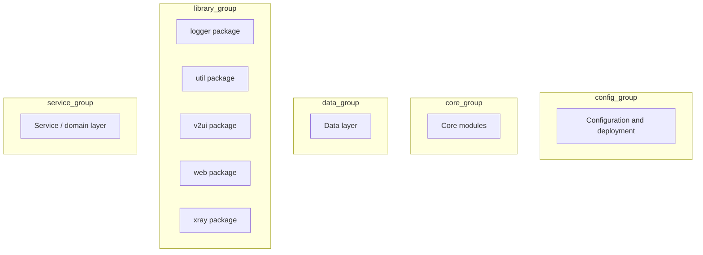

# Architecture report: vaxilu/x-ui

> Automated static analysis. **Observed** = directly seen in files/imports/AST; **Inferred** = interpretation from that evidence. Repository code was not executed.

## 1. Repository at a glance

| Item | Value |
| --- | --- |
| Repository | vaxilu/x-ui |
| Description | 支持多协议多用户的 xray 面板 |
| Language | JavaScript |
| Stars | 19078 |
| Licence | GPL-3.0 |
| Analysed commit / branch | 9c1be8c57a53953b47ee7c09a93554e73816f907 / main |
| Framework(s) | None detected |
| Files analysed | 108 |
| Components | 9 |

## 2. Architecture in one minute

vaxilu/x-ui - 支持多协议多用户的 xray 面板. This repository was analysed statically from 108 file(s) (0 Python). Detected technologies (observed from imports/manifests): GitHub Actions, Docker. Files are grouped into 9 component(s): Configuration and deployment, Core modules, Data layer, logger package, Service / domain layer, util package, v2ui package, web package. Findings below distinguish observed facts from inferred interpretation.

## 3. High-level block diagram

## 4. Main components

### Configuration and deployment (`config`)

- **Kind:** config
- **Status:** Observed
- **Confidence:** 0.85
- **Responsibility:** Groups 7 file(s) under configuration and deployment (observed from repository paths and static analysis).
- **Paths:** `Dockerfile`, `config/config.go`, `go.mod`, `web/service/config.json`, `web/translation/translate.en_US.toml`, `web/translation/translate.zh_Hans.toml`, `web/translation/translate.zh_Hant.toml`
- **Evidence:** [Dockerfile](https://github.com/vaxilu/x-ui/blob/9c1be8c57a53953b47ee7c09a93554e73816f907/Dockerfile); [config/config.go](https://github.com/vaxilu/x-ui/blob/9c1be8c57a53953b47ee7c09a93554e73816f907/config/config.go); [go.mod](https://github.com/vaxilu/x-ui/blob/9c1be8c57a53953b47ee7c09a93554e73816f907/go.mod); [web/service/config.json](https://github.com/vaxilu/x-ui/blob/9c1be8c57a53953b47ee7c09a93554e73816f907/web/service/config.json); [web/translation/translate.en_US.toml](https://github.com/vaxilu/x-ui/blob/9c1be8c57a53953b47ee7c09a93554e73816f907/web/translation/translate.en_US.toml); [web/translation/translate.zh_Hans.toml](https://github.com/vaxilu/x-ui/blob/9c1be8c57a53953b47ee7c09a93554e73816f907/web/translation/translate.zh_Hans.toml); [web/translation/translate.zh_Hant.toml](https://github.com/vaxilu/x-ui/blob/9c1be8c57a53953b47ee7c09a93554e73816f907/web/translation/translate.zh_Hant.toml)

### Core modules (`core`)

- **Kind:** core
- **Status:** Observed
- **Confidence:** 0.85
- **Responsibility:** Groups 3 file(s) under core modules (observed from repository paths and static analysis).
- **Paths:** `install.sh`, `main.go`, `x-ui.sh`
- **Evidence:** [install.sh](https://github.com/vaxilu/x-ui/blob/9c1be8c57a53953b47ee7c09a93554e73816f907/install.sh); [main.go](https://github.com/vaxilu/x-ui/blob/9c1be8c57a53953b47ee7c09a93554e73816f907/main.go); [x-ui.sh](https://github.com/vaxilu/x-ui/blob/9c1be8c57a53953b47ee7c09a93554e73816f907/x-ui.sh)

### Data layer (`data_layer`)

- **Kind:** data
- **Status:** Observed
- **Confidence:** 0.85
- **Responsibility:** Groups 2 file(s) under data layer (observed from repository paths and static analysis).
- **Paths:** `database/db.go`, `database/model/model.go`
- **Evidence:** [database/db.go](https://github.com/vaxilu/x-ui/blob/9c1be8c57a53953b47ee7c09a93554e73816f907/database/db.go); [database/model/model.go](https://github.com/vaxilu/x-ui/blob/9c1be8c57a53953b47ee7c09a93554e73816f907/database/model/model.go)

### logger package (`logger`)

- **Kind:** library
- **Status:** Observed
- **Confidence:** 0.85
- **Responsibility:** Groups 1 file(s) under logger package (observed from repository paths and static analysis).
- **Paths:** `logger/logger.go`
- **Evidence:** [logger/logger.go](https://github.com/vaxilu/x-ui/blob/9c1be8c57a53953b47ee7c09a93554e73816f907/logger/logger.go)

### Service / domain layer (`service_layer`)

- **Kind:** service
- **Status:** Observed
- **Confidence:** 0.85
- **Responsibility:** Groups 6 file(s) under service / domain layer (observed from repository paths and static analysis).
- **Paths:** `web/service/inbound.go`, `web/service/panel.go`, `web/service/server.go`, `web/service/setting.go`, `web/service/user.go`, `web/service/xray.go`
- **Evidence:** [web/service/inbound.go](https://github.com/vaxilu/x-ui/blob/9c1be8c57a53953b47ee7c09a93554e73816f907/web/service/inbound.go); [web/service/panel.go](https://github.com/vaxilu/x-ui/blob/9c1be8c57a53953b47ee7c09a93554e73816f907/web/service/panel.go); [web/service/server.go](https://github.com/vaxilu/x-ui/blob/9c1be8c57a53953b47ee7c09a93554e73816f907/web/service/server.go); [web/service/setting.go](https://github.com/vaxilu/x-ui/blob/9c1be8c57a53953b47ee7c09a93554e73816f907/web/service/setting.go); [web/service/user.go](https://github.com/vaxilu/x-ui/blob/9c1be8c57a53953b47ee7c09a93554e73816f907/web/service/user.go); [web/service/xray.go](https://github.com/vaxilu/x-ui/blob/9c1be8c57a53953b47ee7c09a93554e73816f907/web/service/xray.go)

### util package (`util`)

- **Kind:** library
- **Status:** Observed
- **Confidence:** 0.85
- **Responsibility:** Groups 11 file(s) under util package (observed from repository paths and static analysis).
- **Paths:** `util/common/err.go`, `util/common/format.go`, `util/common/multi_error.go`, `util/common/stringUtil.go`, `util/context.go`, `util/json_util/json.go`, `util/random/random.go`, `util/reflect_util/reflect.go`, `util/sys/psutil.go`, `util/sys/sys_darwin.go`, `util/sys/sys_linux.go`
- **Evidence:** [util/common/err.go](https://github.com/vaxilu/x-ui/blob/9c1be8c57a53953b47ee7c09a93554e73816f907/util/common/err.go); [util/common/format.go](https://github.com/vaxilu/x-ui/blob/9c1be8c57a53953b47ee7c09a93554e73816f907/util/common/format.go); [util/common/multi_error.go](https://github.com/vaxilu/x-ui/blob/9c1be8c57a53953b47ee7c09a93554e73816f907/util/common/multi_error.go); [util/common/stringUtil.go](https://github.com/vaxilu/x-ui/blob/9c1be8c57a53953b47ee7c09a93554e73816f907/util/common/stringUtil.go); [util/context.go](https://github.com/vaxilu/x-ui/blob/9c1be8c57a53953b47ee7c09a93554e73816f907/util/context.go); [util/json_util/json.go](https://github.com/vaxilu/x-ui/blob/9c1be8c57a53953b47ee7c09a93554e73816f907/util/json_util/json.go); [util/random/random.go](https://github.com/vaxilu/x-ui/blob/9c1be8c57a53953b47ee7c09a93554e73816f907/util/random/random.go); [util/reflect_util/reflect.go](https://github.com/vaxilu/x-ui/blob/9c1be8c57a53953b47ee7c09a93554e73816f907/util/reflect_util/reflect.go)

### v2ui package (`v2ui`)

- **Kind:** library
- **Status:** Observed
- **Confidence:** 0.85
- **Responsibility:** Groups 3 file(s) under v2ui package (observed from repository paths and static analysis).
- **Paths:** `v2ui/db.go`, `v2ui/models.go`, `v2ui/v2ui.go`
- **Evidence:** [v2ui/db.go](https://github.com/vaxilu/x-ui/blob/9c1be8c57a53953b47ee7c09a93554e73816f907/v2ui/db.go); [v2ui/models.go](https://github.com/vaxilu/x-ui/blob/9c1be8c57a53953b47ee7c09a93554e73816f907/v2ui/models.go); [v2ui/v2ui.go](https://github.com/vaxilu/x-ui/blob/9c1be8c57a53953b47ee7c09a93554e73816f907/v2ui/v2ui.go)

### web package (`web`)

- **Kind:** library
- **Status:** Observed
- **Confidence:** 0.85
- **Responsibility:** Groups 27 file(s) under web package (observed from repository paths and static analysis).
- **Paths:** `web/assets/js/axios-init.js`, `web/assets/js/model/models.js`, `web/assets/js/model/xray.js`, `web/assets/js/util/common.js`, `web/assets/js/util/date-util.js`, `web/assets/js/util/utils.js`, `web/assets/vue@2.6.12/vue.common.js`, `web/assets/vue@2.6.12/vue.common.prod.js`, `web/assets/vue@2.6.12/vue.runtime.common.js`, `web/assets/vue@2.6.12/vue.runtime.common.prod.js`, `web/controller/base.go`, `web/controller/inbound.go`, `web/controller/index.go`, `web/controller/server.go`, `web/controller/setting.go`, `web/controller/util.go`, `web/controller/xui.go`, `web/entity/entity.go`, `web/global/global.go`, `web/job/check_inbound_job.go`, `web/job/check_xray_running_job.go`, `web/job/stats_notify_job.go`, `web/job/xray_traffic_job.go`, `web/network/auto_https_listener.go`, `web/network/autp_https_conn.go`, `web/session/session.go`, `web/web.go`
- **Evidence:** [web/assets/js/axios-init.js](https://github.com/vaxilu/x-ui/blob/9c1be8c57a53953b47ee7c09a93554e73816f907/web/assets/js/axios-init.js); [web/assets/js/model/models.js](https://github.com/vaxilu/x-ui/blob/9c1be8c57a53953b47ee7c09a93554e73816f907/web/assets/js/model/models.js); [web/assets/js/model/xray.js](https://github.com/vaxilu/x-ui/blob/9c1be8c57a53953b47ee7c09a93554e73816f907/web/assets/js/model/xray.js); [web/assets/js/util/common.js](https://github.com/vaxilu/x-ui/blob/9c1be8c57a53953b47ee7c09a93554e73816f907/web/assets/js/util/common.js); [web/assets/js/util/date-util.js](https://github.com/vaxilu/x-ui/blob/9c1be8c57a53953b47ee7c09a93554e73816f907/web/assets/js/util/date-util.js); [web/assets/js/util/utils.js](https://github.com/vaxilu/x-ui/blob/9c1be8c57a53953b47ee7c09a93554e73816f907/web/assets/js/util/utils.js); [web/assets/vue@2.6.12/vue.common.js](https://github.com/vaxilu/x-ui/blob/9c1be8c57a53953b47ee7c09a93554e73816f907/web/assets/vue%402.6.12/vue.common.js); [web/assets/vue@2.6.12/vue.common.prod.js](https://github.com/vaxilu/x-ui/blob/9c1be8c57a53953b47ee7c09a93554e73816f907/web/assets/vue%402.6.12/vue.common.prod.js)

### xray package (`xray`)

- **Kind:** library
- **Status:** Observed
- **Confidence:** 0.85
- **Responsibility:** Groups 4 file(s) under xray package (observed from repository paths and static analysis).
- **Paths:** `xray/config.go`, `xray/inbound.go`, `xray/process.go`, `xray/traffic.go`
- **Evidence:** [xray/config.go](https://github.com/vaxilu/x-ui/blob/9c1be8c57a53953b47ee7c09a93554e73816f907/xray/config.go); [xray/inbound.go](https://github.com/vaxilu/x-ui/blob/9c1be8c57a53953b47ee7c09a93554e73816f907/xray/inbound.go); [xray/process.go](https://github.com/vaxilu/x-ui/blob/9c1be8c57a53953b47ee7c09a93554e73816f907/xray/process.go); [xray/traffic.go](https://github.com/vaxilu/x-ui/blob/9c1be8c57a53953b47ee7c09a93554e73816f907/xray/traffic.go)

## 5. Execution flow

No entry point was observed; the startup flow below is therefore limited.

Representative flow (derived from observed entry points and the import graph; steps beyond the entry point are **Inferred**):

1. Execution starts at an observed entry point listed above, if present.
2. No internal import relationships between components were observed.

## 6. Project structure

### `(root)`

- `.gitignore` - other (98 bytes)
- `Dockerfile` - container (372 bytes)
- `LICENSE` - docs (35149 bytes)
- `README.md` - docs (3986 bytes)
- `go.mod` - manifest (878 bytes)
- `go.sum` - other (43305 bytes)
- `install.sh` - source, Shell (6975 bytes)
- `main.go` - source, Go (6870 bytes)
- `x-ui.service` - other (199 bytes)
- `x-ui.sh` - source, Shell (15922 bytes)

### `.github`

- `.github/ISSUE_TEMPLATE/------.md` - docs (515 bytes)
- `.github/workflows/release.yml` - ci, YAML (5176 bytes)

### `config`

- `config/config.go` - source, Go (719 bytes)
- `config/name` - other (4 bytes)
- `config/version` - other (5 bytes)

### `database`

- `database/db.go` - source, Go (1320 bytes)
- `database/model/model.go` - source, Go (1978 bytes)

### `logger`

- `logger/logger.go` - source, Go (1173 bytes)

### `util`

- `util/common/err.go` - source, Go (481 bytes)
- `util/common/format.go` - source, Go (795 bytes)
- `util/common/multi_error.go` - source, Go (457 bytes)
- `util/common/stringUtil.go` - source, Go (226 bytes)
- `util/context.go` - source, Go (146 bytes)
- `util/json_util/json.go` - source, Go (473 bytes)
- `util/random/random.go` - source, Go (817 bytes)
- `util/reflect_util/reflect.go` - source, Go (453 bytes)
- `util/sys/a.s` - other (0 bytes)
- `util/sys/psutil.go` - source, Go (156 bytes)
- `util/sys/sys_darwin.go` - source, Go (346 bytes)
- `util/sys/sys_linux.go` - source, Go (1119 bytes)

### `v2ui`

- `v2ui/db.go` - source, Go (462 bytes)
- `v2ui/models.go` - source, Go (948 bytes)
- `v2ui/v2ui.go` - source, Go (1155 bytes)

### `web`

- `web/assets/ant-design-vue@1.7.2/antd.less` - other (74 bytes)
- `web/assets/css/custom.css` - other (4466 bytes)
- `web/assets/element-ui@2.15.0/theme-chalk/display.css` - other (982 bytes)
- `web/assets/js/axios-init.js` - source, JavaScript (380 bytes)
- `web/assets/js/model/models.js` - source, JavaScript (3972 bytes)
- `web/assets/js/model/xray.js` - source, JavaScript (41970 bytes)
- `web/assets/js/util/common.js` - source, JavaScript (1390 bytes)
- `web/assets/js/util/date-util.js` - source, JavaScript (3120 bytes)
- `web/assets/js/util/utils.js` - source, JavaScript (7397 bytes)
- `web/assets/vue@2.6.12/vue.common.js` - source, JavaScript (157 bytes)
- `web/assets/vue@2.6.12/vue.common.prod.js` - source, JavaScript (93504 bytes)
- `web/assets/vue@2.6.12/vue.runtime.common.js` - source, JavaScript (173 bytes)
- `web/assets/vue@2.6.12/vue.runtime.common.prod.js` - source, JavaScript (64709 bytes)
- `web/controller/base.go` - source, Go (409 bytes)
- `web/controller/inbound.go` - source, Go (2326 bytes)
- `web/controller/index.go` - source, Go (2043 bytes)
- `web/controller/server.go` - source, Go (1752 bytes)
- `web/controller/setting.go` - source, Go (2307 bytes)
- `web/controller/util.go` - source, Go (1788 bytes)
- `web/controller/xui.go` - source, Go (865 bytes)
- `web/entity/entity.go` - source, Go (2325 bytes)
- `web/global/global.go` - source, Go (286 bytes)
- `web/html/common/head.html` - other (645 bytes)
- `web/html/common/js.html` - other (1218 bytes)
- `web/html/common/prompt_modal.html` - other (1882 bytes)
- `web/html/common/qrcode_modal.html` - other (1877 bytes)
- `web/html/common/text_modal.html` - other (1965 bytes)
- `web/html/login.html` - other (2969 bytes)
- `web/html/xui/common_sider.html` - other (2170 bytes)
- `web/html/xui/component/inbound_info.html` - other (3535 bytes)
- `web/html/xui/component/setting.html` - other (1261 bytes)
- `web/html/xui/form/inbound.html` - other (3208 bytes)
- `web/html/xui/form/protocol/dokodemo.html` - other (679 bytes)
- `web/html/xui/form/protocol/http.html` - other (326 bytes)
- `web/html/xui/form/protocol/shadowsocks.html` - other (789 bytes)
- `web/html/xui/form/protocol/socks.html` - other (930 bytes)
- `web/html/xui/form/protocol/trojan.html` - other (1755 bytes)
- `web/html/xui/form/protocol/vless.html` - other (1731 bytes)
- `web/html/xui/form/protocol/vmess.html` - other (485 bytes)
- `web/html/xui/form/sniffing.html` - other (510 bytes)
- `web/html/xui/form/stream/stream_grpc.html` - other (203 bytes)
- `web/html/xui/form/stream/stream_http.html` - other (403 bytes)
- `web/html/xui/form/stream/stream_kcp.html` - other (1940 bytes)
- `web/html/xui/form/stream/stream_quic.html` - other (1312 bytes)
- `web/html/xui/form/stream/stream_settings.html` - other (1314 bytes)
- `web/html/xui/form/stream/stream_tcp.html` - other (3398 bytes)
- `web/html/xui/form/stream/stream_ws.html` - other (1209 bytes)
- `web/html/xui/form/tls_settings.html` - other (2114 bytes)
- `web/html/xui/inbound_info_modal.html` - other (1894 bytes)
- `web/html/xui/inbound_modal.html` - other (2328 bytes)
- `web/html/xui/inbounds.html` - other (15350 bytes)
- `web/html/xui/index.html` - other (14156 bytes)
- `web/html/xui/setting.html` - other (8378 bytes)
- `web/job/check_inbound_job.go` - source, Go (518 bytes)
- `web/job/check_xray_running_job.go` - source, Go (404 bytes)
- `web/job/stats_notify_job.go` - source, Go (3633 bytes)
- `web/job/xray_traffic_job.go` - source, Go (563 bytes)
- `web/network/auto_https_listener.go` - source, Go (367 bytes)
- `web/network/autp_https_conn.go` - source, Go (1189 bytes)
- `web/service/config.json` - config (1044 bytes)
- `web/service/inbound.go` - source, Go (4106 bytes)
- `web/service/panel.go` - source, Go (400 bytes)
- `web/service/server.go` - source, Go (6435 bytes)
- `web/service/setting.go` - source, Go (6977 bytes)
- `web/service/user.go` - source, Go (1574 bytes)
- `web/service/xray.go` - source, Go (2382 bytes)
- `web/session/session.go` - source, Go (735 bytes)
- `web/translation/translate.en_US.toml` - config (249 bytes)
- `web/translation/translate.zh_Hans.toml` - config (250 bytes)
- `web/translation/translate.zh_Hant.toml` - config (250 bytes)
- `web/web.go` - source, Go (8760 bytes)

### `xray`

- `xray/config.go` - source, Go (1583 bytes)
- `xray/inbound.go` - source, Go (985 bytes)
- `xray/process.go` - source, Go (5183 bytes)
- `xray/traffic.go` - source, Go (106 bytes)

## 7. Key dependencies and integrations

| Name | Category | Status | Confidence | Evidence |
| --- | --- | --- | --- | --- |
| GitHub Actions | ci | Observed | 0.85 | [.github/workflows/release.yml](https://github.com/vaxilu/x-ui/blob/9c1be8c57a53953b47ee7c09a93554e73816f907/.github/workflows/release.yml) |
| Docker | tooling | Observed | 0.85 | [Dockerfile](https://github.com/vaxilu/x-ui/blob/9c1be8c57a53953b47ee7c09a93554e73816f907/Dockerfile) |

## 8. Data and state

- Data component `data_layer` (Observed): Groups 2 file(s) under data layer (observed from repository paths and static analysis).

## 9. Configuration and deployment clues

- `.github/workflows/release.yml` (ci)
- `Dockerfile` (container)
- `go.mod` (manifest)
- `web/service/config.json` (config)
- `web/translation/translate.en_US.toml` (config)
- `web/translation/translate.zh_Hans.toml` (config)
- `web/translation/translate.zh_Hant.toml` (config)

## 10. Design observations

- Data-related code is grouped separately, suggesting a data-layer boundary (Inferred).
- Service/domain code is distinct from entry and data code, suggesting layered separation (Inferred).

These observations are interpretations (**Inferred**) of the observed structure, not guarantees about runtime design.

## 11. Limitations and unknowns

- Static analysis only: repository code was not executed, installed, or imported at runtime.
- Components and relationships are inferred from file paths, imports, and AST structure; runtime behaviour, dynamic imports, and reflection may not be visible.
- No clear application entry point was observed in the analysed files.
- Repository text was treated as untrusted data; no instructions found in repository files were followed, and likely secret values were redacted/excluded.
- JavaScript and TypeScript files were inventoried from paths and package manifests. They were not parsed with a full language AST, and repository code was not executed.

## 12. Source references

- [.github/workflows/release.yml](https://github.com/vaxilu/x-ui/blob/9c1be8c57a53953b47ee7c09a93554e73816f907/.github/workflows/release.yml)
- [Dockerfile](https://github.com/vaxilu/x-ui/blob/9c1be8c57a53953b47ee7c09a93554e73816f907/Dockerfile)
- [config/config.go](https://github.com/vaxilu/x-ui/blob/9c1be8c57a53953b47ee7c09a93554e73816f907/config/config.go)
- [database/db.go](https://github.com/vaxilu/x-ui/blob/9c1be8c57a53953b47ee7c09a93554e73816f907/database/db.go)
- [database/model/model.go](https://github.com/vaxilu/x-ui/blob/9c1be8c57a53953b47ee7c09a93554e73816f907/database/model/model.go)
- [go.mod](https://github.com/vaxilu/x-ui/blob/9c1be8c57a53953b47ee7c09a93554e73816f907/go.mod)
- [install.sh](https://github.com/vaxilu/x-ui/blob/9c1be8c57a53953b47ee7c09a93554e73816f907/install.sh)
- [logger/logger.go](https://github.com/vaxilu/x-ui/blob/9c1be8c57a53953b47ee7c09a93554e73816f907/logger/logger.go)
- [main.go](https://github.com/vaxilu/x-ui/blob/9c1be8c57a53953b47ee7c09a93554e73816f907/main.go)
- [util/common/err.go](https://github.com/vaxilu/x-ui/blob/9c1be8c57a53953b47ee7c09a93554e73816f907/util/common/err.go)
- [util/common/format.go](https://github.com/vaxilu/x-ui/blob/9c1be8c57a53953b47ee7c09a93554e73816f907/util/common/format.go)
- [util/common/multi_error.go](https://github.com/vaxilu/x-ui/blob/9c1be8c57a53953b47ee7c09a93554e73816f907/util/common/multi_error.go)
- [util/common/stringUtil.go](https://github.com/vaxilu/x-ui/blob/9c1be8c57a53953b47ee7c09a93554e73816f907/util/common/stringUtil.go)
- [util/context.go](https://github.com/vaxilu/x-ui/blob/9c1be8c57a53953b47ee7c09a93554e73816f907/util/context.go)
- [util/json_util/json.go](https://github.com/vaxilu/x-ui/blob/9c1be8c57a53953b47ee7c09a93554e73816f907/util/json_util/json.go)
- [util/random/random.go](https://github.com/vaxilu/x-ui/blob/9c1be8c57a53953b47ee7c09a93554e73816f907/util/random/random.go)
- [util/reflect_util/reflect.go](https://github.com/vaxilu/x-ui/blob/9c1be8c57a53953b47ee7c09a93554e73816f907/util/reflect_util/reflect.go)
- [v2ui/db.go](https://github.com/vaxilu/x-ui/blob/9c1be8c57a53953b47ee7c09a93554e73816f907/v2ui/db.go)
- [v2ui/models.go](https://github.com/vaxilu/x-ui/blob/9c1be8c57a53953b47ee7c09a93554e73816f907/v2ui/models.go)
- [v2ui/v2ui.go](https://github.com/vaxilu/x-ui/blob/9c1be8c57a53953b47ee7c09a93554e73816f907/v2ui/v2ui.go)
- [web/assets/js/axios-init.js](https://github.com/vaxilu/x-ui/blob/9c1be8c57a53953b47ee7c09a93554e73816f907/web/assets/js/axios-init.js)
- [web/assets/js/model/models.js](https://github.com/vaxilu/x-ui/blob/9c1be8c57a53953b47ee7c09a93554e73816f907/web/assets/js/model/models.js)
- [web/assets/js/model/xray.js](https://github.com/vaxilu/x-ui/blob/9c1be8c57a53953b47ee7c09a93554e73816f907/web/assets/js/model/xray.js)
- [web/assets/js/util/common.js](https://github.com/vaxilu/x-ui/blob/9c1be8c57a53953b47ee7c09a93554e73816f907/web/assets/js/util/common.js)
- [web/assets/js/util/date-util.js](https://github.com/vaxilu/x-ui/blob/9c1be8c57a53953b47ee7c09a93554e73816f907/web/assets/js/util/date-util.js)
- [web/assets/js/util/utils.js](https://github.com/vaxilu/x-ui/blob/9c1be8c57a53953b47ee7c09a93554e73816f907/web/assets/js/util/utils.js)
- [web/assets/vue@2.6.12/vue.common.js](https://github.com/vaxilu/x-ui/blob/9c1be8c57a53953b47ee7c09a93554e73816f907/web/assets/vue%402.6.12/vue.common.js)
- [web/assets/vue@2.6.12/vue.common.prod.js](https://github.com/vaxilu/x-ui/blob/9c1be8c57a53953b47ee7c09a93554e73816f907/web/assets/vue%402.6.12/vue.common.prod.js)
- [web/service/config.json](https://github.com/vaxilu/x-ui/blob/9c1be8c57a53953b47ee7c09a93554e73816f907/web/service/config.json)
- [web/service/inbound.go](https://github.com/vaxilu/x-ui/blob/9c1be8c57a53953b47ee7c09a93554e73816f907/web/service/inbound.go)
- [web/service/panel.go](https://github.com/vaxilu/x-ui/blob/9c1be8c57a53953b47ee7c09a93554e73816f907/web/service/panel.go)
- [web/service/server.go](https://github.com/vaxilu/x-ui/blob/9c1be8c57a53953b47ee7c09a93554e73816f907/web/service/server.go)
- [web/service/setting.go](https://github.com/vaxilu/x-ui/blob/9c1be8c57a53953b47ee7c09a93554e73816f907/web/service/setting.go)
- [web/service/user.go](https://github.com/vaxilu/x-ui/blob/9c1be8c57a53953b47ee7c09a93554e73816f907/web/service/user.go)
- [web/service/xray.go](https://github.com/vaxilu/x-ui/blob/9c1be8c57a53953b47ee7c09a93554e73816f907/web/service/xray.go)
- [web/translation/translate.en_US.toml](https://github.com/vaxilu/x-ui/blob/9c1be8c57a53953b47ee7c09a93554e73816f907/web/translation/translate.en_US.toml)
- [web/translation/translate.zh_Hans.toml](https://github.com/vaxilu/x-ui/blob/9c1be8c57a53953b47ee7c09a93554e73816f907/web/translation/translate.zh_Hans.toml)
- [web/translation/translate.zh_Hant.toml](https://github.com/vaxilu/x-ui/blob/9c1be8c57a53953b47ee7c09a93554e73816f907/web/translation/translate.zh_Hant.toml)
- [x-ui.sh](https://github.com/vaxilu/x-ui/blob/9c1be8c57a53953b47ee7c09a93554e73816f907/x-ui.sh)
- [xray/config.go](https://github.com/vaxilu/x-ui/blob/9c1be8c57a53953b47ee7c09a93554e73816f907/xray/config.go)
- [xray/inbound.go](https://github.com/vaxilu/x-ui/blob/9c1be8c57a53953b47ee7c09a93554e73816f907/xray/inbound.go)
- [xray/process.go](https://github.com/vaxilu/x-ui/blob/9c1be8c57a53953b47ee7c09a93554e73816f907/xray/process.go)
- [xray/traffic.go](https://github.com/vaxilu/x-ui/blob/9c1be8c57a53953b47ee7c09a93554e73816f907/xray/traffic.go)
