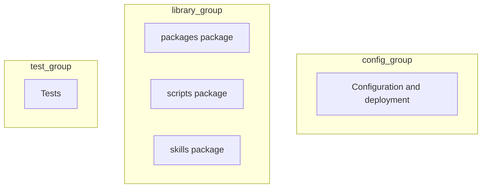

# Architecture report: vercel-labs/agent-skills

> Automated static analysis. **Observed** = directly seen in files/imports/AST; **Inferred** = interpretation from that evidence. Repository code was not executed.

## 1. Repository at a glance

| Item | Value |
| --- | --- |
| Repository | vercel-labs/agent-skills |
| Description | Vercel's official collection of agent skills |
| Language | JavaScript |
| Stars | 34058 |
| Licence | Not detected |
| Analysed commit / branch | 1a2c79d4e6c4a2283dc2c614b6538cbe1ed5ca62 / main |
| Framework(s) | None detected |
| Files analysed | 427 |
| Components | 5 |

## 2. Architecture in one minute

vercel-labs/agent-skills - Vercel's official collection of agent skills. This repository was analysed statically from 427 file(s) (0 Python). Detected technologies (observed from imports/manifests): GitHub Actions, TypeScript. Files are grouped into 5 component(s): Configuration and deployment, packages package, scripts package, skills package, Tests. Findings below distinguish observed facts from inferred interpretation.

## 3. High-level block diagram

## 4. Main components

### Configuration and deployment (`config`)

- **Kind:** config
- **Status:** Observed
- **Confidence:** 0.85
- **Responsibility:** Groups 12 file(s) under configuration and deployment (observed from repository paths and static analysis).
- **Paths:** `package.json`, `packages/react-best-practices-build/package.json`, `packages/react-best-practices-build/test-cases.json`, `packages/react-best-practices-build/tsconfig.json`, `packages/vercel-optimize-tests/package.json`, `skills.sh.json`, `skills/composition-patterns/metadata.json`, `skills/react-best-practices/metadata.json`, `skills/react-native-skills/metadata.json`, `skills/react-view-transitions/metadata.json`, `skills/vercel-optimize/metadata.json`, `skills/vercel-optimize/references/docs-library.json`
- **Evidence:** [package.json](https://github.com/vercel-labs/agent-skills/blob/1a2c79d4e6c4a2283dc2c614b6538cbe1ed5ca62/package.json); [packages/react-best-practices-build/package.json](https://github.com/vercel-labs/agent-skills/blob/1a2c79d4e6c4a2283dc2c614b6538cbe1ed5ca62/packages/react-best-practices-build/package.json); [packages/react-best-practices-build/test-cases.json](https://github.com/vercel-labs/agent-skills/blob/1a2c79d4e6c4a2283dc2c614b6538cbe1ed5ca62/packages/react-best-practices-build/test-cases.json); [packages/react-best-practices-build/tsconfig.json](https://github.com/vercel-labs/agent-skills/blob/1a2c79d4e6c4a2283dc2c614b6538cbe1ed5ca62/packages/react-best-practices-build/tsconfig.json); [packages/vercel-optimize-tests/package.json](https://github.com/vercel-labs/agent-skills/blob/1a2c79d4e6c4a2283dc2c614b6538cbe1ed5ca62/packages/vercel-optimize-tests/package.json); [skills.sh.json](https://github.com/vercel-labs/agent-skills/blob/1a2c79d4e6c4a2283dc2c614b6538cbe1ed5ca62/skills.sh.json); [skills/composition-patterns/metadata.json](https://github.com/vercel-labs/agent-skills/blob/1a2c79d4e6c4a2283dc2c614b6538cbe1ed5ca62/skills/composition-patterns/metadata.json); [skills/react-best-practices/metadata.json](https://github.com/vercel-labs/agent-skills/blob/1a2c79d4e6c4a2283dc2c614b6538cbe1ed5ca62/skills/react-best-practices/metadata.json)

### packages package (`packages`)

- **Kind:** library
- **Status:** Observed
- **Confidence:** 0.85
- **Responsibility:** Groups 7 file(s) under packages package (observed from repository paths and static analysis).
- **Paths:** `packages/react-best-practices-build/src/build.ts`, `packages/react-best-practices-build/src/config.ts`, `packages/react-best-practices-build/src/extract-tests.ts`, `packages/react-best-practices-build/src/migrate.ts`, `packages/react-best-practices-build/src/parser.ts`, `packages/react-best-practices-build/src/types.ts`, `packages/react-best-practices-build/src/validate.ts`
- **Evidence:** [packages/react-best-practices-build/src/build.ts](https://github.com/vercel-labs/agent-skills/blob/1a2c79d4e6c4a2283dc2c614b6538cbe1ed5ca62/packages/react-best-practices-build/src/build.ts); [packages/react-best-practices-build/src/config.ts](https://github.com/vercel-labs/agent-skills/blob/1a2c79d4e6c4a2283dc2c614b6538cbe1ed5ca62/packages/react-best-practices-build/src/config.ts); [packages/react-best-practices-build/src/extract-tests.ts](https://github.com/vercel-labs/agent-skills/blob/1a2c79d4e6c4a2283dc2c614b6538cbe1ed5ca62/packages/react-best-practices-build/src/extract-tests.ts); [packages/react-best-practices-build/src/migrate.ts](https://github.com/vercel-labs/agent-skills/blob/1a2c79d4e6c4a2283dc2c614b6538cbe1ed5ca62/packages/react-best-practices-build/src/migrate.ts); [packages/react-best-practices-build/src/parser.ts](https://github.com/vercel-labs/agent-skills/blob/1a2c79d4e6c4a2283dc2c614b6538cbe1ed5ca62/packages/react-best-practices-build/src/parser.ts); [packages/react-best-practices-build/src/types.ts](https://github.com/vercel-labs/agent-skills/blob/1a2c79d4e6c4a2283dc2c614b6538cbe1ed5ca62/packages/react-best-practices-build/src/types.ts); [packages/react-best-practices-build/src/validate.ts](https://github.com/vercel-labs/agent-skills/blob/1a2c79d4e6c4a2283dc2c614b6538cbe1ed5ca62/packages/react-best-practices-build/src/validate.ts)

### scripts package (`scripts`)

- **Kind:** library
- **Status:** Observed
- **Confidence:** 0.85
- **Responsibility:** Groups 1 file(s) under scripts package (observed from repository paths and static analysis).
- **Paths:** `scripts/build-discovery-index.mjs`
- **Evidence:** [scripts/build-discovery-index.mjs](https://github.com/vercel-labs/agent-skills/blob/1a2c79d4e6c4a2283dc2c614b6538cbe1ed5ca62/scripts/build-discovery-index.mjs)

### skills package (`skills`)

- **Kind:** library
- **Status:** Observed
- **Confidence:** 0.85
- **Responsibility:** Groups 90 file(s) under skills package (observed from repository paths and static analysis).
- **Paths:** `skills/vercel-optimize/lib/auth-route.mjs`, `skills/vercel-optimize/lib/budget-summary.mjs`, `skills/vercel-optimize/lib/citations.mjs`, `skills/vercel-optimize/lib/cost-coverage.mjs`, `skills/vercel-optimize/lib/dedup-recs.mjs`, `skills/vercel-optimize/lib/deep-dive.mjs`, `skills/vercel-optimize/lib/display-labels.mjs`, `skills/vercel-optimize/lib/extract-claims.mjs`, `skills/vercel-optimize/lib/framework-support.mjs`, `skills/vercel-optimize/lib/gates/build-minutes-fanout.mjs`, `skills/vercel-optimize/lib/gates/cold-start.mjs`, `skills/vercel-optimize/lib/gates/contract.mjs`, `skills/vercel-optimize/lib/gates/cwv-poor.mjs`, `skills/vercel-optimize/lib/gates/external-api-slow.mjs`, `skills/vercel-optimize/lib/gates/hard-gates.mjs`, `skills/vercel-optimize/lib/gates/index.mjs`, `skills/vercel-optimize/lib/gates/isr-overrevalidation.mjs`, `skills/vercel-optimize/lib/gates/middleware-heavy.mjs`, `skills/vercel-optimize/lib/gates/observability-events-attribution.mjs`, `skills/vercel-optimize/lib/gates/platform-bot-protection.mjs`, `skills/vercel-optimize/lib/gates/platform-fluid-compute.mjs`, `skills/vercel-optimize/lib/gates/region-misconfig.mjs`, `skills/vercel-optimize/lib/gates/route-errors.mjs`, `skills/vercel-optimize/lib/gates/scanner-driven.mjs`, `skills/vercel-optimize/lib/gates/select-candidates.mjs`, `skills/vercel-optimize/lib/gates/slow-route.mjs`, `skills/vercel-optimize/lib/gates/types.d.ts`, `skills/vercel-optimize/lib/gates/uncached-route.mjs`, `skills/vercel-optimize/lib/gates/usage-spike-triage.mjs`, `skills/vercel-optimize/lib/grade-recommendation.mjs`, `skills/vercel-optimize/lib/impact-label.mjs`, `skills/vercel-optimize/lib/impact-magnitude.mjs`, `skills/vercel-optimize/lib/investigation-brief.mjs`, `skills/vercel-optimize/lib/observation-safety.mjs`, `skills/vercel-optimize/lib/project-facts.mjs`, `skills/vercel-optimize/lib/queries.mjs`, `skills/vercel-optimize/lib/reconcile-candidates.mjs`, `skills/vercel-optimize/lib/render-report.mjs`, `skills/vercel-optimize/lib/repo-root.mjs`, `skills/vercel-optimize/lib/route-normalize.mjs`, `skills/vercel-optimize/lib/sanitizers/bot-protection-certainty.mjs`, `skills/vercel-optimize/lib/sanitizers/cache-tag-invalidation-certainty.mjs`, `skills/vercel-optimize/lib/sanitizers/count-correct.mjs`, `skills/vercel-optimize/lib/sanitizers/function-duration-invocations.mjs`, `skills/vercel-optimize/lib/sanitizers/index.mjs`, `skills/vercel-optimize/lib/sanitizers/middleware-conflict.mjs`, `skills/vercel-optimize/lib/sanitizers/missing-citation.mjs`, `skills/vercel-optimize/lib/sanitizers/pre-release.mjs`, `skills/vercel-optimize/lib/sanitizers/rate-limit.mjs`, `skills/vercel-optimize/lib/sanitizers/rendering-mode-mislabel.mjs`, `skills/vercel-optimize/lib/sanitizers/undeclared-dep.mjs`, `skills/vercel-optimize/lib/sanitizers/vercel-directive-strip.mjs`, `skills/vercel-optimize/lib/sanitizers/window-units.mjs`, `skills/vercel-optimize/lib/scanners/cache-components-suspense-dedupe.mjs`, `skills/vercel-optimize/lib/scanners/edge-heavy-import.mjs`, `skills/vercel-optimize/lib/scanners/force-dynamic.mjs`, `skills/vercel-optimize/lib/scanners/headers-in-page.mjs`, `skills/vercel-optimize/lib/scanners/index.mjs`, `skills/vercel-optimize/lib/scanners/large-static-asset.mjs`, `skills/vercel-optimize/lib/scanners/max-age-without-s-maxage.mjs`, `skills/vercel-optimize/lib/scanners/middleware-broad-matcher.mjs`, `skills/vercel-optimize/lib/scanners/missing-cache-headers.mjs`, `skills/vercel-optimize/lib/scanners/prisma-include-tree.mjs`, `skills/vercel-optimize/lib/scanners/region-pin-in-config.mjs`, `skills/vercel-optimize/lib/scanners/source-maps-production.mjs`, `skills/vercel-optimize/lib/scanners/sveltekit-prerender-missing.mjs`, `skills/vercel-optimize/lib/scanners/turbo-force-bypass.mjs`, `skills/vercel-optimize/lib/scanners/unoptimized-image.mjs`, `skills/vercel-optimize/lib/scanners/use-cache-date-stamp.mjs`, `skills/vercel-optimize/lib/support-topics.mjs`, `skills/vercel-optimize/lib/throttle.mjs`, `skills/vercel-optimize/lib/util.mjs`, `skills/vercel-optimize/lib/vercel.mjs`, `skills/vercel-optimize/lib/verify-claim.mjs`, `skills/vercel-optimize/lib/workspace-resolver.mjs`, `skills/vercel-optimize/scripts/budget-summary.mjs`, `skills/vercel-optimize/scripts/build-docs.mjs`, `skills/vercel-optimize/scripts/check-citations.mjs`, `skills/vercel-optimize/scripts/check-docs-fresh.mjs`, `skills/vercel-optimize/scripts/collect-signals.mjs`, `skills/vercel-optimize/scripts/collect-sub-agent-outputs.mjs`, `skills/vercel-optimize/scripts/deep-dive.mjs`, `skills/vercel-optimize/scripts/gate-investigations.mjs`, `skills/vercel-optimize/scripts/merge-signals.mjs`, `skills/vercel-optimize/scripts/prepare-investigation-brief.mjs`, `skills/vercel-optimize/scripts/reconcile-candidates.mjs`, `skills/vercel-optimize/scripts/render-report.mjs`, `skills/vercel-optimize/scripts/scan-codebase.mjs`, `skills/vercel-optimize/scripts/verify-and-regen.mjs`, `skills/vercel-optimize/scripts/verify-finding.mjs`
- **Evidence:** [skills/vercel-optimize/lib/auth-route.mjs](https://github.com/vercel-labs/agent-skills/blob/1a2c79d4e6c4a2283dc2c614b6538cbe1ed5ca62/skills/vercel-optimize/lib/auth-route.mjs); [skills/vercel-optimize/lib/budget-summary.mjs](https://github.com/vercel-labs/agent-skills/blob/1a2c79d4e6c4a2283dc2c614b6538cbe1ed5ca62/skills/vercel-optimize/lib/budget-summary.mjs); [skills/vercel-optimize/lib/citations.mjs](https://github.com/vercel-labs/agent-skills/blob/1a2c79d4e6c4a2283dc2c614b6538cbe1ed5ca62/skills/vercel-optimize/lib/citations.mjs); [skills/vercel-optimize/lib/cost-coverage.mjs](https://github.com/vercel-labs/agent-skills/blob/1a2c79d4e6c4a2283dc2c614b6538cbe1ed5ca62/skills/vercel-optimize/lib/cost-coverage.mjs); [skills/vercel-optimize/lib/dedup-recs.mjs](https://github.com/vercel-labs/agent-skills/blob/1a2c79d4e6c4a2283dc2c614b6538cbe1ed5ca62/skills/vercel-optimize/lib/dedup-recs.mjs); [skills/vercel-optimize/lib/deep-dive.mjs](https://github.com/vercel-labs/agent-skills/blob/1a2c79d4e6c4a2283dc2c614b6538cbe1ed5ca62/skills/vercel-optimize/lib/deep-dive.mjs); [skills/vercel-optimize/lib/display-labels.mjs](https://github.com/vercel-labs/agent-skills/blob/1a2c79d4e6c4a2283dc2c614b6538cbe1ed5ca62/skills/vercel-optimize/lib/display-labels.mjs); [skills/vercel-optimize/lib/extract-claims.mjs](https://github.com/vercel-labs/agent-skills/blob/1a2c79d4e6c4a2283dc2c614b6538cbe1ed5ca62/skills/vercel-optimize/lib/extract-claims.mjs)

### Tests (`tests`)

- **Kind:** test
- **Status:** Observed
- **Confidence:** 0.85
- **Responsibility:** Groups 106 file(s) under tests (observed from repository paths and static analysis).
- **Paths:** `packages/vercel-optimize-tests/test/account-scope-grading.test.mjs`, `packages/vercel-optimize-tests/test/budget-summary.test.mjs`, `packages/vercel-optimize-tests/test/build-minutes-fanout.test.mjs`, `packages/vercel-optimize-tests/test/cache-components-suspense-dedupe.test.mjs`, `packages/vercel-optimize-tests/test/check-citations-script.test.mjs`, `packages/vercel-optimize-tests/test/citations.test.mjs`, `packages/vercel-optimize-tests/test/cold-start-revival.test.mjs`, `packages/vercel-optimize-tests/test/collect-framework-preflight.test.mjs`, `packages/vercel-optimize-tests/test/collect-sub-agent-outputs.test.mjs`, `packages/vercel-optimize-tests/test/collection-command-docs.test.mjs`, `packages/vercel-optimize-tests/test/cost-coverage.test.mjs`, `packages/vercel-optimize-tests/test/dedup-recs.test.mjs`, `packages/vercel-optimize-tests/test/deep-dive-extract.test.mjs`, `packages/vercel-optimize-tests/test/deep-dive.test.mjs`, `packages/vercel-optimize-tests/test/display-labels.test.mjs`, `packages/vercel-optimize-tests/test/edge-heavy-import.test.mjs`, `packages/vercel-optimize-tests/test/fixtures/real-cli-output/README.md`, `packages/vercel-optimize-tests/test/fixtures/real-cli-output/contract-commitments-empty-200.txt`, `packages/vercel-optimize-tests/test/fixtures/real-cli-output/contract-empty-commitments.json`, `packages/vercel-optimize-tests/test/fixtures/real-cli-output/deep-dive/README.md`, `packages/vercel-optimize-tests/test/fixtures/real-cli-output/deep-dive/slow_route_latency_p95.json`, `packages/vercel-optimize-tests/test/fixtures/real-cli-output/deep-dive/slow_route_perDeployment.json`, `packages/vercel-optimize-tests/test/fixtures/real-cli-output/deep-dive/slow_route_startTypeSplit.json`, `packages/vercel-optimize-tests/test/fixtures/real-cli-output/deep-dive/slow_route_statusDist.json`, `packages/vercel-optimize-tests/test/fixtures/real-cli-output/deep-dive/uncached_route_cacheBreakdown.json`, `packages/vercel-optimize-tests/test/fixtures/real-cli-output/metrics-bot-id-checks.json`, `packages/vercel-optimize-tests/test/fixtures/real-cli-output/metrics-cwv-cls-by-route.json`, `packages/vercel-optimize-tests/test/fixtures/real-cli-output/metrics-cwv-count-by-route.json`, `packages/vercel-optimize-tests/test/fixtures/real-cli-output/metrics-cwv-count.json`, `packages/vercel-optimize-tests/test/fixtures/real-cli-output/metrics-cwv-inp-by-route.json`, `packages/vercel-optimize-tests/test/fixtures/real-cli-output/metrics-cwv-lcp-by-route.json`, `packages/vercel-optimize-tests/test/fixtures/real-cli-output/metrics-cwv-ttfb-by-route.json`, `packages/vercel-optimize-tests/test/fixtures/real-cli-output/metrics-error-invalid-dimension.json`, `packages/vercel-optimize-tests/test/fixtures/real-cli-output/metrics-ext-api-p75.json`, `packages/vercel-optimize-tests/test/fixtures/real-cli-output/metrics-external-api-bytes.json`, `packages/vercel-optimize-tests/test/fixtures/real-cli-output/metrics-external-api-count.json`, `packages/vercel-optimize-tests/test/fixtures/real-cli-output/metrics-fdt-by-bot.json`, `packages/vercel-optimize-tests/test/fixtures/real-cli-output/metrics-fdt-by-cache.json`, `packages/vercel-optimize-tests/test/fixtures/real-cli-output/metrics-firewall-by-action.json`, `packages/vercel-optimize-tests/test/fixtures/real-cli-output/metrics-fn-count-by-route-http-status.json`, `packages/vercel-optimize-tests/test/fixtures/real-cli-output/metrics-fn-duration-p95-by-route.json`, `packages/vercel-optimize-tests/test/fixtures/real-cli-output/metrics-image-by-host.json`, `packages/vercel-optimize-tests/test/fixtures/real-cli-output/metrics-image-count.json`, `packages/vercel-optimize-tests/test/fixtures/real-cli-output/metrics-image-source-bytes.json`, `packages/vercel-optimize-tests/test/fixtures/real-cli-output/metrics-middleware-count.json`, `packages/vercel-optimize-tests/test/fixtures/real-cli-output/metrics-middleware-duration-p95.json`, `packages/vercel-optimize-tests/test/fixtures/real-cli-output/metrics-request-count-by-route-method.json`, `packages/vercel-optimize-tests/test/fixtures/real-cli-output/metrics-request-count-group-by-http-status.json`, `packages/vercel-optimize-tests/test/fixtures/real-cli-output/metrics-request-count-group-by-route-cache.json`, `packages/vercel-optimize-tests/test/fixtures/real-cli-output/metrics-request-count-group-by-route.json`, `packages/vercel-optimize-tests/test/fixtures/real-cli-output/metrics-request-count-since-30d.json`, `packages/vercel-optimize-tests/test/fixtures/real-cli-output/metrics-schema.json`, `packages/vercel-optimize-tests/test/fixtures/real-cli-output/project-v9.json`, `packages/vercel-optimize-tests/test/fixtures/real-cli-output/usage-404-stderr.txt`, `packages/vercel-optimize-tests/test/fixtures/signals.hobby.json`, `packages/vercel-optimize-tests/test/fixtures/signals.pro-oplus.json`, `packages/vercel-optimize-tests/test/flags-gate.test.mjs`, `packages/vercel-optimize-tests/test/framework-support.test.mjs`, `packages/vercel-optimize-tests/test/gate-contract.test.mjs`, `packages/vercel-optimize-tests/test/gate-selection.test.mjs`, `packages/vercel-optimize-tests/test/gate.test.mjs`, `packages/vercel-optimize-tests/test/grade-and-verify.test.mjs`, `packages/vercel-optimize-tests/test/hallucination-probe.test.mjs`, `packages/vercel-optimize-tests/test/impact-label.test.mjs`, `packages/vercel-optimize-tests/test/impact-magnitude.test.mjs`, `packages/vercel-optimize-tests/test/infer-plan.test.mjs`, `packages/vercel-optimize-tests/test/investigation-brief.test.mjs`, `packages/vercel-optimize-tests/test/large-static-asset.test.mjs`, `packages/vercel-optimize-tests/test/merge-signals.test.mjs`, `packages/vercel-optimize-tests/test/new-gates.test.mjs`, `packages/vercel-optimize-tests/test/observability-events-attribution.test.mjs`, `packages/vercel-optimize-tests/test/observability-preflight.test.mjs`, `packages/vercel-optimize-tests/test/observations.test.mjs`, `packages/vercel-optimize-tests/test/oplus-diagnose.test.mjs`, `packages/vercel-optimize-tests/test/prepare-investigation-brief-cli.test.mjs`, `packages/vercel-optimize-tests/test/project-config-contradict.test.mjs`, `packages/vercel-optimize-tests/test/project-facts.test.mjs`, `packages/vercel-optimize-tests/test/public-release-safety.test.mjs`, `packages/vercel-optimize-tests/test/queries.test.mjs`, `packages/vercel-optimize-tests/test/reconcile-candidates-cli.test.mjs`, `packages/vercel-optimize-tests/test/reconcile-candidates.test.mjs`, `packages/vercel-optimize-tests/test/reconcile-pipeline.test.mjs`, `packages/vercel-optimize-tests/test/region-misconfig.test.mjs`, `packages/vercel-optimize-tests/test/region-pin-in-config.test.mjs`, `packages/vercel-optimize-tests/test/render-report.test.mjs`, `packages/vercel-optimize-tests/test/repo-root.test.mjs`, `packages/vercel-optimize-tests/test/route-errors.test.mjs`, `packages/vercel-optimize-tests/test/route-normalize.test.mjs`, `packages/vercel-optimize-tests/test/route-shape-warnings.test.mjs`, `packages/vercel-optimize-tests/test/sanitizers.test.mjs`, `packages/vercel-optimize-tests/test/scan-codebase-layouts.test.mjs`, `packages/vercel-optimize-tests/test/slow-route-5xx-disqualify.test.mjs`, `packages/vercel-optimize-tests/test/support-topics.test.mjs`, `packages/vercel-optimize-tests/test/sveltekit-parity.test.mjs`, `packages/vercel-optimize-tests/test/throttle.test.mjs`, `packages/vercel-optimize-tests/test/time-window.test.mjs`, `packages/vercel-optimize-tests/test/turbo-force-bypass.test.mjs`, `packages/vercel-optimize-tests/test/uncached-route-method-filter.test.mjs`, `packages/vercel-optimize-tests/test/unoptimized-image-ext.test.mjs`, `packages/vercel-optimize-tests/test/usage-spike-triage.test.mjs`, `packages/vercel-optimize-tests/test/use-cache-date-stamp.test.mjs`, `packages/vercel-optimize-tests/test/vercel-command.test.mjs`, `packages/vercel-optimize-tests/test/vercel-redaction.test.mjs`, `packages/vercel-optimize-tests/test/verify-and-regen-cli.test.mjs`, `packages/vercel-optimize-tests/test/voice-drift.test.mjs`, `packages/vercel-optimize-tests/test/workspace-resolver.test.mjs`
- **Evidence:** [packages/vercel-optimize-tests/test/account-scope-grading.test.mjs](https://github.com/vercel-labs/agent-skills/blob/1a2c79d4e6c4a2283dc2c614b6538cbe1ed5ca62/packages/vercel-optimize-tests/test/account-scope-grading.test.mjs); [packages/vercel-optimize-tests/test/budget-summary.test.mjs](https://github.com/vercel-labs/agent-skills/blob/1a2c79d4e6c4a2283dc2c614b6538cbe1ed5ca62/packages/vercel-optimize-tests/test/budget-summary.test.mjs); [packages/vercel-optimize-tests/test/build-minutes-fanout.test.mjs](https://github.com/vercel-labs/agent-skills/blob/1a2c79d4e6c4a2283dc2c614b6538cbe1ed5ca62/packages/vercel-optimize-tests/test/build-minutes-fanout.test.mjs); [packages/vercel-optimize-tests/test/cache-components-suspense-dedupe.test.mjs](https://github.com/vercel-labs/agent-skills/blob/1a2c79d4e6c4a2283dc2c614b6538cbe1ed5ca62/packages/vercel-optimize-tests/test/cache-components-suspense-dedupe.test.mjs); [packages/vercel-optimize-tests/test/check-citations-script.test.mjs](https://github.com/vercel-labs/agent-skills/blob/1a2c79d4e6c4a2283dc2c614b6538cbe1ed5ca62/packages/vercel-optimize-tests/test/check-citations-script.test.mjs); [packages/vercel-optimize-tests/test/citations.test.mjs](https://github.com/vercel-labs/agent-skills/blob/1a2c79d4e6c4a2283dc2c614b6538cbe1ed5ca62/packages/vercel-optimize-tests/test/citations.test.mjs); [packages/vercel-optimize-tests/test/cold-start-revival.test.mjs](https://github.com/vercel-labs/agent-skills/blob/1a2c79d4e6c4a2283dc2c614b6538cbe1ed5ca62/packages/vercel-optimize-tests/test/cold-start-revival.test.mjs); [packages/vercel-optimize-tests/test/collect-framework-preflight.test.mjs](https://github.com/vercel-labs/agent-skills/blob/1a2c79d4e6c4a2283dc2c614b6538cbe1ed5ca62/packages/vercel-optimize-tests/test/collect-framework-preflight.test.mjs)

## 5. Execution flow

No entry point was observed; the startup flow below is therefore limited.

Representative flow (derived from observed entry points and the import graph; steps beyond the entry point are **Inferred**):

1. Execution starts at an observed entry point listed above, if present.
2. No internal import relationships between components were observed.

## 6. Project structure

### `(root)`

- `.gitignore` - other (48 bytes)
- `AGENTS.md` - docs (3367 bytes)
- `README.md` - docs (7273 bytes)
- `package.json` - manifest (126 bytes)
- `skills.sh.json` - config (913 bytes)

### `.github`

- `.github/workflows/agent-skills-discovery.yml` - ci, YAML (1561 bytes)
- `.github/workflows/react-best-practices-ci.yml` - ci, YAML (822 bytes)

### `packages`

- `packages/react-best-practices-build/.gitignore` - other (14 bytes)
- `packages/react-best-practices-build/package.json` - manifest (931 bytes)
- `packages/react-best-practices-build/src/build.ts` - source, TypeScript (9972 bytes)
- `packages/react-best-practices-build/src/config.ts` - source, TypeScript (2902 bytes)
- `packages/react-best-practices-build/src/extract-tests.ts` - source, TypeScript (2455 bytes)
- `packages/react-best-practices-build/src/migrate.ts` - source, TypeScript (5547 bytes)
- `packages/react-best-practices-build/src/parser.ts` - source, TypeScript (7850 bytes)
- `packages/react-best-practices-build/src/types.ts` - source, TypeScript (1337 bytes)
- `packages/react-best-practices-build/src/validate.ts` - source, TypeScript (3537 bytes)
- `packages/react-best-practices-build/test-cases.json` - config (67980 bytes)
- `packages/react-best-practices-build/tsconfig.json` - config (399 bytes)
- `packages/vercel-optimize-tests/package.json` - manifest (378 bytes)
- `packages/vercel-optimize-tests/test/account-scope-grading.test.mjs` - test, JavaScript (3565 bytes)
- `packages/vercel-optimize-tests/test/budget-summary.test.mjs` - test, JavaScript (10684 bytes)
- `packages/vercel-optimize-tests/test/build-minutes-fanout.test.mjs` - test, JavaScript (2790 bytes)
- `packages/vercel-optimize-tests/test/cache-components-suspense-dedupe.test.mjs` - test, JavaScript (3279 bytes)
- `packages/vercel-optimize-tests/test/check-citations-script.test.mjs` - test, JavaScript (605 bytes)
- `packages/vercel-optimize-tests/test/citations.test.mjs` - test, JavaScript (5545 bytes)
- `packages/vercel-optimize-tests/test/cold-start-revival.test.mjs` - test, JavaScript (3747 bytes)
- `packages/vercel-optimize-tests/test/collect-framework-preflight.test.mjs` - test, JavaScript (22636 bytes)
- `packages/vercel-optimize-tests/test/collect-sub-agent-outputs.test.mjs` - test, JavaScript (7261 bytes)
- `packages/vercel-optimize-tests/test/collection-command-docs.test.mjs` - test, JavaScript (2059 bytes)
- `packages/vercel-optimize-tests/test/cost-coverage.test.mjs` - test, JavaScript (4060 bytes)
- `packages/vercel-optimize-tests/test/dedup-recs.test.mjs` - test, JavaScript (13142 bytes)
- `packages/vercel-optimize-tests/test/deep-dive-extract.test.mjs` - test, JavaScript (3011 bytes)
- `packages/vercel-optimize-tests/test/deep-dive.test.mjs` - test, JavaScript (15828 bytes)
- `packages/vercel-optimize-tests/test/display-labels.test.mjs` - test, JavaScript (5968 bytes)
- `packages/vercel-optimize-tests/test/edge-heavy-import.test.mjs` - test, JavaScript (3437 bytes)
- `packages/vercel-optimize-tests/test/fixtures/real-cli-output/README.md` - test (4312 bytes)
- `packages/vercel-optimize-tests/test/fixtures/real-cli-output/contract-commitments-empty-200.txt` - test (525 bytes)
- `packages/vercel-optimize-tests/test/fixtures/real-cli-output/contract-empty-commitments.json` - test (78 bytes)
- `packages/vercel-optimize-tests/test/fixtures/real-cli-output/deep-dive/README.md` - test (2189 bytes)
- `packages/vercel-optimize-tests/test/fixtures/real-cli-output/deep-dive/slow_route_latency_p95.json` - test (515 bytes)
- `packages/vercel-optimize-tests/test/fixtures/real-cli-output/deep-dive/slow_route_perDeployment.json` - test (718 bytes)
- `packages/vercel-optimize-tests/test/fixtures/real-cli-output/deep-dive/slow_route_startTypeSplit.json` - test (752 bytes)
- `packages/vercel-optimize-tests/test/fixtures/real-cli-output/deep-dive/slow_route_statusDist.json` - test (623 bytes)
- `packages/vercel-optimize-tests/test/fixtures/real-cli-output/deep-dive/uncached_route_cacheBreakdown.json` - test (513 bytes)
- `packages/vercel-optimize-tests/test/fixtures/real-cli-output/metrics-bot-id-checks.json` - test (367 bytes)
- `packages/vercel-optimize-tests/test/fixtures/real-cli-output/metrics-cwv-cls-by-route.json` - test (395 bytes)
- `packages/vercel-optimize-tests/test/fixtures/real-cli-output/metrics-cwv-count-by-route.json` - test (397 bytes)
- `packages/vercel-optimize-tests/test/fixtures/real-cli-output/metrics-cwv-count.json` - test (377 bytes)
- `packages/vercel-optimize-tests/test/fixtures/real-cli-output/metrics-cwv-inp-by-route.json` - test (395 bytes)
- `packages/vercel-optimize-tests/test/fixtures/real-cli-output/metrics-cwv-lcp-by-route.json` - test (395 bytes)
- `packages/vercel-optimize-tests/test/fixtures/real-cli-output/metrics-cwv-ttfb-by-route.json` - test (399 bytes)
- `packages/vercel-optimize-tests/test/fixtures/real-cli-output/metrics-error-invalid-dimension.json` - test (1012 bytes)
- `packages/vercel-optimize-tests/test/fixtures/real-cli-output/metrics-ext-api-p75.json` - test (1539 bytes)
- `packages/vercel-optimize-tests/test/fixtures/real-cli-output/metrics-external-api-bytes.json` - test (94555 bytes)
- `packages/vercel-optimize-tests/test/fixtures/real-cli-output/metrics-external-api-count.json` - test (89690 bytes)
- `packages/vercel-optimize-tests/test/fixtures/real-cli-output/metrics-fdt-by-bot.json` - test (157391 bytes)
- `packages/vercel-optimize-tests/test/fixtures/real-cli-output/metrics-fdt-by-cache.json` - test (175663 bytes)
- `packages/vercel-optimize-tests/test/fixtures/real-cli-output/metrics-firewall-by-action.json` - test (49495 bytes)
- `packages/vercel-optimize-tests/test/fixtures/real-cli-output/metrics-fn-count-by-route-http-status.json` - test (769 bytes)
- `packages/vercel-optimize-tests/test/fixtures/real-cli-output/metrics-fn-duration-p95-by-route.json` - test (2670 bytes)
- `packages/vercel-optimize-tests/test/fixtures/real-cli-output/metrics-image-by-host.json` - test (411 bytes)
- `packages/vercel-optimize-tests/test/fixtures/real-cli-output/metrics-image-count.json` - test (375 bytes)
- `packages/vercel-optimize-tests/test/fixtures/real-cli-output/metrics-image-source-bytes.json` - test (388 bytes)
- `packages/vercel-optimize-tests/test/fixtures/real-cli-output/metrics-middleware-count.json` - test (407 bytes)
- `packages/vercel-optimize-tests/test/fixtures/real-cli-output/metrics-middleware-duration-p95.json` - test (413 bytes)
- `packages/vercel-optimize-tests/test/fixtures/real-cli-output/metrics-request-count-by-route-method.json` - test (6712 bytes)
- `packages/vercel-optimize-tests/test/fixtures/real-cli-output/metrics-request-count-group-by-http-status.json` - test (2067 bytes)
- `packages/vercel-optimize-tests/test/fixtures/real-cli-output/metrics-request-count-group-by-route-cache.json` - test (2956 bytes)
- `packages/vercel-optimize-tests/test/fixtures/real-cli-output/metrics-request-count-group-by-route.json` - test (2403 bytes)
- `packages/vercel-optimize-tests/test/fixtures/real-cli-output/metrics-request-count-since-30d.json` - test (1244 bytes)
- `packages/vercel-optimize-tests/test/fixtures/real-cli-output/metrics-schema.json` - test (8463 bytes)
- `packages/vercel-optimize-tests/test/fixtures/real-cli-output/project-v9.json` - test (3166 bytes)
- `packages/vercel-optimize-tests/test/fixtures/real-cli-output/usage-404-stderr.txt` - test (66 bytes)
- `packages/vercel-optimize-tests/test/fixtures/signals.hobby.json` - test (1168 bytes)
- `packages/vercel-optimize-tests/test/fixtures/signals.pro-oplus.json` - test (4685 bytes)
- `packages/vercel-optimize-tests/test/flags-gate.test.mjs` - test, JavaScript (9183 bytes)
- `packages/vercel-optimize-tests/test/framework-support.test.mjs` - test, JavaScript (1383 bytes)
- `packages/vercel-optimize-tests/test/gate-contract.test.mjs` - test, JavaScript (5306 bytes)
- `packages/vercel-optimize-tests/test/gate-selection.test.mjs` - test, JavaScript (3667 bytes)
- `packages/vercel-optimize-tests/test/gate.test.mjs` - test, JavaScript (6135 bytes)
- `packages/vercel-optimize-tests/test/grade-and-verify.test.mjs` - test, JavaScript (51734 bytes)
- `packages/vercel-optimize-tests/test/hallucination-probe.test.mjs` - test, JavaScript (4191 bytes)
- `packages/vercel-optimize-tests/test/impact-label.test.mjs` - test, JavaScript (4044 bytes)
- `packages/vercel-optimize-tests/test/impact-magnitude.test.mjs` - test, JavaScript (2765 bytes)
- `packages/vercel-optimize-tests/test/infer-plan.test.mjs` - test, JavaScript (5684 bytes)
- `packages/vercel-optimize-tests/test/investigation-brief.test.mjs` - test, JavaScript (19819 bytes)
- `packages/vercel-optimize-tests/test/large-static-asset.test.mjs` - test, JavaScript (4147 bytes)
- `packages/vercel-optimize-tests/test/merge-signals.test.mjs` - test, JavaScript (5511 bytes)
- `packages/vercel-optimize-tests/test/new-gates.test.mjs` - test, JavaScript (10807 bytes)
- `packages/vercel-optimize-tests/test/observability-events-attribution.test.mjs` - test, JavaScript (2723 bytes)
- `packages/vercel-optimize-tests/test/observability-preflight.test.mjs` - test, JavaScript (2783 bytes)
- `packages/vercel-optimize-tests/test/observations.test.mjs` - test, JavaScript (4728 bytes)
- `packages/vercel-optimize-tests/test/oplus-diagnose.test.mjs` - test, JavaScript (5603 bytes)
- `packages/vercel-optimize-tests/test/prepare-investigation-brief-cli.test.mjs` - test, JavaScript (5182 bytes)
- `packages/vercel-optimize-tests/test/project-config-contradict.test.mjs` - test, JavaScript (4778 bytes)
- `packages/vercel-optimize-tests/test/project-facts.test.mjs` - test, JavaScript (4380 bytes)
- `packages/vercel-optimize-tests/test/public-release-safety.test.mjs` - test, JavaScript (3902 bytes)
- `packages/vercel-optimize-tests/test/queries.test.mjs` - test, JavaScript (8573 bytes)
- `packages/vercel-optimize-tests/test/reconcile-candidates-cli.test.mjs` - test, JavaScript (1984 bytes)
- `packages/vercel-optimize-tests/test/reconcile-candidates.test.mjs` - test, JavaScript (6615 bytes)
- `packages/vercel-optimize-tests/test/reconcile-pipeline.test.mjs` - test, JavaScript (3447 bytes)
- `packages/vercel-optimize-tests/test/region-misconfig.test.mjs` - test, JavaScript (2899 bytes)
- `packages/vercel-optimize-tests/test/region-pin-in-config.test.mjs` - test, JavaScript (2314 bytes)
- `packages/vercel-optimize-tests/test/render-report.test.mjs` - test, JavaScript (56366 bytes)
- `packages/vercel-optimize-tests/test/repo-root.test.mjs` - test, JavaScript (5614 bytes)
- `packages/vercel-optimize-tests/test/route-errors.test.mjs` - test, JavaScript (2506 bytes)
- `packages/vercel-optimize-tests/test/route-normalize.test.mjs` - test, JavaScript (10211 bytes)
- `packages/vercel-optimize-tests/test/route-shape-warnings.test.mjs` - test, JavaScript (2616 bytes)
- `packages/vercel-optimize-tests/test/sanitizers.test.mjs` - test, JavaScript (17383 bytes)
- `packages/vercel-optimize-tests/test/scan-codebase-layouts.test.mjs` - test, JavaScript (6504 bytes)
- `packages/vercel-optimize-tests/test/slow-route-5xx-disqualify.test.mjs` - test, JavaScript (3525 bytes)
- `packages/vercel-optimize-tests/test/support-topics.test.mjs` - test, JavaScript (8813 bytes)
- `packages/vercel-optimize-tests/test/sveltekit-parity.test.mjs` - test, JavaScript (4784 bytes)
- `packages/vercel-optimize-tests/test/throttle.test.mjs` - test, JavaScript (10658 bytes)
- `packages/vercel-optimize-tests/test/time-window.test.mjs` - test, JavaScript (1577 bytes)
- `packages/vercel-optimize-tests/test/turbo-force-bypass.test.mjs` - test, JavaScript (3179 bytes)
- `packages/vercel-optimize-tests/test/uncached-route-method-filter.test.mjs` - test, JavaScript (3196 bytes)
- `packages/vercel-optimize-tests/test/unoptimized-image-ext.test.mjs` - test, JavaScript (4464 bytes)
- `packages/vercel-optimize-tests/test/usage-spike-triage.test.mjs` - test, JavaScript (3348 bytes)
- `packages/vercel-optimize-tests/test/use-cache-date-stamp.test.mjs` - test, JavaScript (2839 bytes)
- `packages/vercel-optimize-tests/test/vercel-command.test.mjs` - test, JavaScript (2917 bytes)
- `packages/vercel-optimize-tests/test/vercel-redaction.test.mjs` - test, JavaScript (2307 bytes)
- `packages/vercel-optimize-tests/test/verify-and-regen-cli.test.mjs` - test, JavaScript (9719 bytes)
- `packages/vercel-optimize-tests/test/voice-drift.test.mjs` - test, JavaScript (4476 bytes)
- `packages/vercel-optimize-tests/test/workspace-resolver.test.mjs` - test, JavaScript (17056 bytes)

### `scripts`

- `scripts/build-discovery-index.mjs` - source, JavaScript (4190 bytes)

### `skills`

- `skills/composition-patterns/AGENTS.md` - docs (22627 bytes)
- `skills/composition-patterns/README.md` - docs (2140 bytes)
- `skills/composition-patterns/SKILL.md` - docs (2886 bytes)
- `skills/composition-patterns/metadata.json` - config (530 bytes)
- `skills/composition-patterns/rules/_sections.md` - docs (829 bytes)
- `skills/composition-patterns/rules/_template.md` - docs (329 bytes)
- `skills/composition-patterns/rules/architecture-avoid-boolean-props.md` - docs (2267 bytes)
- `skills/composition-patterns/rules/architecture-compound-components.md` - docs (2600 bytes)
- `skills/composition-patterns/rules/patterns-children-over-render-props.md` - docs (1886 bytes)
- `skills/composition-patterns/rules/patterns-explicit-variants.md` - docs (2395 bytes)
- `skills/composition-patterns/rules/react19-no-forwardref.md` - docs (953 bytes)
- `skills/composition-patterns/rules/state-context-interface.md` - docs (4974 bytes)
- `skills/composition-patterns/rules/state-decouple-implementation.md` - docs (2699 bytes)
- `skills/composition-patterns/rules/state-lift-state.md` - docs (3224 bytes)
- `skills/deploy-to-vercel/SKILL.md` - docs (9721 bytes)
- `skills/react-best-practices/AGENTS.md` - docs (108261 bytes)
- `skills/react-best-practices/README.md` - docs (3360 bytes)
- `skills/react-best-practices/SKILL.md` - docs (7251 bytes)
- `skills/react-best-practices/metadata.json` - config (921 bytes)
- `skills/react-best-practices/rules/_sections.md` - docs (1554 bytes)
- `skills/react-best-practices/rules/_template.md` - docs (631 bytes)
- `skills/react-best-practices/rules/advanced-effect-event-deps.md` - docs (1802 bytes)
- `skills/react-best-practices/rules/advanced-event-handler-refs.md` - docs (1483 bytes)
- `skills/react-best-practices/rules/advanced-init-once.md` - docs (958 bytes)
- `skills/react-best-practices/rules/advanced-use-latest.md` - docs (1072 bytes)
- `skills/react-best-practices/rules/async-api-routes.md` - docs (1125 bytes)
- `skills/react-best-practices/rules/async-cheap-condition-before-await.md` - docs (1220 bytes)
- `skills/react-best-practices/rules/async-defer-await.md` - docs (2208 bytes)
- `skills/react-best-practices/rules/async-dependencies.md` - docs (1293 bytes)
- `skills/react-best-practices/rules/async-parallel.md` - docs (654 bytes)
- `skills/react-best-practices/rules/async-suspense-boundaries.md` - docs (2510 bytes)
- `skills/react-best-practices/rules/bundle-analyzable-paths.md` - docs (2382 bytes)
- `skills/react-best-practices/rules/bundle-barrel-imports.md` - docs (2795 bytes)
- `skills/react-best-practices/rules/bundle-conditional.md` - docs (949 bytes)
- `skills/react-best-practices/rules/bundle-defer-third-party.md` - docs (920 bytes)
- `skills/react-best-practices/rules/bundle-dynamic-imports.md` - docs (791 bytes)
- `skills/react-best-practices/rules/bundle-preload.md` - docs (1149 bytes)
- `skills/react-best-practices/rules/client-event-listeners.md` - docs (1969 bytes)
- `skills/react-best-practices/rules/client-localstorage-schema.md` - docs (1950 bytes)
- `skills/react-best-practices/rules/client-passive-event-listeners.md` - docs (1644 bytes)
- `skills/react-best-practices/rules/client-swr-dedup.md` - docs (1159 bytes)
- `skills/react-best-practices/rules/js-batch-dom-css.md` - docs (3266 bytes)
- `skills/react-best-practices/rules/js-cache-function-results.md` - docs (1949 bytes)
- `skills/react-best-practices/rules/js-cache-property-access.md` - docs (532 bytes)
- `skills/react-best-practices/rules/js-cache-storage.md` - docs (1651 bytes)
- `skills/react-best-practices/rules/js-combine-iterations.md` - docs (753 bytes)
- `skills/react-best-practices/rules/js-early-exit.md` - docs (1133 bytes)
- `skills/react-best-practices/rules/js-flatmap-filter.md` - docs (1411 bytes)
- `skills/react-best-practices/rules/js-hoist-regexp.md` - docs (1028 bytes)
- `skills/react-best-practices/rules/js-index-maps.md` - docs (837 bytes)
- `skills/react-best-practices/rules/js-length-check-first.md` - docs (1747 bytes)
- `skills/react-best-practices/rules/js-min-max-loop.md` - docs (2290 bytes)
- `skills/react-best-practices/rules/js-request-idle-callback.md` - docs (2647 bytes)
- `skills/react-best-practices/rules/js-set-map-lookups.md` - docs (532 bytes)
- `skills/react-best-practices/rules/js-tosorted-immutable.md` - docs (1782 bytes)
- `skills/react-best-practices/rules/rendering-activity.md` - docs (564 bytes)
- `skills/react-best-practices/rules/rendering-animate-svg-wrapper.md` - docs (1185 bytes)
- `skills/react-best-practices/rules/rendering-conditional-render.md` - docs (980 bytes)
- `skills/react-best-practices/rules/rendering-content-visibility.md` - docs (815 bytes)
- `skills/react-best-practices/rules/rendering-hoist-jsx.md` - docs (1039 bytes)
- `skills/react-best-practices/rules/rendering-hydration-no-flicker.md` - docs (2308 bytes)
- `skills/react-best-practices/rules/rendering-hydration-suppress-warning.md` - docs (872 bytes)
- `skills/react-best-practices/rules/rendering-resource-hints.md` - docs (2549 bytes)
- `skills/react-best-practices/rules/rendering-script-defer-async.md` - docs (1868 bytes)
- `skills/react-best-practices/rules/rendering-svg-precision.md` - docs (588 bytes)
- `skills/react-best-practices/rules/rendering-usetransition-loading.md` - docs (2074 bytes)
- `skills/react-best-practices/rules/rerender-defer-reads.md` - docs (973 bytes)
- `skills/react-best-practices/rules/rerender-dependencies.md` - docs (824 bytes)
- `skills/react-best-practices/rules/rerender-derived-state-no-effect.md` - docs (1201 bytes)
- `skills/react-best-practices/rules/rerender-derived-state.md` - docs (728 bytes)
- `skills/react-best-practices/rules/rerender-functional-setstate.md` - docs (2968 bytes)
- `skills/react-best-practices/rules/rerender-lazy-state-init.md` - docs (2016 bytes)
- `skills/react-best-practices/rules/rerender-memo-with-default-value.md` - docs (1173 bytes)
- `skills/react-best-practices/rules/rerender-memo.md` - docs (1148 bytes)
- `skills/react-best-practices/rules/rerender-move-effect-to-event.md` - docs (1268 bytes)
- `skills/react-best-practices/rules/rerender-no-inline-components.md` - docs (2135 bytes)
- `skills/react-best-practices/rules/rerender-simple-expression-in-memo.md` - docs (1018 bytes)
- `skills/react-best-practices/rules/rerender-split-combined-hooks.md` - docs (1844 bytes)
- `skills/react-best-practices/rules/rerender-transitions.md` - docs (1055 bytes)
- `skills/react-best-practices/rules/rerender-use-deferred-value.md` - docs (1846 bytes)
- `skills/react-best-practices/rules/rerender-use-ref-transient-values.md` - docs (1742 bytes)
- `skills/react-best-practices/rules/server-after-nonblocking.md` - docs (2012 bytes)
- `skills/react-best-practices/rules/server-auth-actions.md` - docs (2649 bytes)
- `skills/react-best-practices/rules/server-cache-lru.md` - docs (1353 bytes)
- `skills/react-best-practices/rules/server-cache-react.md` - docs (2228 bytes)
- `skills/react-best-practices/rules/server-dedup-props.md` - docs (2060 bytes)
- `skills/react-best-practices/rules/server-hoist-static-io.md` - docs (4423 bytes)
- `skills/react-best-practices/rules/server-no-shared-module-state.md` - docs (1766 bytes)
- `skills/react-best-practices/rules/server-parallel-fetching.md` - docs (1554 bytes)
- `skills/react-best-practices/rules/server-parallel-nested-fetching.md` - docs (992 bytes)
- `skills/react-best-practices/rules/server-serialization.md` - docs (996 bytes)
- `skills/react-native-skills/AGENTS.md` - docs (73771 bytes)
- `skills/react-native-skills/README.md` - docs (5064 bytes)
- `skills/react-native-skills/SKILL.md` - docs (4439 bytes)
- `skills/react-native-skills/metadata.json` - config (896 bytes)
- `skills/react-native-skills/rules/_sections.md` - docs (2228 bytes)
- `skills/react-native-skills/rules/_template.md` - docs (631 bytes)
- `skills/react-native-skills/rules/animation-derived-value.md` - docs (1373 bytes)
- `skills/react-native-skills/rules/animation-gesture-detector-press.md` - docs (2559 bytes)
- `skills/react-native-skills/rules/animation-gpu-properties.md` - docs (2059 bytes)
- `skills/react-native-skills/rules/design-system-compound-components.md` - docs (1625 bytes)
- `skills/react-native-skills/rules/fonts-config-plugin.md` - docs (1393 bytes)
- `skills/react-native-skills/rules/imports-design-system-folder.md` - docs (1418 bytes)
- `skills/react-native-skills/rules/js-hoist-intl.md` - docs (1645 bytes)
- `skills/react-native-skills/rules/list-performance-callbacks.md` - docs (1059 bytes)
- `skills/react-native-skills/rules/list-performance-function-references.md` - docs (4133 bytes)
- `skills/react-native-skills/rules/list-performance-images.md` - docs (1417 bytes)
- `skills/react-native-skills/rules/list-performance-inline-objects.md` - docs (2308 bytes)
- `skills/react-native-skills/rules/list-performance-item-expensive.md` - docs (2466 bytes)
- `skills/react-native-skills/rules/list-performance-item-memo.md` - docs (2250 bytes)
- `skills/react-native-skills/rules/list-performance-item-types.md` - docs (2749 bytes)
- `skills/react-native-skills/rules/list-performance-virtualize.md` - docs (1742 bytes)
- `skills/react-native-skills/rules/monorepo-native-deps-in-app.md` - docs (1091 bytes)
- `skills/react-native-skills/rules/monorepo-single-dependency-versions.md` - docs (1351 bytes)
- `skills/react-native-skills/rules/navigation-native-navigators.md` - docs (4941 bytes)
- `skills/react-native-skills/rules/react-compiler-destructure-functions.md` - docs (1274 bytes)
- `skills/react-native-skills/rules/react-compiler-reanimated-shared-values.md` - docs (1268 bytes)
- `skills/react-native-skills/rules/react-state-dispatcher.md` - docs (2255 bytes)
- `skills/react-native-skills/rules/react-state-fallback.md` - docs (1735 bytes)
- `skills/react-native-skills/rules/react-state-minimize.md` - docs (1740 bytes)
- `skills/react-native-skills/rules/rendering-no-falsy-and.md` - docs (1812 bytes)
- `skills/react-native-skills/rules/rendering-text-in-text-component.md` - docs (697 bytes)
- `skills/react-native-skills/rules/scroll-position-no-state.md` - docs (1936 bytes)
- `skills/react-native-skills/rules/state-ground-truth.md` - docs (2172 bytes)
- `skills/react-native-skills/rules/ui-expo-image.md` - docs (1648 bytes)
- `skills/react-native-skills/rules/ui-image-gallery.md` - docs (2546 bytes)
- `skills/react-native-skills/rules/ui-measure-views.md` - docs (2232 bytes)
- `skills/react-native-skills/rules/ui-menus.md` - docs (4598 bytes)
- `skills/react-native-skills/rules/ui-native-modals.md` - docs (1859 bytes)
- `skills/react-native-skills/rules/ui-pressable.md` - docs (1534 bytes)
- `skills/react-native-skills/rules/ui-safe-area-scroll.md` - docs (1579 bytes)
- `skills/react-native-skills/rules/ui-scrollview-content-inset.md` - docs (1317 bytes)
- `skills/react-native-skills/rules/ui-styling.md` - docs (2212 bytes)
- `skills/react-view-transitions/AGENTS.md` - docs (59088 bytes)
- `skills/react-view-transitions/README.md` - docs (2231 bytes)
- `skills/react-view-transitions/SKILL.md` - docs (14502 bytes)
- `skills/react-view-transitions/metadata.json` - config (852 bytes)
- `skills/react-view-transitions/references/css-recipes.md` - docs (8337 bytes)
- `skills/react-view-transitions/references/implementation.md` - docs (9280 bytes)
- `skills/react-view-transitions/references/nextjs.md` - docs (10700 bytes)
- `skills/react-view-transitions/references/patterns.md` - docs (11941 bytes)
- `skills/react-view-transitions/references/troubleshooting.md` - docs (4940 bytes)
- `skills/vercel-cli-with-tokens/SKILL.md` - docs (10476 bytes)
- `skills/vercel-optimize/AGENTS.md` - docs (1964 bytes)
- `skills/vercel-optimize/CONTRIBUTING.md` - docs (2224 bytes)
- `skills/vercel-optimize/README.md` - docs (4471 bytes)
- `skills/vercel-optimize/SKILL.md` - docs (17311 bytes)
- `skills/vercel-optimize/lib/auth-route.mjs` - source, JavaScript (807 bytes)
- `skills/vercel-optimize/lib/budget-summary.mjs` - source, JavaScript (7145 bytes)
- `skills/vercel-optimize/lib/citations.mjs` - source, JavaScript (4029 bytes)
- `skills/vercel-optimize/lib/cost-coverage.mjs` - source, JavaScript (8628 bytes)
- `skills/vercel-optimize/lib/dedup-recs.mjs` - source, JavaScript (10151 bytes)
- `skills/vercel-optimize/lib/deep-dive.mjs` - source, JavaScript (10458 bytes)
- `skills/vercel-optimize/lib/display-labels.mjs` - source, JavaScript (7611 bytes)
- `skills/vercel-optimize/lib/extract-claims.mjs` - source, JavaScript (19136 bytes)
- `skills/vercel-optimize/lib/framework-support.mjs` - source, JavaScript (2126 bytes)
- `skills/vercel-optimize/lib/gates/build-minutes-fanout.mjs` - source, JavaScript (3016 bytes)
- `skills/vercel-optimize/lib/gates/cold-start.mjs` - source, JavaScript (2797 bytes)
- `skills/vercel-optimize/lib/gates/contract.mjs` - source, JavaScript (3143 bytes)
- `skills/vercel-optimize/lib/gates/cwv-poor.mjs` - source, JavaScript (3372 bytes)
- `skills/vercel-optimize/lib/gates/external-api-slow.mjs` - source, JavaScript (2173 bytes)
- `skills/vercel-optimize/lib/gates/hard-gates.mjs` - source, JavaScript (2543 bytes)
- `skills/vercel-optimize/lib/gates/index.mjs` - source, JavaScript (2066 bytes)
- `skills/vercel-optimize/lib/gates/isr-overrevalidation.mjs` - source, JavaScript (2442 bytes)
- `skills/vercel-optimize/lib/gates/middleware-heavy.mjs` - source, JavaScript (2085 bytes)
- `skills/vercel-optimize/lib/gates/observability-events-attribution.mjs` - source, JavaScript (2255 bytes)
- `skills/vercel-optimize/lib/gates/platform-bot-protection.mjs` - source, JavaScript (5089 bytes)
- `skills/vercel-optimize/lib/gates/platform-fluid-compute.mjs` - source, JavaScript (3630 bytes)
- `skills/vercel-optimize/lib/gates/region-misconfig.mjs` - source, JavaScript (3101 bytes)
- `skills/vercel-optimize/lib/gates/route-errors.mjs` - source, JavaScript (3101 bytes)
- `skills/vercel-optimize/lib/gates/scanner-driven.mjs` - source, JavaScript (5191 bytes)
- `skills/vercel-optimize/lib/gates/select-candidates.mjs` - source, JavaScript (4703 bytes)
- `skills/vercel-optimize/lib/gates/slow-route.mjs` - source, JavaScript (4384 bytes)
- `skills/vercel-optimize/lib/gates/types.d.ts` - source, TypeScript (893 bytes)
- `skills/vercel-optimize/lib/gates/uncached-route.mjs` - source, JavaScript (3963 bytes)
- `skills/vercel-optimize/lib/gates/usage-spike-triage.mjs` - source, JavaScript (5095 bytes)
- `skills/vercel-optimize/lib/grade-recommendation.mjs` - source, JavaScript (6887 bytes)
- `skills/vercel-optimize/lib/impact-label.mjs` - source, JavaScript (5344 bytes)
- `skills/vercel-optimize/lib/impact-magnitude.mjs` - source, JavaScript (2172 bytes)
- `skills/vercel-optimize/lib/investigation-brief.mjs` - source, JavaScript (35165 bytes)
- `skills/vercel-optimize/lib/observation-safety.mjs` - source, JavaScript (9486 bytes)
- `skills/vercel-optimize/lib/project-facts.mjs` - source, JavaScript (4399 bytes)
- `skills/vercel-optimize/lib/queries.mjs` - source, JavaScript (10338 bytes)
- `skills/vercel-optimize/lib/reconcile-candidates.mjs` - source, JavaScript (15966 bytes)
- `skills/vercel-optimize/lib/render-report.mjs` - source, JavaScript (39131 bytes)
- `skills/vercel-optimize/lib/repo-root.mjs` - source, JavaScript (3135 bytes)
- `skills/vercel-optimize/lib/route-normalize.mjs` - source, JavaScript (8590 bytes)
- `skills/vercel-optimize/lib/sanitizers/bot-protection-certainty.mjs` - source, JavaScript (1988 bytes)
- `skills/vercel-optimize/lib/sanitizers/cache-tag-invalidation-certainty.mjs` - source, JavaScript (1522 bytes)
- `skills/vercel-optimize/lib/sanitizers/count-correct.mjs` - source, JavaScript (1956 bytes)
- `skills/vercel-optimize/lib/sanitizers/function-duration-invocations.mjs` - source, JavaScript (1470 bytes)
- `skills/vercel-optimize/lib/sanitizers/index.mjs` - source, JavaScript (3053 bytes)
- `skills/vercel-optimize/lib/sanitizers/middleware-conflict.mjs` - source, JavaScript (1586 bytes)
- `skills/vercel-optimize/lib/sanitizers/missing-citation.mjs` - source, JavaScript (497 bytes)
- `skills/vercel-optimize/lib/sanitizers/pre-release.mjs` - source, JavaScript (2224 bytes)
- `skills/vercel-optimize/lib/sanitizers/rate-limit.mjs` - source, JavaScript (2655 bytes)
- `skills/vercel-optimize/lib/sanitizers/rendering-mode-mislabel.mjs` - source, JavaScript (1670 bytes)
- `skills/vercel-optimize/lib/sanitizers/undeclared-dep.mjs` - source, JavaScript (2833 bytes)
- `skills/vercel-optimize/lib/sanitizers/vercel-directive-strip.mjs` - source, JavaScript (1460 bytes)
- `skills/vercel-optimize/lib/sanitizers/window-units.mjs` - source, JavaScript (869 bytes)
- `skills/vercel-optimize/lib/scanners/cache-components-suspense-dedupe.mjs` - source, JavaScript (4367 bytes)
- `skills/vercel-optimize/lib/scanners/edge-heavy-import.mjs` - source, JavaScript (3740 bytes)
- `skills/vercel-optimize/lib/scanners/force-dynamic.mjs` - source, JavaScript (1586 bytes)
- `skills/vercel-optimize/lib/scanners/headers-in-page.mjs` - source, JavaScript (1537 bytes)
- `skills/vercel-optimize/lib/scanners/index.mjs` - source, JavaScript (1458 bytes)
- `skills/vercel-optimize/lib/scanners/large-static-asset.mjs` - source, JavaScript (3279 bytes)
- `skills/vercel-optimize/lib/scanners/max-age-without-s-maxage.mjs` - source, JavaScript (1629 bytes)
- `skills/vercel-optimize/lib/scanners/middleware-broad-matcher.mjs` - source, JavaScript (1986 bytes)
- `skills/vercel-optimize/lib/scanners/missing-cache-headers.mjs` - source, JavaScript (3922 bytes)
- `skills/vercel-optimize/lib/scanners/prisma-include-tree.mjs` - source, JavaScript (1585 bytes)
- `skills/vercel-optimize/lib/scanners/region-pin-in-config.mjs` - source, JavaScript (3448 bytes)
- `skills/vercel-optimize/lib/scanners/source-maps-production.mjs` - source, JavaScript (1300 bytes)
- `skills/vercel-optimize/lib/scanners/sveltekit-prerender-missing.mjs` - source, JavaScript (2127 bytes)
- `skills/vercel-optimize/lib/scanners/turbo-force-bypass.mjs` - source, JavaScript (4974 bytes)
- `skills/vercel-optimize/lib/scanners/unoptimized-image.mjs` - source, JavaScript (4516 bytes)
- `skills/vercel-optimize/lib/scanners/use-cache-date-stamp.mjs` - source, JavaScript (4040 bytes)
- `skills/vercel-optimize/lib/support-topics.mjs` - source, JavaScript (12836 bytes)
- `skills/vercel-optimize/lib/throttle.mjs` - source, JavaScript (8992 bytes)
- `skills/vercel-optimize/lib/util.mjs` - source, JavaScript (544 bytes)
- `skills/vercel-optimize/lib/vercel.mjs` - source, JavaScript (31125 bytes)
- `skills/vercel-optimize/lib/verify-claim.mjs` - source, JavaScript (60992 bytes)
- `skills/vercel-optimize/lib/workspace-resolver.mjs` - source, JavaScript (17545 bytes)
- `skills/vercel-optimize/metadata.json` - config (903 bytes)
- `skills/vercel-optimize/references/candidates.md` - docs (8510 bytes)
- `skills/vercel-optimize/references/data-collection.md` - docs (20925 bytes)
- `skills/vercel-optimize/references/docs-library.json` - config (31540 bytes)
- `skills/vercel-optimize/references/doctrine.md` - docs (9512 bytes)
- `skills/vercel-optimize/references/observability-plus.md` - docs (5329 bytes)
- `skills/vercel-optimize/references/playbooks/README.md` - docs (2812 bytes)
- `skills/vercel-optimize/references/playbooks/ai-application.md` - docs (3933 bytes)
- `skills/vercel-optimize/references/playbooks/api-service.md` - docs (2485 bytes)
- `skills/vercel-optimize/references/playbooks/content-site.md` - docs (2502 bytes)
- `skills/vercel-optimize/references/playbooks/ecommerce.md` - docs (2737 bytes)
- `skills/vercel-optimize/references/playbooks/marketing.md` - docs (2675 bytes)
- `skills/vercel-optimize/references/playbooks/saas.md` - docs (2896 bytes)
- `skills/vercel-optimize/references/playbooks/sveltekit.md` - docs (4019 bytes)
- `skills/vercel-optimize/references/recommendations.md` - docs (10788 bytes)
- `skills/vercel-optimize/references/scanner-patterns.md` - docs (13671 bytes)
- `skills/vercel-optimize/references/scoring.md` - docs (12505 bytes)
- `skills/vercel-optimize/references/support-topics/README.md` - docs (1785 bytes)
- `skills/vercel-optimize/references/support-topics/astro-edge-middleware-scope.md` - docs (1012 bytes)
- `skills/vercel-optimize/references/support-topics/astro-output-mode-and-isr.md` - docs (1135 bytes)
- `skills/vercel-optimize/references/support-topics/auth-preserving-parallelization.md` - docs (1203 bytes)
- `skills/vercel-optimize/references/support-topics/bot-protection-product-guardrails.md` - docs (1119 bytes)
- `skills/vercel-optimize/references/support-topics/build-minutes-monorepo-fanout.md` - docs (1269 bytes)
- `skills/vercel-optimize/references/support-topics/cache-components-static-shell-boundaries.md` - docs (1162 bytes)
- `skills/vercel-optimize/references/support-topics/cache-components-suspense-dedupe-pitfall.md` - docs (1380 bytes)
- `skills/vercel-optimize/references/support-topics/cdn-cache-auth-safety.md` - docs (1068 bytes)
- `skills/vercel-optimize/references/support-topics/cold-start-initialization-bundle.md` - docs (1159 bytes)
- `skills/vercel-optimize/references/support-topics/core-web-vitals-client-bottlenecks.md` - docs (1037 bytes)
- `skills/vercel-optimize/references/support-topics/database-egress-pooling-region.md` - docs (1015 bytes)
- `skills/vercel-optimize/references/support-topics/dynamic-rendering-traps.md` - docs (1139 bytes)
- `skills/vercel-optimize/references/support-topics/external-api-critical-path-platform.md` - docs (1145 bytes)
- `skills/vercel-optimize/references/support-topics/external-api-critical-path.md` - docs (978 bytes)
- `skills/vercel-optimize/references/support-topics/fast-data-transfer-payloads.md` - docs (1050 bytes)
- `skills/vercel-optimize/references/support-topics/fluid-compute-caveats.md` - docs (1125 bytes)
- `skills/vercel-optimize/references/support-topics/function-duration-io-and-after.md` - docs (1027 bytes)
- `skills/vercel-optimize/references/support-topics/function-invocation-reduction.md` - docs (1181 bytes)
- `skills/vercel-optimize/references/support-topics/function-region-misconfiguration-ttfb.md` - docs (1254 bytes)
- `skills/vercel-optimize/references/support-topics/image-optimization-cost-control.md` - docs (1071 bytes)
- `skills/vercel-optimize/references/support-topics/isr-revalidation-static-generation.md` - docs (1419 bytes)
- `skills/vercel-optimize/references/support-topics/middleware-proxy-edge-cost.md` - docs (991 bytes)
- `skills/vercel-optimize/references/support-topics/next-fetch-revalidate-floor.md` - docs (1059 bytes)
- `skills/vercel-optimize/references/support-topics/next-font-cls-self-hosting.md` - docs (906 bytes)
- `skills/vercel-optimize/references/support-topics/next-heavy-ui-lazy-load-boundaries.md` - docs (1048 bytes)
- `skills/vercel-optimize/references/support-topics/next-image-lcp-preload-sizes.md` - docs (1062 bytes)
- `skills/vercel-optimize/references/support-topics/next-route-handler-get-cache-defaults.md` - docs (1072 bytes)
- `skills/vercel-optimize/references/support-topics/next-script-third-party-strategy.md` - docs (1051 bytes)
- `skills/vercel-optimize/references/support-topics/nextjs-version-cache-semantics.md` - docs (996 bytes)
- `skills/vercel-optimize/references/support-topics/not-found-catchall-request-waste.md` - docs (1273 bytes)
- `skills/vercel-optimize/references/support-topics/nuxt-route-rules-cache-isr.md` - docs (1188 bytes)
- `skills/vercel-optimize/references/support-topics/observability-events-cost-attribution.md` - docs (1155 bytes)
- `skills/vercel-optimize/references/support-topics/post-response-work-waituntil.md` - docs (1009 bytes)
- `skills/vercel-optimize/references/support-topics/route-error-durable-offload.md` - docs (1298 bytes)
- `skills/vercel-optimize/references/support-topics/route-error-runtime-limits.md` - docs (988 bytes)
- `skills/vercel-optimize/references/support-topics/runtime-cache-reusable-data.md` - docs (1180 bytes)
- `skills/vercel-optimize/references/support-topics/sveltekit-isr-prerender-safety.md` - docs (1167 bytes)
- `skills/vercel-optimize/references/support-topics/sveltekit-split-cold-start-tradeoff.md` - docs (1040 bytes)
- `skills/vercel-optimize/references/support-topics/usage-spike-triage.md` - docs (1018 bytes)
- `skills/vercel-optimize/references/support-topics/use-cache-date-stamp-isr-write-amplifier.md` - docs (1189 bytes)
- `skills/vercel-optimize/references/support-topics/use-cache-remote-shared-origin-data.md` - docs (1089 bytes)
- `skills/vercel-optimize/references/support-topics/workflow-resumable-stream-routes.md` - docs (1274 bytes)
- `skills/vercel-optimize/references/verification.md` - docs (9000 bytes)
- `skills/vercel-optimize/references/voice.md` - docs (3731 bytes)
- `skills/vercel-optimize/scripts/budget-summary.mjs` - source, JavaScript (2096 bytes)
- `skills/vercel-optimize/scripts/build-docs.mjs` - source, JavaScript (3414 bytes)
- `skills/vercel-optimize/scripts/check-citations.mjs` - source, JavaScript (3531 bytes)
- `skills/vercel-optimize/scripts/check-docs-fresh.mjs` - source, JavaScript (3910 bytes)
- `skills/vercel-optimize/scripts/collect-signals.mjs` - source, JavaScript (21576 bytes)
- `skills/vercel-optimize/scripts/collect-sub-agent-outputs.mjs` - source, JavaScript (10123 bytes)
- `skills/vercel-optimize/scripts/deep-dive.mjs` - source, JavaScript (12332 bytes)
- `skills/vercel-optimize/scripts/gate-investigations.mjs` - source, JavaScript (6353 bytes)
- `skills/vercel-optimize/scripts/merge-signals.mjs` - source, JavaScript (6325 bytes)
- `skills/vercel-optimize/scripts/prepare-investigation-brief.mjs` - source, JavaScript (8071 bytes)
- `skills/vercel-optimize/scripts/reconcile-candidates.mjs` - source, JavaScript (2442 bytes)
- `skills/vercel-optimize/scripts/render-report.mjs` - source, JavaScript (17424 bytes)
- `skills/vercel-optimize/scripts/scan-codebase.mjs` - source, JavaScript (11521 bytes)
- `skills/vercel-optimize/scripts/verify-and-regen.mjs` - source, JavaScript (15238 bytes)
- `skills/vercel-optimize/scripts/verify-finding.mjs` - source, JavaScript (698 bytes)
- `skills/web-design-guidelines/SKILL.md` - docs (1231 bytes)
- `skills/writing-guidelines/SKILL.md` - docs (1233 bytes)

## 7. Key dependencies and integrations

| Name | Category | Status | Confidence | Evidence |
| --- | --- | --- | --- | --- |
| GitHub Actions | ci | Observed | 0.90 | [.github/workflows/agent-skills-discovery.yml](https://github.com/vercel-labs/agent-skills/blob/1a2c79d4e6c4a2283dc2c614b6538cbe1ed5ca62/.github/workflows/agent-skills-discovery.yml); [.github/workflows/react-best-practices-ci.yml](https://github.com/vercel-labs/agent-skills/blob/1a2c79d4e6c4a2283dc2c614b6538cbe1ed5ca62/.github/workflows/react-best-practices-ci.yml) |
| TypeScript | tooling | Observed | 0.85 | [packages/react-best-practices-build/package.json:29](https://github.com/vercel-labs/agent-skills/blob/1a2c79d4e6c4a2283dc2c614b6538cbe1ed5ca62/packages/react-best-practices-build/package.json#L29) |

## 8. Data and state

No database, cache, queue, or persistent-state usage was observed in the analysed files. State handling, if any, may be in-memory or in files that were not analysed.

## 9. Configuration and deployment clues

- `.github/workflows/agent-skills-discovery.yml` (ci)
- `.github/workflows/react-best-practices-ci.yml` (ci)
- `package.json` (manifest)
- `packages/react-best-practices-build/package.json` (manifest)
- `packages/react-best-practices-build/test-cases.json` (config)
- `packages/react-best-practices-build/tsconfig.json` (config)
- `packages/vercel-optimize-tests/package.json` (manifest)
- `skills.sh.json` (config)
- `skills/composition-patterns/metadata.json` (config)
- `skills/react-best-practices/metadata.json` (config)
- `skills/react-native-skills/metadata.json` (config)
- `skills/react-view-transitions/metadata.json` (config)
- `skills/vercel-optimize/metadata.json` (config)
- `skills/vercel-optimize/references/docs-library.json` (config)

## 10. Design observations

- Tests are present alongside source code (Observed from test file paths).

These observations are interpretations (**Inferred**) of the observed structure, not guarantees about runtime design.

## 11. Limitations and unknowns

- Static analysis only: repository code was not executed, installed, or imported at runtime.
- Components and relationships are inferred from file paths, imports, and AST structure; runtime behaviour, dynamic imports, and reflection may not be visible.
- 2 file(s) were skipped during inventory (2 x lockfile excluded).
- No clear application entry point was observed in the analysed files.
- Repository text was treated as untrusted data; no instructions found in repository files were followed, and likely secret values were redacted/excluded.
- JavaScript and TypeScript files were inventoried from paths and package manifests. They were not parsed with a full language AST, and repository code was not executed.

## 12. Source references

- [.github/workflows/agent-skills-discovery.yml](https://github.com/vercel-labs/agent-skills/blob/1a2c79d4e6c4a2283dc2c614b6538cbe1ed5ca62/.github/workflows/agent-skills-discovery.yml)
- [.github/workflows/react-best-practices-ci.yml](https://github.com/vercel-labs/agent-skills/blob/1a2c79d4e6c4a2283dc2c614b6538cbe1ed5ca62/.github/workflows/react-best-practices-ci.yml)
- [package.json](https://github.com/vercel-labs/agent-skills/blob/1a2c79d4e6c4a2283dc2c614b6538cbe1ed5ca62/package.json)
- [packages/react-best-practices-build/package.json](https://github.com/vercel-labs/agent-skills/blob/1a2c79d4e6c4a2283dc2c614b6538cbe1ed5ca62/packages/react-best-practices-build/package.json)
- [packages/react-best-practices-build/package.json:29](https://github.com/vercel-labs/agent-skills/blob/1a2c79d4e6c4a2283dc2c614b6538cbe1ed5ca62/packages/react-best-practices-build/package.json#L29)
- [packages/react-best-practices-build/src/build.ts](https://github.com/vercel-labs/agent-skills/blob/1a2c79d4e6c4a2283dc2c614b6538cbe1ed5ca62/packages/react-best-practices-build/src/build.ts)
- [packages/react-best-practices-build/src/config.ts](https://github.com/vercel-labs/agent-skills/blob/1a2c79d4e6c4a2283dc2c614b6538cbe1ed5ca62/packages/react-best-practices-build/src/config.ts)
- [packages/react-best-practices-build/src/extract-tests.ts](https://github.com/vercel-labs/agent-skills/blob/1a2c79d4e6c4a2283dc2c614b6538cbe1ed5ca62/packages/react-best-practices-build/src/extract-tests.ts)
- [packages/react-best-practices-build/src/migrate.ts](https://github.com/vercel-labs/agent-skills/blob/1a2c79d4e6c4a2283dc2c614b6538cbe1ed5ca62/packages/react-best-practices-build/src/migrate.ts)
- [packages/react-best-practices-build/src/parser.ts](https://github.com/vercel-labs/agent-skills/blob/1a2c79d4e6c4a2283dc2c614b6538cbe1ed5ca62/packages/react-best-practices-build/src/parser.ts)
- [packages/react-best-practices-build/src/types.ts](https://github.com/vercel-labs/agent-skills/blob/1a2c79d4e6c4a2283dc2c614b6538cbe1ed5ca62/packages/react-best-practices-build/src/types.ts)
- [packages/react-best-practices-build/src/validate.ts](https://github.com/vercel-labs/agent-skills/blob/1a2c79d4e6c4a2283dc2c614b6538cbe1ed5ca62/packages/react-best-practices-build/src/validate.ts)
- [packages/react-best-practices-build/test-cases.json](https://github.com/vercel-labs/agent-skills/blob/1a2c79d4e6c4a2283dc2c614b6538cbe1ed5ca62/packages/react-best-practices-build/test-cases.json)
- [packages/react-best-practices-build/tsconfig.json](https://github.com/vercel-labs/agent-skills/blob/1a2c79d4e6c4a2283dc2c614b6538cbe1ed5ca62/packages/react-best-practices-build/tsconfig.json)
- [packages/vercel-optimize-tests/package.json](https://github.com/vercel-labs/agent-skills/blob/1a2c79d4e6c4a2283dc2c614b6538cbe1ed5ca62/packages/vercel-optimize-tests/package.json)
- [packages/vercel-optimize-tests/test/account-scope-grading.test.mjs](https://github.com/vercel-labs/agent-skills/blob/1a2c79d4e6c4a2283dc2c614b6538cbe1ed5ca62/packages/vercel-optimize-tests/test/account-scope-grading.test.mjs)
- [packages/vercel-optimize-tests/test/budget-summary.test.mjs](https://github.com/vercel-labs/agent-skills/blob/1a2c79d4e6c4a2283dc2c614b6538cbe1ed5ca62/packages/vercel-optimize-tests/test/budget-summary.test.mjs)
- [packages/vercel-optimize-tests/test/build-minutes-fanout.test.mjs](https://github.com/vercel-labs/agent-skills/blob/1a2c79d4e6c4a2283dc2c614b6538cbe1ed5ca62/packages/vercel-optimize-tests/test/build-minutes-fanout.test.mjs)
- [packages/vercel-optimize-tests/test/cache-components-suspense-dedupe.test.mjs](https://github.com/vercel-labs/agent-skills/blob/1a2c79d4e6c4a2283dc2c614b6538cbe1ed5ca62/packages/vercel-optimize-tests/test/cache-components-suspense-dedupe.test.mjs)
- [packages/vercel-optimize-tests/test/check-citations-script.test.mjs](https://github.com/vercel-labs/agent-skills/blob/1a2c79d4e6c4a2283dc2c614b6538cbe1ed5ca62/packages/vercel-optimize-tests/test/check-citations-script.test.mjs)
- [packages/vercel-optimize-tests/test/citations.test.mjs](https://github.com/vercel-labs/agent-skills/blob/1a2c79d4e6c4a2283dc2c614b6538cbe1ed5ca62/packages/vercel-optimize-tests/test/citations.test.mjs)
- [packages/vercel-optimize-tests/test/cold-start-revival.test.mjs](https://github.com/vercel-labs/agent-skills/blob/1a2c79d4e6c4a2283dc2c614b6538cbe1ed5ca62/packages/vercel-optimize-tests/test/cold-start-revival.test.mjs)
- [packages/vercel-optimize-tests/test/collect-framework-preflight.test.mjs](https://github.com/vercel-labs/agent-skills/blob/1a2c79d4e6c4a2283dc2c614b6538cbe1ed5ca62/packages/vercel-optimize-tests/test/collect-framework-preflight.test.mjs)
- [scripts/build-discovery-index.mjs](https://github.com/vercel-labs/agent-skills/blob/1a2c79d4e6c4a2283dc2c614b6538cbe1ed5ca62/scripts/build-discovery-index.mjs)
- [skills.sh.json](https://github.com/vercel-labs/agent-skills/blob/1a2c79d4e6c4a2283dc2c614b6538cbe1ed5ca62/skills.sh.json)
- [skills/composition-patterns/metadata.json](https://github.com/vercel-labs/agent-skills/blob/1a2c79d4e6c4a2283dc2c614b6538cbe1ed5ca62/skills/composition-patterns/metadata.json)
- [skills/react-best-practices/metadata.json](https://github.com/vercel-labs/agent-skills/blob/1a2c79d4e6c4a2283dc2c614b6538cbe1ed5ca62/skills/react-best-practices/metadata.json)
- [skills/vercel-optimize/lib/auth-route.mjs](https://github.com/vercel-labs/agent-skills/blob/1a2c79d4e6c4a2283dc2c614b6538cbe1ed5ca62/skills/vercel-optimize/lib/auth-route.mjs)
- [skills/vercel-optimize/lib/budget-summary.mjs](https://github.com/vercel-labs/agent-skills/blob/1a2c79d4e6c4a2283dc2c614b6538cbe1ed5ca62/skills/vercel-optimize/lib/budget-summary.mjs)
- [skills/vercel-optimize/lib/citations.mjs](https://github.com/vercel-labs/agent-skills/blob/1a2c79d4e6c4a2283dc2c614b6538cbe1ed5ca62/skills/vercel-optimize/lib/citations.mjs)
- [skills/vercel-optimize/lib/cost-coverage.mjs](https://github.com/vercel-labs/agent-skills/blob/1a2c79d4e6c4a2283dc2c614b6538cbe1ed5ca62/skills/vercel-optimize/lib/cost-coverage.mjs)
- [skills/vercel-optimize/lib/dedup-recs.mjs](https://github.com/vercel-labs/agent-skills/blob/1a2c79d4e6c4a2283dc2c614b6538cbe1ed5ca62/skills/vercel-optimize/lib/dedup-recs.mjs)
- [skills/vercel-optimize/lib/deep-dive.mjs](https://github.com/vercel-labs/agent-skills/blob/1a2c79d4e6c4a2283dc2c614b6538cbe1ed5ca62/skills/vercel-optimize/lib/deep-dive.mjs)
- [skills/vercel-optimize/lib/display-labels.mjs](https://github.com/vercel-labs/agent-skills/blob/1a2c79d4e6c4a2283dc2c614b6538cbe1ed5ca62/skills/vercel-optimize/lib/display-labels.mjs)
- [skills/vercel-optimize/lib/extract-claims.mjs](https://github.com/vercel-labs/agent-skills/blob/1a2c79d4e6c4a2283dc2c614b6538cbe1ed5ca62/skills/vercel-optimize/lib/extract-claims.mjs)
