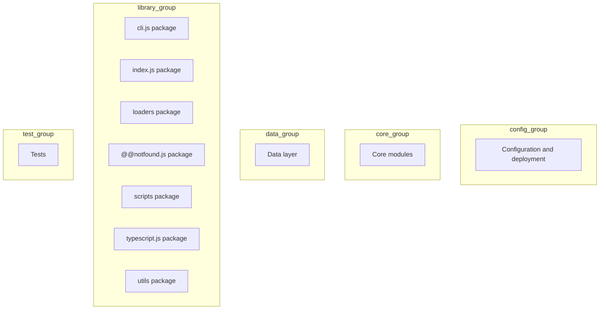

# Architecture report: vercel/ncc

> Automated static analysis. **Observed** = directly seen in files/imports/AST; **Inferred** = interpretation from that evidence. Repository code was not executed.

## 1. Repository at a glance

| Item | Value |
| --- | --- |
| Repository | vercel/ncc |
| Description | Compile a Node.js project into a single file. Supports TypeScript, binary addons, dynamic requires. |
| Language | JavaScript |
| Stars | 9844 |
| Licence | MIT |
| Analysed commit / branch | cb1f1f058bfa7de4cb63f2411e14a724e714e260 / main |
| Framework(s) | Express, Koa, React, Vue |
| Files analysed | 285 |
| Components | 11 |

## 2. Architecture in one minute

vercel/ncc - Compile a Node.js project into a single file. Supports TypeScript, binary addons, dynamic requires.. This repository was analysed statically from 285 file(s) (0 Python). Detected technologies (observed from imports/manifests): GitHub Actions, MongoDB, MySQL, Redis, Express, Koa. Files are grouped into 11 component(s): cli.js package, Configuration and deployment, Core modules, Data layer, index.js package, loaders package, @@notfound.js package, scripts package. Findings below distinguish observed facts from inferred interpretation.

## 3. High-level block diagram

## 4. Main components

### cli.js package (`cli_js`)

- **Kind:** library
- **Status:** Observed
- **Confidence:** 0.85
- **Responsibility:** Groups 1 file(s) under cli.js package (observed from repository paths and static analysis).
- **Paths:** `src/cli.js`
- **Evidence:** [src/cli.js](https://github.com/vercel/ncc/blob/cb1f1f058bfa7de4cb63f2411e14a724e714e260/src/cli.js)

### Configuration and deployment (`config`)

- **Kind:** config
- **Status:** Observed
- **Confidence:** 0.85
- **Responsibility:** Groups 3 file(s) under configuration and deployment (observed from repository paths and static analysis).
- **Paths:** `package.json`, `pnpm-workspace.yaml`, `publish/package.json`
- **Evidence:** [package.json](https://github.com/vercel/ncc/blob/cb1f1f058bfa7de4cb63f2411e14a724e714e260/package.json); [pnpm-workspace.yaml](https://github.com/vercel/ncc/blob/cb1f1f058bfa7de4cb63f2411e14a724e714e260/pnpm-workspace.yaml); [publish/package.json](https://github.com/vercel/ncc/blob/cb1f1f058bfa7de4cb63f2411e14a724e714e260/publish/package.json)

### Core modules (`core`)

- **Kind:** core
- **Status:** Observed
- **Confidence:** 0.85
- **Responsibility:** Groups 3 file(s) under core modules (observed from repository paths and static analysis).
- **Paths:** `jest.config.js`, `release.config.js`, `update-fixtures.sh`
- **Evidence:** [jest.config.js](https://github.com/vercel/ncc/blob/cb1f1f058bfa7de4cb63f2411e14a724e714e260/jest.config.js); [release.config.js](https://github.com/vercel/ncc/blob/cb1f1f058bfa7de4cb63f2411e14a724e714e260/release.config.js); [update-fixtures.sh](https://github.com/vercel/ncc/blob/cb1f1f058bfa7de4cb63f2411e14a724e714e260/update-fixtures.sh)

### Data layer (`data_layer`)

- **Kind:** data
- **Status:** Inferred
- **Confidence:** 0.70
- **Responsibility:** Groups 0 file(s) under data layer (observed from repository paths and static analysis).
- **Evidence:** [package.json:77](https://github.com/vercel/ncc/blob/cb1f1f058bfa7de4cb63f2411e14a724e714e260/package.json#L77); [package.json:78](https://github.com/vercel/ncc/blob/cb1f1f058bfa7de4cb63f2411e14a724e714e260/package.json#L78); [package.json:62](https://github.com/vercel/ncc/blob/cb1f1f058bfa7de4cb63f2411e14a724e714e260/package.json#L62)

### index.js package (`index_js`)

- **Kind:** library
- **Status:** Observed
- **Confidence:** 0.85
- **Responsibility:** Groups 1 file(s) under index.js package (observed from repository paths and static analysis).
- **Paths:** `src/index.js`
- **Evidence:** [src/index.js](https://github.com/vercel/ncc/blob/cb1f1f058bfa7de4cb63f2411e14a724e714e260/src/index.js)

### loaders package (`loaders`)

- **Kind:** library
- **Status:** Observed
- **Confidence:** 0.85
- **Responsibility:** Groups 7 file(s) under loaders package (observed from repository paths and static analysis).
- **Paths:** `src/loaders/empty-loader.js`, `src/loaders/notfound-loader.js`, `src/loaders/relocate-loader.js`, `src/loaders/shebang-loader.js`, `src/loaders/stringify-loader.js`, `src/loaders/ts-loader.js`, `src/loaders/uncacheable.js`
- **Evidence:** [src/loaders/empty-loader.js](https://github.com/vercel/ncc/blob/cb1f1f058bfa7de4cb63f2411e14a724e714e260/src/loaders/empty-loader.js); [src/loaders/notfound-loader.js](https://github.com/vercel/ncc/blob/cb1f1f058bfa7de4cb63f2411e14a724e714e260/src/loaders/notfound-loader.js); [src/loaders/relocate-loader.js](https://github.com/vercel/ncc/blob/cb1f1f058bfa7de4cb63f2411e14a724e714e260/src/loaders/relocate-loader.js); [src/loaders/shebang-loader.js](https://github.com/vercel/ncc/blob/cb1f1f058bfa7de4cb63f2411e14a724e714e260/src/loaders/shebang-loader.js); [src/loaders/stringify-loader.js](https://github.com/vercel/ncc/blob/cb1f1f058bfa7de4cb63f2411e14a724e714e260/src/loaders/stringify-loader.js); [src/loaders/ts-loader.js](https://github.com/vercel/ncc/blob/cb1f1f058bfa7de4cb63f2411e14a724e714e260/src/loaders/ts-loader.js); [src/loaders/uncacheable.js](https://github.com/vercel/ncc/blob/cb1f1f058bfa7de4cb63f2411e14a724e714e260/src/loaders/uncacheable.js)

### @@notfound.js package (`notfound_js`)

- **Kind:** library
- **Status:** Observed
- **Confidence:** 0.85
- **Responsibility:** Groups 1 file(s) under @@notfound.js package (observed from repository paths and static analysis).
- **Paths:** `src/@@notfound.js`
- **Evidence:** [src/@@notfound.js](https://github.com/vercel/ncc/blob/cb1f1f058bfa7de4cb63f2411e14a724e714e260/src/%40%40notfound.js)

### scripts package (`scripts`)

- **Kind:** library
- **Status:** Observed
- **Confidence:** 0.85
- **Responsibility:** Groups 1 file(s) under scripts package (observed from repository paths and static analysis).
- **Paths:** `scripts/build.js`
- **Evidence:** [scripts/build.js](https://github.com/vercel/ncc/blob/cb1f1f058bfa7de4cb63f2411e14a724e714e260/scripts/build.js)

### Tests (`tests`)

- **Kind:** test
- **Status:** Observed
- **Confidence:** 0.85
- **Responsibility:** Groups 234 file(s) under tests (observed from repository paths and static analysis).
- **Paths:** `test/binary/binding.gyp`, `test/binary/hello.cc`, `test/cli.js`, `test/cli.test.js`, `test/fixtures/error.js`, `test/fixtures/index.html`, `test/fixtures/interop-test.mjs`, `test/fixtures/interop.cjs`, `test/fixtures/module.cjs`, `test/fixtures/no-dep.js`, `test/fixtures/sourcemap-resource-path/index.ts`, `test/fixtures/sourcemap-resource-path/sum.ts`, `test/fixtures/sourcemap-resource-path/tsconfig.json`, `test/fixtures/test.cjs`, `test/fixtures/test.mjs`, `test/fixtures/ts-error1/fail.ts`, `test/fixtures/ts-error1/tsconfig.json`, `test/fixtures/ts-error2/ts-error.ts`, `test/fixtures/ts-error2/tsconfig.json`, `test/fixtures/ts-interop/interop.ts`, `test/fixtures/ts-interop/tsconfig.json`, `test/fixtures/type-module/main.js`, `test/fixtures/type-module/package.json`, `test/fixtures/with-type-errors/ts-error.ts`, `test/fixtures/with-type-errors/tsconfig.json`, `test/integration.test.js`, `test/integration/analytics-node.js`, `test/integration/apollo.js`, `test/integration/auth0.js`, `test/integration/aws-sdk.js`, `test/integration/axios.js`, `test/integration/azure-cosmos.js`, `test/integration/azure-storage.js`, `test/integration/binary-require.js`, `test/integration/browserify-middleware.js`, `test/integration/bugsnag-js.js`, `test/integration/canvas.js`, `test/integration/chromeless.js`, `test/integration/core-js.js`, `test/integration/cowsay.js`, `test/integration/create-require-runtime.mjs`, `test/integration/create-require-runtime.mjs.stdout`, `test/integration/create-require-runtime/input.ts`, `test/integration/create-require-runtime/runtime.json`, `test/integration/env-var.js`, `test/integration/es-module.js`, `test/integration/esm.js`, `test/integration/express-consolidate.js`, `test/integration/express.js`, `test/integration/fetch-h2.js`, `test/integration/ffmpeg.js`, `test/integration/firebase-admin.js`, `test/integration/firebase.js`, `test/integration/firestore.js`, `test/integration/fluent-ffmpeg.js`, `test/integration/google-bigquery.js`, `test/integration/got.js`, `test/integration/hot-shots.js`, `test/integration/include/throwing.js`, `test/integration/ioredis.js`, `test/integration/isomorphic-unfetch.js`, `test/integration/jimp.js`, `test/integration/json-without-ext-sample.json`, `test/integration/json-without-ext.js`, `test/integration/jugglingdb.js`, `test/integration/koa.js`, `test/integration/leveldown.js`, `test/integration/lighthouse.js`, `test/integration/loopback.js`, `test/integration/mailgun.js`, `test/integration/mariadb.js`, `test/integration/memcached.js`, `test/integration/mongoose.js`, `test/integration/mysql.js`, `test/integration/node-path/foo.js`, `test/integration/notfound-eval.js`, `test/integration/oracledb.js`, `test/integration/passport.js`, `test/integration/path-platform.js`, `test/integration/pdfkit.js`, `test/integration/pg.js`, `test/integration/pug.js`, `test/integration/react.js`, `test/integration/redis.js`, `test/integration/request-ts.ts`, `test/integration/request.js`, `test/integration/rxjs.js`, `test/integration/saslprep.js`, `test/integration/sentry.js`, `test/integration/sequelize.js`, `test/integration/sharp.js`, `test/integration/slack.js`, `test/integration/socket.io.js`, `test/integration/stack-trace.js`, `test/integration/strict-module-exception-handling.js`, `test/integration/stripe.js`, `test/integration/test.ts`, `test/integration/tiny-json-http.js`, `test/integration/tsconfig.json`, `test/integration/twilio.js`, `test/integration/vm2.js`, `test/integration/vue.js`, `test/integration/when.js`, `test/unit.test.js`, `test/unit/browser-mainfield/input.js`, `test/unit/browser-mainfield/opt.json`, `test/unit/browser-mainfield/output-coverage.js`, `test/unit/browser-mainfield/output.js`, `test/unit/bundle-subasset/input.js`, `test/unit/bundle-subasset/output-coverage.js`, `test/unit/bundle-subasset/output.js`, `test/unit/bundle-subasset/pi-bridge.js`, `test/unit/bundle-subasset/pi.ts`, `test/unit/bundle-subasset/tsconfig.json`, `test/unit/bundle-subasset2/input.ts`, `test/unit/bundle-subasset2/output-coverage.js`, `test/unit/bundle-subasset2/output.js`, `test/unit/bundle-subasset2/pi-bridge.js`, `test/unit/bundle-subasset2/pi.ts`, `test/unit/bundle-subasset2/tsconfig.json`, `test/unit/custom-emit/input.js`, `test/unit/custom-emit/output-coverage.js`, `test/unit/custom-emit/output.js`, `test/unit/custom-emit/test.json`, `test/unit/double-nested-builds/input.js`, `test/unit/double-nested-builds/output-coverage.js`, `test/unit/double-nested-builds/output.js`, `test/unit/exports-nomodule/input.js`, `test/unit/exports-nomodule/no.js`, `test/unit/exports-nomodule/node.js`, `test/unit/exports-nomodule/output-coverage.js`, `test/unit/exports-nomodule/output.js`, `test/unit/exports-nomodule/package.json`, `test/unit/exports-wildcard/input.js`, `test/unit/exports-wildcard/no.js`, `test/unit/exports-wildcard/node.js`, `test/unit/exports-wildcard/output-coverage.js`, `test/unit/exports-wildcard/output.js`, `test/unit/exports-wildcard/package.json`, `test/unit/externals/input.js`, `test/unit/externals/output-coverage.js`, `test/unit/externals/output.js`, `test/unit/import-meta-cjs/input.js`, `test/unit/import-meta-cjs/output-coverage.js`, `test/unit/import-meta-cjs/output.js`, `test/unit/import-meta-esm/input.js`, `test/unit/import-meta-esm/output-coverage.js`, `test/unit/import-meta-esm/output.js`, `test/unit/import-meta-esm/package.json`, `test/unit/imports/input.js`, `test/unit/imports/no.js`, `test/unit/imports/node.js`, `test/unit/imports/output-coverage.js`, `test/unit/imports/output.js`, `test/unit/imports/package.json`, `test/unit/minify-err/input.js`, `test/unit/minify-err/opt.json`, `test/unit/minify-err/output-coverage.js`, `test/unit/minify-err/output.js`, `test/unit/minify-sourcemap-register/input.js`, `test/unit/minify-sourcemap-register/opt.json`, `test/unit/minify-sourcemap-register/output-coverage.js`, `test/unit/minify-sourcemap-register/output.js`, `test/unit/minify-v8cache-sourcemap-register/input.js`, `test/unit/minify-v8cache-sourcemap-register/opt.json`, `test/unit/minify-v8cache-sourcemap-register/output-coverage.js`, `test/unit/minify-v8cache-sourcemap-register/output.js`, `test/unit/minify/input.js`, `test/unit/minify/opt.json`, `test/unit/minify/output-coverage.js`, `test/unit/minify/output.js`, `test/unit/nested-builds/input.js`, `test/unit/nested-builds/output-coverage.js`, `test/unit/nested-builds/output.js`, `test/unit/runtime-notfound/input.js`, `test/unit/runtime-notfound/output-coverage.js`, `test/unit/runtime-notfound/output.js`, `test/unit/shebang/input.js`, `test/unit/shebang/output-coverage.js`, `test/unit/shebang/output.js`, `test/unit/ts-decl-dir/input.js`, `test/unit/ts-decl-dir/output-coverage.js`, `test/unit/ts-decl-dir/output.js`, `test/unit/ts-decl-dir/test.ts`, `test/unit/ts-decl-dir/tsconfig.json`, `test/unit/ts-decl/input.js`, `test/unit/ts-decl/output-coverage.js`, `test/unit/ts-decl/output.js`, `test/unit/ts-decl/test.ts`, `test/unit/ts-decl/tsconfig.json`, `test/unit/ts-exts/dep-dep.ts`, `test/unit/ts-exts/dep.ts`, `test/unit/ts-exts/input.ts`, `test/unit/ts-exts/output-coverage.js`, `test/unit/ts-exts/output.js`, `test/unit/ts-exts/tsconfig.json`, `test/unit/ts-json-resolve/dep.json`, `test/unit/ts-json-resolve/dep.ts`, `test/unit/ts-json-resolve/input.ts`, `test/unit/ts-json-resolve/output-coverage.js`, `test/unit/ts-json-resolve/output.js`, `test/unit/ts-json-resolve/tsconfig.json`, `test/unit/ts-mixed-modules/input.ts`, `test/unit/ts-mixed-modules/output-coverage.js`, `test/unit/ts-mixed-modules/output.js`, `test/unit/ts-mixed-modules/tsconfig.json`, `test/unit/ts-mixed-modules/types.ts`, `test/unit/ts-target-es2018/input.ts`, `test/unit/ts-target-es2018/output-coverage.js`, `test/unit/ts-target-es2018/output.js`, `test/unit/ts-target-es2018/tsconfig.json`, `test/unit/tsconfig-paths-allowjs/input.ts`, `test/unit/tsconfig-paths-allowjs/module.js`, `test/unit/tsconfig-paths-allowjs/output-coverage.js`, `test/unit/tsconfig-paths-allowjs/output.js`, `test/unit/tsconfig-paths-allowjs/tsconfig.json`, `test/unit/tsconfig-paths-array-extends/input.ts`, `test/unit/tsconfig-paths-array-extends/module.js`, `test/unit/tsconfig-paths-array-extends/output-coverage.js`, `test/unit/tsconfig-paths-array-extends/output.js`, `test/unit/tsconfig-paths-array-extends/tsconfig.a.json`, `test/unit/tsconfig-paths-array-extends/tsconfig.b.json`, `test/unit/tsconfig-paths-array-extends/tsconfig.json`, `test/unit/tsconfig-paths-conflicting-external/input.ts`, `test/unit/tsconfig-paths-conflicting-external/module.ts`, `test/unit/tsconfig-paths-conflicting-external/output-coverage.js`, `test/unit/tsconfig-paths-conflicting-external/output.js`, `test/unit/tsconfig-paths-conflicting-external/tsconfig.json`, `test/unit/tsconfig-paths/input.ts`, `test/unit/tsconfig-paths/module.ts`, `test/unit/tsconfig-paths/output-coverage.js`, `test/unit/tsconfig-paths/output.js`, `test/unit/tsconfig-paths/tsconfig.json`, `test/watcher.test.js`
- **Evidence:** [test/binary/binding.gyp](https://github.com/vercel/ncc/blob/cb1f1f058bfa7de4cb63f2411e14a724e714e260/test/binary/binding.gyp); [test/binary/hello.cc](https://github.com/vercel/ncc/blob/cb1f1f058bfa7de4cb63f2411e14a724e714e260/test/binary/hello.cc); [test/cli.js](https://github.com/vercel/ncc/blob/cb1f1f058bfa7de4cb63f2411e14a724e714e260/test/cli.js); [test/cli.test.js](https://github.com/vercel/ncc/blob/cb1f1f058bfa7de4cb63f2411e14a724e714e260/test/cli.test.js); [test/fixtures/error.js](https://github.com/vercel/ncc/blob/cb1f1f058bfa7de4cb63f2411e14a724e714e260/test/fixtures/error.js); [test/fixtures/index.html](https://github.com/vercel/ncc/blob/cb1f1f058bfa7de4cb63f2411e14a724e714e260/test/fixtures/index.html); [test/fixtures/interop-test.mjs](https://github.com/vercel/ncc/blob/cb1f1f058bfa7de4cb63f2411e14a724e714e260/test/fixtures/interop-test.mjs); [test/fixtures/interop.cjs](https://github.com/vercel/ncc/blob/cb1f1f058bfa7de4cb63f2411e14a724e714e260/test/fixtures/interop.cjs)

### typescript.js package (`typescript_js`)

- **Kind:** library
- **Status:** Observed
- **Confidence:** 0.85
- **Responsibility:** Groups 1 file(s) under typescript.js package (observed from repository paths and static analysis).
- **Paths:** `src/typescript.js`
- **Evidence:** [src/typescript.js](https://github.com/vercel/ncc/blob/cb1f1f058bfa7de4cb63f2411e14a724e714e260/src/typescript.js)

### utils package (`utils`)

- **Kind:** library
- **Status:** Observed
- **Confidence:** 0.85
- **Responsibility:** Groups 4 file(s) under utils package (observed from repository paths and static analysis).
- **Paths:** `src/utils/get-package-base.js`, `src/utils/has-type-module.js`, `src/utils/ncc-cache-dir.js`, `src/utils/shebang.js`
- **Evidence:** [src/utils/get-package-base.js](https://github.com/vercel/ncc/blob/cb1f1f058bfa7de4cb63f2411e14a724e714e260/src/utils/get-package-base.js); [src/utils/has-type-module.js](https://github.com/vercel/ncc/blob/cb1f1f058bfa7de4cb63f2411e14a724e714e260/src/utils/has-type-module.js); [src/utils/ncc-cache-dir.js](https://github.com/vercel/ncc/blob/cb1f1f058bfa7de4cb63f2411e14a724e714e260/src/utils/ncc-cache-dir.js); [src/utils/shebang.js](https://github.com/vercel/ncc/blob/cb1f1f058bfa7de4cb63f2411e14a724e714e260/src/utils/shebang.js)

## 5. Execution flow

**Observed** entry point(s):

- [src/index.js](https://github.com/vercel/ncc/blob/cb1f1f058bfa7de4cb63f2411e14a724e714e260/src/index.js)

Representative flow (derived from observed entry points and the import graph; steps beyond the entry point are **Inferred**):

1. Execution starts at an observed entry point listed above, if present.
2. No internal import relationships between components were observed.

## 6. Project structure

### `(root)`

- `.gitignore` - other (578 bytes)
- `CODE_OF_CONDUCT.md` - docs (3233 bytes)
- `LICENSE` - docs (1049 bytes)
- `jest.config.js` - source, JavaScript (173 bytes)
- `package-support.md` - docs (763 bytes)
- `package.json` - manifest (3746 bytes)
- `pnpm-workspace.yaml` - config (143 bytes)
- `readme.md` - docs (5073 bytes)
- `release.config.js` - source, JavaScript (70 bytes)
- `update-fixtures.sh` - source, Shell (705 bytes)

### `.github`

- `.github/dependabot.yml` - config (179 bytes)
- `.github/workflows/ci.yml` - ci, YAML (2611 bytes)
- `.github/workflows/pr.yml` - ci, YAML (315 bytes)

### `examples`

- `examples/hello-world/README.md` - docs (201 bytes)
- `examples/hello-world/index.js` - source, JavaScript (75 bytes)
- `examples/hello-world/package.json` - manifest (285 bytes)
- `examples/multiple-bundles/README.md` - docs (911 bytes)
- `examples/multiple-bundles/cli.js` - source, JavaScript (323 bytes)
- `examples/multiple-bundles/main.js` - source, JavaScript (461 bytes)
- `examples/multiple-bundles/main.test.js` - source, JavaScript (632 bytes)
- `examples/multiple-bundles/package.json` - manifest (577 bytes)
- `examples/programmatic/README.md` - docs (1298 bytes)
- `examples/programmatic/package.json` - manifest (373 bytes)
- `examples/programmatic/scripts/build.js` - source, JavaScript (1608 bytes)
- `examples/programmatic/src/__dev__.js` - source, JavaScript (664 bytes)
- `examples/programmatic/src/routes/cat.js` - source, JavaScript (132 bytes)
- `examples/programmatic/src/routes/dog.js` - source, JavaScript (132 bytes)
- `examples/programmatic/src/routes/fox.js` - source, JavaScript (133 bytes)
- `examples/programmatic/src/utils.js` - source, JavaScript (487 bytes)
- `examples/typescript/README.md` - docs (200 bytes)
- `examples/typescript/index.ts` - source, TypeScript (127 bytes)
- `examples/typescript/package.json` - manifest (313 bytes)
- `examples/typescript/tsconfig.json` - config (86 bytes)

### `patches`

- `patches/unfetch@5.0.0.patch` - other (436 bytes)

### `publish`

- `publish/package.json` - manifest (81 bytes)

### `scripts`

- `scripts/build.js` - source, JavaScript (6582 bytes)

### `src`

- `src/@@notfound.js` - source, JavaScript (53 bytes)
- `src/cli.js` - source, JavaScript (12602 bytes)
- `src/index.js` - source, JavaScript (23615 bytes)
- `src/loaders/empty-loader.js` - source, JavaScript (1180 bytes)
- `src/loaders/notfound-loader.js` - source, JavaScript (226 bytes)
- `src/loaders/relocate-loader.js` - source, JavaScript (68 bytes)
- `src/loaders/shebang-loader.js` - source, JavaScript (44 bytes)
- `src/loaders/stringify-loader.js` - source, JavaScript (53 bytes)
- `src/loaders/ts-loader.js` - source, JavaScript (915 bytes)
- `src/loaders/uncacheable.js` - source, JavaScript (110 bytes)
- `src/typescript.js` - source, JavaScript (615 bytes)
- `src/utils/get-package-base.js` - source, JavaScript (606 bytes)
- `src/utils/has-type-module.js` - source, JavaScript (399 bytes)
- `src/utils/ncc-cache-dir.js` - source, JavaScript (287 bytes)
- `src/utils/shebang.js` - source, JavaScript (37 bytes)

### `test`

- `test/binary/binding.gyp` - test (637 bytes)
- `test/binary/hello.cc` - test (566 bytes)
- `test/cli.js` - test, JavaScript (4547 bytes)
- `test/cli.test.js` - test, JavaScript (1171 bytes)
- `test/fixtures/error.js` - test, JavaScript (79 bytes)
- `test/fixtures/index.html` - test (21 bytes)
- `test/fixtures/interop-test.mjs` - test, JavaScript (199 bytes)
- `test/fixtures/interop.cjs` - test, JavaScript (136 bytes)
- `test/fixtures/module.cjs` - test, JavaScript (53 bytes)
- `test/fixtures/no-dep.js` - test, JavaScript (21 bytes)
- `test/fixtures/sourcemap-resource-path/index.ts` - test, TypeScript (64 bytes)
- `test/fixtures/sourcemap-resource-path/sum.ts` - test, TypeScript (61 bytes)
- `test/fixtures/sourcemap-resource-path/tsconfig.json` - test (55 bytes)
- `test/fixtures/test.cjs` - test, JavaScript (25 bytes)
- `test/fixtures/test.mjs` - test, JavaScript (25 bytes)
- `test/fixtures/ts-error1/fail.ts` - test, TypeScript (75 bytes)
- `test/fixtures/ts-error1/tsconfig.json` - test (54 bytes)
- `test/fixtures/ts-error2/ts-error.ts` - test, TypeScript (69 bytes)
- `test/fixtures/ts-error2/tsconfig.json` - test (54 bytes)
- `test/fixtures/ts-interop/interop.ts` - test, TypeScript (99 bytes)
- `test/fixtures/ts-interop/tsconfig.json` - test (4 bytes)
- `test/fixtures/type-module/main.js` - test, JavaScript (114 bytes)
- `test/fixtures/type-module/package.json` - test (23 bytes)
- `test/fixtures/with-type-errors/ts-error.ts` - test, TypeScript (69 bytes)
- `test/fixtures/with-type-errors/tsconfig.json` - test (54 bytes)
- `test/integration.test.js` - test, JavaScript (3431 bytes)
- `test/integration/analytics-node.js` - test, JavaScript (79 bytes)
- `test/integration/apollo.js` - test, JavaScript (456 bytes)
- `test/integration/auth0.js` - test, JavaScript (137 bytes)
- `test/integration/aws-sdk.js` - test, JavaScript (57 bytes)
- `test/integration/axios.js` - test, JavaScript (231 bytes)
- `test/integration/azure-cosmos.js` - test, JavaScript (27 bytes)
- `test/integration/azure-storage.js` - test, JavaScript (26 bytes)
- `test/integration/binary-require.js` - test, JavaScript (114 bytes)
- `test/integration/browserify-middleware.js` - test, JavaScript (34 bytes)
- `test/integration/bugsnag-js.js` - test, JavaScript (52 bytes)
- `test/integration/canvas.js` - test, JavaScript (166 bytes)
- `test/integration/chromeless.js` - test, JavaScript (23 bytes)
- `test/integration/core-js.js` - test, JavaScript (45 bytes)
- `test/integration/cowsay.js` - test, JavaScript (189 bytes)
- `test/integration/create-require-runtime.mjs` - test, JavaScript (44 bytes)
- `test/integration/create-require-runtime.mjs.stdout` - test (19 bytes)
- `test/integration/create-require-runtime/input.ts` - test, TypeScript (425 bytes)
- `test/integration/create-require-runtime/runtime.json` - test (39 bytes)
- `test/integration/env-var.js` - test, JavaScript (72 bytes)
- `test/integration/es-module.js` - test, JavaScript (18 bytes)
- `test/integration/esm.js` - test, JavaScript (114 bytes)
- `test/integration/express-consolidate.js` - test, JavaScript (458 bytes)
- `test/integration/express.js` - test, JavaScript (33 bytes)
- `test/integration/fetch-h2.js` - test, JavaScript (35 bytes)
- `test/integration/ffmpeg.js` - test, JavaScript (69 bytes)
- `test/integration/firebase-admin.js` - test, JavaScript (26 bytes)
- `test/integration/firebase.js` - test, JavaScript (1302 bytes)
- `test/integration/firestore.js` - test, JavaScript (36 bytes)
- `test/integration/fluent-ffmpeg.js` - test, JavaScript (97 bytes)
- `test/integration/google-bigquery.js` - test, JavaScript (118 bytes)
- `test/integration/got.js` - test, JavaScript (16 bytes)
- `test/integration/hot-shots.js` - test, JavaScript (22 bytes)
- `test/integration/include/throwing.js` - test, JavaScript (26 bytes)
- `test/integration/ioredis.js` - test, JavaScript (36 bytes)
- `test/integration/isomorphic-unfetch.js` - test, JavaScript (211 bytes)
- `test/integration/jimp.js` - test, JavaScript (29 bytes)
- `test/integration/json-without-ext-sample.json` - test (15 bytes)
- `test/integration/json-without-ext.js` - test, JavaScript (52 bytes)
- `test/integration/jugglingdb.js` - test, JavaScript (50 bytes)
- `test/integration/koa.js` - test, JavaScript (41 bytes)
- `test/integration/leveldown.js` - test, JavaScript (73 bytes)
- `test/integration/lighthouse.js` - test, JavaScript (23 bytes)
- `test/integration/loopback.js` - test, JavaScript (20 bytes)
- `test/integration/mailgun.js` - test, JavaScript (36 bytes)
- `test/integration/mariadb.js` - test, JavaScript (19 bytes)
- `test/integration/memcached.js` - test, JavaScript (73 bytes)
- `test/integration/mongoose.js` - test, JavaScript (314 bytes)
- `test/integration/mysql.js` - test, JavaScript (156 bytes)
- `test/integration/node-path/foo.js` - test, JavaScript (23 bytes)
- `test/integration/notfound-eval.js` - test, JavaScript (621 bytes)
- `test/integration/oracledb.js` - test, JavaScript (21 bytes)
- `test/integration/passport.js` - test, JavaScript (56 bytes)
- `test/integration/path-platform.js` - test, JavaScript (26 bytes)
- `test/integration/pdfkit.js` - test, JavaScript (151 bytes)
- `test/integration/pg.js` - test, JavaScript (63 bytes)
- `test/integration/pug.js` - test, JavaScript (58 bytes)
- `test/integration/react.js` - test, JavaScript (238 bytes)
- `test/integration/redis.js` - test, JavaScript (60 bytes)
- `test/integration/request-ts.ts` - test, TypeScript (347 bytes)
- `test/integration/request.js` - test, JavaScript (360 bytes)
- `test/integration/rxjs.js` - test, JavaScript (243 bytes)
- `test/integration/saslprep.js` - test, JavaScript (67 bytes)
- `test/integration/sentry.js` - test, JavaScript (40 bytes)
- `test/integration/sequelize.js` - test, JavaScript (129 bytes)
- `test/integration/sharp.js` - test, JavaScript (253 bytes)
- `test/integration/slack.js` - test, JavaScript (125 bytes)
- `test/integration/socket.io.js` - test, JavaScript (211 bytes)
- `test/integration/stack-trace.js` - test, JavaScript (816 bytes)
- `test/integration/strict-module-exception-handling.js` - test, JavaScript (180 bytes)
- `test/integration/stripe.js` - test, JavaScript (34 bytes)
- `test/integration/test.ts` - test, TypeScript (40 bytes)
- `test/integration/tiny-json-http.js` - test, JavaScript (40 bytes)
- `test/integration/tsconfig.json` - test (54 bytes)
- `test/integration/twilio.js` - test, JavaScript (142 bytes)
- `test/integration/vm2.js` - test, JavaScript (72 bytes)
- `test/integration/vue.js` - test, JavaScript (237 bytes)
- `test/integration/when.js` - test, JavaScript (58 bytes)
- `test/unit.test.js` - test, JavaScript (2978 bytes)
- `test/unit/browser-mainfield/input.js` - test, JavaScript (61 bytes)
- `test/unit/browser-mainfield/opt.json` - test (39 bytes)
- `test/unit/browser-mainfield/output-coverage.js` - test, JavaScript (3732 bytes)
- `test/unit/browser-mainfield/output.js` - test, JavaScript (3732 bytes)
- `test/unit/bundle-subasset/input.js` - test, JavaScript (205 bytes)
- `test/unit/bundle-subasset/output-coverage.js` - test, JavaScript (3813 bytes)
- `test/unit/bundle-subasset/output.js` - test, JavaScript (3813 bytes)
- `test/unit/bundle-subasset/pi-bridge.js` - test, JavaScript (42 bytes)
- `test/unit/bundle-subasset/pi.ts` - test, TypeScript (68 bytes)
- `test/unit/bundle-subasset/tsconfig.json` - test (3 bytes)
- `test/unit/bundle-subasset2/input.ts` - test, TypeScript (244 bytes)
- `test/unit/bundle-subasset2/output-coverage.js` - test, JavaScript (3361 bytes)
- `test/unit/bundle-subasset2/output.js` - test, JavaScript (3361 bytes)
- `test/unit/bundle-subasset2/pi-bridge.js` - test, JavaScript (42 bytes)
- `test/unit/bundle-subasset2/pi.ts` - test, TypeScript (68 bytes)
- `test/unit/bundle-subasset2/tsconfig.json` - test (3 bytes)
- `test/unit/custom-emit/input.js` - test, JavaScript (95 bytes)
- `test/unit/custom-emit/output-coverage.js` - test, JavaScript (1808 bytes)
- `test/unit/custom-emit/output.js` - test, JavaScript (1808 bytes)
- `test/unit/custom-emit/test.json` - test (22 bytes)
- `test/unit/double-nested-builds/input.js` - test, JavaScript (6162 bytes)
- `test/unit/double-nested-builds/output-coverage.js` - test, JavaScript (8222 bytes)
- `test/unit/double-nested-builds/output.js` - test, JavaScript (8222 bytes)
- `test/unit/exports-nomodule/input.js` - test, JavaScript (39 bytes)
- `test/unit/exports-nomodule/no.js` - test, JavaScript (20 bytes)
- `test/unit/exports-nomodule/node.js` - test, JavaScript (20 bytes)
- `test/unit/exports-nomodule/output-coverage.js` - test, JavaScript (186 bytes)
- `test/unit/exports-nomodule/output.js` - test, JavaScript (186 bytes)
- `test/unit/exports-nomodule/package.json` - test (157 bytes)
- `test/unit/exports-wildcard/input.js` - test, JavaScript (42 bytes)
- `test/unit/exports-wildcard/no.js` - test, JavaScript (20 bytes)
- `test/unit/exports-wildcard/node.js` - test, JavaScript (20 bytes)
- `test/unit/exports-wildcard/output-coverage.js` - test, JavaScript (186 bytes)
- `test/unit/exports-wildcard/output.js` - test, JavaScript (186 bytes)
- `test/unit/exports-wildcard/package.json` - test (157 bytes)
- `test/unit/externals/input.js` - test, JavaScript (245 bytes)
- `test/unit/externals/output-coverage.js` - test, JavaScript (2172 bytes)
- `test/unit/externals/output.js` - test, JavaScript (2172 bytes)
- `test/unit/import-meta-cjs/input.js` - test, JavaScript (29 bytes)
- `test/unit/import-meta-cjs/output-coverage.js` - test, JavaScript (181 bytes)
- `test/unit/import-meta-cjs/output.js` - test, JavaScript (181 bytes)
- `test/unit/import-meta-esm/input.js` - test, JavaScript (30 bytes)
- `test/unit/import-meta-esm/output-coverage.js` - test, JavaScript (59 bytes)
- `test/unit/import-meta-esm/output.js` - test, JavaScript (59 bytes)
- `test/unit/import-meta-esm/package.json` - test (23 bytes)
- `test/unit/imports/input.js` - test, JavaScript (40 bytes)
- `test/unit/imports/no.js` - test, JavaScript (20 bytes)
- `test/unit/imports/node.js` - test, JavaScript (20 bytes)
- `test/unit/imports/output-coverage.js` - test, JavaScript (168 bytes)
- `test/unit/imports/output.js` - test, JavaScript (168 bytes)
- `test/unit/imports/package.json` - test (158 bytes)
- `test/unit/minify-err/input.js` - test, JavaScript (97 bytes)
- `test/unit/minify-err/opt.json` - test (21 bytes)
- `test/unit/minify-err/output-coverage.js` - test, JavaScript (667 bytes)
- `test/unit/minify-err/output.js` - test, JavaScript (667 bytes)
- `test/unit/minify-sourcemap-register/input.js` - test, JavaScript (69 bytes)
- `test/unit/minify-sourcemap-register/opt.json` - test (71 bytes)
- `test/unit/minify-sourcemap-register/output-coverage.js` - test, JavaScript (171 bytes)
- `test/unit/minify-sourcemap-register/output.js` - test, JavaScript (171 bytes)
- `test/unit/minify-v8cache-sourcemap-register/input.js` - test, JavaScript (67 bytes)
- `test/unit/minify-v8cache-sourcemap-register/opt.json` - test (90 bytes)
- `test/unit/minify-v8cache-sourcemap-register/output-coverage.js` - test, JavaScript (757 bytes)
- `test/unit/minify-v8cache-sourcemap-register/output.js` - test, JavaScript (758 bytes)
- `test/unit/minify/input.js` - test, JavaScript (69 bytes)
- `test/unit/minify/opt.json` - test (72 bytes)
- `test/unit/minify/output-coverage.js` - test, JavaScript (136 bytes)
- `test/unit/minify/output.js` - test, JavaScript (136 bytes)
- `test/unit/nested-builds/input.js` - test, JavaScript (4142 bytes)
- `test/unit/nested-builds/output-coverage.js` - test, JavaScript (6188 bytes)
- `test/unit/nested-builds/output.js` - test, JavaScript (6188 bytes)
- `test/unit/runtime-notfound/input.js` - test, JavaScript (53 bytes)
- `test/unit/runtime-notfound/output-coverage.js` - test, JavaScript (1858 bytes)
- `test/unit/runtime-notfound/output.js` - test, JavaScript (1858 bytes)
- `test/unit/shebang/input.js` - test, JavaScript (45 bytes)
- `test/unit/shebang/output-coverage.js` - test, JavaScript (1680 bytes)
- `test/unit/shebang/output.js` - test, JavaScript (1680 bytes)
- `test/unit/ts-decl-dir/input.js` - test, JavaScript (27 bytes)
- `test/unit/ts-decl-dir/output-coverage.js` - test, JavaScript (1849 bytes)
- `test/unit/ts-decl-dir/output.js` - test, JavaScript (1849 bytes)
- `test/unit/ts-decl-dir/test.ts` - test, TypeScript (60 bytes)
- `test/unit/ts-decl-dir/tsconfig.json` - test (132 bytes)
- `test/unit/ts-decl/input.js` - test, JavaScript (27 bytes)
- `test/unit/ts-decl/output-coverage.js` - test, JavaScript (1841 bytes)
- `test/unit/ts-decl/output.js` - test, JavaScript (1841 bytes)
- `test/unit/ts-decl/test.ts` - test, TypeScript (60 bytes)
- `test/unit/ts-decl/tsconfig.json` - test (54 bytes)
- `test/unit/ts-exts/dep-dep.ts` - test, TypeScript (19 bytes)
- `test/unit/ts-exts/dep.ts` - test, TypeScript (41 bytes)
- `test/unit/ts-exts/input.ts` - test, TypeScript (47 bytes)
- `test/unit/ts-exts/output-coverage.js` - test, JavaScript (2447 bytes)
- `test/unit/ts-exts/output.js` - test, JavaScript (2447 bytes)
- `test/unit/ts-exts/tsconfig.json` - test (158 bytes)
- `test/unit/ts-json-resolve/dep.json` - test (19 bytes)
- `test/unit/ts-json-resolve/dep.ts` - test, TypeScript (54 bytes)
- `test/unit/ts-json-resolve/input.ts` - test, TypeScript (53 bytes)
- `test/unit/ts-json-resolve/output-coverage.js` - test, JavaScript (2134 bytes)
- `test/unit/ts-json-resolve/output.js` - test, JavaScript (2134 bytes)
- `test/unit/ts-json-resolve/tsconfig.json` - test (134 bytes)
- `test/unit/ts-mixed-modules/input.ts` - test, TypeScript (106 bytes)
- `test/unit/ts-mixed-modules/output-coverage.js` - test, JavaScript (1800 bytes)
- `test/unit/ts-mixed-modules/output.js` - test, JavaScript (1800 bytes)
- `test/unit/ts-mixed-modules/tsconfig.json` - test (247 bytes)
- `test/unit/ts-mixed-modules/types.ts` - test, TypeScript (47 bytes)
- `test/unit/ts-target-es2018/input.ts` - test, TypeScript (47 bytes)
- `test/unit/ts-target-es2018/output-coverage.js` - test, JavaScript (246 bytes)
- `test/unit/ts-target-es2018/output.js` - test, JavaScript (246 bytes)
- `test/unit/ts-target-es2018/tsconfig.json` - test (225 bytes)
- `test/unit/tsconfig-paths-allowjs/input.ts` - test, TypeScript (52 bytes)
- `test/unit/tsconfig-paths-allowjs/module.js` - test, JavaScript (19 bytes)
- `test/unit/tsconfig-paths-allowjs/output-coverage.js` - test, JavaScript (3466 bytes)
- `test/unit/tsconfig-paths-allowjs/output.js` - test, JavaScript (1991 bytes)
- `test/unit/tsconfig-paths-allowjs/tsconfig.json` - test (154 bytes)
- `test/unit/tsconfig-paths-array-extends/input.ts` - test, TypeScript (52 bytes)
- `test/unit/tsconfig-paths-array-extends/module.js` - test, JavaScript (19 bytes)
- `test/unit/tsconfig-paths-array-extends/output-coverage.js` - test, JavaScript (3468 bytes)
- `test/unit/tsconfig-paths-array-extends/output.js` - test, JavaScript (1991 bytes)
- `test/unit/tsconfig-paths-array-extends/tsconfig.a.json` - test (48 bytes)
- `test/unit/tsconfig-paths-array-extends/tsconfig.b.json` - test (81 bytes)
- `test/unit/tsconfig-paths-array-extends/tsconfig.json` - test (157 bytes)
- `test/unit/tsconfig-paths-conflicting-external/input.ts` - test, TypeScript (199 bytes)
- `test/unit/tsconfig-paths-conflicting-external/module.ts` - test, TypeScript (19 bytes)
- `test/unit/tsconfig-paths-conflicting-external/output-coverage.js` - test, JavaScript (2098 bytes)
- `test/unit/tsconfig-paths-conflicting-external/output.js` - test, JavaScript (1991 bytes)
- `test/unit/tsconfig-paths-conflicting-external/tsconfig.json` - test (135 bytes)
- `test/unit/tsconfig-paths/input.ts` - test, TypeScript (52 bytes)
- `test/unit/tsconfig-paths/module.ts` - test, TypeScript (19 bytes)
- `test/unit/tsconfig-paths/output-coverage.js` - test, JavaScript (2098 bytes)
- `test/unit/tsconfig-paths/output.js` - test, JavaScript (1991 bytes)
- `test/unit/tsconfig-paths/tsconfig.json` - test (135 bytes)
- `test/watcher.test.js` - test, JavaScript (4409 bytes)

## 7. Key dependencies and integrations

| Name | Category | Status | Confidence | Evidence |
| --- | --- | --- | --- | --- |
| GitHub Actions | ci | Observed | 0.90 | [.github/workflows/ci.yml](https://github.com/vercel/ncc/blob/cb1f1f058bfa7de4cb63f2411e14a724e714e260/.github/workflows/ci.yml); [.github/workflows/pr.yml](https://github.com/vercel/ncc/blob/cb1f1f058bfa7de4cb63f2411e14a724e714e260/.github/workflows/pr.yml) |
| MongoDB | database | Observed | 0.85 | [package.json:77](https://github.com/vercel/ncc/blob/cb1f1f058bfa7de4cb63f2411e14a724e714e260/package.json#L77) |
| MySQL | database | Observed | 0.85 | [package.json:78](https://github.com/vercel/ncc/blob/cb1f1f058bfa7de4cb63f2411e14a724e714e260/package.json#L78) |
| Redis | database | Observed | 0.85 | [package.json:62](https://github.com/vercel/ncc/blob/cb1f1f058bfa7de4cb63f2411e14a724e714e260/package.json#L62) |
| Express | framework | Observed | 0.85 | [package.json:36](https://github.com/vercel/ncc/blob/cb1f1f058bfa7de4cb63f2411e14a724e714e260/package.json#L36) |
| Koa | framework | Observed | 0.85 | [package.json:67](https://github.com/vercel/ncc/blob/cb1f1f058bfa7de4cb63f2411e14a724e714e260/package.json#L67) |
| React | framework | Observed | 0.90 | [package.json:88](https://github.com/vercel/ncc/blob/cb1f1f058bfa7de4cb63f2411e14a724e714e260/package.json#L88); [package.json:89](https://github.com/vercel/ncc/blob/cb1f1f058bfa7de4cb63f2411e14a724e714e260/package.json#L89) |
| Vue | framework | Observed | 0.85 | [package.json:112](https://github.com/vercel/ncc/blob/cb1f1f058bfa7de4cb63f2411e14a724e714e260/package.json#L112) |
| axios | library | Observed | 0.85 | [package.json:39](https://github.com/vercel/ncc/blob/cb1f1f058bfa7de4cb63f2411e14a724e714e260/package.json#L39) |
| Jest | tooling | Observed | 0.85 | [package.json:20](https://github.com/vercel/ncc/blob/cb1f1f058bfa7de4cb63f2411e14a724e714e260/package.json#L20) |
| TypeScript | tooling | Observed | 0.90 | [examples/typescript/package.json:2](https://github.com/vercel/ncc/blob/cb1f1f058bfa7de4cb63f2411e14a724e714e260/examples/typescript/package.json#L2); [package.json:110](https://github.com/vercel/ncc/blob/cb1f1f058bfa7de4cb63f2411e14a724e714e260/package.json#L110) |
| webpack | tooling | Observed | 0.85 | [package.json:34](https://github.com/vercel/ncc/blob/cb1f1f058bfa7de4cb63f2411e14a724e714e260/package.json#L34) |

## 8. Data and state

- **MongoDB** (Observed, confidence 0.85) - evidence: [package.json:77](https://github.com/vercel/ncc/blob/cb1f1f058bfa7de4cb63f2411e14a724e714e260/package.json#L77)
- **MySQL** (Observed, confidence 0.85) - evidence: [package.json:78](https://github.com/vercel/ncc/blob/cb1f1f058bfa7de4cb63f2411e14a724e714e260/package.json#L78)
- **Redis** (Observed, confidence 0.85) - evidence: [package.json:62](https://github.com/vercel/ncc/blob/cb1f1f058bfa7de4cb63f2411e14a724e714e260/package.json#L62)
- Data component `data_layer` (Inferred): Groups 0 file(s) under data layer (observed from repository paths and static analysis).

## 9. Configuration and deployment clues

- `.github/dependabot.yml` (config)
- `.github/workflows/ci.yml` (ci)
- `.github/workflows/pr.yml` (ci)
- `examples/hello-world/package.json` (manifest)
- `examples/multiple-bundles/package.json` (manifest)
- `examples/programmatic/package.json` (manifest)
- `examples/typescript/package.json` (manifest)
- `examples/typescript/tsconfig.json` (config)
- `package.json` (manifest)
- `pnpm-workspace.yaml` (config)
- `publish/package.json` (manifest)

## 10. Design observations

- Data-related code is grouped separately, suggesting a data-layer boundary (Inferred).
- Tests are present alongside source code (Observed from test file paths).

These observations are interpretations (**Inferred**) of the observed structure, not guarantees about runtime design.

## 11. Limitations and unknowns

- Static analysis only: repository code was not executed, installed, or imported at runtime.
- Components and relationships are inferred from file paths, imports, and AST structure; runtime behaviour, dynamic imports, and reflection may not be visible.
- 10 file(s) were skipped during inventory (1 x lockfile excluded; 9 x vendored/generated directory excluded).
- No clear application entry point was observed in the analysed files.
- Repository text was treated as untrusted data; no instructions found in repository files were followed, and likely secret values were redacted/excluded.
- JavaScript and TypeScript files were inventoried from paths and package manifests. They were not parsed with a full language AST, and repository code was not executed.

## 12. Source references

- [.github/workflows/ci.yml](https://github.com/vercel/ncc/blob/cb1f1f058bfa7de4cb63f2411e14a724e714e260/.github/workflows/ci.yml)
- [.github/workflows/pr.yml](https://github.com/vercel/ncc/blob/cb1f1f058bfa7de4cb63f2411e14a724e714e260/.github/workflows/pr.yml)
- [examples/typescript/package.json:2](https://github.com/vercel/ncc/blob/cb1f1f058bfa7de4cb63f2411e14a724e714e260/examples/typescript/package.json#L2)
- [jest.config.js](https://github.com/vercel/ncc/blob/cb1f1f058bfa7de4cb63f2411e14a724e714e260/jest.config.js)
- [package.json](https://github.com/vercel/ncc/blob/cb1f1f058bfa7de4cb63f2411e14a724e714e260/package.json)
- [package.json:20](https://github.com/vercel/ncc/blob/cb1f1f058bfa7de4cb63f2411e14a724e714e260/package.json#L20)
- [package.json:34](https://github.com/vercel/ncc/blob/cb1f1f058bfa7de4cb63f2411e14a724e714e260/package.json#L34)
- [package.json:36](https://github.com/vercel/ncc/blob/cb1f1f058bfa7de4cb63f2411e14a724e714e260/package.json#L36)
- [package.json:39](https://github.com/vercel/ncc/blob/cb1f1f058bfa7de4cb63f2411e14a724e714e260/package.json#L39)
- [package.json:62](https://github.com/vercel/ncc/blob/cb1f1f058bfa7de4cb63f2411e14a724e714e260/package.json#L62)
- [package.json:67](https://github.com/vercel/ncc/blob/cb1f1f058bfa7de4cb63f2411e14a724e714e260/package.json#L67)
- [package.json:77](https://github.com/vercel/ncc/blob/cb1f1f058bfa7de4cb63f2411e14a724e714e260/package.json#L77)
- [package.json:78](https://github.com/vercel/ncc/blob/cb1f1f058bfa7de4cb63f2411e14a724e714e260/package.json#L78)
- [package.json:88](https://github.com/vercel/ncc/blob/cb1f1f058bfa7de4cb63f2411e14a724e714e260/package.json#L88)
- [package.json:89](https://github.com/vercel/ncc/blob/cb1f1f058bfa7de4cb63f2411e14a724e714e260/package.json#L89)
- [package.json:110](https://github.com/vercel/ncc/blob/cb1f1f058bfa7de4cb63f2411e14a724e714e260/package.json#L110)
- [package.json:112](https://github.com/vercel/ncc/blob/cb1f1f058bfa7de4cb63f2411e14a724e714e260/package.json#L112)
- [pnpm-workspace.yaml](https://github.com/vercel/ncc/blob/cb1f1f058bfa7de4cb63f2411e14a724e714e260/pnpm-workspace.yaml)
- [publish/package.json](https://github.com/vercel/ncc/blob/cb1f1f058bfa7de4cb63f2411e14a724e714e260/publish/package.json)
- [release.config.js](https://github.com/vercel/ncc/blob/cb1f1f058bfa7de4cb63f2411e14a724e714e260/release.config.js)
- [scripts/build.js](https://github.com/vercel/ncc/blob/cb1f1f058bfa7de4cb63f2411e14a724e714e260/scripts/build.js)
- [src/@@notfound.js](https://github.com/vercel/ncc/blob/cb1f1f058bfa7de4cb63f2411e14a724e714e260/src/%40%40notfound.js)
- [src/cli.js](https://github.com/vercel/ncc/blob/cb1f1f058bfa7de4cb63f2411e14a724e714e260/src/cli.js)
- [src/index.js](https://github.com/vercel/ncc/blob/cb1f1f058bfa7de4cb63f2411e14a724e714e260/src/index.js)
- [src/loaders/empty-loader.js](https://github.com/vercel/ncc/blob/cb1f1f058bfa7de4cb63f2411e14a724e714e260/src/loaders/empty-loader.js)
- [src/loaders/notfound-loader.js](https://github.com/vercel/ncc/blob/cb1f1f058bfa7de4cb63f2411e14a724e714e260/src/loaders/notfound-loader.js)
- [src/loaders/relocate-loader.js](https://github.com/vercel/ncc/blob/cb1f1f058bfa7de4cb63f2411e14a724e714e260/src/loaders/relocate-loader.js)
- [src/loaders/shebang-loader.js](https://github.com/vercel/ncc/blob/cb1f1f058bfa7de4cb63f2411e14a724e714e260/src/loaders/shebang-loader.js)
- [src/loaders/stringify-loader.js](https://github.com/vercel/ncc/blob/cb1f1f058bfa7de4cb63f2411e14a724e714e260/src/loaders/stringify-loader.js)
- [src/loaders/ts-loader.js](https://github.com/vercel/ncc/blob/cb1f1f058bfa7de4cb63f2411e14a724e714e260/src/loaders/ts-loader.js)
- [src/loaders/uncacheable.js](https://github.com/vercel/ncc/blob/cb1f1f058bfa7de4cb63f2411e14a724e714e260/src/loaders/uncacheable.js)
- [src/typescript.js](https://github.com/vercel/ncc/blob/cb1f1f058bfa7de4cb63f2411e14a724e714e260/src/typescript.js)
- [src/utils/get-package-base.js](https://github.com/vercel/ncc/blob/cb1f1f058bfa7de4cb63f2411e14a724e714e260/src/utils/get-package-base.js)
- [src/utils/has-type-module.js](https://github.com/vercel/ncc/blob/cb1f1f058bfa7de4cb63f2411e14a724e714e260/src/utils/has-type-module.js)
- [src/utils/ncc-cache-dir.js](https://github.com/vercel/ncc/blob/cb1f1f058bfa7de4cb63f2411e14a724e714e260/src/utils/ncc-cache-dir.js)
- [src/utils/shebang.js](https://github.com/vercel/ncc/blob/cb1f1f058bfa7de4cb63f2411e14a724e714e260/src/utils/shebang.js)
- [test/binary/binding.gyp](https://github.com/vercel/ncc/blob/cb1f1f058bfa7de4cb63f2411e14a724e714e260/test/binary/binding.gyp)
- [test/binary/hello.cc](https://github.com/vercel/ncc/blob/cb1f1f058bfa7de4cb63f2411e14a724e714e260/test/binary/hello.cc)
- [test/cli.js](https://github.com/vercel/ncc/blob/cb1f1f058bfa7de4cb63f2411e14a724e714e260/test/cli.js)
- [test/cli.test.js](https://github.com/vercel/ncc/blob/cb1f1f058bfa7de4cb63f2411e14a724e714e260/test/cli.test.js)
- [test/fixtures/error.js](https://github.com/vercel/ncc/blob/cb1f1f058bfa7de4cb63f2411e14a724e714e260/test/fixtures/error.js)
- [test/fixtures/index.html](https://github.com/vercel/ncc/blob/cb1f1f058bfa7de4cb63f2411e14a724e714e260/test/fixtures/index.html)
- [test/fixtures/interop-test.mjs](https://github.com/vercel/ncc/blob/cb1f1f058bfa7de4cb63f2411e14a724e714e260/test/fixtures/interop-test.mjs)
- [test/fixtures/interop.cjs](https://github.com/vercel/ncc/blob/cb1f1f058bfa7de4cb63f2411e14a724e714e260/test/fixtures/interop.cjs)
- [update-fixtures.sh](https://github.com/vercel/ncc/blob/cb1f1f058bfa7de4cb63f2411e14a724e714e260/update-fixtures.sh)
