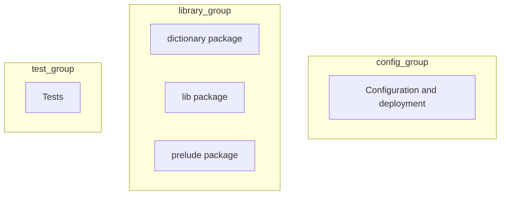

# Architecture report: vercel/pkg

> Automated static analysis. **Observed** = directly seen in files/imports/AST; **Inferred** = interpretation from that evidence. Repository code was not executed.

## 1. Repository at a glance

| Item | Value |
| --- | --- |
| Repository | vercel/pkg |
| Description | Package your Node.js project into an executable |
| Language | JavaScript |
| Stars | 24294 |
| Licence | MIT |
| Analysed commit / branch | 9066ceeb391d9c7ba6aba650109c2fa3f8e088eb / main |
| Framework(s) | Express |
| Files analysed | 703 |
| Components | 5 |

## 2. Architecture in one minute

vercel/pkg - Package your Node.js project into an executable. This repository was analysed statically from 703 file(s) (0 Python). Detected technologies (observed from imports/manifests): GitHub Actions, Express, TypeScript. Files are grouped into 5 component(s): Configuration and deployment, dictionary package, lib package, prelude package, Tests. Findings below distinguish observed facts from inferred interpretation.

## 3. High-level block diagram

## 4. Main components

### Configuration and deployment (`config`)

- **Kind:** config
- **Status:** Observed
- **Confidence:** 0.85
- **Responsibility:** Groups 3 file(s) under configuration and deployment (observed from repository paths and static analysis).
- **Paths:** `dictionary/.eslintrc.json`, `package.json`, `prelude/.eslintrc.json`
- **Evidence:** [dictionary/.eslintrc.json](https://github.com/vercel/pkg/blob/9066ceeb391d9c7ba6aba650109c2fa3f8e088eb/dictionary/.eslintrc.json); [package.json](https://github.com/vercel/pkg/blob/9066ceeb391d9c7ba6aba650109c2fa3f8e088eb/package.json); [prelude/.eslintrc.json](https://github.com/vercel/pkg/blob/9066ceeb391d9c7ba6aba650109c2fa3f8e088eb/prelude/.eslintrc.json)

### dictionary package (`dictionary`)

- **Kind:** library
- **Status:** Observed
- **Confidence:** 0.85
- **Responsibility:** Groups 235 file(s) under dictionary package (observed from repository paths and static analysis).
- **Paths:** `dictionary/angular-bridge.js`, `dictionary/any-promise.js`, `dictionary/async.js`, `dictionary/aws-sdk.js`, `dictionary/babel-core.js`, `dictionary/batch.js`, `dictionary/bcrypt.js`, `dictionary/better-sqlite3.js`, `dictionary/bignum.js`, `dictionary/bindings.js`, `dictionary/blessed.js`, `dictionary/body-parser.js`, `dictionary/browserify.js`, `dictionary/bson.js`, `dictionary/buffermaker.js`, `dictionary/bunyan.js`, `dictionary/busboy.js`, `dictionary/bytes.js`, `dictionary/callsites.js`, `dictionary/chokidar.js`, `dictionary/coffee-script.js`, `dictionary/colors.js`, `dictionary/compression.js`, `dictionary/compressjs.js`, `dictionary/connect-mongo.js`, `dictionary/connect-mongodb.js`, `dictionary/connect-redis.js`, `dictionary/connect.js`, `dictionary/consolidate.js`, `dictionary/cookie-parser.js`, `dictionary/cookie.js`, `dictionary/cors.js`, `dictionary/cron.js`, `dictionary/cross-env.js`, `dictionary/cross-spawn-async.js`, `dictionary/curve25519.js`, `dictionary/data-preflight.js`, `dictionary/debug.js`, `dictionary/denymount.js`, `dictionary/diff.js`, `dictionary/drivelist.js`, `dictionary/ed25519.js`, `dictionary/ejs.js`, `dictionary/elasticsearch.js`, `dictionary/electron.js`, `dictionary/emailjs.js`, `dictionary/engine.io.js`, `dictionary/epoll.js`, `dictionary/errorhandler.js`, `dictionary/errors.js`, `dictionary/eslint.js`, `dictionary/etcher-image-write.js`, `dictionary/exceljs.js`, `dictionary/exiftool.exe.js`, `dictionary/exiftool.pl.js`, `dictionary/express-load.js`, `dictionary/express-session.js`, `dictionary/express.js`, `dictionary/extender.js`, `dictionary/extsprintf.js`, `dictionary/faye-websocket.js`, `dictionary/feathers.js`, `dictionary/findup-sync.js`, `dictionary/floordate.js`, `dictionary/fmt.js`, `dictionary/formidable.js`, `dictionary/fs-extra.js`, `dictionary/fsevents.js`, `dictionary/geoip-lite.js`, `dictionary/github.js`, `dictionary/gm.js`, `dictionary/google-closure-compiler-java.js`, `dictionary/google-closure-compiler.js`, `dictionary/googleapis.js`, `dictionary/got.js`, `dictionary/graceful-fs.js`, `dictionary/grpc.js`, `dictionary/gulp.js`, `dictionary/hap-nodejs.js`, `dictionary/heapdump.js`, `dictionary/hoek.js`, `dictionary/homebridge.js`, `dictionary/http-proxy.js`, `dictionary/http-server.js`, `dictionary/image-size.js`, `dictionary/indexof.js`, `dictionary/inquirer.js`, `dictionary/j.js`, `dictionary/jade.js`, `dictionary/jsdom.js`, `dictionary/json-stringify-date.js`, `dictionary/json-stringify-safe.js`, `dictionary/jsonwebtoken.js`, `dictionary/kerberos.js`, `dictionary/knex.js`, `dictionary/later.js`, `dictionary/level.js`, `dictionary/leveldown.js`, `dictionary/levelup.js`, `dictionary/liftoff.js`, `dictionary/lodash.js`, `dictionary/log4js.js`, `dictionary/logform.js`, `dictionary/machinepack-urls.js`, `dictionary/markdown.js`, `dictionary/mdns.js`, `dictionary/method-override.js`, `dictionary/microjob.js`, `dictionary/mime-types.js`, `dictionary/mime.js`, `dictionary/minimatch.js`, `dictionary/minstache.js`, `dictionary/module-deps.js`, `dictionary/moment-timezone.js`, `dictionary/moment.js`, `dictionary/mongodb-core.js`, `dictionary/mongodb.js`, `dictionary/mongoose.js`, `dictionary/mongoskin.js`, `dictionary/ms.js`, `dictionary/msgpack.js`, `dictionary/multer.js`, `dictionary/muri.js`, `dictionary/native-or-bluebird.js`, `dictionary/natives.js`, `dictionary/nconf.js`, `dictionary/nedb.js`, `dictionary/negotiator.js`, `dictionary/newrelic.js`, `dictionary/nib.js`, `dictionary/nightmare.js`, `dictionary/node-forge.js`, `dictionary/node-libcurl.js`, `dictionary/node-notifier.js`, `dictionary/node-pre-gyp.js`, `dictionary/node-redis-pubsub.js`, `dictionary/node-sass.js`, `dictionary/node-uuid.js`, `dictionary/node-xlsx.js`, `dictionary/node-zookeeper-client.js`, `dictionary/nodegit.js`, `dictionary/nodemailer-sendmail-transport.js`, `dictionary/nodemailer.js`, `dictionary/npm-registry-client.js`, `dictionary/npm.js`, `dictionary/nssocket.js`, `dictionary/oauth2orize.js`, `dictionary/octobat.js`, `dictionary/open.js`, `dictionary/opn.js`, `dictionary/optimist.js`, `dictionary/passport-local.js`, `dictionary/passport.js`, `dictionary/pg-cursor.js`, `dictionary/pg-query-stream.js`, `dictionary/pg-types.js`, `dictionary/pg.js`, `dictionary/pg.js.js`, `dictionary/pgpass.js`, `dictionary/phantom.js`, `dictionary/phantomjs-prebuilt.js`, `dictionary/pkginfo.js`, `dictionary/pm2.js`, `dictionary/pmx.js`, `dictionary/pouchdb.js`, `dictionary/primus-emitter.js`, `dictionary/primus-spark-latency.js`, `dictionary/primus.js`, `dictionary/publicsuffixlist.js`, `dictionary/pug.js`, `dictionary/punt.js`, `dictionary/puppeteer.js`, `dictionary/pwd.js`, `dictionary/q.js`, `dictionary/raven.js`, `dictionary/rc.js`, `dictionary/readable-stream.js`, `dictionary/rechoir.js`, `dictionary/redis-parser.js`, `dictionary/redis.js`, `dictionary/regression.js`, `dictionary/reload.js`, `dictionary/request.js`, `dictionary/require-uncached.js`, `dictionary/require_optional.js`, `dictionary/s3.js`, `dictionary/safe_datejs.js`, `dictionary/sails.js`, `dictionary/sax.js`, `dictionary/scrypt.js`, `dictionary/semver.js`, `dictionary/sequelize.js`, `dictionary/serialport.js`, `dictionary/sha3.js`, `dictionary/sharp.js`, `dictionary/shelljs.js`, `dictionary/sinon.js`, `dictionary/socket.io-client.js`, `dictionary/socket.io.js`, `dictionary/sqip.js`, `dictionary/sqlite3.js`, `dictionary/steam-crypto.js`, `dictionary/steam-resources.js`, `dictionary/steam.js`, `dictionary/stripe-webhook-middleware.js`, `dictionary/stripe.js`, `dictionary/strong-globalize.js`, `dictionary/stylus.js`, `dictionary/supervisor.js`, `dictionary/svgo.js`, `dictionary/tabtab.js`, `dictionary/tesseract.js.js`, `dictionary/throng.js`, `dictionary/time.js`, `dictionary/tinify.js`, `dictionary/tiny-worker.js`, `dictionary/tmp.js`, `dictionary/transformers.js`, `dictionary/uglify-js.js`, `dictionary/umd.js`, `dictionary/underscore.js`, `dictionary/union.js`, `dictionary/update-notifier.js`, `dictionary/usage.js`, `dictionary/v8flags.js`, `dictionary/verror.js`, `dictionary/voc.js`, `dictionary/webdriverio.js`, `dictionary/winston-uber.js`, `dictionary/winston.js`, `dictionary/ws.js`, `dictionary/xlsx.js`, `dictionary/xml2js.js`, `dictionary/yargs.js`, `dictionary/zeromq.js`
- **Evidence:** [dictionary/angular-bridge.js](https://github.com/vercel/pkg/blob/9066ceeb391d9c7ba6aba650109c2fa3f8e088eb/dictionary/angular-bridge.js); [dictionary/any-promise.js](https://github.com/vercel/pkg/blob/9066ceeb391d9c7ba6aba650109c2fa3f8e088eb/dictionary/any-promise.js); [dictionary/async.js](https://github.com/vercel/pkg/blob/9066ceeb391d9c7ba6aba650109c2fa3f8e088eb/dictionary/async.js); [dictionary/aws-sdk.js](https://github.com/vercel/pkg/blob/9066ceeb391d9c7ba6aba650109c2fa3f8e088eb/dictionary/aws-sdk.js); [dictionary/babel-core.js](https://github.com/vercel/pkg/blob/9066ceeb391d9c7ba6aba650109c2fa3f8e088eb/dictionary/babel-core.js); [dictionary/batch.js](https://github.com/vercel/pkg/blob/9066ceeb391d9c7ba6aba650109c2fa3f8e088eb/dictionary/batch.js); [dictionary/bcrypt.js](https://github.com/vercel/pkg/blob/9066ceeb391d9c7ba6aba650109c2fa3f8e088eb/dictionary/bcrypt.js); [dictionary/better-sqlite3.js](https://github.com/vercel/pkg/blob/9066ceeb391d9c7ba6aba650109c2fa3f8e088eb/dictionary/better-sqlite3.js)

### lib package (`lib`)

- **Kind:** library
- **Status:** Observed
- **Confidence:** 0.85
- **Responsibility:** Groups 16 file(s) under lib package (observed from repository paths and static analysis).
- **Paths:** `lib/bin.ts`, `lib/chmod.ts`, `lib/common.ts`, `lib/compress_type.ts`, `lib/detector.ts`, `lib/fabricator.ts`, `lib/follow.ts`, `lib/help.ts`, `lib/index.ts`, `lib/log.js`, `lib/mach-o.ts`, `lib/packer.ts`, `lib/producer.ts`, `lib/refiner.ts`, `lib/types.ts`, `lib/walker.ts`
- **Evidence:** [lib/bin.ts](https://github.com/vercel/pkg/blob/9066ceeb391d9c7ba6aba650109c2fa3f8e088eb/lib/bin.ts); [lib/chmod.ts](https://github.com/vercel/pkg/blob/9066ceeb391d9c7ba6aba650109c2fa3f8e088eb/lib/chmod.ts); [lib/common.ts](https://github.com/vercel/pkg/blob/9066ceeb391d9c7ba6aba650109c2fa3f8e088eb/lib/common.ts); [lib/compress_type.ts](https://github.com/vercel/pkg/blob/9066ceeb391d9c7ba6aba650109c2fa3f8e088eb/lib/compress_type.ts); [lib/detector.ts](https://github.com/vercel/pkg/blob/9066ceeb391d9c7ba6aba650109c2fa3f8e088eb/lib/detector.ts); [lib/fabricator.ts](https://github.com/vercel/pkg/blob/9066ceeb391d9c7ba6aba650109c2fa3f8e088eb/lib/fabricator.ts); [lib/follow.ts](https://github.com/vercel/pkg/blob/9066ceeb391d9c7ba6aba650109c2fa3f8e088eb/lib/follow.ts); [lib/help.ts](https://github.com/vercel/pkg/blob/9066ceeb391d9c7ba6aba650109c2fa3f8e088eb/lib/help.ts)

### prelude package (`prelude`)

- **Kind:** library
- **Status:** Observed
- **Confidence:** 0.85
- **Responsibility:** Groups 2 file(s) under prelude package (observed from repository paths and static analysis).
- **Paths:** `prelude/bootstrap.js`, `prelude/diagnostic.js`
- **Evidence:** [prelude/bootstrap.js](https://github.com/vercel/pkg/blob/9066ceeb391d9c7ba6aba650109c2fa3f8e088eb/prelude/bootstrap.js); [prelude/diagnostic.js](https://github.com/vercel/pkg/blob/9066ceeb391d9c7ba6aba650109c2fa3f8e088eb/prelude/diagnostic.js)

### Tests (`tests`)

- **Kind:** test
- **Status:** Observed
- **Confidence:** 0.85
- **Responsibility:** Groups 429 file(s) under tests (observed from repository paths and static analysis).
- **Paths:** `test/.eslintrc.json`, `test/.gitignore`, `test/test-10-pnpm/.gitignore`, `test/test-10-pnpm/main.js`, `test/test-10-pnpm/package.json`, `test/test-10-pnpm/test.js`, `test/test-11-pnpm/.gitignore`, `test/test-11-pnpm/main.js`, `test/test-11-pnpm/package.json`, `test/test-11-pnpm/test.js`, `test/test-42-fetch-all/main.js`, `test/test-42-path-related-values/main.js`, `test/test-42-path-related-values/project/app.js`, `test/test-42-path-related-values/project/module.js`, `test/test-46-input-js/main.js`, `test/test-46-input-js/test-x-index.js`, `test/test-46-input-output-js-exe/main.js`, `test/test-46-input-output-js-exe/test-x-index.js`, `test/test-46-input-output-js/main.js`, `test/test-46-input-output-js/test-x-index.js`, `test/test-46-input-output-target-js-exe/main.js`, `test/test-46-input-output-target-js-exe/test-x-index.js`, `test/test-46-input-output-target-js/main.js`, `test/test-46-input-output-target-js/test-x-index.js`, `test/test-46-input-output-target/main.js`, `test/test-46-input-output-target/test-x-index`, `test/test-46-input-output-targets-many-2/main.js`, `test/test-46-input-output-targets-many-2/test-x-index`, `test/test-46-input-output-targets-many-3/main.js`, `test/test-46-input-output-targets-many-3/test-x-index.js`, `test/test-46-input-output-targets-many-4/main.js`, `test/test-46-input-output-targets-many-4/test-x-index.js`, `test/test-46-input-output-targets-many-5/main.js`, `test/test-46-input-output-targets-many-5/test-x-index.js`, `test/test-46-input-output-targets-many-6/main.js`, `test/test-46-input-output-targets-many-6/test-x-index.js`, `test/test-46-input-output-targets-many/main.js`, `test/test-46-input-output-targets-many/test-x-index`, `test/test-46-input-output/main.js`, `test/test-46-input-output/test-x-index`, `test/test-46-input-package-json-dir-scope/main.js`, `test/test-46-input-package-json-dir-scope/package.json`, `test/test-46-input-package-json-dir-scope/test-x-index.js`, `test/test-46-input-package-json-dir/main.js`, `test/test-46-input-package-json-dir/package.json`, `test/test-46-input-package-json-dir/test-x-index.js`, `test/test-46-input-package-json-outputdir/main.js`, `test/test-46-input-package-json-outputdir/package.json`, `test/test-46-input-package-json-outputdir/test-x-index.js`, `test/test-46-input-package-json-target/main.js`, `test/test-46-input-package-json-target/package.json`, `test/test-46-input-package-json-target/test-x-index.js`, `test/test-46-input-package-json/main.js`, `test/test-46-input-package-json/package.json`, `test/test-46-input-package-json/test-x-index.js`, `test/test-46-input-target-js-exe/main.js`, `test/test-46-input-target-js-exe/test-x-index.js`, `test/test-46-input-target-js/main.js`, `test/test-46-input-target-js/test-x-index.js`, `test/test-46-input-target/main.js`, `test/test-46-input-target/test-x-index`, `test/test-46-input-targets-many-2/main.js`, `test/test-46-input-targets-many-2/test-x-index`, `test/test-46-input-targets-many-3/main.js`, `test/test-46-input-targets-many-3/test-x-index.js`, `test/test-46-input-targets-many-4/main.js`, `test/test-46-input-targets-many-4/test-x-index.js`, `test/test-46-input-targets-many-5/main.js`, `test/test-46-input-targets-many-5/test-x-index.js`, `test/test-46-input-targets-many-6/main.js`, `test/test-46-input-targets-many-6/test-x-index.js`, `test/test-46-input-targets-many/main.js`, `test/test-46-input-targets-many/test-x-index`, `test/test-46-input/main.js`, `test/test-46-input/test-x-index`, `test/test-46-multi-arch-2/main.js`, `test/test-46-multi-arch-2/test-x-index.js`, `test/test-46-multi-arch/main.js`, `test/test-46-multi-arch/test-x-index.js`, `test/test-46-outpath-target/main.js`, `test/test-46-outpath-target/test-x-index`, `test/test-46-outpath-targets-many/main.js`, `test/test-46-outpath-targets-many/test-x-index`, `test/test-46-outpath/main.js`, `test/test-46-outpath/test-x-index`, `test/test-48-common/main.js`, `test/test-50-api/main.js`, `test/test-50-api/test-x-index.js`, `test/test-50-arguments/main.js`, `test/test-50-arguments/test-x-index.js`, `test/test-50-ast-parsing-2/main.js`, `test/test-50-ast-parsing-2/test-x-index.js`, `test/test-50-ast-parsing/main.js`, `test/test-50-ast-parsing/test-x-index.js`, `test/test-50-ast-parsing/test-y-data.txt`, `test/test-50-bakery-2/main.js`, `test/test-50-bakery-2/test-x-index.js`, `test/test-50-bakery-3/main.js`, `test/test-50-bakery-3/test-x-index.js`, `test/test-50-bakery-4/main.js`, `test/test-50-bakery-4/test-x-index.js`, `test/test-50-bakery-fetch/main.js`, `test/test-50-bakery/main.js`, `test/test-50-bakery/test-x-index.js`, `test/test-50-can-include-addon/main.js`, `test/test-50-can-include-addon/test-x-index.js`, `test/test-50-can-include-addon/time.node`, `test/test-50-cannot-css-script/assets/animate.css`, `test/test-50-cannot-css-script/main.js`, `test/test-50-cannot-css-script/package.json`, `test/test-50-cannot-css-script/test-x-index.js`, `test/test-50-cannot-include-df/main.js`, `test/test-50-cannot-include-df/test-x-index.js`, `test/test-50-chdir-env-var/main.js`, `test/test-50-chdir-env-var/source/test-x-index.js`, `test/test-50-class-to-string/main.js`, `test/test-50-class-to-string/test-x-index.js`, `test/test-50-config-log/main.js`, `test/test-50-config-log/test-x-index.js`, `test/test-50-console-trace/main.js`, `test/test-50-console-trace/test-x-index.js`, `test/test-50-corrupt-executable/main.js`, `test/test-50-corrupt-executable/test-x-index.js`, `test/test-50-debug/main.js`, `test/test-50-debug/test-x-index.js`, `test/test-50-error-source-position/main.js`, `test/test-50-error-source-position/test-x-index.js`, `test/test-50-extensions/.eslintrc.json`, `test/test-50-extensions/main.js`, `test/test-50-extensions/test-x-index.js`, `test/test-50-extensions/test-y-esnext.js`, `test/test-50-extensions/test-z-sub.js`, `test/test-50-for-await-of/main.js`, `test/test-50-for-await-of/test-x-index.js`, `test/test-50-fs-runtime-layer-2/main.js`, `test/test-50-fs-runtime-layer-2/test-x-index.js`, `test/test-50-fs-runtime-layer-2/test-z-asset.css`, `test/test-50-fs-runtime-layer-3/main.js`, `test/test-50-fs-runtime-layer-3/test-x-index.js`, `test/test-50-fs-runtime-layer-3/test-z-asset.css`, `test/test-50-fs-runtime-layer/main.js`, `test/test-50-fs-runtime-layer/package.json`, `test/test-50-fs-runtime-layer/test-x-index.js`, `test/test-50-fs-runtime-layer/test-x1-index.js`, `test/test-50-fs-runtime-layer/test-x3-index.js`, `test/test-50-fs-runtime-layer/test-z-asset-A.css`, `test/test-50-fs-runtime-layer/test-z-asset-B.css`, `test/test-50-global-object/main.js`, `test/test-50-global-object/package.json`, `test/test-50-global-object/test-x-index.js`, `test/test-50-global-object/test-y-resolve-A.js`, `test/test-50-global-object/test-y-resolve-B.js`, `test/test-50-inspect/main.js`, `test/test-50-inspect/test-x-index.js`, `test/test-50-invalid-package-json-2/main.js`, `test/test-50-invalid-package-json-2/test-x-index.js`, `test/test-50-invalid-package-json-bin-2/main.js`, `test/test-50-invalid-package-json-bin-2/package.json`, `test/test-50-invalid-package-json-bin/main.js`, `test/test-50-invalid-package-json-bin/package.json`, `test/test-50-invalid-package-json/main.js`, `test/test-50-invalid-unknown-token/main.js`, `test/test-50-invalid-unknown-token/test-x-index.js`, `test/test-50-invalid/main.js`, `test/test-50-many-arrow-functions/main.js`, `test/test-50-many-arrow-functions/test-x-index.js`, `test/test-50-many-arrow-functions/test-z-creator.js`, `test/test-50-many-callbacks/main.js`, `test/test-50-many-callbacks/test-x-index.js`, `test/test-50-many-callbacks/test-z-creator.js`, `test/test-50-may-exclude-must-exclude/main.js`, `test/test-50-may-exclude-must-exclude/test-x-index.js`, `test/test-50-may-exclude-must-exclude/test-y-index.js`, `test/test-50-may-exclude/main.js`, `test/test-50-may-exclude/test-x-index.js`, `test/test-50-module-parent/main.js`, `test/test-50-module-parent/test-x-index.js`, `test/test-50-module-parent/test-y-fish-A.js`, `test/test-50-module-parent/test-y-fish-B.js`, `test/test-50-module-parent/test-y-fish-C.js`, `test/test-50-mountpoints/main.js`, `test/test-50-mountpoints/plugins-C-int/test-y-require-C.js`, `test/test-50-mountpoints/plugins-D-ext/test-y-require-D.js`, `test/test-50-mountpoints/test-x-index.js`, `test/test-50-mountpoints/test-y-common.js`, `test/test-50-native-addon-2/main.js`, `test/test-50-native-addon-2/test-x-index.js`, `test/test-50-native-addon-3/lib/community/test-y-index.js`, `test/test-50-native-addon-3/lib/community/time-y.node`, `test/test-50-native-addon-3/lib/enterprise/test-z-index.js`, `test/test-50-native-addon-3/lib/enterprise/time-z.node`, `test/test-50-native-addon-3/lib/test-x-index.js`, `test/test-50-native-addon-3/lib/time-x.node`, `test/test-50-native-addon-3/main.js`, `test/test-50-native-addon-4/lib/time.node`, `test/test-50-native-addon-4/main.js`, `test/test-50-native-addon-4/test-x-index.js`, `test/test-50-native-addon/lib/time.node`, `test/test-50-native-addon/main.js`, `test/test-50-native-addon/test-x-index.js`, `test/test-50-no-signature/main.js`, `test/test-50-no-signature/test-x-index.js`, `test/test-50-no-super-in-constructor/main.js`, `test/test-50-no-super-in-constructor/test-x-index.js`, `test/test-50-node-modules-tree/main.js`, `test/test-50-node-modules-tree/test-x-index.js`, `test/test-50-node-modules-tree/test-y-fish-A.js`, `test/test-50-node-modules-tree/test-y-fish-B.js`, `test/test-50-node-modules-tree/test-y-fish-E`, `test/test-50-node-modules-tree/test-y-fish-F`, `test/test-50-node-modules-tree/test-y-fish-G`, `test/test-50-node-modules-tree/test-y-fish-H`, `test/test-50-node-modules-tree/test-y-fish-I`, `test/test-50-node-modules-tree/test-y-fish-J`, `test/test-50-node-modules-tree/test-y-fish-M`, `test/test-50-node-modules-tree/test-y-fish-N`, `test/test-50-node-modules-tree/test-y-fish-O`, `test/test-50-node-modules-tree/test-y-fish-P`, `test/test-50-non-ascii/main.js`, `test/test-50-non-ascii/test-x-index.js`, `test/test-50-non-ascii/test-y-$$.js`, `test/test-50-not-found-wording-2/main.js`, `test/test-50-not-found-wording-2/test-x-index.js`, `test/test-50-not-found-wording/main.js`, `test/test-50-not-found-wording/test-x-index.js`, `test/test-50-object-spread/main.js`, `test/test-50-object-spread/test-x-index.js`, `test/test-50-observe-snapshot-root-2/main.js`, `test/test-50-observe-snapshot-root-2/test-x-index.js`, `test/test-50-observe-snapshot-root/main.js`, `test/test-50-observe-snapshot-root/test-x-index.js`, `test/test-50-odd-entrypoint/main.js`, `test/test-50-odd-entrypoint/test-x-index.js`, `test/test-50-package-a-binary/main.js`, `test/test-50-package-a-binary/test-x-index.js`, `test/test-50-package-json-2/main.js`, `test/test-50-package-json-2/package.json`, `test/test-50-package-json-2/sub/test-x-index.js`, `test/test-50-package-json-2/test-y-data.json`, `test/test-50-package-json-3/main.js`, `test/test-50-package-json-3/package.json`, `test/test-50-package-json-3/test-x-index.js`, `test/test-50-package-json-3/test-y-data.json`, `test/test-50-package-json-4/main.js`, `test/test-50-package-json-4/test-x-index.js`, `test/test-50-package-json-5/main.js`, `test/test-50-package-json-6/main.js`, `test/test-50-package-json-6/test-x-index.js`, `test/test-50-package-json-6b/main.js`, `test/test-50-package-json-6c/beta/alpha.js`, `test/test-50-package-json-6c/beta/beta.js`, `test/test-50-package-json-6c/beta/package.json`, `test/test-50-package-json-6c/main.js`, `test/test-50-package-json-6d/main.js`, `test/test-50-package-json-6d/test-x-index.js`, `test/test-50-package-json-7/main.js`, `test/test-50-package-json-7/package.json`, `test/test-50-package-json-7/test-x-index.js`, `test/test-50-package-json-7p/main.js`, `test/test-50-package-json-7p/package.json`, `test/test-50-package-json-7p/test-x-index.js`, `test/test-50-package-json-8/main.js`, `test/test-50-package-json-8/package.json`, `test/test-50-package-json-8/sub/sub/test-y-require.js`, `test/test-50-package-json-8/sub/test-x-index.js`, `test/test-50-package-json-8/sub/test-z-require.js`, `test/test-50-package-json-8/test-z-data.css`, `test/test-50-package-json-8b/main.js`, `test/test-50-package-json-8b/package.json`, `test/test-50-package-json-8b/sub/sub/test-y-require.js`, `test/test-50-package-json-8b/sub/test-x-index.js`, `test/test-50-package-json-8b/sub/test-z-require.js`, `test/test-50-package-json-8b/test-z-data.css`, `test/test-50-package-json-8p/main.js`, `test/test-50-package-json-8p/package.json`, `test/test-50-package-json-8p/sub/sub/test-y-require.js`, `test/test-50-package-json-8p/sub/test-x-index.js`, `test/test-50-package-json-8p/sub/test-z-require.js`, `test/test-50-package-json-8p/test-z-data.css`, `test/test-50-package-json-9/main.js`, `test/test-50-package-json-9/test-x-index.js`, `test/test-50-package-json-9p/main.js`, `test/test-50-package-json-9p/test-x-index.js`, `test/test-50-package-json-A/main.js`, `test/test-50-package-json-A/package.json`, `test/test-50-package-json-A/test-x-index.js`, `test/test-50-package-json/main.js`, `test/test-50-package-json/package.json`, `test/test-50-package-json/test-x-index.js`, `test/test-50-package-json/test-y-resolve-A.js`, `test/test-50-package-json/test-y-resolve-B.txt`, `test/test-50-package-json/test-y-resolve-C.json`, `test/test-50-path-as-buffer/main.js`, `test/test-50-path-as-buffer/test-x-index.js`, `test/test-50-path-as-buffer/test-z-asset.css`, `test/test-50-path-separators/main.js`, `test/test-50-path-separators/package.json`, `test/test-50-path-separators/sub/test-y-require-C.js`, `test/test-50-path-separators/sub/test-y-require-D.js`, `test/test-50-path-separators/test-x-index.js`, `test/test-50-promisify/main.js`, `test/test-50-promisify/test-x-index.js`, `test/test-50-public-packages/main.js`, `test/test-50-public-packages/test-x-index.js`, `test/test-50-reproducible/main.js`, `test/test-50-reproducible/test-x-index.js`, `test/test-50-require-edge-cases/main.js`, `test/test-50-require-edge-cases/test-x-index.js`, `test/test-50-require-edge-cases/test-x1-content.js`, `test/test-50-require-edge-cases/test-x2-require-false.js`, `test/test-50-require-edge-cases/test-x3-empty-file.js`, `test/test-50-require-main-parent/main.js`, `test/test-50-require-main-parent/sub/test-y-require-C.js`, `test/test-50-require-main-parent/sub/test-y-require-D.js`, `test/test-50-require-main-parent/test-x-index.js`, `test/test-50-require-main-parent/test-y-require-A.js`, `test/test-50-require-main-parent/test-y-require-B.js`, `test/test-50-require-resolve-2/main.js`, `test/test-50-require-resolve-2/test-x-index.js`, `test/test-50-require-resolve-2/test-y-resolve-A.txt`, `test/test-50-require-resolve-2/test-y-resolve-B.txt`, `test/test-50-require-resolve-2/test-y-resolve-C.txt`, `test/test-50-require-resolve-2/test-y-resolve-D.txt`, `test/test-50-require-resolve-2/test-y-resolve-E.txt`, `test/test-50-require-resolve-2/test-y-resolve-F.txt`, `test/test-50-require-resolve-2/test-y-resolve-G.txt`, `test/test-50-require-resolve-2/test-y-resolve-H.txt`, `test/test-50-require-resolve-2/test-z-require-code-I.js`, `test/test-50-require-resolve-2/test-z-require-code-J.js`, `test/test-50-require-resolve-2/test-z-require-content-K.txt`, `test/test-50-require-resolve-2/test-z-require-content-L.txt`, `test/test-50-require-resolve-2/test-z-require-content-M.txt`, `test/test-50-require-resolve-2/test-z-require-content-N.txt`, `test/test-50-require-resolve/main.js`, `test/test-50-require-resolve/test-x-index.js`, `test/test-50-require-resolve/test-y-resolve.any`, `test/test-50-require-resolve/test-z-require-code-1.js`, `test/test-50-require-resolve/test-z-require-code-2.js`, `test/test-50-require-resolve/test-z-require-code-3.js`, `test/test-50-require-resolve/test-z-require-code-4.js`, `test/test-50-require-resolve/test-z-require-content.css`, `test/test-50-require-resolve/test-z-require-json-1.json`, `test/test-50-require-resolve/test-z-require-json-2.json`, `test/test-50-require-resolve/test-z-require-json-3.json`, `test/test-50-require-resolve/test-z-require-json-4.json`, `test/test-50-require-resolve/test-z-require-json-5.json`, `test/test-50-require-with-config/main.js`, `test/test-50-require-with-config/package.json`, `test/test-50-require-with-config/test-x-index.js`, `test/test-50-require-with-config/test-y-resolve-A.txt`, `test/test-50-require-with-config/test-y-resolve-B.txt`, `test/test-50-require-with-config/test-y-resolve-C.txt`, `test/test-50-require-with-config/test-y-resolve-D.txt`, `test/test-50-require-with-config/test-y-resolve-E.txt`, `test/test-50-require-with-config/test-y-resolve-F.txt`, `test/test-50-require-with-config/test-y-resolve-G.txt`, `test/test-50-require-with-config/test-y-resolve-H.txt`, `test/test-50-require-with-config/test-z-require-code-I.js`, `test/test-50-require-with-config/test-z-require-code-J.js`, `test/test-50-require-with-config/test-z-require-content-K.txt`, `test/test-50-require-with-config/test-z-require-content-L.txt`, `test/test-50-require-with-config/test-z-require-content-M.txt`, `test/test-50-require-with-config/test-z-require-content-N.txt`, `test/test-50-resolve-and-nearby/main.js`, `test/test-50-resolve-and-nearby/test-x-index.js`, `test/test-50-resolve-and-nearby/test-y-fish`, `test/test-50-should-disclose-package/main.js`, `test/test-50-should-disclose-package/test-x-index.js`, `test/test-50-signature/main.js`, `test/test-50-signature/test-x-index.js`, `test/test-50-sigusr1/main.js`, `test/test-50-sigusr1/test-x-index.js`, `test/test-50-spawn/main.js`, `test/test-50-spawn/test-cluster-child.js`, `test/test-50-spawn/test-cluster.js`, `test/test-50-spawn/test-cpfork-a-1.js`, `test/test-50-spawn/test-cpfork-a-2.js`, `test/test-50-spawn/test-cpfork-a-child.js`, `test/test-50-spawn/test-cpfork-b-1.js`, `test/test-50-spawn/test-cpfork-b-2.js`, `test/test-50-spawn/test-cpfork-b-child.js`, `test/test-50-spawn/test-exec-1.js`, `test/test-50-spawn/test-exec-2.js`, `test/test-50-spawn/test-exec-3.js`, `test/test-50-spawn/test-exec-child.js`, `test/test-50-spawn/test-execFile-child.js`, `test/test-50-spawn/test-execFile.js`, `test/test-50-spawn/test-execFileSync-child.js`, `test/test-50-spawn/test-execFileSync.js`, `test/test-50-spawn/test-execSync-1.js`, `test/test-50-spawn/test-execSync-2.js`, `test/test-50-spawn/test-execSync-3.js`, `test/test-50-spawn/test-execSync-child.js`, `test/test-50-spawn/test-node.js`, `test/test-50-spawn/test-spawn-a-1.js`, `test/test-50-spawn/test-spawn-a-2.js`, `test/test-50-spawn/test-spawn-a-3.js`, `test/test-50-spawn/test-spawn-a-4.js`, `test/test-50-spawn/test-spawn-a-5.js`, `test/test-50-spawn/test-spawn-a-child.js`, `test/test-50-spawn/test-spawn-b-child.js`, `test/test-50-spawn/test-spawn-b.js`, `test/test-50-spawn/test-spawn-c-child.js`, `test/test-50-spawn/test-spawn-c.js`, `test/test-50-spawn/test-spawn-d-child.js`, `test/test-50-spawn/test-spawn-d.js`, `test/test-50-spawn/test-spawnSync-child.js`, `test/test-50-spawn/test-spawnSync.js`, `test/test-50-symlink/main.js`, `test/test-50-symlink/test-x-index.js`, `test/test-50-tamper-core/main.js`, `test/test-50-tamper-core/test-x-index.js`, `test/test-50-undo-patch/main.js`, `test/test-50-undo-patch/test-x-index.js`, `test/test-50-undo-patch/test-y-index.js`, `test/test-77-compare-dicts-and-tests/main.js`, `test/test-78-verify-pkg-version/main.js`, `test/test-78-verify-pkg-version/test-x-index.js`, `test/test-79-npm/angular-bridge/angular-bridge.js`, `test/test-79-npm/angular-bridge/package.json`, `test/test-79-npm/any-promise/any-promise.js`, `test/test-79-npm/any-promise/any-promise.meta.js`, `test/test-79-npm/any-promise/package.json`, `test/test-79-npm/async/async.js`, `test/test-79-npm/async/package.json`, `test/test-79-npm/aws-sdk/aws-sdk.js`, `test/test-79-npm/aws-sdk/package.json`, `test/test-79-npm/babel-core/babel-core.js`, `test/test-79-npm/babel-core/babel-core.txt`
- **Evidence:** [test/.eslintrc.json](https://github.com/vercel/pkg/blob/9066ceeb391d9c7ba6aba650109c2fa3f8e088eb/test/.eslintrc.json); [test/.gitignore](https://github.com/vercel/pkg/blob/9066ceeb391d9c7ba6aba650109c2fa3f8e088eb/test/.gitignore); [test/test-10-pnpm/.gitignore](https://github.com/vercel/pkg/blob/9066ceeb391d9c7ba6aba650109c2fa3f8e088eb/test/test-10-pnpm/.gitignore); [test/test-10-pnpm/main.js](https://github.com/vercel/pkg/blob/9066ceeb391d9c7ba6aba650109c2fa3f8e088eb/test/test-10-pnpm/main.js); [test/test-10-pnpm/package.json](https://github.com/vercel/pkg/blob/9066ceeb391d9c7ba6aba650109c2fa3f8e088eb/test/test-10-pnpm/package.json); [test/test-10-pnpm/test.js](https://github.com/vercel/pkg/blob/9066ceeb391d9c7ba6aba650109c2fa3f8e088eb/test/test-10-pnpm/test.js); [test/test-11-pnpm/.gitignore](https://github.com/vercel/pkg/blob/9066ceeb391d9c7ba6aba650109c2fa3f8e088eb/test/test-11-pnpm/.gitignore); [test/test-11-pnpm/main.js](https://github.com/vercel/pkg/blob/9066ceeb391d9c7ba6aba650109c2fa3f8e088eb/test/test-11-pnpm/main.js)

## 5. Execution flow

**Observed** entry point(s):

- [examples/express/index.js](https://github.com/vercel/pkg/blob/9066ceeb391d9c7ba6aba650109c2fa3f8e088eb/examples/express/index.js)
- [test/test-10-pnpm/test.js](https://github.com/vercel/pkg/blob/9066ceeb391d9c7ba6aba650109c2fa3f8e088eb/test/test-10-pnpm/test.js)
- [test/test-11-pnpm/test.js](https://github.com/vercel/pkg/blob/9066ceeb391d9c7ba6aba650109c2fa3f8e088eb/test/test-11-pnpm/test.js)
- [test/test-46-input-package-json-dir-scope/test-x-index.js](https://github.com/vercel/pkg/blob/9066ceeb391d9c7ba6aba650109c2fa3f8e088eb/test/test-46-input-package-json-dir-scope/test-x-index.js)
- [test/test-46-input-package-json-dir/test-x-index.js](https://github.com/vercel/pkg/blob/9066ceeb391d9c7ba6aba650109c2fa3f8e088eb/test/test-46-input-package-json-dir/test-x-index.js)
- [test/test-46-input-package-json-outputdir/test-x-index.js](https://github.com/vercel/pkg/blob/9066ceeb391d9c7ba6aba650109c2fa3f8e088eb/test/test-46-input-package-json-outputdir/test-x-index.js)
- [test/test-46-input-package-json-target/test-x-index.js](https://github.com/vercel/pkg/blob/9066ceeb391d9c7ba6aba650109c2fa3f8e088eb/test/test-46-input-package-json-target/test-x-index.js)
- [test/test-46-input-package-json/test-x-index.js](https://github.com/vercel/pkg/blob/9066ceeb391d9c7ba6aba650109c2fa3f8e088eb/test/test-46-input-package-json/test-x-index.js)
- [test/test-50-cannot-css-script/test-x-index.js](https://github.com/vercel/pkg/blob/9066ceeb391d9c7ba6aba650109c2fa3f8e088eb/test/test-50-cannot-css-script/test-x-index.js)
- [test/test-50-fs-runtime-layer/test-x-index.js](https://github.com/vercel/pkg/blob/9066ceeb391d9c7ba6aba650109c2fa3f8e088eb/test/test-50-fs-runtime-layer/test-x-index.js)
- [test/test-50-global-object/test-x-index.js](https://github.com/vercel/pkg/blob/9066ceeb391d9c7ba6aba650109c2fa3f8e088eb/test/test-50-global-object/test-x-index.js)
- [test/test-50-package-json-2/sub/test-x-index.js](https://github.com/vercel/pkg/blob/9066ceeb391d9c7ba6aba650109c2fa3f8e088eb/test/test-50-package-json-2/sub/test-x-index.js)

Representative flow (derived from observed entry points and the import graph; steps beyond the entry point are **Inferred**):

1. Execution starts at an observed entry point listed above, if present.
2. No internal import relationships between components were observed.

## 6. Project structure

### `(root)`

- `.eslintignore` - other (26 bytes)
- `.eslintrc` - other (2073 bytes)
- `.gitignore` - other (293 bytes)
- `.prettierignore` - other (8 bytes)
- `.yarnrc` - other (15 bytes)
- `LICENSE` - docs (1079 bytes)
- `README.md` - docs (18323 bytes)
- `package.json` - manifest (2530 bytes)

### `.github`

- `.github/ISSUE_TEMPLATE/01_bug_report.yml` - config (2631 bytes)
- `.github/ISSUE_TEMPLATE/02_regression.yml` - config (2865 bytes)
- `.github/ISSUE_TEMPLATE/config.yml` - config (247 bytes)
- `.github/workflows/ci.yml` - ci, YAML (753 bytes)
- `.github/workflows/close-stale.yml` - ci, YAML (1144 bytes)

### `dictionary`

- `dictionary/.eslintrc.json` - config (56 bytes)
- `dictionary/angular-bridge.js` - source, JavaScript (36 bytes)
- `dictionary/any-promise.js` - source, JavaScript (36 bytes)
- `dictionary/async.js` - source, JavaScript (36 bytes)
- `dictionary/aws-sdk.js` - source, JavaScript (102 bytes)
- `dictionary/babel-core.js` - source, JavaScript (36 bytes)
- `dictionary/batch.js` - source, JavaScript (36 bytes)
- `dictionary/bcrypt.js` - source, JavaScript (36 bytes)
- `dictionary/better-sqlite3.js` - source, JavaScript (36 bytes)
- `dictionary/bignum.js` - source, JavaScript (36 bytes)
- `dictionary/bindings.js` - source, JavaScript (36 bytes)
- `dictionary/blessed.js` - source, JavaScript (132 bytes)
- `dictionary/body-parser.js` - source, JavaScript (113 bytes)
- `dictionary/browserify.js` - source, JavaScript (78 bytes)
- `dictionary/bson.js` - source, JavaScript (36 bytes)
- `dictionary/buffermaker.js` - source, JavaScript (78 bytes)
- `dictionary/bunyan.js` - source, JavaScript (149 bytes)
- `dictionary/busboy.js` - source, JavaScript (84 bytes)
- `dictionary/bytes.js` - source, JavaScript (36 bytes)
- `dictionary/callsites.js` - source, JavaScript (36 bytes)
- `dictionary/chokidar.js` - source, JavaScript (36 bytes)
- `dictionary/coffee-script.js` - source, JavaScript (92 bytes)
- `dictionary/colors.js` - source, JavaScript (36 bytes)
- `dictionary/compression.js` - source, JavaScript (36 bytes)
- `dictionary/compressjs.js` - source, JavaScript (78 bytes)
- `dictionary/connect-mongo.js` - source, JavaScript (36 bytes)
- `dictionary/connect-mongodb.js` - source, JavaScript (36 bytes)
- `dictionary/connect-redis.js` - source, JavaScript (36 bytes)
- `dictionary/connect.js` - source, JavaScript (154 bytes)
- `dictionary/consolidate.js` - source, JavaScript (36 bytes)
- `dictionary/cookie-parser.js` - source, JavaScript (36 bytes)
- `dictionary/cookie.js` - source, JavaScript (36 bytes)
- `dictionary/cors.js` - source, JavaScript (36 bytes)
- `dictionary/cron.js` - source, JavaScript (36 bytes)
- `dictionary/cross-env.js` - source, JavaScript (243 bytes)
- `dictionary/cross-spawn-async.js` - source, JavaScript (36 bytes)
- `dictionary/curve25519.js` - source, JavaScript (36 bytes)
- `dictionary/data-preflight.js` - source, JavaScript (102 bytes)
- `dictionary/debug.js` - source, JavaScript (36 bytes)
- `dictionary/denymount.js` - source, JavaScript (36 bytes)
- `dictionary/diff.js` - source, JavaScript (36 bytes)
- `dictionary/drivelist.js` - source, JavaScript (626 bytes)
- `dictionary/ed25519.js` - source, JavaScript (36 bytes)
- `dictionary/ejs.js` - source, JavaScript (36 bytes)
- `dictionary/elasticsearch.js` - source, JavaScript (36 bytes)
- `dictionary/electron.js` - source, JavaScript (419 bytes)
- `dictionary/emailjs.js` - source, JavaScript (36 bytes)
- `dictionary/engine.io.js` - source, JavaScript (36 bytes)
- `dictionary/epoll.js` - source, JavaScript (36 bytes)
- `dictionary/errorhandler.js` - source, JavaScript (80 bytes)
- `dictionary/errors.js` - source, JavaScript (81 bytes)
- `dictionary/eslint.js` - source, JavaScript (107 bytes)
- `dictionary/etcher-image-write.js` - source, JavaScript (36 bytes)
- `dictionary/exceljs.js` - source, JavaScript (539 bytes)
- `dictionary/exiftool.exe.js` - source, JavaScript (289 bytes)
- `dictionary/exiftool.pl.js` - source, JavaScript (273 bytes)
- `dictionary/express-load.js` - source, JavaScript (193 bytes)
- `dictionary/express-session.js` - source, JavaScript (36 bytes)
- `dictionary/express.js` - source, JavaScript (318 bytes)
- `dictionary/extender.js` - source, JavaScript (522 bytes)
- `dictionary/extsprintf.js` - source, JavaScript (36 bytes)
- `dictionary/faye-websocket.js` - source, JavaScript (36 bytes)
- `dictionary/feathers.js` - source, JavaScript (36 bytes)
- `dictionary/findup-sync.js` - source, JavaScript (36 bytes)
- `dictionary/floordate.js` - source, JavaScript (36 bytes)
- `dictionary/fmt.js` - source, JavaScript (36 bytes)
- `dictionary/formidable.js` - source, JavaScript (36 bytes)
- `dictionary/fs-extra.js` - source, JavaScript (36 bytes)
- `dictionary/fsevents.js` - source, JavaScript (36 bytes)
- `dictionary/geoip-lite.js` - source, JavaScript (75 bytes)
- `dictionary/github.js` - source, JavaScript (84 bytes)
- `dictionary/gm.js` - source, JavaScript (36 bytes)
- `dictionary/google-closure-compiler-java.js` - source, JavaScript (309 bytes)
- `dictionary/google-closure-compiler.js` - source, JavaScript (333 bytes)
- `dictionary/googleapis.js` - source, JavaScript (82 bytes)
- `dictionary/got.js` - source, JavaScript (36 bytes)
- `dictionary/graceful-fs.js` - source, JavaScript (466 bytes)
- `dictionary/grpc.js` - source, JavaScript (199 bytes)
- `dictionary/gulp.js` - source, JavaScript (36 bytes)
- `dictionary/hap-nodejs.js` - source, JavaScript (36 bytes)
- `dictionary/heapdump.js` - source, JavaScript (36 bytes)
- `dictionary/hoek.js` - source, JavaScript (36 bytes)
- `dictionary/homebridge.js` - source, JavaScript (36 bytes)
- `dictionary/http-proxy.js` - source, JavaScript (36 bytes)
- `dictionary/http-server.js` - source, JavaScript (36 bytes)
- `dictionary/image-size.js` - source, JavaScript (36 bytes)
- `dictionary/indexof.js` - source, JavaScript (36 bytes)
- `dictionary/inquirer.js` - source, JavaScript (36 bytes)
- `dictionary/j.js` - source, JavaScript (271 bytes)
- `dictionary/jade.js` - source, JavaScript (36 bytes)
- `dictionary/jsdom.js` - source, JavaScript (36 bytes)
- `dictionary/json-stringify-date.js` - source, JavaScript (36 bytes)
- `dictionary/json-stringify-safe.js` - source, JavaScript (36 bytes)
- `dictionary/jsonwebtoken.js` - source, JavaScript (36 bytes)
- `dictionary/kerberos.js` - source, JavaScript (36 bytes)
- `dictionary/knex.js` - source, JavaScript (81 bytes)
- `dictionary/later.js` - source, JavaScript (78 bytes)
- `dictionary/level.js` - source, JavaScript (36 bytes)
- `dictionary/leveldown.js` - source, JavaScript (213 bytes)
- `dictionary/levelup.js` - source, JavaScript (36 bytes)
- `dictionary/liftoff.js` - source, JavaScript (290 bytes)
- `dictionary/lodash.js` - source, JavaScript (36 bytes)
- `dictionary/log4js.js` - source, JavaScript (88 bytes)
- `dictionary/logform.js` - source, JavaScript (74 bytes)
- `dictionary/machinepack-urls.js` - source, JavaScript (83 bytes)
- `dictionary/markdown.js` - source, JavaScript (36 bytes)
- `dictionary/mdns.js` - source, JavaScript (137 bytes)
- `dictionary/method-override.js` - source, JavaScript (36 bytes)
- `dictionary/microjob.js` - source, JavaScript (413 bytes)
- `dictionary/mime-types.js` - source, JavaScript (36 bytes)
- `dictionary/mime.js` - source, JavaScript (36 bytes)
- `dictionary/minimatch.js` - source, JavaScript (36 bytes)
- `dictionary/minstache.js` - source, JavaScript (36 bytes)
- `dictionary/module-deps.js` - source, JavaScript (36 bytes)
- `dictionary/moment-timezone.js` - source, JavaScript (36 bytes)
- `dictionary/moment.js` - source, JavaScript (81 bytes)
- `dictionary/mongodb-core.js` - source, JavaScript (651 bytes)
- `dictionary/mongodb.js` - source, JavaScript (89 bytes)
- `dictionary/mongoose.js` - source, JavaScript (106 bytes)
- `dictionary/mongoskin.js` - source, JavaScript (81 bytes)
- `dictionary/ms.js` - source, JavaScript (36 bytes)
- `dictionary/msgpack.js` - source, JavaScript (36 bytes)
- `dictionary/multer.js` - source, JavaScript (36 bytes)
- `dictionary/muri.js` - source, JavaScript (36 bytes)
- `dictionary/native-or-bluebird.js` - source, JavaScript (36 bytes)
- `dictionary/natives.js` - source, JavaScript (36 bytes)
- `dictionary/nconf.js` - source, JavaScript (91 bytes)
- `dictionary/nedb.js` - source, JavaScript (36 bytes)
- `dictionary/negotiator.js` - source, JavaScript (78 bytes)
- `dictionary/newrelic.js` - source, JavaScript (36 bytes)
- `dictionary/nib.js` - source, JavaScript (36 bytes)
- `dictionary/nightmare.js` - source, JavaScript (459 bytes)
- `dictionary/node-forge.js` - source, JavaScript (89 bytes)
- `dictionary/node-libcurl.js` - source, JavaScript (36 bytes)
- `dictionary/node-notifier.js` - source, JavaScript (1035 bytes)
- `dictionary/node-pre-gyp.js` - source, JavaScript (78 bytes)
- `dictionary/node-redis-pubsub.js` - source, JavaScript (36 bytes)
- `dictionary/node-sass.js` - source, JavaScript (36 bytes)
- `dictionary/node-uuid.js` - source, JavaScript (36 bytes)
- `dictionary/node-xlsx.js` - source, JavaScript (36 bytes)
- `dictionary/node-zookeeper-client.js` - source, JavaScript (96 bytes)
- `dictionary/nodegit.js` - source, JavaScript (82 bytes)
- `dictionary/nodemailer-sendmail-transport.js` - source, JavaScript (36 bytes)
- `dictionary/nodemailer.js` - source, JavaScript (36 bytes)
- `dictionary/npm-registry-client.js` - source, JavaScript (81 bytes)
- `dictionary/npm.js` - source, JavaScript (78 bytes)
- `dictionary/nssocket.js` - source, JavaScript (36 bytes)
- `dictionary/oauth2orize.js` - source, JavaScript (81 bytes)
- `dictionary/octobat.js` - source, JavaScript (36 bytes)
- `dictionary/open.js` - source, JavaScript (256 bytes)
- `dictionary/opn.js` - source, JavaScript (83 bytes)
- `dictionary/optimist.js` - source, JavaScript (36 bytes)
- `dictionary/passport-local.js` - source, JavaScript (36 bytes)
- `dictionary/passport.js` - source, JavaScript (36 bytes)
- `dictionary/pg-cursor.js` - source, JavaScript (36 bytes)
- `dictionary/pg-query-stream.js` - source, JavaScript (36 bytes)
- `dictionary/pg-types.js` - source, JavaScript (88 bytes)
- `dictionary/pg.js` - source, JavaScript (81 bytes)
- `dictionary/pg.js.js` - source, JavaScript (81 bytes)
- `dictionary/pgpass.js` - source, JavaScript (83 bytes)
- `dictionary/phantom.js` - source, JavaScript (424 bytes)
- `dictionary/phantomjs-prebuilt.js` - source, JavaScript (387 bytes)
- `dictionary/pkginfo.js` - source, JavaScript (36 bytes)
- `dictionary/pm2.js` - source, JavaScript (97 bytes)
- `dictionary/pmx.js` - source, JavaScript (36 bytes)
- `dictionary/pouchdb.js` - source, JavaScript (36 bytes)
- `dictionary/primus-emitter.js` - source, JavaScript (36 bytes)
- `dictionary/primus-spark-latency.js` - source, JavaScript (36 bytes)
- `dictionary/primus.js` - source, JavaScript (36 bytes)
- `dictionary/publicsuffixlist.js` - source, JavaScript (275 bytes)
- `dictionary/pug.js` - source, JavaScript (36 bytes)
- `dictionary/punt.js` - source, JavaScript (36 bytes)
- `dictionary/puppeteer.js` - source, JavaScript (310 bytes)
- `dictionary/pwd.js` - source, JavaScript (36 bytes)
- `dictionary/q.js` - source, JavaScript (36 bytes)
- `dictionary/raven.js` - source, JavaScript (36 bytes)
- `dictionary/rc.js` - source, JavaScript (189 bytes)
- `dictionary/readable-stream.js` - source, JavaScript (36 bytes)
- `dictionary/rechoir.js` - source, JavaScript (36 bytes)
- `dictionary/redis-parser.js` - source, JavaScript (36 bytes)
- `dictionary/redis.js` - source, JavaScript (36 bytes)
- `dictionary/regression.js` - source, JavaScript (36 bytes)
- `dictionary/reload.js` - source, JavaScript (90 bytes)
- `dictionary/request.js` - source, JavaScript (36 bytes)
- `dictionary/require-uncached.js` - source, JavaScript (36 bytes)
- `dictionary/require_optional.js` - source, JavaScript (36 bytes)
- `dictionary/s3.js` - source, JavaScript (36 bytes)
- `dictionary/safe_datejs.js` - source, JavaScript (36 bytes)
- `dictionary/sails.js` - source, JavaScript (1214 bytes)
- `dictionary/sax.js` - source, JavaScript (36 bytes)
- `dictionary/scrypt.js` - source, JavaScript (36 bytes)
- `dictionary/semver.js` - source, JavaScript (36 bytes)
- `dictionary/sequelize.js` - source, JavaScript (81 bytes)
- `dictionary/serialport.js` - source, JavaScript (36 bytes)
- `dictionary/sha3.js` - source, JavaScript (36 bytes)
- `dictionary/sharp.js` - source, JavaScript (220 bytes)
- `dictionary/shelljs.js` - source, JavaScript (78 bytes)
- `dictionary/sinon.js` - source, JavaScript (36 bytes)
- `dictionary/socket.io-client.js` - source, JavaScript (184 bytes)
- `dictionary/socket.io.js` - source, JavaScript (260 bytes)
- `dictionary/sqip.js` - source, JavaScript (147 bytes)
- `dictionary/sqlite3.js` - source, JavaScript (36 bytes)
- `dictionary/steam-crypto.js` - source, JavaScript (79 bytes)
- `dictionary/steam-resources.js` - source, JavaScript (494 bytes)
- `dictionary/steam.js` - source, JavaScript (36 bytes)
- `dictionary/stripe-webhook-middleware.js` - source, JavaScript (36 bytes)
- `dictionary/stripe.js` - source, JavaScript (36 bytes)
- `dictionary/strong-globalize.js` - source, JavaScript (36 bytes)
- `dictionary/stylus.js` - source, JavaScript (265 bytes)
- `dictionary/supervisor.js` - source, JavaScript (36 bytes)
- `dictionary/svgo.js` - source, JavaScript (124 bytes)
- `dictionary/tabtab.js` - source, JavaScript (36 bytes)
- `dictionary/tesseract.js.js` - source, JavaScript (101 bytes)
- `dictionary/throng.js` - source, JavaScript (36 bytes)
- `dictionary/time.js` - source, JavaScript (36 bytes)
- `dictionary/tinify.js` - source, JavaScript (88 bytes)
- `dictionary/tiny-worker.js` - source, JavaScript (80 bytes)
- `dictionary/tmp.js` - source, JavaScript (36 bytes)
- `dictionary/transformers.js` - source, JavaScript (36 bytes)
- `dictionary/uglify-js.js` - source, JavaScript (188 bytes)
- `dictionary/umd.js` - source, JavaScript (359 bytes)
- `dictionary/underscore.js` - source, JavaScript (36 bytes)
- `dictionary/union.js` - source, JavaScript (36 bytes)
- `dictionary/update-notifier.js` - source, JavaScript (36 bytes)
- `dictionary/usage.js` - source, JavaScript (88 bytes)
- `dictionary/v8flags.js` - source, JavaScript (277 bytes)
- `dictionary/verror.js` - source, JavaScript (36 bytes)
- `dictionary/voc.js` - source, JavaScript (36 bytes)
- `dictionary/webdriverio.js` - source, JavaScript (83 bytes)
- `dictionary/winston-uber.js` - source, JavaScript (97 bytes)
- `dictionary/winston.js` - source, JavaScript (97 bytes)
- `dictionary/ws.js` - source, JavaScript (36 bytes)
- `dictionary/xlsx.js` - source, JavaScript (284 bytes)
- `dictionary/xml2js.js` - source, JavaScript (36 bytes)
- `dictionary/yargs.js` - source, JavaScript (36 bytes)
- `dictionary/zeromq.js` - source, JavaScript (247 bytes)

### `examples`

- `examples/.eslintrc.json` - config (123 bytes)
- `examples/express/index.js` - source, JavaScript (459 bytes)
- `examples/express/package.json` - manifest (217 bytes)
- `examples/express/readme.md` - docs (424 bytes)
- `examples/express/views/index.html` - other (139 bytes)
- `examples/express/views/lib/sakura.css` - other (3257 bytes)

### `lib`

- `lib/bin.ts` - source, TypeScript (447 bytes)
- `lib/chmod.ts` - source, TypeScript (277 bytes)
- `lib/common.ts` - source, TypeScript (5508 bytes)
- `lib/compress_type.ts` - source, TypeScript (67 bytes)
- `lib/detector.ts` - source, TypeScript (10653 bytes)
- `lib/fabricator.ts` - source, TypeScript (5146 bytes)
- `lib/follow.ts` - source, TypeScript (2897 bytes)
- `lib/help.ts` - source, TypeScript (2513 bytes)
- `lib/index.ts` - source, TypeScript (16407 bytes)
- `lib/log.js` - source, JavaScript (58 bytes)
- `lib/mach-o.ts` - source, TypeScript (1647 bytes)
- `lib/packer.ts` - source, TypeScript (4962 bytes)
- `lib/producer.ts` - source, TypeScript (14885 bytes)
- `lib/refiner.ts` - source, TypeScript (2547 bytes)
- `lib/types.ts` - source, TypeScript (1519 bytes)
- `lib/walker.ts` - source, TypeScript (26564 bytes)

### `prelude`

- `prelude/.eslintrc.json` - config (120 bytes)
- `prelude/bootstrap.js` - source, JavaScript (66989 bytes)
- `prelude/diagnostic.js` - source, JavaScript (2674 bytes)

### `test`

- `test/.eslintrc.json` - test (147 bytes)
- `test/.gitignore` - test (14 bytes)
- `test/test-10-pnpm/.gitignore` - test (36 bytes)
- `test/test-10-pnpm/main.js` - test, JavaScript (1539 bytes)
- `test/test-10-pnpm/package.json` - test (318 bytes)
- `test/test-10-pnpm/test.js` - test, JavaScript (96 bytes)
- `test/test-11-pnpm/.gitignore` - test (35 bytes)
- `test/test-11-pnpm/main.js` - test, JavaScript (1534 bytes)
- `test/test-11-pnpm/package.json` - test (311 bytes)
- `test/test-11-pnpm/test.js` - test, JavaScript (52 bytes)
- `test/test-42-fetch-all/main.js` - test, JavaScript (1280 bytes)
- `test/test-42-path-related-values/main.js` - test, JavaScript (1342 bytes)
- `test/test-42-path-related-values/project/app.js` - test, JavaScript (39 bytes)
- `test/test-42-path-related-values/project/module.js` - test, JavaScript (521 bytes)
- `test/test-46-input-js/main.js` - test, JavaScript (436 bytes)
- `test/test-46-input-js/test-x-index.js` - test, JavaScript (32 bytes)
- `test/test-46-input-output-js-exe/main.js` - test, JavaScript (407 bytes)
- `test/test-46-input-output-js-exe/test-x-index.js` - test, JavaScript (32 bytes)
- `test/test-46-input-output-js/main.js` - test, JavaScript (461 bytes)
- `test/test-46-input-output-js/test-x-index.js` - test, JavaScript (32 bytes)
- `test/test-46-input-output-target-js-exe/main.js` - test, JavaScript (449 bytes)
- `test/test-46-input-output-target-js-exe/test-x-index.js` - test, JavaScript (32 bytes)
- `test/test-46-input-output-target-js/main.js` - test, JavaScript (503 bytes)
- `test/test-46-input-output-target-js/test-x-index.js` - test, JavaScript (32 bytes)
- `test/test-46-input-output-target/main.js` - test, JavaScript (500 bytes)
- `test/test-46-input-output-target/test-x-index` - test (32 bytes)
- `test/test-46-input-output-targets-many-2/main.js` - test, JavaScript (553 bytes)
- `test/test-46-input-output-targets-many-2/test-x-index` - test (32 bytes)
- `test/test-46-input-output-targets-many-3/main.js` - test, JavaScript (482 bytes)
- `test/test-46-input-output-targets-many-3/test-x-index.js` - test, JavaScript (32 bytes)
- `test/test-46-input-output-targets-many-4/main.js` - test, JavaScript (556 bytes)
- `test/test-46-input-output-targets-many-4/test-x-index.js` - test, JavaScript (32 bytes)
- `test/test-46-input-output-targets-many-5/main.js` - test, JavaScript (498 bytes)
- `test/test-46-input-output-targets-many-5/test-x-index.js` - test, JavaScript (32 bytes)
- `test/test-46-input-output-targets-many-6/main.js` - test, JavaScript (572 bytes)
- `test/test-46-input-output-targets-many-6/test-x-index.js` - test, JavaScript (32 bytes)
- `test/test-46-input-output-targets-many/main.js` - test, JavaScript (479 bytes)
- `test/test-46-input-output-targets-many/test-x-index` - test (32 bytes)
- `test/test-46-input-output/main.js` - test, JavaScript (458 bytes)
- `test/test-46-input-output/test-x-index` - test (32 bytes)
- `test/test-46-input-package-json-dir-scope/main.js` - test, JavaScript (420 bytes)
- `test/test-46-input-package-json-dir-scope/package.json` - test (62 bytes)
- `test/test-46-input-package-json-dir-scope/test-x-index.js` - test, JavaScript (32 bytes)
- `test/test-46-input-package-json-dir/main.js` - test, JavaScript (420 bytes)
- `test/test-46-input-package-json-dir/package.json` - test (57 bytes)
- `test/test-46-input-package-json-dir/test-x-index.js` - test, JavaScript (32 bytes)
- `test/test-46-input-package-json-outputdir/main.js` - test, JavaScript (458 bytes)
- `test/test-46-input-package-json-outputdir/package.json` - test (97 bytes)
- `test/test-46-input-package-json-outputdir/test-x-index.js` - test, JavaScript (32 bytes)
- `test/test-46-input-package-json-target/main.js` - test, JavaScript (400 bytes)
- `test/test-46-input-package-json-target/package.json` - test (125 bytes)
- `test/test-46-input-package-json-target/test-x-index.js` - test, JavaScript (32 bytes)
- `test/test-46-input-package-json/main.js` - test, JavaScript (433 bytes)
- `test/test-46-input-package-json/package.json` - test (57 bytes)
- `test/test-46-input-package-json/test-x-index.js` - test, JavaScript (32 bytes)
- `test/test-46-input-target-js-exe/main.js` - test, JavaScript (477 bytes)
- `test/test-46-input-target-js-exe/test-x-index.js` - test, JavaScript (32 bytes)
- `test/test-46-input-target-js/main.js` - test, JavaScript (477 bytes)
- `test/test-46-input-target-js/test-x-index.js` - test, JavaScript (32 bytes)
- `test/test-46-input-target/main.js` - test, JavaScript (532 bytes)
- `test/test-46-input-target/test-x-index` - test (32 bytes)
- `test/test-46-input-targets-many-2/main.js` - test, JavaScript (525 bytes)
- `test/test-46-input-targets-many-2/test-x-index` - test (32 bytes)
- `test/test-46-input-targets-many-3/main.js` - test, JavaScript (445 bytes)
- `test/test-46-input-targets-many-3/test-x-index.js` - test, JavaScript (32 bytes)
- `test/test-46-input-targets-many-4/main.js` - test, JavaScript (528 bytes)
- `test/test-46-input-targets-many-4/test-x-index.js` - test, JavaScript (32 bytes)
- `test/test-46-input-targets-many-5/main.js` - test, JavaScript (445 bytes)
- `test/test-46-input-targets-many-5/test-x-index.js` - test, JavaScript (32 bytes)
- `test/test-46-input-targets-many-6/main.js` - test, JavaScript (528 bytes)
- `test/test-46-input-targets-many-6/test-x-index.js` - test, JavaScript (32 bytes)
- `test/test-46-input-targets-many/main.js` - test, JavaScript (442 bytes)
- `test/test-46-input-targets-many/test-x-index` - test (32 bytes)
- `test/test-46-input/main.js` - test, JavaScript (433 bytes)
- `test/test-46-input/test-x-index` - test (32 bytes)
- `test/test-46-multi-arch-2/main.js` - test, JavaScript (1043 bytes)
- `test/test-46-multi-arch-2/test-x-index.js` - test, JavaScript (32 bytes)
- `test/test-46-multi-arch/main.js` - test, JavaScript (729 bytes)
- `test/test-46-multi-arch/test-x-index.js` - test, JavaScript (32 bytes)
- `test/test-46-outpath-target/main.js` - test, JavaScript (558 bytes)
- `test/test-46-outpath-target/test-x-index` - test (32 bytes)
- `test/test-46-outpath-targets-many/main.js` - test, JavaScript (501 bytes)
- `test/test-46-outpath-targets-many/test-x-index` - test (32 bytes)
- `test/test-46-outpath/main.js` - test, JavaScript (470 bytes)
- `test/test-46-outpath/test-x-index` - test (32 bytes)
- `test/test-48-common/main.js` - test, JavaScript (6372 bytes)
- `test/test-50-api/main.js` - test, JavaScript (823 bytes)
- `test/test-50-api/test-x-index.js` - test, JavaScript (32 bytes)
- `test/test-50-arguments/main.js` - test, JavaScript (726 bytes)
- `test/test-50-arguments/test-x-index.js` - test, JavaScript (45 bytes)
- `test/test-50-ast-parsing-2/main.js` - test, JavaScript (1269 bytes)
- `test/test-50-ast-parsing-2/test-x-index.js` - test, JavaScript (945 bytes)
- `test/test-50-ast-parsing/main.js` - test, JavaScript (1051 bytes)
- `test/test-50-ast-parsing/test-x-index.js` - test, JavaScript (470 bytes)
- `test/test-50-ast-parsing/test-y-data.txt` - test (4938 bytes)
- `test/test-50-bakery-2/main.js` - test, JavaScript (815 bytes)
- `test/test-50-bakery-2/test-x-index.js` - test, JavaScript (39 bytes)
- `test/test-50-bakery-3/main.js` - test, JavaScript (885 bytes)
- `test/test-50-bakery-3/test-x-index.js` - test, JavaScript (54 bytes)
- `test/test-50-bakery-4/main.js` - test, JavaScript (1123 bytes)
- `test/test-50-bakery-4/test-x-index.js` - test, JavaScript (54 bytes)
- `test/test-50-bakery-fetch/main.js` - test, JavaScript (1047 bytes)
- `test/test-50-bakery/main.js` - test, JavaScript (759 bytes)
- `test/test-50-bakery/test-x-index.js` - test, JavaScript (39 bytes)
- `test/test-50-can-include-addon/main.js` - test, JavaScript (780 bytes)
- `test/test-50-can-include-addon/test-x-index.js` - test, JavaScript (39 bytes)
- `test/test-50-can-include-addon/time.node` - test (25 bytes)
- `test/test-50-cannot-css-script/assets/animate.css` - test (55 bytes)
- `test/test-50-cannot-css-script/main.js` - test, JavaScript (691 bytes)
- `test/test-50-cannot-css-script/package.json` - test (85 bytes)
- `test/test-50-cannot-css-script/test-x-index.js` - test, JavaScript (32 bytes)
- `test/test-50-cannot-include-df/main.js` - test, JavaScript (772 bytes)
- `test/test-50-cannot-include-df/test-x-index.js` - test, JavaScript (40 bytes)
- `test/test-50-chdir-env-var/main.js` - test, JavaScript (665 bytes)
- `test/test-50-chdir-env-var/source/test-x-index.js` - test, JavaScript (34 bytes)
- `test/test-50-class-to-string/main.js` - test, JavaScript (648 bytes)
- `test/test-50-class-to-string/test-x-index.js` - test, JavaScript (202 bytes)
- `test/test-50-config-log/main.js` - test, JavaScript (679 bytes)
- `test/test-50-config-log/test-x-index.js` - test, JavaScript (34 bytes)
- `test/test-50-console-trace/main.js` - test, JavaScript (984 bytes)
- `test/test-50-console-trace/test-x-index.js` - test, JavaScript (59 bytes)
- `test/test-50-corrupt-executable/main.js` - test, JavaScript (1491 bytes)
- `test/test-50-corrupt-executable/test-x-index.js` - test, JavaScript (34 bytes)
- `test/test-50-debug/main.js` - test, JavaScript (580 bytes)
- `test/test-50-debug/test-x-index.js` - test, JavaScript (71 bytes)
- `test/test-50-error-source-position/main.js` - test, JavaScript (830 bytes)
- `test/test-50-error-source-position/test-x-index.js` - test, JavaScript (188 bytes)
- `test/test-50-extensions/.eslintrc.json` - test (56 bytes)
- `test/test-50-extensions/main.js` - test, JavaScript (686 bytes)
- `test/test-50-extensions/test-x-index.js` - test, JavaScript (420 bytes)
- `test/test-50-extensions/test-y-esnext.js` - test, JavaScript (70 bytes)
- `test/test-50-extensions/test-z-sub.js` - test, JavaScript (17 bytes)
- `test/test-50-for-await-of/main.js` - test, JavaScript (779 bytes)
- `test/test-50-for-await-of/test-x-index.js` - test, JavaScript (616 bytes)
- `test/test-50-fs-runtime-layer-2/main.js` - test, JavaScript (1682 bytes)
- `test/test-50-fs-runtime-layer-2/test-x-index.js` - test, JavaScript (13581 bytes)
- `test/test-50-fs-runtime-layer-2/test-z-asset.css` - test (32 bytes)
- `test/test-50-fs-runtime-layer-3/main.js` - test, JavaScript (823 bytes)
- `test/test-50-fs-runtime-layer-3/test-x-index.js` - test, JavaScript (1283 bytes)
- `test/test-50-fs-runtime-layer-3/test-z-asset.css` - test (32 bytes)
- `test/test-50-fs-runtime-layer/main.js` - test, JavaScript (1001 bytes)
- `test/test-50-fs-runtime-layer/package.json` - test (124 bytes)
- `test/test-50-fs-runtime-layer/test-x-index.js` - test, JavaScript (186 bytes)
- `test/test-50-fs-runtime-layer/test-x1-index.js` - test, JavaScript (16081 bytes)
- `test/test-50-fs-runtime-layer/test-x3-index.js` - test, JavaScript (199283 bytes)
- `test/test-50-fs-runtime-layer/test-z-asset-A.css` - test (1031 bytes)
- `test/test-50-fs-runtime-layer/test-z-asset-B.css` - test (202 bytes)
- `test/test-50-global-object/main.js` - test, JavaScript (636 bytes)
- `test/test-50-global-object/package.json` - test (73 bytes)
- `test/test-50-global-object/test-x-index.js` - test, JavaScript (185 bytes)
- `test/test-50-global-object/test-y-resolve-A.js` - test, JavaScript (46 bytes)
- `test/test-50-global-object/test-y-resolve-B.js` - test, JavaScript (46 bytes)
- `test/test-50-inspect/main.js` - test, JavaScript (582 bytes)
- `test/test-50-inspect/test-x-index.js` - test, JavaScript (71 bytes)
- `test/test-50-invalid-package-json-2/main.js` - test, JavaScript (806 bytes)
- `test/test-50-invalid-package-json-2/test-x-index.js` - test, JavaScript (36 bytes)
- `test/test-50-invalid-package-json-bin-2/main.js` - test, JavaScript (668 bytes)
- `test/test-50-invalid-package-json-bin-2/package.json` - test (42 bytes)
- `test/test-50-invalid-package-json-bin/main.js` - test, JavaScript (683 bytes)
- `test/test-50-invalid-package-json-bin/package.json` - test (23 bytes)
- `test/test-50-invalid-package-json/main.js` - test, JavaScript (668 bytes)
- `test/test-50-invalid-unknown-token/main.js` - test, JavaScript (640 bytes)
- `test/test-50-invalid-unknown-token/test-x-index.js` - test, JavaScript (32 bytes)
- `test/test-50-invalid/main.js` - test, JavaScript (665 bytes)
- `test/test-50-many-arrow-functions/main.js` - test, JavaScript (953 bytes)
- `test/test-50-many-arrow-functions/test-x-index.js` - test, JavaScript (7900 bytes)
- `test/test-50-many-arrow-functions/test-z-creator.js` - test, JavaScript (643 bytes)
- `test/test-50-many-callbacks/main.js` - test, JavaScript (682 bytes)
- `test/test-50-many-callbacks/test-x-index.js` - test, JavaScript (76748 bytes)
- `test/test-50-many-callbacks/test-z-creator.js` - test, JavaScript (222 bytes)
- `test/test-50-may-exclude-must-exclude/main.js` - test, JavaScript (2008 bytes)
- `test/test-50-may-exclude-must-exclude/test-x-index.js` - test, JavaScript (1696 bytes)
- `test/test-50-may-exclude-must-exclude/test-y-index.js` - test, JavaScript (41 bytes)
- `test/test-50-may-exclude/main.js` - test, JavaScript (709 bytes)
- `test/test-50-may-exclude/test-x-index.js` - test, JavaScript (1051 bytes)
- `test/test-50-module-parent/main.js` - test, JavaScript (904 bytes)
- `test/test-50-module-parent/test-x-index.js` - test, JavaScript (77 bytes)
- `test/test-50-module-parent/test-y-fish-A.js` - test, JavaScript (86 bytes)
- `test/test-50-module-parent/test-y-fish-B.js` - test, JavaScript (86 bytes)
- `test/test-50-module-parent/test-y-fish-C.js` - test, JavaScript (142 bytes)
- `test/test-50-mountpoints/main.js` - test, JavaScript (989 bytes)
- `test/test-50-mountpoints/plugins-C-int/test-y-require-C.js` - test, JavaScript (79 bytes)
- `test/test-50-mountpoints/plugins-D-ext/test-y-require-D.js` - test, JavaScript (198 bytes)
- `test/test-50-mountpoints/test-x-index.js` - test, JavaScript (475 bytes)
- `test/test-50-mountpoints/test-y-common.js` - test, JavaScript (68 bytes)
- `test/test-50-native-addon-2/main.js` - test, JavaScript (702 bytes)
- `test/test-50-native-addon-2/test-x-index.js` - test, JavaScript (336 bytes)
- `test/test-50-native-addon-3/lib/community/test-y-index.js` - test, JavaScript (274 bytes)
- `test/test-50-native-addon-3/lib/community/time-y.node` - test (27 bytes)
- `test/test-50-native-addon-3/lib/enterprise/test-z-index.js` - test, JavaScript (293 bytes)
- `test/test-50-native-addon-3/lib/enterprise/time-z.node` - test (27 bytes)
- `test/test-50-native-addon-3/lib/test-x-index.js` - test, JavaScript (713 bytes)
- `test/test-50-native-addon-3/lib/time-x.node` - test (25 bytes)
- `test/test-50-native-addon-3/main.js` - test, JavaScript (1213 bytes)
- `test/test-50-native-addon-4/lib/time.node` - test (25 bytes)
- `test/test-50-native-addon-4/main.js` - test, JavaScript (766 bytes)
- `test/test-50-native-addon-4/test-x-index.js` - test, JavaScript (307 bytes)
- `test/test-50-native-addon/lib/time.node` - test (25 bytes)
- `test/test-50-native-addon/main.js` - test, JavaScript (899 bytes)
- `test/test-50-native-addon/test-x-index.js` - test, JavaScript (307 bytes)
- `test/test-50-no-signature/main.js` - test, JavaScript (730 bytes)
- `test/test-50-no-signature/test-x-index.js` - test, JavaScript (34 bytes)
- `test/test-50-no-super-in-constructor/main.js` - test, JavaScript (688 bytes)
- `test/test-50-no-super-in-constructor/test-x-index.js` - test, JavaScript (293 bytes)
- `test/test-50-node-modules-tree/main.js` - test, JavaScript (709 bytes)
- `test/test-50-node-modules-tree/test-x-index.js` - test, JavaScript (1116 bytes)
- `test/test-50-node-modules-tree/test-y-fish-A.js` - test, JavaScript (57 bytes)
- `test/test-50-node-modules-tree/test-y-fish-B.js` - test, JavaScript (57 bytes)
- `test/test-50-node-modules-tree/test-y-fish-E` - test (21 bytes)
- `test/test-50-node-modules-tree/test-y-fish-F` - test (21 bytes)
- `test/test-50-node-modules-tree/test-y-fish-G` - test (21 bytes)
- `test/test-50-node-modules-tree/test-y-fish-H` - test (21 bytes)
- `test/test-50-node-modules-tree/test-y-fish-I` - test (21 bytes)
- `test/test-50-node-modules-tree/test-y-fish-J` - test (21 bytes)
- `test/test-50-node-modules-tree/test-y-fish-M` - test (21 bytes)
- `test/test-50-node-modules-tree/test-y-fish-N` - test (21 bytes)
- `test/test-50-node-modules-tree/test-y-fish-O` - test (21 bytes)
- `test/test-50-node-modules-tree/test-y-fish-P` - test (21 bytes)
- `test/test-50-non-ascii/main.js` - test, JavaScript (592 bytes)
- `test/test-50-non-ascii/test-x-index.js` - test, JavaScript (56 bytes)
- `test/test-50-non-ascii/test-y-$$.js` - test, JavaScript (32 bytes)
- `test/test-50-not-found-wording-2/main.js` - test, JavaScript (709 bytes)
- `test/test-50-not-found-wording-2/test-x-index.js` - test, JavaScript (316 bytes)
- `test/test-50-not-found-wording/main.js` - test, JavaScript (779 bytes)
- `test/test-50-not-found-wording/test-x-index.js` - test, JavaScript (330 bytes)
- `test/test-50-object-spread/main.js` - test, JavaScript (728 bytes)
- `test/test-50-object-spread/test-x-index.js` - test, JavaScript (151 bytes)
- `test/test-50-observe-snapshot-root-2/main.js` - test, JavaScript (550 bytes)
- `test/test-50-observe-snapshot-root-2/test-x-index.js` - test, JavaScript (904 bytes)
- `test/test-50-observe-snapshot-root/main.js` - test, JavaScript (550 bytes)
- `test/test-50-observe-snapshot-root/test-x-index.js` - test, JavaScript (684 bytes)
- `test/test-50-odd-entrypoint/main.js` - test, JavaScript (870 bytes)
- `test/test-50-odd-entrypoint/test-x-index.js` - test, JavaScript (32 bytes)
- `test/test-50-package-a-binary/main.js` - test, JavaScript (709 bytes)
- `test/test-50-package-a-binary/test-x-index.js` - test, JavaScript (352 bytes)
- `test/test-50-package-json-2/main.js` - test, JavaScript (640 bytes)
- `test/test-50-package-json-2/package.json` - test (87 bytes)
- `test/test-50-package-json-2/sub/test-x-index.js` - test, JavaScript (102 bytes)
- `test/test-50-package-json-2/test-y-data.json` - test (12 bytes)
- `test/test-50-package-json-3/main.js` - test, JavaScript (572 bytes)
- `test/test-50-package-json-3/package.json` - test (204 bytes)
- `test/test-50-package-json-3/test-x-index.js` - test, JavaScript (154 bytes)
- `test/test-50-package-json-3/test-y-data.json` - test (12 bytes)
- `test/test-50-package-json-4/main.js` - test, JavaScript (686 bytes)
- `test/test-50-package-json-4/test-x-index.js` - test, JavaScript (279 bytes)
- `test/test-50-package-json-5/main.js` - test, JavaScript (705 bytes)
- `test/test-50-package-json-6/main.js` - test, JavaScript (686 bytes)
- `test/test-50-package-json-6/test-x-index.js` - test, JavaScript (48 bytes)
- `test/test-50-package-json-6b/main.js` - test, JavaScript (698 bytes)
- `test/test-50-package-json-6c/beta/alpha.js` - test, JavaScript (423 bytes)
- `test/test-50-package-json-6c/beta/beta.js` - test, JavaScript (35 bytes)
- `test/test-50-package-json-6c/beta/package.json` - test (42 bytes)
- `test/test-50-package-json-6c/main.js` - test, JavaScript (684 bytes)
- `test/test-50-package-json-6d/main.js` - test, JavaScript (686 bytes)
- `test/test-50-package-json-6d/test-x-index.js` - test, JavaScript (33 bytes)
- `test/test-50-package-json-7/main.js` - test, JavaScript (613 bytes)
- `test/test-50-package-json-7/package.json` - test (99 bytes)
- `test/test-50-package-json-7/test-x-index.js` - test, JavaScript (225 bytes)
- `test/test-50-package-json-7p/main.js` - test, JavaScript (613 bytes)
- `test/test-50-package-json-7p/package.json` - test (93 bytes)
- `test/test-50-package-json-7p/test-x-index.js` - test, JavaScript (83 bytes)
- `test/test-50-package-json-8/main.js` - test, JavaScript (640 bytes)
- `test/test-50-package-json-8/package.json` - test (90 bytes)
- `test/test-50-package-json-8/sub/sub/test-y-require.js` - test, JavaScript (181 bytes)
- `test/test-50-package-json-8/sub/test-x-index.js` - test, JavaScript (76 bytes)
- `test/test-50-package-json-8/sub/test-z-require.js` - test, JavaScript (158 bytes)
- `test/test-50-package-json-8/test-z-data.css` - test (10 bytes)
- `test/test-50-package-json-8b/main.js` - test, JavaScript (640 bytes)
- `test/test-50-package-json-8b/package.json` - test (92 bytes)
- `test/test-50-package-json-8b/sub/sub/test-y-require.js` - test, JavaScript (181 bytes)
- `test/test-50-package-json-8b/sub/test-x-index.js` - test, JavaScript (76 bytes)
- `test/test-50-package-json-8b/sub/test-z-require.js` - test, JavaScript (158 bytes)
- `test/test-50-package-json-8b/test-z-data.css` - test (10 bytes)
- `test/test-50-package-json-8p/main.js` - test, JavaScript (640 bytes)
- `test/test-50-package-json-8p/package.json` - test (137 bytes)
- `test/test-50-package-json-8p/sub/sub/test-y-require.js` - test, JavaScript (181 bytes)
- `test/test-50-package-json-8p/sub/test-x-index.js` - test, JavaScript (76 bytes)
- `test/test-50-package-json-8p/sub/test-z-require.js` - test, JavaScript (158 bytes)
- `test/test-50-package-json-8p/test-z-data.css` - test (10 bytes)
- `test/test-50-package-json-9/main.js` - test, JavaScript (709 bytes)
- `test/test-50-package-json-9/test-x-index.js` - test, JavaScript (42 bytes)
- `test/test-50-package-json-9p/main.js` - test, JavaScript (709 bytes)
- `test/test-50-package-json-9p/test-x-index.js` - test, JavaScript (42 bytes)
- `test/test-50-package-json-A/main.js` - test, JavaScript (707 bytes)
- `test/test-50-package-json-A/package.json` - test (45 bytes)
- `test/test-50-package-json-A/test-x-index.js` - test, JavaScript (124 bytes)
- `test/test-50-package-json/main.js` - test, JavaScript (707 bytes)
- `test/test-50-package-json/package.json` - test (73 bytes)
- `test/test-50-package-json/test-x-index.js` - test, JavaScript (307 bytes)
- `test/test-50-package-json/test-y-resolve-A.js` - test, JavaScript (52 bytes)
- `test/test-50-package-json/test-y-resolve-B.txt` - test (37 bytes)
- `test/test-50-package-json/test-y-resolve-C.json` - test (19 bytes)
- `test/test-50-path-as-buffer/main.js` - test, JavaScript (938 bytes)
- `test/test-50-path-as-buffer/test-x-index.js` - test, JavaScript (567 bytes)
- `test/test-50-path-as-buffer/test-z-asset.css` - test (32 bytes)
- `test/test-50-path-separators/main.js` - test, JavaScript (636 bytes)
- `test/test-50-path-separators/package.json` - test (69 bytes)
- `test/test-50-path-separators/sub/test-y-require-C.js` - test, JavaScript (36 bytes)
- `test/test-50-path-separators/sub/test-y-require-D.js` - test, JavaScript (36 bytes)
- `test/test-50-path-separators/test-x-index.js` - test, JavaScript (227 bytes)
- `test/test-50-promisify/main.js` - test, JavaScript (702 bytes)
- `test/test-50-promisify/test-x-index.js` - test, JavaScript (649 bytes)
- `test/test-50-public-packages/main.js` - test, JavaScript (855 bytes)
- `test/test-50-public-packages/test-x-index.js` - test, JavaScript (36 bytes)
- `test/test-50-reproducible/main.js` - test, JavaScript (997 bytes)
- `test/test-50-reproducible/test-x-index.js` - test, JavaScript (32 bytes)
- `test/test-50-require-edge-cases/main.js` - test, JavaScript (709 bytes)
- `test/test-50-require-edge-cases/test-x-index.js` - test, JavaScript (249 bytes)
- `test/test-50-require-edge-cases/test-x1-content.js` - test, JavaScript (41 bytes)
- `test/test-50-require-edge-cases/test-x2-require-false.js` - test, JavaScript (39 bytes)
- `test/test-50-require-edge-cases/test-x3-empty-file.js` - test, JavaScript (0 bytes)
- `test/test-50-require-main-parent/main.js` - test, JavaScript (2299 bytes)
- `test/test-50-require-main-parent/sub/test-y-require-C.js` - test, JavaScript (929 bytes)
- `test/test-50-require-main-parent/sub/test-y-require-D.js` - test, JavaScript (929 bytes)
- `test/test-50-require-main-parent/test-x-index.js` - test, JavaScript (1772 bytes)
- `test/test-50-require-main-parent/test-y-require-A.js` - test, JavaScript (929 bytes)
- `test/test-50-require-main-parent/test-y-require-B.js` - test, JavaScript (929 bytes)
- `test/test-50-require-resolve-2/main.js` - test, JavaScript (2390 bytes)
- `test/test-50-require-resolve-2/test-x-index.js` - test, JavaScript (2857 bytes)
- `test/test-50-require-resolve-2/test-y-resolve-A.txt` - test (29 bytes)
- `test/test-50-require-resolve-2/test-y-resolve-B.txt` - test (29 bytes)
- `test/test-50-require-resolve-2/test-y-resolve-C.txt` - test (29 bytes)
- `test/test-50-require-resolve-2/test-y-resolve-D.txt` - test (29 bytes)
- `test/test-50-require-resolve-2/test-y-resolve-E.txt` - test (29 bytes)
- `test/test-50-require-resolve-2/test-y-resolve-F.txt` - test (29 bytes)
- `test/test-50-require-resolve-2/test-y-resolve-G.txt` - test (29 bytes)
- `test/test-50-require-resolve-2/test-y-resolve-H.txt` - test (29 bytes)
- `test/test-50-require-resolve-2/test-z-require-code-I.js` - test, JavaScript (72 bytes)
- `test/test-50-require-resolve-2/test-z-require-code-J.js` - test, JavaScript (72 bytes)
- `test/test-50-require-resolve-2/test-z-require-content-K.txt` - test (37 bytes)
- `test/test-50-require-resolve-2/test-z-require-content-L.txt` - test (37 bytes)
- `test/test-50-require-resolve-2/test-z-require-content-M.txt` - test (37 bytes)
- `test/test-50-require-resolve-2/test-z-require-content-N.txt` - test (37 bytes)
- `test/test-50-require-resolve/main.js` - test, JavaScript (709 bytes)
- `test/test-50-require-resolve/test-x-index.js` - test, JavaScript (2349 bytes)
- `test/test-50-require-resolve/test-y-resolve.any` - test (56 bytes)
- `test/test-50-require-resolve/test-z-require-code-1.js` - test, JavaScript (77 bytes)
- `test/test-50-require-resolve/test-z-require-code-2.js` - test, JavaScript (77 bytes)
- `test/test-50-require-resolve/test-z-require-code-3.js` - test, JavaScript (77 bytes)
- `test/test-50-require-resolve/test-z-require-code-4.js` - test, JavaScript (77 bytes)
- `test/test-50-require-resolve/test-z-require-content.css` - test (1294 bytes)
- `test/test-50-require-resolve/test-z-require-json-1.json` - test (47 bytes)
- `test/test-50-require-resolve/test-z-require-json-2.json` - test (47 bytes)
- `test/test-50-require-resolve/test-z-require-json-3.json` - test (47 bytes)
- `test/test-50-require-resolve/test-z-require-json-4.json` - test (47 bytes)
- `test/test-50-require-resolve/test-z-require-json-5.json` - test (47 bytes)
- `test/test-50-require-with-config/main.js` - test, JavaScript (2019 bytes)
- `test/test-50-require-with-config/package.json` - test (104 bytes)
- `test/test-50-require-with-config/test-x-index.js` - test, JavaScript (2102 bytes)
- `test/test-50-require-with-config/test-y-resolve-A.txt` - test (29 bytes)
- `test/test-50-require-with-config/test-y-resolve-B.txt` - test (29 bytes)
- `test/test-50-require-with-config/test-y-resolve-C.txt` - test (29 bytes)
- `test/test-50-require-with-config/test-y-resolve-D.txt` - test (29 bytes)
- `test/test-50-require-with-config/test-y-resolve-E.txt` - test (29 bytes)
- `test/test-50-require-with-config/test-y-resolve-F.txt` - test (29 bytes)
- `test/test-50-require-with-config/test-y-resolve-G.txt` - test (29 bytes)
- `test/test-50-require-with-config/test-y-resolve-H.txt` - test (29 bytes)
- `test/test-50-require-with-config/test-z-require-code-I.js` - test, JavaScript (72 bytes)
- `test/test-50-require-with-config/test-z-require-code-J.js` - test, JavaScript (72 bytes)
- `test/test-50-require-with-config/test-z-require-content-K.txt` - test (37 bytes)
- `test/test-50-require-with-config/test-z-require-content-L.txt` - test (37 bytes)
- `test/test-50-require-with-config/test-z-require-content-M.txt` - test (37 bytes)
- `test/test-50-require-with-config/test-z-require-content-N.txt` - test (37 bytes)
- `test/test-50-resolve-and-nearby/main.js` - test, JavaScript (709 bytes)
- `test/test-50-resolve-and-nearby/test-x-index.js` - test, JavaScript (220 bytes)
- `test/test-50-resolve-and-nearby/test-y-fish` - test (37 bytes)
- `test/test-50-should-disclose-package/main.js` - test, JavaScript (1878 bytes)
- `test/test-50-should-disclose-package/test-x-index.js` - test, JavaScript (128 bytes)
- `test/test-50-signature/main.js` - test, JavaScript (1420 bytes)
- `test/test-50-signature/test-x-index.js` - test, JavaScript (34 bytes)
- `test/test-50-sigusr1/main.js` - test, JavaScript (602 bytes)
- `test/test-50-sigusr1/test-x-index.js` - test, JavaScript (111 bytes)
- `test/test-50-spawn/main.js` - test, JavaScript (1823 bytes)
- `test/test-50-spawn/test-cluster-child.js` - test, JavaScript (362 bytes)
- `test/test-50-spawn/test-cluster.js` - test, JavaScript (492 bytes)
- `test/test-50-spawn/test-cpfork-a-1.js` - test, JavaScript (452 bytes)
- `test/test-50-spawn/test-cpfork-a-2.js` - test, JavaScript (486 bytes)
- `test/test-50-spawn/test-cpfork-a-child.js` - test, JavaScript (364 bytes)
- `test/test-50-spawn/test-cpfork-b-1.js` - test, JavaScript (487 bytes)
- `test/test-50-spawn/test-cpfork-b-2.js` - test, JavaScript (522 bytes)
- `test/test-50-spawn/test-cpfork-b-child.js` - test, JavaScript (608 bytes)
- `test/test-50-spawn/test-exec-1.js` - test, JavaScript (542 bytes)
- `test/test-50-spawn/test-exec-2.js` - test, JavaScript (516 bytes)
- `test/test-50-spawn/test-exec-3.js` - test, JavaScript (521 bytes)
- `test/test-50-spawn/test-exec-child.js` - test, JavaScript (251 bytes)
- `test/test-50-spawn/test-execFile-child.js` - test, JavaScript (255 bytes)
- `test/test-50-spawn/test-execFile.js` - test, JavaScript (502 bytes)
- `test/test-50-spawn/test-execFileSync-child.js` - test, JavaScript (259 bytes)
- `test/test-50-spawn/test-execFileSync.js` - test, JavaScript (228 bytes)
- `test/test-50-spawn/test-execSync-1.js` - test, JavaScript (331 bytes)
- `test/test-50-spawn/test-execSync-2.js` - test, JavaScript (246 bytes)
- `test/test-50-spawn/test-execSync-3.js` - test, JavaScript (251 bytes)
- `test/test-50-spawn/test-execSync-child.js` - test, JavaScript (255 bytes)
- `test/test-50-spawn/test-node.js` - test, JavaScript (458 bytes)
- `test/test-50-spawn/test-spawn-a-1.js` - test, JavaScript (480 bytes)
- `test/test-50-spawn/test-spawn-a-2.js` - test, JavaScript (528 bytes)
- `test/test-50-spawn/test-spawn-a-3.js` - test, JavaScript (446 bytes)
- `test/test-50-spawn/test-spawn-a-4.js` - test, JavaScript (485 bytes)
- `test/test-50-spawn/test-spawn-a-5.js` - test, JavaScript (553 bytes)
- `test/test-50-spawn/test-spawn-a-child.js` - test, JavaScript (363 bytes)
- `test/test-50-spawn/test-spawn-b-child.js` - test, JavaScript (607 bytes)
- `test/test-50-spawn/test-spawn-b.js` - test, JavaScript (481 bytes)
- `test/test-50-spawn/test-spawn-c-child.js` - test, JavaScript (254 bytes)
- `test/test-50-spawn/test-spawn-c.js` - test, JavaScript (406 bytes)
- `test/test-50-spawn/test-spawn-d-child.js` - test, JavaScript (254 bytes)
- `test/test-50-spawn/test-spawn-d.js` - test, JavaScript (383 bytes)
- `test/test-50-spawn/test-spawnSync-child.js` - test, JavaScript (256 bytes)
- `test/test-50-spawn/test-spawnSync.js` - test, JavaScript (282 bytes)
- `test/test-50-symlink/main.js` - test, JavaScript (768 bytes)
- `test/test-50-symlink/test-x-index.js` - test, JavaScript (32 bytes)
- `test/test-50-tamper-core/main.js` - test, JavaScript (709 bytes)
- `test/test-50-tamper-core/test-x-index.js` - test, JavaScript (299 bytes)
- `test/test-50-undo-patch/main.js` - test, JavaScript (615 bytes)
- `test/test-50-undo-patch/test-x-index.js` - test, JavaScript (54 bytes)
- `test/test-50-undo-patch/test-y-index.js` - test, JavaScript (34 bytes)
- `test/test-77-compare-dicts-and-tests/main.js` - test, JavaScript (1167 bytes)
- `test/test-78-verify-pkg-version/main.js` - test, JavaScript (677 bytes)
- `test/test-78-verify-pkg-version/test-x-index.js` - test, JavaScript (50 bytes)
- `test/test-79-npm/angular-bridge/angular-bridge.js` - test, JavaScript (114 bytes)
- `test/test-79-npm/angular-bridge/package.json` - test (22 bytes)
- `test/test-79-npm/any-promise/any-promise.js` - test, JavaScript (183 bytes)
- `test/test-79-npm/any-promise/any-promise.meta.js` - test, JavaScript (96 bytes)
- `test/test-79-npm/any-promise/package.json` - test (22 bytes)
- `test/test-79-npm/async/async.js` - test, JavaScript (91 bytes)
- `test/test-79-npm/async/package.json` - test (22 bytes)
- `test/test-79-npm/aws-sdk/aws-sdk.js` - test, JavaScript (369 bytes)
- `test/test-79-npm/aws-sdk/package.json` - test (22 bytes)
- `test/test-79-npm/babel-core/babel-core.js` - test, JavaScript (276 bytes)
- `test/test-79-npm/babel-core/babel-core.txt` - test (72 bytes)

## 7. Key dependencies and integrations

| Name | Category | Status | Confidence | Evidence |
| --- | --- | --- | --- | --- |
| GitHub Actions | ci | Observed | 0.90 | [.github/workflows/ci.yml](https://github.com/vercel/pkg/blob/9066ceeb391d9c7ba6aba650109c2fa3f8e088eb/.github/workflows/ci.yml); [.github/workflows/close-stale.yml](https://github.com/vercel/pkg/blob/9066ceeb391d9c7ba6aba650109c2fa3f8e088eb/.github/workflows/close-stale.yml) |
| Express | framework | Observed | 0.85 | [examples/express/package.json:2](https://github.com/vercel/pkg/blob/9066ceeb391d9c7ba6aba650109c2fa3f8e088eb/examples/express/package.json#L2) |
| TypeScript | tooling | Observed | 0.85 | [package.json:47](https://github.com/vercel/pkg/blob/9066ceeb391d9c7ba6aba650109c2fa3f8e088eb/package.json#L47) |

## 8. Data and state

No database, cache, queue, or persistent-state usage was observed in the analysed files. State handling, if any, may be in-memory or in files that were not analysed.

## 9. Configuration and deployment clues

- `.github/ISSUE_TEMPLATE/01_bug_report.yml` (config)
- `.github/ISSUE_TEMPLATE/02_regression.yml` (config)
- `.github/ISSUE_TEMPLATE/config.yml` (config)
- `.github/workflows/ci.yml` (ci)
- `.github/workflows/close-stale.yml` (ci)
- `dictionary/.eslintrc.json` (config)
- `examples/.eslintrc.json` (config)
- `examples/express/package.json` (manifest)
- `package.json` (manifest)
- `prelude/.eslintrc.json` (config)

## 10. Design observations

- Tests are present alongside source code (Observed from test file paths).

These observations are interpretations (**Inferred**) of the observed structure, not guarantees about runtime design.

## 11. Limitations and unknowns

- Static analysis only: repository code was not executed, installed, or imported at runtime.
- Components and relationships are inferred from file paths, imports, and AST structure; runtime behaviour, dynamic imports, and reflection may not be visible.
- 97 file(s) were skipped during inventory (97 x vendored/generated directory excluded).
- No clear application entry point was observed in the analysed files.
- Repository text was treated as untrusted data; no instructions found in repository files were followed, and likely secret values were redacted/excluded.
- JavaScript and TypeScript files were inventoried from paths and package manifests. They were not parsed with a full language AST, and repository code was not executed.
- The GitHub repository was marked archived at selection time.

## 12. Source references

- [.github/workflows/ci.yml](https://github.com/vercel/pkg/blob/9066ceeb391d9c7ba6aba650109c2fa3f8e088eb/.github/workflows/ci.yml)
- [.github/workflows/close-stale.yml](https://github.com/vercel/pkg/blob/9066ceeb391d9c7ba6aba650109c2fa3f8e088eb/.github/workflows/close-stale.yml)
- [dictionary/.eslintrc.json](https://github.com/vercel/pkg/blob/9066ceeb391d9c7ba6aba650109c2fa3f8e088eb/dictionary/.eslintrc.json)
- [dictionary/angular-bridge.js](https://github.com/vercel/pkg/blob/9066ceeb391d9c7ba6aba650109c2fa3f8e088eb/dictionary/angular-bridge.js)
- [dictionary/any-promise.js](https://github.com/vercel/pkg/blob/9066ceeb391d9c7ba6aba650109c2fa3f8e088eb/dictionary/any-promise.js)
- [dictionary/async.js](https://github.com/vercel/pkg/blob/9066ceeb391d9c7ba6aba650109c2fa3f8e088eb/dictionary/async.js)
- [dictionary/aws-sdk.js](https://github.com/vercel/pkg/blob/9066ceeb391d9c7ba6aba650109c2fa3f8e088eb/dictionary/aws-sdk.js)
- [dictionary/babel-core.js](https://github.com/vercel/pkg/blob/9066ceeb391d9c7ba6aba650109c2fa3f8e088eb/dictionary/babel-core.js)
- [dictionary/batch.js](https://github.com/vercel/pkg/blob/9066ceeb391d9c7ba6aba650109c2fa3f8e088eb/dictionary/batch.js)
- [dictionary/bcrypt.js](https://github.com/vercel/pkg/blob/9066ceeb391d9c7ba6aba650109c2fa3f8e088eb/dictionary/bcrypt.js)
- [dictionary/better-sqlite3.js](https://github.com/vercel/pkg/blob/9066ceeb391d9c7ba6aba650109c2fa3f8e088eb/dictionary/better-sqlite3.js)
- [examples/express/index.js](https://github.com/vercel/pkg/blob/9066ceeb391d9c7ba6aba650109c2fa3f8e088eb/examples/express/index.js)
- [examples/express/package.json:2](https://github.com/vercel/pkg/blob/9066ceeb391d9c7ba6aba650109c2fa3f8e088eb/examples/express/package.json#L2)
- [lib/bin.ts](https://github.com/vercel/pkg/blob/9066ceeb391d9c7ba6aba650109c2fa3f8e088eb/lib/bin.ts)
- [lib/chmod.ts](https://github.com/vercel/pkg/blob/9066ceeb391d9c7ba6aba650109c2fa3f8e088eb/lib/chmod.ts)
- [lib/common.ts](https://github.com/vercel/pkg/blob/9066ceeb391d9c7ba6aba650109c2fa3f8e088eb/lib/common.ts)
- [lib/compress_type.ts](https://github.com/vercel/pkg/blob/9066ceeb391d9c7ba6aba650109c2fa3f8e088eb/lib/compress_type.ts)
- [lib/detector.ts](https://github.com/vercel/pkg/blob/9066ceeb391d9c7ba6aba650109c2fa3f8e088eb/lib/detector.ts)
- [lib/fabricator.ts](https://github.com/vercel/pkg/blob/9066ceeb391d9c7ba6aba650109c2fa3f8e088eb/lib/fabricator.ts)
- [lib/follow.ts](https://github.com/vercel/pkg/blob/9066ceeb391d9c7ba6aba650109c2fa3f8e088eb/lib/follow.ts)
- [lib/help.ts](https://github.com/vercel/pkg/blob/9066ceeb391d9c7ba6aba650109c2fa3f8e088eb/lib/help.ts)
- [package.json](https://github.com/vercel/pkg/blob/9066ceeb391d9c7ba6aba650109c2fa3f8e088eb/package.json)
- [package.json:47](https://github.com/vercel/pkg/blob/9066ceeb391d9c7ba6aba650109c2fa3f8e088eb/package.json#L47)
- [prelude/.eslintrc.json](https://github.com/vercel/pkg/blob/9066ceeb391d9c7ba6aba650109c2fa3f8e088eb/prelude/.eslintrc.json)
- [prelude/bootstrap.js](https://github.com/vercel/pkg/blob/9066ceeb391d9c7ba6aba650109c2fa3f8e088eb/prelude/bootstrap.js)
- [prelude/diagnostic.js](https://github.com/vercel/pkg/blob/9066ceeb391d9c7ba6aba650109c2fa3f8e088eb/prelude/diagnostic.js)
- [test/.eslintrc.json](https://github.com/vercel/pkg/blob/9066ceeb391d9c7ba6aba650109c2fa3f8e088eb/test/.eslintrc.json)
- [test/.gitignore](https://github.com/vercel/pkg/blob/9066ceeb391d9c7ba6aba650109c2fa3f8e088eb/test/.gitignore)
- [test/test-10-pnpm/.gitignore](https://github.com/vercel/pkg/blob/9066ceeb391d9c7ba6aba650109c2fa3f8e088eb/test/test-10-pnpm/.gitignore)
- [test/test-10-pnpm/main.js](https://github.com/vercel/pkg/blob/9066ceeb391d9c7ba6aba650109c2fa3f8e088eb/test/test-10-pnpm/main.js)
- [test/test-10-pnpm/package.json](https://github.com/vercel/pkg/blob/9066ceeb391d9c7ba6aba650109c2fa3f8e088eb/test/test-10-pnpm/package.json)
- [test/test-10-pnpm/test.js](https://github.com/vercel/pkg/blob/9066ceeb391d9c7ba6aba650109c2fa3f8e088eb/test/test-10-pnpm/test.js)
- [test/test-11-pnpm/.gitignore](https://github.com/vercel/pkg/blob/9066ceeb391d9c7ba6aba650109c2fa3f8e088eb/test/test-11-pnpm/.gitignore)
- [test/test-11-pnpm/main.js](https://github.com/vercel/pkg/blob/9066ceeb391d9c7ba6aba650109c2fa3f8e088eb/test/test-11-pnpm/main.js)
- [test/test-11-pnpm/test.js](https://github.com/vercel/pkg/blob/9066ceeb391d9c7ba6aba650109c2fa3f8e088eb/test/test-11-pnpm/test.js)
- [test/test-46-input-package-json-dir-scope/test-x-index.js](https://github.com/vercel/pkg/blob/9066ceeb391d9c7ba6aba650109c2fa3f8e088eb/test/test-46-input-package-json-dir-scope/test-x-index.js)
- [test/test-46-input-package-json-dir/test-x-index.js](https://github.com/vercel/pkg/blob/9066ceeb391d9c7ba6aba650109c2fa3f8e088eb/test/test-46-input-package-json-dir/test-x-index.js)
- [test/test-46-input-package-json-outputdir/test-x-index.js](https://github.com/vercel/pkg/blob/9066ceeb391d9c7ba6aba650109c2fa3f8e088eb/test/test-46-input-package-json-outputdir/test-x-index.js)
- [test/test-46-input-package-json-target/test-x-index.js](https://github.com/vercel/pkg/blob/9066ceeb391d9c7ba6aba650109c2fa3f8e088eb/test/test-46-input-package-json-target/test-x-index.js)
- [test/test-46-input-package-json/test-x-index.js](https://github.com/vercel/pkg/blob/9066ceeb391d9c7ba6aba650109c2fa3f8e088eb/test/test-46-input-package-json/test-x-index.js)
- [test/test-50-cannot-css-script/test-x-index.js](https://github.com/vercel/pkg/blob/9066ceeb391d9c7ba6aba650109c2fa3f8e088eb/test/test-50-cannot-css-script/test-x-index.js)
- [test/test-50-fs-runtime-layer/test-x-index.js](https://github.com/vercel/pkg/blob/9066ceeb391d9c7ba6aba650109c2fa3f8e088eb/test/test-50-fs-runtime-layer/test-x-index.js)
- [test/test-50-global-object/test-x-index.js](https://github.com/vercel/pkg/blob/9066ceeb391d9c7ba6aba650109c2fa3f8e088eb/test/test-50-global-object/test-x-index.js)
- [test/test-50-package-json-2/sub/test-x-index.js](https://github.com/vercel/pkg/blob/9066ceeb391d9c7ba6aba650109c2fa3f8e088eb/test/test-50-package-json-2/sub/test-x-index.js)
