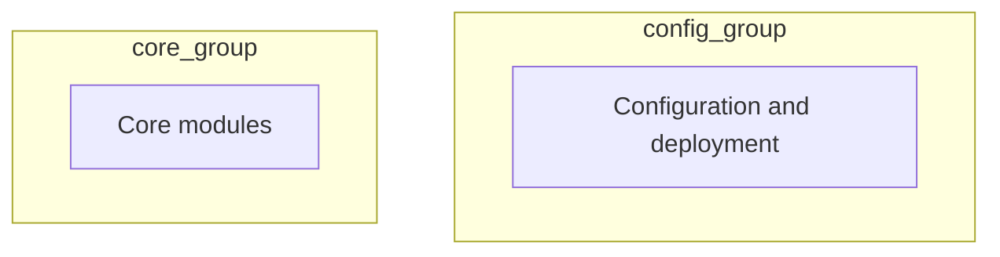

# Architecture report: verekia/js-stack-from-scratch

> Automated static analysis. **Observed** = directly seen in files/imports/AST; **Inferred** = interpretation from that evidence. Repository code was not executed.

## 1. Repository at a glance

| Item | Value |
| --- | --- |
| Repository | verekia/js-stack-from-scratch |
| Description | 🛠️⚡ Step-by-step tutorial to build a modern JavaScript stack. |
| Language | JavaScript |
| Stars | 20109 |
| Licence | MIT |
| Analysed commit / branch | 68fdf20c078a6e97bcebfb2fa0bb70a13d2c9d30 / master |
| Framework(s) | None detected |
| Files analysed | 19 |
| Components | 2 |

## 2. Architecture in one minute

verekia/js-stack-from-scratch - 🛠️⚡ Step-by-step tutorial to build a modern JavaScript stack.. This repository was analysed statically from 19 file(s) (0 Python). Detected technologies (observed from imports/manifests): no known frameworks/libraries. Files are grouped into 2 component(s): Configuration and deployment, Core modules. Findings below distinguish observed facts from inferred interpretation.

## 3. High-level block diagram

## 4. Main components

### Configuration and deployment (`config`)

- **Kind:** config
- **Status:** Observed
- **Confidence:** 0.85
- **Responsibility:** Groups 1 file(s) under configuration and deployment (observed from repository paths and static analysis).
- **Paths:** `package.json`
- **Evidence:** [package.json](https://github.com/verekia/js-stack-from-scratch/blob/68fdf20c078a6e97bcebfb2fa0bb70a13d2c9d30/package.json)

### Core modules (`core`)

- **Kind:** core
- **Status:** Observed
- **Confidence:** 0.85
- **Responsibility:** Groups 1 file(s) under core modules (observed from repository paths and static analysis).
- **Paths:** `mdlint.js`
- **Evidence:** [mdlint.js](https://github.com/verekia/js-stack-from-scratch/blob/68fdf20c078a6e97bcebfb2fa0bb70a13d2c9d30/mdlint.js)

## 5. Execution flow

No entry point was observed; the startup flow below is therefore limited.

Representative flow (derived from observed entry points and the import graph; steps beyond the entry point are **Inferred**):

1. Execution starts at an observed entry point listed above, if present.
2. No internal import relationships between components were observed.

## 6. Project structure

### `(root)`

- `.gitignore` - other (38 bytes)
- `.travis.yml` - ci, YAML (32 bytes)
- `CHANGELOG.md` - docs (1324 bytes)
- `LICENSE.md` - docs (1078 bytes)
- `README.md` - docs (5915 bytes)
- `how-to-translate.md` - docs (3110 bytes)
- `mdlint.js` - source, JavaScript (530 bytes)
- `package.json` - manifest (412 bytes)

### `.github`

- `.github/FUNDING.yml` - config (16 bytes)
- `.github/ISSUE_TEMPLATE` - other (463 bytes)

### `tutorial`

- `tutorial/01-node-yarn-package-json.md` - docs (6987 bytes)
- `tutorial/02-babel-es6-eslint-flow-jest-husky.md` - docs (17725 bytes)
- `tutorial/03-express-nodemon-pm2.md` - docs (10325 bytes)
- `tutorial/04-webpack-react-hmr.md` - docs (12227 bytes)
- `tutorial/05-redux-immutable-fetch.md` - docs (23230 bytes)
- `tutorial/06-react-router-ssr-helmet.md` - docs (17422 bytes)
- `tutorial/07-socket-io.md` - docs (6402 bytes)
- `tutorial/08-bootstrap-jss.md` - docs (16494 bytes)
- `tutorial/09-travis-coveralls-heroku.md` - docs (6502 bytes)

## 7. Key dependencies and integrations

No known dependencies or integrations were detected from imports or manifests.

## 8. Data and state

No database, cache, queue, or persistent-state usage was observed in the analysed files. State handling, if any, may be in-memory or in files that were not analysed.

## 9. Configuration and deployment clues

- `.github/FUNDING.yml` (config)
- `.travis.yml` (ci)
- `package.json` (manifest)

## 10. Design observations

- No strong design patterns could be established from the available evidence.

These observations are interpretations (**Inferred**) of the observed structure, not guarantees about runtime design.

## 11. Limitations and unknowns

- Static analysis only: repository code was not executed, installed, or imported at runtime.
- Components and relationships are inferred from file paths, imports, and AST structure; runtime behaviour, dynamic imports, and reflection may not be visible.
- 1 file(s) were skipped during inventory (1 x lockfile excluded).
- No clear application entry point was observed in the analysed files.
- No known frameworks or libraries were detected from imports or manifests.
- Repository text was treated as untrusted data; no instructions found in repository files were followed, and likely secret values were redacted/excluded.
- JavaScript and TypeScript files were inventoried from paths and package manifests. They were not parsed with a full language AST, and repository code was not executed.

## 12. Source references

- [mdlint.js](https://github.com/verekia/js-stack-from-scratch/blob/68fdf20c078a6e97bcebfb2fa0bb70a13d2c9d30/mdlint.js)
- [package.json](https://github.com/verekia/js-stack-from-scratch/blob/68fdf20c078a6e97bcebfb2fa0bb70a13d2c9d30/package.json)
