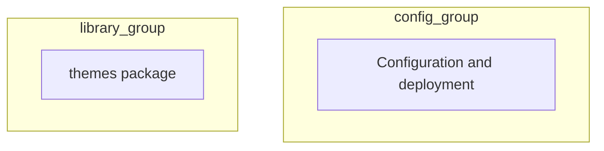

# Architecture report: viatsko/awesome-vscode

> Automated static analysis. **Observed** = directly seen in files/imports/AST; **Inferred** = interpretation from that evidence. Repository code was not executed.

## 1. Repository at a glance

| Item | Value |
| --- | --- |
| Repository | viatsko/awesome-vscode |
| Description | 🎨 A curated list of delightful VS Code packages and resources. |
| Language | JavaScript |
| Stars | 29230 |
| Licence | CC0-1.0 |
| Analysed commit / branch | 9c3bf848287d3967a744e7c057ea49ec9e89b396 / master |
| Framework(s) | None detected |
| Files analysed | 11 |
| Components | 2 |

## 2. Architecture in one minute

viatsko/awesome-vscode - 🎨 A curated list of delightful VS Code packages and resources.. This repository was analysed statically from 11 file(s) (0 Python). Detected technologies (observed from imports/manifests): GitHub Actions. Files are grouped into 2 component(s): Configuration and deployment, themes package. Findings below distinguish observed facts from inferred interpretation.

## 3. High-level block diagram

## 4. Main components

### Configuration and deployment (`config`)

- **Kind:** config
- **Status:** Observed
- **Confidence:** 0.85
- **Responsibility:** Groups 2 file(s) under configuration and deployment (observed from repository paths and static analysis).
- **Paths:** `_config.yml`, `package.json`
- **Evidence:** [_config.yml](https://github.com/viatsko/awesome-vscode/blob/9c3bf848287d3967a744e7c057ea49ec9e89b396/_config.yml); [package.json](https://github.com/viatsko/awesome-vscode/blob/9c3bf848287d3967a744e7c057ea49ec9e89b396/package.json)

### themes package (`themes`)

- **Kind:** library
- **Status:** Observed
- **Confidence:** 0.85
- **Responsibility:** Groups 1 file(s) under themes package (observed from repository paths and static analysis).
- **Paths:** `themes/theme-template.js`
- **Evidence:** [themes/theme-template.js](https://github.com/viatsko/awesome-vscode/blob/9c3bf848287d3967a744e7c057ea49ec9e89b396/themes/theme-template.js)

## 5. Execution flow

No entry point was observed; the startup flow below is therefore limited.

Representative flow (derived from observed entry points and the import graph; steps beyond the entry point are **Inferred**):

1. Execution starts at an observed entry point listed above, if present.
2. No internal import relationships between components were observed.

## 6. Project structure

### `(root)`

- `.markdownlint.json` - config (148 bytes)
- `CLAUDE.md` - docs (2086 bytes)
- `CODE_OF_CONDUCT.md` - docs (3215 bytes)
- `CONTRIBUTING.md` - docs (1546 bytes)
- `LICENSE` - docs (6555 bytes)
- `PULL_REQUEST_TEMPLATE.md` - docs (274 bytes)
- `README.md` - docs (75265 bytes)
- `_config.yml` - config (25 bytes)
- `package.json` - manifest (230 bytes)

### `.github`

- `.github/workflows/links.yml` - ci, YAML (519 bytes)

### `themes`

- `themes/theme-template.js` - source, JavaScript (250 bytes)

## 7. Key dependencies and integrations

| Name | Category | Status | Confidence | Evidence |
| --- | --- | --- | --- | --- |
| GitHub Actions | ci | Observed | 0.85 | [.github/workflows/links.yml](https://github.com/viatsko/awesome-vscode/blob/9c3bf848287d3967a744e7c057ea49ec9e89b396/.github/workflows/links.yml) |

## 8. Data and state

No database, cache, queue, or persistent-state usage was observed in the analysed files. State handling, if any, may be in-memory or in files that were not analysed.

## 9. Configuration and deployment clues

- `.github/workflows/links.yml` (ci)
- `.markdownlint.json` (config)
- `_config.yml` (config)
- `package.json` (manifest)

## 10. Design observations

- No strong design patterns could be established from the available evidence.

These observations are interpretations (**Inferred**) of the observed structure, not guarantees about runtime design.

## 11. Limitations and unknowns

- Static analysis only: repository code was not executed, installed, or imported at runtime.
- Components and relationships are inferred from file paths, imports, and AST structure; runtime behaviour, dynamic imports, and reflection may not be visible.
- No clear application entry point was observed in the analysed files.
- Repository text was treated as untrusted data; no instructions found in repository files were followed, and likely secret values were redacted/excluded.
- JavaScript and TypeScript files were inventoried from paths and package manifests. They were not parsed with a full language AST, and repository code was not executed.

## 12. Source references

- [.github/workflows/links.yml](https://github.com/viatsko/awesome-vscode/blob/9c3bf848287d3967a744e7c057ea49ec9e89b396/.github/workflows/links.yml)
- [_config.yml](https://github.com/viatsko/awesome-vscode/blob/9c3bf848287d3967a744e7c057ea49ec9e89b396/_config.yml)
- [package.json](https://github.com/viatsko/awesome-vscode/blob/9c3bf848287d3967a744e7c057ea49ec9e89b396/package.json)
- [themes/theme-template.js](https://github.com/viatsko/awesome-vscode/blob/9c3bf848287d3967a744e7c057ea49ec9e89b396/themes/theme-template.js)
