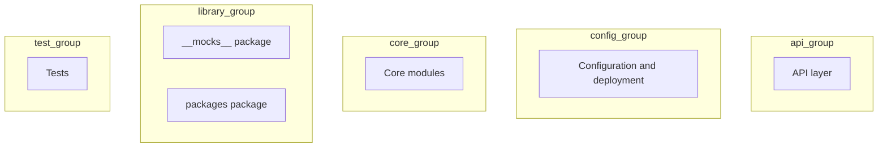

# Architecture report: vuejs/vue-cli

> Automated static analysis. **Observed** = directly seen in files/imports/AST; **Inferred** = interpretation from that evidence. Repository code was not executed.

## 1. Repository at a glance

| Item | Value |
| --- | --- |
| Repository | vuejs/vue-cli |
| Description | 🛠️ webpack-based tooling for Vue.js Development |
| Language | JavaScript |
| Stars | 29495 |
| Licence | MIT |
| Analysed commit / branch | 7eb93c169c7520935252e2473387f923ef80d856 / dev |
| Framework(s) | Express, Vue |
| Files analysed | 785 |
| Components | 6 |

## 2. Architecture in one minute

vuejs/vue-cli - 🛠️ webpack-based tooling for Vue.js Development. This repository was analysed statically from 785 file(s) (0 Python). Detected technologies (observed from imports/manifests): Express, Vue, Jest, TypeScript, webpack. Files are grouped into 6 component(s): API layer, Configuration and deployment, Core modules, __mocks__ package, packages package, Tests. Findings below distinguish observed facts from inferred interpretation.

## 3. High-level block diagram

## 4. Main components

### API layer (`api_layer`)

- **Kind:** api
- **Status:** Observed
- **Confidence:** 0.85
- **Responsibility:** Groups 13 file(s) under api layer (observed from repository paths and static analysis).
- **Paths:** `packages/@vue/cli-plugin-router/generator/template/src/views/AboutView.vue`, `packages/@vue/cli-plugin-router/generator/template/src/views/HomeView.vue`, `packages/@vue/cli-plugin-typescript/generator/template-vue3/src/views/HomeView.vue`, `packages/@vue/cli-plugin-typescript/generator/template/src/views/HomeView.vue`, `packages/@vue/cli-ui/apollo-server/api/PluginApi.js`, `packages/@vue/cli-ui/apollo-server/api/client-addon.js`, `packages/@vue/cli-ui/apollo-server/api/configuration.js`, `packages/@vue/cli-ui/apollo-server/api/notify.js`, `packages/@vue/cli-ui/apollo-server/api/progress.js`, `packages/@vue/cli-ui/apollo-server/api/suggestion.js`, `packages/@vue/cli-ui/apollo-server/api/task.js`, `packages/@vue/cli-ui/apollo-server/api/view.js`, `packages/@vue/cli-ui/apollo-server/api/widget.js`
- **Evidence:** [packages/@vue/cli-plugin-router/generator/template/src/views/AboutView.vue](https://github.com/vuejs/vue-cli/blob/7eb93c169c7520935252e2473387f923ef80d856/packages/%40vue/cli-plugin-router/generator/template/src/views/AboutView.vue); [packages/@vue/cli-plugin-router/generator/template/src/views/HomeView.vue](https://github.com/vuejs/vue-cli/blob/7eb93c169c7520935252e2473387f923ef80d856/packages/%40vue/cli-plugin-router/generator/template/src/views/HomeView.vue); [packages/@vue/cli-plugin-typescript/generator/template-vue3/src/views/HomeView.vue](https://github.com/vuejs/vue-cli/blob/7eb93c169c7520935252e2473387f923ef80d856/packages/%40vue/cli-plugin-typescript/generator/template-vue3/src/views/HomeView.vue); [packages/@vue/cli-plugin-typescript/generator/template/src/views/HomeView.vue](https://github.com/vuejs/vue-cli/blob/7eb93c169c7520935252e2473387f923ef80d856/packages/%40vue/cli-plugin-typescript/generator/template/src/views/HomeView.vue); [packages/@vue/cli-ui/apollo-server/api/PluginApi.js](https://github.com/vuejs/vue-cli/blob/7eb93c169c7520935252e2473387f923ef80d856/packages/%40vue/cli-ui/apollo-server/api/PluginApi.js); [packages/@vue/cli-ui/apollo-server/api/client-addon.js](https://github.com/vuejs/vue-cli/blob/7eb93c169c7520935252e2473387f923ef80d856/packages/%40vue/cli-ui/apollo-server/api/client-addon.js); [packages/@vue/cli-ui/apollo-server/api/configuration.js](https://github.com/vuejs/vue-cli/blob/7eb93c169c7520935252e2473387f923ef80d856/packages/%40vue/cli-ui/apollo-server/api/configuration.js); [packages/@vue/cli-ui/apollo-server/api/notify.js](https://github.com/vuejs/vue-cli/blob/7eb93c169c7520935252e2473387f923ef80d856/packages/%40vue/cli-ui/apollo-server/api/notify.js)

### Configuration and deployment (`config`)

- **Kind:** config
- **Status:** Observed
- **Confidence:** 0.85
- **Responsibility:** Groups 39 file(s) under configuration and deployment (observed from repository paths and static analysis).
- **Paths:** `appveyor.yml`, `lerna.json`, `package.json`, `packages/@vue/babel-preset-app/package.json`, `packages/@vue/cli-init/package.json`, `packages/@vue/cli-overlay/package.json`, `packages/@vue/cli-plugin-babel/package.json`, `packages/@vue/cli-plugin-e2e-cypress/generator/template/cypress.json`, `packages/@vue/cli-plugin-e2e-cypress/package.json`, `packages/@vue/cli-plugin-e2e-nightwatch/package.json`, `packages/@vue/cli-plugin-e2e-webdriverio/package.json`, `packages/@vue/cli-plugin-eslint/package.json`, `packages/@vue/cli-plugin-pwa/package.json`, `packages/@vue/cli-plugin-router/package.json`, `packages/@vue/cli-plugin-typescript/generator/template/tsconfig.json`, `packages/@vue/cli-plugin-typescript/package.json`, `packages/@vue/cli-plugin-unit-jest/package.json`, `packages/@vue/cli-plugin-unit-mocha/package.json`, `packages/@vue/cli-plugin-vuex/package.json`, `packages/@vue/cli-service/generator/template/jsconfig.json`, `packages/@vue/cli-service/lib/config/app.js`, `packages/@vue/cli-service/lib/config/assets.js`, `packages/@vue/cli-service/lib/config/base.js`, `packages/@vue/cli-service/lib/config/css.js`, `packages/@vue/cli-service/lib/config/prod.js`, `packages/@vue/cli-service/lib/config/terserOptions.js`, `packages/@vue/cli-service/lib/config/vue-loader-v15-resolve-compat/vue-loader.js`, `packages/@vue/cli-service/package.json`, `packages/@vue/cli-service/types/tsconfig.json`, `packages/@vue/cli-shared-utils/package.json`, `packages/@vue/cli-test-utils/package.json`, `packages/@vue/cli-test-utils/types/tsconfig.json`, `packages/@vue/cli-ui-addon-webpack/package.json`, `packages/@vue/cli-ui-addon-webpack/src/assets/speeds.json`, `packages/@vue/cli-ui-addon-webpack/src/locales/en.json`, `packages/@vue/cli-ui-addon-widgets/package.json`, `packages/@vue/cli-ui/cypress.json`, `packages/@vue/cli-ui/locales/en.json`, `packages/@vue/cli-ui/package.json`
- **Evidence:** [appveyor.yml](https://github.com/vuejs/vue-cli/blob/7eb93c169c7520935252e2473387f923ef80d856/appveyor.yml); [lerna.json](https://github.com/vuejs/vue-cli/blob/7eb93c169c7520935252e2473387f923ef80d856/lerna.json); [package.json](https://github.com/vuejs/vue-cli/blob/7eb93c169c7520935252e2473387f923ef80d856/package.json); [packages/@vue/babel-preset-app/package.json](https://github.com/vuejs/vue-cli/blob/7eb93c169c7520935252e2473387f923ef80d856/packages/%40vue/babel-preset-app/package.json); [packages/@vue/cli-init/package.json](https://github.com/vuejs/vue-cli/blob/7eb93c169c7520935252e2473387f923ef80d856/packages/%40vue/cli-init/package.json); [packages/@vue/cli-overlay/package.json](https://github.com/vuejs/vue-cli/blob/7eb93c169c7520935252e2473387f923ef80d856/packages/%40vue/cli-overlay/package.json); [packages/@vue/cli-plugin-babel/package.json](https://github.com/vuejs/vue-cli/blob/7eb93c169c7520935252e2473387f923ef80d856/packages/%40vue/cli-plugin-babel/package.json); [packages/@vue/cli-plugin-e2e-cypress/generator/template/cypress.json](https://github.com/vuejs/vue-cli/blob/7eb93c169c7520935252e2473387f923ef80d856/packages/%40vue/cli-plugin-e2e-cypress/generator/template/cypress.json)

### Core modules (`core`)

- **Kind:** core
- **Status:** Observed
- **Confidence:** 0.85
- **Responsibility:** Groups 1 file(s) under core modules (observed from repository paths and static analysis).
- **Paths:** `jest.config.js`
- **Evidence:** [jest.config.js](https://github.com/vuejs/vue-cli/blob/7eb93c169c7520935252e2473387f923ef80d856/jest.config.js)

### __mocks__ package (`mocks`)

- **Kind:** library
- **Status:** Observed
- **Confidence:** 0.85
- **Responsibility:** Groups 2 file(s) under __mocks__ package (observed from repository paths and static analysis).
- **Paths:** `__mocks__/fs.js`, `__mocks__/inquirer.js`
- **Evidence:** [__mocks__/fs.js](https://github.com/vuejs/vue-cli/blob/7eb93c169c7520935252e2473387f923ef80d856/__mocks__/fs.js); [__mocks__/inquirer.js](https://github.com/vuejs/vue-cli/blob/7eb93c169c7520935252e2473387f923ef80d856/__mocks__/inquirer.js)

### packages package (`packages`)

- **Kind:** library
- **Status:** Observed
- **Confidence:** 0.85
- **Responsibility:** Groups 413 file(s) under packages package (observed from repository paths and static analysis).
- **Paths:** `packages/@vue/babel-preset-app/__tests__/babel-preset.spec.js`, `packages/@vue/babel-preset-app/index.js`, `packages/@vue/babel-preset-app/polyfillsPlugin.js`, `packages/@vue/cli-init/index.js`, `packages/@vue/cli-overlay/src/index.js`, `packages/@vue/cli-plugin-babel/__tests__/babelMigrator.spec.js`, `packages/@vue/cli-plugin-babel/__tests__/babelRuntime.spec.js`, `packages/@vue/cli-plugin-babel/__tests__/transpileDependencies.spec.js`, `packages/@vue/cli-plugin-babel/codemods/__testfixtures__/customConfig.input.js`, `packages/@vue/cli-plugin-babel/codemods/__testfixtures__/customConfig.output.js`, `packages/@vue/cli-plugin-babel/codemods/__testfixtures__/default.input.js`, `packages/@vue/cli-plugin-babel/codemods/__testfixtures__/default.output.js`, `packages/@vue/cli-plugin-babel/codemods/__testfixtures__/doubleQuote.input.js`, `packages/@vue/cli-plugin-babel/codemods/__testfixtures__/doubleQuote.output.js`, `packages/@vue/cli-plugin-babel/codemods/__testfixtures__/require.input.js`, `packages/@vue/cli-plugin-babel/codemods/__testfixtures__/require.output.js`, `packages/@vue/cli-plugin-babel/codemods/__testfixtures__/templateLiteral.input.js`, `packages/@vue/cli-plugin-babel/codemods/__testfixtures__/templateLiteral.output.js`, `packages/@vue/cli-plugin-babel/codemods/__tests__/usePluginPreset.spec.js`, `packages/@vue/cli-plugin-babel/codemods/usePluginPreset.js`, `packages/@vue/cli-plugin-babel/generator.js`, `packages/@vue/cli-plugin-babel/index.js`, `packages/@vue/cli-plugin-babel/migrator/index.js`, `packages/@vue/cli-plugin-babel/preset.js`, `packages/@vue/cli-plugin-e2e-cypress/__tests__/cypressPlugin.spec.js`, `packages/@vue/cli-plugin-e2e-cypress/generator/index.js`, `packages/@vue/cli-plugin-e2e-cypress/index.js`, `packages/@vue/cli-plugin-e2e-cypress/migrator/index.js`, `packages/@vue/cli-plugin-e2e-cypress/ui.js`, `packages/@vue/cli-plugin-e2e-nightwatch/__tests__/lib/globals-gecko.js`, `packages/@vue/cli-plugin-e2e-nightwatch/__tests__/lib/globals-generated.js`, `packages/@vue/cli-plugin-e2e-nightwatch/__tests__/lib/nightwatch.conf.js`, `packages/@vue/cli-plugin-e2e-nightwatch/__tests__/nightwatchPlugin.spec.js`, `packages/@vue/cli-plugin-e2e-nightwatch/generator/index.js`, `packages/@vue/cli-plugin-e2e-nightwatch/index.js`, `packages/@vue/cli-plugin-e2e-nightwatch/nightwatch.conf.js`, `packages/@vue/cli-plugin-e2e-nightwatch/prompts.js`, `packages/@vue/cli-plugin-e2e-nightwatch/ui.js`, `packages/@vue/cli-plugin-e2e-webdriverio/__tests__/wdioGenerator.spec.js`, `packages/@vue/cli-plugin-e2e-webdriverio/__tests__/wdioPlugin.spec.js`, `packages/@vue/cli-plugin-e2e-webdriverio/generator/index.js`, `packages/@vue/cli-plugin-e2e-webdriverio/generator/template/wdio.local.conf.js`, `packages/@vue/cli-plugin-e2e-webdriverio/generator/template/wdio.sauce.conf.js`, `packages/@vue/cli-plugin-e2e-webdriverio/generator/template/wdio.shared.conf.js`, `packages/@vue/cli-plugin-e2e-webdriverio/index.js`, `packages/@vue/cli-plugin-e2e-webdriverio/migrator/index.js`, `packages/@vue/cli-plugin-e2e-webdriverio/prompts.js`, `packages/@vue/cli-plugin-e2e-webdriverio/ui.js`, `packages/@vue/cli-plugin-eslint/__tests__/eslint8.spec.js`, `packages/@vue/cli-plugin-eslint/__tests__/eslintGenerator.spec.js`, `packages/@vue/cli-plugin-eslint/__tests__/eslintMigrator.spec.js`, `packages/@vue/cli-plugin-eslint/__tests__/eslintPlugin.spec.js`, `packages/@vue/cli-plugin-eslint/__tests__/eslintVue3.spec.js`, `packages/@vue/cli-plugin-eslint/__tests__/ui.spec.js`, `packages/@vue/cli-plugin-eslint/eslintDeps.js`, `packages/@vue/cli-plugin-eslint/eslintOptions.js`, `packages/@vue/cli-plugin-eslint/generator/index.js`, `packages/@vue/cli-plugin-eslint/index.js`, `packages/@vue/cli-plugin-eslint/lint.js`, `packages/@vue/cli-plugin-eslint/migrator/index.js`, `packages/@vue/cli-plugin-eslint/prompts.js`, `packages/@vue/cli-plugin-eslint/ui/configDescriptor.js`, `packages/@vue/cli-plugin-eslint/ui/index.js`, `packages/@vue/cli-plugin-eslint/ui/taskDescriptor.js`, `packages/@vue/cli-plugin-pwa/__tests__/pwaGenerator.spec.js`, `packages/@vue/cli-plugin-pwa/__tests__/pwaPlugin.spec.js`, `packages/@vue/cli-plugin-pwa/generator/index.js`, `packages/@vue/cli-plugin-pwa/generator/template/src/registerServiceWorker.js`, `packages/@vue/cli-plugin-pwa/index.js`, `packages/@vue/cli-plugin-pwa/lib/HtmlPwaPlugin.js`, `packages/@vue/cli-plugin-pwa/lib/noopServiceWorker.js`, `packages/@vue/cli-plugin-pwa/lib/noopServiceWorkerMiddleware.js`, `packages/@vue/cli-plugin-pwa/ui.js`, `packages/@vue/cli-plugin-router/__tests__/routerGenerator.spec.js`, `packages/@vue/cli-plugin-router/generator/index.js`, `packages/@vue/cli-plugin-router/generator/injectUseRouter.js`, `packages/@vue/cli-plugin-router/generator/template-vue3/src/App.vue`, `packages/@vue/cli-plugin-router/generator/template-vue3/src/router/index.js`, `packages/@vue/cli-plugin-router/generator/template/src/App.vue`, `packages/@vue/cli-plugin-router/generator/template/src/router/index.js`, `packages/@vue/cli-plugin-router/index.js`, `packages/@vue/cli-plugin-router/prompts.js`, `packages/@vue/cli-plugin-typescript/__tests__/tsGenerator.spec.js`, `packages/@vue/cli-plugin-typescript/__tests__/tsMochaPlugin.spec.js`, `packages/@vue/cli-plugin-typescript/__tests__/tsPlugin.helper.js`, `packages/@vue/cli-plugin-typescript/__tests__/tsPluginBabel.spec.js`, `packages/@vue/cli-plugin-typescript/__tests__/tsPluginClassComponent.spec.js`, `packages/@vue/cli-plugin-typescript/__tests__/tsPluginDefault.spec.js`, `packages/@vue/cli-plugin-typescript/__tests__/tsPluginE2e.spec.js`, `packages/@vue/cli-plugin-typescript/__tests__/tsPluginESLint.spec.js`, `packages/@vue/cli-plugin-typescript/__tests__/tsPluginUnit.spec.js`, `packages/@vue/cli-plugin-typescript/__tests__/tsPluginVue3.spec.js`, `packages/@vue/cli-plugin-typescript/codemods/__testfixtures__/shims-vue.input.ts`, `packages/@vue/cli-plugin-typescript/codemods/__testfixtures__/shims-vue.output.ts`, `packages/@vue/cli-plugin-typescript/codemods/__tests__/migrateComponentType.spec.js`, `packages/@vue/cli-plugin-typescript/codemods/migrateComponentType.js`, `packages/@vue/cli-plugin-typescript/generator/convert.js`, `packages/@vue/cli-plugin-typescript/generator/index.js`, `packages/@vue/cli-plugin-typescript/generator/template-vue3/src/App.vue`, `packages/@vue/cli-plugin-typescript/generator/template-vue3/src/components/HelloWorld.vue`, `packages/@vue/cli-plugin-typescript/generator/template-vue3/src/shims-vue.d.ts`, `packages/@vue/cli-plugin-typescript/generator/template/src/App.vue`, `packages/@vue/cli-plugin-typescript/generator/template/src/components/HelloWorld.vue`, `packages/@vue/cli-plugin-typescript/generator/template/src/shims-tsx.d.ts`, `packages/@vue/cli-plugin-typescript/generator/template/src/shims-vue.d.ts`, `packages/@vue/cli-plugin-typescript/index.js`, `packages/@vue/cli-plugin-typescript/migrator/index.js`, `packages/@vue/cli-plugin-typescript/prompts.js`, `packages/@vue/cli-plugin-unit-jest/__tests__/jestGenerator.spec.js`, `packages/@vue/cli-plugin-unit-jest/__tests__/jestPlugin.spec.js`, `packages/@vue/cli-plugin-unit-jest/__tests__/jestPluginVue3.spec.js`, `packages/@vue/cli-plugin-unit-jest/generator/index.js`, `packages/@vue/cli-plugin-unit-jest/index.js`, `packages/@vue/cli-plugin-unit-jest/jest-preset.js`, `packages/@vue/cli-plugin-unit-jest/migrator/index.js`, `packages/@vue/cli-plugin-unit-jest/presets/default/jest-preset.js`, `packages/@vue/cli-plugin-unit-jest/presets/no-babel/esmoduleTransformer.js`, `packages/@vue/cli-plugin-unit-jest/presets/no-babel/jest-preset.js`, `packages/@vue/cli-plugin-unit-jest/presets/typescript-and-babel/jest-preset.js`, `packages/@vue/cli-plugin-unit-jest/presets/typescript/jest-preset.js`, `packages/@vue/cli-plugin-unit-jest/ui.js`, `packages/@vue/cli-plugin-unit-mocha/__tests__/mochaGenerator.spec.js`, `packages/@vue/cli-plugin-unit-mocha/__tests__/mochaPlugin.spec.js`, `packages/@vue/cli-plugin-unit-mocha/__tests__/mochaPluginVue3.spec.js`, `packages/@vue/cli-plugin-unit-mocha/generator/index.js`, `packages/@vue/cli-plugin-unit-mocha/index.js`, `packages/@vue/cli-plugin-unit-mocha/setup.js`, `packages/@vue/cli-plugin-unit-mocha/ui.js`, `packages/@vue/cli-plugin-vuex/__tests__/vuexGenerator.spec.js`, `packages/@vue/cli-plugin-vuex/generator/index.js`, `packages/@vue/cli-plugin-vuex/generator/injectUseStore.js`, `packages/@vue/cli-plugin-vuex/generator/template-vue3/src/store/index.js`, `packages/@vue/cli-plugin-vuex/generator/template/src/store/index.js`, `packages/@vue/cli-plugin-vuex/index.js`, `packages/@vue/cli-service/__tests__/Service.spec.js`, `packages/@vue/cli-service/__tests__/ServiceESM.spec.js`, `packages/@vue/cli-service/__tests__/build.spec.js`, `packages/@vue/cli-service/__tests__/buildLib.spec.js`, `packages/@vue/cli-service/__tests__/buildLibFormats.spec.js`, `packages/@vue/cli-service/__tests__/buildWc.spec.js`, `packages/@vue/cli-service/__tests__/buildWcAsync.spec.js`, `packages/@vue/cli-service/__tests__/cors.spec.js`, `packages/@vue/cli-service/__tests__/css.spec.js`, `packages/@vue/cli-service/__tests__/cssPreprocessors.spec.js`, `packages/@vue/cli-service/__tests__/generator.spec.js`, `packages/@vue/cli-service/__tests__/modernMode.spec.js`, `packages/@vue/cli-service/__tests__/multiPage.spec.js`, `packages/@vue/cli-service/__tests__/proxy.spec.js`, `packages/@vue/cli-service/__tests__/serve.spec.js`, `packages/@vue/cli-service/__tests__/serveVue3.spec.js`, `packages/@vue/cli-service/bin/vue-cli-service.js`, `packages/@vue/cli-service/generator/index.js`, `packages/@vue/cli-service/generator/router.js`, `packages/@vue/cli-service/generator/template/src/App.vue`, `packages/@vue/cli-service/generator/template/src/components/HelloWorld.vue`, `packages/@vue/cli-service/generator/template/src/main.js`, `packages/@vue/cli-service/generator/vuex.js`, `packages/@vue/cli-service/lib/PluginAPI.js`, `packages/@vue/cli-service/lib/Service.js`, `packages/@vue/cli-service/lib/commands/help.js`, `packages/@vue/cli-service/lib/commands/inspect.js`, `packages/@vue/cli-service/lib/commands/serve.js`, `packages/@vue/cli-service/lib/options.js`, `packages/@vue/cli-service/lib/util/getAssetPath.js`, `packages/@vue/cli-service/lib/util/getBaseUrl.js`, `packages/@vue/cli-service/lib/util/getPadLength.js`, `packages/@vue/cli-service/lib/util/getVueMajor.js`, `packages/@vue/cli-service/lib/util/isAbsoluteUrl.js`, `packages/@vue/cli-service/lib/util/loadFileConfig.js`, `packages/@vue/cli-service/lib/util/prepareProxy.js`, `packages/@vue/cli-service/lib/util/prepareURLs.js`, `packages/@vue/cli-service/lib/util/resolveClientEnv.js`, `packages/@vue/cli-service/lib/util/resolveLoaderError.js`, `packages/@vue/cli-service/lib/util/resolveLocal.js`, `packages/@vue/cli-service/lib/util/resolveUserConfig.js`, `packages/@vue/cli-service/lib/util/targets.js`, `packages/@vue/cli-service/lib/util/validateWebpackConfig.js`, `packages/@vue/cli-service/lib/webpack/CorsPlugin.js`, `packages/@vue/cli-service/lib/webpack/DashboardPlugin.js`, `packages/@vue/cli-service/lib/webpack/ModernModePlugin.js`, `packages/@vue/cli-service/lib/webpack/MovePlugin.js`, `packages/@vue/cli-service/lib/webpack/SafariNomoduleFixPlugin.js`, `packages/@vue/cli-service/lib/webpack/analyzeBundle.js`, `packages/@vue/cli-service/migrator/index.js`, `packages/@vue/cli-service/types/ProjectOptions.d.ts`, `packages/@vue/cli-service/types/cli-service-test.ts`, `packages/@vue/cli-service/types/index.d.ts`, `packages/@vue/cli-service/webpack.config.js`, `packages/@vue/cli-shared-utils/__tests__/pluginOrder.spec.js`, `packages/@vue/cli-shared-utils/__tests__/pluginResolution.spec.js`, `packages/@vue/cli-shared-utils/index.js`, `packages/@vue/cli-shared-utils/lib/_silence.js`, `packages/@vue/cli-shared-utils/lib/env.js`, `packages/@vue/cli-shared-utils/lib/exit.js`, `packages/@vue/cli-shared-utils/lib/ipc.js`, `packages/@vue/cli-shared-utils/lib/launch.js`, `packages/@vue/cli-shared-utils/lib/logger.js`, `packages/@vue/cli-shared-utils/lib/module.js`, `packages/@vue/cli-shared-utils/lib/object.js`, `packages/@vue/cli-shared-utils/lib/openBrowser.js`, `packages/@vue/cli-shared-utils/lib/pkg.js`, `packages/@vue/cli-shared-utils/lib/pluginOrder.js`, `packages/@vue/cli-shared-utils/lib/pluginResolution.js`, `packages/@vue/cli-shared-utils/lib/request.js`, `packages/@vue/cli-shared-utils/lib/spinner.js`, `packages/@vue/cli-shared-utils/lib/validate.js`, `packages/@vue/cli-test-utils/assertPromptModule.d.ts`, `packages/@vue/cli-test-utils/assertPromptModule.js`, `packages/@vue/cli-test-utils/createJSONServer.d.ts`, `packages/@vue/cli-test-utils/createJSONServer.js`, `packages/@vue/cli-test-utils/createServer.d.ts`, `packages/@vue/cli-test-utils/createServer.js`, `packages/@vue/cli-test-utils/createTestProject.d.ts`, `packages/@vue/cli-test-utils/createTestProject.js`, `packages/@vue/cli-test-utils/createUpgradableProject.js`, `packages/@vue/cli-test-utils/generateWithPlugin.d.ts`, `packages/@vue/cli-test-utils/generateWithPlugin.js`, `packages/@vue/cli-test-utils/launchPuppeteer.d.ts`, `packages/@vue/cli-test-utils/launchPuppeteer.js`, `packages/@vue/cli-test-utils/serveWithPuppeteer.d.ts`, `packages/@vue/cli-test-utils/serveWithPuppeteer.js`, `packages/@vue/cli-test-utils/types/cli-test-utils-test.ts`, `packages/@vue/cli-ui-addon-webpack/.eslintrc.js`, `packages/@vue/cli-ui-addon-webpack/babel.config.js`, `packages/@vue/cli-ui-addon-webpack/src/components/AssetList.vue`, `packages/@vue/cli-ui-addon-webpack/src/components/AssetListItem.vue`, `packages/@vue/cli-ui-addon-webpack/src/components/BuildProgress.vue`, `packages/@vue/cli-ui-addon-webpack/src/components/BuildStatus.vue`, `packages/@vue/cli-ui-addon-webpack/src/components/DonutModule.vue`, `packages/@vue/cli-ui-addon-webpack/src/components/ModuleList.vue`, `packages/@vue/cli-ui-addon-webpack/src/components/ModuleListItem.vue`, `packages/@vue/cli-ui-addon-webpack/src/components/SpeedStats.vue`, `packages/@vue/cli-ui-addon-webpack/src/components/SpeedStatsItem.vue`, `packages/@vue/cli-ui-addon-webpack/src/components/TestView.vue`, `packages/@vue/cli-ui-addon-webpack/src/components/WebpackAnalyzer.vue`, `packages/@vue/cli-ui-addon-webpack/src/components/WebpackDashboard.vue`, `packages/@vue/cli-ui-addon-webpack/src/filters.js`, `packages/@vue/cli-ui-addon-webpack/src/main.js`, `packages/@vue/cli-ui-addon-webpack/src/mixins/Dashboard.js`, `packages/@vue/cli-ui-addon-webpack/src/store/index.js`, `packages/@vue/cli-ui-addon-webpack/src/util/assets.js`, `packages/@vue/cli-ui-addon-webpack/src/util/colors.js`, `packages/@vue/cli-ui-addon-webpack/vue.config.js`, `packages/@vue/cli-ui-addon-widgets/.eslintrc.js`, `packages/@vue/cli-ui-addon-widgets/babel.config.js`, `packages/@vue/cli-ui-addon-widgets/src/components/DependencyUpdates.vue`, `packages/@vue/cli-ui-addon-widgets/src/components/KillPort.vue`, `packages/@vue/cli-ui-addon-widgets/src/components/News.vue`, `packages/@vue/cli-ui-addon-widgets/src/components/NewsItem.vue`, `packages/@vue/cli-ui-addon-widgets/src/components/NewsItemDetails.vue`, `packages/@vue/cli-ui-addon-widgets/src/components/PluginUpdates.vue`, `packages/@vue/cli-ui-addon-widgets/src/components/RunTask.vue`, `packages/@vue/cli-ui-addon-widgets/src/components/StatusWidget.vue`, `packages/@vue/cli-ui-addon-widgets/src/components/Vulnerability.vue`, `packages/@vue/cli-ui-addon-widgets/src/components/VulnerabilityDetails.vue`, `packages/@vue/cli-ui-addon-widgets/src/components/VulnerabilityItem.vue`, `packages/@vue/cli-ui-addon-widgets/src/components/Welcome.vue`, `packages/@vue/cli-ui-addon-widgets/src/main.js`, `packages/@vue/cli-ui-addon-widgets/src/util/consts.js`, `packages/@vue/cli-ui-addon-widgets/vue.config.js`, `packages/@vue/cli-ui/.eslintrc.js`, `packages/@vue/cli-ui/apollo-server/channels.js`, `packages/@vue/cli-ui/apollo-server/connectors/app.js`, `packages/@vue/cli-ui/apollo-server/connectors/client-addons.js`, `packages/@vue/cli-ui/apollo-server/connectors/configurations.js`, `packages/@vue/cli-ui/apollo-server/connectors/cwd.js`, `packages/@vue/cli-ui/apollo-server/connectors/dependencies.js`, `packages/@vue/cli-ui/apollo-server/connectors/files.js`, `packages/@vue/cli-ui/apollo-server/connectors/folders.js`, `packages/@vue/cli-ui/apollo-server/connectors/git.js`, `packages/@vue/cli-ui/apollo-server/connectors/locales.js`, `packages/@vue/cli-ui/apollo-server/connectors/logs.js`, `packages/@vue/cli-ui/apollo-server/connectors/plugins.js`, `packages/@vue/cli-ui/apollo-server/connectors/progress.js`, `packages/@vue/cli-ui/apollo-server/connectors/projects.js`, `packages/@vue/cli-ui/apollo-server/connectors/prompts.js`, `packages/@vue/cli-ui/apollo-server/connectors/shared-data.js`, `packages/@vue/cli-ui/apollo-server/connectors/suggestions.js`, `packages/@vue/cli-ui/apollo-server/connectors/tasks.js`, `packages/@vue/cli-ui/apollo-server/connectors/views.js`, `packages/@vue/cli-ui/apollo-server/connectors/widgets.js`, `packages/@vue/cli-ui/apollo-server/context.js`, `packages/@vue/cli-ui/apollo-server/directives.js`, `packages/@vue/cli-ui/apollo-server/mocks.js`, `packages/@vue/cli-ui/apollo-server/pubsub.js`, `packages/@vue/cli-ui/apollo-server/resolvers.js`, `packages/@vue/cli-ui/apollo-server/schema/configuration.js`, `packages/@vue/cli-ui/apollo-server/schema/console.js`, `packages/@vue/cli-ui/apollo-server/schema/dependency.js`, `packages/@vue/cli-ui/apollo-server/schema/folder.js`, `packages/@vue/cli-ui/apollo-server/schema/git.js`, `packages/@vue/cli-ui/apollo-server/schema/plugin.js`, `packages/@vue/cli-ui/apollo-server/schema/project.js`, `packages/@vue/cli-ui/apollo-server/schema/prompt.js`, `packages/@vue/cli-ui/apollo-server/schema/suggestion.js`, `packages/@vue/cli-ui/apollo-server/schema/task.js`, `packages/@vue/cli-ui/apollo-server/schema/view.js`, `packages/@vue/cli-ui/apollo-server/schema/widget.js`, `packages/@vue/cli-ui/apollo-server/server.js`, `packages/@vue/cli-ui/apollo-server/type-defs.js`, `packages/@vue/cli-ui/apollo-server/util/command.js`, `packages/@vue/cli-ui/apollo-server/util/db.js`, `packages/@vue/cli-ui/apollo-server/util/highlight.js`, `packages/@vue/cli-ui/apollo-server/util/ipc.js`, `packages/@vue/cli-ui/apollo-server/util/logger.js`, `packages/@vue/cli-ui/apollo-server/util/notification.js`, `packages/@vue/cli-ui/apollo-server/util/parse-args.js`, `packages/@vue/cli-ui/apollo-server/util/parse-diff.js`, `packages/@vue/cli-ui/apollo-server/util/rcFolder.js`, `packages/@vue/cli-ui/apollo-server/util/resolve-path.js`, `packages/@vue/cli-ui/apollo-server/util/stats.js`, `packages/@vue/cli-ui/apollo-server/util/strings.js`, `packages/@vue/cli-ui/apollo-server/util/terminate.js`, `packages/@vue/cli-ui/apollo-server/util/terminate.sh`, `packages/@vue/cli-ui/babel.config.js`, `packages/@vue/cli-ui/graphql-server.js`, `packages/@vue/cli-ui/index.js`, `packages/@vue/cli-ui/server.js`, `packages/@vue/cli-ui/src/App.vue`, `packages/@vue/cli-ui/src/components/app/About.vue`, `packages/@vue/cli-ui/src/components/app/AppLoading.vue`, `packages/@vue/cli-ui/src/components/app/ConnectionStatus.vue`, `packages/@vue/cli-ui/src/components/app/LocaleLoader.vue`, `packages/@vue/cli-ui/src/components/app/NotFound.vue`, `packages/@vue/cli-ui/src/components/app/ProgressScreen.vue`, `packages/@vue/cli-ui/src/components/app/ProjectHome.vue`, `packages/@vue/cli-ui/src/components/app/ProjectQuickDropdown.vue`, `packages/@vue/cli-ui/src/components/app/StatusBar.vue`, `packages/@vue/cli-ui/src/components/app/TopBar.vue`, `packages/@vue/cli-ui/src/components/client-addon/ClientAddonComponent.vue`, `packages/@vue/cli-ui/src/components/client-addon/ClientAddonLoader.vue`, `packages/@vue/cli-ui/src/components/configuration/ConfigurationItem.vue`, `packages/@vue/cli-ui/src/components/configuration/ConfigurationTab.vue`, `packages/@vue/cli-ui/src/components/configuration/ProjectConfigurationDetails.vue`, `packages/@vue/cli-ui/src/components/configuration/ProjectConfigurations.vue`, `packages/@vue/cli-ui/src/components/content/ContentView.vue`, `packages/@vue/cli-ui/src/components/content/ItemLogo.vue`, `packages/@vue/cli-ui/src/components/content/ListFilter.vue`, `packages/@vue/cli-ui/src/components/content/ListItemInfo.vue`, `packages/@vue/cli-ui/src/components/content/ListSort.vue`, `packages/@vue/cli-ui/src/components/content/NavContent.vue`, `packages/@vue/cli-ui/src/components/content/NavList.vue`, `packages/@vue/cli-ui/src/components/content/StepWizard.vue`, `packages/@vue/cli-ui/src/components/content/TerminalView.vue`, `packages/@vue/cli-ui/src/components/dashboard/ProjectDashboard.vue`, `packages/@vue/cli-ui/src/components/dashboard/Widget.vue`, `packages/@vue/cli-ui/src/components/dashboard/WidgetAddItem.vue`, `packages/@vue/cli-ui/src/components/dashboard/WidgetAddPane.vue`, `packages/@vue/cli-ui/src/components/dashboard/WidgetDetailsView.vue`, `packages/@vue/cli-ui/src/components/dependency/NpmPackageSearch.vue`, `packages/@vue/cli-ui/src/components/dependency/PackageSearchItem.vue`, `packages/@vue/cli-ui/src/components/dependency/ProjectDependencies.vue`, `packages/@vue/cli-ui/src/components/dependency/ProjectDependencyItem.vue`, `packages/@vue/cli-ui/src/components/file-diff/FileDiff.vue`, `packages/@vue/cli-ui/src/components/file-diff/FileDiffChange.vue`, `packages/@vue/cli-ui/src/components/file-diff/FileDiffChunk.vue`, `packages/@vue/cli-ui/src/components/file-diff/FileDiffView.vue`, `packages/@vue/cli-ui/src/components/folder/FolderExplorer.vue`, `packages/@vue/cli-ui/src/components/folder/FolderExplorerItem.vue`, `packages/@vue/cli-ui/src/components/logger/LoggerMessage.vue`, `packages/@vue/cli-ui/src/components/logger/LoggerView.vue`, `packages/@vue/cli-ui/src/components/plugin/ProjectPluginAddLocal.vue`, `packages/@vue/cli-ui/src/components/plugin/ProjectPluginItem.vue`, `packages/@vue/cli-ui/src/components/plugin/ProjectPlugins.vue`, `packages/@vue/cli-ui/src/components/plugin/ProjectPluginsAdd.vue`, `packages/@vue/cli-ui/src/components/project-create/ProjectCreate.vue`, `packages/@vue/cli-ui/src/components/project-create/ProjectFeatureItem.vue`, `packages/@vue/cli-ui/src/components/project-create/ProjectPresetItem.vue`, `packages/@vue/cli-ui/src/components/project-manager/ProjectRename.vue`, `packages/@vue/cli-ui/src/components/project-manager/ProjectSelect.vue`, `packages/@vue/cli-ui/src/components/project-manager/ProjectSelectList.vue`, `packages/@vue/cli-ui/src/components/project-manager/ProjectSelectListItem.vue`, `packages/@vue/cli-ui/src/components/project-manager/ProjectTasksDropdown.vue`, `packages/@vue/cli-ui/src/components/prompt/Prompt.vue`, `packages/@vue/cli-ui/src/components/prompt/PromptCheckbox.vue`, `packages/@vue/cli-ui/src/components/prompt/PromptColor.vue`, `packages/@vue/cli-ui/src/components/prompt/PromptConfirm.vue`, `packages/@vue/cli-ui/src/components/prompt/PromptEditor.vue`, `packages/@vue/cli-ui/src/components/prompt/PromptError.vue`, `packages/@vue/cli-ui/src/components/prompt/PromptInput.vue`, `packages/@vue/cli-ui/src/components/prompt/PromptList.vue`, `packages/@vue/cli-ui/src/components/prompt/PromptsList.vue`, `packages/@vue/cli-ui/src/components/search/InstantSearchInput.vue`, `packages/@vue/cli-ui/src/components/search/InstantSearchPagination.vue`, `packages/@vue/cli-ui/src/components/suggestion/SuggestionBar.vue`, `packages/@vue/cli-ui/src/components/suggestion/SuggestionBarItem.vue`, `packages/@vue/cli-ui/src/components/suggestion/SuggestionBarList.vue`, `packages/@vue/cli-ui/src/components/task/ProjectTaskDetails.vue`, `packages/@vue/cli-ui/src/components/task/ProjectTasks.vue`, `packages/@vue/cli-ui/src/components/task/TaskItem.vue`, `packages/@vue/cli-ui/src/components/view/ViewBadge.vue`, `packages/@vue/cli-ui/src/components/view/ViewNav.vue`, `packages/@vue/cli-ui/src/components/view/ViewNavButton.vue`, `packages/@vue/cli-ui/src/components/view/ViewNavMore.vue`, `packages/@vue/cli-ui/src/filters.js`, `packages/@vue/cli-ui/src/i18n.js`, `packages/@vue/cli-ui/src/main.js`, `packages/@vue/cli-ui/src/mixins/ClientState.js`, `packages/@vue/cli-ui/src/mixins/Defer.js`, `packages/@vue/cli-ui/src/mixins/Movable.js`, `packages/@vue/cli-ui/src/mixins/OnGrid.js`, `packages/@vue/cli-ui/src/mixins/OnWindowResize.js`, `packages/@vue/cli-ui/src/mixins/PageVisibility.js`, `packages/@vue/cli-ui/src/mixins/Progress.js`, `packages/@vue/cli-ui/src/mixins/Prompts.js`, `packages/@vue/cli-ui/src/mixins/Resizable.js`, `packages/@vue/cli-ui/src/mixins/RestoreRoute.js`, `packages/@vue/cli-ui/src/plugins.js`, `packages/@vue/cli-ui/src/register-components.js`, `packages/@vue/cli-ui/src/router.js`, `packages/@vue/cli-ui/src/state/defaults.js`, `packages/@vue/cli-ui/src/state/resolvers.js`, `packages/@vue/cli-ui/src/state/typeDefs.js`
- **Evidence:** [packages/@vue/babel-preset-app/__tests__/babel-preset.spec.js](https://github.com/vuejs/vue-cli/blob/7eb93c169c7520935252e2473387f923ef80d856/packages/%40vue/babel-preset-app/__tests__/babel-preset.spec.js); [packages/@vue/babel-preset-app/index.js](https://github.com/vuejs/vue-cli/blob/7eb93c169c7520935252e2473387f923ef80d856/packages/%40vue/babel-preset-app/index.js); [packages/@vue/babel-preset-app/polyfillsPlugin.js](https://github.com/vuejs/vue-cli/blob/7eb93c169c7520935252e2473387f923ef80d856/packages/%40vue/babel-preset-app/polyfillsPlugin.js); [packages/@vue/cli-init/index.js](https://github.com/vuejs/vue-cli/blob/7eb93c169c7520935252e2473387f923ef80d856/packages/%40vue/cli-init/index.js); [packages/@vue/cli-overlay/src/index.js](https://github.com/vuejs/vue-cli/blob/7eb93c169c7520935252e2473387f923ef80d856/packages/%40vue/cli-overlay/src/index.js); [packages/@vue/cli-plugin-babel/__tests__/babelMigrator.spec.js](https://github.com/vuejs/vue-cli/blob/7eb93c169c7520935252e2473387f923ef80d856/packages/%40vue/cli-plugin-babel/__tests__/babelMigrator.spec.js); [packages/@vue/cli-plugin-babel/__tests__/babelRuntime.spec.js](https://github.com/vuejs/vue-cli/blob/7eb93c169c7520935252e2473387f923ef80d856/packages/%40vue/cli-plugin-babel/__tests__/babelRuntime.spec.js); [packages/@vue/cli-plugin-babel/__tests__/transpileDependencies.spec.js](https://github.com/vuejs/vue-cli/blob/7eb93c169c7520935252e2473387f923ef80d856/packages/%40vue/cli-plugin-babel/__tests__/transpileDependencies.spec.js)

### Tests (`tests`)

- **Kind:** test
- **Status:** Observed
- **Confidence:** 0.85
- **Responsibility:** Groups 22 file(s) under tests (observed from repository paths and static analysis).
- **Paths:** `packages/@vue/cli-plugin-e2e-cypress/generator/template/tests/e2e/_eslintrc.js`, `packages/@vue/cli-plugin-e2e-cypress/generator/template/tests/e2e/plugins/index.js`, `packages/@vue/cli-plugin-e2e-cypress/generator/template/tests/e2e/specs/test.js`, `packages/@vue/cli-plugin-e2e-cypress/generator/template/tests/e2e/support/commands.js`, `packages/@vue/cli-plugin-e2e-cypress/generator/template/tests/e2e/support/index.js`, `packages/@vue/cli-plugin-e2e-nightwatch/generator/template/tests/e2e/_eslintrc.js`, `packages/@vue/cli-plugin-e2e-nightwatch/generator/template/tests/e2e/custom-assertions/elementCount.js`, `packages/@vue/cli-plugin-e2e-nightwatch/generator/template/tests/e2e/custom-commands/customExecute.js`, `packages/@vue/cli-plugin-e2e-nightwatch/generator/template/tests/e2e/custom-commands/openHomepage.js`, `packages/@vue/cli-plugin-e2e-nightwatch/generator/template/tests/e2e/custom-commands/openHomepageClass.js`, `packages/@vue/cli-plugin-e2e-nightwatch/generator/template/tests/e2e/globals.js`, `packages/@vue/cli-plugin-e2e-nightwatch/generator/template/tests/e2e/page-objects/homepage.js`, `packages/@vue/cli-plugin-e2e-nightwatch/generator/template/tests/e2e/specs/test-with-pageobjects.js`, `packages/@vue/cli-plugin-e2e-nightwatch/generator/template/tests/e2e/specs/test.js`, `packages/@vue/cli-plugin-e2e-webdriverio/generator/template/tests/e2e/_eslintrc.js`, `packages/@vue/cli-plugin-e2e-webdriverio/generator/template/tests/e2e/logs/.gitkeep`, `packages/@vue/cli-plugin-e2e-webdriverio/generator/template/tests/e2e/pageobjects/app.page.js`, `packages/@vue/cli-plugin-e2e-webdriverio/generator/template/tests/e2e/specs/app.spec.js`, `packages/@vue/cli-plugin-unit-jest/generator/template/tests/unit/example.spec.js`, `packages/@vue/cli-plugin-unit-jest/generator/template/tests/unit/example.spec.ts`, `packages/@vue/cli-plugin-unit-mocha/generator/template/tests/unit/example.spec.js`, `packages/@vue/cli-plugin-unit-mocha/generator/template/tests/unit/example.spec.ts`
- **Evidence:** [packages/@vue/cli-plugin-e2e-cypress/generator/template/tests/e2e/_eslintrc.js](https://github.com/vuejs/vue-cli/blob/7eb93c169c7520935252e2473387f923ef80d856/packages/%40vue/cli-plugin-e2e-cypress/generator/template/tests/e2e/_eslintrc.js); [packages/@vue/cli-plugin-e2e-cypress/generator/template/tests/e2e/plugins/index.js](https://github.com/vuejs/vue-cli/blob/7eb93c169c7520935252e2473387f923ef80d856/packages/%40vue/cli-plugin-e2e-cypress/generator/template/tests/e2e/plugins/index.js); [packages/@vue/cli-plugin-e2e-cypress/generator/template/tests/e2e/specs/test.js](https://github.com/vuejs/vue-cli/blob/7eb93c169c7520935252e2473387f923ef80d856/packages/%40vue/cli-plugin-e2e-cypress/generator/template/tests/e2e/specs/test.js); [packages/@vue/cli-plugin-e2e-cypress/generator/template/tests/e2e/support/commands.js](https://github.com/vuejs/vue-cli/blob/7eb93c169c7520935252e2473387f923ef80d856/packages/%40vue/cli-plugin-e2e-cypress/generator/template/tests/e2e/support/commands.js); [packages/@vue/cli-plugin-e2e-cypress/generator/template/tests/e2e/support/index.js](https://github.com/vuejs/vue-cli/blob/7eb93c169c7520935252e2473387f923ef80d856/packages/%40vue/cli-plugin-e2e-cypress/generator/template/tests/e2e/support/index.js); [packages/@vue/cli-plugin-e2e-nightwatch/generator/template/tests/e2e/_eslintrc.js](https://github.com/vuejs/vue-cli/blob/7eb93c169c7520935252e2473387f923ef80d856/packages/%40vue/cli-plugin-e2e-nightwatch/generator/template/tests/e2e/_eslintrc.js); [packages/@vue/cli-plugin-e2e-nightwatch/generator/template/tests/e2e/custom-assertions/elementCount.js](https://github.com/vuejs/vue-cli/blob/7eb93c169c7520935252e2473387f923ef80d856/packages/%40vue/cli-plugin-e2e-nightwatch/generator/template/tests/e2e/custom-assertions/elementCount.js); [packages/@vue/cli-plugin-e2e-nightwatch/generator/template/tests/e2e/custom-commands/customExecute.js](https://github.com/vuejs/vue-cli/blob/7eb93c169c7520935252e2473387f923ef80d856/packages/%40vue/cli-plugin-e2e-nightwatch/generator/template/tests/e2e/custom-commands/customExecute.js)

## 5. Execution flow

**Observed** entry point(s):

- [packages/@vue/babel-preset-app/index.js](https://github.com/vuejs/vue-cli/blob/7eb93c169c7520935252e2473387f923ef80d856/packages/%40vue/babel-preset-app/index.js)
- [packages/@vue/cli-init/index.js](https://github.com/vuejs/vue-cli/blob/7eb93c169c7520935252e2473387f923ef80d856/packages/%40vue/cli-init/index.js)
- [packages/@vue/cli-plugin-babel/index.js](https://github.com/vuejs/vue-cli/blob/7eb93c169c7520935252e2473387f923ef80d856/packages/%40vue/cli-plugin-babel/index.js)
- [packages/@vue/cli-plugin-e2e-cypress/index.js](https://github.com/vuejs/vue-cli/blob/7eb93c169c7520935252e2473387f923ef80d856/packages/%40vue/cli-plugin-e2e-cypress/index.js)
- [packages/@vue/cli-plugin-e2e-nightwatch/index.js](https://github.com/vuejs/vue-cli/blob/7eb93c169c7520935252e2473387f923ef80d856/packages/%40vue/cli-plugin-e2e-nightwatch/index.js)
- [packages/@vue/cli-plugin-e2e-webdriverio/index.js](https://github.com/vuejs/vue-cli/blob/7eb93c169c7520935252e2473387f923ef80d856/packages/%40vue/cli-plugin-e2e-webdriverio/index.js)
- [packages/@vue/cli-plugin-eslint/index.js](https://github.com/vuejs/vue-cli/blob/7eb93c169c7520935252e2473387f923ef80d856/packages/%40vue/cli-plugin-eslint/index.js)
- [packages/@vue/cli-plugin-pwa/index.js](https://github.com/vuejs/vue-cli/blob/7eb93c169c7520935252e2473387f923ef80d856/packages/%40vue/cli-plugin-pwa/index.js)
- [packages/@vue/cli-plugin-router/index.js](https://github.com/vuejs/vue-cli/blob/7eb93c169c7520935252e2473387f923ef80d856/packages/%40vue/cli-plugin-router/index.js)
- [packages/@vue/cli-plugin-typescript/index.js](https://github.com/vuejs/vue-cli/blob/7eb93c169c7520935252e2473387f923ef80d856/packages/%40vue/cli-plugin-typescript/index.js)
- [packages/@vue/cli-plugin-unit-jest/index.js](https://github.com/vuejs/vue-cli/blob/7eb93c169c7520935252e2473387f923ef80d856/packages/%40vue/cli-plugin-unit-jest/index.js)
- [packages/@vue/cli-plugin-unit-mocha/index.js](https://github.com/vuejs/vue-cli/blob/7eb93c169c7520935252e2473387f923ef80d856/packages/%40vue/cli-plugin-unit-mocha/index.js)

Representative flow (derived from observed entry points and the import graph; steps beyond the entry point are **Inferred**):

1. Execution starts at an observed entry point listed above, if present.
2. No internal import relationships between components were observed.

## 6. Project structure

### `(root)`

- `.editorconfig` - config (147 bytes)
- `.eslintignore` - other (77 bytes)
- `.eslintrc.js` - source, JavaScript (655 bytes)
- `.gitignore` - other (123 bytes)
- `.tidelift.yml` - config (26 bytes)
- `LICENSE` - docs (1091 bytes)
- `README.md` - docs (1376 bytes)
- `appveyor.yml` - config (578 bytes)
- `jest.config.js` - source, JavaScript (163 bytes)
- `lerna.json` - config (594 bytes)
- `package.json` - manifest (2638 bytes)

### `.circleci`

- `.circleci/config.yml` - ci, YAML (2537 bytes)

### `.github`

- `.github/COMMIT_CONVENTION.md` - docs (3138 bytes)
- `.github/CONTRIBUTING.md` - docs (2550 bytes)
- `.github/FUNDING.yml` - config (87 bytes)
- `.github/ISSUE_TEMPLATE/config.yml` - config (467 bytes)
- `.github/PULL_REQUEST_TEMPLATE.md` - docs (642 bytes)

### `__mocks__`

- `__mocks__/fs.js` - source, JavaScript (187 bytes)
- `__mocks__/inquirer.js` - source, JavaScript (2359 bytes)

### `docs`

- `docs/.vitepress/config.js` - docs (20246 bytes)
- `docs/.vitepress/self-destroying-service-worker.js` - docs (1546 bytes)
- `docs/.vitepress/theme/AlgoliaSearchBox.vue` - docs (8725 bytes)
- `docs/.vitepress/theme/custom.css` - docs (46 bytes)
- `docs/.vitepress/theme/index.js` - docs (2341 bytes)
- `docs/.vitepress/theme/search.svg` - docs (179 bytes)
- `docs/config/index.md` - docs (18722 bytes)
- `docs/core-plugins/babel.md` - docs (1470 bytes)
- `docs/core-plugins/e2e-cypress.md` - docs (2983 bytes)
- `docs/core-plugins/e2e-nightwatch.md` - docs (5920 bytes)
- `docs/core-plugins/e2e-webdriverio.md` - docs (2143 bytes)
- `docs/core-plugins/eslint.md` - docs (2734 bytes)
- `docs/core-plugins/index.md` - docs (659 bytes)
- `docs/core-plugins/pwa.md` - docs (5104 bytes)
- `docs/core-plugins/router.md` - docs (127 bytes)
- `docs/core-plugins/typescript.md` - docs (1629 bytes)
- `docs/core-plugins/unit-jest.md` - docs (2448 bytes)
- `docs/core-plugins/unit-mocha.md` - docs (1112 bytes)
- `docs/core-plugins/vuex.md` - docs (121 bytes)
- `docs/dev-guide/generator-api.md` - docs (4656 bytes)
- `docs/dev-guide/plugin-api.md` - docs (3145 bytes)
- `docs/dev-guide/plugin-dev.md` - docs (29785 bytes)
- `docs/dev-guide/ui-api.md` - docs (34119 bytes)
- `docs/dev-guide/ui-info.md` - docs (1195 bytes)
- `docs/dev-guide/ui-localization.md` - docs (1990 bytes)
- `docs/guide/browser-compatibility.md` - docs (6925 bytes)
- `docs/guide/build-targets.md` - docs (7060 bytes)
- `docs/guide/cli-service.md` - docs (7201 bytes)
- `docs/guide/creating-a-project.md` - docs (3594 bytes)
- `docs/guide/css.md` - docs (7662 bytes)
- `docs/guide/deployment.md` - docs (19841 bytes)
- `docs/guide/html-and-static-assets.md` - docs (8990 bytes)
- `docs/guide/index.md` - docs (3074 bytes)
- `docs/guide/installation.md` - docs (1930 bytes)
- `docs/guide/mode-and-env.md` - docs (5850 bytes)
- `docs/guide/plugins-and-presets.md` - docs (7749 bytes)
- `docs/guide/prototyping.md` - docs (259 bytes)
- `docs/guide/troubleshooting.md` - docs (1497 bytes)
- `docs/guide/webpack.md` - docs (7027 bytes)
- `docs/index.md` - docs (616 bytes)
- `docs/migrations/migrate-from-v3.md` - docs (14353 bytes)
- `docs/migrations/migrate-from-v4.md` - docs (12306 bytes)
- `docs/public/icons/safari-pinned-tab.svg` - docs (10608 bytes)
- `docs/public/manifest.json` - config (413 bytes)
- `docs/ru/config/index.md` - docs (29911 bytes)
- `docs/ru/core-plugins/babel.md` - docs (2229 bytes)
- `docs/ru/core-plugins/e2e-cypress.md` - docs (4477 bytes)
- `docs/ru/core-plugins/e2e-nightwatch.md` - docs (9281 bytes)
- `docs/ru/core-plugins/e2e-webdriverio.md` - docs (3047 bytes)
- `docs/ru/core-plugins/eslint.md` - docs (4305 bytes)
- `docs/ru/core-plugins/index.md` - docs (1016 bytes)
- `docs/ru/core-plugins/pwa.md` - docs (9242 bytes)
- `docs/ru/core-plugins/router.md` - docs (176 bytes)
- `docs/ru/core-plugins/typescript.md` - docs (2535 bytes)
- `docs/ru/core-plugins/unit-jest.md` - docs (3680 bytes)
- `docs/ru/core-plugins/unit-mocha.md` - docs (1733 bytes)
- `docs/ru/core-plugins/vuex.md` - docs (150 bytes)
- `docs/ru/dev-guide/generator-api.md` - docs (7792 bytes)
- `docs/ru/dev-guide/plugin-api.md` - docs (4948 bytes)
- `docs/ru/dev-guide/plugin-dev.md` - docs (48257 bytes)
- `docs/ru/dev-guide/ui-api.md` - docs (48269 bytes)
- `docs/ru/dev-guide/ui-info.md` - docs (1833 bytes)
- `docs/ru/dev-guide/ui-localization.md` - docs (3125 bytes)
- `docs/ru/guide/browser-compatibility.md` - docs (12700 bytes)
- `docs/ru/guide/build-targets.md` - docs (11756 bytes)
- `docs/ru/guide/cli-service.md` - docs (11856 bytes)
- `docs/ru/guide/creating-a-project.md` - docs (6157 bytes)
- `docs/ru/guide/css.md` - docs (11246 bytes)
- `docs/ru/guide/deployment.md` - docs (29220 bytes)
- `docs/ru/guide/html-and-static-assets.md` - docs (14969 bytes)
- `docs/ru/guide/index.md` - docs (5671 bytes)
- `docs/ru/guide/installation.md` - docs (3045 bytes)
- `docs/ru/guide/mode-and-env.md` - docs (10114 bytes)
- `docs/ru/guide/plugins-and-presets.md` - docs (13268 bytes)
- `docs/ru/guide/prototyping.md` - docs (3768 bytes)
- `docs/ru/guide/troubleshooting.md` - docs (2727 bytes)
- `docs/ru/guide/webpack.md` - docs (11010 bytes)
- `docs/ru/index.md` - docs (2018 bytes)
- `docs/ru/migrating-from-v3/index.md` - docs (22031 bytes)
- `docs/zh/config/index.md` - docs (17113 bytes)
- `docs/zh/dev-guide/plugin-dev.md` - docs (28814 bytes)
- `docs/zh/dev-guide/ui-api.md` - docs (32547 bytes)
- `docs/zh/dev-guide/ui-info.md` - docs (1139 bytes)
- `docs/zh/dev-guide/ui-localization.md` - docs (2367 bytes)
- `docs/zh/guide/browser-compatibility.md` - docs (5437 bytes)
- `docs/zh/guide/build-targets.md` - docs (7523 bytes)
- `docs/zh/guide/cli-service.md` - docs (5349 bytes)
- `docs/zh/guide/creating-a-project.md` - docs (3409 bytes)
- `docs/zh/guide/css.md` - docs (6385 bytes)
- `docs/zh/guide/deployment.md` - docs (17780 bytes)
- `docs/zh/guide/html-and-static-assets.md` - docs (8590 bytes)
- `docs/zh/guide/index.md` - docs (2998 bytes)
- `docs/zh/guide/installation.md` - docs (1636 bytes)
- `docs/zh/guide/mode-and-env.md` - docs (5913 bytes)
- `docs/zh/guide/plugins-and-presets.md` - docs (7472 bytes)
- `docs/zh/guide/prototyping.md` - docs (2055 bytes)
- `docs/zh/guide/webpack.md` - docs (6598 bytes)
- `docs/zh/index.md` - docs (616 bytes)

### `packages`

- `packages/@vue/babel-preset-app/.npmignore` - other (20 bytes)
- `packages/@vue/babel-preset-app/README.md` - docs (6125 bytes)
- `packages/@vue/babel-preset-app/__tests__/babel-preset.spec.js` - source, JavaScript (6636 bytes)
- `packages/@vue/babel-preset-app/index.js` - source, JavaScript (9365 bytes)
- `packages/@vue/babel-preset-app/package.json` - manifest (1499 bytes)
- `packages/@vue/babel-preset-app/polyfillsPlugin.js` - source, JavaScript (1296 bytes)
- `packages/@vue/cli-init/.npmignore` - other (20 bytes)
- `packages/@vue/cli-init/README.md` - docs (110 bytes)
- `packages/@vue/cli-init/index.js` - source, JavaScript (187 bytes)
- `packages/@vue/cli-init/package.json` - manifest (622 bytes)
- `packages/@vue/cli-overlay/.npmignore` - other (20 bytes)
- `packages/@vue/cli-overlay/README.md` - docs (42 bytes)
- `packages/@vue/cli-overlay/package.json` - manifest (640 bytes)
- `packages/@vue/cli-overlay/src/index.js` - source, JavaScript (0 bytes)
- `packages/@vue/cli-plugin-babel/.npmignore` - other (37 bytes)
- `packages/@vue/cli-plugin-babel/README.md` - docs (1470 bytes)
- `packages/@vue/cli-plugin-babel/__tests__/babelMigrator.spec.js` - source, JavaScript (1341 bytes)
- `packages/@vue/cli-plugin-babel/__tests__/babelRuntime.spec.js` - source, JavaScript (2631 bytes)
- `packages/@vue/cli-plugin-babel/__tests__/transpileDependencies.spec.js` - source, JavaScript (4433 bytes)
- `packages/@vue/cli-plugin-babel/codemods/__testfixtures__/customConfig.input.js` - source, JavaScript (84 bytes)
- `packages/@vue/cli-plugin-babel/codemods/__testfixtures__/customConfig.output.js` - source, JavaScript (104 bytes)
- `packages/@vue/cli-plugin-babel/codemods/__testfixtures__/default.input.js` - source, JavaScript (45 bytes)
- `packages/@vue/cli-plugin-babel/codemods/__testfixtures__/default.output.js` - source, JavaScript (65 bytes)
- `packages/@vue/cli-plugin-babel/codemods/__testfixtures__/doubleQuote.input.js` - source, JavaScript (45 bytes)
- `packages/@vue/cli-plugin-babel/codemods/__testfixtures__/doubleQuote.output.js` - source, JavaScript (65 bytes)
- `packages/@vue/cli-plugin-babel/codemods/__testfixtures__/require.input.js` - source, JavaScript (129 bytes)
- `packages/@vue/cli-plugin-babel/codemods/__testfixtures__/require.output.js` - source, JavaScript (136 bytes)
- `packages/@vue/cli-plugin-babel/codemods/__testfixtures__/templateLiteral.input.js` - source, JavaScript (45 bytes)
- `packages/@vue/cli-plugin-babel/codemods/__testfixtures__/templateLiteral.output.js` - source, JavaScript (65 bytes)
- `packages/@vue/cli-plugin-babel/codemods/__tests__/usePluginPreset.spec.js` - source, JavaScript (327 bytes)
- `packages/@vue/cli-plugin-babel/codemods/usePluginPreset.js` - source, JavaScript (1082 bytes)
- `packages/@vue/cli-plugin-babel/generator.js` - source, JavaScript (548 bytes)
- `packages/@vue/cli-plugin-babel/index.js` - source, JavaScript (4709 bytes)
- `packages/@vue/cli-plugin-babel/migrator/index.js` - source, JavaScript (716 bytes)
- `packages/@vue/cli-plugin-babel/package.json` - manifest (987 bytes)
- `packages/@vue/cli-plugin-babel/preset.js` - source, JavaScript (50 bytes)
- `packages/@vue/cli-plugin-e2e-cypress/.npmignore` - other (20 bytes)
- `packages/@vue/cli-plugin-e2e-cypress/README.md` - docs (2983 bytes)
- `packages/@vue/cli-plugin-e2e-cypress/__tests__/cypressPlugin.spec.js` - source, JavaScript (1326 bytes)
- `packages/@vue/cli-plugin-e2e-cypress/generator/index.js` - source, JavaScript (331 bytes)
- `packages/@vue/cli-plugin-e2e-cypress/generator/template/cypress.json` - config (50 bytes)
- `packages/@vue/cli-plugin-e2e-cypress/generator/template/tests/e2e/_eslintrc.js` - test, JavaScript (180 bytes)
- `packages/@vue/cli-plugin-e2e-cypress/generator/template/tests/e2e/plugins/index.js` - test, JavaScript (906 bytes)
- `packages/@vue/cli-plugin-e2e-cypress/generator/template/tests/e2e/specs/test.js` - test, JavaScript (237 bytes)
- `packages/@vue/cli-plugin-e2e-cypress/generator/template/tests/e2e/support/commands.js` - test, JavaScript (841 bytes)
- `packages/@vue/cli-plugin-e2e-cypress/generator/template/tests/e2e/support/index.js` - test, JavaScript (670 bytes)
- `packages/@vue/cli-plugin-e2e-cypress/index.js` - source, JavaScript (2403 bytes)
- `packages/@vue/cli-plugin-e2e-cypress/migrator/index.js` - source, JavaScript (346 bytes)
- `packages/@vue/cli-plugin-e2e-cypress/package.json` - manifest (878 bytes)
- `packages/@vue/cli-plugin-e2e-cypress/ui.js` - source, JavaScript (1221 bytes)
- `packages/@vue/cli-plugin-e2e-nightwatch/.npmignore` - other (20 bytes)
- `packages/@vue/cli-plugin-e2e-nightwatch/README.md` - docs (5920 bytes)
- `packages/@vue/cli-plugin-e2e-nightwatch/__tests__/lib/globals-gecko.js` - source, JavaScript (264 bytes)
- `packages/@vue/cli-plugin-e2e-nightwatch/__tests__/lib/globals-generated.js` - source, JavaScript (360 bytes)
- `packages/@vue/cli-plugin-e2e-nightwatch/__tests__/lib/nightwatch.conf.js` - source, JavaScript (141 bytes)
- `packages/@vue/cli-plugin-e2e-nightwatch/__tests__/nightwatchPlugin.spec.js` - source, JavaScript (4566 bytes)
- `packages/@vue/cli-plugin-e2e-nightwatch/generator/index.js` - source, JavaScript (1359 bytes)
- `packages/@vue/cli-plugin-e2e-nightwatch/generator/template/tests/e2e/_eslintrc.js` - test, JavaScript (194 bytes)
- `packages/@vue/cli-plugin-e2e-nightwatch/generator/template/tests/e2e/custom-assertions/elementCount.js` - test, JavaScript (1045 bytes)
- `packages/@vue/cli-plugin-e2e-nightwatch/generator/template/tests/e2e/custom-commands/customExecute.js` - test, JavaScript (1185 bytes)
- `packages/@vue/cli-plugin-e2e-nightwatch/generator/template/tests/e2e/custom-commands/openHomepage.js` - test, JavaScript (772 bytes)
- `packages/@vue/cli-plugin-e2e-nightwatch/generator/template/tests/e2e/custom-commands/openHomepageClass.js` - test, JavaScript (717 bytes)
- `packages/@vue/cli-plugin-e2e-nightwatch/generator/template/tests/e2e/globals.js` - test, JavaScript (2634 bytes)
- `packages/@vue/cli-plugin-e2e-nightwatch/generator/template/tests/e2e/page-objects/homepage.js` - test, JavaScript (1096 bytes)
- `packages/@vue/cli-plugin-e2e-nightwatch/generator/template/tests/e2e/specs/test-with-pageobjects.js` - test, JavaScript (1064 bytes)
- `packages/@vue/cli-plugin-e2e-nightwatch/generator/template/tests/e2e/specs/test.js` - test, JavaScript (535 bytes)
- `packages/@vue/cli-plugin-e2e-nightwatch/index.js` - source, JavaScript (5336 bytes)
- `packages/@vue/cli-plugin-e2e-nightwatch/nightwatch.conf.js` - source, JavaScript (10670 bytes)
- `packages/@vue/cli-plugin-e2e-nightwatch/package.json` - manifest (1183 bytes)
- `packages/@vue/cli-plugin-e2e-nightwatch/prompts.js` - source, JavaScript (479 bytes)
- `packages/@vue/cli-plugin-e2e-nightwatch/ui.js` - source, JavaScript (930 bytes)
- `packages/@vue/cli-plugin-e2e-webdriverio/.npmignore` - other (20 bytes)
- `packages/@vue/cli-plugin-e2e-webdriverio/README.md` - docs (2143 bytes)
- `packages/@vue/cli-plugin-e2e-webdriverio/__tests__/wdioGenerator.spec.js` - source, JavaScript (841 bytes)
- `packages/@vue/cli-plugin-e2e-webdriverio/__tests__/wdioPlugin.spec.js` - source, JavaScript (1118 bytes)
- `packages/@vue/cli-plugin-e2e-webdriverio/generator/index.js` - source, JavaScript (2199 bytes)
- `packages/@vue/cli-plugin-e2e-webdriverio/generator/template/tests/e2e/_eslintrc.js` - test, JavaScript (237 bytes)
- `packages/@vue/cli-plugin-e2e-webdriverio/generator/template/tests/e2e/logs/.gitkeep` - test (0 bytes)
- `packages/@vue/cli-plugin-e2e-webdriverio/generator/template/tests/e2e/pageobjects/app.page.js` - test, JavaScript (237 bytes)
- `packages/@vue/cli-plugin-e2e-webdriverio/generator/template/tests/e2e/specs/app.spec.js` - test, JavaScript (326 bytes)
- `packages/@vue/cli-plugin-e2e-webdriverio/generator/template/wdio.local.conf.js` - source, JavaScript (917 bytes)
- `packages/@vue/cli-plugin-e2e-webdriverio/generator/template/wdio.sauce.conf.js` - source, JavaScript (895 bytes)
- `packages/@vue/cli-plugin-e2e-webdriverio/generator/template/wdio.shared.conf.js` - source, JavaScript (7885 bytes)
- `packages/@vue/cli-plugin-e2e-webdriverio/index.js` - source, JavaScript (2341 bytes)
- `packages/@vue/cli-plugin-e2e-webdriverio/migrator/index.js` - source, JavaScript (696 bytes)
- `packages/@vue/cli-plugin-e2e-webdriverio/package.json` - manifest (1663 bytes)
- `packages/@vue/cli-plugin-e2e-webdriverio/prompts.js` - source, JavaScript (479 bytes)
- `packages/@vue/cli-plugin-e2e-webdriverio/ui.js` - source, JavaScript (245 bytes)
- `packages/@vue/cli-plugin-eslint/.npmignore` - other (20 bytes)
- `packages/@vue/cli-plugin-eslint/README.md` - docs (2734 bytes)
- `packages/@vue/cli-plugin-eslint/__tests__/eslint8.spec.js` - source, JavaScript (908 bytes)
- `packages/@vue/cli-plugin-eslint/__tests__/eslintGenerator.spec.js` - source, JavaScript (6379 bytes)
- `packages/@vue/cli-plugin-eslint/__tests__/eslintMigrator.spec.js` - source, JavaScript (5879 bytes)
- `packages/@vue/cli-plugin-eslint/__tests__/eslintPlugin.spec.js` - source, JavaScript (8362 bytes)
- `packages/@vue/cli-plugin-eslint/__tests__/eslintVue3.spec.js` - source, JavaScript (1210 bytes)
- `packages/@vue/cli-plugin-eslint/__tests__/ui.spec.js` - source, JavaScript (5261 bytes)
- `packages/@vue/cli-plugin-eslint/eslintDeps.js` - source, JavaScript (1138 bytes)
- `packages/@vue/cli-plugin-eslint/eslintOptions.js` - source, JavaScript (2009 bytes)
- `packages/@vue/cli-plugin-eslint/generator/index.js` - source, JavaScript (3267 bytes)
- `packages/@vue/cli-plugin-eslint/generator/template/airbnb/_editorconfig` - other (160 bytes)
- `packages/@vue/cli-plugin-eslint/generator/template/standard/_editorconfig` - other (121 bytes)
- `packages/@vue/cli-plugin-eslint/index.js` - source, JavaScript (2982 bytes)
- `packages/@vue/cli-plugin-eslint/lint.js` - source, JavaScript (6486 bytes)
- `packages/@vue/cli-plugin-eslint/migrator/index.js` - source, JavaScript (2937 bytes)
- `packages/@vue/cli-plugin-eslint/package.json` - manifest (880 bytes)
- `packages/@vue/cli-plugin-eslint/prompts.js` - source, JavaScript (1026 bytes)
- `packages/@vue/cli-plugin-eslint/ui/configDescriptor.js` - source, JavaScript (5673 bytes)
- `packages/@vue/cli-plugin-eslint/ui/index.js` - source, JavaScript (1025 bytes)
- `packages/@vue/cli-plugin-eslint/ui/taskDescriptor.js` - source, JavaScript (478 bytes)
- `packages/@vue/cli-plugin-pwa/.npmignore` - other (20 bytes)
- `packages/@vue/cli-plugin-pwa/README.md` - docs (5104 bytes)
- `packages/@vue/cli-plugin-pwa/__tests__/pwaGenerator.spec.js` - source, JavaScript (970 bytes)
- `packages/@vue/cli-plugin-pwa/__tests__/pwaPlugin.spec.js` - source, JavaScript (2893 bytes)
- `packages/@vue/cli-plugin-pwa/generator/index.js` - source, JavaScript (444 bytes)
- `packages/@vue/cli-plugin-pwa/generator/template/public/img/icons/safari-pinned-tab.svg` - other (215 bytes)
- `packages/@vue/cli-plugin-pwa/generator/template/public/robots.txt` - docs (24 bytes)
- `packages/@vue/cli-plugin-pwa/generator/template/src/registerServiceWorker.js` - source, JavaScript (903 bytes)
- `packages/@vue/cli-plugin-pwa/index.js` - source, JavaScript (2383 bytes)
- `packages/@vue/cli-plugin-pwa/lib/HtmlPwaPlugin.js` - source, JavaScript (6749 bytes)
- `packages/@vue/cli-plugin-pwa/lib/noopServiceWorker.js` - source, JavaScript (902 bytes)
- `packages/@vue/cli-plugin-pwa/lib/noopServiceWorkerMiddleware.js` - source, JavaScript (1091 bytes)
- `packages/@vue/cli-plugin-pwa/logo.svg` - other (3176 bytes)
- `packages/@vue/cli-plugin-pwa/package.json` - manifest (897 bytes)
- `packages/@vue/cli-plugin-pwa/ui.js` - source, JavaScript (6697 bytes)
- `packages/@vue/cli-plugin-router/.npmignore` - other (20 bytes)
- `packages/@vue/cli-plugin-router/README.md` - docs (127 bytes)
- `packages/@vue/cli-plugin-router/__tests__/routerGenerator.spec.js` - source, JavaScript (4231 bytes)
- `packages/@vue/cli-plugin-router/generator/index.js` - source, JavaScript (1180 bytes)
- `packages/@vue/cli-plugin-router/generator/injectUseRouter.js` - source, JavaScript (754 bytes)
- `packages/@vue/cli-plugin-router/generator/template-vue3/src/App.vue` - source, Vue (1023 bytes)
- `packages/@vue/cli-plugin-router/generator/template-vue3/src/router/index.js` - source, JavaScript (1068 bytes)
- `packages/@vue/cli-plugin-router/generator/template/src/App.vue` - source, Vue (1059 bytes)
- `packages/@vue/cli-plugin-router/generator/template/src/router/index.js` - source, JavaScript (1039 bytes)
- `packages/@vue/cli-plugin-router/generator/template/src/views/AboutView.vue` - source, Vue (89 bytes)
- `packages/@vue/cli-plugin-router/generator/template/src/views/HomeView.vue` - source, Vue (482 bytes)
- `packages/@vue/cli-plugin-router/index.js` - source, JavaScript (43 bytes)
- `packages/@vue/cli-plugin-router/package.json` - manifest (805 bytes)
- `packages/@vue/cli-plugin-router/prompts.js` - source, JavaScript (469 bytes)
- `packages/@vue/cli-plugin-typescript/.npmignore` - other (20 bytes)
- `packages/@vue/cli-plugin-typescript/README.md` - docs (1629 bytes)
- `packages/@vue/cli-plugin-typescript/__tests__/tsGenerator.spec.js` - source, JavaScript (3978 bytes)
- `packages/@vue/cli-plugin-typescript/__tests__/tsMochaPlugin.spec.js` - source, JavaScript (329 bytes)
- `packages/@vue/cli-plugin-typescript/__tests__/tsPlugin.helper.js` - source, JavaScript (2868 bytes)
- `packages/@vue/cli-plugin-typescript/__tests__/tsPluginBabel.spec.js` - source, JavaScript (1631 bytes)
- `packages/@vue/cli-plugin-typescript/__tests__/tsPluginClassComponent.spec.js` - source, JavaScript (412 bytes)
- `packages/@vue/cli-plugin-typescript/__tests__/tsPluginDefault.spec.js` - source, JavaScript (248 bytes)
- `packages/@vue/cli-plugin-typescript/__tests__/tsPluginE2e.spec.js` - source, JavaScript (1038 bytes)
- `packages/@vue/cli-plugin-typescript/__tests__/tsPluginESLint.spec.js` - source, JavaScript (1082 bytes)
- `packages/@vue/cli-plugin-typescript/__tests__/tsPluginUnit.spec.js` - source, JavaScript (604 bytes)
- `packages/@vue/cli-plugin-typescript/__tests__/tsPluginVue3.spec.js` - source, JavaScript (287 bytes)
- `packages/@vue/cli-plugin-typescript/codemods/__testfixtures__/shims-vue.input.ts` - source, TypeScript (151 bytes)
- `packages/@vue/cli-plugin-typescript/codemods/__testfixtures__/shims-vue.output.ts` - source, TypeScript (145 bytes)
- `packages/@vue/cli-plugin-typescript/codemods/__tests__/migrateComponentType.spec.js` - source, JavaScript (165 bytes)
- `packages/@vue/cli-plugin-typescript/codemods/migrateComponentType.js` - source, JavaScript (2432 bytes)
- `packages/@vue/cli-plugin-typescript/generator/convert.js` - source, JavaScript (933 bytes)
- `packages/@vue/cli-plugin-typescript/generator/index.js` - source, JavaScript (2068 bytes)
- `packages/@vue/cli-plugin-typescript/generator/template-vue3/src/App.vue` - source, Vue (826 bytes)
- `packages/@vue/cli-plugin-typescript/generator/template-vue3/src/components/HelloWorld.vue` - source, Vue (519 bytes)
- `packages/@vue/cli-plugin-typescript/generator/template-vue3/src/shims-vue.d.ts` - source, TypeScript (168 bytes)
- `packages/@vue/cli-plugin-typescript/generator/template-vue3/src/views/HomeView.vue` - source, Vue (903 bytes)
- `packages/@vue/cli-plugin-typescript/generator/template/src/App.vue` - source, Vue (812 bytes)
- `packages/@vue/cli-plugin-typescript/generator/template/src/components/HelloWorld.vue` - source, Vue (492 bytes)
- `packages/@vue/cli-plugin-typescript/generator/template/src/shims-tsx.d.ts` - source, TypeScript (222 bytes)
- `packages/@vue/cli-plugin-typescript/generator/template/src/shims-vue.d.ts` - source, TypeScript (72 bytes)
- `packages/@vue/cli-plugin-typescript/generator/template/src/views/HomeView.vue` - source, Vue (889 bytes)
- `packages/@vue/cli-plugin-typescript/generator/template/tsconfig.json` - config (1476 bytes)
- `packages/@vue/cli-plugin-typescript/index.js` - source, JavaScript (3206 bytes)
- `packages/@vue/cli-plugin-typescript/migrator/index.js` - source, JavaScript (405 bytes)
- `packages/@vue/cli-plugin-typescript/package.json` - manifest (1535 bytes)
- `packages/@vue/cli-plugin-typescript/prompts.js` - source, JavaScript (833 bytes)
- `packages/@vue/cli-plugin-unit-jest/.npmignore` - other (20 bytes)
- `packages/@vue/cli-plugin-unit-jest/README.md` - docs (2448 bytes)
- `packages/@vue/cli-plugin-unit-jest/__tests__/jestGenerator.spec.js` - source, JavaScript (3977 bytes)
- `packages/@vue/cli-plugin-unit-jest/__tests__/jestPlugin.spec.js` - source, JavaScript (3398 bytes)
- `packages/@vue/cli-plugin-unit-jest/__tests__/jestPluginVue3.spec.js` - source, JavaScript (1257 bytes)
- `packages/@vue/cli-plugin-unit-jest/generator/index.js` - source, JavaScript (2066 bytes)
- `packages/@vue/cli-plugin-unit-jest/generator/template/tests/unit/example.spec.js` - test, JavaScript (1166 bytes)
- `packages/@vue/cli-plugin-unit-jest/generator/template/tests/unit/example.spec.ts` - test, TypeScript (1178 bytes)
- `packages/@vue/cli-plugin-unit-jest/index.js` - source, JavaScript (667 bytes)
- `packages/@vue/cli-plugin-unit-jest/jest-preset.js` - source, JavaScript (58 bytes)
- `packages/@vue/cli-plugin-unit-jest/migrator/index.js` - source, JavaScript (811 bytes)
- `packages/@vue/cli-plugin-unit-jest/package.json` - manifest (1553 bytes)
- `packages/@vue/cli-plugin-unit-jest/presets/default/jest-preset.js` - source, JavaScript (1552 bytes)
- `packages/@vue/cli-plugin-unit-jest/presets/no-babel/esmoduleTransformer.js` - source, JavaScript (194 bytes)
- `packages/@vue/cli-plugin-unit-jest/presets/no-babel/jest-preset.js` - source, JavaScript (490 bytes)
- `packages/@vue/cli-plugin-unit-jest/presets/typescript-and-babel/jest-preset.js` - source, JavaScript (232 bytes)
- `packages/@vue/cli-plugin-unit-jest/presets/typescript/jest-preset.js` - source, JavaScript (430 bytes)
- `packages/@vue/cli-plugin-unit-jest/ui.js` - source, JavaScript (877 bytes)
- `packages/@vue/cli-plugin-unit-mocha/.npmignore` - other (20 bytes)
- `packages/@vue/cli-plugin-unit-mocha/README.md` - docs (1112 bytes)
- `packages/@vue/cli-plugin-unit-mocha/__tests__/mochaGenerator.spec.js` - source, JavaScript (4044 bytes)
- `packages/@vue/cli-plugin-unit-mocha/__tests__/mochaPlugin.spec.js` - source, JavaScript (344 bytes)
- `packages/@vue/cli-plugin-unit-mocha/__tests__/mochaPluginVue3.spec.js` - source, JavaScript (956 bytes)
- `packages/@vue/cli-plugin-unit-mocha/generator/index.js` - source, JavaScript (1789 bytes)
- `packages/@vue/cli-plugin-unit-mocha/generator/template/tests/unit/example.spec.js` - test, JavaScript (1269 bytes)
- `packages/@vue/cli-plugin-unit-mocha/generator/template/tests/unit/example.spec.ts` - test, TypeScript (1281 bytes)
- `packages/@vue/cli-plugin-unit-mocha/index.js` - source, JavaScript (3058 bytes)
- `packages/@vue/cli-plugin-unit-mocha/package.json` - manifest (1049 bytes)
- `packages/@vue/cli-plugin-unit-mocha/setup.js` - source, JavaScript (383 bytes)
- `packages/@vue/cli-plugin-unit-mocha/ui.js` - source, JavaScript (520 bytes)
- `packages/@vue/cli-plugin-vuex/.npmignore` - other (20 bytes)
- `packages/@vue/cli-plugin-vuex/README.md` - docs (121 bytes)
- `packages/@vue/cli-plugin-vuex/__tests__/vuexGenerator.spec.js` - source, JavaScript (1000 bytes)
- `packages/@vue/cli-plugin-vuex/generator/index.js` - source, JavaScript (766 bytes)
- `packages/@vue/cli-plugin-vuex/generator/injectUseStore.js` - source, JavaScript (753 bytes)
- `packages/@vue/cli-plugin-vuex/generator/template-vue3/src/store/index.js` - source, JavaScript (157 bytes)
- `packages/@vue/cli-plugin-vuex/generator/template/src/store/index.js` - source, JavaScript (186 bytes)
- `packages/@vue/cli-plugin-vuex/index.js` - source, JavaScript (43 bytes)
- `packages/@vue/cli-plugin-vuex/package.json` - manifest (732 bytes)
- `packages/@vue/cli-service/.npmignore` - other (20 bytes)
- `packages/@vue/cli-service/README.md` - docs (79 bytes)
- `packages/@vue/cli-service/__tests__/Service.spec.js` - source, JavaScript (12705 bytes)
- `packages/@vue/cli-service/__tests__/ServiceESM.spec.js` - source, JavaScript (2439 bytes)
- `packages/@vue/cli-service/__tests__/build.spec.js` - source, JavaScript (4141 bytes)
- `packages/@vue/cli-service/__tests__/buildLib.spec.js` - source, JavaScript (8592 bytes)
- `packages/@vue/cli-service/__tests__/buildLibFormats.spec.js` - source, JavaScript (2106 bytes)
- `packages/@vue/cli-service/__tests__/buildWc.spec.js` - source, JavaScript (4830 bytes)
- `packages/@vue/cli-service/__tests__/buildWcAsync.spec.js` - source, JavaScript (2526 bytes)
- `packages/@vue/cli-service/__tests__/cors.spec.js` - source, JavaScript (2318 bytes)
- `packages/@vue/cli-service/__tests__/css.spec.js` - source, JavaScript (12749 bytes)
- `packages/@vue/cli-service/__tests__/cssPreprocessors.spec.js` - source, JavaScript (2543 bytes)
- `packages/@vue/cli-service/__tests__/generator.spec.js` - source, JavaScript (1039 bytes)
- `packages/@vue/cli-service/__tests__/modernMode.spec.js` - source, JavaScript (7222 bytes)
- `packages/@vue/cli-service/__tests__/multiPage.spec.js` - source, JavaScript (8041 bytes)
- `packages/@vue/cli-service/__tests__/proxy.spec.js` - source, JavaScript (2431 bytes)
- `packages/@vue/cli-service/__tests__/serve.spec.js` - source, JavaScript (6530 bytes)
- `packages/@vue/cli-service/__tests__/serveVue3.spec.js` - source, JavaScript (1471 bytes)
- `packages/@vue/cli-service/bin/vue-cli-service.js` - source, JavaScript (973 bytes)
- `packages/@vue/cli-service/generator/index.js` - source, JavaScript (1742 bytes)
- `packages/@vue/cli-service/generator/router.js` - source, JavaScript (140 bytes)
- `packages/@vue/cli-service/generator/template/_gitignore` - other (670 bytes)
- `packages/@vue/cli-service/generator/template/jsconfig.json` - config (318 bytes)
- `packages/@vue/cli-service/generator/template/public/index.html` - other (617 bytes)
- `packages/@vue/cli-service/generator/template/src/App.vue` - source, Vue (1418 bytes)
- `packages/@vue/cli-service/generator/template/src/components/HelloWorld.vue` - source, Vue (2365 bytes)
- `packages/@vue/cli-service/generator/template/src/main.js` - source, JavaScript (401 bytes)
- `packages/@vue/cli-service/generator/vuex.js` - source, JavaScript (77 bytes)
- `packages/@vue/cli-service/lib/PluginAPI.js` - source, JavaScript (5978 bytes)
- `packages/@vue/cli-service/lib/Service.js` - source, JavaScript (11840 bytes)
- `packages/@vue/cli-service/lib/commands/help.js` - source, JavaScript (1739 bytes)
- `packages/@vue/cli-service/lib/commands/inspect.js` - source, JavaScript (2514 bytes)
- `packages/@vue/cli-service/lib/commands/serve.js` - source, JavaScript (13336 bytes)
- `packages/@vue/cli-service/lib/config/app.js` - source, JavaScript (8853 bytes)
- `packages/@vue/cli-service/lib/config/assets.js` - source, JavaScript (1290 bytes)
- `packages/@vue/cli-service/lib/config/base.js` - source, JavaScript (7212 bytes)
- `packages/@vue/cli-service/lib/config/css.js` - source, JavaScript (7328 bytes)
- `packages/@vue/cli-service/lib/config/index-default.html` - other (288 bytes)
- `packages/@vue/cli-service/lib/config/prod.js` - source, JavaScript (508 bytes)
- `packages/@vue/cli-service/lib/config/terserOptions.js` - source, JavaScript (2773 bytes)
- `packages/@vue/cli-service/lib/config/vue-loader-v15-resolve-compat/vue-loader.js` - source, JavaScript (48 bytes)
- `packages/@vue/cli-service/lib/options.js` - source, JavaScript (3463 bytes)
- `packages/@vue/cli-service/lib/util/getAssetPath.js` - source, JavaScript (186 bytes)
- `packages/@vue/cli-service/lib/util/getBaseUrl.js` - source, JavaScript (116 bytes)
- `packages/@vue/cli-service/lib/util/getPadLength.js` - source, JavaScript (192 bytes)
- `packages/@vue/cli-service/lib/util/getVueMajor.js` - source, JavaScript (392 bytes)
- `packages/@vue/cli-service/lib/util/isAbsoluteUrl.js` - source, JavaScript (173 bytes)
- `packages/@vue/cli-service/lib/util/loadFileConfig.js` - source, JavaScript (920 bytes)
- `packages/@vue/cli-service/lib/util/prepareProxy.js` - source, JavaScript (6608 bytes)
- `packages/@vue/cli-service/lib/util/prepareURLs.js` - source, JavaScript (2018 bytes)
- `packages/@vue/cli-service/lib/util/resolveClientEnv.js` - source, JavaScript (473 bytes)
- `packages/@vue/cli-service/lib/util/resolveLoaderError.js` - source, JavaScript (1252 bytes)
- `packages/@vue/cli-service/lib/util/resolveLocal.js` - source, JavaScript (132 bytes)
- `packages/@vue/cli-service/lib/util/resolveUserConfig.js` - source, JavaScript (2143 bytes)
- `packages/@vue/cli-service/lib/util/targets.js` - source, JavaScript (1971 bytes)
- `packages/@vue/cli-service/lib/util/validateWebpackConfig.js` - source, JavaScript (1112 bytes)
- `packages/@vue/cli-service/lib/webpack/CorsPlugin.js` - source, JavaScript (2339 bytes)
- `packages/@vue/cli-service/lib/webpack/DashboardPlugin.js` - source, JavaScript (5552 bytes)
- `packages/@vue/cli-service/lib/webpack/ModernModePlugin.js` - source, JavaScript (3077 bytes)
- `packages/@vue/cli-service/lib/webpack/MovePlugin.js` - source, JavaScript (330 bytes)
- `packages/@vue/cli-service/lib/webpack/SafariNomoduleFixPlugin.js` - source, JavaScript (2665 bytes)
- `packages/@vue/cli-service/lib/webpack/analyzeBundle.js` - source, JavaScript (12811 bytes)
- `packages/@vue/cli-service/migrator/index.js` - source, JavaScript (350 bytes)
- `packages/@vue/cli-service/package.json` - manifest (3381 bytes)
- `packages/@vue/cli-service/types/ProjectOptions.d.ts` - source, TypeScript (5933 bytes)
- `packages/@vue/cli-service/types/cli-service-test.ts` - source, TypeScript (1886 bytes)
- `packages/@vue/cli-service/types/index.d.ts` - source, TypeScript (3944 bytes)
- `packages/@vue/cli-service/types/tsconfig.json` - config (427 bytes)
- `packages/@vue/cli-service/webpack.config.js` - source, JavaScript (424 bytes)
- `packages/@vue/cli-shared-utils/.npmignore` - other (20 bytes)
- `packages/@vue/cli-shared-utils/README.md` - docs (52 bytes)
- `packages/@vue/cli-shared-utils/__tests__/pluginOrder.spec.js` - source, JavaScript (1824 bytes)
- `packages/@vue/cli-shared-utils/__tests__/pluginResolution.spec.js` - source, JavaScript (2722 bytes)
- `packages/@vue/cli-shared-utils/index.js` - source, JavaScript (487 bytes)
- `packages/@vue/cli-shared-utils/lib/_silence.js` - source, JavaScript (291 bytes)
- `packages/@vue/cli-shared-utils/lib/env.js` - source, JavaScript (5340 bytes)
- `packages/@vue/cli-shared-utils/lib/exit.js` - source, JavaScript (254 bytes)
- `packages/@vue/cli-shared-utils/lib/ipc.js` - source, JavaScript (3183 bytes)
- `packages/@vue/cli-shared-utils/lib/launch.js` - source, JavaScript (486 bytes)
- `packages/@vue/cli-shared-utils/lib/logger.js` - source, JavaScript (1978 bytes)
- `packages/@vue/cli-shared-utils/lib/module.js` - source, JavaScript (3190 bytes)
- `packages/@vue/cli-shared-utils/lib/object.js` - source, JavaScript (1067 bytes)
- `packages/@vue/cli-shared-utils/lib/openBrowser.js` - source, JavaScript (3613 bytes)
- `packages/@vue/cli-shared-utils/lib/openChrome.applescript` - other (2356 bytes)
- `packages/@vue/cli-shared-utils/lib/pkg.js` - source, JavaScript (252 bytes)
- `packages/@vue/cli-shared-utils/lib/pluginOrder.js` - source, JavaScript (2503 bytes)
- `packages/@vue/cli-shared-utils/lib/pluginResolution.js` - source, JavaScript (1903 bytes)
- `packages/@vue/cli-shared-utils/lib/request.js` - source, JavaScript (253 bytes)
- `packages/@vue/cli-shared-utils/lib/spinner.js` - source, JavaScript (1117 bytes)
- `packages/@vue/cli-shared-utils/lib/validate.js` - source, JavaScript (637 bytes)
- `packages/@vue/cli-shared-utils/package.json` - manifest (948 bytes)
- `packages/@vue/cli-test-utils/.npmignore` - other (20 bytes)
- `packages/@vue/cli-test-utils/README.md` - docs (48 bytes)
- `packages/@vue/cli-test-utils/assertPromptModule.d.ts` - source, TypeScript (334 bytes)
- `packages/@vue/cli-test-utils/assertPromptModule.js` - source, JavaScript (1127 bytes)
- `packages/@vue/cli-test-utils/createJSONServer.d.ts` - source, TypeScript (477 bytes)
- `packages/@vue/cli-test-utils/createJSONServer.js` - source, JavaScript (522 bytes)
- `packages/@vue/cli-test-utils/createServer.d.ts` - source, TypeScript (206 bytes)
- `packages/@vue/cli-test-utils/createServer.js` - source, JavaScript (280 bytes)
- `packages/@vue/cli-test-utils/createTestProject.d.ts` - source, TypeScript (1107 bytes)
- `packages/@vue/cli-test-utils/createTestProject.js` - source, JavaScript (1652 bytes)
- `packages/@vue/cli-test-utils/createUpgradableProject.js` - source, JavaScript (1266 bytes)
- `packages/@vue/cli-test-utils/generateWithPlugin.d.ts` - source, TypeScript (698 bytes)
- `packages/@vue/cli-test-utils/generateWithPlugin.js` - source, JavaScript (334 bytes)
- `packages/@vue/cli-test-utils/launchPuppeteer.d.ts` - source, TypeScript (207 bytes)
- `packages/@vue/cli-test-utils/launchPuppeteer.js` - source, JavaScript (856 bytes)
- `packages/@vue/cli-test-utils/package.json` - manifest (894 bytes)
- `packages/@vue/cli-test-utils/serveWithPuppeteer.d.ts` - source, TypeScript (731 bytes)
- `packages/@vue/cli-test-utils/serveWithPuppeteer.js` - source, JavaScript (2831 bytes)
- `packages/@vue/cli-test-utils/types/cli-test-utils-test.ts` - source, TypeScript (2823 bytes)
- `packages/@vue/cli-test-utils/types/tsconfig.json` - config (398 bytes)
- `packages/@vue/cli-ui-addon-webpack/.eslintrc.js` - source, JavaScript (371 bytes)
- `packages/@vue/cli-ui-addon-webpack/.gitignore` - other (208 bytes)
- `packages/@vue/cli-ui-addon-webpack/README.md` - docs (102 bytes)
- `packages/@vue/cli-ui-addon-webpack/babel.config.js` - source, JavaScript (65 bytes)
- `packages/@vue/cli-ui-addon-webpack/package.json` - manifest (1222 bytes)
- `packages/@vue/cli-ui-addon-webpack/public/.gitkeep` - other (0 bytes)
- `packages/@vue/cli-ui-addon-webpack/src/assets/speeds.json` - config (713 bytes)
- `packages/@vue/cli-ui-addon-webpack/src/assets/webpack.svg` - other (655 bytes)
- `packages/@vue/cli-ui-addon-webpack/src/components/AssetList.vue` - source, Vue (1446 bytes)
- `packages/@vue/cli-ui-addon-webpack/src/components/AssetListItem.vue` - source, Vue (1641 bytes)
- `packages/@vue/cli-ui-addon-webpack/src/components/BuildProgress.vue` - source, Vue (5636 bytes)
- `packages/@vue/cli-ui-addon-webpack/src/components/BuildStatus.vue` - source, Vue (3158 bytes)
- `packages/@vue/cli-ui-addon-webpack/src/components/DonutModule.vue` - source, Vue (3089 bytes)
- `packages/@vue/cli-ui-addon-webpack/src/components/ModuleList.vue` - source, Vue (710 bytes)
- `packages/@vue/cli-ui-addon-webpack/src/components/ModuleListItem.vue` - source, Vue (923 bytes)
- `packages/@vue/cli-ui-addon-webpack/src/components/SpeedStats.vue` - source, Vue (1050 bytes)
- `packages/@vue/cli-ui-addon-webpack/src/components/SpeedStatsItem.vue` - source, Vue (861 bytes)
- `packages/@vue/cli-ui-addon-webpack/src/components/TestView.vue` - source, Vue (1063 bytes)
- `packages/@vue/cli-ui-addon-webpack/src/components/WebpackAnalyzer.vue` - source, Vue (9372 bytes)
- `packages/@vue/cli-ui-addon-webpack/src/components/WebpackDashboard.vue` - source, Vue (3209 bytes)
- `packages/@vue/cli-ui-addon-webpack/src/filters.js` - source, JavaScript (527 bytes)
- `packages/@vue/cli-ui-addon-webpack/src/locales/en.json` - config (110 bytes)
- `packages/@vue/cli-ui-addon-webpack/src/main.js` - source, JavaScript (835 bytes)
- `packages/@vue/cli-ui-addon-webpack/src/mixins/Dashboard.js` - source, JavaScript (1206 bytes)
- `packages/@vue/cli-ui-addon-webpack/src/store/index.js` - source, JavaScript (2409 bytes)
- `packages/@vue/cli-ui-addon-webpack/src/util/assets.js` - source, JavaScript (1611 bytes)
- `packages/@vue/cli-ui-addon-webpack/src/util/colors.js` - source, JavaScript (959 bytes)
- `packages/@vue/cli-ui-addon-webpack/vue.config.js` - source, JavaScript (160 bytes)
- `packages/@vue/cli-ui-addon-widgets/.browserslistrc` - other (40 bytes)
- `packages/@vue/cli-ui-addon-widgets/.eslintrc.js` - source, JavaScript (549 bytes)
- `packages/@vue/cli-ui-addon-widgets/.gitignore` - other (214 bytes)
- `packages/@vue/cli-ui-addon-widgets/README.md` - docs (245 bytes)
- `packages/@vue/cli-ui-addon-widgets/babel.config.js` - source, JavaScript (65 bytes)
- `packages/@vue/cli-ui-addon-widgets/package.json` - manifest (1073 bytes)
- `packages/@vue/cli-ui-addon-widgets/public/index.html` - other (577 bytes)
- `packages/@vue/cli-ui-addon-widgets/src/components/DependencyUpdates.vue` - source, Vue (1066 bytes)
- `packages/@vue/cli-ui-addon-widgets/src/components/KillPort.vue` - source, Vue (2432 bytes)
- `packages/@vue/cli-ui-addon-widgets/src/components/News.vue` - source, Vue (4793 bytes)
- `packages/@vue/cli-ui-addon-widgets/src/components/NewsItem.vue` - source, Vue (1026 bytes)
- `packages/@vue/cli-ui-addon-widgets/src/components/NewsItemDetails.vue` - source, Vue (1453 bytes)
- `packages/@vue/cli-ui-addon-widgets/src/components/PluginUpdates.vue` - source, Vue (1034 bytes)
- `packages/@vue/cli-ui-addon-widgets/src/components/RunTask.vue` - source, Vue (2056 bytes)
- `packages/@vue/cli-ui-addon-widgets/src/components/StatusWidget.vue` - source, Vue (3155 bytes)
- `packages/@vue/cli-ui-addon-widgets/src/components/Vulnerability.vue` - source, Vue (1740 bytes)
- `packages/@vue/cli-ui-addon-widgets/src/components/VulnerabilityDetails.vue` - source, Vue (2703 bytes)
- `packages/@vue/cli-ui-addon-widgets/src/components/VulnerabilityItem.vue` - source, Vue (4230 bytes)
- `packages/@vue/cli-ui-addon-widgets/src/components/Welcome.vue` - source, Vue (1600 bytes)
- `packages/@vue/cli-ui-addon-widgets/src/main.js` - source, JavaScript (1142 bytes)
- `packages/@vue/cli-ui-addon-widgets/src/util/consts.js` - source, JavaScript (201 bytes)
- `packages/@vue/cli-ui-addon-widgets/vue.config.js` - source, JavaScript (160 bytes)
- `packages/@vue/cli-ui/.eslintrc.js` - source, JavaScript (713 bytes)
- `packages/@vue/cli-ui/.gitignore` - other (228 bytes)
- `packages/@vue/cli-ui/README.md` - docs (800 bytes)
- `packages/@vue/cli-ui/apollo-server/api/PluginApi.js` - source, JavaScript (18518 bytes)
- `packages/@vue/cli-ui/apollo-server/api/client-addon.js` - source, JavaScript (268 bytes)
- `packages/@vue/cli-ui/apollo-server/api/configuration.js` - source, JavaScript (614 bytes)
- `packages/@vue/cli-ui/apollo-server/api/notify.js` - source, JavaScript (281 bytes)
- `packages/@vue/cli-ui/apollo-server/api/progress.js` - source, JavaScript (318 bytes)
- `packages/@vue/cli-ui/apollo-server/api/suggestion.js` - source, JavaScript (440 bytes)
- `packages/@vue/cli-ui/apollo-server/api/task.js` - source, JavaScript (978 bytes)
- `packages/@vue/cli-ui/apollo-server/api/view.js` - source, JavaScript (679 bytes)
- `packages/@vue/cli-ui/apollo-server/api/widget.js` - source, JavaScript (1006 bytes)
- `packages/@vue/cli-ui/apollo-server/channels.js` - source, JavaScript (720 bytes)
- `packages/@vue/cli-ui/apollo-server/connectors/app.js` - source, JavaScript (199 bytes)
- `packages/@vue/cli-ui/apollo-server/connectors/client-addons.js` - source, JavaScript (1734 bytes)
- `packages/@vue/cli-ui/apollo-server/connectors/configurations.js` - source, JavaScript (7393 bytes)
- `packages/@vue/cli-ui/apollo-server/connectors/cwd.js` - source, JavaScript (662 bytes)
- `packages/@vue/cli-ui/apollo-server/connectors/dependencies.js` - source, JavaScript (8081 bytes)
- `packages/@vue/cli-ui/apollo-server/connectors/files.js` - source, JavaScript (674 bytes)
- `packages/@vue/cli-ui/apollo-server/connectors/folders.js` - source, JavaScript (4544 bytes)
- `packages/@vue/cli-ui/apollo-server/connectors/git.js` - source, JavaScript (3003 bytes)
- `packages/@vue/cli-ui/apollo-server/connectors/locales.js` - source, JavaScript (1658 bytes)
- `packages/@vue/cli-ui/apollo-server/connectors/logs.js` - source, JavaScript (1285 bytes)
- `packages/@vue/cli-ui/apollo-server/connectors/plugins.js` - source, JavaScript (18079 bytes)
- `packages/@vue/cli-ui/apollo-server/connectors/progress.js` - source, JavaScript (1065 bytes)
- `packages/@vue/cli-ui/apollo-server/connectors/projects.js` - source, JavaScript (12867 bytes)
- `packages/@vue/cli-ui/apollo-server/connectors/prompts.js` - source, JavaScript (5419 bytes)
- `packages/@vue/cli-ui/apollo-server/connectors/shared-data.js` - source, JavaScript (3658 bytes)
- `packages/@vue/cli-ui/apollo-server/connectors/suggestions.js` - source, JavaScript (1885 bytes)
- `packages/@vue/cli-ui/apollo-server/connectors/tasks.js` - source, JavaScript (14205 bytes)
- `packages/@vue/cli-ui/apollo-server/connectors/views.js` - source, JavaScript (3916 bytes)
- `packages/@vue/cli-ui/apollo-server/connectors/widgets.js` - source, JavaScript (7702 bytes)
- `packages/@vue/cli-ui/apollo-server/context.js` - source, JavaScript (300 bytes)
- `packages/@vue/cli-ui/apollo-server/directives.js` - source, JavaScript (50 bytes)
- `packages/@vue/cli-ui/apollo-server/mocks.js` - source, JavaScript (231 bytes)
- `packages/@vue/cli-ui/apollo-server/pubsub.js` - source, JavaScript (141 bytes)
- `packages/@vue/cli-ui/apollo-server/resolvers.js` - source, JavaScript (3142 bytes)
- `packages/@vue/cli-ui/apollo-server/schema/configuration.js` - source, JavaScript (1338 bytes)
- `packages/@vue/cli-ui/apollo-server/schema/console.js` - source, JavaScript (933 bytes)
- `packages/@vue/cli-ui/apollo-server/schema/dependency.js` - source, JavaScript (1665 bytes)
- `packages/@vue/cli-ui/apollo-server/schema/folder.js` - source, JavaScript (1638 bytes)
- `packages/@vue/cli-ui/apollo-server/schema/git.js` - source, JavaScript (845 bytes)
- `packages/@vue/cli-ui/apollo-server/schema/plugin.js` - source, JavaScript (2989 bytes)
- `packages/@vue/cli-ui/apollo-server/schema/project.js` - source, JavaScript (3169 bytes)
- `packages/@vue/cli-ui/apollo-server/schema/prompt.js` - source, JavaScript (949 bytes)
- `packages/@vue/cli-ui/apollo-server/schema/suggestion.js` - source, JavaScript (1409 bytes)
- `packages/@vue/cli-ui/apollo-server/schema/task.js` - source, JavaScript (2501 bytes)
- `packages/@vue/cli-ui/apollo-server/schema/view.js` - source, JavaScript (1218 bytes)
- `packages/@vue/cli-ui/apollo-server/schema/widget.js` - source, JavaScript (2213 bytes)
- `packages/@vue/cli-ui/apollo-server/server.js` - source, JavaScript (915 bytes)
- `packages/@vue/cli-ui/apollo-server/type-defs.js` - source, JavaScript (1555 bytes)
- `packages/@vue/cli-ui/apollo-server/util/command.js` - source, JavaScript (415 bytes)
- `packages/@vue/cli-ui/apollo-server/util/db.js` - source, JavaScript (364 bytes)
- `packages/@vue/cli-ui/apollo-server/util/highlight.js` - source, JavaScript (1207 bytes)
- `packages/@vue/cli-ui/apollo-server/util/ipc.js` - source, JavaScript (1018 bytes)
- `packages/@vue/cli-ui/apollo-server/util/logger.js` - source, JavaScript (844 bytes)
- `packages/@vue/cli-ui/apollo-server/util/notification.js` - source, JavaScript (948 bytes)
- `packages/@vue/cli-ui/apollo-server/util/parse-args.js` - source, JavaScript (635 bytes)
- `packages/@vue/cli-ui/apollo-server/util/parse-diff.js` - source, JavaScript (4342 bytes)
- `packages/@vue/cli-ui/apollo-server/util/rcFolder.js` - source, JavaScript (612 bytes)
- `packages/@vue/cli-ui/apollo-server/util/resolve-path.js` - source, JavaScript (830 bytes)
- `packages/@vue/cli-ui/apollo-server/util/stats.js` - source, JavaScript (262 bytes)
- `packages/@vue/cli-ui/apollo-server/util/strings.js` - source, JavaScript (272 bytes)
- `packages/@vue/cli-ui/apollo-server/util/terminate.js` - source, JavaScript (1074 bytes)
- `packages/@vue/cli-ui/apollo-server/util/terminate.sh` - source, Shell (193 bytes)
- `packages/@vue/cli-ui/babel.config.js` - source, JavaScript (65 bytes)
- `packages/@vue/cli-ui/cypress.json` - config (50 bytes)
- `packages/@vue/cli-ui/graphql-server.js` - source, JavaScript (6729 bytes)
- `packages/@vue/cli-ui/index.js` - source, JavaScript (861 bytes)
- `packages/@vue/cli-ui/locales/en.json` - config (31814 bytes)
- `packages/@vue/cli-ui/package.json` - manifest (4819 bytes)
- `packages/@vue/cli-ui/public/index.html` - other (563 bytes)
- `packages/@vue/cli-ui/server.js` - source, JavaScript (88 bytes)
- `packages/@vue/cli-ui/src/App.vue` - source, Vue (1154 bytes)
- `packages/@vue/cli-ui/src/assets/search-by-algolia.svg` - other (8494 bytes)
- `packages/@vue/cli-ui/src/components/app/About.vue` - source, Vue (1937 bytes)
- `packages/@vue/cli-ui/src/components/app/AppLoading.vue` - source, Vue (387 bytes)
- `packages/@vue/cli-ui/src/components/app/ConnectionStatus.vue` - source, Vue (2118 bytes)
- `packages/@vue/cli-ui/src/components/app/LocaleLoader.vue` - source, Vue (804 bytes)
- `packages/@vue/cli-ui/src/components/app/NotFound.vue` - source, Vue (1157 bytes)
- `packages/@vue/cli-ui/src/components/app/ProgressScreen.vue` - source, Vue (2519 bytes)
- `packages/@vue/cli-ui/src/components/app/ProjectHome.vue` - source, Vue (1139 bytes)
- `packages/@vue/cli-ui/src/components/app/ProjectQuickDropdown.vue` - source, Vue (4822 bytes)
- `packages/@vue/cli-ui/src/components/app/StatusBar.vue` - source, Vue (6648 bytes)
- `packages/@vue/cli-ui/src/components/app/TopBar.vue` - source, Vue (624 bytes)
- `packages/@vue/cli-ui/src/components/client-addon/ClientAddonComponent.vue` - source, Vue (1163 bytes)
- `packages/@vue/cli-ui/src/components/client-addon/ClientAddonLoader.vue` - source, Vue (1142 bytes)
- `packages/@vue/cli-ui/src/components/configuration/ConfigurationItem.vue` - source, Vue (977 bytes)
- `packages/@vue/cli-ui/src/components/configuration/ConfigurationTab.vue` - source, Vue (979 bytes)
- `packages/@vue/cli-ui/src/components/configuration/ProjectConfigurationDetails.vue` - source, Vue (4303 bytes)
- `packages/@vue/cli-ui/src/components/configuration/ProjectConfigurations.vue` - source, Vue (2457 bytes)
- `packages/@vue/cli-ui/src/components/content/ContentView.vue` - source, Vue (1168 bytes)
- `packages/@vue/cli-ui/src/components/content/ItemLogo.vue` - source, Vue (3611 bytes)
- `packages/@vue/cli-ui/src/components/content/ListFilter.vue` - source, Vue (184 bytes)
- `packages/@vue/cli-ui/src/components/content/ListItemInfo.vue` - source, Vue (1766 bytes)
- `packages/@vue/cli-ui/src/components/content/ListSort.vue` - source, Vue (191 bytes)
- `packages/@vue/cli-ui/src/components/content/NavContent.vue` - source, Vue (776 bytes)
- `packages/@vue/cli-ui/src/components/content/NavList.vue` - source, Vue (1157 bytes)
- `packages/@vue/cli-ui/src/components/content/StepWizard.vue` - source, Vue (2175 bytes)
- `packages/@vue/cli-ui/src/components/content/TerminalView.vue` - source, Vue (5723 bytes)
- `packages/@vue/cli-ui/src/components/dashboard/ProjectDashboard.vue` - source, Vue (3012 bytes)
- `packages/@vue/cli-ui/src/components/dashboard/Widget.vue` - source, Vue (14567 bytes)
- `packages/@vue/cli-ui/src/components/dashboard/WidgetAddItem.vue` - source, Vue (3720 bytes)
- `packages/@vue/cli-ui/src/components/dashboard/WidgetAddPane.vue` - source, Vue (2049 bytes)
- `packages/@vue/cli-ui/src/components/dashboard/WidgetDetailsView.vue` - source, Vue (789 bytes)
- `packages/@vue/cli-ui/src/components/dependency/NpmPackageSearch.vue` - source, Vue (3834 bytes)
- `packages/@vue/cli-ui/src/components/dependency/PackageSearchItem.vue` - source, Vue (4028 bytes)
- `packages/@vue/cli-ui/src/components/dependency/ProjectDependencies.vue` - source, Vue (6881 bytes)
- `packages/@vue/cli-ui/src/components/dependency/ProjectDependencyItem.vue` - source, Vue (4897 bytes)
- `packages/@vue/cli-ui/src/components/file-diff/FileDiff.vue` - source, Vue (3349 bytes)
- `packages/@vue/cli-ui/src/components/file-diff/FileDiffChange.vue` - source, Vue (2636 bytes)
- `packages/@vue/cli-ui/src/components/file-diff/FileDiffChunk.vue` - source, Vue (787 bytes)
- `packages/@vue/cli-ui/src/components/file-diff/FileDiffView.vue` - source, Vue (7325 bytes)
- `packages/@vue/cli-ui/src/components/folder/FolderExplorer.vue` - source, Vue (11867 bytes)
- `packages/@vue/cli-ui/src/components/folder/FolderExplorerItem.vue` - source, Vue (1296 bytes)
- `packages/@vue/cli-ui/src/components/logger/LoggerMessage.vue` - source, Vue (1713 bytes)
- `packages/@vue/cli-ui/src/components/logger/LoggerView.vue` - source, Vue (3378 bytes)
- `packages/@vue/cli-ui/src/components/plugin/ProjectPluginAddLocal.vue` - source, Vue (776 bytes)
- `packages/@vue/cli-ui/src/components/plugin/ProjectPluginItem.vue` - source, Vue (4967 bytes)
- `packages/@vue/cli-ui/src/components/plugin/ProjectPlugins.vue` - source, Vue (2771 bytes)
- `packages/@vue/cli-ui/src/components/plugin/ProjectPluginsAdd.vue` - source, Vue (7589 bytes)
- `packages/@vue/cli-ui/src/components/project-create/ProjectCreate.vue` - source, Vue (22639 bytes)
- `packages/@vue/cli-ui/src/components/project-create/ProjectFeatureItem.vue` - source, Vue (699 bytes)
- `packages/@vue/cli-ui/src/components/project-create/ProjectPresetItem.vue` - source, Vue (1217 bytes)
- `packages/@vue/cli-ui/src/components/project-manager/ProjectRename.vue` - source, Vue (1586 bytes)
- `packages/@vue/cli-ui/src/components/project-manager/ProjectSelect.vue` - source, Vue (4829 bytes)
- `packages/@vue/cli-ui/src/components/project-manager/ProjectSelectList.vue` - source, Vue (4514 bytes)
- `packages/@vue/cli-ui/src/components/project-manager/ProjectSelectListItem.vue` - source, Vue (3074 bytes)
- `packages/@vue/cli-ui/src/components/project-manager/ProjectTasksDropdown.vue` - source, Vue (4032 bytes)
- `packages/@vue/cli-ui/src/components/prompt/Prompt.vue` - source, Vue (1110 bytes)
- `packages/@vue/cli-ui/src/components/prompt/PromptCheckbox.vue` - source, Vue (1432 bytes)
- `packages/@vue/cli-ui/src/components/prompt/PromptColor.vue` - source, Vue (1456 bytes)
- `packages/@vue/cli-ui/src/components/prompt/PromptConfirm.vue` - source, Vue (668 bytes)
- `packages/@vue/cli-ui/src/components/prompt/PromptEditor.vue` - source, Vue (767 bytes)
- `packages/@vue/cli-ui/src/components/prompt/PromptError.vue` - source, Vue (455 bytes)
- `packages/@vue/cli-ui/src/components/prompt/PromptInput.vue` - source, Vue (675 bytes)
- `packages/@vue/cli-ui/src/components/prompt/PromptList.vue` - source, Vue (1039 bytes)
- `packages/@vue/cli-ui/src/components/prompt/PromptsList.vue` - source, Vue (1898 bytes)
- `packages/@vue/cli-ui/src/components/search/InstantSearchInput.vue` - source, Vue (1557 bytes)
- `packages/@vue/cli-ui/src/components/search/InstantSearchPagination.vue` - source, Vue (1289 bytes)
- `packages/@vue/cli-ui/src/components/suggestion/SuggestionBar.vue` - source, Vue (2795 bytes)
- `packages/@vue/cli-ui/src/components/suggestion/SuggestionBarItem.vue` - source, Vue (4060 bytes)
- `packages/@vue/cli-ui/src/components/suggestion/SuggestionBarList.vue` - source, Vue (438 bytes)
- `packages/@vue/cli-ui/src/components/task/ProjectTaskDetails.vue` - source, Vue (9345 bytes)
- `packages/@vue/cli-ui/src/components/task/ProjectTasks.vue` - source, Vue (2542 bytes)
- `packages/@vue/cli-ui/src/components/task/TaskItem.vue` - source, Vue (2115 bytes)
- `packages/@vue/cli-ui/src/components/view/ViewBadge.vue` - source, Vue (1087 bytes)
- `packages/@vue/cli-ui/src/components/view/ViewNav.vue` - source, Vue (5621 bytes)
- `packages/@vue/cli-ui/src/components/view/ViewNavButton.vue` - source, Vue (3574 bytes)
- `packages/@vue/cli-ui/src/components/view/ViewNavMore.vue` - source, Vue (1034 bytes)
- `packages/@vue/cli-ui/src/filters.js` - source, JavaScript (685 bytes)
- `packages/@vue/cli-ui/src/graphql/app/routeRequested.gql` - other (49 bytes)
- `packages/@vue/cli-ui/src/graphql/client-addon/clientAddonAdded.gql` - other (115 bytes)
- `packages/@vue/cli-ui/src/graphql/client-addon/clientAddonFragment.gql` - other (51 bytes)
- `packages/@vue/cli-ui/src/graphql/client-addon/clientAddons.gql` - other (100 bytes)
- `packages/@vue/cli-ui/src/graphql/configuration/configuration.gql` - other (265 bytes)
- `packages/@vue/cli-ui/src/graphql/configuration/configurationCancel.gql` - other (142 bytes)
- `packages/@vue/cli-ui/src/graphql/configuration/configurationFragment.gql` - other (108 bytes)
- `packages/@vue/cli-ui/src/graphql/configuration/configurationSave.gql` - other (138 bytes)
- `packages/@vue/cli-ui/src/graphql/configuration/configurations.gql` - other (108 bytes)
- `packages/@vue/cli-ui/src/graphql/connected/connected.gql` - other (40 bytes)
- `packages/@vue/cli-ui/src/graphql/connected/connectedSet.gql` - other (84 bytes)
- `packages/@vue/cli-ui/src/graphql/console-log/consoleLogAdded.gql` - other (111 bytes)
- `packages/@vue/cli-ui/src/graphql/console-log/consoleLogFragment.gql` - other (73 bytes)
- `packages/@vue/cli-ui/src/graphql/console-log/consoleLogLast.gql` - other (102 bytes)
- `packages/@vue/cli-ui/src/graphql/console-log/consoleLogs.gql` - other (96 bytes)
- `packages/@vue/cli-ui/src/graphql/console-log/consoleLogsClear.gql` - other (109 bytes)
- `packages/@vue/cli-ui/src/graphql/cwd/cwd.gql` - other (20 bytes)
- `packages/@vue/cli-ui/src/graphql/cwd/cwdChanged.gql` - other (46 bytes)
- `packages/@vue/cli-ui/src/graphql/dark-mode/darkMode.gql` - other (38 bytes)
- `packages/@vue/cli-ui/src/graphql/dark-mode/darkModeSet.gql` - other (87 bytes)
- `packages/@vue/cli-ui/src/graphql/dependency/dependencies.gql` - other (97 bytes)
- `packages/@vue/cli-ui/src/graphql/dependency/dependenciesUpdate.gql` - other (100 bytes)
- `packages/@vue/cli-ui/src/graphql/dependency/dependencyDetails.gql` - other (189 bytes)
- `packages/@vue/cli-ui/src/graphql/dependency/dependencyFragment.gql` - other (71 bytes)
- `packages/@vue/cli-ui/src/graphql/dependency/dependencyInstall.gql` - other (156 bytes)
- `packages/@vue/cli-ui/src/graphql/dependency/dependencyUninstall.gql` - other (162 bytes)
- `packages/@vue/cli-ui/src/graphql/dependency/dependencyUpdate.gql` - other (139 bytes)
- `packages/@vue/cli-ui/src/graphql/feature/featureFragment.gql` - other (75 bytes)
- `packages/@vue/cli-ui/src/graphql/feature/featureSetEnabled.gql` - other (165 bytes)
- `packages/@vue/cli-ui/src/graphql/file/fileOpenInEditor.gql` - other (94 bytes)
- `packages/@vue/cli-ui/src/graphql/folder/folderCreate.gql` - other (137 bytes)
- `packages/@vue/cli-ui/src/graphql/folder/folderCurrent.gql` - other (106 bytes)
- `packages/@vue/cli-ui/src/graphql/folder/folderCurrentFragment.gql` - other (179 bytes)
- `packages/@vue/cli-ui/src/graphql/folder/folderExists.gql` - other (67 bytes)
- `packages/@vue/cli-ui/src/graphql/folder/folderOpen.gql` - other (133 bytes)
- `packages/@vue/cli-ui/src/graphql/folder/folderOpenParent.gql` - other (115 bytes)
- `packages/@vue/cli-ui/src/graphql/folder/folderSetFavorite.gql` - other (190 bytes)
- `packages/@vue/cli-ui/src/graphql/folder/foldersFavorite.gql` - other (59 bytes)
- `packages/@vue/cli-ui/src/graphql/git/fileDiffs.gql` - other (274 bytes)
- `packages/@vue/cli-ui/src/graphql/git/gitCommit.gql` - other (75 bytes)
- `packages/@vue/cli-ui/src/graphql/loading/loading.gql` - other (36 bytes)
- `packages/@vue/cli-ui/src/graphql/loading/loadingChange.gql` - other (76 bytes)
- `packages/@vue/cli-ui/src/graphql/locale/localeAdded.gql` - other (95 bytes)
- `packages/@vue/cli-ui/src/graphql/locale/localeFragment.gql` - other (47 bytes)
- `packages/@vue/cli-ui/src/graphql/locale/locales.gql` - other (80 bytes)
- `packages/@vue/cli-ui/src/graphql/plugin/pluginActionCall.gql` - other (178 bytes)
- `packages/@vue/cli-ui/src/graphql/plugin/pluginActionCallFragment.gql` - other (64 bytes)
- `packages/@vue/cli-ui/src/graphql/plugin/pluginActionCalled.gql` - other (129 bytes)
- `packages/@vue/cli-ui/src/graphql/plugin/pluginActionResolved.gql` - other (137 bytes)
- `packages/@vue/cli-ui/src/graphql/plugin/pluginActionResultFragment.gql` - other (87 bytes)
- `packages/@vue/cli-ui/src/graphql/plugin/pluginDetails.gql` - other (177 bytes)
- `packages/@vue/cli-ui/src/graphql/plugin/pluginFinishInstall.gql` - other (131 bytes)
- `packages/@vue/cli-ui/src/graphql/plugin/pluginFragment.gql` - other (68 bytes)
- `packages/@vue/cli-ui/src/graphql/plugin/pluginInstall.gql` - other (140 bytes)
- `packages/@vue/cli-ui/src/graphql/plugin/pluginInstallLocal.gql` - other (129 bytes)
- `packages/@vue/cli-ui/src/graphql/plugin/pluginInstallation.gql` - other (126 bytes)
- `packages/@vue/cli-ui/src/graphql/plugin/pluginInstallationFragment.gql` - other (147 bytes)
- `packages/@vue/cli-ui/src/graphql/plugin/pluginInvoke.gql` - other (138 bytes)
- `packages/@vue/cli-ui/src/graphql/plugin/pluginLogo.gql` - other (85 bytes)
- `packages/@vue/cli-ui/src/graphql/plugin/pluginResetApi.gql` - other (44 bytes)
- `packages/@vue/cli-ui/src/graphql/plugin/pluginUninstall.gql` - other (144 bytes)
- `packages/@vue/cli-ui/src/graphql/plugin/pluginUpdate.gql` - other (183 bytes)
- `packages/@vue/cli-ui/src/graphql/plugin/plugins.gql` - other (80 bytes)
- `packages/@vue/cli-ui/src/graphql/plugin/pluginsUpdate.gql` - other (135 bytes)
- `packages/@vue/cli-ui/src/graphql/preset/presetApply.gql` - other (138 bytes)
- `packages/@vue/cli-ui/src/graphql/preset/presetFragment.gql` - other (63 bytes)
- `packages/@vue/cli-ui/src/graphql/progress/progress.gql` - other (107 bytes)
- `packages/@vue/cli-ui/src/graphql/progress/progressChanged.gql` - other (128 bytes)
- `packages/@vue/cli-ui/src/graphql/progress/progressFragment.gql` - other (81 bytes)
- `packages/@vue/cli-ui/src/graphql/progress/progressRemoved.gql` - other (72 bytes)
- `packages/@vue/cli-ui/src/graphql/project/currentProjectId.gql` - other (53 bytes)
- `packages/@vue/cli-ui/src/graphql/project/currentProjectIdSet.gql` - other (103 bytes)
- `packages/@vue/cli-ui/src/graphql/project/projectCancelCreation.gql` - other (58 bytes)
- `packages/@vue/cli-ui/src/graphql/project/projectCreate.gql` - other (142 bytes)
- `packages/@vue/cli-ui/src/graphql/project/projectCreation.gql` - other (114 bytes)
- `packages/@vue/cli-ui/src/graphql/project/projectCreationFragment.gql` - other (260 bytes)
- `packages/@vue/cli-ui/src/graphql/project/projectCurrent.gql` - other (96 bytes)
- `packages/@vue/cli-ui/src/graphql/project/projectCwdReset.gql` - other (47 bytes)
- `packages/@vue/cli-ui/src/graphql/project/projectFragment.gql` - other (91 bytes)
- `packages/@vue/cli-ui/src/graphql/project/projectImport.gql` - other (142 bytes)
- `packages/@vue/cli-ui/src/graphql/project/projectInitCreation.gql` - other (125 bytes)
- `packages/@vue/cli-ui/src/graphql/project/projectOpen.gql` - other (113 bytes)
- `packages/@vue/cli-ui/src/graphql/project/projectRemove.gql` - other (64 bytes)
- `packages/@vue/cli-ui/src/graphql/project/projectSetFavorite.gql` - other (166 bytes)
- `packages/@vue/cli-ui/src/graphql/project/projects.gql` - other (151 bytes)
- `packages/@vue/cli-ui/src/graphql/prompt/promptAnswer.gql` - other (131 bytes)
- `packages/@vue/cli-ui/src/graphql/prompt/promptChoiceFragment.gql` - other (90 bytes)
- `packages/@vue/cli-ui/src/graphql/prompt/promptErrorFragment.gql` - other (57 bytes)
- `packages/@vue/cli-ui/src/graphql/prompt/promptFragment.gql` - other (282 bytes)
- `packages/@vue/cli-ui/src/graphql/shared-data/sharedData.gql` - other (155 bytes)
- `packages/@vue/cli-ui/src/graphql/shared-data/sharedDataFragment.gql` - other (51 bytes)
- `packages/@vue/cli-ui/src/graphql/shared-data/sharedDataUpdate.gql` - other (200 bytes)
- `packages/@vue/cli-ui/src/graphql/shared-data/sharedDataUpdated.gql` - other (176 bytes)
- `packages/@vue/cli-ui/src/graphql/suggestion/suggestionActivate.gql` - other (158 bytes)
- `packages/@vue/cli-ui/src/graphql/suggestion/suggestionAdded.gql` - other (110 bytes)
- `packages/@vue/cli-ui/src/graphql/suggestion/suggestionFragment.gql` - other (115 bytes)
- `packages/@vue/cli-ui/src/graphql/suggestion/suggestionRemoved.gql` - other (114 bytes)
- `packages/@vue/cli-ui/src/graphql/suggestion/suggestionUpdated.gql` - other (114 bytes)
- `packages/@vue/cli-ui/src/graphql/suggestion/suggestions.gql` - other (95 bytes)
- `packages/@vue/cli-ui/src/graphql/task/task.gql` - other (257 bytes)
- `packages/@vue/cli-ui/src/graphql/task/taskChanged.gql` - other (91 bytes)
- `packages/@vue/cli-ui/src/graphql/task/taskFragment.gql` - other (132 bytes)
- `packages/@vue/cli-ui/src/graphql/task/taskLogAdded.gql` - other (120 bytes)
- `packages/@vue/cli-ui/src/graphql/task/taskLogFragment.gql` - other (55 bytes)
- `packages/@vue/cli-ui/src/graphql/task/taskLogs.gql` - other (136 bytes)
- `packages/@vue/cli-ui/src/graphql/task/taskLogsClear.gql` - other (112 bytes)
- `packages/@vue/cli-ui/src/graphql/task/taskOpen.gql` - other (53 bytes)
- `packages/@vue/cli-ui/src/graphql/task/taskRestoreParameters.gql` - other (139 bytes)
- `packages/@vue/cli-ui/src/graphql/task/taskRun.gql` - other (100 bytes)
- `packages/@vue/cli-ui/src/graphql/task/taskSaveParameters.gql` - other (133 bytes)
- `packages/@vue/cli-ui/src/graphql/task/taskStop.gql` - other (102 bytes)
- `packages/@vue/cli-ui/src/graphql/task/tasks.gql` - other (72 bytes)
- `packages/@vue/cli-ui/src/graphql/version/versionFragment.gql` - other (80 bytes)
- `packages/@vue/cli-ui/src/graphql/view/viewAdded.gql` - other (87 bytes)
- `packages/@vue/cli-ui/src/graphql/view/viewChanged.gql` - other (91 bytes)
- `packages/@vue/cli-ui/src/graphql/view/viewFragment.gql` - other (145 bytes)
- `packages/@vue/cli-ui/src/graphql/view/viewOpen.gql` - other (54 bytes)
- `packages/@vue/cli-ui/src/graphql/view/viewRemoved.gql` - other (91 bytes)
- `packages/@vue/cli-ui/src/graphql/view/views.gql` - other (72 bytes)
- `packages/@vue/cli-ui/src/graphql/widget/widgetAdd.gql` - other (129 bytes)
- `packages/@vue/cli-ui/src/graphql/widget/widgetConfigOpen.gql` - other (122 bytes)
- `packages/@vue/cli-ui/src/graphql/widget/widgetConfigSave.gql` - other (122 bytes)
- `packages/@vue/cli-ui/src/graphql/widget/widgetDefinitionFragment.gql` - other (165 bytes)
- `packages/@vue/cli-ui/src/graphql/widget/widgetDefinitions.gql` - other (120 bytes)
- `packages/@vue/cli-ui/src/graphql/widget/widgetFragment.gql` - other (343 bytes)
- `packages/@vue/cli-ui/src/graphql/widget/widgetMove.gql` - other (132 bytes)
- `packages/@vue/cli-ui/src/graphql/widget/widgetRemove.gql` - other (113 bytes)
- `packages/@vue/cli-ui/src/graphql/widget/widgets.gql` - other (80 bytes)
- `packages/@vue/cli-ui/src/i18n.js` - source, JavaScript (2395 bytes)
- `packages/@vue/cli-ui/src/main.js` - source, JavaScript (538 bytes)
- `packages/@vue/cli-ui/src/mixins/ClientState.js` - source, JavaScript (640 bytes)
- `packages/@vue/cli-ui/src/mixins/Defer.js` - source, JavaScript (605 bytes)
- `packages/@vue/cli-ui/src/mixins/Movable.js` - source, JavaScript (1497 bytes)
- `packages/@vue/cli-ui/src/mixins/OnGrid.js` - source, JavaScript (1510 bytes)
- `packages/@vue/cli-ui/src/mixins/OnWindowResize.js` - source, JavaScript (273 bytes)
- `packages/@vue/cli-ui/src/mixins/PageVisibility.js` - source, JavaScript (566 bytes)
- `packages/@vue/cli-ui/src/mixins/Progress.js` - source, JavaScript (1968 bytes)
- `packages/@vue/cli-ui/src/mixins/Prompts.js` - source, JavaScript (1891 bytes)
- `packages/@vue/cli-ui/src/mixins/Resizable.js` - source, JavaScript (3833 bytes)
- `packages/@vue/cli-ui/src/mixins/RestoreRoute.js` - source, JavaScript (1250 bytes)
- `packages/@vue/cli-ui/src/plugins.js` - source, JavaScript (1313 bytes)
- `packages/@vue/cli-ui/src/register-components.js` - source, JavaScript (678 bytes)
- `packages/@vue/cli-ui/src/router.js` - source, JavaScript (3867 bytes)
- `packages/@vue/cli-ui/src/state/defaults.js` - source, JavaScript (104 bytes)
- `packages/@vue/cli-ui/src/state/resolvers.js` - source, JavaScript (1030 bytes)
- `packages/@vue/cli-ui/src/state/typeDefs.js` - source, JavaScript (364 bytes)
- `packages/@vue/cli-ui/src/style/colors.styl` - other (477 bytes)

## 7. Key dependencies and integrations

| Name | Category | Status | Confidence | Evidence |
| --- | --- | --- | --- | --- |
| Express | framework | Observed | 0.85 | [packages/@vue/cli-ui/package.json:41](https://github.com/vuejs/vue-cli/blob/7eb93c169c7520935252e2473387f923ef80d856/packages/%40vue/cli-ui/package.json#L41) |
| Vue | framework | Observed | 0.90 | [packages/@vue/babel-preset-app/package.json:2](https://github.com/vuejs/vue-cli/blob/7eb93c169c7520935252e2473387f923ef80d856/packages/%40vue/babel-preset-app/package.json#L2); [packages/@vue/cli-plugin-typescript/package.json:2](https://github.com/vuejs/vue-cli/blob/7eb93c169c7520935252e2473387f923ef80d856/packages/%40vue/cli-plugin-typescript/package.json#L2); [packages/@vue/cli-service/package.json:2](https://github.com/vuejs/vue-cli/blob/7eb93c169c7520935252e2473387f923ef80d856/packages/%40vue/cli-service/package.json#L2); [packages/@vue/cli-ui/package.json:2](https://github.com/vuejs/vue-cli/blob/7eb93c169c7520935252e2473387f923ef80d856/packages/%40vue/cli-ui/package.json#L2) |
| Jest | tooling | Observed | 0.90 | [package.json:41](https://github.com/vuejs/vue-cli/blob/7eb93c169c7520935252e2473387f923ef80d856/package.json#L41); [packages/@vue/cli-plugin-unit-jest/package.json:2](https://github.com/vuejs/vue-cli/blob/7eb93c169c7520935252e2473387f923ef80d856/packages/%40vue/cli-plugin-unit-jest/package.json#L2) |
| TypeScript | tooling | Observed | 0.90 | [package.json:35](https://github.com/vuejs/vue-cli/blob/7eb93c169c7520935252e2473387f923ef80d856/package.json#L35); [packages/@vue/cli-plugin-typescript/package.json:2](https://github.com/vuejs/vue-cli/blob/7eb93c169c7520935252e2473387f923ef80d856/packages/%40vue/cli-plugin-typescript/package.json#L2); [packages/@vue/cli-ui/package.json:65](https://github.com/vuejs/vue-cli/blob/7eb93c169c7520935252e2473387f923ef80d856/packages/%40vue/cli-ui/package.json#L65) |
| webpack | tooling | Observed | 0.90 | [package.json:74](https://github.com/vuejs/vue-cli/blob/7eb93c169c7520935252e2473387f923ef80d856/package.json#L74); [packages/@vue/cli-plugin-babel/package.json:28](https://github.com/vuejs/vue-cli/blob/7eb93c169c7520935252e2473387f923ef80d856/packages/%40vue/cli-plugin-babel/package.json#L28); [packages/@vue/cli-plugin-eslint/package.json:27](https://github.com/vuejs/vue-cli/blob/7eb93c169c7520935252e2473387f923ef80d856/packages/%40vue/cli-plugin-eslint/package.json#L27); [packages/@vue/cli-plugin-pwa/package.json:27](https://github.com/vuejs/vue-cli/blob/7eb93c169c7520935252e2473387f923ef80d856/packages/%40vue/cli-plugin-pwa/package.json#L27) |

## 8. Data and state

No database, cache, queue, or persistent-state usage was observed in the analysed files. State handling, if any, may be in-memory or in files that were not analysed.

## 9. Configuration and deployment clues

- `.circleci/config.yml` (ci)
- `.editorconfig` (config)
- `.github/FUNDING.yml` (config)
- `.github/ISSUE_TEMPLATE/config.yml` (config)
- `.tidelift.yml` (config)
- `appveyor.yml` (config)
- `docs/public/manifest.json` (config)
- `lerna.json` (config)
- `package.json` (manifest)
- `packages/@vue/babel-preset-app/package.json` (manifest)
- `packages/@vue/cli-init/package.json` (manifest)
- `packages/@vue/cli-overlay/package.json` (manifest)
- `packages/@vue/cli-plugin-babel/package.json` (manifest)
- `packages/@vue/cli-plugin-e2e-cypress/generator/template/cypress.json` (config)
- `packages/@vue/cli-plugin-e2e-cypress/package.json` (manifest)
- `packages/@vue/cli-plugin-e2e-nightwatch/package.json` (manifest)
- `packages/@vue/cli-plugin-e2e-webdriverio/package.json` (manifest)
- `packages/@vue/cli-plugin-eslint/package.json` (manifest)
- `packages/@vue/cli-plugin-pwa/package.json` (manifest)
- `packages/@vue/cli-plugin-router/package.json` (manifest)
- `packages/@vue/cli-plugin-typescript/generator/template/tsconfig.json` (config)
- `packages/@vue/cli-plugin-typescript/package.json` (manifest)
- `packages/@vue/cli-plugin-unit-jest/package.json` (manifest)
- `packages/@vue/cli-plugin-unit-mocha/package.json` (manifest)
- `packages/@vue/cli-plugin-vuex/package.json` (manifest)
- `packages/@vue/cli-service/generator/template/jsconfig.json` (config)
- `packages/@vue/cli-service/package.json` (manifest)
- `packages/@vue/cli-service/types/tsconfig.json` (config)
- `packages/@vue/cli-shared-utils/package.json` (manifest)
- `packages/@vue/cli-test-utils/package.json` (manifest)
- `packages/@vue/cli-test-utils/types/tsconfig.json` (config)
- `packages/@vue/cli-ui-addon-webpack/package.json` (manifest)
- `packages/@vue/cli-ui-addon-webpack/src/assets/speeds.json` (config)
- `packages/@vue/cli-ui-addon-webpack/src/locales/en.json` (config)
- `packages/@vue/cli-ui-addon-widgets/package.json` (manifest)
- `packages/@vue/cli-ui/cypress.json` (config)
- `packages/@vue/cli-ui/locales/en.json` (config)
- `packages/@vue/cli-ui/package.json` (manifest)

## 10. Design observations

- An entry/API layer is separated from other code (Inferred from paths and decorators).
- Tests are present alongside source code (Observed from test file paths).

These observations are interpretations (**Inferred**) of the observed structure, not guarantees about runtime design.

## 11. Limitations and unknowns

- Static analysis only: repository code was not executed, installed, or imported at runtime.
- Components and relationships are inferred from file paths, imports, and AST structure; runtime behaviour, dynamic imports, and reflection may not be visible.
- 15 file(s) were skipped during inventory (2 x likely secret file excluded; 13 x vendored/generated directory excluded).
- No clear application entry point was observed in the analysed files.
- Repository text was treated as untrusted data; no instructions found in repository files were followed, and likely secret values were redacted/excluded.
- JavaScript and TypeScript files were inventoried from paths and package manifests. They were not parsed with a full language AST, and repository code was not executed.

## 12. Source references

- [__mocks__/fs.js](https://github.com/vuejs/vue-cli/blob/7eb93c169c7520935252e2473387f923ef80d856/__mocks__/fs.js)
- [__mocks__/inquirer.js](https://github.com/vuejs/vue-cli/blob/7eb93c169c7520935252e2473387f923ef80d856/__mocks__/inquirer.js)
- [appveyor.yml](https://github.com/vuejs/vue-cli/blob/7eb93c169c7520935252e2473387f923ef80d856/appveyor.yml)
- [jest.config.js](https://github.com/vuejs/vue-cli/blob/7eb93c169c7520935252e2473387f923ef80d856/jest.config.js)
- [lerna.json](https://github.com/vuejs/vue-cli/blob/7eb93c169c7520935252e2473387f923ef80d856/lerna.json)
- [package.json](https://github.com/vuejs/vue-cli/blob/7eb93c169c7520935252e2473387f923ef80d856/package.json)
- [package.json:35](https://github.com/vuejs/vue-cli/blob/7eb93c169c7520935252e2473387f923ef80d856/package.json#L35)
- [package.json:41](https://github.com/vuejs/vue-cli/blob/7eb93c169c7520935252e2473387f923ef80d856/package.json#L41)
- [package.json:74](https://github.com/vuejs/vue-cli/blob/7eb93c169c7520935252e2473387f923ef80d856/package.json#L74)
- [packages/@vue/babel-preset-app/__tests__/babel-preset.spec.js](https://github.com/vuejs/vue-cli/blob/7eb93c169c7520935252e2473387f923ef80d856/packages/%40vue/babel-preset-app/__tests__/babel-preset.spec.js)
- [packages/@vue/babel-preset-app/index.js](https://github.com/vuejs/vue-cli/blob/7eb93c169c7520935252e2473387f923ef80d856/packages/%40vue/babel-preset-app/index.js)
- [packages/@vue/babel-preset-app/package.json](https://github.com/vuejs/vue-cli/blob/7eb93c169c7520935252e2473387f923ef80d856/packages/%40vue/babel-preset-app/package.json)
- [packages/@vue/babel-preset-app/package.json:2](https://github.com/vuejs/vue-cli/blob/7eb93c169c7520935252e2473387f923ef80d856/packages/%40vue/babel-preset-app/package.json#L2)
- [packages/@vue/babel-preset-app/polyfillsPlugin.js](https://github.com/vuejs/vue-cli/blob/7eb93c169c7520935252e2473387f923ef80d856/packages/%40vue/babel-preset-app/polyfillsPlugin.js)
- [packages/@vue/cli-init/index.js](https://github.com/vuejs/vue-cli/blob/7eb93c169c7520935252e2473387f923ef80d856/packages/%40vue/cli-init/index.js)
- [packages/@vue/cli-init/package.json](https://github.com/vuejs/vue-cli/blob/7eb93c169c7520935252e2473387f923ef80d856/packages/%40vue/cli-init/package.json)
- [packages/@vue/cli-overlay/package.json](https://github.com/vuejs/vue-cli/blob/7eb93c169c7520935252e2473387f923ef80d856/packages/%40vue/cli-overlay/package.json)
- [packages/@vue/cli-overlay/src/index.js](https://github.com/vuejs/vue-cli/blob/7eb93c169c7520935252e2473387f923ef80d856/packages/%40vue/cli-overlay/src/index.js)
- [packages/@vue/cli-plugin-babel/__tests__/babelMigrator.spec.js](https://github.com/vuejs/vue-cli/blob/7eb93c169c7520935252e2473387f923ef80d856/packages/%40vue/cli-plugin-babel/__tests__/babelMigrator.spec.js)
- [packages/@vue/cli-plugin-babel/__tests__/babelRuntime.spec.js](https://github.com/vuejs/vue-cli/blob/7eb93c169c7520935252e2473387f923ef80d856/packages/%40vue/cli-plugin-babel/__tests__/babelRuntime.spec.js)
- [packages/@vue/cli-plugin-babel/__tests__/transpileDependencies.spec.js](https://github.com/vuejs/vue-cli/blob/7eb93c169c7520935252e2473387f923ef80d856/packages/%40vue/cli-plugin-babel/__tests__/transpileDependencies.spec.js)
- [packages/@vue/cli-plugin-babel/index.js](https://github.com/vuejs/vue-cli/blob/7eb93c169c7520935252e2473387f923ef80d856/packages/%40vue/cli-plugin-babel/index.js)
- [packages/@vue/cli-plugin-babel/package.json](https://github.com/vuejs/vue-cli/blob/7eb93c169c7520935252e2473387f923ef80d856/packages/%40vue/cli-plugin-babel/package.json)
- [packages/@vue/cli-plugin-babel/package.json:28](https://github.com/vuejs/vue-cli/blob/7eb93c169c7520935252e2473387f923ef80d856/packages/%40vue/cli-plugin-babel/package.json#L28)
- [packages/@vue/cli-plugin-e2e-cypress/generator/template/cypress.json](https://github.com/vuejs/vue-cli/blob/7eb93c169c7520935252e2473387f923ef80d856/packages/%40vue/cli-plugin-e2e-cypress/generator/template/cypress.json)
- [packages/@vue/cli-plugin-e2e-cypress/generator/template/tests/e2e/_eslintrc.js](https://github.com/vuejs/vue-cli/blob/7eb93c169c7520935252e2473387f923ef80d856/packages/%40vue/cli-plugin-e2e-cypress/generator/template/tests/e2e/_eslintrc.js)
- [packages/@vue/cli-plugin-e2e-cypress/generator/template/tests/e2e/plugins/index.js](https://github.com/vuejs/vue-cli/blob/7eb93c169c7520935252e2473387f923ef80d856/packages/%40vue/cli-plugin-e2e-cypress/generator/template/tests/e2e/plugins/index.js)
- [packages/@vue/cli-plugin-e2e-cypress/generator/template/tests/e2e/specs/test.js](https://github.com/vuejs/vue-cli/blob/7eb93c169c7520935252e2473387f923ef80d856/packages/%40vue/cli-plugin-e2e-cypress/generator/template/tests/e2e/specs/test.js)
- [packages/@vue/cli-plugin-e2e-cypress/generator/template/tests/e2e/support/commands.js](https://github.com/vuejs/vue-cli/blob/7eb93c169c7520935252e2473387f923ef80d856/packages/%40vue/cli-plugin-e2e-cypress/generator/template/tests/e2e/support/commands.js)
- [packages/@vue/cli-plugin-e2e-cypress/generator/template/tests/e2e/support/index.js](https://github.com/vuejs/vue-cli/blob/7eb93c169c7520935252e2473387f923ef80d856/packages/%40vue/cli-plugin-e2e-cypress/generator/template/tests/e2e/support/index.js)
- [packages/@vue/cli-plugin-e2e-cypress/index.js](https://github.com/vuejs/vue-cli/blob/7eb93c169c7520935252e2473387f923ef80d856/packages/%40vue/cli-plugin-e2e-cypress/index.js)
- [packages/@vue/cli-plugin-e2e-nightwatch/generator/template/tests/e2e/_eslintrc.js](https://github.com/vuejs/vue-cli/blob/7eb93c169c7520935252e2473387f923ef80d856/packages/%40vue/cli-plugin-e2e-nightwatch/generator/template/tests/e2e/_eslintrc.js)
- [packages/@vue/cli-plugin-e2e-nightwatch/generator/template/tests/e2e/custom-assertions/elementCount.js](https://github.com/vuejs/vue-cli/blob/7eb93c169c7520935252e2473387f923ef80d856/packages/%40vue/cli-plugin-e2e-nightwatch/generator/template/tests/e2e/custom-assertions/elementCount.js)
- [packages/@vue/cli-plugin-e2e-nightwatch/generator/template/tests/e2e/custom-commands/customExecute.js](https://github.com/vuejs/vue-cli/blob/7eb93c169c7520935252e2473387f923ef80d856/packages/%40vue/cli-plugin-e2e-nightwatch/generator/template/tests/e2e/custom-commands/customExecute.js)
- [packages/@vue/cli-plugin-e2e-nightwatch/index.js](https://github.com/vuejs/vue-cli/blob/7eb93c169c7520935252e2473387f923ef80d856/packages/%40vue/cli-plugin-e2e-nightwatch/index.js)
- [packages/@vue/cli-plugin-e2e-webdriverio/index.js](https://github.com/vuejs/vue-cli/blob/7eb93c169c7520935252e2473387f923ef80d856/packages/%40vue/cli-plugin-e2e-webdriverio/index.js)
- [packages/@vue/cli-plugin-eslint/index.js](https://github.com/vuejs/vue-cli/blob/7eb93c169c7520935252e2473387f923ef80d856/packages/%40vue/cli-plugin-eslint/index.js)
- [packages/@vue/cli-plugin-eslint/package.json:27](https://github.com/vuejs/vue-cli/blob/7eb93c169c7520935252e2473387f923ef80d856/packages/%40vue/cli-plugin-eslint/package.json#L27)
- [packages/@vue/cli-plugin-pwa/index.js](https://github.com/vuejs/vue-cli/blob/7eb93c169c7520935252e2473387f923ef80d856/packages/%40vue/cli-plugin-pwa/index.js)
- [packages/@vue/cli-plugin-pwa/package.json:27](https://github.com/vuejs/vue-cli/blob/7eb93c169c7520935252e2473387f923ef80d856/packages/%40vue/cli-plugin-pwa/package.json#L27)
- [packages/@vue/cli-plugin-router/generator/template/src/views/AboutView.vue](https://github.com/vuejs/vue-cli/blob/7eb93c169c7520935252e2473387f923ef80d856/packages/%40vue/cli-plugin-router/generator/template/src/views/AboutView.vue)
- [packages/@vue/cli-plugin-router/generator/template/src/views/HomeView.vue](https://github.com/vuejs/vue-cli/blob/7eb93c169c7520935252e2473387f923ef80d856/packages/%40vue/cli-plugin-router/generator/template/src/views/HomeView.vue)
- [packages/@vue/cli-plugin-router/index.js](https://github.com/vuejs/vue-cli/blob/7eb93c169c7520935252e2473387f923ef80d856/packages/%40vue/cli-plugin-router/index.js)
- [packages/@vue/cli-plugin-typescript/generator/template-vue3/src/views/HomeView.vue](https://github.com/vuejs/vue-cli/blob/7eb93c169c7520935252e2473387f923ef80d856/packages/%40vue/cli-plugin-typescript/generator/template-vue3/src/views/HomeView.vue)
- [packages/@vue/cli-plugin-typescript/generator/template/src/views/HomeView.vue](https://github.com/vuejs/vue-cli/blob/7eb93c169c7520935252e2473387f923ef80d856/packages/%40vue/cli-plugin-typescript/generator/template/src/views/HomeView.vue)
- [packages/@vue/cli-plugin-typescript/index.js](https://github.com/vuejs/vue-cli/blob/7eb93c169c7520935252e2473387f923ef80d856/packages/%40vue/cli-plugin-typescript/index.js)
- [packages/@vue/cli-plugin-typescript/package.json:2](https://github.com/vuejs/vue-cli/blob/7eb93c169c7520935252e2473387f923ef80d856/packages/%40vue/cli-plugin-typescript/package.json#L2)
- [packages/@vue/cli-plugin-typescript/package.json:27](https://github.com/vuejs/vue-cli/blob/7eb93c169c7520935252e2473387f923ef80d856/packages/%40vue/cli-plugin-typescript/package.json#L27)
- [packages/@vue/cli-plugin-unit-jest/index.js](https://github.com/vuejs/vue-cli/blob/7eb93c169c7520935252e2473387f923ef80d856/packages/%40vue/cli-plugin-unit-jest/index.js)
- [packages/@vue/cli-plugin-unit-jest/package.json:2](https://github.com/vuejs/vue-cli/blob/7eb93c169c7520935252e2473387f923ef80d856/packages/%40vue/cli-plugin-unit-jest/package.json#L2)
- [packages/@vue/cli-plugin-unit-mocha/index.js](https://github.com/vuejs/vue-cli/blob/7eb93c169c7520935252e2473387f923ef80d856/packages/%40vue/cli-plugin-unit-mocha/index.js)
- [packages/@vue/cli-service/package.json:2](https://github.com/vuejs/vue-cli/blob/7eb93c169c7520935252e2473387f923ef80d856/packages/%40vue/cli-service/package.json#L2)
- [packages/@vue/cli-service/package.json:27](https://github.com/vuejs/vue-cli/blob/7eb93c169c7520935252e2473387f923ef80d856/packages/%40vue/cli-service/package.json#L27)
- [packages/@vue/cli-ui/apollo-server/api/PluginApi.js](https://github.com/vuejs/vue-cli/blob/7eb93c169c7520935252e2473387f923ef80d856/packages/%40vue/cli-ui/apollo-server/api/PluginApi.js)
- [packages/@vue/cli-ui/apollo-server/api/client-addon.js](https://github.com/vuejs/vue-cli/blob/7eb93c169c7520935252e2473387f923ef80d856/packages/%40vue/cli-ui/apollo-server/api/client-addon.js)
- [packages/@vue/cli-ui/apollo-server/api/configuration.js](https://github.com/vuejs/vue-cli/blob/7eb93c169c7520935252e2473387f923ef80d856/packages/%40vue/cli-ui/apollo-server/api/configuration.js)
- [packages/@vue/cli-ui/apollo-server/api/notify.js](https://github.com/vuejs/vue-cli/blob/7eb93c169c7520935252e2473387f923ef80d856/packages/%40vue/cli-ui/apollo-server/api/notify.js)
- [packages/@vue/cli-ui/package.json:2](https://github.com/vuejs/vue-cli/blob/7eb93c169c7520935252e2473387f923ef80d856/packages/%40vue/cli-ui/package.json#L2)
- [packages/@vue/cli-ui/package.json:41](https://github.com/vuejs/vue-cli/blob/7eb93c169c7520935252e2473387f923ef80d856/packages/%40vue/cli-ui/package.json#L41)
- [packages/@vue/cli-ui/package.json:65](https://github.com/vuejs/vue-cli/blob/7eb93c169c7520935252e2473387f923ef80d856/packages/%40vue/cli-ui/package.json#L65)
