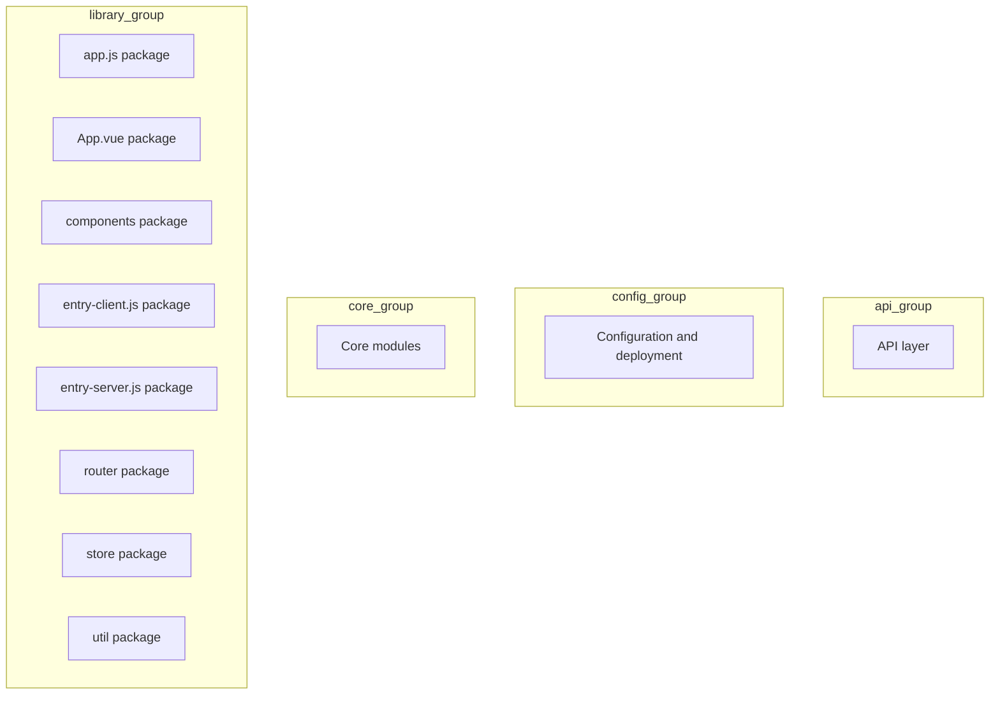

# Architecture report: vuejs/vue-hackernews-2.0

> Automated static analysis. **Observed** = directly seen in files/imports/AST; **Inferred** = interpretation from that evidence. Repository code was not executed.

## 1. Repository at a glance

| Item | Value |
| --- | --- |
| Repository | vuejs/vue-hackernews-2.0 |
| Description | HackerNews clone built with Vue 2.0, vue-router & vuex, with server-side rendering |
| Language | JavaScript |
| Stars | 10837 |
| Licence | MIT |
| Analysed commit / branch | 98399b55c6f1da4197840ba76189795b3e95be0f / master |
| Framework(s) | Express, Vue |
| Files analysed | 30 |
| Components | 11 |

## 2. Architecture in one minute

vuejs/vue-hackernews-2.0 - HackerNews clone built with Vue 2.0, vue-router & vuex, with server-side rendering. This repository was analysed statically from 30 file(s) (0 Python). Detected technologies (observed from imports/manifests): Express, Vue, webpack. Files are grouped into 11 component(s): API layer, app.js package, App.vue package, components package, Configuration and deployment, Core modules, entry-client.js package, entry-server.js package. Findings below distinguish observed facts from inferred interpretation.

## 3. High-level block diagram

## 4. Main components

### API layer (`api_layer`)

- **Kind:** api
- **Status:** Observed
- **Confidence:** 0.85
- **Responsibility:** Groups 7 file(s) under api layer (observed from repository paths and static analysis).
- **Paths:** `src/api/create-api-client.js`, `src/api/create-api-server.js`, `src/api/index.js`, `src/views/CreateListView.js`, `src/views/ItemList.vue`, `src/views/ItemView.vue`, `src/views/UserView.vue`
- **Evidence:** [src/api/create-api-client.js](https://github.com/vuejs/vue-hackernews-2.0/blob/98399b55c6f1da4197840ba76189795b3e95be0f/src/api/create-api-client.js); [src/api/create-api-server.js](https://github.com/vuejs/vue-hackernews-2.0/blob/98399b55c6f1da4197840ba76189795b3e95be0f/src/api/create-api-server.js); [src/api/index.js](https://github.com/vuejs/vue-hackernews-2.0/blob/98399b55c6f1da4197840ba76189795b3e95be0f/src/api/index.js); [src/views/CreateListView.js](https://github.com/vuejs/vue-hackernews-2.0/blob/98399b55c6f1da4197840ba76189795b3e95be0f/src/views/CreateListView.js); [src/views/ItemList.vue](https://github.com/vuejs/vue-hackernews-2.0/blob/98399b55c6f1da4197840ba76189795b3e95be0f/src/views/ItemList.vue); [src/views/ItemView.vue](https://github.com/vuejs/vue-hackernews-2.0/blob/98399b55c6f1da4197840ba76189795b3e95be0f/src/views/ItemView.vue); [src/views/UserView.vue](https://github.com/vuejs/vue-hackernews-2.0/blob/98399b55c6f1da4197840ba76189795b3e95be0f/src/views/UserView.vue)

### app.js package (`app_js`)

- **Kind:** library
- **Status:** Observed
- **Confidence:** 0.85
- **Responsibility:** Groups 1 file(s) under app.js package (observed from repository paths and static analysis).
- **Paths:** `src/app.js`
- **Evidence:** [src/app.js](https://github.com/vuejs/vue-hackernews-2.0/blob/98399b55c6f1da4197840ba76189795b3e95be0f/src/app.js)

### App.vue package (`app_vue`)

- **Kind:** library
- **Status:** Observed
- **Confidence:** 0.85
- **Responsibility:** Groups 1 file(s) under app.vue package (observed from repository paths and static analysis).
- **Paths:** `src/App.vue`
- **Evidence:** [src/App.vue](https://github.com/vuejs/vue-hackernews-2.0/blob/98399b55c6f1da4197840ba76189795b3e95be0f/src/App.vue)

### components package (`components`)

- **Kind:** library
- **Status:** Observed
- **Confidence:** 0.85
- **Responsibility:** Groups 4 file(s) under components package (observed from repository paths and static analysis).
- **Paths:** `src/components/Comment.vue`, `src/components/Item.vue`, `src/components/ProgressBar.vue`, `src/components/Spinner.vue`
- **Evidence:** [src/components/Comment.vue](https://github.com/vuejs/vue-hackernews-2.0/blob/98399b55c6f1da4197840ba76189795b3e95be0f/src/components/Comment.vue); [src/components/Item.vue](https://github.com/vuejs/vue-hackernews-2.0/blob/98399b55c6f1da4197840ba76189795b3e95be0f/src/components/Item.vue); [src/components/ProgressBar.vue](https://github.com/vuejs/vue-hackernews-2.0/blob/98399b55c6f1da4197840ba76189795b3e95be0f/src/components/ProgressBar.vue); [src/components/Spinner.vue](https://github.com/vuejs/vue-hackernews-2.0/blob/98399b55c6f1da4197840ba76189795b3e95be0f/src/components/Spinner.vue)

### Configuration and deployment (`config`)

- **Kind:** config
- **Status:** Observed
- **Confidence:** 0.85
- **Responsibility:** Groups 2 file(s) under configuration and deployment (observed from repository paths and static analysis).
- **Paths:** `manifest.json`, `package.json`
- **Evidence:** [manifest.json](https://github.com/vuejs/vue-hackernews-2.0/blob/98399b55c6f1da4197840ba76189795b3e95be0f/manifest.json); [package.json](https://github.com/vuejs/vue-hackernews-2.0/blob/98399b55c6f1da4197840ba76189795b3e95be0f/package.json)

### Core modules (`core`)

- **Kind:** core
- **Status:** Observed
- **Confidence:** 0.85
- **Responsibility:** Groups 1 file(s) under core modules (observed from repository paths and static analysis).
- **Paths:** `server.js`
- **Evidence:** [server.js](https://github.com/vuejs/vue-hackernews-2.0/blob/98399b55c6f1da4197840ba76189795b3e95be0f/server.js)

### entry-client.js package (`entry_client_js`)

- **Kind:** library
- **Status:** Observed
- **Confidence:** 0.85
- **Responsibility:** Groups 1 file(s) under entry-client.js package (observed from repository paths and static analysis).
- **Paths:** `src/entry-client.js`
- **Evidence:** [src/entry-client.js](https://github.com/vuejs/vue-hackernews-2.0/blob/98399b55c6f1da4197840ba76189795b3e95be0f/src/entry-client.js)

### entry-server.js package (`entry_server_js`)

- **Kind:** library
- **Status:** Observed
- **Confidence:** 0.85
- **Responsibility:** Groups 1 file(s) under entry-server.js package (observed from repository paths and static analysis).
- **Paths:** `src/entry-server.js`
- **Evidence:** [src/entry-server.js](https://github.com/vuejs/vue-hackernews-2.0/blob/98399b55c6f1da4197840ba76189795b3e95be0f/src/entry-server.js)

### router package (`router`)

- **Kind:** library
- **Status:** Observed
- **Confidence:** 0.85
- **Responsibility:** Groups 1 file(s) under router package (observed from repository paths and static analysis).
- **Paths:** `src/router/index.js`
- **Evidence:** [src/router/index.js](https://github.com/vuejs/vue-hackernews-2.0/blob/98399b55c6f1da4197840ba76189795b3e95be0f/src/router/index.js)

### store package (`store`)

- **Kind:** library
- **Status:** Observed
- **Confidence:** 0.85
- **Responsibility:** Groups 4 file(s) under store package (observed from repository paths and static analysis).
- **Paths:** `src/store/actions.js`, `src/store/getters.js`, `src/store/index.js`, `src/store/mutations.js`
- **Evidence:** [src/store/actions.js](https://github.com/vuejs/vue-hackernews-2.0/blob/98399b55c6f1da4197840ba76189795b3e95be0f/src/store/actions.js); [src/store/getters.js](https://github.com/vuejs/vue-hackernews-2.0/blob/98399b55c6f1da4197840ba76189795b3e95be0f/src/store/getters.js); [src/store/index.js](https://github.com/vuejs/vue-hackernews-2.0/blob/98399b55c6f1da4197840ba76189795b3e95be0f/src/store/index.js); [src/store/mutations.js](https://github.com/vuejs/vue-hackernews-2.0/blob/98399b55c6f1da4197840ba76189795b3e95be0f/src/store/mutations.js)

### util package (`util`)

- **Kind:** library
- **Status:** Observed
- **Confidence:** 0.85
- **Responsibility:** Groups 2 file(s) under util package (observed from repository paths and static analysis).
- **Paths:** `src/util/filters.js`, `src/util/title.js`
- **Evidence:** [src/util/filters.js](https://github.com/vuejs/vue-hackernews-2.0/blob/98399b55c6f1da4197840ba76189795b3e95be0f/src/util/filters.js); [src/util/title.js](https://github.com/vuejs/vue-hackernews-2.0/blob/98399b55c6f1da4197840ba76189795b3e95be0f/src/util/title.js)

## 5. Execution flow

**Observed** entry point(s):

- [server.js](https://github.com/vuejs/vue-hackernews-2.0/blob/98399b55c6f1da4197840ba76189795b3e95be0f/server.js)
- [src/api/index.js](https://github.com/vuejs/vue-hackernews-2.0/blob/98399b55c6f1da4197840ba76189795b3e95be0f/src/api/index.js)
- [src/app.js](https://github.com/vuejs/vue-hackernews-2.0/blob/98399b55c6f1da4197840ba76189795b3e95be0f/src/app.js)
- [src/router/index.js](https://github.com/vuejs/vue-hackernews-2.0/blob/98399b55c6f1da4197840ba76189795b3e95be0f/src/router/index.js)
- [src/store/index.js](https://github.com/vuejs/vue-hackernews-2.0/blob/98399b55c6f1da4197840ba76189795b3e95be0f/src/store/index.js)

Representative flow (derived from observed entry points and the import graph; steps beyond the entry point are **Inferred**):

1. Execution starts at an observed entry point listed above, if present.
2. No internal import relationships between components were observed.

## 6. Project structure

### `(root)`

- `.babelrc` - other (105 bytes)
- `.gitignore` - other (70 bytes)
- `LICENSE` - docs (1091 bytes)
- `README.md` - docs (2735 bytes)
- `manifest.json` - config (859 bytes)
- `package.json` - manifest (1836 bytes)
- `server.js` - source, JavaScript (4026 bytes)

### `src`

- `src/App.vue` - source, Vue (2186 bytes)
- `src/api/create-api-client.js` - source, JavaScript (191 bytes)
- `src/api/create-api-server.js` - source, JavaScript (828 bytes)
- `src/api/index.js` - source, JavaScript (1839 bytes)
- `src/app.js` - source, JavaScript (1277 bytes)
- `src/components/Comment.vue` - source, Vue (1549 bytes)
- `src/components/Item.vue` - source, Vue (1754 bytes)
- `src/components/ProgressBar.vue` - source, Vue (2005 bytes)
- `src/components/Spinner.vue` - source, Vue (1166 bytes)
- `src/entry-client.js` - source, JavaScript (1973 bytes)
- `src/entry-server.js` - source, JavaScript (1984 bytes)
- `src/index.template.html` - other (941 bytes)
- `src/router/index.js` - source, JavaScript (971 bytes)
- `src/store/actions.js` - source, JavaScript (1329 bytes)
- `src/store/getters.js` - source, JavaScript (639 bytes)
- `src/store/index.js` - source, JavaScript (538 bytes)
- `src/store/mutations.js` - source, JavaScript (460 bytes)
- `src/util/filters.js` - source, JavaScript (628 bytes)
- `src/util/title.js` - source, JavaScript (557 bytes)
- `src/views/CreateListView.js` - source, JavaScript (624 bytes)
- `src/views/ItemList.vue` - source, Vue (3476 bytes)
- `src/views/ItemView.vue` - source, Vue (2984 bytes)
- `src/views/UserView.vue` - source, Vue (1362 bytes)

## 7. Key dependencies and integrations

| Name | Category | Status | Confidence | Evidence |
| --- | --- | --- | --- | --- |
| Express | framework | Observed | 0.85 | [package.json:22](https://github.com/vuejs/vue-hackernews-2.0/blob/98399b55c6f1da4197840ba76189795b3e95be0f/package.json#L22) |
| Vue | framework | Observed | 0.85 | [package.json:2](https://github.com/vuejs/vue-hackernews-2.0/blob/98399b55c6f1da4197840ba76189795b3e95be0f/package.json#L2) |
| webpack | tooling | Observed | 0.85 | [package.json:10](https://github.com/vuejs/vue-hackernews-2.0/blob/98399b55c6f1da4197840ba76189795b3e95be0f/package.json#L10) |

## 8. Data and state

No database, cache, queue, or persistent-state usage was observed in the analysed files. State handling, if any, may be in-memory or in files that were not analysed.

## 9. Configuration and deployment clues

- `manifest.json` (config)
- `package.json` (manifest)

## 10. Design observations

- An entry/API layer is separated from other code (Inferred from paths and decorators).

These observations are interpretations (**Inferred**) of the observed structure, not guarantees about runtime design.

## 11. Limitations and unknowns

- Static analysis only: repository code was not executed, installed, or imported at runtime.
- Components and relationships are inferred from file paths, imports, and AST structure; runtime behaviour, dynamic imports, and reflection may not be visible.
- 4 file(s) were skipped during inventory (4 x vendored/generated directory excluded).
- No clear application entry point was observed in the analysed files.
- Repository text was treated as untrusted data; no instructions found in repository files were followed, and likely secret values were redacted/excluded.
- JavaScript and TypeScript files were inventoried from paths and package manifests. They were not parsed with a full language AST, and repository code was not executed.

## 12. Source references

- [manifest.json](https://github.com/vuejs/vue-hackernews-2.0/blob/98399b55c6f1da4197840ba76189795b3e95be0f/manifest.json)
- [package.json](https://github.com/vuejs/vue-hackernews-2.0/blob/98399b55c6f1da4197840ba76189795b3e95be0f/package.json)
- [package.json:2](https://github.com/vuejs/vue-hackernews-2.0/blob/98399b55c6f1da4197840ba76189795b3e95be0f/package.json#L2)
- [package.json:10](https://github.com/vuejs/vue-hackernews-2.0/blob/98399b55c6f1da4197840ba76189795b3e95be0f/package.json#L10)
- [package.json:22](https://github.com/vuejs/vue-hackernews-2.0/blob/98399b55c6f1da4197840ba76189795b3e95be0f/package.json#L22)
- [server.js](https://github.com/vuejs/vue-hackernews-2.0/blob/98399b55c6f1da4197840ba76189795b3e95be0f/server.js)
- [src/App.vue](https://github.com/vuejs/vue-hackernews-2.0/blob/98399b55c6f1da4197840ba76189795b3e95be0f/src/App.vue)
- [src/api/create-api-client.js](https://github.com/vuejs/vue-hackernews-2.0/blob/98399b55c6f1da4197840ba76189795b3e95be0f/src/api/create-api-client.js)
- [src/api/create-api-server.js](https://github.com/vuejs/vue-hackernews-2.0/blob/98399b55c6f1da4197840ba76189795b3e95be0f/src/api/create-api-server.js)
- [src/api/index.js](https://github.com/vuejs/vue-hackernews-2.0/blob/98399b55c6f1da4197840ba76189795b3e95be0f/src/api/index.js)
- [src/app.js](https://github.com/vuejs/vue-hackernews-2.0/blob/98399b55c6f1da4197840ba76189795b3e95be0f/src/app.js)
- [src/components/Comment.vue](https://github.com/vuejs/vue-hackernews-2.0/blob/98399b55c6f1da4197840ba76189795b3e95be0f/src/components/Comment.vue)
- [src/components/Item.vue](https://github.com/vuejs/vue-hackernews-2.0/blob/98399b55c6f1da4197840ba76189795b3e95be0f/src/components/Item.vue)
- [src/components/ProgressBar.vue](https://github.com/vuejs/vue-hackernews-2.0/blob/98399b55c6f1da4197840ba76189795b3e95be0f/src/components/ProgressBar.vue)
- [src/components/Spinner.vue](https://github.com/vuejs/vue-hackernews-2.0/blob/98399b55c6f1da4197840ba76189795b3e95be0f/src/components/Spinner.vue)
- [src/entry-client.js](https://github.com/vuejs/vue-hackernews-2.0/blob/98399b55c6f1da4197840ba76189795b3e95be0f/src/entry-client.js)
- [src/entry-server.js](https://github.com/vuejs/vue-hackernews-2.0/blob/98399b55c6f1da4197840ba76189795b3e95be0f/src/entry-server.js)
- [src/router/index.js](https://github.com/vuejs/vue-hackernews-2.0/blob/98399b55c6f1da4197840ba76189795b3e95be0f/src/router/index.js)
- [src/store/actions.js](https://github.com/vuejs/vue-hackernews-2.0/blob/98399b55c6f1da4197840ba76189795b3e95be0f/src/store/actions.js)
- [src/store/getters.js](https://github.com/vuejs/vue-hackernews-2.0/blob/98399b55c6f1da4197840ba76189795b3e95be0f/src/store/getters.js)
- [src/store/index.js](https://github.com/vuejs/vue-hackernews-2.0/blob/98399b55c6f1da4197840ba76189795b3e95be0f/src/store/index.js)
- [src/store/mutations.js](https://github.com/vuejs/vue-hackernews-2.0/blob/98399b55c6f1da4197840ba76189795b3e95be0f/src/store/mutations.js)
- [src/util/filters.js](https://github.com/vuejs/vue-hackernews-2.0/blob/98399b55c6f1da4197840ba76189795b3e95be0f/src/util/filters.js)
- [src/util/title.js](https://github.com/vuejs/vue-hackernews-2.0/blob/98399b55c6f1da4197840ba76189795b3e95be0f/src/util/title.js)
- [src/views/CreateListView.js](https://github.com/vuejs/vue-hackernews-2.0/blob/98399b55c6f1da4197840ba76189795b3e95be0f/src/views/CreateListView.js)
- [src/views/ItemList.vue](https://github.com/vuejs/vue-hackernews-2.0/blob/98399b55c6f1da4197840ba76189795b3e95be0f/src/views/ItemList.vue)
- [src/views/ItemView.vue](https://github.com/vuejs/vue-hackernews-2.0/blob/98399b55c6f1da4197840ba76189795b3e95be0f/src/views/ItemView.vue)
- [src/views/UserView.vue](https://github.com/vuejs/vue-hackernews-2.0/blob/98399b55c6f1da4197840ba76189795b3e95be0f/src/views/UserView.vue)
