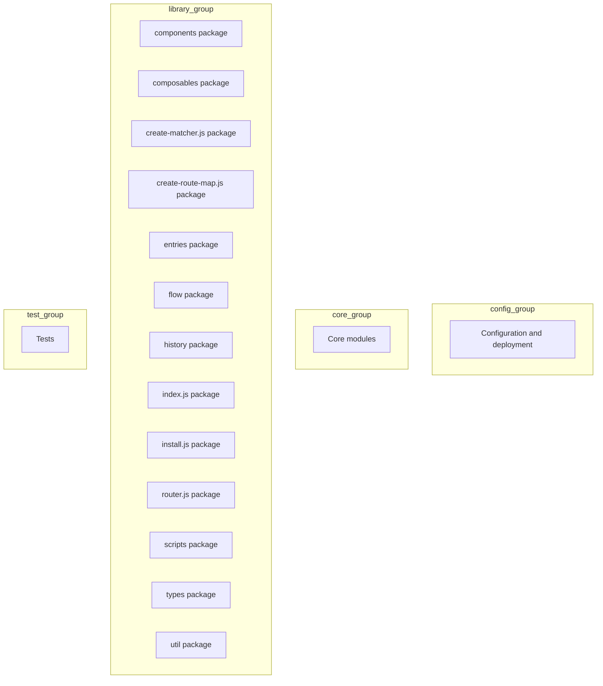

# Architecture report: vuejs/vue-router

> Automated static analysis. **Observed** = directly seen in files/imports/AST; **Inferred** = interpretation from that evidence. Repository code was not executed.

## 1. Repository at a glance

| Item | Value |
| --- | --- |
| Repository | vuejs/vue-router |
| Description | 🚦 The official router for Vue 2 |
| Language | JavaScript |
| Stars | 18852 |
| Licence | MIT |
| Analysed commit / branch | 680ccc68c506cca9be6207745043245d61fa715a / dev |
| Framework(s) | Express, Vue |
| Files analysed | 460 |
| Components | 16 |

## 2. Architecture in one minute

vuejs/vue-router - 🚦 The official router for Vue 2. This repository was analysed statically from 460 file(s) (0 Python). Detected technologies (observed from imports/manifests): GitHub Actions, Express, Vue, axios, TypeScript, webpack. Files are grouped into 16 component(s): components package, composables package, Configuration and deployment, Core modules, create-matcher.js package, create-route-map.js package, entries package, flow package. Findings below distinguish observed facts from inferred interpretation.

## 3. High-level block diagram

## 4. Main components

### components package (`components`)

- **Kind:** library
- **Status:** Observed
- **Confidence:** 0.85
- **Responsibility:** Groups 2 file(s) under components package (observed from repository paths and static analysis).
- **Paths:** `src/components/link.js`, `src/components/view.js`
- **Evidence:** [src/components/link.js](https://github.com/vuejs/vue-router/blob/680ccc68c506cca9be6207745043245d61fa715a/src/components/link.js); [src/components/view.js](https://github.com/vuejs/vue-router/blob/680ccc68c506cca9be6207745043245d61fa715a/src/components/view.js)

### composables package (`composables`)

- **Kind:** library
- **Status:** Observed
- **Confidence:** 0.85
- **Responsibility:** Groups 5 file(s) under composables package (observed from repository paths and static analysis).
- **Paths:** `src/composables/globals.js`, `src/composables/guards.js`, `src/composables/index.js`, `src/composables/useLink.js`, `src/composables/utils.js`
- **Evidence:** [src/composables/globals.js](https://github.com/vuejs/vue-router/blob/680ccc68c506cca9be6207745043245d61fa715a/src/composables/globals.js); [src/composables/guards.js](https://github.com/vuejs/vue-router/blob/680ccc68c506cca9be6207745043245d61fa715a/src/composables/guards.js); [src/composables/index.js](https://github.com/vuejs/vue-router/blob/680ccc68c506cca9be6207745043245d61fa715a/src/composables/index.js); [src/composables/useLink.js](https://github.com/vuejs/vue-router/blob/680ccc68c506cca9be6207745043245d61fa715a/src/composables/useLink.js); [src/composables/utils.js](https://github.com/vuejs/vue-router/blob/680ccc68c506cca9be6207745043245d61fa715a/src/composables/utils.js)

### Configuration and deployment (`config`)

- **Kind:** config
- **Status:** Observed
- **Confidence:** 0.85
- **Responsibility:** Groups 6 file(s) under configuration and deployment (observed from repository paths and static analysis).
- **Paths:** `docs-gitbook/assets/circle.yml`, `docs-gitbook/book.json`, `netlify.toml`, `package.json`, `vetur/attributes.json`, `vetur/tags.json`
- **Evidence:** [docs-gitbook/assets/circle.yml](https://github.com/vuejs/vue-router/blob/680ccc68c506cca9be6207745043245d61fa715a/docs-gitbook/assets/circle.yml); [docs-gitbook/book.json](https://github.com/vuejs/vue-router/blob/680ccc68c506cca9be6207745043245d61fa715a/docs-gitbook/book.json); [netlify.toml](https://github.com/vuejs/vue-router/blob/680ccc68c506cca9be6207745043245d61fa715a/netlify.toml); [package.json](https://github.com/vuejs/vue-router/blob/680ccc68c506cca9be6207745043245d61fa715a/package.json); [vetur/attributes.json](https://github.com/vuejs/vue-router/blob/680ccc68c506cca9be6207745043245d61fa715a/vetur/attributes.json); [vetur/tags.json](https://github.com/vuejs/vue-router/blob/680ccc68c506cca9be6207745043245d61fa715a/vetur/tags.json)

### Core modules (`core`)

- **Kind:** core
- **Status:** Observed
- **Confidence:** 0.85
- **Responsibility:** Groups 3 file(s) under core modules (observed from repository paths and static analysis).
- **Paths:** `composables.d.ts`, `composables.js`, `composables.mjs`
- **Evidence:** [composables.d.ts](https://github.com/vuejs/vue-router/blob/680ccc68c506cca9be6207745043245d61fa715a/composables.d.ts); [composables.js](https://github.com/vuejs/vue-router/blob/680ccc68c506cca9be6207745043245d61fa715a/composables.js); [composables.mjs](https://github.com/vuejs/vue-router/blob/680ccc68c506cca9be6207745043245d61fa715a/composables.mjs)

### create-matcher.js package (`create_matcher_js`)

- **Kind:** library
- **Status:** Observed
- **Confidence:** 0.85
- **Responsibility:** Groups 1 file(s) under create-matcher.js package (observed from repository paths and static analysis).
- **Paths:** `src/create-matcher.js`
- **Evidence:** [src/create-matcher.js](https://github.com/vuejs/vue-router/blob/680ccc68c506cca9be6207745043245d61fa715a/src/create-matcher.js)

### create-route-map.js package (`create_route_map_js`)

- **Kind:** library
- **Status:** Observed
- **Confidence:** 0.85
- **Responsibility:** Groups 1 file(s) under create-route-map.js package (observed from repository paths and static analysis).
- **Paths:** `src/create-route-map.js`
- **Evidence:** [src/create-route-map.js](https://github.com/vuejs/vue-router/blob/680ccc68c506cca9be6207745043245d61fa715a/src/create-route-map.js)

### entries package (`entries`)

- **Kind:** library
- **Status:** Observed
- **Confidence:** 0.85
- **Responsibility:** Groups 2 file(s) under entries package (observed from repository paths and static analysis).
- **Paths:** `src/entries/cjs.js`, `src/entries/esm.js`
- **Evidence:** [src/entries/cjs.js](https://github.com/vuejs/vue-router/blob/680ccc68c506cca9be6207745043245d61fa715a/src/entries/cjs.js); [src/entries/esm.js](https://github.com/vuejs/vue-router/blob/680ccc68c506cca9be6207745043245d61fa715a/src/entries/esm.js)

### flow package (`flow`)

- **Kind:** library
- **Status:** Observed
- **Confidence:** 0.85
- **Responsibility:** Groups 1 file(s) under flow package (observed from repository paths and static analysis).
- **Paths:** `flow/declarations.js`
- **Evidence:** [flow/declarations.js](https://github.com/vuejs/vue-router/blob/680ccc68c506cca9be6207745043245d61fa715a/flow/declarations.js)

### history package (`history`)

- **Kind:** library
- **Status:** Observed
- **Confidence:** 0.85
- **Responsibility:** Groups 4 file(s) under history package (observed from repository paths and static analysis).
- **Paths:** `src/history/abstract.js`, `src/history/base.js`, `src/history/hash.js`, `src/history/html5.js`
- **Evidence:** [src/history/abstract.js](https://github.com/vuejs/vue-router/blob/680ccc68c506cca9be6207745043245d61fa715a/src/history/abstract.js); [src/history/base.js](https://github.com/vuejs/vue-router/blob/680ccc68c506cca9be6207745043245d61fa715a/src/history/base.js); [src/history/hash.js](https://github.com/vuejs/vue-router/blob/680ccc68c506cca9be6207745043245d61fa715a/src/history/hash.js); [src/history/html5.js](https://github.com/vuejs/vue-router/blob/680ccc68c506cca9be6207745043245d61fa715a/src/history/html5.js)

### index.js package (`index_js`)

- **Kind:** library
- **Status:** Observed
- **Confidence:** 0.85
- **Responsibility:** Groups 1 file(s) under index.js package (observed from repository paths and static analysis).
- **Paths:** `src/index.js`
- **Evidence:** [src/index.js](https://github.com/vuejs/vue-router/blob/680ccc68c506cca9be6207745043245d61fa715a/src/index.js)

### install.js package (`install_js`)

- **Kind:** library
- **Status:** Observed
- **Confidence:** 0.85
- **Responsibility:** Groups 1 file(s) under install.js package (observed from repository paths and static analysis).
- **Paths:** `src/install.js`
- **Evidence:** [src/install.js](https://github.com/vuejs/vue-router/blob/680ccc68c506cca9be6207745043245d61fa715a/src/install.js)

### router.js package (`router_js`)

- **Kind:** library
- **Status:** Observed
- **Confidence:** 0.85
- **Responsibility:** Groups 1 file(s) under router.js package (observed from repository paths and static analysis).
- **Paths:** `src/router.js`
- **Evidence:** [src/router.js](https://github.com/vuejs/vue-router/blob/680ccc68c506cca9be6207745043245d61fa715a/src/router.js)

### scripts package (`scripts`)

- **Kind:** library
- **Status:** Observed
- **Confidence:** 0.85
- **Responsibility:** Groups 2 file(s) under scripts package (observed from repository paths and static analysis).
- **Paths:** `scripts/release.sh`, `scripts/verifyCommitMsg.js`
- **Evidence:** [scripts/release.sh](https://github.com/vuejs/vue-router/blob/680ccc68c506cca9be6207745043245d61fa715a/scripts/release.sh); [scripts/verifyCommitMsg.js](https://github.com/vuejs/vue-router/blob/680ccc68c506cca9be6207745043245d61fa715a/scripts/verifyCommitMsg.js)

### Tests (`tests`)

- **Kind:** test
- **Status:** Observed
- **Confidence:** 0.85
- **Responsibility:** Groups 51 file(s) under tests (observed from repository paths and static analysis).
- **Paths:** `test/.eslintrc`, `test/e2e/.eslintrc`, `test/e2e/browserstack-send-status.js`, `test/e2e/nightwatch.browserstack.js`, `test/e2e/nightwatch.config.js`, `test/e2e/runner.js`, `test/e2e/specs/.prettierrc`, `test/e2e/specs/active-links.js`, `test/e2e/specs/auth-flow.js`, `test/e2e/specs/basic.js`, `test/e2e/specs/composables.js`, `test/e2e/specs/data-fetching.js`, `test/e2e/specs/hash-mode.js`, `test/e2e/specs/hash-scroll-behavior.js`, `test/e2e/specs/history-state.js`, `test/e2e/specs/keepalive-view.js`, `test/e2e/specs/lazy-loading-before-mount.js`, `test/e2e/specs/lazy-loading.js`, `test/e2e/specs/multi-app.js`, `test/e2e/specs/named-routes.js`, `test/e2e/specs/named-views.js`, `test/e2e/specs/navigation-guards.js`, `test/e2e/specs/nested-router.js`, `test/e2e/specs/nested-routes.js`, `test/e2e/specs/redirect.js`, `test/e2e/specs/restart-app.js`, `test/e2e/specs/route-alias.js`, `test/e2e/specs/route-matching.js`, `test/e2e/specs/route-params.js`, `test/e2e/specs/route-props.js`, `test/e2e/specs/scroll-behavior.js`, `test/e2e/specs/transitions.js`, `test/unit/.eslintrc`, `test/unit/jasmine.json`, `test/unit/specs/abstract-history.spec.js`, `test/unit/specs/api.spec.js`, `test/unit/specs/async.spec.js`, `test/unit/specs/create-map.spec.js`, `test/unit/specs/create-matcher.spec.js`, `test/unit/specs/custom-query.spec.js`, `test/unit/specs/discrete-components.spec.js`, `test/unit/specs/error-handling.spec.js`, `test/unit/specs/location.spec.js`, `test/unit/specs/node.spec.js`, `test/unit/specs/onReady.spec.js`, `test/unit/specs/path.spec.js`, `test/unit/specs/query.spec.js`, `test/unit/specs/route.spec.js`, `types/test/index.ts`, `types/test/meta.ts`, `types/test/tsconfig.json`
- **Evidence:** [test/.eslintrc](https://github.com/vuejs/vue-router/blob/680ccc68c506cca9be6207745043245d61fa715a/test/.eslintrc); [test/e2e/.eslintrc](https://github.com/vuejs/vue-router/blob/680ccc68c506cca9be6207745043245d61fa715a/test/e2e/.eslintrc); [test/e2e/browserstack-send-status.js](https://github.com/vuejs/vue-router/blob/680ccc68c506cca9be6207745043245d61fa715a/test/e2e/browserstack-send-status.js); [test/e2e/nightwatch.browserstack.js](https://github.com/vuejs/vue-router/blob/680ccc68c506cca9be6207745043245d61fa715a/test/e2e/nightwatch.browserstack.js); [test/e2e/nightwatch.config.js](https://github.com/vuejs/vue-router/blob/680ccc68c506cca9be6207745043245d61fa715a/test/e2e/nightwatch.config.js); [test/e2e/runner.js](https://github.com/vuejs/vue-router/blob/680ccc68c506cca9be6207745043245d61fa715a/test/e2e/runner.js); [test/e2e/specs/.prettierrc](https://github.com/vuejs/vue-router/blob/680ccc68c506cca9be6207745043245d61fa715a/test/e2e/specs/.prettierrc); [test/e2e/specs/active-links.js](https://github.com/vuejs/vue-router/blob/680ccc68c506cca9be6207745043245d61fa715a/test/e2e/specs/active-links.js)

### types package (`types`)

- **Kind:** library
- **Status:** Observed
- **Confidence:** 0.85
- **Responsibility:** Groups 4 file(s) under types package (observed from repository paths and static analysis).
- **Paths:** `types/composables.d.ts`, `types/index.d.ts`, `types/router.d.ts`, `types/vue.d.ts`
- **Evidence:** [types/composables.d.ts](https://github.com/vuejs/vue-router/blob/680ccc68c506cca9be6207745043245d61fa715a/types/composables.d.ts); [types/index.d.ts](https://github.com/vuejs/vue-router/blob/680ccc68c506cca9be6207745043245d61fa715a/types/index.d.ts); [types/router.d.ts](https://github.com/vuejs/vue-router/blob/680ccc68c506cca9be6207745043245d61fa715a/types/router.d.ts); [types/vue.d.ts](https://github.com/vuejs/vue-router/blob/680ccc68c506cca9be6207745043245d61fa715a/types/vue.d.ts)

### util package (`util`)

- **Kind:** library
- **Status:** Observed
- **Confidence:** 0.85
- **Responsibility:** Groups 14 file(s) under util package (observed from repository paths and static analysis).
- **Paths:** `src/util/async.js`, `src/util/dom.js`, `src/util/errors.js`, `src/util/location.js`, `src/util/misc.js`, `src/util/params.js`, `src/util/path.js`, `src/util/push-state.js`, `src/util/query.js`, `src/util/resolve-components.js`, `src/util/route.js`, `src/util/scroll.js`, `src/util/state-key.js`, `src/util/warn.js`
- **Evidence:** [src/util/async.js](https://github.com/vuejs/vue-router/blob/680ccc68c506cca9be6207745043245d61fa715a/src/util/async.js); [src/util/dom.js](https://github.com/vuejs/vue-router/blob/680ccc68c506cca9be6207745043245d61fa715a/src/util/dom.js); [src/util/errors.js](https://github.com/vuejs/vue-router/blob/680ccc68c506cca9be6207745043245d61fa715a/src/util/errors.js); [src/util/location.js](https://github.com/vuejs/vue-router/blob/680ccc68c506cca9be6207745043245d61fa715a/src/util/location.js); [src/util/misc.js](https://github.com/vuejs/vue-router/blob/680ccc68c506cca9be6207745043245d61fa715a/src/util/misc.js); [src/util/params.js](https://github.com/vuejs/vue-router/blob/680ccc68c506cca9be6207745043245d61fa715a/src/util/params.js); [src/util/path.js](https://github.com/vuejs/vue-router/blob/680ccc68c506cca9be6207745043245d61fa715a/src/util/path.js); [src/util/push-state.js](https://github.com/vuejs/vue-router/blob/680ccc68c506cca9be6207745043245d61fa715a/src/util/push-state.js)

## 5. Execution flow

**Observed** entry point(s):

- [src/composables/index.js](https://github.com/vuejs/vue-router/blob/680ccc68c506cca9be6207745043245d61fa715a/src/composables/index.js)
- [src/index.js](https://github.com/vuejs/vue-router/blob/680ccc68c506cca9be6207745043245d61fa715a/src/index.js)

Representative flow (derived from observed entry points and the import graph; steps beyond the entry point are **Inferred**):

1. Execution starts at an observed entry point listed above, if present.
2. No internal import relationships between components were observed.

## 6. Project structure

### `(root)`

- `.babelrc` - other (77 bytes)
- `.eslintignore` - other (10 bytes)
- `.eslintrc` - other (143 bytes)
- `.flowconfig` - other (202 bytes)
- `.gitignore` - other (238 bytes)
- `.prettierrc` - other (63 bytes)
- `CHANGELOG.md` - docs (29174 bytes)
- `LICENSE` - docs (1073 bytes)
- `README.md` - docs (6029 bytes)
- `composables.d.ts` - source, TypeScript (36 bytes)
- `composables.js` - source, JavaScript (6836 bytes)
- `composables.mjs` - source, JavaScript (6684 bytes)
- `netlify.toml` - config (125 bytes)
- `package.json` - manifest (4289 bytes)

### `.circleci`

- `.circleci/config.yml` - ci, YAML (1769 bytes)

### `.github`

- `.github/ISSUE_TEMPLATE.md` - docs (210 bytes)
- `.github/PULL_REQUEST_TEMPLATE.md` - docs (149 bytes)
- `.github/funding.yml` - config (50 bytes)
- `.github/workflows/release-tag.yml` - ci, YAML (607 bytes)

### `docs`

- `docs/.vuepress/components/HomeSponsors.vue` - docs (1599 bytes)
- `docs/.vuepress/components/HomeSponsorsGroup.vue` - docs (729 bytes)
- `docs/.vuepress/components/sponsors.json` - config (1674 bytes)
- `docs/.vuepress/config.js` - docs (12358 bytes)
- `docs/.vuepress/public/_redirects` - docs (878 bytes)
- `docs/.vuepress/public/icons/safari-pinned-tab.svg` - docs (10608 bytes)
- `docs/.vuepress/public/images/vueschool/vs-close.svg` - docs (608 bytes)
- `docs/.vuepress/public/images/vueschool/vs-fw-bg-small.svg` - docs (21295 bytes)
- `docs/.vuepress/public/images/vueschool/vs-fw-bg.svg` - docs (26958 bytes)
- `docs/.vuepress/public/images/vueschool/vs-iso.svg` - docs (1095 bytes)
- `docs/.vuepress/public/images/vueschool/vs-logo.svg` - docs (3729 bytes)
- `docs/.vuepress/public/sponsors/fincliplogo_black_svg.svg` - docs (3789 bytes)
- `docs/.vuepress/public/sponsors/fincliplogo_white_svg.svg` - docs (7474 bytes)
- `docs/.vuepress/public/sponsors/vuetify-logo-dark-text.svg` - docs (3251 bytes)
- `docs/.vuepress/public/sponsors/vuetify-logo-light-text.svg` - docs (3278 bytes)
- `docs/.vuepress/styles/index.styl` - docs (999 bytes)
- `docs/.vuepress/theme/Layout.vue` - docs (4254 bytes)
- `docs/.vuepress/theme/components/BuySellAds.vue` - docs (2137 bytes)
- `docs/.vuepress/theme/components/CarbonAds.vue` - docs (1373 bytes)
- `docs/.vuepress/theme/components/VueSchool/BannerTop.vue` - docs (5014 bytes)
- `docs/.vuepress/theme/index.js` - docs (57 bytes)
- `docs/README.md` - docs (909 bytes)
- `docs/api/README.md` - docs (19269 bytes)
- `docs/fr/README.md` - docs (972 bytes)
- `docs/fr/api/README.md` - docs (17417 bytes)
- `docs/fr/guide/README.md` - docs (3801 bytes)
- `docs/fr/guide/advanced/data-fetching.md` - docs (3950 bytes)
- `docs/fr/guide/advanced/lazy-loading.md` - docs (2501 bytes)
- `docs/fr/guide/advanced/meta.md` - docs (1702 bytes)
- `docs/fr/guide/advanced/navigation-guards.md` - docs (7185 bytes)
- `docs/fr/guide/advanced/scroll-behavior.md` - docs (3017 bytes)
- `docs/fr/guide/advanced/transitions.md` - docs (1675 bytes)
- `docs/fr/guide/essentials/dynamic-matching.md` - docs (4115 bytes)
- `docs/fr/guide/essentials/history-mode.md` - docs (4434 bytes)
- `docs/fr/guide/essentials/named-routes.md` - docs (1001 bytes)
- `docs/fr/guide/essentials/named-views.md` - docs (3406 bytes)
- `docs/fr/guide/essentials/navigation.md` - docs (4683 bytes)
- `docs/fr/guide/essentials/nested-routes.md` - docs (3660 bytes)
- `docs/fr/guide/essentials/passing-props.md` - docs (2350 bytes)
- `docs/fr/guide/essentials/redirect-and-alias.md` - docs (2028 bytes)
- `docs/fr/installation.md` - docs (1315 bytes)
- `docs/guide/README.md` - docs (3785 bytes)
- `docs/guide/advanced/data-fetching.md` - docs (3518 bytes)
- `docs/guide/advanced/lazy-loading.md` - docs (2427 bytes)
- `docs/guide/advanced/meta.md` - docs (1734 bytes)
- `docs/guide/advanced/navigation-failures.md` - docs (3034 bytes)
- `docs/guide/advanced/navigation-guards.md` - docs (7418 bytes)
- `docs/guide/advanced/scroll-behavior.md` - docs (3275 bytes)
- `docs/guide/advanced/transitions.md` - docs (1835 bytes)
- `docs/guide/essentials/dynamic-matching.md` - docs (4707 bytes)
- `docs/guide/essentials/history-mode.md` - docs (4517 bytes)
- `docs/guide/essentials/named-routes.md` - docs (1176 bytes)
- `docs/guide/essentials/named-views.md` - docs (3141 bytes)
- `docs/guide/essentials/navigation.md` - docs (4168 bytes)
- `docs/guide/essentials/nested-routes.md` - docs (3433 bytes)
- `docs/guide/essentials/passing-props.md` - docs (2637 bytes)
- `docs/guide/essentials/redirect-and-alias.md` - docs (1699 bytes)
- `docs/installation.md` - docs (1497 bytes)
- `docs/ja/README.md` - docs (1451 bytes)
- `docs/ja/api/README.md` - docs (21960 bytes)
- `docs/ja/guide/README.md` - docs (4569 bytes)
- `docs/ja/guide/advanced/data-fetching.md` - docs (4501 bytes)
- `docs/ja/guide/advanced/lazy-loading.md` - docs (2884 bytes)
- `docs/ja/guide/advanced/meta.md` - docs (2187 bytes)
- `docs/ja/guide/advanced/navigation-failures.md` - docs (3733 bytes)
- `docs/ja/guide/advanced/navigation-guards.md` - docs (9715 bytes)
- `docs/ja/guide/advanced/scroll-behavior.md` - docs (3823 bytes)
- `docs/ja/guide/advanced/transitions.md` - docs (2154 bytes)
- `docs/ja/guide/essentials/dynamic-matching.md` - docs (6138 bytes)
- `docs/ja/guide/essentials/history-mode.md` - docs (4979 bytes)
- `docs/ja/guide/essentials/named-routes.md` - docs (1447 bytes)
- `docs/ja/guide/essentials/named-views.md` - docs (4207 bytes)
- `docs/ja/guide/essentials/navigation.md` - docs (5354 bytes)
- `docs/ja/guide/essentials/nested-routes.md` - docs (4179 bytes)
- `docs/ja/guide/essentials/passing-props.md` - docs (3130 bytes)
- `docs/ja/guide/essentials/redirect-and-alias.md` - docs (2523 bytes)
- `docs/ja/installation.md` - docs (1860 bytes)
- `docs/kr/README.md` - docs (1099 bytes)
- `docs/kr/api/README.md` - docs (9983 bytes)
- `docs/kr/guide/README.md` - docs (3682 bytes)
- `docs/kr/guide/advanced/data-fetching.md` - docs (3776 bytes)
- `docs/kr/guide/advanced/lazy-loading.md` - docs (2333 bytes)
- `docs/kr/guide/advanced/meta.md` - docs (1766 bytes)
- `docs/kr/guide/advanced/navigation-guards.md` - docs (5781 bytes)
- `docs/kr/guide/advanced/scroll-behavior.md` - docs (2268 bytes)
- `docs/kr/guide/advanced/transitions.md` - docs (1730 bytes)
- `docs/kr/guide/essentials/dynamic-matching.md` - docs (3707 bytes)
- `docs/kr/guide/essentials/getting-started.md` - docs (3051 bytes)
- `docs/kr/guide/essentials/history-mode.md` - docs (4043 bytes)
- `docs/kr/guide/essentials/named-routes.md` - docs (1000 bytes)
- `docs/kr/guide/essentials/named-views.md` - docs (1094 bytes)
- `docs/kr/guide/essentials/navigation.md` - docs (3505 bytes)
- `docs/kr/guide/essentials/nested-routes.md` - docs (3524 bytes)
- `docs/kr/guide/essentials/passing-props.md` - docs (2109 bytes)
- `docs/kr/guide/essentials/redirect-and-alias.md` - docs (1676 bytes)
- `docs/kr/installation.md` - docs (1265 bytes)
- `docs/ru/README.md` - docs (1450 bytes)
- `docs/ru/api/README.md` - docs (30662 bytes)
- `docs/ru/guide/README.md` - docs (5262 bytes)
- `docs/ru/guide/advanced/data-fetching.md` - docs (4916 bytes)
- `docs/ru/guide/advanced/lazy-loading.md` - docs (3600 bytes)
- `docs/ru/guide/advanced/meta.md` - docs (2840 bytes)
- `docs/ru/guide/advanced/navigation-failures.md` - docs (5051 bytes)
- `docs/ru/guide/advanced/navigation-guards.md` - docs (11611 bytes)
- `docs/ru/guide/advanced/scroll-behavior.md` - docs (4894 bytes)
- `docs/ru/guide/advanced/transitions.md` - docs (2357 bytes)
- `docs/ru/guide/essentials/dynamic-matching.md` - docs (7242 bytes)
- `docs/ru/guide/essentials/history-mode.md` - docs (6349 bytes)
- `docs/ru/guide/essentials/named-routes.md` - docs (1343 bytes)
- `docs/ru/guide/essentials/named-views.md` - docs (4694 bytes)
- `docs/ru/guide/essentials/navigation.md` - docs (6423 bytes)
- `docs/ru/guide/essentials/nested-routes.md` - docs (4612 bytes)
- `docs/ru/guide/essentials/passing-props.md` - docs (3838 bytes)
- `docs/ru/guide/essentials/redirect-and-alias.md` - docs (3020 bytes)
- `docs/ru/installation.md` - docs (2354 bytes)
- `docs/zh/README.md` - docs (1237 bytes)
- `docs/zh/api/README.md` - docs (17677 bytes)
- `docs/zh/guide/README.md` - docs (3535 bytes)
- `docs/zh/guide/advanced/data-fetching.md` - docs (3122 bytes)
- `docs/zh/guide/advanced/lazy-loading.md` - docs (2424 bytes)
- `docs/zh/guide/advanced/meta.md` - docs (1408 bytes)
- `docs/zh/guide/advanced/navigation-failures.md` - docs (3137 bytes)
- `docs/zh/guide/advanced/navigation-guards.md` - docs (6724 bytes)
- `docs/zh/guide/advanced/scroll-behavior.md` - docs (3166 bytes)
- `docs/zh/guide/advanced/transitions.md` - docs (1758 bytes)
- `docs/zh/guide/essentials/dynamic-matching.md` - docs (4670 bytes)
- `docs/zh/guide/essentials/history-mode.md` - docs (4364 bytes)
- `docs/zh/guide/essentials/named-routes.md` - docs (1206 bytes)
- `docs/zh/guide/essentials/named-views.md` - docs (3063 bytes)
- `docs/zh/guide/essentials/navigation.md` - docs (4109 bytes)
- `docs/zh/guide/essentials/nested-routes.md` - docs (3272 bytes)
- `docs/zh/guide/essentials/passing-props.md` - docs (2502 bytes)
- `docs/zh/guide/essentials/redirect-and-alias.md` - docs (1711 bytes)
- `docs/zh/installation.md` - docs (1504 bytes)

### `docs-gitbook`

- `docs-gitbook/LANGS.md` - docs (174 bytes)
- `docs-gitbook/assets/CNAME` - other (17 bytes)
- `docs-gitbook/assets/circle.yml` - config (50 bytes)
- `docs-gitbook/book.json` - config (435 bytes)
- `docs-gitbook/de/SUMMARY.md` - docs (1374 bytes)
- `docs-gitbook/de/advanced/data-fetching.md` - docs (3641 bytes)
- `docs-gitbook/de/advanced/lazy-loading.md` - docs (2178 bytes)
- `docs-gitbook/de/advanced/meta.md` - docs (1550 bytes)
- `docs-gitbook/de/advanced/navigation-guards.md` - docs (4154 bytes)
- `docs-gitbook/de/advanced/scroll-behavior.md` - docs (2034 bytes)
- `docs-gitbook/de/advanced/transitions.md` - docs (1565 bytes)
- `docs-gitbook/de/api/component-injections.md` - docs (618 bytes)
- `docs-gitbook/de/api/options.md` - docs (1868 bytes)
- `docs-gitbook/de/api/route-object.md` - docs (2573 bytes)
- `docs-gitbook/de/api/router-instance.md` - docs (1965 bytes)
- `docs-gitbook/de/api/router-link.md` - docs (4458 bytes)
- `docs-gitbook/de/api/router-view.md` - docs (1064 bytes)
- `docs-gitbook/de/essentials/dynamic-matching.md` - docs (3346 bytes)
- `docs-gitbook/de/essentials/getting-started.md` - docs (2945 bytes)
- `docs-gitbook/de/essentials/history-mode.md` - docs (2244 bytes)
- `docs-gitbook/de/essentials/named-routes.md` - docs (911 bytes)
- `docs-gitbook/de/essentials/named-views.md` - docs (1003 bytes)
- `docs-gitbook/de/essentials/navigation.md` - docs (3163 bytes)
- `docs-gitbook/de/essentials/nested-routes.md` - docs (3634 bytes)
- `docs-gitbook/de/essentials/redirect-and-alias.md` - docs (1753 bytes)
- `docs-gitbook/de/installation.md` - docs (1200 bytes)
- `docs-gitbook/es/README.md` - docs (29 bytes)
- `docs-gitbook/es/SUMMARY.md` - docs (2000 bytes)
- `docs-gitbook/es/advanced/data-fetching.md` - docs (3532 bytes)
- `docs-gitbook/es/advanced/lazy-loading.md` - docs (2210 bytes)
- `docs-gitbook/es/advanced/meta.md` - docs (1648 bytes)
- `docs-gitbook/es/advanced/navigation-guards.md` - docs (6167 bytes)
- `docs-gitbook/es/advanced/scroll-behavior.md` - docs (2144 bytes)
- `docs-gitbook/es/advanced/transitions.md` - docs (1597 bytes)
- `docs-gitbook/es/api/component-injections.md` - docs (626 bytes)
- `docs-gitbook/es/api/options.md` - docs (3114 bytes)
- `docs-gitbook/es/api/route-object.md` - docs (2643 bytes)
- `docs-gitbook/es/api/router-instance.md` - docs (3015 bytes)
- `docs-gitbook/es/api/router-link.md` - docs (5249 bytes)
- `docs-gitbook/es/api/router-view.md` - docs (1122 bytes)
- `docs-gitbook/es/essentials/dynamic-matching.md` - docs (3528 bytes)
- `docs-gitbook/es/essentials/getting-started.md` - docs (2847 bytes)
- `docs-gitbook/es/essentials/history-mode.md` - docs (2316 bytes)
- `docs-gitbook/es/essentials/named-routes.md` - docs (926 bytes)
- `docs-gitbook/es/essentials/named-views.md` - docs (1065 bytes)
- `docs-gitbook/es/essentials/navigation.md` - docs (3323 bytes)
- `docs-gitbook/es/essentials/nested-routes.md` - docs (3330 bytes)
- `docs-gitbook/es/essentials/passing-props.md` - docs (2291 bytes)
- `docs-gitbook/es/essentials/redirect-and-alias.md` - docs (1714 bytes)
- `docs-gitbook/es/installation.md` - docs (1260 bytes)
- `docs-gitbook/fr/README.md` - docs (29 bytes)
- `docs-gitbook/fr/SUMMARY.md` - docs (1914 bytes)
- `docs-gitbook/fr/advanced/data-fetching.md` - docs (3950 bytes)
- `docs-gitbook/fr/advanced/lazy-loading.md` - docs (2504 bytes)
- `docs-gitbook/fr/advanced/meta.md` - docs (1702 bytes)
- `docs-gitbook/fr/advanced/navigation-guards.md` - docs (7348 bytes)
- `docs-gitbook/fr/advanced/scroll-behavior.md` - docs (3018 bytes)
- `docs-gitbook/fr/advanced/transitions.md` - docs (1675 bytes)
- `docs-gitbook/fr/api/component-injections.md` - docs (658 bytes)
- `docs-gitbook/fr/api/options.md` - docs (3281 bytes)
- `docs-gitbook/fr/api/route-object.md` - docs (3106 bytes)
- `docs-gitbook/fr/api/router-instance.md` - docs (3475 bytes)
- `docs-gitbook/fr/api/router-link.md` - docs (5232 bytes)
- `docs-gitbook/fr/api/router-view.md` - docs (1083 bytes)
- `docs-gitbook/fr/essentials/dynamic-matching.md` - docs (3860 bytes)
- `docs-gitbook/fr/essentials/getting-started.md` - docs (3809 bytes)
- `docs-gitbook/fr/essentials/history-mode.md` - docs (4209 bytes)
- `docs-gitbook/fr/essentials/named-routes.md` - docs (1001 bytes)
- `docs-gitbook/fr/essentials/named-views.md` - docs (3406 bytes)
- `docs-gitbook/fr/essentials/navigation.md` - docs (4570 bytes)
- `docs-gitbook/fr/essentials/nested-routes.md` - docs (3662 bytes)
- `docs-gitbook/fr/essentials/passing-props.md` - docs (2353 bytes)
- `docs-gitbook/fr/essentials/redirect-and-alias.md` - docs (2048 bytes)
- `docs-gitbook/fr/installation.md` - docs (1314 bytes)
- `docs-gitbook/ja/README.md` - docs (29 bytes)
- `docs-gitbook/ja/SUMMARY.md` - docs (2092 bytes)
- `docs-gitbook/ja/advanced/data-fetching.md` - docs (4207 bytes)
- `docs-gitbook/ja/advanced/lazy-loading.md` - docs (2580 bytes)
- `docs-gitbook/ja/advanced/meta.md` - docs (1883 bytes)
- `docs-gitbook/ja/advanced/navigation-guards.md` - docs (8638 bytes)
- `docs-gitbook/ja/advanced/scroll-behavior.md` - docs (3523 bytes)
- `docs-gitbook/ja/advanced/transitions.md` - docs (1851 bytes)
- `docs-gitbook/ja/api/component-injections.md` - docs (747 bytes)
- `docs-gitbook/ja/api/options.md` - docs (3702 bytes)
- `docs-gitbook/ja/api/route-object.md` - docs (3310 bytes)
- `docs-gitbook/ja/api/router-instance.md` - docs (3783 bytes)
- `docs-gitbook/ja/api/router-link.md` - docs (6118 bytes)
- `docs-gitbook/ja/api/router-view.md` - docs (1293 bytes)
- `docs-gitbook/ja/essentials/dynamic-matching.md` - docs (4224 bytes)
- `docs-gitbook/ja/essentials/getting-started.md` - docs (4252 bytes)
- `docs-gitbook/ja/essentials/history-mode.md` - docs (4588 bytes)
- `docs-gitbook/ja/essentials/named-routes.md` - docs (1142 bytes)
- `docs-gitbook/ja/essentials/named-views.md` - docs (3900 bytes)
- `docs-gitbook/ja/essentials/navigation.md` - docs (4996 bytes)
- `docs-gitbook/ja/essentials/nested-routes.md` - docs (3867 bytes)
- `docs-gitbook/ja/essentials/passing-props.md` - docs (2795 bytes)
- `docs-gitbook/ja/essentials/redirect-and-alias.md` - docs (2244 bytes)
- `docs-gitbook/ja/installation.md` - docs (1398 bytes)
- `docs-gitbook/kr/README.md` - docs (29 bytes)
- `docs-gitbook/kr/SUMMARY.md` - docs (1980 bytes)
- `docs-gitbook/kr/advanced/data-fetching.md` - docs (3776 bytes)
- `docs-gitbook/kr/advanced/lazy-loading.md` - docs (2349 bytes)
- `docs-gitbook/kr/advanced/meta.md` - docs (1766 bytes)
- `docs-gitbook/kr/advanced/navigation-guards.md` - docs (5776 bytes)
- `docs-gitbook/kr/advanced/scroll-behavior.md` - docs (2268 bytes)
- `docs-gitbook/kr/advanced/transitions.md` - docs (1676 bytes)
- `docs-gitbook/kr/api/component-injections.md` - docs (654 bytes)
- `docs-gitbook/kr/api/options.md` - docs (3202 bytes)
- `docs-gitbook/kr/api/route-object.md` - docs (2886 bytes)
- `docs-gitbook/kr/api/router-instance.md` - docs (3060 bytes)
- `docs-gitbook/kr/api/router-link.md` - docs (5286 bytes)
- `docs-gitbook/kr/api/router-view.md` - docs (1162 bytes)
- `docs-gitbook/kr/essentials/dynamic-matching.md` - docs (3678 bytes)
- `docs-gitbook/kr/essentials/getting-started.md` - docs (3047 bytes)
- `docs-gitbook/kr/essentials/history-mode.md` - docs (3998 bytes)
- `docs-gitbook/kr/essentials/named-routes.md` - docs (1000 bytes)
- `docs-gitbook/kr/essentials/named-views.md` - docs (1094 bytes)
- `docs-gitbook/kr/essentials/navigation.md` - docs (3505 bytes)
- `docs-gitbook/kr/essentials/nested-routes.md` - docs (3521 bytes)
- `docs-gitbook/kr/essentials/passing-props.md` - docs (2111 bytes)
- `docs-gitbook/kr/essentials/redirect-and-alias.md` - docs (1676 bytes)
- `docs-gitbook/kr/installation.md` - docs (1261 bytes)
- `docs-gitbook/old/README.md` - docs (214 bytes)
- `docs-gitbook/old/SUMMARY.md` - docs (0 bytes)
- `docs-gitbook/ru/README.md` - docs (29 bytes)
- `docs-gitbook/ru/SUMMARY.md` - docs (2337 bytes)
- `docs-gitbook/ru/advanced/data-fetching.md` - docs (4851 bytes)
- `docs-gitbook/ru/advanced/lazy-loading.md` - docs (3608 bytes)
- `docs-gitbook/ru/advanced/meta.md` - docs (2229 bytes)
- `docs-gitbook/ru/advanced/navigation-guards.md` - docs (10410 bytes)
- `docs-gitbook/ru/advanced/scroll-behavior.md` - docs (4322 bytes)
- `docs-gitbook/ru/advanced/transitions.md` - docs (2371 bytes)
- `docs-gitbook/ru/api/component-injections.md` - docs (1115 bytes)
- `docs-gitbook/ru/api/options.md` - docs (4570 bytes)
- `docs-gitbook/ru/api/route-object.md` - docs (3582 bytes)
- `docs-gitbook/ru/api/router-instance.md` - docs (4647 bytes)
- `docs-gitbook/ru/api/router-link.md` - docs (7939 bytes)
- `docs-gitbook/ru/api/router-view.md` - docs (1795 bytes)
- `docs-gitbook/ru/essentials/dynamic-matching.md` - docs (5060 bytes)
- `docs-gitbook/ru/essentials/getting-started.md` - docs (4984 bytes)
- `docs-gitbook/ru/essentials/history-mode.md` - docs (5095 bytes)
- `docs-gitbook/ru/essentials/named-routes.md` - docs (1296 bytes)
- `docs-gitbook/ru/essentials/named-views.md` - docs (4577 bytes)
- `docs-gitbook/ru/essentials/navigation.md` - docs (6192 bytes)
- `docs-gitbook/ru/essentials/nested-routes.md` - docs (4580 bytes)
- `docs-gitbook/ru/essentials/passing-props.md` - docs (3783 bytes)
- `docs-gitbook/ru/essentials/redirect-and-alias.md` - docs (2906 bytes)
- `docs-gitbook/ru/installation.md` - docs (1681 bytes)

### `examples`

- `examples/active-links/app.js` - source, JavaScript (3942 bytes)
- `examples/active-links/index.html` - other (397 bytes)
- `examples/auth-flow/app.js` - source, JavaScript (963 bytes)
- `examples/auth-flow/auth.js` - source, JavaScript (985 bytes)
- `examples/auth-flow/components/About.vue` - source, Vue (59 bytes)
- `examples/auth-flow/components/App.vue` - source, Vue (856 bytes)
- `examples/auth-flow/components/Dashboard.vue` - source, Vue (91 bytes)
- `examples/auth-flow/components/Login.vue` - source, Vue (918 bytes)
- `examples/auth-flow/index.html` - other (217 bytes)
- `examples/basic/app.js` - source, JavaScript (3933 bytes)
- `examples/basic/index.html` - other (258 bytes)
- `examples/composables/app.js` - source, JavaScript (2994 bytes)
- `examples/composables/index.html` - other (226 bytes)
- `examples/data-fetching/Post.vue` - source, Vue (1342 bytes)
- `examples/data-fetching/api.js` - source, JavaScript (713 bytes)
- `examples/data-fetching/app.js` - source, JavaScript (755 bytes)
- `examples/data-fetching/index.html` - other (221 bytes)
- `examples/discrete-components/app.js` - source, JavaScript (1124 bytes)
- `examples/discrete-components/index.html` - other (1594 bytes)
- `examples/global.css` - other (354 bytes)
- `examples/hash-mode/app.js` - source, JavaScript (3337 bytes)
- `examples/hash-mode/index.html` - other (262 bytes)
- `examples/hash-scroll-behavior/app.js` - source, JavaScript (2149 bytes)
- `examples/hash-scroll-behavior/index.html` - other (332 bytes)
- `examples/index.html` - other (1487 bytes)
- `examples/keepalive-view/app.js` - source, JavaScript (4038 bytes)
- `examples/keepalive-view/index.html` - other (222 bytes)
- `examples/lazy-loading-before-mount/app.js` - source, JavaScript (819 bytes)
- `examples/lazy-loading-before-mount/index.html` - other (273 bytes)
- `examples/lazy-loading/Bar.vue` - source, Vue (262 bytes)
- `examples/lazy-loading/Baz.vue` - source, Vue (107 bytes)
- `examples/lazy-loading/Foo.vue` - source, Vue (143 bytes)
- `examples/lazy-loading/app.js` - source, JavaScript (2833 bytes)
- `examples/lazy-loading/index.html` - other (220 bytes)
- `examples/multi-app/app.js` - source, JavaScript (2137 bytes)
- `examples/multi-app/index.html` - other (587 bytes)
- `examples/named-routes/app.js` - source, JavaScript (968 bytes)
- `examples/named-routes/index.html` - other (220 bytes)
- `examples/named-views/app.js` - source, JavaScript (1081 bytes)
- `examples/named-views/index.html` - other (219 bytes)
- `examples/navigation-guards/app.js` - source, JavaScript (5431 bytes)
- `examples/navigation-guards/index.html` - other (367 bytes)
- `examples/nested-router/app.js` - source, JavaScript (1256 bytes)
- `examples/nested-router/index.html` - other (336 bytes)
- `examples/nested-routes/app.js` - source, JavaScript (3406 bytes)
- `examples/nested-routes/index.html` - other (352 bytes)
- `examples/redirect/app.js` - source, JavaScript (3723 bytes)
- `examples/redirect/index.html` - other (216 bytes)
- `examples/restart-app/app.js` - source, JavaScript (1480 bytes)
- `examples/restart-app/index.html` - other (484 bytes)
- `examples/route-alias/app.js` - source, JavaScript (2293 bytes)
- `examples/route-alias/index.html` - other (219 bytes)
- `examples/route-matching/app.js` - source, JavaScript (1967 bytes)
- `examples/route-matching/index.html` - other (222 bytes)
- `examples/route-params/app.js` - source, JavaScript (1143 bytes)
- `examples/route-params/index.html` - other (220 bytes)
- `examples/route-props/Hello.vue` - source, Vue (210 bytes)
- `examples/route-props/app.js` - source, JavaScript (1288 bytes)
- `examples/route-props/index.html` - other (219 bytes)
- `examples/router-errors/app.js` - source, JavaScript (933 bytes)
- `examples/router-errors/index.html` - other (253 bytes)
- `examples/scroll-behavior/app.js` - source, JavaScript (2943 bytes)
- `examples/scroll-behavior/index.html` - other (469 bytes)
- `examples/server.js` - source, JavaScript (893 bytes)
- `examples/transitions/app.js` - source, JavaScript (1713 bytes)
- `examples/transitions/index.html` - other (725 bytes)
- `examples/webpack.config.js` - source, JavaScript (1474 bytes)

### `flow`

- `flow/declarations.js` - source, JavaScript (2567 bytes)

### `scripts`

- `scripts/release.sh` - source, Shell (762 bytes)
- `scripts/verifyCommitMsg.js` - source, JavaScript (952 bytes)

### `src`

- `src/components/link.js` - source, JavaScript (6884 bytes)
- `src/components/view.js` - source, JavaScript (4629 bytes)
- `src/composables/globals.js` - source, JavaScript (743 bytes)
- `src/composables/guards.js` - source, JavaScript (1727 bytes)
- `src/composables/index.js` - source, JavaScript (77 bytes)
- `src/composables/useLink.js` - source, JavaScript (3161 bytes)
- `src/composables/utils.js` - source, JavaScript (306 bytes)
- `src/create-matcher.js` - source, JavaScript (6545 bytes)
- `src/create-route-map.js` - source, JavaScript (6294 bytes)
- `src/entries/cjs.js` - source, JavaScript (60 bytes)
- `src/entries/esm.js` - source, JavaScript (523 bytes)
- `src/history/abstract.js` - source, JavaScript (1693 bytes)
- `src/history/base.js` - source, JavaScript (10324 bytes)
- `src/history/hash.js` - source, JavaScript (3656 bytes)
- `src/history/html5.js` - source, JavaScript (3070 bytes)
- `src/index.js` - source, JavaScript (64 bytes)
- `src/install.js` - source, JavaScript (1397 bytes)
- `src/router.js` - source, JavaScript (8046 bytes)
- `src/util/async.js` - source, JavaScript (349 bytes)
- `src/util/dom.js` - source, JavaScript (68 bytes)
- `src/util/errors.js` - source, JavaScript (2043 bytes)
- `src/util/location.js` - source, JavaScript (1819 bytes)
- `src/util/misc.js` - source, JavaScript (94 bytes)
- `src/util/params.js` - source, JavaScript (1069 bytes)
- `src/util/path.js` - source, JavaScript (1436 bytes)
- `src/util/push-state.js` - source, JavaScript (1344 bytes)
- `src/util/query.js` - source, JavaScript (2707 bytes)
- `src/util/resolve-components.js` - source, JavaScript (3022 bytes)
- `src/util/route.js` - source, JavaScript (3912 bytes)
- `src/util/scroll.js` - source, JavaScript (4993 bytes)
- `src/util/state-key.js` - source, JavaScript (452 bytes)
- `src/util/warn.js` - source, JavaScript (308 bytes)

### `test`

- `test/.eslintrc` - test (39 bytes)
- `test/e2e/.eslintrc` - test (39 bytes)
- `test/e2e/browserstack-send-status.js` - test, JavaScript (2766 bytes)
- `test/e2e/nightwatch.browserstack.js` - test, JavaScript (2928 bytes)
- `test/e2e/nightwatch.config.js` - test, JavaScript (1912 bytes)
- `test/e2e/runner.js` - test, JavaScript (4980 bytes)
- `test/e2e/specs/.prettierrc` - test (24 bytes)
- `test/e2e/specs/active-links.js` - test, JavaScript (4551 bytes)
- `test/e2e/specs/auth-flow.js` - test, JavaScript (2229 bytes)
- `test/e2e/specs/basic.js` - test, JavaScript (4033 bytes)
- `test/e2e/specs/composables.js` - test, JavaScript (1503 bytes)
- `test/e2e/specs/data-fetching.js` - test, JavaScript (1051 bytes)
- `test/e2e/specs/hash-mode.js` - test, JavaScript (3196 bytes)
- `test/e2e/specs/hash-scroll-behavior.js` - test, JavaScript (2244 bytes)
- `test/e2e/specs/history-state.js` - test, JavaScript (1932 bytes)
- `test/e2e/specs/keepalive-view.js` - test, JavaScript (2055 bytes)
- `test/e2e/specs/lazy-loading-before-mount.js` - test, JavaScript (430 bytes)
- `test/e2e/specs/lazy-loading.js` - test, JavaScript (1634 bytes)
- `test/e2e/specs/multi-app.js` - test, JavaScript (1436 bytes)
- `test/e2e/specs/named-routes.js` - test, JavaScript (1543 bytes)
- `test/e2e/specs/named-views.js` - test, JavaScript (1410 bytes)
- `test/e2e/specs/navigation-guards.js` - test, JavaScript (5562 bytes)
- `test/e2e/specs/nested-router.js` - test, JavaScript (1036 bytes)
- `test/e2e/specs/nested-routes.js` - test, JavaScript (3784 bytes)
- `test/e2e/specs/redirect.js` - test, JavaScript (5821 bytes)
- `test/e2e/specs/restart-app.js` - test, JavaScript (1372 bytes)
- `test/e2e/specs/route-alias.js` - test, JavaScript (3907 bytes)
- `test/e2e/specs/route-matching.js` - test, JavaScript (5306 bytes)
- `test/e2e/specs/route-params.js` - test, JavaScript (1138 bytes)
- `test/e2e/specs/route-props.js` - test, JavaScript (1395 bytes)
- `test/e2e/specs/scroll-behavior.js` - test, JavaScript (3865 bytes)
- `test/e2e/specs/transitions.js` - test, JavaScript (1762 bytes)
- `test/unit/.eslintrc` - test (73 bytes)
- `test/unit/jasmine.json` - test (150 bytes)
- `test/unit/specs/abstract-history.spec.js` - test, JavaScript (1147 bytes)
- `test/unit/specs/api.spec.js` - test, JavaScript (8558 bytes)
- `test/unit/specs/async.spec.js` - test, JavaScript (424 bytes)
- `test/unit/specs/create-map.spec.js` - test, JavaScript (7210 bytes)
- `test/unit/specs/create-matcher.spec.js` - test, JavaScript (4929 bytes)
- `test/unit/specs/custom-query.spec.js` - test, JavaScript (435 bytes)
- `test/unit/specs/discrete-components.spec.js` - test, JavaScript (683 bytes)
- `test/unit/specs/error-handling.spec.js` - test, JavaScript (5751 bytes)
- `test/unit/specs/location.spec.js` - test, JavaScript (4394 bytes)
- `test/unit/specs/node.spec.js` - test, JavaScript (2127 bytes)
- `test/unit/specs/onReady.spec.js` - test, JavaScript (835 bytes)
- `test/unit/specs/path.spec.js` - test, JavaScript (1943 bytes)
- `test/unit/specs/query.spec.js` - test, JavaScript (2270 bytes)
- `test/unit/specs/route.spec.js` - test, JavaScript (4579 bytes)

### `types`

- `types/composables.d.ts` - source, TypeScript (1791 bytes)
- `types/index.d.ts` - source, TypeScript (524 bytes)
- `types/router.d.ts` - source, TypeScript (16923 bytes)
- `types/test/index.ts` - test, TypeScript (5240 bytes)
- `types/test/meta.ts` - test, TypeScript (779 bytes)
- `types/test/tsconfig.json` - test (288 bytes)
- `types/vue.d.ts` - source, TypeScript (463 bytes)

### `vetur`

- `vetur/attributes.json` - config (2542 bytes)
- `vetur/tags.json` - config (713 bytes)

## 7. Key dependencies and integrations

| Name | Category | Status | Confidence | Evidence |
| --- | --- | --- | --- | --- |
| GitHub Actions | ci | Observed | 0.85 | [.github/workflows/release-tag.yml](https://github.com/vuejs/vue-router/blob/680ccc68c506cca9be6207745043245d61fa715a/.github/workflows/release-tag.yml) |
| Express | framework | Observed | 0.85 | [package.json:108](https://github.com/vuejs/vue-router/blob/680ccc68c506cca9be6207745043245d61fa715a/package.json#L108) |
| Vue | framework | Observed | 0.85 | [package.json:2](https://github.com/vuejs/vue-router/blob/680ccc68c506cca9be6207745043245d61fa715a/package.json#L2) |
| axios | library | Observed | 0.85 | [package.json:89](https://github.com/vuejs/vue-router/blob/680ccc68c506cca9be6207745043245d61fa715a/package.json#L89) |
| TypeScript | tooling | Observed | 0.85 | [package.json:124](https://github.com/vuejs/vue-router/blob/680ccc68c506cca9be6207745043245d61fa715a/package.json#L124) |
| webpack | tooling | Observed | 0.85 | [package.json:131](https://github.com/vuejs/vue-router/blob/680ccc68c506cca9be6207745043245d61fa715a/package.json#L131) |

## 8. Data and state

No database, cache, queue, or persistent-state usage was observed in the analysed files. State handling, if any, may be in-memory or in files that were not analysed.

## 9. Configuration and deployment clues

- `.circleci/config.yml` (ci)
- `.github/funding.yml` (config)
- `.github/workflows/release-tag.yml` (ci)
- `docs-gitbook/assets/circle.yml` (config)
- `docs-gitbook/book.json` (config)
- `docs/.vuepress/components/sponsors.json` (config)
- `netlify.toml` (config)
- `package.json` (manifest)
- `vetur/attributes.json` (config)
- `vetur/tags.json` (config)

## 10. Design observations

- Tests are present alongside source code (Observed from test file paths).

These observations are interpretations (**Inferred**) of the observed structure, not guarantees about runtime design.

## 11. Limitations and unknowns

- Static analysis only: repository code was not executed, installed, or imported at runtime.
- Components and relationships are inferred from file paths, imports, and AST structure; runtime behaviour, dynamic imports, and reflection may not be visible.
- 8 file(s) were skipped during inventory (8 x vendored/generated directory excluded).
- No clear application entry point was observed in the analysed files.
- Repository text was treated as untrusted data; no instructions found in repository files were followed, and likely secret values were redacted/excluded.
- JavaScript and TypeScript files were inventoried from paths and package manifests. They were not parsed with a full language AST, and repository code was not executed.

## 12. Source references

- [.github/workflows/release-tag.yml](https://github.com/vuejs/vue-router/blob/680ccc68c506cca9be6207745043245d61fa715a/.github/workflows/release-tag.yml)
- [composables.d.ts](https://github.com/vuejs/vue-router/blob/680ccc68c506cca9be6207745043245d61fa715a/composables.d.ts)
- [composables.js](https://github.com/vuejs/vue-router/blob/680ccc68c506cca9be6207745043245d61fa715a/composables.js)
- [composables.mjs](https://github.com/vuejs/vue-router/blob/680ccc68c506cca9be6207745043245d61fa715a/composables.mjs)
- [docs-gitbook/assets/circle.yml](https://github.com/vuejs/vue-router/blob/680ccc68c506cca9be6207745043245d61fa715a/docs-gitbook/assets/circle.yml)
- [docs-gitbook/book.json](https://github.com/vuejs/vue-router/blob/680ccc68c506cca9be6207745043245d61fa715a/docs-gitbook/book.json)
- [flow/declarations.js](https://github.com/vuejs/vue-router/blob/680ccc68c506cca9be6207745043245d61fa715a/flow/declarations.js)
- [netlify.toml](https://github.com/vuejs/vue-router/blob/680ccc68c506cca9be6207745043245d61fa715a/netlify.toml)
- [package.json](https://github.com/vuejs/vue-router/blob/680ccc68c506cca9be6207745043245d61fa715a/package.json)
- [package.json:2](https://github.com/vuejs/vue-router/blob/680ccc68c506cca9be6207745043245d61fa715a/package.json#L2)
- [package.json:89](https://github.com/vuejs/vue-router/blob/680ccc68c506cca9be6207745043245d61fa715a/package.json#L89)
- [package.json:108](https://github.com/vuejs/vue-router/blob/680ccc68c506cca9be6207745043245d61fa715a/package.json#L108)
- [package.json:124](https://github.com/vuejs/vue-router/blob/680ccc68c506cca9be6207745043245d61fa715a/package.json#L124)
- [package.json:131](https://github.com/vuejs/vue-router/blob/680ccc68c506cca9be6207745043245d61fa715a/package.json#L131)
- [scripts/release.sh](https://github.com/vuejs/vue-router/blob/680ccc68c506cca9be6207745043245d61fa715a/scripts/release.sh)
- [scripts/verifyCommitMsg.js](https://github.com/vuejs/vue-router/blob/680ccc68c506cca9be6207745043245d61fa715a/scripts/verifyCommitMsg.js)
- [src/components/link.js](https://github.com/vuejs/vue-router/blob/680ccc68c506cca9be6207745043245d61fa715a/src/components/link.js)
- [src/components/view.js](https://github.com/vuejs/vue-router/blob/680ccc68c506cca9be6207745043245d61fa715a/src/components/view.js)
- [src/composables/globals.js](https://github.com/vuejs/vue-router/blob/680ccc68c506cca9be6207745043245d61fa715a/src/composables/globals.js)
- [src/composables/guards.js](https://github.com/vuejs/vue-router/blob/680ccc68c506cca9be6207745043245d61fa715a/src/composables/guards.js)
- [src/composables/index.js](https://github.com/vuejs/vue-router/blob/680ccc68c506cca9be6207745043245d61fa715a/src/composables/index.js)
- [src/composables/useLink.js](https://github.com/vuejs/vue-router/blob/680ccc68c506cca9be6207745043245d61fa715a/src/composables/useLink.js)
- [src/composables/utils.js](https://github.com/vuejs/vue-router/blob/680ccc68c506cca9be6207745043245d61fa715a/src/composables/utils.js)
- [src/create-matcher.js](https://github.com/vuejs/vue-router/blob/680ccc68c506cca9be6207745043245d61fa715a/src/create-matcher.js)
- [src/create-route-map.js](https://github.com/vuejs/vue-router/blob/680ccc68c506cca9be6207745043245d61fa715a/src/create-route-map.js)
- [src/entries/cjs.js](https://github.com/vuejs/vue-router/blob/680ccc68c506cca9be6207745043245d61fa715a/src/entries/cjs.js)
- [src/entries/esm.js](https://github.com/vuejs/vue-router/blob/680ccc68c506cca9be6207745043245d61fa715a/src/entries/esm.js)
- [src/history/abstract.js](https://github.com/vuejs/vue-router/blob/680ccc68c506cca9be6207745043245d61fa715a/src/history/abstract.js)
- [src/history/base.js](https://github.com/vuejs/vue-router/blob/680ccc68c506cca9be6207745043245d61fa715a/src/history/base.js)
- [src/history/hash.js](https://github.com/vuejs/vue-router/blob/680ccc68c506cca9be6207745043245d61fa715a/src/history/hash.js)
- [src/history/html5.js](https://github.com/vuejs/vue-router/blob/680ccc68c506cca9be6207745043245d61fa715a/src/history/html5.js)
- [src/index.js](https://github.com/vuejs/vue-router/blob/680ccc68c506cca9be6207745043245d61fa715a/src/index.js)
- [src/install.js](https://github.com/vuejs/vue-router/blob/680ccc68c506cca9be6207745043245d61fa715a/src/install.js)
- [src/router.js](https://github.com/vuejs/vue-router/blob/680ccc68c506cca9be6207745043245d61fa715a/src/router.js)
- [src/util/async.js](https://github.com/vuejs/vue-router/blob/680ccc68c506cca9be6207745043245d61fa715a/src/util/async.js)
- [src/util/dom.js](https://github.com/vuejs/vue-router/blob/680ccc68c506cca9be6207745043245d61fa715a/src/util/dom.js)
- [src/util/errors.js](https://github.com/vuejs/vue-router/blob/680ccc68c506cca9be6207745043245d61fa715a/src/util/errors.js)
- [src/util/location.js](https://github.com/vuejs/vue-router/blob/680ccc68c506cca9be6207745043245d61fa715a/src/util/location.js)
- [src/util/misc.js](https://github.com/vuejs/vue-router/blob/680ccc68c506cca9be6207745043245d61fa715a/src/util/misc.js)
- [src/util/params.js](https://github.com/vuejs/vue-router/blob/680ccc68c506cca9be6207745043245d61fa715a/src/util/params.js)
- [src/util/path.js](https://github.com/vuejs/vue-router/blob/680ccc68c506cca9be6207745043245d61fa715a/src/util/path.js)
- [src/util/push-state.js](https://github.com/vuejs/vue-router/blob/680ccc68c506cca9be6207745043245d61fa715a/src/util/push-state.js)
- [test/.eslintrc](https://github.com/vuejs/vue-router/blob/680ccc68c506cca9be6207745043245d61fa715a/test/.eslintrc)
- [test/e2e/.eslintrc](https://github.com/vuejs/vue-router/blob/680ccc68c506cca9be6207745043245d61fa715a/test/e2e/.eslintrc)
- [test/e2e/browserstack-send-status.js](https://github.com/vuejs/vue-router/blob/680ccc68c506cca9be6207745043245d61fa715a/test/e2e/browserstack-send-status.js)
- [test/e2e/nightwatch.browserstack.js](https://github.com/vuejs/vue-router/blob/680ccc68c506cca9be6207745043245d61fa715a/test/e2e/nightwatch.browserstack.js)
- [test/e2e/nightwatch.config.js](https://github.com/vuejs/vue-router/blob/680ccc68c506cca9be6207745043245d61fa715a/test/e2e/nightwatch.config.js)
- [test/e2e/runner.js](https://github.com/vuejs/vue-router/blob/680ccc68c506cca9be6207745043245d61fa715a/test/e2e/runner.js)
- [test/e2e/specs/.prettierrc](https://github.com/vuejs/vue-router/blob/680ccc68c506cca9be6207745043245d61fa715a/test/e2e/specs/.prettierrc)
- [test/e2e/specs/active-links.js](https://github.com/vuejs/vue-router/blob/680ccc68c506cca9be6207745043245d61fa715a/test/e2e/specs/active-links.js)
- [types/composables.d.ts](https://github.com/vuejs/vue-router/blob/680ccc68c506cca9be6207745043245d61fa715a/types/composables.d.ts)
- [types/index.d.ts](https://github.com/vuejs/vue-router/blob/680ccc68c506cca9be6207745043245d61fa715a/types/index.d.ts)
- [types/router.d.ts](https://github.com/vuejs/vue-router/blob/680ccc68c506cca9be6207745043245d61fa715a/types/router.d.ts)
- [types/vue.d.ts](https://github.com/vuejs/vue-router/blob/680ccc68c506cca9be6207745043245d61fa715a/types/vue.d.ts)
- [vetur/attributes.json](https://github.com/vuejs/vue-router/blob/680ccc68c506cca9be6207745043245d61fa715a/vetur/attributes.json)
- [vetur/tags.json](https://github.com/vuejs/vue-router/blob/680ccc68c506cca9be6207745043245d61fa715a/vetur/tags.json)
