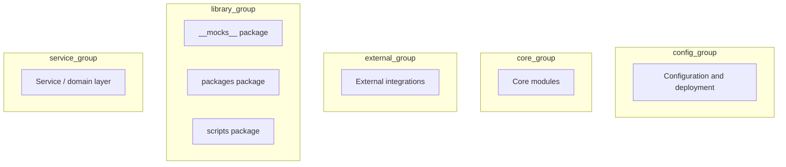

# Architecture report: vuejs/vuepress

> Automated static analysis. **Observed** = directly seen in files/imports/AST; **Inferred** = interpretation from that evidence. Repository code was not executed.

## 1. Repository at a glance

| Item | Value |
| --- | --- |
| Repository | vuejs/vuepress |
| Description | 📝 Minimalistic Vue-powered static site generator |
| Language | JavaScript |
| Stars | 22716 |
| Licence | MIT |
| Analysed commit / branch | 9fb4bb00925d9409e6732118e996411c6a82c85d / master |
| Framework(s) | Vue |
| Files analysed | 506 |
| Components | 7 |

## 2. Architecture in one minute

vuejs/vuepress - 📝 Minimalistic Vue-powered static site generator. This repository was analysed statically from 506 file(s) (0 Python). Detected technologies (observed from imports/manifests): GitHub Actions, Vue, Docker, Jest, TypeScript, webpack. Files are grouped into 7 component(s): Configuration and deployment, Core modules, External integrations, __mocks__ package, packages package, scripts package, Service / domain layer. Findings below distinguish observed facts from inferred interpretation.

## 3. High-level block diagram

## 4. Main components

### Configuration and deployment (`config`)

- **Kind:** config
- **Status:** Observed
- **Confidence:** 0.85
- **Responsibility:** Groups 27 file(s) under configuration and deployment (observed from repository paths and static analysis).
- **Paths:** `__mocks__/vuepress-theme-without-index/package.json`, `lerna.json`, `package.json`, `packages/@vuepress/core/package.json`, `packages/@vuepress/markdown-loader/package.json`, `packages/@vuepress/markdown/__tests__/fragments/Dockerfile`, `packages/@vuepress/markdown/package.json`, `packages/@vuepress/plugin-active-header-links/package.json`, `packages/@vuepress/plugin-back-to-top/package.json`, `packages/@vuepress/plugin-google-analytics/package.json`, `packages/@vuepress/plugin-last-updated/package.json`, `packages/@vuepress/plugin-medium-zoom/package.json`, `packages/@vuepress/plugin-nprogress/package.json`, `packages/@vuepress/plugin-pwa/package.json`, `packages/@vuepress/plugin-register-components/package.json`, `packages/@vuepress/plugin-search/package.json`, `packages/@vuepress/shared-utils/package.json`, `packages/@vuepress/shared-utils/tsconfig.json`, `packages/@vuepress/test-utils/package.json`, `packages/@vuepress/theme-default/package.json`, `packages/@vuepress/theme-vue/package.json`, `packages/@vuepress/types/package.json`, `packages/@vuepress/types/tsconfig.json`, `packages/docs/docs/.vuepress/public/manifest.json`, `packages/docs/package.json`, `packages/vuepress/package.json`, `tsconfig.json`
- **Evidence:** [__mocks__/vuepress-theme-without-index/package.json](https://github.com/vuejs/vuepress/blob/9fb4bb00925d9409e6732118e996411c6a82c85d/__mocks__/vuepress-theme-without-index/package.json); [lerna.json](https://github.com/vuejs/vuepress/blob/9fb4bb00925d9409e6732118e996411c6a82c85d/lerna.json); [package.json](https://github.com/vuejs/vuepress/blob/9fb4bb00925d9409e6732118e996411c6a82c85d/package.json); [packages/@vuepress/core/package.json](https://github.com/vuejs/vuepress/blob/9fb4bb00925d9409e6732118e996411c6a82c85d/packages/%40vuepress/core/package.json); [packages/@vuepress/markdown-loader/package.json](https://github.com/vuejs/vuepress/blob/9fb4bb00925d9409e6732118e996411c6a82c85d/packages/%40vuepress/markdown-loader/package.json); [packages/@vuepress/markdown/__tests__/fragments/Dockerfile](https://github.com/vuejs/vuepress/blob/9fb4bb00925d9409e6732118e996411c6a82c85d/packages/%40vuepress/markdown/__tests__/fragments/Dockerfile); [packages/@vuepress/markdown/package.json](https://github.com/vuejs/vuepress/blob/9fb4bb00925d9409e6732118e996411c6a82c85d/packages/%40vuepress/markdown/package.json); [packages/@vuepress/plugin-active-header-links/package.json](https://github.com/vuejs/vuepress/blob/9fb4bb00925d9409e6732118e996411c6a82c85d/packages/%40vuepress/plugin-active-header-links/package.json)

### Core modules (`core`)

- **Kind:** core
- **Status:** Observed
- **Confidence:** 0.85
- **Responsibility:** Groups 1 file(s) under core modules (observed from repository paths and static analysis).
- **Paths:** `babel.config.js`
- **Evidence:** [babel.config.js](https://github.com/vuejs/vuepress/blob/9fb4bb00925d9409e6732118e996411c6a82c85d/babel.config.js)

### External integrations (`external_integrations`)

- **Kind:** external
- **Status:** Observed
- **Confidence:** 0.85
- **Responsibility:** Groups 21 file(s) under external integrations (observed from repository paths and static analysis).
- **Paths:** `packages/@vuepress/core/lib/client/app.js`, `packages/@vuepress/core/lib/client/clientEntry.js`, `packages/@vuepress/core/lib/client/components/ClientOnly.js`, `packages/@vuepress/core/lib/client/components/Content.js`, `packages/@vuepress/core/lib/client/components/ContentSlotsDistributor.js`, `packages/@vuepress/core/lib/client/components/GlobalLayout.vue`, `packages/@vuepress/core/lib/client/components/NotFound.vue`, `packages/@vuepress/core/lib/client/components/OutboundLink.vue`, `packages/@vuepress/core/lib/client/dataMixin.js`, `packages/@vuepress/core/lib/client/plugins/Store.d.ts`, `packages/@vuepress/core/lib/client/plugins/Store.js`, `packages/@vuepress/core/lib/client/plugins/VuePress.d.ts`, `packages/@vuepress/core/lib/client/plugins/VuePress.js`, `packages/@vuepress/core/lib/client/redirect.js`, `packages/@vuepress/core/lib/client/root-mixins/updateMeta.js`, `packages/@vuepress/core/lib/client/serverEntry.js`, `packages/@vuepress/core/lib/client/util.js`, `packages/@vuepress/test-utils/client/createLocalVue.js`, `packages/@vuepress/test-utils/client/index.js`, `packages/@vuepress/test-utils/client/mockComponent.js`, `packages/@vuepress/test-utils/client/siteData.js`
- **Evidence:** [packages/@vuepress/core/lib/client/app.js](https://github.com/vuejs/vuepress/blob/9fb4bb00925d9409e6732118e996411c6a82c85d/packages/%40vuepress/core/lib/client/app.js); [packages/@vuepress/core/lib/client/clientEntry.js](https://github.com/vuejs/vuepress/blob/9fb4bb00925d9409e6732118e996411c6a82c85d/packages/%40vuepress/core/lib/client/clientEntry.js); [packages/@vuepress/core/lib/client/components/ClientOnly.js](https://github.com/vuejs/vuepress/blob/9fb4bb00925d9409e6732118e996411c6a82c85d/packages/%40vuepress/core/lib/client/components/ClientOnly.js); [packages/@vuepress/core/lib/client/components/Content.js](https://github.com/vuejs/vuepress/blob/9fb4bb00925d9409e6732118e996411c6a82c85d/packages/%40vuepress/core/lib/client/components/Content.js); [packages/@vuepress/core/lib/client/components/ContentSlotsDistributor.js](https://github.com/vuejs/vuepress/blob/9fb4bb00925d9409e6732118e996411c6a82c85d/packages/%40vuepress/core/lib/client/components/ContentSlotsDistributor.js); [packages/@vuepress/core/lib/client/components/GlobalLayout.vue](https://github.com/vuejs/vuepress/blob/9fb4bb00925d9409e6732118e996411c6a82c85d/packages/%40vuepress/core/lib/client/components/GlobalLayout.vue); [packages/@vuepress/core/lib/client/components/NotFound.vue](https://github.com/vuejs/vuepress/blob/9fb4bb00925d9409e6732118e996411c6a82c85d/packages/%40vuepress/core/lib/client/components/NotFound.vue); [packages/@vuepress/core/lib/client/components/OutboundLink.vue](https://github.com/vuejs/vuepress/blob/9fb4bb00925d9409e6732118e996411c6a82c85d/packages/%40vuepress/core/lib/client/components/OutboundLink.vue)

### __mocks__ package (`mocks`)

- **Kind:** library
- **Status:** Observed
- **Confidence:** 0.85
- **Responsibility:** Groups 17 file(s) under __mocks__ package (observed from repository paths and static analysis).
- **Paths:** `__mocks__/@org/vuepress-plugin-a.js`, `__mocks__/@org/vuepress-plugin-b.js`, `__mocks__/@org/vuepress-theme-a/index.js`, `__mocks__/@vuepress/plugin-a.js`, `__mocks__/@vuepress/theme-a/index.js`, `__mocks__/vuepress-plugin-a.js`, `__mocks__/vuepress-plugin-b.js`, `__mocks__/vuepress-theme-a/index.js`, `__mocks__/vuepress-theme-child/Layout.vue`, `__mocks__/vuepress-theme-child/components/Home.vue`, `__mocks__/vuepress-theme-child/index.js`, `__mocks__/vuepress-theme-parent/Layout.vue`, `__mocks__/vuepress-theme-parent/components/Home.vue`, `__mocks__/vuepress-theme-parent/components/Sidebar.vue`, `__mocks__/vuepress-theme-parent/index.js`, `__mocks__/vuepress-theme-without-index/Layout.vue`, `__mocks__/vuepress-theme-without-index/index.js`
- **Evidence:** [__mocks__/@org/vuepress-plugin-a.js](https://github.com/vuejs/vuepress/blob/9fb4bb00925d9409e6732118e996411c6a82c85d/__mocks__/%40org/vuepress-plugin-a.js); [__mocks__/@org/vuepress-plugin-b.js](https://github.com/vuejs/vuepress/blob/9fb4bb00925d9409e6732118e996411c6a82c85d/__mocks__/%40org/vuepress-plugin-b.js); [__mocks__/@org/vuepress-theme-a/index.js](https://github.com/vuejs/vuepress/blob/9fb4bb00925d9409e6732118e996411c6a82c85d/__mocks__/%40org/vuepress-theme-a/index.js); [__mocks__/@vuepress/plugin-a.js](https://github.com/vuejs/vuepress/blob/9fb4bb00925d9409e6732118e996411c6a82c85d/__mocks__/%40vuepress/plugin-a.js); [__mocks__/@vuepress/theme-a/index.js](https://github.com/vuejs/vuepress/blob/9fb4bb00925d9409e6732118e996411c6a82c85d/__mocks__/%40vuepress/theme-a/index.js); [__mocks__/vuepress-plugin-a.js](https://github.com/vuejs/vuepress/blob/9fb4bb00925d9409e6732118e996411c6a82c85d/__mocks__/vuepress-plugin-a.js); [__mocks__/vuepress-plugin-b.js](https://github.com/vuejs/vuepress/blob/9fb4bb00925d9409e6732118e996411c6a82c85d/__mocks__/vuepress-plugin-b.js); [__mocks__/vuepress-theme-a/index.js](https://github.com/vuejs/vuepress/blob/9fb4bb00925d9409e6732118e996411c6a82c85d/__mocks__/vuepress-theme-a/index.js)

### packages package (`packages`)

- **Kind:** library
- **Status:** Observed
- **Confidence:** 0.85
- **Responsibility:** Groups 148 file(s) under packages package (observed from repository paths and static analysis).
- **Paths:** `packages/@vuepress/markdown-loader/index.js`, `packages/@vuepress/markdown/__tests__/fragments/snippet with spaces.js`, `packages/@vuepress/markdown/__tests__/fragments/snippet-with-region.js`, `packages/@vuepress/markdown/__tests__/fragments/snippet.js`, `packages/@vuepress/markdown/__tests__/highlight.spec.js`, `packages/@vuepress/markdown/__tests__/highlightLines.spec.js`, `packages/@vuepress/markdown/__tests__/hoist.spec.js`, `packages/@vuepress/markdown/__tests__/lineNumers.spec.js`, `packages/@vuepress/markdown/__tests__/link.spec.js`, `packages/@vuepress/markdown/__tests__/preWrapper.spec.js`, `packages/@vuepress/markdown/__tests__/slugify.spec.js`, `packages/@vuepress/markdown/__tests__/snippet.spec.js`, `packages/@vuepress/markdown/__tests__/util.js`, `packages/@vuepress/markdown/index.js`, `packages/@vuepress/markdown/lib/component.js`, `packages/@vuepress/markdown/lib/constant.js`, `packages/@vuepress/markdown/lib/highlight.js`, `packages/@vuepress/markdown/lib/highlightLines.js`, `packages/@vuepress/markdown/lib/hoist.js`, `packages/@vuepress/markdown/lib/lineNumbers.js`, `packages/@vuepress/markdown/lib/link.js`, `packages/@vuepress/markdown/lib/preWrapper.js`, `packages/@vuepress/markdown/lib/snippet.js`, `packages/@vuepress/plugin-active-header-links/clientRootMixin.js`, `packages/@vuepress/plugin-active-header-links/index.js`, `packages/@vuepress/plugin-back-to-top/BackToTop.vue`, `packages/@vuepress/plugin-back-to-top/enhanceAppFile.js`, `packages/@vuepress/plugin-back-to-top/index.js`, `packages/@vuepress/plugin-google-analytics/enhanceAppFile.js`, `packages/@vuepress/plugin-google-analytics/index.js`, `packages/@vuepress/plugin-last-updated/index.js`, `packages/@vuepress/plugin-medium-zoom/clientRootMixin.js`, `packages/@vuepress/plugin-medium-zoom/index.js`, `packages/@vuepress/plugin-nprogress/clientRootMixin.js`, `packages/@vuepress/plugin-nprogress/enhanceAppFile.js`, `packages/@vuepress/plugin-nprogress/index.js`, `packages/@vuepress/plugin-pwa/index.js`, `packages/@vuepress/plugin-pwa/lib/SWUpdateEvent.js`, `packages/@vuepress/plugin-pwa/lib/SWUpdatePopup.vue`, `packages/@vuepress/plugin-pwa/lib/enhanceAppFile.js`, `packages/@vuepress/plugin-pwa/lib/event.js`, `packages/@vuepress/plugin-pwa/lib/i18n.js`, `packages/@vuepress/plugin-pwa/lib/skip-waiting.js`, `packages/@vuepress/plugin-register-components/index.js`, `packages/@vuepress/plugin-search/SearchBox.vue`, `packages/@vuepress/plugin-search/__tests__/matchQuery.spec.js`, `packages/@vuepress/plugin-search/index.js`, `packages/@vuepress/plugin-search/match-query.js`, `packages/@vuepress/shared-utils/__tests__/deeplyParseHeaders.spec.ts`, `packages/@vuepress/shared-utils/__tests__/fileToPath.spec.ts`, `packages/@vuepress/shared-utils/__tests__/fixtures/plugin-a.js`, `packages/@vuepress/shared-utils/__tests__/fixtures/theme-a/index.js`, `packages/@vuepress/shared-utils/__tests__/isIndexFile.spec.ts`, `packages/@vuepress/shared-utils/__tests__/moduleResolver.spec.ts`, `packages/@vuepress/shared-utils/__tests__/parseHeaders.spec.ts`, `packages/@vuepress/shared-utils/__tests__/removeNonCodeWrappedHTML.spec.ts`, `packages/@vuepress/shared-utils/__tests__/slugify.spec.ts`, `packages/@vuepress/shared-utils/__tests__/unescapeHtml.spec.ts`, `packages/@vuepress/shared-utils/scripts/update-index.js`, `packages/@vuepress/shared-utils/src/codegen.ts`, `packages/@vuepress/shared-utils/src/compose.ts`, `packages/@vuepress/shared-utils/src/datatypes.ts`, `packages/@vuepress/shared-utils/src/deeplyParseHeaders.ts`, `packages/@vuepress/shared-utils/src/ensureEndingSlash.ts`, `packages/@vuepress/shared-utils/src/ensureLeadingSlash.ts`, `packages/@vuepress/shared-utils/src/env.ts`, `packages/@vuepress/shared-utils/src/extractHeaders.ts`, `packages/@vuepress/shared-utils/src/fallback.ts`, `packages/@vuepress/shared-utils/src/fileToPath.ts`, `packages/@vuepress/shared-utils/src/getPermalink.ts`, `packages/@vuepress/shared-utils/src/index.ts`, `packages/@vuepress/shared-utils/src/inferTitle.ts`, `packages/@vuepress/shared-utils/src/isIndexFile.ts`, `packages/@vuepress/shared-utils/src/logger.ts`, `packages/@vuepress/shared-utils/src/moduleLoader.ts`, `packages/@vuepress/shared-utils/src/moduleResolver.ts`, `packages/@vuepress/shared-utils/src/normalizeConfig.ts`, `packages/@vuepress/shared-utils/src/parseEmojis.ts`, `packages/@vuepress/shared-utils/src/parseFrontmatter.ts`, `packages/@vuepress/shared-utils/src/parseHeaders.ts`, `packages/@vuepress/shared-utils/src/parseVueFrontmatter.ts`, `packages/@vuepress/shared-utils/src/performance.ts`, `packages/@vuepress/shared-utils/src/removeNonCodeWrappedHTML.ts`, `packages/@vuepress/shared-utils/src/slugify.ts`, `packages/@vuepress/shared-utils/src/sort.ts`, `packages/@vuepress/shared-utils/src/toAbsolutePath.ts`, `packages/@vuepress/shared-utils/src/tryChain.ts`, `packages/@vuepress/shared-utils/src/unescapeHtml.ts`, `packages/@vuepress/test-utils/index.js`, `packages/@vuepress/test-utils/lib/createJestConfig.js`, `packages/@vuepress/test-utils/lib/createJestRunner.js`, `packages/@vuepress/test-utils/lib/getFragment.js`, `packages/@vuepress/test-utils/lib/getFragments.js`, `packages/@vuepress/test-utils/lib/jest.config.js`, `packages/@vuepress/theme-default/__tests__/components/DropdownLink.spec.js`, `packages/@vuepress/theme-default/__tests__/components/NavLink.spec.js`, `packages/@vuepress/theme-default/components/AlgoliaSearchBox.vue`, `packages/@vuepress/theme-default/components/DropdownLink.vue`, `packages/@vuepress/theme-default/components/DropdownTransition.vue`, `packages/@vuepress/theme-default/components/Home.vue`, `packages/@vuepress/theme-default/components/NavLink.vue`, `packages/@vuepress/theme-default/components/NavLinks.vue`, `packages/@vuepress/theme-default/components/Navbar.vue`, `packages/@vuepress/theme-default/components/Page.vue`, `packages/@vuepress/theme-default/components/PageEdit.vue`, `packages/@vuepress/theme-default/components/PageNav.vue`, `packages/@vuepress/theme-default/components/Sidebar.vue`, `packages/@vuepress/theme-default/components/SidebarButton.vue`, `packages/@vuepress/theme-default/components/SidebarGroup.vue`, `packages/@vuepress/theme-default/components/SidebarLink.vue`, `packages/@vuepress/theme-default/components/SidebarLinks.vue`, `packages/@vuepress/theme-default/global-components/Badge.vue`, `packages/@vuepress/theme-default/global-components/CodeBlock.vue`, `packages/@vuepress/theme-default/global-components/CodeGroup.vue`, `packages/@vuepress/theme-default/index.js`, `packages/@vuepress/theme-default/layouts/404.vue`, `packages/@vuepress/theme-default/layouts/Layout.vue`, `packages/@vuepress/theme-default/noopModule.js`, `packages/@vuepress/theme-default/util/index.js`, `packages/@vuepress/theme-vue/components/BuySellAds.vue`, `packages/@vuepress/theme-vue/components/CarbonAds.vue`, `packages/@vuepress/theme-vue/index.js`, `packages/@vuepress/theme-vue/layouts/Layout.vue`, `packages/@vuepress/types/index.d.ts`, `packages/@vuepress/types/index.js`, `packages/@vuepress/types/src/config.ts`, `packages/@vuepress/types/src/context.ts`, `packages/@vuepress/types/src/index.ts`, `packages/@vuepress/types/src/lang.ts`, `packages/@vuepress/types/src/locale.ts`, `packages/@vuepress/types/src/markdown.ts`, `packages/@vuepress/types/src/official-plugins.ts`, `packages/@vuepress/types/src/plugin-api.ts`, `packages/@vuepress/types/src/plugin.ts`, `packages/@vuepress/types/src/shared.ts`, `packages/@vuepress/types/src/site-data.ts`, `packages/@vuepress/types/src/style.ts`, `packages/@vuepress/types/src/theme-default.ts`, `packages/@vuepress/types/src/theme.ts`, `packages/@vuepress/types/src/third-party-plugins.ts`, `packages/vuepress/cli.js`, `packages/vuepress/config.d.ts`, `packages/vuepress/config.js`, `packages/vuepress/index.js`, `packages/vuepress/lib/checkEnv.js`, `packages/vuepress/lib/handleUnknownCommand.js`, `packages/vuepress/lib/registerCoreCommands.js`, `packages/vuepress/lib/util.js`
- **Evidence:** [packages/@vuepress/markdown-loader/index.js](https://github.com/vuejs/vuepress/blob/9fb4bb00925d9409e6732118e996411c6a82c85d/packages/%40vuepress/markdown-loader/index.js); [packages/@vuepress/markdown/__tests__/fragments/snippet with spaces.js](https://github.com/vuejs/vuepress/blob/9fb4bb00925d9409e6732118e996411c6a82c85d/packages/%40vuepress/markdown/__tests__/fragments/snippet%20with%20spaces.js); [packages/@vuepress/markdown/__tests__/fragments/snippet-with-region.js](https://github.com/vuejs/vuepress/blob/9fb4bb00925d9409e6732118e996411c6a82c85d/packages/%40vuepress/markdown/__tests__/fragments/snippet-with-region.js); [packages/@vuepress/markdown/__tests__/fragments/snippet.js](https://github.com/vuejs/vuepress/blob/9fb4bb00925d9409e6732118e996411c6a82c85d/packages/%40vuepress/markdown/__tests__/fragments/snippet.js); [packages/@vuepress/markdown/__tests__/highlight.spec.js](https://github.com/vuejs/vuepress/blob/9fb4bb00925d9409e6732118e996411c6a82c85d/packages/%40vuepress/markdown/__tests__/highlight.spec.js); [packages/@vuepress/markdown/__tests__/highlightLines.spec.js](https://github.com/vuejs/vuepress/blob/9fb4bb00925d9409e6732118e996411c6a82c85d/packages/%40vuepress/markdown/__tests__/highlightLines.spec.js); [packages/@vuepress/markdown/__tests__/hoist.spec.js](https://github.com/vuejs/vuepress/blob/9fb4bb00925d9409e6732118e996411c6a82c85d/packages/%40vuepress/markdown/__tests__/hoist.spec.js); [packages/@vuepress/markdown/__tests__/lineNumers.spec.js](https://github.com/vuejs/vuepress/blob/9fb4bb00925d9409e6732118e996411c6a82c85d/packages/%40vuepress/markdown/__tests__/lineNumers.spec.js)

### scripts package (`scripts`)

- **Kind:** library
- **Status:** Observed
- **Confidence:** 0.85
- **Responsibility:** Groups 4 file(s) under scripts package (observed from repository paths and static analysis).
- **Paths:** `scripts/bootstrap.js`, `scripts/jest.config.js`, `scripts/remote-version.js`, `scripts/test.js`
- **Evidence:** [scripts/bootstrap.js](https://github.com/vuejs/vuepress/blob/9fb4bb00925d9409e6732118e996411c6a82c85d/scripts/bootstrap.js); [scripts/jest.config.js](https://github.com/vuejs/vuepress/blob/9fb4bb00925d9409e6732118e996411c6a82c85d/scripts/jest.config.js); [scripts/remote-version.js](https://github.com/vuejs/vuepress/blob/9fb4bb00925d9409e6732118e996411c6a82c85d/scripts/remote-version.js); [scripts/test.js](https://github.com/vuejs/vuepress/blob/9fb4bb00925d9409e6732118e996411c6a82c85d/scripts/test.js)

### Service / domain layer (`service_layer`)

- **Kind:** service
- **Status:** Observed
- **Confidence:** 0.85
- **Responsibility:** Groups 63 file(s) under service / domain layer (observed from repository paths and static analysis).
- **Paths:** `packages/@vuepress/core/lib/eject.js`, `packages/@vuepress/core/lib/index.js`, `packages/@vuepress/core/lib/node/App.js`, `packages/@vuepress/core/lib/node/CacheLoader.js`, `packages/@vuepress/core/lib/node/ClientComputedMixin.js`, `packages/@vuepress/core/lib/node/Page.js`, `packages/@vuepress/core/lib/node/__tests__/plugin-api/AsyncOption.spec.js`, `packages/@vuepress/core/lib/node/__tests__/plugin-api/Option.spec.js`, `packages/@vuepress/core/lib/node/__tests__/plugin-api/PluginAPI.spec.js`, `packages/@vuepress/core/lib/node/__tests__/plugin-api/PluginUtil.spec.js`, `packages/@vuepress/core/lib/node/__tests__/prepare/App.spec.js`, `packages/@vuepress/core/lib/node/__tests__/prepare/Page.spec.js`, `packages/@vuepress/core/lib/node/__tests__/prepare/fixtures/docs-config/.vuepress/config.js`, `packages/@vuepress/core/lib/node/__tests__/prepare/fixtures/docs-dep-theme-without-index/.vuepress/config.js`, `packages/@vuepress/core/lib/node/__tests__/prepare/fixtures/docs-i18n/.vuepress/config.js`, `packages/@vuepress/core/lib/node/__tests__/prepare/fixtures/docs-local-theme/.vuepress/config.js`, `packages/@vuepress/core/lib/node/__tests__/prepare/fixtures/docs-local-theme/.vuepress/theme/Layout.vue`, `packages/@vuepress/core/lib/node/__tests__/prepare/fixtures/docs-patterns/.vuepress/config.js`, `packages/@vuepress/core/lib/node/__tests__/prepare/util.js`, `packages/@vuepress/core/lib/node/__tests__/theme-api/fixtures/theme/Layout.vue`, `packages/@vuepress/core/lib/node/__tests__/theme-api/fixtures/theme/components/Home.vue`, `packages/@vuepress/core/lib/node/__tests__/theme-api/index.spec.js`, `packages/@vuepress/core/lib/node/createMarkdown.js`, `packages/@vuepress/core/lib/node/createTemp.js`, `packages/@vuepress/core/lib/node/dev/index.js`, `packages/@vuepress/core/lib/node/docs.fallback/.vuepress/theme/Layout.vue`, `packages/@vuepress/core/lib/node/internal-plugins/dataBlock/index.js`, `packages/@vuepress/core/lib/node/internal-plugins/dataBlock/loader.js`, `packages/@vuepress/core/lib/node/internal-plugins/enhanceApp.js`, `packages/@vuepress/core/lib/node/internal-plugins/frontmatterBlock/index.js`, `packages/@vuepress/core/lib/node/internal-plugins/frontmatterBlock/loader.js`, `packages/@vuepress/core/lib/node/internal-plugins/layoutComponents.js`, `packages/@vuepress/core/lib/node/internal-plugins/pageComponents.js`, `packages/@vuepress/core/lib/node/internal-plugins/palette/index.js`, `packages/@vuepress/core/lib/node/internal-plugins/rootMixins.js`, `packages/@vuepress/core/lib/node/internal-plugins/routes.js`, `packages/@vuepress/core/lib/node/internal-plugins/siteData.js`, `packages/@vuepress/core/lib/node/internal-plugins/style/client.js`, `packages/@vuepress/core/lib/node/internal-plugins/style/index.js`, `packages/@vuepress/core/lib/node/internal-plugins/transformModule.js`, `packages/@vuepress/core/lib/node/loadConfig.js`, `packages/@vuepress/core/lib/node/loadTheme.js`, `packages/@vuepress/core/lib/node/plugin-api/abstract/AsyncOption.js`, `packages/@vuepress/core/lib/node/plugin-api/abstract/Option.js`, `packages/@vuepress/core/lib/node/plugin-api/constants.js`, `packages/@vuepress/core/lib/node/plugin-api/index.js`, `packages/@vuepress/core/lib/node/plugin-api/override/AliasOption.js`, `packages/@vuepress/core/lib/node/plugin-api/override/ClientDynamicModulesOption.js`, `packages/@vuepress/core/lib/node/plugin-api/override/DefineOption.js`, `packages/@vuepress/core/lib/node/plugin-api/override/EnhanceAppFilesOption.js`, `packages/@vuepress/core/lib/node/plugin-api/override/GlobalUIComponentsOption.js`, `packages/@vuepress/core/lib/node/plugin-api/override/instantiateOption.js`, `packages/@vuepress/core/lib/node/plugin-api/util.js`, `packages/@vuepress/core/lib/node/theme-api/Layout.fallback.vue`, `packages/@vuepress/core/lib/node/theme-api/index.js`, `packages/@vuepress/core/lib/node/util/index.js`, `packages/@vuepress/core/lib/node/webpack/ClientPlugin.js`, `packages/@vuepress/core/lib/node/webpack/DevLogPlugin.js`, `packages/@vuepress/core/lib/node/webpack/HeadPlugin.js`, `packages/@vuepress/core/lib/node/webpack/createBaseConfig.js`, `packages/@vuepress/core/lib/node/webpack/createClientConfig.js`, `packages/@vuepress/core/lib/node/webpack/createServerConfig.js`, `packages/@vuepress/core/lib/node/webpack/noopModule.js`
- **Evidence:** [packages/@vuepress/core/lib/eject.js](https://github.com/vuejs/vuepress/blob/9fb4bb00925d9409e6732118e996411c6a82c85d/packages/%40vuepress/core/lib/eject.js); [packages/@vuepress/core/lib/index.js](https://github.com/vuejs/vuepress/blob/9fb4bb00925d9409e6732118e996411c6a82c85d/packages/%40vuepress/core/lib/index.js); [packages/@vuepress/core/lib/node/App.js](https://github.com/vuejs/vuepress/blob/9fb4bb00925d9409e6732118e996411c6a82c85d/packages/%40vuepress/core/lib/node/App.js); [packages/@vuepress/core/lib/node/CacheLoader.js](https://github.com/vuejs/vuepress/blob/9fb4bb00925d9409e6732118e996411c6a82c85d/packages/%40vuepress/core/lib/node/CacheLoader.js); [packages/@vuepress/core/lib/node/ClientComputedMixin.js](https://github.com/vuejs/vuepress/blob/9fb4bb00925d9409e6732118e996411c6a82c85d/packages/%40vuepress/core/lib/node/ClientComputedMixin.js); [packages/@vuepress/core/lib/node/Page.js](https://github.com/vuejs/vuepress/blob/9fb4bb00925d9409e6732118e996411c6a82c85d/packages/%40vuepress/core/lib/node/Page.js); [packages/@vuepress/core/lib/node/__tests__/plugin-api/AsyncOption.spec.js](https://github.com/vuejs/vuepress/blob/9fb4bb00925d9409e6732118e996411c6a82c85d/packages/%40vuepress/core/lib/node/__tests__/plugin-api/AsyncOption.spec.js); [packages/@vuepress/core/lib/node/__tests__/plugin-api/Option.spec.js](https://github.com/vuejs/vuepress/blob/9fb4bb00925d9409e6732118e996411c6a82c85d/packages/%40vuepress/core/lib/node/__tests__/plugin-api/Option.spec.js)

## 5. Execution flow

**Observed** entry point(s):

- [__mocks__/vuepress-theme-without-index/Layout.vue](https://github.com/vuejs/vuepress/blob/9fb4bb00925d9409e6732118e996411c6a82c85d/__mocks__/vuepress-theme-without-index/Layout.vue)
- [packages/@vuepress/core/lib/index.js](https://github.com/vuejs/vuepress/blob/9fb4bb00925d9409e6732118e996411c6a82c85d/packages/%40vuepress/core/lib/index.js)
- [packages/@vuepress/markdown-loader/index.js](https://github.com/vuejs/vuepress/blob/9fb4bb00925d9409e6732118e996411c6a82c85d/packages/%40vuepress/markdown-loader/index.js)
- [packages/@vuepress/markdown/index.js](https://github.com/vuejs/vuepress/blob/9fb4bb00925d9409e6732118e996411c6a82c85d/packages/%40vuepress/markdown/index.js)
- [packages/@vuepress/plugin-active-header-links/index.js](https://github.com/vuejs/vuepress/blob/9fb4bb00925d9409e6732118e996411c6a82c85d/packages/%40vuepress/plugin-active-header-links/index.js)
- [packages/@vuepress/plugin-back-to-top/index.js](https://github.com/vuejs/vuepress/blob/9fb4bb00925d9409e6732118e996411c6a82c85d/packages/%40vuepress/plugin-back-to-top/index.js)
- [packages/@vuepress/plugin-google-analytics/index.js](https://github.com/vuejs/vuepress/blob/9fb4bb00925d9409e6732118e996411c6a82c85d/packages/%40vuepress/plugin-google-analytics/index.js)
- [packages/@vuepress/plugin-last-updated/index.js](https://github.com/vuejs/vuepress/blob/9fb4bb00925d9409e6732118e996411c6a82c85d/packages/%40vuepress/plugin-last-updated/index.js)
- [packages/@vuepress/plugin-medium-zoom/index.js](https://github.com/vuejs/vuepress/blob/9fb4bb00925d9409e6732118e996411c6a82c85d/packages/%40vuepress/plugin-medium-zoom/index.js)
- [packages/@vuepress/plugin-nprogress/index.js](https://github.com/vuejs/vuepress/blob/9fb4bb00925d9409e6732118e996411c6a82c85d/packages/%40vuepress/plugin-nprogress/index.js)
- [packages/@vuepress/plugin-pwa/index.js](https://github.com/vuejs/vuepress/blob/9fb4bb00925d9409e6732118e996411c6a82c85d/packages/%40vuepress/plugin-pwa/index.js)
- [packages/@vuepress/plugin-register-components/index.js](https://github.com/vuejs/vuepress/blob/9fb4bb00925d9409e6732118e996411c6a82c85d/packages/%40vuepress/plugin-register-components/index.js)

Representative flow (derived from observed entry points and the import graph; steps beyond the entry point are **Inferred**):

1. Execution starts at an observed entry point listed above, if present.
2. No internal import relationships between components were observed.

## 6. Project structure

### `(root)`

- `.all-contributorsrc` - other (1294 bytes)
- `.commitlintrc.js` - source, JavaScript (468 bytes)
- `.editorconfig` - config (147 bytes)
- `.eslintignore` - other (158 bytes)
- `.eslintrc.js` - source, JavaScript (865 bytes)
- `.gitignore` - other (296 bytes)
- `.gitpod.yml` - config (91 bytes)
- `.npmignore` - other (136 bytes)
- `CHANGELOG.md` - docs (150034 bytes)
- `CODE_OF_CONDUCT.md` - docs (3354 bytes)
- `LICENSE` - docs (1091 bytes)
- `README.md` - docs (8090 bytes)
- `babel.config.js` - source, JavaScript (348 bytes)
- `lerna.json` - config (266 bytes)
- `package.json` - manifest (2393 bytes)
- `tsconfig.json` - config (721 bytes)

### `.dependabot`

- `.dependabot/config.yml` - config (474 bytes)

### `.github`

- `.github/CONTRIBUTING.md` - docs (3825 bytes)
- `.github/FUNDING.yml` - config (698 bytes)
- `.github/ISSUE_TEMPLATE/bug_report.md` - docs (1148 bytes)
- `.github/ISSUE_TEMPLATE/feature_request.md` - docs (636 bytes)
- `.github/PULL_REQUEST_TEMPLATE.md` - docs (1255 bytes)
- `.github/semantic.yml` - config (41 bytes)
- `.github/workflows/pull-request-ci.yml` - ci, YAML (924 bytes)

### `.vscode`

- `.vscode/extensions.json` - config (63 bytes)
- `.vscode/settings.json` - config (1105 bytes)

### `__mocks__`

- `__mocks__/@org/vuepress-plugin-a.js` - source, JavaScript (20 bytes)
- `__mocks__/@org/vuepress-plugin-b.js` - source, JavaScript (20 bytes)
- `__mocks__/@org/vuepress-theme-a/index.js` - source, JavaScript (20 bytes)
- `__mocks__/@vuepress/plugin-a.js` - source, JavaScript (20 bytes)
- `__mocks__/@vuepress/theme-a/index.js` - source, JavaScript (20 bytes)
- `__mocks__/vuepress-plugin-a.js` - source, JavaScript (20 bytes)
- `__mocks__/vuepress-plugin-b.js` - source, JavaScript (38 bytes)
- `__mocks__/vuepress-theme-a/index.js` - source, JavaScript (20 bytes)
- `__mocks__/vuepress-theme-child/Layout.vue` - source, Vue (0 bytes)
- `__mocks__/vuepress-theme-child/components/Home.vue` - source, Vue (0 bytes)
- `__mocks__/vuepress-theme-child/index.js` - source, JavaScript (55 bytes)
- `__mocks__/vuepress-theme-parent/Layout.vue` - source, Vue (0 bytes)
- `__mocks__/vuepress-theme-parent/components/Home.vue` - source, Vue (0 bytes)
- `__mocks__/vuepress-theme-parent/components/Sidebar.vue` - source, Vue (0 bytes)
- `__mocks__/vuepress-theme-parent/index.js` - source, JavaScript (20 bytes)
- `__mocks__/vuepress-theme-without-index/Layout.vue` - source, Vue (0 bytes)
- `__mocks__/vuepress-theme-without-index/index.js` - source, JavaScript (51 bytes)
- `__mocks__/vuepress-theme-without-index/package.json` - manifest (69 bytes)

### `art`

- `art/vuepress-icon.svg` - other (6631 bytes)

### `changelog`

- `changelog/1.9.2.md` - docs (2579 bytes)

### `packages`

- `packages/@vuepress/core/.npmignore` - other (26 bytes)
- `packages/@vuepress/core/README.md` - docs (108 bytes)
- `packages/@vuepress/core/lib/client/app.js` - source, JavaScript (3391 bytes)
- `packages/@vuepress/core/lib/client/clientEntry.js` - source, JavaScript (280 bytes)
- `packages/@vuepress/core/lib/client/components/ClientOnly.js` - source, JavaScript (232 bytes)
- `packages/@vuepress/core/lib/client/components/Content.js` - source, JavaScript (630 bytes)
- `packages/@vuepress/core/lib/client/components/ContentSlotsDistributor.js` - source, JavaScript (269 bytes)
- `packages/@vuepress/core/lib/client/components/GlobalLayout.vue` - source, Vue (674 bytes)
- `packages/@vuepress/core/lib/client/components/NotFound.vue` - source, Vue (516 bytes)
- `packages/@vuepress/core/lib/client/components/OutboundLink.vue` - source, Vue (1176 bytes)
- `packages/@vuepress/core/lib/client/dataMixin.js` - source, JavaScript (965 bytes)
- `packages/@vuepress/core/lib/client/index.dev.html` - other (223 bytes)
- `packages/@vuepress/core/lib/client/index.ssr.html` - other (465 bytes)
- `packages/@vuepress/core/lib/client/plugins/Store.d.ts` - source, TypeScript (207 bytes)
- `packages/@vuepress/core/lib/client/plugins/Store.js` - source, JavaScript (379 bytes)
- `packages/@vuepress/core/lib/client/plugins/VuePress.d.ts` - source, TypeScript (488 bytes)
- `packages/@vuepress/core/lib/client/plugins/VuePress.js` - source, JavaScript (440 bytes)
- `packages/@vuepress/core/lib/client/redirect.js` - source, JavaScript (1741 bytes)
- `packages/@vuepress/core/lib/client/root-mixins/updateMeta.js` - source, JavaScript (3524 bytes)
- `packages/@vuepress/core/lib/client/serverEntry.js` - source, JavaScript (435 bytes)
- `packages/@vuepress/core/lib/client/style/config.styl` - other (599 bytes)
- `packages/@vuepress/core/lib/client/util.js` - source, JavaScript (4853 bytes)
- `packages/@vuepress/core/lib/eject.js` - source, JavaScript (1094 bytes)
- `packages/@vuepress/core/lib/index.js` - source, JavaScript (777 bytes)
- `packages/@vuepress/core/lib/node/App.js` - source, JavaScript (13525 bytes)
- `packages/@vuepress/core/lib/node/CacheLoader.js` - source, JavaScript (1747 bytes)
- `packages/@vuepress/core/lib/node/ClientComputedMixin.js` - source, JavaScript (3067 bytes)
- `packages/@vuepress/core/lib/node/Page.js` - source, JavaScript (7184 bytes)
- `packages/@vuepress/core/lib/node/__tests__/plugin-api/AsyncOption.spec.js` - source, JavaScript (784 bytes)
- `packages/@vuepress/core/lib/node/__tests__/plugin-api/Option.spec.js` - source, JavaScript (2221 bytes)
- `packages/@vuepress/core/lib/node/__tests__/plugin-api/PluginAPI.spec.js` - source, JavaScript (2666 bytes)
- `packages/@vuepress/core/lib/node/__tests__/plugin-api/PluginUtil.spec.js` - source, JavaScript (2004 bytes)
- `packages/@vuepress/core/lib/node/__tests__/prepare/App.spec.js` - source, JavaScript (808 bytes)
- `packages/@vuepress/core/lib/node/__tests__/prepare/Page.spec.js` - source, JavaScript (9378 bytes)
- `packages/@vuepress/core/lib/node/__tests__/prepare/__snapshots__/Page.spec.js.snap` - other (705 bytes)
- `packages/@vuepress/core/lib/node/__tests__/prepare/fixtures/docs-config/.vuepress/config.js` - source, JavaScript (188 bytes)
- `packages/@vuepress/core/lib/node/__tests__/prepare/fixtures/docs-config/README.md` - docs (19 bytes)
- `packages/@vuepress/core/lib/node/__tests__/prepare/fixtures/docs-dep-theme-without-index/.vuepress/config.js` - source, JavaScript (125 bytes)
- `packages/@vuepress/core/lib/node/__tests__/prepare/fixtures/docs-dep-theme-without-index/README.md` - docs (19 bytes)
- `packages/@vuepress/core/lib/node/__tests__/prepare/fixtures/docs-i18n/.vuepress/config.js` - source, JavaScript (758 bytes)
- `packages/@vuepress/core/lib/node/__tests__/prepare/fixtures/docs-i18n/README.md` - docs (19 bytes)
- `packages/@vuepress/core/lib/node/__tests__/prepare/fixtures/docs-i18n/zh/README.md` - docs (20 bytes)
- `packages/@vuepress/core/lib/node/__tests__/prepare/fixtures/docs-local-theme/.vuepress/config.js` - source, JavaScript (84 bytes)
- `packages/@vuepress/core/lib/node/__tests__/prepare/fixtures/docs-local-theme/.vuepress/theme/Layout.vue` - source, Vue (0 bytes)
- `packages/@vuepress/core/lib/node/__tests__/prepare/fixtures/docs-local-theme/README.md` - docs (19 bytes)
- `packages/@vuepress/core/lib/node/__tests__/prepare/fixtures/docs-patterns/.vuepress/config.js` - source, JavaScript (241 bytes)
- `packages/@vuepress/core/lib/node/__tests__/prepare/fixtures/docs-patterns/README.md` - docs (19 bytes)
- `packages/@vuepress/core/lib/node/__tests__/prepare/fixtures/docs/2020-01-01-date.md` - docs (7 bytes)
- `packages/@vuepress/core/lib/node/__tests__/prepare/fixtures/docs/README.md` - docs (7 bytes)
- `packages/@vuepress/core/lib/node/__tests__/prepare/fixtures/docs/alpha.md` - docs (54 bytes)
- `packages/@vuepress/core/lib/node/__tests__/prepare/fixtures/docs/excerpt.md` - docs (38 bytes)
- `packages/@vuepress/core/lib/node/__tests__/prepare/util.js` - source, JavaScript (466 bytes)
- `packages/@vuepress/core/lib/node/__tests__/theme-api/fixtures/theme/Layout.vue` - source, Vue (0 bytes)
- `packages/@vuepress/core/lib/node/__tests__/theme-api/fixtures/theme/components/Home.vue` - source, Vue (0 bytes)
- `packages/@vuepress/core/lib/node/__tests__/theme-api/index.spec.js` - source, JavaScript (676 bytes)
- `packages/@vuepress/core/lib/node/createMarkdown.js` - source, JavaScript (694 bytes)
- `packages/@vuepress/core/lib/node/createTemp.js` - source, JavaScript (1652 bytes)
- `packages/@vuepress/core/lib/node/dev/index.js` - source, JavaScript (7571 bytes)
- `packages/@vuepress/core/lib/node/docs.fallback/.vuepress/theme/Layout.vue` - source, Vue (37 bytes)
- `packages/@vuepress/core/lib/node/docs.fallback/README.md` - docs (77 bytes)
- `packages/@vuepress/core/lib/node/internal-plugins/dataBlock/index.js` - source, JavaScript (635 bytes)
- `packages/@vuepress/core/lib/node/internal-plugins/dataBlock/loader.js` - source, JavaScript (193 bytes)
- `packages/@vuepress/core/lib/node/internal-plugins/enhanceApp.js` - source, JavaScript (673 bytes)
- `packages/@vuepress/core/lib/node/internal-plugins/frontmatterBlock/index.js` - source, JavaScript (415 bytes)
- `packages/@vuepress/core/lib/node/internal-plugins/frontmatterBlock/loader.js` - source, JavaScript (796 bytes)
- `packages/@vuepress/core/lib/node/internal-plugins/layoutComponents.js` - source, JavaScript (614 bytes)
- `packages/@vuepress/core/lib/node/internal-plugins/pageComponents.js` - source, JavaScript (640 bytes)
- `packages/@vuepress/core/lib/node/internal-plugins/palette/index.js` - source, JavaScript (1964 bytes)
- `packages/@vuepress/core/lib/node/internal-plugins/rootMixins.js` - source, JavaScript (678 bytes)
- `packages/@vuepress/core/lib/node/internal-plugins/routes.js` - source, JavaScript (2191 bytes)
- `packages/@vuepress/core/lib/node/internal-plugins/siteData.js` - source, JavaScript (406 bytes)
- `packages/@vuepress/core/lib/node/internal-plugins/style/client.js` - source, JavaScript (56 bytes)
- `packages/@vuepress/core/lib/node/internal-plugins/style/index.js` - source, JavaScript (1871 bytes)
- `packages/@vuepress/core/lib/node/internal-plugins/transformModule.js` - source, JavaScript (770 bytes)
- `packages/@vuepress/core/lib/node/loadConfig.js` - source, JavaScript (1781 bytes)
- `packages/@vuepress/core/lib/node/loadTheme.js` - source, JavaScript (3382 bytes)
- `packages/@vuepress/core/lib/node/plugin-api/abstract/AsyncOption.js` - source, JavaScript (1842 bytes)
- `packages/@vuepress/core/lib/node/plugin-api/abstract/Option.js` - source, JavaScript (2309 bytes)
- `packages/@vuepress/core/lib/node/plugin-api/constants.js` - source, JavaScript (1684 bytes)
- `packages/@vuepress/core/lib/node/plugin-api/index.js` - source, JavaScript (7673 bytes)
- `packages/@vuepress/core/lib/node/plugin-api/override/AliasOption.js` - source, JavaScript (398 bytes)
- `packages/@vuepress/core/lib/node/plugin-api/override/ClientDynamicModulesOption.js` - source, JavaScript (546 bytes)
- `packages/@vuepress/core/lib/node/plugin-api/override/DefineOption.js` - source, JavaScript (503 bytes)
- `packages/@vuepress/core/lib/node/plugin-api/override/EnhanceAppFilesOption.js` - source, JavaScript (2318 bytes)
- `packages/@vuepress/core/lib/node/plugin-api/override/GlobalUIComponentsOption.js` - source, JavaScript (350 bytes)
- `packages/@vuepress/core/lib/node/plugin-api/override/instantiateOption.js` - source, JavaScript (1052 bytes)
- `packages/@vuepress/core/lib/node/plugin-api/util.js` - source, JavaScript (1635 bytes)
- `packages/@vuepress/core/lib/node/theme-api/Layout.fallback.vue` - source, Vue (37 bytes)
- `packages/@vuepress/core/lib/node/theme-api/index.js` - source, JavaScript (3825 bytes)
- `packages/@vuepress/core/lib/node/util/index.js` - source, JavaScript (1476 bytes)
- `packages/@vuepress/core/lib/node/webpack/ClientPlugin.js` - source, JavaScript (2966 bytes)
- `packages/@vuepress/core/lib/node/webpack/DevLogPlugin.js` - source, JavaScript (1443 bytes)
- `packages/@vuepress/core/lib/node/webpack/HeadPlugin.js` - source, JavaScript (640 bytes)
- `packages/@vuepress/core/lib/node/webpack/createBaseConfig.js` - source, JavaScript (9000 bytes)
- `packages/@vuepress/core/lib/node/webpack/createClientConfig.js` - source, JavaScript (2165 bytes)
- `packages/@vuepress/core/lib/node/webpack/createServerConfig.js` - source, JavaScript (1455 bytes)
- `packages/@vuepress/core/lib/node/webpack/noopModule.js` - source, JavaScript (18 bytes)
- `packages/@vuepress/core/package.json` - manifest (2168 bytes)
- `packages/@vuepress/markdown-loader/.npmignore` - other (26 bytes)
- `packages/@vuepress/markdown-loader/README.md` - docs (467 bytes)
- `packages/@vuepress/markdown-loader/index.js` - source, JavaScript (3772 bytes)
- `packages/@vuepress/markdown-loader/package.json` - manifest (854 bytes)
- `packages/@vuepress/markdown/.npmignore` - other (26 bytes)
- `packages/@vuepress/markdown/README.md` - docs (1327 bytes)
- `packages/@vuepress/markdown/__tests__/__snapshots__/highlight.spec.js.snap` - other (308 bytes)
- `packages/@vuepress/markdown/__tests__/__snapshots__/highlightLines.spec.js.snap` - other (520 bytes)
- `packages/@vuepress/markdown/__tests__/__snapshots__/hoist.spec.js.snap` - other (558 bytes)
- `packages/@vuepress/markdown/__tests__/__snapshots__/lineNumers.spec.js.snap` - other (665 bytes)
- `packages/@vuepress/markdown/__tests__/__snapshots__/link.spec.js.snap` - other (604 bytes)
- `packages/@vuepress/markdown/__tests__/__snapshots__/preWrapper.spec.js.snap` - other (772 bytes)
- `packages/@vuepress/markdown/__tests__/__snapshots__/snippet.spec.js.snap` - other (5105 bytes)
- `packages/@vuepress/markdown/__tests__/fragments/Dockerfile` - container (85 bytes)
- `packages/@vuepress/markdown/__tests__/fragments/code-highlightLines-multiple.md` - docs (85 bytes)
- `packages/@vuepress/markdown/__tests__/fragments/code-highlightLines-single.md` - docs (25 bytes)
- `packages/@vuepress/markdown/__tests__/fragments/code-prewrapper-with-double-quotation-marks.md` - docs (34 bytes)
- `packages/@vuepress/markdown/__tests__/fragments/code-prewrapper-with-quotes.md` - docs (21 bytes)
- `packages/@vuepress/markdown/__tests__/fragments/code-prewrapper-with-spaces.md` - docs (14 bytes)
- `packages/@vuepress/markdown/__tests__/fragments/code-snippet-highlightLines-multiple.md` - docs (70 bytes)
- `packages/@vuepress/markdown/__tests__/fragments/code-snippet-highlightLines-single-and-multiple.md` - docs (72 bytes)
- `packages/@vuepress/markdown/__tests__/fragments/code-snippet-highlightLines-single.md` - docs (70 bytes)
- `packages/@vuepress/markdown/__tests__/fragments/code-snippet-with-indented-region.md` - docs (93 bytes)
- `packages/@vuepress/markdown/__tests__/fragments/code-snippet-with-region-and-highlight.md` - docs (90 bytes)
- `packages/@vuepress/markdown/__tests__/fragments/code-snippet-with-region-and-single-highlight.md` - docs (89 bytes)
- `packages/@vuepress/markdown/__tests__/fragments/code-snippet-with-region.md` - docs (85 bytes)
- `packages/@vuepress/markdown/__tests__/fragments/code-snippet-with-space-in-path.md` - docs (83 bytes)
- `packages/@vuepress/markdown/__tests__/fragments/code-snippet.md` - docs (131 bytes)
- `packages/@vuepress/markdown/__tests__/fragments/code.md` - docs (21 bytes)
- `packages/@vuepress/markdown/__tests__/fragments/hoist.md` - docs (95 bytes)
- `packages/@vuepress/markdown/__tests__/fragments/snippet with spaces.js` - source, JavaScript (39 bytes)
- `packages/@vuepress/markdown/__tests__/fragments/snippet-with-indented-region.html` - other (320 bytes)
- `packages/@vuepress/markdown/__tests__/fragments/snippet-with-region.js` - source, JavaScript (1119 bytes)
- `packages/@vuepress/markdown/__tests__/fragments/snippet.js` - source, JavaScript (39 bytes)
- `packages/@vuepress/markdown/__tests__/highlight.spec.js` - source, JavaScript (464 bytes)
- `packages/@vuepress/markdown/__tests__/highlightLines.spec.js` - source, JavaScript (868 bytes)
- `packages/@vuepress/markdown/__tests__/hoist.spec.js` - source, JavaScript (733 bytes)
- `packages/@vuepress/markdown/__tests__/lineNumers.spec.js` - source, JavaScript (903 bytes)
- `packages/@vuepress/markdown/__tests__/link.spec.js` - source, JavaScript (2481 bytes)
- `packages/@vuepress/markdown/__tests__/preWrapper.spec.js` - source, JavaScript (1035 bytes)
- `packages/@vuepress/markdown/__tests__/slugify.spec.js` - source, JavaScript (680 bytes)
- `packages/@vuepress/markdown/__tests__/snippet.spec.js` - source, JavaScript (2272 bytes)
- `packages/@vuepress/markdown/__tests__/util.js` - source, JavaScript (60 bytes)
- `packages/@vuepress/markdown/index.js` - source, JavaScript (4240 bytes)
- `packages/@vuepress/markdown/lib/component.js` - source, JavaScript (2456 bytes)
- `packages/@vuepress/markdown/lib/constant.js` - source, JavaScript (397 bytes)
- `packages/@vuepress/markdown/lib/highlight.js` - source, JavaScript (1292 bytes)
- `packages/@vuepress/markdown/lib/highlightLines.js` - source, JavaScript (1477 bytes)
- `packages/@vuepress/markdown/lib/hoist.js` - source, JavaScript (368 bytes)
- `packages/@vuepress/markdown/lib/lineNumbers.js` - source, JavaScript (811 bytes)
- `packages/@vuepress/markdown/lib/link.js` - source, JavaScript (2754 bytes)
- `packages/@vuepress/markdown/lib/preWrapper.js` - source, JavaScript (857 bytes)
- `packages/@vuepress/markdown/lib/snippet.js` - source, JavaScript (4460 bytes)
- `packages/@vuepress/markdown/package.json` - manifest (997 bytes)
- `packages/@vuepress/plugin-active-header-links/.npmignore` - other (26 bytes)
- `packages/@vuepress/plugin-active-header-links/README.md` - docs (180 bytes)
- `packages/@vuepress/plugin-active-header-links/clientRootMixin.js` - source, JavaScript (2201 bytes)
- `packages/@vuepress/plugin-active-header-links/index.js` - source, JavaScript (380 bytes)
- `packages/@vuepress/plugin-active-header-links/package.json` - manifest (794 bytes)
- `packages/@vuepress/plugin-back-to-top/.npmignore` - other (26 bytes)
- `packages/@vuepress/plugin-back-to-top/BackToTop.vue` - source, Vue (1833 bytes)
- `packages/@vuepress/plugin-back-to-top/README.md` - docs (156 bytes)
- `packages/@vuepress/plugin-back-to-top/enhanceAppFile.js` - source, JavaScript (173 bytes)
- `packages/@vuepress/plugin-back-to-top/index.js` - source, JavaScript (235 bytes)
- `packages/@vuepress/plugin-back-to-top/package.json` - manifest (764 bytes)
- `packages/@vuepress/plugin-google-analytics/.npmignore` - other (26 bytes)
- `packages/@vuepress/plugin-google-analytics/README.md` - docs (171 bytes)
- `packages/@vuepress/plugin-google-analytics/enhanceAppFile.js` - source, JavaScript (812 bytes)
- `packages/@vuepress/plugin-google-analytics/index.js` - source, JavaScript (371 bytes)
- `packages/@vuepress/plugin-google-analytics/package.json` - manifest (749 bytes)
- `packages/@vuepress/plugin-last-updated/.npmignore` - other (26 bytes)
- `packages/@vuepress/plugin-last-updated/README.md` - docs (159 bytes)
- `packages/@vuepress/plugin-last-updated/index.js` - source, JavaScript (1088 bytes)
- `packages/@vuepress/plugin-last-updated/package.json` - manifest (762 bytes)
- `packages/@vuepress/plugin-medium-zoom/.npmignore` - other (26 bytes)
- `packages/@vuepress/plugin-medium-zoom/README.md` - docs (156 bytes)
- `packages/@vuepress/plugin-medium-zoom/clientRootMixin.js` - source, JavaScript (414 bytes)
- `packages/@vuepress/plugin-medium-zoom/index.js` - source, JavaScript (334 bytes)
- `packages/@vuepress/plugin-medium-zoom/package.json` - manifest (758 bytes)
- `packages/@vuepress/plugin-medium-zoom/style.css` - other (89 bytes)
- `packages/@vuepress/plugin-nprogress/.npmignore` - other (19 bytes)
- `packages/@vuepress/plugin-nprogress/README.md` - docs (62 bytes)
- `packages/@vuepress/plugin-nprogress/clientRootMixin.js` - source, JavaScript (439 bytes)
- `packages/@vuepress/plugin-nprogress/enhanceAppFile.js` - source, JavaScript (26 bytes)
- `packages/@vuepress/plugin-nprogress/index.js` - source, JavaScript (230 bytes)
- `packages/@vuepress/plugin-nprogress/nprogress.styl` - other (1033 bytes)
- `packages/@vuepress/plugin-nprogress/package.json` - manifest (748 bytes)
- `packages/@vuepress/plugin-pwa/.npmignore` - other (26 bytes)
- `packages/@vuepress/plugin-pwa/README.md` - docs (132 bytes)
- `packages/@vuepress/plugin-pwa/index.js` - source, JavaScript (1373 bytes)
- `packages/@vuepress/plugin-pwa/lib/SWUpdateEvent.js` - source, JavaScript (1009 bytes)
- `packages/@vuepress/plugin-pwa/lib/SWUpdatePopup.vue` - source, Vue (2155 bytes)
- `packages/@vuepress/plugin-pwa/lib/enhanceAppFile.js` - source, JavaScript (1832 bytes)
- `packages/@vuepress/plugin-pwa/lib/event.js` - source, JavaScript (48 bytes)
- `packages/@vuepress/plugin-pwa/lib/i18n.js` - source, JavaScript (617 bytes)
- `packages/@vuepress/plugin-pwa/lib/skip-waiting.js` - source, JavaScript (345 bytes)
- `packages/@vuepress/plugin-pwa/package.json` - manifest (809 bytes)
- `packages/@vuepress/plugin-register-components/.npmignore` - other (26 bytes)
- `packages/@vuepress/plugin-register-components/README.md` - docs (83 bytes)
- `packages/@vuepress/plugin-register-components/index.js` - source, JavaScript (1832 bytes)
- `packages/@vuepress/plugin-register-components/package.json` - manifest (808 bytes)
- `packages/@vuepress/plugin-search/.npmignore` - other (26 bytes)
- `packages/@vuepress/plugin-search/README.md` - docs (155 bytes)
- `packages/@vuepress/plugin-search/SearchBox.vue` - source, Vue (6469 bytes)
- `packages/@vuepress/plugin-search/__tests__/matchQuery.spec.js` - source, JavaScript (891 bytes)
- `packages/@vuepress/plugin-search/index.js` - source, JavaScript (397 bytes)
- `packages/@vuepress/plugin-search/match-query.js` - source, JavaScript (1421 bytes)
- `packages/@vuepress/plugin-search/package.json` - manifest (709 bytes)
- `packages/@vuepress/plugin-search/search.svg` - other (216 bytes)
- `packages/@vuepress/shared-utils/.npmignore` - other (26 bytes)
- `packages/@vuepress/shared-utils/README.md` - docs (54 bytes)
- `packages/@vuepress/shared-utils/__tests__/deeplyParseHeaders.spec.ts` - source, TypeScript (950 bytes)
- `packages/@vuepress/shared-utils/__tests__/fileToPath.spec.ts` - source, TypeScript (695 bytes)
- `packages/@vuepress/shared-utils/__tests__/fixtures/plugin-a.js` - source, JavaScript (33 bytes)
- `packages/@vuepress/shared-utils/__tests__/fixtures/theme-a/index.js` - source, JavaScript (20 bytes)
- `packages/@vuepress/shared-utils/__tests__/isIndexFile.spec.ts` - source, TypeScript (601 bytes)
- `packages/@vuepress/shared-utils/__tests__/moduleResolver.spec.ts` - source, TypeScript (4854 bytes)
- `packages/@vuepress/shared-utils/__tests__/parseHeaders.spec.ts` - source, TypeScript (1005 bytes)
- `packages/@vuepress/shared-utils/__tests__/removeNonCodeWrappedHTML.spec.ts` - source, TypeScript (1877 bytes)
- `packages/@vuepress/shared-utils/__tests__/slugify.spec.ts` - source, TypeScript (1255 bytes)
- `packages/@vuepress/shared-utils/__tests__/unescapeHtml.spec.ts` - source, TypeScript (205 bytes)
- `packages/@vuepress/shared-utils/package.json` - manifest (1123 bytes)
- `packages/@vuepress/shared-utils/scripts/update-index.js` - source, JavaScript (836 bytes)
- `packages/@vuepress/shared-utils/src/codegen.ts` - source, TypeScript (431 bytes)
- `packages/@vuepress/shared-utils/src/compose.ts` - source, TypeScript (373 bytes)
- `packages/@vuepress/shared-utils/src/datatypes.ts` - source, TypeScript (2214 bytes)
- `packages/@vuepress/shared-utils/src/deeplyParseHeaders.ts` - source, TypeScript (381 bytes)
- `packages/@vuepress/shared-utils/src/ensureEndingSlash.ts` - source, TypeScript (126 bytes)
- `packages/@vuepress/shared-utils/src/ensureLeadingSlash.ts` - source, TypeScript (99 bytes)
- `packages/@vuepress/shared-utils/src/env.ts` - source, TypeScript (324 bytes)
- `packages/@vuepress/shared-utils/src/extractHeaders.ts` - source, TypeScript (929 bytes)
- `packages/@vuepress/shared-utils/src/fallback.ts` - source, TypeScript (186 bytes)
- `packages/@vuepress/shared-utils/src/fileToPath.ts` - source, TypeScript (519 bytes)
- `packages/@vuepress/shared-utils/src/getPermalink.ts` - source, TypeScript (2337 bytes)
- `packages/@vuepress/shared-utils/src/index.ts` - source, TypeScript (1823 bytes)
- `packages/@vuepress/shared-utils/src/inferTitle.ts` - source, TypeScript (545 bytes)
- `packages/@vuepress/shared-utils/src/isIndexFile.ts` - source, TypeScript (145 bytes)
- `packages/@vuepress/shared-utils/src/logger.ts` - source, TypeScript (1935 bytes)
- `packages/@vuepress/shared-utils/src/moduleLoader.ts` - source, TypeScript (2253 bytes)
- `packages/@vuepress/shared-utils/src/moduleResolver.ts` - source, TypeScript (6284 bytes)
- `packages/@vuepress/shared-utils/src/normalizeConfig.ts` - source, TypeScript (801 bytes)
- `packages/@vuepress/shared-utils/src/parseEmojis.ts` - source, TypeScript (192 bytes)
- `packages/@vuepress/shared-utils/src/parseFrontmatter.ts` - source, TypeScript (303 bytes)
- `packages/@vuepress/shared-utils/src/parseHeaders.ts` - source, TypeScript (1302 bytes)
- `packages/@vuepress/shared-utils/src/parseVueFrontmatter.ts` - source, TypeScript (605 bytes)
- `packages/@vuepress/shared-utils/src/performance.ts` - source, TypeScript (597 bytes)
- `packages/@vuepress/shared-utils/src/removeNonCodeWrappedHTML.ts` - source, TypeScript (294 bytes)
- `packages/@vuepress/shared-utils/src/slugify.ts` - source, TypeScript (857 bytes)
- `packages/@vuepress/shared-utils/src/sort.ts` - source, TypeScript (140 bytes)
- `packages/@vuepress/shared-utils/src/toAbsolutePath.ts` - source, TypeScript (240 bytes)
- `packages/@vuepress/shared-utils/src/tryChain.ts` - source, TypeScript (523 bytes)
- `packages/@vuepress/shared-utils/src/unescapeHtml.ts` - source, TypeScript (180 bytes)
- `packages/@vuepress/shared-utils/tsconfig.json` - config (155 bytes)
- `packages/@vuepress/test-utils/.npmignore` - other (26 bytes)
- `packages/@vuepress/test-utils/README.md` - docs (50 bytes)
- `packages/@vuepress/test-utils/client/createLocalVue.js` - source, JavaScript (747 bytes)
- `packages/@vuepress/test-utils/client/index.js` - source, JavaScript (136 bytes)
- `packages/@vuepress/test-utils/client/mockComponent.js` - source, JavaScript (437 bytes)
- `packages/@vuepress/test-utils/client/siteData.js` - source, JavaScript (1220 bytes)
- `packages/@vuepress/test-utils/fixtures/docs/.vuepress/theme/Layout.vue` - docs (37 bytes)
- `packages/@vuepress/test-utils/fixtures/docs/README.md` - docs (6 bytes)
- `packages/@vuepress/test-utils/index.js` - source, JavaScript (310 bytes)
- `packages/@vuepress/test-utils/lib/createJestConfig.js` - source, JavaScript (166 bytes)
- `packages/@vuepress/test-utils/lib/createJestRunner.js` - source, JavaScript (1307 bytes)
- `packages/@vuepress/test-utils/lib/getFragment.js` - source, JavaScript (444 bytes)
- `packages/@vuepress/test-utils/lib/getFragments.js` - source, JavaScript (387 bytes)
- `packages/@vuepress/test-utils/lib/jest.config.js` - source, JavaScript (679 bytes)
- `packages/@vuepress/test-utils/package.json` - manifest (1104 bytes)
- `packages/@vuepress/theme-default/.npmignore` - other (26 bytes)
- `packages/@vuepress/theme-default/README.md` - docs (497 bytes)
- `packages/@vuepress/theme-default/__tests__/components/DropdownLink.spec.js` - source, JavaScript (743 bytes)
- `packages/@vuepress/theme-default/__tests__/components/NavLink.spec.js` - source, JavaScript (819 bytes)
- `packages/@vuepress/theme-default/__tests__/components/__snapshots__/DropdownLink.spec.js.snap` - other (735 bytes)
- `packages/@vuepress/theme-default/__tests__/components/__snapshots__/NavLink.spec.js.snap` - other (372 bytes)
- `packages/@vuepress/theme-default/components/AlgoliaSearchBox.vue` - source, Vue (4643 bytes)
- `packages/@vuepress/theme-default/components/DropdownLink.vue` - source, Vue (5643 bytes)
- `packages/@vuepress/theme-default/components/DropdownTransition.vue` - source, Vue (561 bytes)
- `packages/@vuepress/theme-default/components/Home.vue` - source, Vue (3652 bytes)
- `packages/@vuepress/theme-default/components/NavLink.vue` - source, Vue (1628 bytes)
- `packages/@vuepress/theme-default/components/NavLinks.vue` - source, Vue (3804 bytes)
- `packages/@vuepress/theme-default/components/Navbar.vue` - source, Vue (3474 bytes)
- `packages/@vuepress/theme-default/components/Page.vue` - source, Vue (535 bytes)
- `packages/@vuepress/theme-default/components/PageEdit.vue` - source, Vue (3455 bytes)
- `packages/@vuepress/theme-default/components/PageNav.vue` - source, Vue (3380 bytes)
- `packages/@vuepress/theme-default/components/Sidebar.vue` - source, Vue (1240 bytes)
- `packages/@vuepress/theme-default/components/SidebarButton.vue` - source, Vue (990 bytes)
- `packages/@vuepress/theme-default/components/SidebarGroup.vue` - source, Vue (2955 bytes)
- `packages/@vuepress/theme-default/components/SidebarLink.vue` - source, Vue (3291 bytes)
- `packages/@vuepress/theme-default/components/SidebarLinks.vue` - source, Vue (2184 bytes)
- `packages/@vuepress/theme-default/global-components/Badge.vue` - source, Vue (805 bytes)
- `packages/@vuepress/theme-default/global-components/CodeBlock.vue` - source, Vue (626 bytes)
- `packages/@vuepress/theme-default/global-components/CodeGroup.vue` - source, Vue (2783 bytes)
- `packages/@vuepress/theme-default/index.js` - source, JavaScript (1536 bytes)
- `packages/@vuepress/theme-default/layouts/404.vue` - source, Vue (530 bytes)
- `packages/@vuepress/theme-default/layouts/Layout.vue` - source, Vue (3185 bytes)
- `packages/@vuepress/theme-default/noopModule.js` - source, JavaScript (18 bytes)
- `packages/@vuepress/theme-default/package.json` - manifest (1127 bytes)
- `packages/@vuepress/theme-default/styles/arrow.styl` - other (577 bytes)
- `packages/@vuepress/theme-default/styles/code.styl` - other (2861 bytes)
- `packages/@vuepress/theme-default/styles/config.styl` - other (41 bytes)
- `packages/@vuepress/theme-default/styles/custom-blocks.styl` - other (961 bytes)
- `packages/@vuepress/theme-default/styles/index.styl` - other (3261 bytes)
- `packages/@vuepress/theme-default/styles/mobile.styl` - other (731 bytes)
- `packages/@vuepress/theme-default/styles/toc.styl` - other (54 bytes)
- `packages/@vuepress/theme-default/styles/wrapper.styl` - other (180 bytes)
- `packages/@vuepress/theme-default/util/index.js` - source, JavaScript (5825 bytes)
- `packages/@vuepress/theme-vue/.npmignore` - other (19 bytes)
- `packages/@vuepress/theme-vue/README.md` - docs (48 bytes)
- `packages/@vuepress/theme-vue/components/BuySellAds.vue` - source, Vue (2101 bytes)
- `packages/@vuepress/theme-vue/components/CarbonAds.vue` - source, Vue (1270 bytes)
- `packages/@vuepress/theme-vue/index.js` - source, JavaScript (57 bytes)
- `packages/@vuepress/theme-vue/layouts/Layout.vue` - source, Vue (488 bytes)
- `packages/@vuepress/theme-vue/package.json` - manifest (796 bytes)
- `packages/@vuepress/types/index.d.ts` - source, TypeScript (1054 bytes)
- `packages/@vuepress/types/index.js` - source, JavaScript (180 bytes)
- `packages/@vuepress/types/package.json` - manifest (805 bytes)
- `packages/@vuepress/types/src/config.ts` - source, TypeScript (4871 bytes)
- `packages/@vuepress/types/src/context.ts` - source, TypeScript (3655 bytes)
- `packages/@vuepress/types/src/index.ts` - source, TypeScript (310 bytes)
- `packages/@vuepress/types/src/lang.ts` - source, TypeScript (9174 bytes)
- `packages/@vuepress/types/src/locale.ts` - source, TypeScript (302 bytes)
- `packages/@vuepress/types/src/markdown.ts` - source, TypeScript (2510 bytes)
- `packages/@vuepress/types/src/official-plugins.ts` - source, TypeScript (4118 bytes)
- `packages/@vuepress/types/src/plugin-api.ts` - source, TypeScript (5109 bytes)
- `packages/@vuepress/types/src/plugin.ts` - source, TypeScript (2191 bytes)
- `packages/@vuepress/types/src/shared.ts` - source, TypeScript (351 bytes)
- `packages/@vuepress/types/src/site-data.ts` - source, TypeScript (347 bytes)
- `packages/@vuepress/types/src/style.ts` - source, TypeScript (400 bytes)
- `packages/@vuepress/types/src/theme-default.ts` - source, TypeScript (5729 bytes)
- `packages/@vuepress/types/src/theme.ts` - source, TypeScript (1549 bytes)
- `packages/@vuepress/types/src/third-party-plugins.ts` - source, TypeScript (725 bytes)
- `packages/@vuepress/types/tsconfig.json` - config (183 bytes)
- `packages/docs/.remarkrc` - docs (159 bytes)
- `packages/docs/.textlintrc.js` - docs (492 bytes)
- `packages/docs/docs/.vuepress/components/Foo/Bar.vue` - docs (174 bytes)
- `packages/docs/docs/.vuepress/components/OtherComponent.vue` - docs (79 bytes)
- `packages/docs/docs/.vuepress/components/UpgradePath.vue` - docs (576 bytes)
- `packages/docs/docs/.vuepress/components/demo-1.vue` - docs (173 bytes)
- `packages/docs/docs/.vuepress/components/diagram-markdown-slot-relationship.vue` - docs (12046 bytes)
- `packages/docs/docs/.vuepress/components/svg-container.vue` - docs (190 bytes)
- `packages/docs/docs/.vuepress/config.ts` - docs (2989 bytes)
- `packages/docs/docs/.vuepress/config/index.ts` - docs (109 bytes)
- `packages/docs/docs/.vuepress/config/nav/en.ts` - docs (1642 bytes)
- `packages/docs/docs/.vuepress/config/nav/zh.ts` - docs (1658 bytes)
- `packages/docs/docs/.vuepress/config/sidebar/en.ts` - docs (424 bytes)
- `packages/docs/docs/.vuepress/config/sidebar/shared.ts` - docs (1955 bytes)
- `packages/docs/docs/.vuepress/config/sidebar/zh.ts` - docs (421 bytes)
- `packages/docs/docs/.vuepress/enhanceApp.js` - docs (186 bytes)
- `packages/docs/docs/.vuepress/public/icons/safari-pinned-tab.svg` - docs (10608 bytes)
- `packages/docs/docs/.vuepress/public/manifest.json` - config (415 bytes)
- `packages/docs/docs/.vuepress/styles/index.styl` - docs (458 bytes)
- `packages/docs/docs/.vuepress/styles/palette.styl` - docs (66 bytes)
- `packages/docs/docs/api/cli.md` - docs (1823 bytes)
- `packages/docs/docs/api/node.md` - docs (1859 bytes)
- `packages/docs/docs/config/README.md` - docs (11834 bytes)
- `packages/docs/docs/faq/README.md` - docs (2584 bytes)
- `packages/docs/docs/guide/README.md` - docs (4820 bytes)
- `packages/docs/docs/guide/assets.md` - docs (2368 bytes)
- `packages/docs/docs/guide/basic-config.md` - docs (2662 bytes)
- `packages/docs/docs/guide/deploy.md` - docs (7242 bytes)
- `packages/docs/docs/guide/directory-structure.md` - docs (3294 bytes)
- `packages/docs/docs/guide/frontmatter.md` - docs (3233 bytes)
- `packages/docs/docs/guide/getting-started.md` - docs (3820 bytes)
- `packages/docs/docs/guide/global-computed.md` - docs (1631 bytes)
- `packages/docs/docs/guide/i18n.md` - docs (2841 bytes)
- `packages/docs/docs/guide/markdown-slot.md` - docs (2549 bytes)
- `packages/docs/docs/guide/markdown.md` - docs (9400 bytes)
- `packages/docs/docs/guide/permalinks.md` - docs (2170 bytes)
- `packages/docs/docs/guide/typescript-as-config.md` - docs (3333 bytes)
- `packages/docs/docs/guide/using-vue.md` - docs (7687 bytes)
- `packages/docs/docs/index.md` - docs (747 bytes)
- `packages/docs/docs/miscellaneous/design-concepts.md` - docs (7485 bytes)
- `packages/docs/docs/miscellaneous/glossary.md` - docs (1983 bytes)
- `packages/docs/docs/miscellaneous/local-development.md` - docs (5163 bytes)
- `packages/docs/docs/miscellaneous/migration-guide.md` - docs (1537 bytes)
- `packages/docs/docs/plugin/README.md` - docs (2181 bytes)
- `packages/docs/docs/plugin/context-api.md` - docs (873 bytes)
- `packages/docs/docs/plugin/life-cycle.md` - docs (753 bytes)
- `packages/docs/docs/plugin/official/plugin-active-header-links.md` - docs (913 bytes)
- `packages/docs/docs/plugin/official/plugin-back-to-top.md` - docs (413 bytes)
- `packages/docs/docs/plugin/official/plugin-blog.md` - docs (1119 bytes)
- `packages/docs/docs/plugin/official/plugin-google-analytics.md` - docs (1128 bytes)
- `packages/docs/docs/plugin/official/plugin-last-updated.md` - docs (2332 bytes)
- `packages/docs/docs/plugin/official/plugin-medium-zoom.md` - docs (1201 bytes)
- `packages/docs/docs/plugin/official/plugin-nprogress.md` - docs (817 bytes)
- `packages/docs/docs/plugin/official/plugin-pwa.md` - docs (6772 bytes)
- `packages/docs/docs/plugin/official/plugin-register-components.md` - docs (1448 bytes)
- `packages/docs/docs/plugin/official/plugin-search.md` - docs (2402 bytes)
- `packages/docs/docs/plugin/option-api.md` - docs (10429 bytes)
- `packages/docs/docs/plugin/using-a-plugin.md` - docs (1883 bytes)
- `packages/docs/docs/plugin/writing-a-plugin.md` - docs (583 bytes)
- `packages/docs/docs/theme/README.md` - docs (147 bytes)
- `packages/docs/docs/theme/blog-theme.md` - docs (570 bytes)
- `packages/docs/docs/theme/default-theme-config.md` - docs (17020 bytes)
- `packages/docs/docs/theme/inheritance.md` - docs (6495 bytes)
- `packages/docs/docs/theme/option-api.md` - docs (3779 bytes)
- `packages/docs/docs/theme/using-a-theme.md` - docs (1011 bytes)
- `packages/docs/docs/theme/writing-a-theme.md` - docs (6129 bytes)
- `packages/docs/docs/zh/README.md` - docs (914 bytes)
- `packages/docs/docs/zh/api/cli.md` - docs (1250 bytes)
- `packages/docs/docs/zh/api/node.md` - docs (1886 bytes)
- `packages/docs/docs/zh/config/README.md` - docs (11186 bytes)
- `packages/docs/docs/zh/faq/README.md` - docs (2320 bytes)
- `packages/docs/docs/zh/guide/README.md` - docs (4498 bytes)
- `packages/docs/docs/zh/guide/assets.md` - docs (2436 bytes)
- `packages/docs/docs/zh/guide/basic-config.md` - docs (2685 bytes)
- `packages/docs/docs/zh/guide/deploy.md` - docs (8292 bytes)
- `packages/docs/docs/zh/guide/directory-structure.md` - docs (3110 bytes)
- `packages/docs/docs/zh/guide/frontmatter.md` - docs (3092 bytes)
- `packages/docs/docs/zh/guide/getting-started.md` - docs (2153 bytes)
- `packages/docs/docs/zh/guide/global-computed.md` - docs (1568 bytes)
- `packages/docs/docs/zh/guide/i18n.md` - docs (2763 bytes)
- `packages/docs/docs/zh/guide/markdown-slot.md` - docs (2429 bytes)
- `packages/docs/docs/zh/guide/markdown.md` - docs (9189 bytes)
- `packages/docs/docs/zh/guide/permalinks.md` - docs (2227 bytes)
- `packages/docs/docs/zh/guide/typescript-as-config.md` - docs (3163 bytes)
- `packages/docs/docs/zh/guide/using-vue.md` - docs (7637 bytes)
- `packages/docs/docs/zh/miscellaneous/design-concepts.md` - docs (7241 bytes)
- `packages/docs/docs/zh/miscellaneous/glossary.md` - docs (1918 bytes)
- `packages/docs/docs/zh/miscellaneous/local-development.md` - docs (3410 bytes)
- `packages/docs/docs/zh/miscellaneous/migration-guide.md` - docs (1534 bytes)
- `packages/docs/docs/zh/plugin/README.md` - docs (2021 bytes)
- `packages/docs/docs/zh/plugin/context-api.md` - docs (797 bytes)
- `packages/docs/docs/zh/plugin/life-cycle.md` - docs (783 bytes)
- `packages/docs/docs/zh/plugin/official/plugin-active-header-links.md` - docs (881 bytes)
- `packages/docs/docs/zh/plugin/official/plugin-back-to-top.md` - docs (412 bytes)
- `packages/docs/docs/zh/plugin/official/plugin-blog.md` - docs (1035 bytes)
- `packages/docs/docs/zh/plugin/official/plugin-google-analytics.md` - docs (1220 bytes)
- `packages/docs/docs/zh/plugin/official/plugin-last-updated.md` - docs (2349 bytes)
- `packages/docs/docs/zh/plugin/official/plugin-medium-zoom.md` - docs (1228 bytes)
- `packages/docs/docs/zh/plugin/official/plugin-nprogress.md` - docs (830 bytes)
- `packages/docs/docs/zh/plugin/official/plugin-pwa.md` - docs (6570 bytes)
- `packages/docs/docs/zh/plugin/official/plugin-register-components.md` - docs (1442 bytes)
- `packages/docs/docs/zh/plugin/official/plugin-search.md` - docs (1537 bytes)
- `packages/docs/docs/zh/plugin/option-api.md` - docs (10107 bytes)
- `packages/docs/docs/zh/plugin/using-a-plugin.md` - docs (1850 bytes)
- `packages/docs/docs/zh/plugin/writing-a-plugin.md` - docs (577 bytes)
- `packages/docs/docs/zh/theme/README.md` - docs (368 bytes)
- `packages/docs/docs/zh/theme/blog-theme.md` - docs (494 bytes)
- `packages/docs/docs/zh/theme/default-theme-config.md` - docs (14479 bytes)
- `packages/docs/docs/zh/theme/inheritance.md` - docs (6066 bytes)
- `packages/docs/docs/zh/theme/option-api.md` - docs (3719 bytes)
- `packages/docs/docs/zh/theme/using-a-theme.md` - docs (1021 bytes)
- `packages/docs/docs/zh/theme/writing-a-theme.md` - docs (6340 bytes)
- `packages/docs/package.json` - manifest (1750 bytes)
- `packages/vuepress/README.md` - docs (2214 bytes)
- `packages/vuepress/cli.js` - source, JavaScript (713 bytes)
- `packages/vuepress/config.d.ts` - source, TypeScript (32 bytes)
- `packages/vuepress/config.js` - source, JavaScript (44 bytes)
- `packages/vuepress/index.js` - source, JavaScript (43 bytes)
- `packages/vuepress/lib/checkEnv.js` - source, JavaScript (575 bytes)
- `packages/vuepress/lib/handleUnknownCommand.js` - source, JavaScript (3924 bytes)
- `packages/vuepress/lib/registerCoreCommands.js` - source, JavaScript (3546 bytes)
- `packages/vuepress/lib/util.js` - source, JavaScript (983 bytes)
- `packages/vuepress/package.json` - manifest (1250 bytes)

### `rfcs`

- `rfcs/002.plugin-git-log.md` - docs (3426 bytes)
- `rfcs/README.md` - docs (2932 bytes)
- `rfcs/template.md` - docs (2220 bytes)

### `scripts`

- `scripts/bootstrap.js` - source, JavaScript (1732 bytes)
- `scripts/jest.config.js` - source, JavaScript (629 bytes)
- `scripts/remote-version.js` - source, JavaScript (598 bytes)
- `scripts/test.js` - source, JavaScript (817 bytes)

## 7. Key dependencies and integrations

| Name | Category | Status | Confidence | Evidence |
| --- | --- | --- | --- | --- |
| GitHub Actions | ci | Observed | 0.85 | [.github/workflows/pull-request-ci.yml](https://github.com/vuejs/vuepress/blob/9fb4bb00925d9409e6732118e996411c6a82c85d/.github/workflows/pull-request-ci.yml) |
| Vue | framework | Observed | 0.90 | [packages/@vuepress/core/package.json:2](https://github.com/vuejs/vuepress/blob/9fb4bb00925d9409e6732118e996411c6a82c85d/packages/%40vuepress/core/package.json#L2); [packages/@vuepress/test-utils/package.json:2](https://github.com/vuejs/vuepress/blob/9fb4bb00925d9409e6732118e996411c6a82c85d/packages/%40vuepress/test-utils/package.json#L2) |
| Docker | tooling | Observed | 0.85 | [packages/@vuepress/markdown/__tests__/fragments/Dockerfile](https://github.com/vuejs/vuepress/blob/9fb4bb00925d9409e6732118e996411c6a82c85d/packages/%40vuepress/markdown/__tests__/fragments/Dockerfile) |
| Jest | tooling | Observed | 0.85 | [packages/@vuepress/test-utils/package.json:26](https://github.com/vuejs/vuepress/blob/9fb4bb00925d9409e6732118e996411c6a82c85d/packages/%40vuepress/test-utils/package.json#L26) |
| TypeScript | tooling | Observed | 0.85 | [package.json:58](https://github.com/vuejs/vuepress/blob/9fb4bb00925d9409e6732118e996411c6a82c85d/package.json#L58) |
| webpack | tooling | Observed | 0.85 | [packages/@vuepress/core/package.json:46](https://github.com/vuejs/vuepress/blob/9fb4bb00925d9409e6732118e996411c6a82c85d/packages/%40vuepress/core/package.json#L46) |

## 8. Data and state

No database, cache, queue, or persistent-state usage was observed in the analysed files. State handling, if any, may be in-memory or in files that were not analysed.

## 9. Configuration and deployment clues

- `.dependabot/config.yml` (config)
- `.editorconfig` (config)
- `.github/FUNDING.yml` (config)
- `.github/semantic.yml` (config)
- `.github/workflows/pull-request-ci.yml` (ci)
- `.gitpod.yml` (config)
- `.vscode/extensions.json` (config)
- `.vscode/settings.json` (config)
- `__mocks__/vuepress-theme-without-index/package.json` (manifest)
- `lerna.json` (config)
- `package.json` (manifest)
- `packages/@vuepress/core/package.json` (manifest)
- `packages/@vuepress/markdown-loader/package.json` (manifest)
- `packages/@vuepress/markdown/__tests__/fragments/Dockerfile` (container)
- `packages/@vuepress/markdown/package.json` (manifest)
- `packages/@vuepress/plugin-active-header-links/package.json` (manifest)
- `packages/@vuepress/plugin-back-to-top/package.json` (manifest)
- `packages/@vuepress/plugin-google-analytics/package.json` (manifest)
- `packages/@vuepress/plugin-last-updated/package.json` (manifest)
- `packages/@vuepress/plugin-medium-zoom/package.json` (manifest)
- `packages/@vuepress/plugin-nprogress/package.json` (manifest)
- `packages/@vuepress/plugin-pwa/package.json` (manifest)
- `packages/@vuepress/plugin-register-components/package.json` (manifest)
- `packages/@vuepress/plugin-search/package.json` (manifest)
- `packages/@vuepress/shared-utils/package.json` (manifest)
- `packages/@vuepress/shared-utils/tsconfig.json` (config)
- `packages/@vuepress/test-utils/package.json` (manifest)
- `packages/@vuepress/theme-default/package.json` (manifest)
- `packages/@vuepress/theme-vue/package.json` (manifest)
- `packages/@vuepress/types/package.json` (manifest)
- `packages/@vuepress/types/tsconfig.json` (config)
- `packages/docs/docs/.vuepress/public/manifest.json` (config)
- `packages/docs/package.json` (manifest)
- `packages/vuepress/package.json` (manifest)
- `tsconfig.json` (config)

## 10. Design observations

- Service/domain code is distinct from entry and data code, suggesting layered separation (Inferred).
- External integrations appear isolated behind a boundary component (Inferred from imports/paths).

These observations are interpretations (**Inferred**) of the observed structure, not guarantees about runtime design.

## 11. Limitations and unknowns

- Static analysis only: repository code was not executed, installed, or imported at runtime.
- Components and relationships are inferred from file paths, imports, and AST structure; runtime behaviour, dynamic imports, and reflection may not be visible.
- 2 file(s) were skipped during inventory (1 x file exceeds per-file size limit (200000 bytes); 1 x vendored/generated directory excluded).
- No clear application entry point was observed in the analysed files.
- Repository text was treated as untrusted data; no instructions found in repository files were followed, and likely secret values were redacted/excluded.
- JavaScript and TypeScript files were inventoried from paths and package manifests. They were not parsed with a full language AST, and repository code was not executed.

## 12. Source references

- [.github/workflows/pull-request-ci.yml](https://github.com/vuejs/vuepress/blob/9fb4bb00925d9409e6732118e996411c6a82c85d/.github/workflows/pull-request-ci.yml)
- [__mocks__/@org/vuepress-plugin-a.js](https://github.com/vuejs/vuepress/blob/9fb4bb00925d9409e6732118e996411c6a82c85d/__mocks__/%40org/vuepress-plugin-a.js)
- [__mocks__/@org/vuepress-plugin-b.js](https://github.com/vuejs/vuepress/blob/9fb4bb00925d9409e6732118e996411c6a82c85d/__mocks__/%40org/vuepress-plugin-b.js)
- [__mocks__/@org/vuepress-theme-a/index.js](https://github.com/vuejs/vuepress/blob/9fb4bb00925d9409e6732118e996411c6a82c85d/__mocks__/%40org/vuepress-theme-a/index.js)
- [__mocks__/@vuepress/plugin-a.js](https://github.com/vuejs/vuepress/blob/9fb4bb00925d9409e6732118e996411c6a82c85d/__mocks__/%40vuepress/plugin-a.js)
- [__mocks__/@vuepress/theme-a/index.js](https://github.com/vuejs/vuepress/blob/9fb4bb00925d9409e6732118e996411c6a82c85d/__mocks__/%40vuepress/theme-a/index.js)
- [__mocks__/vuepress-plugin-a.js](https://github.com/vuejs/vuepress/blob/9fb4bb00925d9409e6732118e996411c6a82c85d/__mocks__/vuepress-plugin-a.js)
- [__mocks__/vuepress-plugin-b.js](https://github.com/vuejs/vuepress/blob/9fb4bb00925d9409e6732118e996411c6a82c85d/__mocks__/vuepress-plugin-b.js)
- [__mocks__/vuepress-theme-a/index.js](https://github.com/vuejs/vuepress/blob/9fb4bb00925d9409e6732118e996411c6a82c85d/__mocks__/vuepress-theme-a/index.js)
- [__mocks__/vuepress-theme-without-index/Layout.vue](https://github.com/vuejs/vuepress/blob/9fb4bb00925d9409e6732118e996411c6a82c85d/__mocks__/vuepress-theme-without-index/Layout.vue)
- [__mocks__/vuepress-theme-without-index/package.json](https://github.com/vuejs/vuepress/blob/9fb4bb00925d9409e6732118e996411c6a82c85d/__mocks__/vuepress-theme-without-index/package.json)
- [babel.config.js](https://github.com/vuejs/vuepress/blob/9fb4bb00925d9409e6732118e996411c6a82c85d/babel.config.js)
- [lerna.json](https://github.com/vuejs/vuepress/blob/9fb4bb00925d9409e6732118e996411c6a82c85d/lerna.json)
- [package.json](https://github.com/vuejs/vuepress/blob/9fb4bb00925d9409e6732118e996411c6a82c85d/package.json)
- [package.json:58](https://github.com/vuejs/vuepress/blob/9fb4bb00925d9409e6732118e996411c6a82c85d/package.json#L58)
- [packages/@vuepress/core/lib/client/app.js](https://github.com/vuejs/vuepress/blob/9fb4bb00925d9409e6732118e996411c6a82c85d/packages/%40vuepress/core/lib/client/app.js)
- [packages/@vuepress/core/lib/client/clientEntry.js](https://github.com/vuejs/vuepress/blob/9fb4bb00925d9409e6732118e996411c6a82c85d/packages/%40vuepress/core/lib/client/clientEntry.js)
- [packages/@vuepress/core/lib/client/components/ClientOnly.js](https://github.com/vuejs/vuepress/blob/9fb4bb00925d9409e6732118e996411c6a82c85d/packages/%40vuepress/core/lib/client/components/ClientOnly.js)
- [packages/@vuepress/core/lib/client/components/Content.js](https://github.com/vuejs/vuepress/blob/9fb4bb00925d9409e6732118e996411c6a82c85d/packages/%40vuepress/core/lib/client/components/Content.js)
- [packages/@vuepress/core/lib/client/components/ContentSlotsDistributor.js](https://github.com/vuejs/vuepress/blob/9fb4bb00925d9409e6732118e996411c6a82c85d/packages/%40vuepress/core/lib/client/components/ContentSlotsDistributor.js)
- [packages/@vuepress/core/lib/client/components/GlobalLayout.vue](https://github.com/vuejs/vuepress/blob/9fb4bb00925d9409e6732118e996411c6a82c85d/packages/%40vuepress/core/lib/client/components/GlobalLayout.vue)
- [packages/@vuepress/core/lib/client/components/NotFound.vue](https://github.com/vuejs/vuepress/blob/9fb4bb00925d9409e6732118e996411c6a82c85d/packages/%40vuepress/core/lib/client/components/NotFound.vue)
- [packages/@vuepress/core/lib/client/components/OutboundLink.vue](https://github.com/vuejs/vuepress/blob/9fb4bb00925d9409e6732118e996411c6a82c85d/packages/%40vuepress/core/lib/client/components/OutboundLink.vue)
- [packages/@vuepress/core/lib/eject.js](https://github.com/vuejs/vuepress/blob/9fb4bb00925d9409e6732118e996411c6a82c85d/packages/%40vuepress/core/lib/eject.js)
- [packages/@vuepress/core/lib/index.js](https://github.com/vuejs/vuepress/blob/9fb4bb00925d9409e6732118e996411c6a82c85d/packages/%40vuepress/core/lib/index.js)
- [packages/@vuepress/core/lib/node/App.js](https://github.com/vuejs/vuepress/blob/9fb4bb00925d9409e6732118e996411c6a82c85d/packages/%40vuepress/core/lib/node/App.js)
- [packages/@vuepress/core/lib/node/CacheLoader.js](https://github.com/vuejs/vuepress/blob/9fb4bb00925d9409e6732118e996411c6a82c85d/packages/%40vuepress/core/lib/node/CacheLoader.js)
- [packages/@vuepress/core/lib/node/ClientComputedMixin.js](https://github.com/vuejs/vuepress/blob/9fb4bb00925d9409e6732118e996411c6a82c85d/packages/%40vuepress/core/lib/node/ClientComputedMixin.js)
- [packages/@vuepress/core/lib/node/Page.js](https://github.com/vuejs/vuepress/blob/9fb4bb00925d9409e6732118e996411c6a82c85d/packages/%40vuepress/core/lib/node/Page.js)
- [packages/@vuepress/core/lib/node/__tests__/plugin-api/AsyncOption.spec.js](https://github.com/vuejs/vuepress/blob/9fb4bb00925d9409e6732118e996411c6a82c85d/packages/%40vuepress/core/lib/node/__tests__/plugin-api/AsyncOption.spec.js)
- [packages/@vuepress/core/lib/node/__tests__/plugin-api/Option.spec.js](https://github.com/vuejs/vuepress/blob/9fb4bb00925d9409e6732118e996411c6a82c85d/packages/%40vuepress/core/lib/node/__tests__/plugin-api/Option.spec.js)
- [packages/@vuepress/core/package.json](https://github.com/vuejs/vuepress/blob/9fb4bb00925d9409e6732118e996411c6a82c85d/packages/%40vuepress/core/package.json)
- [packages/@vuepress/core/package.json:2](https://github.com/vuejs/vuepress/blob/9fb4bb00925d9409e6732118e996411c6a82c85d/packages/%40vuepress/core/package.json#L2)
- [packages/@vuepress/core/package.json:46](https://github.com/vuejs/vuepress/blob/9fb4bb00925d9409e6732118e996411c6a82c85d/packages/%40vuepress/core/package.json#L46)
- [packages/@vuepress/markdown-loader/index.js](https://github.com/vuejs/vuepress/blob/9fb4bb00925d9409e6732118e996411c6a82c85d/packages/%40vuepress/markdown-loader/index.js)
- [packages/@vuepress/markdown-loader/package.json](https://github.com/vuejs/vuepress/blob/9fb4bb00925d9409e6732118e996411c6a82c85d/packages/%40vuepress/markdown-loader/package.json)
- [packages/@vuepress/markdown/__tests__/fragments/Dockerfile](https://github.com/vuejs/vuepress/blob/9fb4bb00925d9409e6732118e996411c6a82c85d/packages/%40vuepress/markdown/__tests__/fragments/Dockerfile)
- [packages/@vuepress/markdown/__tests__/fragments/snippet with spaces.js](https://github.com/vuejs/vuepress/blob/9fb4bb00925d9409e6732118e996411c6a82c85d/packages/%40vuepress/markdown/__tests__/fragments/snippet%20with%20spaces.js)
- [packages/@vuepress/markdown/__tests__/fragments/snippet-with-region.js](https://github.com/vuejs/vuepress/blob/9fb4bb00925d9409e6732118e996411c6a82c85d/packages/%40vuepress/markdown/__tests__/fragments/snippet-with-region.js)
- [packages/@vuepress/markdown/__tests__/fragments/snippet.js](https://github.com/vuejs/vuepress/blob/9fb4bb00925d9409e6732118e996411c6a82c85d/packages/%40vuepress/markdown/__tests__/fragments/snippet.js)
- [packages/@vuepress/markdown/__tests__/highlight.spec.js](https://github.com/vuejs/vuepress/blob/9fb4bb00925d9409e6732118e996411c6a82c85d/packages/%40vuepress/markdown/__tests__/highlight.spec.js)
- [packages/@vuepress/markdown/__tests__/highlightLines.spec.js](https://github.com/vuejs/vuepress/blob/9fb4bb00925d9409e6732118e996411c6a82c85d/packages/%40vuepress/markdown/__tests__/highlightLines.spec.js)
- [packages/@vuepress/markdown/__tests__/hoist.spec.js](https://github.com/vuejs/vuepress/blob/9fb4bb00925d9409e6732118e996411c6a82c85d/packages/%40vuepress/markdown/__tests__/hoist.spec.js)
- [packages/@vuepress/markdown/__tests__/lineNumers.spec.js](https://github.com/vuejs/vuepress/blob/9fb4bb00925d9409e6732118e996411c6a82c85d/packages/%40vuepress/markdown/__tests__/lineNumers.spec.js)
- [packages/@vuepress/markdown/index.js](https://github.com/vuejs/vuepress/blob/9fb4bb00925d9409e6732118e996411c6a82c85d/packages/%40vuepress/markdown/index.js)
- [packages/@vuepress/markdown/package.json](https://github.com/vuejs/vuepress/blob/9fb4bb00925d9409e6732118e996411c6a82c85d/packages/%40vuepress/markdown/package.json)
- [packages/@vuepress/plugin-active-header-links/index.js](https://github.com/vuejs/vuepress/blob/9fb4bb00925d9409e6732118e996411c6a82c85d/packages/%40vuepress/plugin-active-header-links/index.js)
- [packages/@vuepress/plugin-active-header-links/package.json](https://github.com/vuejs/vuepress/blob/9fb4bb00925d9409e6732118e996411c6a82c85d/packages/%40vuepress/plugin-active-header-links/package.json)
- [packages/@vuepress/plugin-back-to-top/index.js](https://github.com/vuejs/vuepress/blob/9fb4bb00925d9409e6732118e996411c6a82c85d/packages/%40vuepress/plugin-back-to-top/index.js)
- [packages/@vuepress/plugin-google-analytics/index.js](https://github.com/vuejs/vuepress/blob/9fb4bb00925d9409e6732118e996411c6a82c85d/packages/%40vuepress/plugin-google-analytics/index.js)
- [packages/@vuepress/plugin-last-updated/index.js](https://github.com/vuejs/vuepress/blob/9fb4bb00925d9409e6732118e996411c6a82c85d/packages/%40vuepress/plugin-last-updated/index.js)
- [packages/@vuepress/plugin-medium-zoom/index.js](https://github.com/vuejs/vuepress/blob/9fb4bb00925d9409e6732118e996411c6a82c85d/packages/%40vuepress/plugin-medium-zoom/index.js)
- [packages/@vuepress/plugin-nprogress/index.js](https://github.com/vuejs/vuepress/blob/9fb4bb00925d9409e6732118e996411c6a82c85d/packages/%40vuepress/plugin-nprogress/index.js)
- [packages/@vuepress/plugin-pwa/index.js](https://github.com/vuejs/vuepress/blob/9fb4bb00925d9409e6732118e996411c6a82c85d/packages/%40vuepress/plugin-pwa/index.js)
- [packages/@vuepress/plugin-register-components/index.js](https://github.com/vuejs/vuepress/blob/9fb4bb00925d9409e6732118e996411c6a82c85d/packages/%40vuepress/plugin-register-components/index.js)
- [packages/@vuepress/test-utils/package.json:2](https://github.com/vuejs/vuepress/blob/9fb4bb00925d9409e6732118e996411c6a82c85d/packages/%40vuepress/test-utils/package.json#L2)
- [packages/@vuepress/test-utils/package.json:26](https://github.com/vuejs/vuepress/blob/9fb4bb00925d9409e6732118e996411c6a82c85d/packages/%40vuepress/test-utils/package.json#L26)
- [scripts/bootstrap.js](https://github.com/vuejs/vuepress/blob/9fb4bb00925d9409e6732118e996411c6a82c85d/scripts/bootstrap.js)
- [scripts/jest.config.js](https://github.com/vuejs/vuepress/blob/9fb4bb00925d9409e6732118e996411c6a82c85d/scripts/jest.config.js)
- [scripts/remote-version.js](https://github.com/vuejs/vuepress/blob/9fb4bb00925d9409e6732118e996411c6a82c85d/scripts/remote-version.js)
- [scripts/test.js](https://github.com/vuejs/vuepress/blob/9fb4bb00925d9409e6732118e996411c6a82c85d/scripts/test.js)
