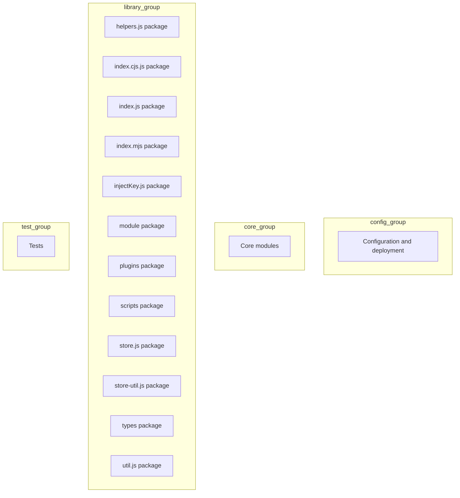

# Architecture report: vuejs/vuex

> Automated static analysis. **Observed** = directly seen in files/imports/AST; **Inferred** = interpretation from that evidence. Repository code was not executed.

## 1. Repository at a glance

| Item | Value |
| --- | --- |
| Repository | vuejs/vuex |
| Description | 🗃️ Centralized State Management for Vue.js. |
| Language | JavaScript |
| Stars | 28285 |
| Licence | MIT |
| Analysed commit / branch | bd907467b8392d6671bb115738285ff7f63d0cf6 / main |
| Framework(s) | Express, Vue |
| Files analysed | 223 |
| Components | 15 |

## 2. Architecture in one minute

vuejs/vuex - 🗃️ Centralized State Management for Vue.js.. This repository was analysed statically from 223 file(s) (0 Python). Detected technologies (observed from imports/manifests): GitHub Actions, Express, Vue, Jest, TypeScript, webpack. Files are grouped into 15 component(s): Configuration and deployment, Core modules, helpers.js package, index.cjs.js package, index.js package, index.mjs package, injectKey.js package, module package. Findings below distinguish observed facts from inferred interpretation.

## 3. High-level block diagram

## 4. Main components

### Configuration and deployment (`config`)

- **Kind:** config
- **Status:** Observed
- **Confidence:** 0.85
- **Responsibility:** Groups 2 file(s) under configuration and deployment (observed from repository paths and static analysis).
- **Paths:** `package.json`, `types/tsconfig.json`
- **Evidence:** [package.json](https://github.com/vuejs/vuex/blob/bd907467b8392d6671bb115738285ff7f63d0cf6/package.json); [types/tsconfig.json](https://github.com/vuejs/vuex/blob/bd907467b8392d6671bb115738285ff7f63d0cf6/types/tsconfig.json)

### Core modules (`core`)

- **Kind:** core
- **Status:** Observed
- **Confidence:** 0.85
- **Responsibility:** Groups 2 file(s) under core modules (observed from repository paths and static analysis).
- **Paths:** `jest.config.js`, `rollup.config.js`
- **Evidence:** [jest.config.js](https://github.com/vuejs/vuex/blob/bd907467b8392d6671bb115738285ff7f63d0cf6/jest.config.js); [rollup.config.js](https://github.com/vuejs/vuex/blob/bd907467b8392d6671bb115738285ff7f63d0cf6/rollup.config.js)

### helpers.js package (`helpers_js`)

- **Kind:** library
- **Status:** Observed
- **Confidence:** 0.85
- **Responsibility:** Groups 1 file(s) under helpers.js package (observed from repository paths and static analysis).
- **Paths:** `src/helpers.js`
- **Evidence:** [src/helpers.js](https://github.com/vuejs/vuex/blob/bd907467b8392d6671bb115738285ff7f63d0cf6/src/helpers.js)

### index.cjs.js package (`index_cjs_js`)

- **Kind:** library
- **Status:** Observed
- **Confidence:** 0.85
- **Responsibility:** Groups 1 file(s) under index.cjs.js package (observed from repository paths and static analysis).
- **Paths:** `src/index.cjs.js`
- **Evidence:** [src/index.cjs.js](https://github.com/vuejs/vuex/blob/bd907467b8392d6671bb115738285ff7f63d0cf6/src/index.cjs.js)

### index.js package (`index_js`)

- **Kind:** library
- **Status:** Observed
- **Confidence:** 0.85
- **Responsibility:** Groups 1 file(s) under index.js package (observed from repository paths and static analysis).
- **Paths:** `src/index.js`
- **Evidence:** [src/index.js](https://github.com/vuejs/vuex/blob/bd907467b8392d6671bb115738285ff7f63d0cf6/src/index.js)

### index.mjs package (`index_mjs`)

- **Kind:** library
- **Status:** Observed
- **Confidence:** 0.85
- **Responsibility:** Groups 1 file(s) under index.mjs package (observed from repository paths and static analysis).
- **Paths:** `src/index.mjs`
- **Evidence:** [src/index.mjs](https://github.com/vuejs/vuex/blob/bd907467b8392d6671bb115738285ff7f63d0cf6/src/index.mjs)

### injectKey.js package (`injectkey_js`)

- **Kind:** library
- **Status:** Observed
- **Confidence:** 0.85
- **Responsibility:** Groups 1 file(s) under injectkey.js package (observed from repository paths and static analysis).
- **Paths:** `src/injectKey.js`
- **Evidence:** [src/injectKey.js](https://github.com/vuejs/vuex/blob/bd907467b8392d6671bb115738285ff7f63d0cf6/src/injectKey.js)

### module package (`module`)

- **Kind:** library
- **Status:** Observed
- **Confidence:** 0.85
- **Responsibility:** Groups 2 file(s) under module package (observed from repository paths and static analysis).
- **Paths:** `src/module/module-collection.js`, `src/module/module.js`
- **Evidence:** [src/module/module-collection.js](https://github.com/vuejs/vuex/blob/bd907467b8392d6671bb115738285ff7f63d0cf6/src/module/module-collection.js); [src/module/module.js](https://github.com/vuejs/vuex/blob/bd907467b8392d6671bb115738285ff7f63d0cf6/src/module/module.js)

### plugins package (`plugins`)

- **Kind:** library
- **Status:** Observed
- **Confidence:** 0.85
- **Responsibility:** Groups 2 file(s) under plugins package (observed from repository paths and static analysis).
- **Paths:** `src/plugins/devtool.js`, `src/plugins/logger.js`
- **Evidence:** [src/plugins/devtool.js](https://github.com/vuejs/vuex/blob/bd907467b8392d6671bb115738285ff7f63d0cf6/src/plugins/devtool.js); [src/plugins/logger.js](https://github.com/vuejs/vuex/blob/bd907467b8392d6671bb115738285ff7f63d0cf6/src/plugins/logger.js)

### scripts package (`scripts`)

- **Kind:** library
- **Status:** Observed
- **Confidence:** 0.85
- **Responsibility:** Groups 2 file(s) under scripts package (observed from repository paths and static analysis).
- **Paths:** `scripts/build.js`, `scripts/release.js`
- **Evidence:** [scripts/build.js](https://github.com/vuejs/vuex/blob/bd907467b8392d6671bb115738285ff7f63d0cf6/scripts/build.js); [scripts/release.js](https://github.com/vuejs/vuex/blob/bd907467b8392d6671bb115738285ff7f63d0cf6/scripts/release.js)

### store.js package (`store_js`)

- **Kind:** library
- **Status:** Observed
- **Confidence:** 0.85
- **Responsibility:** Groups 1 file(s) under store.js package (observed from repository paths and static analysis).
- **Paths:** `src/store.js`
- **Evidence:** [src/store.js](https://github.com/vuejs/vuex/blob/bd907467b8392d6671bb115738285ff7f63d0cf6/src/store.js)

### store-util.js package (`store_util_js`)

- **Kind:** library
- **Status:** Observed
- **Confidence:** 0.85
- **Responsibility:** Groups 1 file(s) under store-util.js package (observed from repository paths and static analysis).
- **Paths:** `src/store-util.js`
- **Evidence:** [src/store-util.js](https://github.com/vuejs/vuex/blob/bd907467b8392d6671bb115738285ff7f63d0cf6/src/store-util.js)

### Tests (`tests`)

- **Kind:** test
- **Status:** Observed
- **Confidence:** 0.85
- **Responsibility:** Groups 20 file(s) under tests (observed from repository paths and static analysis).
- **Paths:** `test/.eslintrc.json`, `test/e2e/cart.spec.js`, `test/e2e/chat.spec.js`, `test/e2e/counter.spec.js`, `test/e2e/todomvc.spec.js`, `test/esm/esm-import.mjs`, `test/esm/esm-test.js`, `test/helpers.js`, `test/setup.js`, `test/unit/helpers.spec.js`, `test/unit/hot-reload.spec.js`, `test/unit/module/module-collection.spec.js`, `test/unit/module/module.spec.js`, `test/unit/modules.spec.js`, `test/unit/store.spec.js`, `test/unit/util.spec.js`, `types/test/helpers.ts`, `types/test/index.ts`, `types/test/tsconfig.json`, `types/test/vue.ts`
- **Evidence:** [test/.eslintrc.json](https://github.com/vuejs/vuex/blob/bd907467b8392d6671bb115738285ff7f63d0cf6/test/.eslintrc.json); [test/e2e/cart.spec.js](https://github.com/vuejs/vuex/blob/bd907467b8392d6671bb115738285ff7f63d0cf6/test/e2e/cart.spec.js); [test/e2e/chat.spec.js](https://github.com/vuejs/vuex/blob/bd907467b8392d6671bb115738285ff7f63d0cf6/test/e2e/chat.spec.js); [test/e2e/counter.spec.js](https://github.com/vuejs/vuex/blob/bd907467b8392d6671bb115738285ff7f63d0cf6/test/e2e/counter.spec.js); [test/e2e/todomvc.spec.js](https://github.com/vuejs/vuex/blob/bd907467b8392d6671bb115738285ff7f63d0cf6/test/e2e/todomvc.spec.js); [test/esm/esm-import.mjs](https://github.com/vuejs/vuex/blob/bd907467b8392d6671bb115738285ff7f63d0cf6/test/esm/esm-import.mjs); [test/esm/esm-test.js](https://github.com/vuejs/vuex/blob/bd907467b8392d6671bb115738285ff7f63d0cf6/test/esm/esm-test.js); [test/helpers.js](https://github.com/vuejs/vuex/blob/bd907467b8392d6671bb115738285ff7f63d0cf6/test/helpers.js)

### types package (`types`)

- **Kind:** library
- **Status:** Observed
- **Confidence:** 0.85
- **Responsibility:** Groups 4 file(s) under types package (observed from repository paths and static analysis).
- **Paths:** `types/helpers.d.ts`, `types/index.d.ts`, `types/logger.d.ts`, `types/vue.d.ts`
- **Evidence:** [types/helpers.d.ts](https://github.com/vuejs/vuex/blob/bd907467b8392d6671bb115738285ff7f63d0cf6/types/helpers.d.ts); [types/index.d.ts](https://github.com/vuejs/vuex/blob/bd907467b8392d6671bb115738285ff7f63d0cf6/types/index.d.ts); [types/logger.d.ts](https://github.com/vuejs/vuex/blob/bd907467b8392d6671bb115738285ff7f63d0cf6/types/logger.d.ts); [types/vue.d.ts](https://github.com/vuejs/vuex/blob/bd907467b8392d6671bb115738285ff7f63d0cf6/types/vue.d.ts)

### util.js package (`util_js`)

- **Kind:** library
- **Status:** Observed
- **Confidence:** 0.85
- **Responsibility:** Groups 1 file(s) under util.js package (observed from repository paths and static analysis).
- **Paths:** `src/util.js`
- **Evidence:** [src/util.js](https://github.com/vuejs/vuex/blob/bd907467b8392d6671bb115738285ff7f63d0cf6/src/util.js)

## 5. Execution flow

**Observed** entry point(s):

- [src/index.js](https://github.com/vuejs/vuex/blob/bd907467b8392d6671bb115738285ff7f63d0cf6/src/index.js)

Representative flow (derived from observed entry points and the import graph; steps beyond the entry point are **Inferred**):

1. Execution starts at an observed entry point listed above, if present.
2. No internal import relationships between components were observed.

## 6. Project structure

### `(root)`

- `.babelrc` - other (117 bytes)
- `.eslintrc.json` - config (148 bytes)
- `.gitignore` - other (107 bytes)
- `CHANGELOG.md` - docs (25515 bytes)
- `LICENSE` - docs (1083 bytes)
- `README.md` - docs (2765 bytes)
- `jest.config.js` - source, JavaScript (587 bytes)
- `package.json` - manifest (3144 bytes)
- `rollup.config.js` - source, JavaScript (2585 bytes)

### `.github`

- `.github/FUNDING.yml` - config (75 bytes)
- `.github/ISSUE_TEMPLATE.md` - docs (204 bytes)
- `.github/ISSUE_TEMPLATE/bug_report.yml` - config (2084 bytes)
- `.github/commit-convention.md` - docs (2931 bytes)
- `.github/contributing.md` - docs (1692 bytes)
- `.github/workflows/ci.yml` - ci, YAML (474 bytes)

### `docs`

- `docs/.vitepress/config.js` - docs (9732 bytes)
- `docs/.vitepress/styles/styles.css` - docs (663 bytes)
- `docs/.vitepress/theme/index.js` - docs (132 bytes)
- `docs/api/index.md` - docs (13057 bytes)
- `docs/guide/actions.md` - docs (5062 bytes)
- `docs/guide/composition-api.md` - docs (1507 bytes)
- `docs/guide/forms.md` - docs (1614 bytes)
- `docs/guide/getters.md` - docs (2960 bytes)
- `docs/guide/hot-reload.md` - docs (2126 bytes)
- `docs/guide/index.md` - docs (2697 bytes)
- `docs/guide/migrating-to-4-0-from-3-x.md` - docs (3749 bytes)
- `docs/guide/modules.md` - docs (11278 bytes)
- `docs/guide/mutations.md` - docs (4882 bytes)
- `docs/guide/plugins.md` - docs (4179 bytes)
- `docs/guide/state.md` - docs (4310 bytes)
- `docs/guide/strict.md` - docs (857 bytes)
- `docs/guide/structure.md` - docs (1321 bytes)
- `docs/guide/testing.md` - docs (6214 bytes)
- `docs/guide/typescript-support.md` - docs (3660 bytes)
- `docs/index.md` - docs (4328 bytes)
- `docs/installation.md` - docs (859 bytes)
- `docs/ja/api/index.md` - docs (15274 bytes)
- `docs/ja/guide/actions.md` - docs (6879 bytes)
- `docs/ja/guide/composition-api.md` - docs (1861 bytes)
- `docs/ja/guide/forms.md` - docs (1889 bytes)
- `docs/ja/guide/getters.md` - docs (3740 bytes)
- `docs/ja/guide/hot-reload.md` - docs (2747 bytes)
- `docs/ja/guide/index.md` - docs (3788 bytes)
- `docs/ja/guide/migrating-to-4-0-from-3-x.md` - docs (4766 bytes)
- `docs/ja/guide/modules.md` - docs (14395 bytes)
- `docs/ja/guide/mutations.md` - docs (7005 bytes)
- `docs/ja/guide/plugins.md` - docs (5507 bytes)
- `docs/ja/guide/state.md` - docs (5954 bytes)
- `docs/ja/guide/strict.md` - docs (1066 bytes)
- `docs/ja/guide/structure.md` - docs (1885 bytes)
- `docs/ja/guide/testing.md` - docs (7677 bytes)
- `docs/ja/guide/typescript-support.md` - docs (4506 bytes)
- `docs/ja/index.md` - docs (4971 bytes)
- `docs/ja/installation.md` - docs (1036 bytes)
- `docs/ptbr/api/index.md` - docs (14183 bytes)
- `docs/ptbr/guide/actions.md` - docs (5554 bytes)
- `docs/ptbr/guide/composition-api.md` - docs (1685 bytes)
- `docs/ptbr/guide/forms.md` - docs (1717 bytes)
- `docs/ptbr/guide/getters.md` - docs (3114 bytes)
- `docs/ptbr/guide/hot-reload.md` - docs (2258 bytes)
- `docs/ptbr/guide/index.md` - docs (3021 bytes)
- `docs/ptbr/guide/migrating-to-4-0-from-3-x.md` - docs (4257 bytes)
- `docs/ptbr/guide/modules.md` - docs (11621 bytes)
- `docs/ptbr/guide/mutations.md` - docs (5523 bytes)
- `docs/ptbr/guide/plugins.md` - docs (4674 bytes)
- `docs/ptbr/guide/state.md` - docs (4749 bytes)
- `docs/ptbr/guide/strict.md` - docs (990 bytes)
- `docs/ptbr/guide/structure.md` - docs (1449 bytes)
- `docs/ptbr/guide/testing.md` - docs (6765 bytes)
- `docs/ptbr/guide/typescript-support.md` - docs (4156 bytes)
- `docs/ptbr/index.md` - docs (4450 bytes)
- `docs/ptbr/installation.md` - docs (916 bytes)
- `docs/public/_redirects` - docs (471 bytes)
- `docs/public/icons/safari-pinned-tab.svg` - docs (10608 bytes)
- `docs/zh/api/index.md` - docs (12907 bytes)
- `docs/zh/guide/actions.md` - docs (4865 bytes)
- `docs/zh/guide/composition-api.md` - docs (1405 bytes)
- `docs/zh/guide/forms.md` - docs (1624 bytes)
- `docs/zh/guide/getters.md` - docs (2945 bytes)
- `docs/zh/guide/hot-reload.md` - docs (2097 bytes)
- `docs/zh/guide/index.md` - docs (2827 bytes)
- `docs/zh/guide/migrating-to-4-0-from-3-x.md` - docs (3822 bytes)
- `docs/zh/guide/modules.md` - docs (11271 bytes)
- `docs/zh/guide/mutations.md` - docs (4802 bytes)
- `docs/zh/guide/plugins.md` - docs (4003 bytes)
- `docs/zh/guide/state.md` - docs (4171 bytes)
- `docs/zh/guide/strict.md` - docs (744 bytes)
- `docs/zh/guide/structure.md` - docs (1200 bytes)
- `docs/zh/guide/testing.md` - docs (6175 bytes)
- `docs/zh/guide/typescript-support.md` - docs (3695 bytes)
- `docs/zh/index.md` - docs (3535 bytes)
- `docs/zh/installation.md` - docs (859 bytes)

### `examples`

- `examples/classic/chat/api/index.js` - source, JavaScript (454 bytes)
- `examples/classic/chat/api/mock-data.js` - source, JavaScript (1397 bytes)
- `examples/classic/chat/app.js` - source, JavaScript (234 bytes)
- `examples/classic/chat/components/App.vue` - source, Vue (384 bytes)
- `examples/classic/chat/components/Message.vue` - source, Vue (449 bytes)
- `examples/classic/chat/components/MessageSection.vue` - source, Vue (1135 bytes)
- `examples/classic/chat/components/Thread.vue` - source, Vue (567 bytes)
- `examples/classic/chat/components/ThreadSection.vue` - source, Vue (716 bytes)
- `examples/classic/chat/css/chat.css` - other (1977 bytes)
- `examples/classic/chat/index.html` - other (367 bytes)
- `examples/classic/chat/store/actions.js` - source, JavaScript (390 bytes)
- `examples/classic/chat/store/getters.js` - source, JavaScript (680 bytes)
- `examples/classic/chat/store/index.js` - source, JavaScript (627 bytes)
- `examples/classic/chat/store/mutations.js` - source, JavaScript (1593 bytes)
- `examples/classic/counter-hot/CounterControls.vue` - source, Vue (617 bytes)
- `examples/classic/counter-hot/app.js` - source, JavaScript (187 bytes)
- `examples/classic/counter-hot/index.html` - other (329 bytes)
- `examples/classic/counter-hot/store/actions.js` - source, JavaScript (364 bytes)
- `examples/classic/counter-hot/store/getters.js` - source, JavaScript (139 bytes)
- `examples/classic/counter-hot/store/index.js` - source, JavaScript (548 bytes)
- `examples/classic/counter-hot/store/mutations.js` - source, JavaScript (177 bytes)
- `examples/classic/counter/Counter.vue` - source, Vue (566 bytes)
- `examples/classic/counter/app.js` - source, JavaScript (163 bytes)
- `examples/classic/counter/index.html` - other (325 bytes)
- `examples/classic/counter/store.js` - source, JavaScript (1299 bytes)
- `examples/classic/shopping-cart/api/shop.js` - source, JavaScript (720 bytes)
- `examples/classic/shopping-cart/app.js` - source, JavaScript (200 bytes)
- `examples/classic/shopping-cart/components/App.vue` - source, Vue (337 bytes)
- `examples/classic/shopping-cart/components/ProductList.vue` - source, Vue (674 bytes)
- `examples/classic/shopping-cart/components/ShoppingCart.vue` - source, Vue (978 bytes)
- `examples/classic/shopping-cart/currency.js` - source, JavaScript (715 bytes)
- `examples/classic/shopping-cart/index.html` - other (337 bytes)
- `examples/classic/shopping-cart/store/index.js` - source, JavaScript (310 bytes)
- `examples/classic/shopping-cart/store/modules/cart.js` - source, JavaScript (2229 bytes)
- `examples/classic/shopping-cart/store/modules/nested.js` - source, JavaScript (137 bytes)
- `examples/classic/shopping-cart/store/modules/products.js` - source, JavaScript (598 bytes)
- `examples/classic/todomvc/app.js` - source, JavaScript (162 bytes)
- `examples/classic/todomvc/components/App.vue` - source, Vue (2493 bytes)
- `examples/classic/todomvc/components/TodoItem.vue` - source, Vue (1484 bytes)
- `examples/classic/todomvc/index.html` - other (278 bytes)
- `examples/classic/todomvc/store/actions.js` - source, JavaScript (658 bytes)
- `examples/classic/todomvc/store/index.js` - source, JavaScript (307 bytes)
- `examples/classic/todomvc/store/mutations.js` - source, JavaScript (489 bytes)
- `examples/classic/todomvc/store/plugins.js` - source, JavaScript (357 bytes)
- `examples/composition/chat/api/index.js` - source, JavaScript (454 bytes)
- `examples/composition/chat/api/mock-data.js` - source, JavaScript (1397 bytes)
- `examples/composition/chat/app.js` - source, JavaScript (234 bytes)
- `examples/composition/chat/components/App.vue` - source, Vue (384 bytes)
- `examples/composition/chat/components/Message.vue` - source, Vue (451 bytes)
- `examples/composition/chat/components/MessageSection.vue` - source, Vue (1350 bytes)
- `examples/composition/chat/components/Thread.vue` - source, Vue (569 bytes)
- `examples/composition/chat/components/ThreadSection.vue` - source, Vue (935 bytes)
- `examples/composition/chat/css/chat.css` - other (1977 bytes)
- `examples/composition/chat/index.html` - other (371 bytes)
- `examples/composition/chat/store/actions.js` - source, JavaScript (390 bytes)
- `examples/composition/chat/store/getters.js` - source, JavaScript (680 bytes)
- `examples/composition/chat/store/index.js` - source, JavaScript (627 bytes)
- `examples/composition/chat/store/mutations.js` - source, JavaScript (1593 bytes)
- `examples/composition/counter-hot/CounterControls.vue` - source, Vue (873 bytes)
- `examples/composition/counter-hot/app.js` - source, JavaScript (187 bytes)
- `examples/composition/counter-hot/index.html` - other (333 bytes)
- `examples/composition/counter-hot/store/actions.js` - source, JavaScript (364 bytes)
- `examples/composition/counter-hot/store/getters.js` - source, JavaScript (302 bytes)
- `examples/composition/counter-hot/store/index.js` - source, JavaScript (559 bytes)
- `examples/composition/counter-hot/store/mutations.js` - source, JavaScript (177 bytes)
- `examples/composition/counter/Counter.vue` - source, Vue (816 bytes)
- `examples/composition/counter/app.js` - source, JavaScript (163 bytes)
- `examples/composition/counter/index.html` - other (329 bytes)
- `examples/composition/counter/store.js` - source, JavaScript (1299 bytes)
- `examples/composition/shopping-cart/api/shop.js` - source, JavaScript (593 bytes)
- `examples/composition/shopping-cart/app.js` - source, JavaScript (162 bytes)
- `examples/composition/shopping-cart/components/App.vue` - source, Vue (337 bytes)
- `examples/composition/shopping-cart/components/ProductList.vue` - source, Vue (1012 bytes)
- `examples/composition/shopping-cart/components/ShoppingCart.vue` - source, Vue (1126 bytes)
- `examples/composition/shopping-cart/currency.js` - source, JavaScript (715 bytes)
- `examples/composition/shopping-cart/index.html` - other (341 bytes)
- `examples/composition/shopping-cart/store/index.js` - source, JavaScript (310 bytes)
- `examples/composition/shopping-cart/store/modules/cart.js` - source, JavaScript (2139 bytes)
- `examples/composition/shopping-cart/store/modules/products.js` - source, JavaScript (582 bytes)
- `examples/composition/todomvc/app.js` - source, JavaScript (162 bytes)
- `examples/composition/todomvc/components/App.vue` - source, Vue (2738 bytes)
- `examples/composition/todomvc/components/TodoItem.vue` - source, Vue (1576 bytes)
- `examples/composition/todomvc/index.html` - other (282 bytes)
- `examples/composition/todomvc/store/actions.js` - source, JavaScript (658 bytes)
- `examples/composition/todomvc/store/index.js` - source, JavaScript (307 bytes)
- `examples/composition/todomvc/store/mutations.js` - source, JavaScript (489 bytes)
- `examples/composition/todomvc/store/plugins.js` - source, JavaScript (357 bytes)
- `examples/global.css` - other (325 bytes)
- `examples/index.html` - other (943 bytes)
- `examples/server.js` - source, JavaScript (728 bytes)
- `examples/webpack.config.js` - source, JavaScript (1646 bytes)

### `scripts`

- `scripts/build.js` - source, JavaScript (1174 bytes)
- `scripts/release.js` - source, JavaScript (3005 bytes)

### `src`

- `src/helpers.js` - source, JavaScript (6589 bytes)
- `src/index.cjs.js` - source, JavaScript (434 bytes)
- `src/index.js` - source, JavaScript (592 bytes)
- `src/index.mjs` - source, JavaScript (424 bytes)
- `src/injectKey.js` - source, JavaScript (152 bytes)
- `src/module/module-collection.js` - source, JavaScript (3497 bytes)
- `src/module/module.js` - source, JavaScript (1612 bytes)
- `src/plugins/devtool.js` - source, JavaScript (7729 bytes)
- `src/plugins/logger.js` - source, JavaScript (2538 bytes)
- `src/store-util.js` - source, JavaScript (8560 bytes)
- `src/store.js` - source, JavaScript (7310 bytes)
- `src/util.js` - source, JavaScript (1538 bytes)

### `test`

- `test/.eslintrc.json` - test (36 bytes)
- `test/e2e/cart.spec.js` - test, JavaScript (1717 bytes)
- `test/e2e/chat.spec.js` - test, JavaScript (1860 bytes)
- `test/e2e/counter.spec.js` - test, JavaScript (1208 bytes)
- `test/e2e/todomvc.spec.js` - test, JavaScript (5753 bytes)
- `test/esm/esm-import.mjs` - test, JavaScript (706 bytes)
- `test/esm/esm-test.js` - test, JavaScript (211 bytes)
- `test/helpers.js` - test, JavaScript (3269 bytes)
- `test/setup.js` - test, JavaScript (37 bytes)
- `test/unit/helpers.spec.js` - test, JavaScript (13776 bytes)
- `test/unit/hot-reload.spec.js` - test, JavaScript (8392 bytes)
- `test/unit/module/module-collection.spec.js` - test, JavaScript (3127 bytes)
- `test/unit/module/module.spec.js` - test, JavaScript (4410 bytes)
- `test/unit/modules.spec.js` - test, JavaScript (23368 bytes)
- `test/unit/store.spec.js` - test, JavaScript (9758 bytes)
- `test/unit/util.spec.js` - test, JavaScript (1972 bytes)

### `types`

- `types/README.md` - docs (95 bytes)
- `types/helpers.d.ts` - source, TypeScript (2951 bytes)
- `types/index.d.ts` - source, TypeScript (4472 bytes)
- `types/logger.d.ts` - source, TypeScript (745 bytes)
- `types/test/helpers.ts` - test, TypeScript (3268 bytes)
- `types/test/index.ts` - test, TypeScript (8728 bytes)
- `types/test/tsconfig.json` - test (311 bytes)
- `types/test/vue.ts` - test, TypeScript (168 bytes)
- `types/tsconfig.json` - config (293 bytes)
- `types/vue.d.ts` - source, TypeScript (225 bytes)

## 7. Key dependencies and integrations

| Name | Category | Status | Confidence | Evidence |
| --- | --- | --- | --- | --- |
| GitHub Actions | ci | Observed | 0.85 | [.github/workflows/ci.yml](https://github.com/vuejs/vuex/blob/bd907467b8392d6671bb115738285ff7f63d0cf6/.github/workflows/ci.yml) |
| Express | framework | Observed | 0.85 | [package.json:80](https://github.com/vuejs/vuex/blob/bd907467b8392d6671bb115738285ff7f63d0cf6/package.json#L80) |
| Vue | framework | Observed | 0.90 | [package.json:2](https://github.com/vuejs/vuex/blob/bd907467b8392d6671bb115738285ff7f63d0cf6/package.json#L2) |
| Jest | tooling | Observed | 0.85 | [package.json:33](https://github.com/vuejs/vuex/blob/bd907467b8392d6671bb115738285ff7f63d0cf6/package.json#L33) |
| TypeScript | tooling | Observed | 0.85 | [package.json:91](https://github.com/vuejs/vuex/blob/bd907467b8392d6671bb115738285ff7f63d0cf6/package.json#L91) |
| webpack | tooling | Observed | 0.85 | [package.json:96](https://github.com/vuejs/vuex/blob/bd907467b8392d6671bb115738285ff7f63d0cf6/package.json#L96) |

## 8. Data and state

No database, cache, queue, or persistent-state usage was observed in the analysed files. State handling, if any, may be in-memory or in files that were not analysed.

## 9. Configuration and deployment clues

- `.eslintrc.json` (config)
- `.github/FUNDING.yml` (config)
- `.github/ISSUE_TEMPLATE/bug_report.yml` (config)
- `.github/workflows/ci.yml` (ci)
- `package.json` (manifest)
- `types/tsconfig.json` (config)

## 10. Design observations

- Tests are present alongside source code (Observed from test file paths).

These observations are interpretations (**Inferred**) of the observed structure, not guarantees about runtime design.

## 11. Limitations and unknowns

- Static analysis only: repository code was not executed, installed, or imported at runtime.
- Components and relationships are inferred from file paths, imports, and AST structure; runtime behaviour, dynamic imports, and reflection may not be visible.
- No clear application entry point was observed in the analysed files.
- Repository text was treated as untrusted data; no instructions found in repository files were followed, and likely secret values were redacted/excluded.
- JavaScript and TypeScript files were inventoried from paths and package manifests. They were not parsed with a full language AST, and repository code was not executed.

## 12. Source references

- [.github/workflows/ci.yml](https://github.com/vuejs/vuex/blob/bd907467b8392d6671bb115738285ff7f63d0cf6/.github/workflows/ci.yml)
- [jest.config.js](https://github.com/vuejs/vuex/blob/bd907467b8392d6671bb115738285ff7f63d0cf6/jest.config.js)
- [package.json](https://github.com/vuejs/vuex/blob/bd907467b8392d6671bb115738285ff7f63d0cf6/package.json)
- [package.json:2](https://github.com/vuejs/vuex/blob/bd907467b8392d6671bb115738285ff7f63d0cf6/package.json#L2)
- [package.json:33](https://github.com/vuejs/vuex/blob/bd907467b8392d6671bb115738285ff7f63d0cf6/package.json#L33)
- [package.json:80](https://github.com/vuejs/vuex/blob/bd907467b8392d6671bb115738285ff7f63d0cf6/package.json#L80)
- [package.json:91](https://github.com/vuejs/vuex/blob/bd907467b8392d6671bb115738285ff7f63d0cf6/package.json#L91)
- [package.json:96](https://github.com/vuejs/vuex/blob/bd907467b8392d6671bb115738285ff7f63d0cf6/package.json#L96)
- [rollup.config.js](https://github.com/vuejs/vuex/blob/bd907467b8392d6671bb115738285ff7f63d0cf6/rollup.config.js)
- [scripts/build.js](https://github.com/vuejs/vuex/blob/bd907467b8392d6671bb115738285ff7f63d0cf6/scripts/build.js)
- [scripts/release.js](https://github.com/vuejs/vuex/blob/bd907467b8392d6671bb115738285ff7f63d0cf6/scripts/release.js)
- [src/helpers.js](https://github.com/vuejs/vuex/blob/bd907467b8392d6671bb115738285ff7f63d0cf6/src/helpers.js)
- [src/index.cjs.js](https://github.com/vuejs/vuex/blob/bd907467b8392d6671bb115738285ff7f63d0cf6/src/index.cjs.js)
- [src/index.js](https://github.com/vuejs/vuex/blob/bd907467b8392d6671bb115738285ff7f63d0cf6/src/index.js)
- [src/index.mjs](https://github.com/vuejs/vuex/blob/bd907467b8392d6671bb115738285ff7f63d0cf6/src/index.mjs)
- [src/injectKey.js](https://github.com/vuejs/vuex/blob/bd907467b8392d6671bb115738285ff7f63d0cf6/src/injectKey.js)
- [src/module/module-collection.js](https://github.com/vuejs/vuex/blob/bd907467b8392d6671bb115738285ff7f63d0cf6/src/module/module-collection.js)
- [src/module/module.js](https://github.com/vuejs/vuex/blob/bd907467b8392d6671bb115738285ff7f63d0cf6/src/module/module.js)
- [src/plugins/devtool.js](https://github.com/vuejs/vuex/blob/bd907467b8392d6671bb115738285ff7f63d0cf6/src/plugins/devtool.js)
- [src/plugins/logger.js](https://github.com/vuejs/vuex/blob/bd907467b8392d6671bb115738285ff7f63d0cf6/src/plugins/logger.js)
- [src/store-util.js](https://github.com/vuejs/vuex/blob/bd907467b8392d6671bb115738285ff7f63d0cf6/src/store-util.js)
- [src/store.js](https://github.com/vuejs/vuex/blob/bd907467b8392d6671bb115738285ff7f63d0cf6/src/store.js)
- [src/util.js](https://github.com/vuejs/vuex/blob/bd907467b8392d6671bb115738285ff7f63d0cf6/src/util.js)
- [test/.eslintrc.json](https://github.com/vuejs/vuex/blob/bd907467b8392d6671bb115738285ff7f63d0cf6/test/.eslintrc.json)
- [test/e2e/cart.spec.js](https://github.com/vuejs/vuex/blob/bd907467b8392d6671bb115738285ff7f63d0cf6/test/e2e/cart.spec.js)
- [test/e2e/chat.spec.js](https://github.com/vuejs/vuex/blob/bd907467b8392d6671bb115738285ff7f63d0cf6/test/e2e/chat.spec.js)
- [test/e2e/counter.spec.js](https://github.com/vuejs/vuex/blob/bd907467b8392d6671bb115738285ff7f63d0cf6/test/e2e/counter.spec.js)
- [test/e2e/todomvc.spec.js](https://github.com/vuejs/vuex/blob/bd907467b8392d6671bb115738285ff7f63d0cf6/test/e2e/todomvc.spec.js)
- [test/esm/esm-import.mjs](https://github.com/vuejs/vuex/blob/bd907467b8392d6671bb115738285ff7f63d0cf6/test/esm/esm-import.mjs)
- [test/esm/esm-test.js](https://github.com/vuejs/vuex/blob/bd907467b8392d6671bb115738285ff7f63d0cf6/test/esm/esm-test.js)
- [test/helpers.js](https://github.com/vuejs/vuex/blob/bd907467b8392d6671bb115738285ff7f63d0cf6/test/helpers.js)
- [types/helpers.d.ts](https://github.com/vuejs/vuex/blob/bd907467b8392d6671bb115738285ff7f63d0cf6/types/helpers.d.ts)
- [types/index.d.ts](https://github.com/vuejs/vuex/blob/bd907467b8392d6671bb115738285ff7f63d0cf6/types/index.d.ts)
- [types/logger.d.ts](https://github.com/vuejs/vuex/blob/bd907467b8392d6671bb115738285ff7f63d0cf6/types/logger.d.ts)
- [types/tsconfig.json](https://github.com/vuejs/vuex/blob/bd907467b8392d6671bb115738285ff7f63d0cf6/types/tsconfig.json)
- [types/vue.d.ts](https://github.com/vuejs/vuex/blob/bd907467b8392d6671bb115738285ff7f63d0cf6/types/vue.d.ts)
