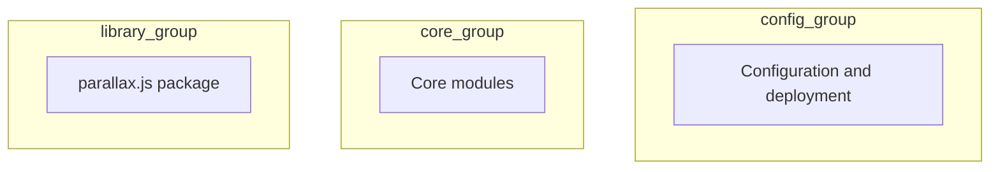

# Architecture report: wagerfield/parallax

> Automated static analysis. **Observed** = directly seen in files/imports/AST; **Inferred** = interpretation from that evidence. Repository code was not executed.

## 1. Repository at a glance

| Item | Value |
| --- | --- |
| Repository | wagerfield/parallax |
| Description | Parallax Engine that reacts to the orientation of a smart device |
| Language | JavaScript |
| Stars | 16570 |
| Licence | Other |
| Analysed commit / branch | 04e53e94665dd55181f8d54312a9a9e63fef52ab / master |
| Framework(s) | None detected |
| Files analysed | 18 |
| Components | 3 |

## 2. Architecture in one minute

wagerfield/parallax - Parallax Engine that reacts to the orientation of a smart device. This repository was analysed statically from 18 file(s) (0 Python). Detected technologies (observed from imports/manifests): no known frameworks/libraries. Files are grouped into 3 component(s): Configuration and deployment, Core modules, parallax.js package. Findings below distinguish observed facts from inferred interpretation.

## 3. High-level block diagram

## 4. Main components

### Configuration and deployment (`config`)

- **Kind:** config
- **Status:** Observed
- **Confidence:** 0.85
- **Responsibility:** Groups 1 file(s) under configuration and deployment (observed from repository paths and static analysis).
- **Paths:** `package.json`
- **Evidence:** [package.json](https://github.com/wagerfield/parallax/blob/04e53e94665dd55181f8d54312a9a9e63fef52ab/package.json)

### Core modules (`core`)

- **Kind:** core
- **Status:** Observed
- **Confidence:** 0.85
- **Responsibility:** Groups 1 file(s) under core modules (observed from repository paths and static analysis).
- **Paths:** `gulpfile.js`
- **Evidence:** [gulpfile.js](https://github.com/wagerfield/parallax/blob/04e53e94665dd55181f8d54312a9a9e63fef52ab/gulpfile.js)

### parallax.js package (`parallax_js`)

- **Kind:** library
- **Status:** Observed
- **Confidence:** 0.85
- **Responsibility:** Groups 1 file(s) under parallax.js package (observed from repository paths and static analysis).
- **Paths:** `src/parallax.js`
- **Evidence:** [src/parallax.js](https://github.com/wagerfield/parallax/blob/04e53e94665dd55181f8d54312a9a9e63fef52ab/src/parallax.js)

## 5. Execution flow

No entry point was observed; the startup flow below is therefore limited.

Representative flow (derived from observed entry points and the import graph; steps beyond the entry point are **Inferred**):

1. Execution starts at an observed entry point listed above, if present.
2. No internal import relationships between components were observed.

## 6. Project structure

### `(root)`

- `.gitignore` - other (52 bytes)
- `.npmignore` - other (18 bytes)
- `.nvmrc` - other (2 bytes)
- `LICENSE` - docs (1299 bytes)
- `README.md` - docs (12611 bytes)
- `gulpfile.js` - source, JavaScript (2597 bytes)
- `package.json` - manifest (1248 bytes)

### `examples`

- `examples/assets/styles.scss` - other (1605 bytes)
- `examples/pages/callback.html` - other (1305 bytes)
- `examples/pages/destroy.html` - other (1254 bytes)
- `examples/pages/hoveronly.html` - other (1096 bytes)
- `examples/pages/input_element.html` - other (1457 bytes)
- `examples/pages/interactive.html` - other (1371 bytes)
- `examples/pages/relative.html` - other (1791 bytes)
- `examples/pages/selector.html` - other (1097 bytes)
- `examples/pages/separate_axis_data.html` - other (1187 bytes)
- `examples/pages/simple.html` - other (1058 bytes)

### `src`

- `src/parallax.js` - source, JavaScript (17997 bytes)

## 7. Key dependencies and integrations

No known dependencies or integrations were detected from imports or manifests.

## 8. Data and state

No database, cache, queue, or persistent-state usage was observed in the analysed files. State handling, if any, may be in-memory or in files that were not analysed.

## 9. Configuration and deployment clues

- `package.json` (manifest)

## 10. Design observations

- No strong design patterns could be established from the available evidence.

These observations are interpretations (**Inferred**) of the observed structure, not guarantees about runtime design.

## 11. Limitations and unknowns

- Static analysis only: repository code was not executed, installed, or imported at runtime.
- Components and relationships are inferred from file paths, imports, and AST structure; runtime behaviour, dynamic imports, and reflection may not be visible.
- No clear application entry point was observed in the analysed files.
- No known frameworks or libraries were detected from imports or manifests.
- Repository text was treated as untrusted data; no instructions found in repository files were followed, and likely secret values were redacted/excluded.
- JavaScript and TypeScript files were inventoried from paths and package manifests. They were not parsed with a full language AST, and repository code was not executed.

## 12. Source references

- [gulpfile.js](https://github.com/wagerfield/parallax/blob/04e53e94665dd55181f8d54312a9a9e63fef52ab/gulpfile.js)
- [package.json](https://github.com/wagerfield/parallax/blob/04e53e94665dd55181f8d54312a9a9e63fef52ab/package.json)
- [src/parallax.js](https://github.com/wagerfield/parallax/blob/04e53e94665dd55181f8d54312a9a9e63fef52ab/src/parallax.js)
