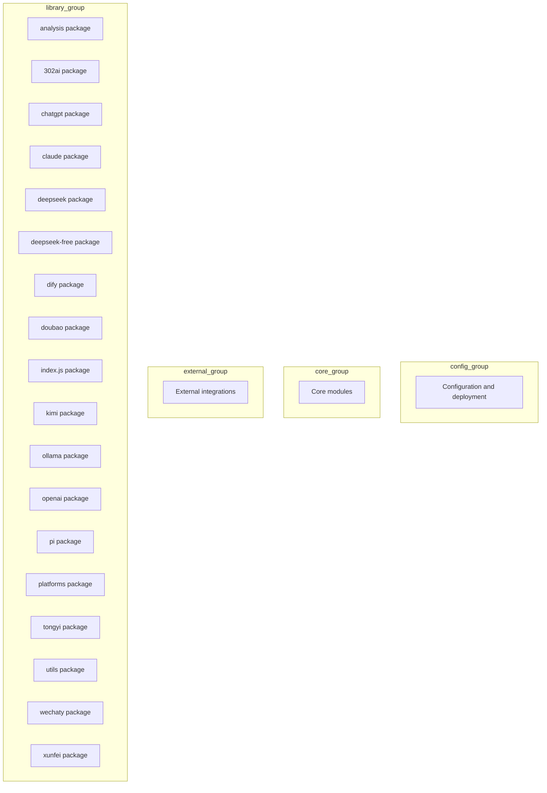

# Architecture report: wangrongding/wechat-bot

> Automated static analysis. **Observed** = directly seen in files/imports/AST; **Inferred** = interpretation from that evidence. Repository code was not executed.

## 1. Repository at a glance

| Item | Value |
| --- | --- |
| Repository | wangrongding/wechat-bot |
| Description | 🤖 Multi-platform IM AI Agent for Telegram, WhatsApp, Lark, and WeChat. Connects ChatGPT / Claude / Kimi / DeepSeek / Ollama / Pi for auto-replies, community analysis, contact management, and inactive-friend detection. |
| Language | JavaScript |
| Stars | 11558 |
| Licence | MIT |
| Analysed commit / branch | 43c6c5075393ca50a430629108251d9be104d5b9 / main |
| Framework(s) | None detected |
| Files analysed | 61 |
| Components | 21 |

## 2. Architecture in one minute

wangrongding/wechat-bot - 🤖 Multi-platform IM AI Agent for Telegram, WhatsApp, Lark, and WeChat. Connects ChatGPT / Claude / Kimi / DeepSeek / Ollama / Pi for auto-replies, community analysis, contact management, and inactive…. This repository was analysed statically from 61 file(s) (0 Python). Detected technologies (observed from imports/manifests): axios, Docker. Files are grouped into 21 component(s): analysis package, 302ai package, chatgpt package, claude package, Configuration and deployment, Core modules, deepseek package, deepseek-free package. Findings below distinguish observed facts from inferred interpretation.

## 3. High-level block diagram

## 4. Main components

### analysis package (`analysis`)

- **Kind:** library
- **Status:** Observed
- **Confidence:** 0.85
- **Responsibility:** Groups 2 file(s) under analysis package (observed from repository paths and static analysis).
- **Paths:** `src/analysis/__test__.js`, `src/analysis/wechatAnalyzer.js`
- **Evidence:** [src/analysis/__test__.js](https://github.com/wangrongding/wechat-bot/blob/43c6c5075393ca50a430629108251d9be104d5b9/src/analysis/__test__.js); [src/analysis/wechatAnalyzer.js](https://github.com/wangrongding/wechat-bot/blob/43c6c5075393ca50a430629108251d9be104d5b9/src/analysis/wechatAnalyzer.js)

### 302ai package (`c_302ai`)

- **Kind:** library
- **Status:** Observed
- **Confidence:** 0.85
- **Responsibility:** Groups 2 file(s) under 302ai package (observed from repository paths and static analysis).
- **Paths:** `src/302ai/__test__.js`, `src/302ai/index.js`
- **Evidence:** [src/302ai/__test__.js](https://github.com/wangrongding/wechat-bot/blob/43c6c5075393ca50a430629108251d9be104d5b9/src/302ai/__test__.js); [src/302ai/index.js](https://github.com/wangrongding/wechat-bot/blob/43c6c5075393ca50a430629108251d9be104d5b9/src/302ai/index.js)

### chatgpt package (`chatgpt`)

- **Kind:** library
- **Status:** Observed
- **Confidence:** 0.85
- **Responsibility:** Groups 1 file(s) under chatgpt package (observed from repository paths and static analysis).
- **Paths:** `src/chatgpt/index.js`
- **Evidence:** [src/chatgpt/index.js](https://github.com/wangrongding/wechat-bot/blob/43c6c5075393ca50a430629108251d9be104d5b9/src/chatgpt/index.js)

### claude package (`claude`)

- **Kind:** library
- **Status:** Observed
- **Confidence:** 0.85
- **Responsibility:** Groups 1 file(s) under claude package (observed from repository paths and static analysis).
- **Paths:** `src/claude/index.js`
- **Evidence:** [src/claude/index.js](https://github.com/wangrongding/wechat-bot/blob/43c6c5075393ca50a430629108251d9be104d5b9/src/claude/index.js)

### Configuration and deployment (`config`)

- **Kind:** config
- **Status:** Observed
- **Confidence:** 0.85
- **Responsibility:** Groups 4 file(s) under configuration and deployment (observed from repository paths and static analysis).
- **Paths:** `Dockerfile`, `Dockerfile.alpine`, `package.json`, `src/config/env.js`
- **Evidence:** [Dockerfile](https://github.com/wangrongding/wechat-bot/blob/43c6c5075393ca50a430629108251d9be104d5b9/Dockerfile); [Dockerfile.alpine](https://github.com/wangrongding/wechat-bot/blob/43c6c5075393ca50a430629108251d9be104d5b9/Dockerfile.alpine); [package.json](https://github.com/wangrongding/wechat-bot/blob/43c6c5075393ca50a430629108251d9be104d5b9/package.json); [src/config/env.js](https://github.com/wangrongding/wechat-bot/blob/43c6c5075393ca50a430629108251d9be104d5b9/src/config/env.js)

### Core modules (`core`)

- **Kind:** core
- **Status:** Observed
- **Confidence:** 0.85
- **Responsibility:** Groups 1 file(s) under core modules (observed from repository paths and static analysis).
- **Paths:** `cli.js`
- **Evidence:** [cli.js](https://github.com/wangrongding/wechat-bot/blob/43c6c5075393ca50a430629108251d9be104d5b9/cli.js)

### deepseek package (`deepseek`)

- **Kind:** library
- **Status:** Observed
- **Confidence:** 0.85
- **Responsibility:** Groups 2 file(s) under deepseek package (observed from repository paths and static analysis).
- **Paths:** `src/deepseek/__test__.js`, `src/deepseek/index.js`
- **Evidence:** [src/deepseek/__test__.js](https://github.com/wangrongding/wechat-bot/blob/43c6c5075393ca50a430629108251d9be104d5b9/src/deepseek/__test__.js); [src/deepseek/index.js](https://github.com/wangrongding/wechat-bot/blob/43c6c5075393ca50a430629108251d9be104d5b9/src/deepseek/index.js)

### deepseek-free package (`deepseek_free`)

- **Kind:** library
- **Status:** Observed
- **Confidence:** 0.85
- **Responsibility:** Groups 2 file(s) under deepseek-free package (observed from repository paths and static analysis).
- **Paths:** `src/deepseek-free/__test__.js`, `src/deepseek-free/index.js`
- **Evidence:** [src/deepseek-free/__test__.js](https://github.com/wangrongding/wechat-bot/blob/43c6c5075393ca50a430629108251d9be104d5b9/src/deepseek-free/__test__.js); [src/deepseek-free/index.js](https://github.com/wangrongding/wechat-bot/blob/43c6c5075393ca50a430629108251d9be104d5b9/src/deepseek-free/index.js)

### dify package (`dify`)

- **Kind:** library
- **Status:** Observed
- **Confidence:** 0.85
- **Responsibility:** Groups 2 file(s) under dify package (observed from repository paths and static analysis).
- **Paths:** `src/dify/__test__.js`, `src/dify/index.js`
- **Evidence:** [src/dify/__test__.js](https://github.com/wangrongding/wechat-bot/blob/43c6c5075393ca50a430629108251d9be104d5b9/src/dify/__test__.js); [src/dify/index.js](https://github.com/wangrongding/wechat-bot/blob/43c6c5075393ca50a430629108251d9be104d5b9/src/dify/index.js)

### doubao package (`doubao`)

- **Kind:** library
- **Status:** Observed
- **Confidence:** 0.85
- **Responsibility:** Groups 2 file(s) under doubao package (observed from repository paths and static analysis).
- **Paths:** `src/doubao/__test__.js`, `src/doubao/index.js`
- **Evidence:** [src/doubao/__test__.js](https://github.com/wangrongding/wechat-bot/blob/43c6c5075393ca50a430629108251d9be104d5b9/src/doubao/__test__.js); [src/doubao/index.js](https://github.com/wangrongding/wechat-bot/blob/43c6c5075393ca50a430629108251d9be104d5b9/src/doubao/index.js)

### External integrations (`external_integrations`)

- **Kind:** external
- **Status:** Observed
- **Confidence:** 0.85
- **Responsibility:** Groups 5 file(s) under external integrations (observed from repository paths and static analysis).
- **Paths:** `src/adapters/lark.js`, `src/adapters/opencli.js`, `src/adapters/pi.js`, `src/adapters/telegram.js`, `src/adapters/whatsapp.js`
- **Evidence:** [src/adapters/lark.js](https://github.com/wangrongding/wechat-bot/blob/43c6c5075393ca50a430629108251d9be104d5b9/src/adapters/lark.js); [src/adapters/opencli.js](https://github.com/wangrongding/wechat-bot/blob/43c6c5075393ca50a430629108251d9be104d5b9/src/adapters/opencli.js); [src/adapters/pi.js](https://github.com/wangrongding/wechat-bot/blob/43c6c5075393ca50a430629108251d9be104d5b9/src/adapters/pi.js); [src/adapters/telegram.js](https://github.com/wangrongding/wechat-bot/blob/43c6c5075393ca50a430629108251d9be104d5b9/src/adapters/telegram.js); [src/adapters/whatsapp.js](https://github.com/wangrongding/wechat-bot/blob/43c6c5075393ca50a430629108251d9be104d5b9/src/adapters/whatsapp.js)

### index.js package (`index_js`)

- **Kind:** library
- **Status:** Observed
- **Confidence:** 0.85
- **Responsibility:** Groups 1 file(s) under index.js package (observed from repository paths and static analysis).
- **Paths:** `src/index.js`
- **Evidence:** [src/index.js](https://github.com/wangrongding/wechat-bot/blob/43c6c5075393ca50a430629108251d9be104d5b9/src/index.js)

### kimi package (`kimi`)

- **Kind:** library
- **Status:** Observed
- **Confidence:** 0.85
- **Responsibility:** Groups 2 file(s) under kimi package (observed from repository paths and static analysis).
- **Paths:** `src/kimi/__test__.js`, `src/kimi/index.js`
- **Evidence:** [src/kimi/__test__.js](https://github.com/wangrongding/wechat-bot/blob/43c6c5075393ca50a430629108251d9be104d5b9/src/kimi/__test__.js); [src/kimi/index.js](https://github.com/wangrongding/wechat-bot/blob/43c6c5075393ca50a430629108251d9be104d5b9/src/kimi/index.js)

### ollama package (`ollama`)

- **Kind:** library
- **Status:** Observed
- **Confidence:** 0.85
- **Responsibility:** Groups 2 file(s) under ollama package (observed from repository paths and static analysis).
- **Paths:** `src/ollama/__test__.js`, `src/ollama/index.js`
- **Evidence:** [src/ollama/__test__.js](https://github.com/wangrongding/wechat-bot/blob/43c6c5075393ca50a430629108251d9be104d5b9/src/ollama/__test__.js); [src/ollama/index.js](https://github.com/wangrongding/wechat-bot/blob/43c6c5075393ca50a430629108251d9be104d5b9/src/ollama/index.js)

### openai package (`openai`)

- **Kind:** library
- **Status:** Observed
- **Confidence:** 0.85
- **Responsibility:** Groups 2 file(s) under openai package (observed from repository paths and static analysis).
- **Paths:** `src/openai/__test__.js`, `src/openai/index.js`
- **Evidence:** [src/openai/__test__.js](https://github.com/wangrongding/wechat-bot/blob/43c6c5075393ca50a430629108251d9be104d5b9/src/openai/__test__.js); [src/openai/index.js](https://github.com/wangrongding/wechat-bot/blob/43c6c5075393ca50a430629108251d9be104d5b9/src/openai/index.js)

### pi package (`pi`)

- **Kind:** library
- **Status:** Observed
- **Confidence:** 0.85
- **Responsibility:** Groups 1 file(s) under pi package (observed from repository paths and static analysis).
- **Paths:** `src/pi/index.js`
- **Evidence:** [src/pi/index.js](https://github.com/wangrongding/wechat-bot/blob/43c6c5075393ca50a430629108251d9be104d5b9/src/pi/index.js)

### platforms package (`platforms`)

- **Kind:** library
- **Status:** Observed
- **Confidence:** 0.85
- **Responsibility:** Groups 9 file(s) under platforms package (observed from repository paths and static analysis).
- **Paths:** `src/platforms/lark/agent.js`, `src/platforms/lark/messageStore.js`, `src/platforms/telegram/agent.js`, `src/platforms/telegram/messageStore.js`, `src/platforms/wechat/bot.js`, `src/platforms/wechat/commandRouter.js`, `src/platforms/wechat/messageStore.js`, `src/platforms/whatsapp/agent.js`, `src/platforms/whatsapp/messageStore.js`
- **Evidence:** [src/platforms/lark/agent.js](https://github.com/wangrongding/wechat-bot/blob/43c6c5075393ca50a430629108251d9be104d5b9/src/platforms/lark/agent.js); [src/platforms/lark/messageStore.js](https://github.com/wangrongding/wechat-bot/blob/43c6c5075393ca50a430629108251d9be104d5b9/src/platforms/lark/messageStore.js); [src/platforms/telegram/agent.js](https://github.com/wangrongding/wechat-bot/blob/43c6c5075393ca50a430629108251d9be104d5b9/src/platforms/telegram/agent.js); [src/platforms/telegram/messageStore.js](https://github.com/wangrongding/wechat-bot/blob/43c6c5075393ca50a430629108251d9be104d5b9/src/platforms/telegram/messageStore.js); [src/platforms/wechat/bot.js](https://github.com/wangrongding/wechat-bot/blob/43c6c5075393ca50a430629108251d9be104d5b9/src/platforms/wechat/bot.js); [src/platforms/wechat/commandRouter.js](https://github.com/wangrongding/wechat-bot/blob/43c6c5075393ca50a430629108251d9be104d5b9/src/platforms/wechat/commandRouter.js); [src/platforms/wechat/messageStore.js](https://github.com/wangrongding/wechat-bot/blob/43c6c5075393ca50a430629108251d9be104d5b9/src/platforms/wechat/messageStore.js); [src/platforms/whatsapp/agent.js](https://github.com/wangrongding/wechat-bot/blob/43c6c5075393ca50a430629108251d9be104d5b9/src/platforms/whatsapp/agent.js)

### tongyi package (`tongyi`)

- **Kind:** library
- **Status:** Observed
- **Confidence:** 0.85
- **Responsibility:** Groups 1 file(s) under tongyi package (observed from repository paths and static analysis).
- **Paths:** `src/tongyi/index.js`
- **Evidence:** [src/tongyi/index.js](https://github.com/wangrongding/wechat-bot/blob/43c6c5075393ca50a430629108251d9be104d5b9/src/tongyi/index.js)

### utils package (`utils`)

- **Kind:** library
- **Status:** Observed
- **Confidence:** 0.85
- **Responsibility:** Groups 1 file(s) under utils package (observed from repository paths and static analysis).
- **Paths:** `src/utils/process.js`
- **Evidence:** [src/utils/process.js](https://github.com/wangrongding/wechat-bot/blob/43c6c5075393ca50a430629108251d9be104d5b9/src/utils/process.js)

### wechaty package (`wechaty`)

- **Kind:** library
- **Status:** Observed
- **Confidence:** 0.85
- **Responsibility:** Groups 3 file(s) under wechaty package (observed from repository paths and static analysis).
- **Paths:** `src/wechaty/sendMessage.js`, `src/wechaty/serve.js`, `src/wechaty/testMessage.js`
- **Evidence:** [src/wechaty/sendMessage.js](https://github.com/wangrongding/wechat-bot/blob/43c6c5075393ca50a430629108251d9be104d5b9/src/wechaty/sendMessage.js); [src/wechaty/serve.js](https://github.com/wangrongding/wechat-bot/blob/43c6c5075393ca50a430629108251d9be104d5b9/src/wechaty/serve.js); [src/wechaty/testMessage.js](https://github.com/wangrongding/wechat-bot/blob/43c6c5075393ca50a430629108251d9be104d5b9/src/wechaty/testMessage.js)

### xunfei package (`xunfei`)

- **Kind:** library
- **Status:** Observed
- **Confidence:** 0.85
- **Responsibility:** Groups 3 file(s) under xunfei package (observed from repository paths and static analysis).
- **Paths:** `src/xunfei/__test__.js`, `src/xunfei/index.js`, `src/xunfei/xunfei.js`
- **Evidence:** [src/xunfei/__test__.js](https://github.com/wangrongding/wechat-bot/blob/43c6c5075393ca50a430629108251d9be104d5b9/src/xunfei/__test__.js); [src/xunfei/index.js](https://github.com/wangrongding/wechat-bot/blob/43c6c5075393ca50a430629108251d9be104d5b9/src/xunfei/index.js); [src/xunfei/xunfei.js](https://github.com/wangrongding/wechat-bot/blob/43c6c5075393ca50a430629108251d9be104d5b9/src/xunfei/xunfei.js)

## 5. Execution flow

**Observed** entry point(s):

- [cli.js](https://github.com/wangrongding/wechat-bot/blob/43c6c5075393ca50a430629108251d9be104d5b9/cli.js)
- [src/302ai/index.js](https://github.com/wangrongding/wechat-bot/blob/43c6c5075393ca50a430629108251d9be104d5b9/src/302ai/index.js)
- [src/chatgpt/index.js](https://github.com/wangrongding/wechat-bot/blob/43c6c5075393ca50a430629108251d9be104d5b9/src/chatgpt/index.js)
- [src/claude/index.js](https://github.com/wangrongding/wechat-bot/blob/43c6c5075393ca50a430629108251d9be104d5b9/src/claude/index.js)
- [src/deepseek-free/index.js](https://github.com/wangrongding/wechat-bot/blob/43c6c5075393ca50a430629108251d9be104d5b9/src/deepseek-free/index.js)
- [src/deepseek/index.js](https://github.com/wangrongding/wechat-bot/blob/43c6c5075393ca50a430629108251d9be104d5b9/src/deepseek/index.js)
- [src/dify/index.js](https://github.com/wangrongding/wechat-bot/blob/43c6c5075393ca50a430629108251d9be104d5b9/src/dify/index.js)
- [src/doubao/index.js](https://github.com/wangrongding/wechat-bot/blob/43c6c5075393ca50a430629108251d9be104d5b9/src/doubao/index.js)
- [src/index.js](https://github.com/wangrongding/wechat-bot/blob/43c6c5075393ca50a430629108251d9be104d5b9/src/index.js)
- [src/kimi/index.js](https://github.com/wangrongding/wechat-bot/blob/43c6c5075393ca50a430629108251d9be104d5b9/src/kimi/index.js)
- [src/ollama/index.js](https://github.com/wangrongding/wechat-bot/blob/43c6c5075393ca50a430629108251d9be104d5b9/src/ollama/index.js)
- [src/openai/index.js](https://github.com/wangrongding/wechat-bot/blob/43c6c5075393ca50a430629108251d9be104d5b9/src/openai/index.js)

Representative flow (derived from observed entry points and the import graph; steps beyond the entry point are **Inferred**):

1. Execution starts at an observed entry point listed above, if present.
2. No internal import relationships between components were observed.

## 6. Project structure

### `(root)`

- `.dockerignore` - container (14 bytes)
- `.env.example` - config (7099 bytes)
- `.gitignore` - other (115 bytes)
- `.prettierrc.cjs` - source, JavaScript (1315 bytes)
- `Dockerfile` - container (1357 bytes)
- `Dockerfile.alpine` - container (837 bytes)
- `LICENSE.md` - docs (1100 bytes)
- `README.md` - docs (20875 bytes)
- `README.zh-CN.md` - docs (22118 bytes)
- `RECORD.md` - docs (1993 bytes)
- `cli.js` - source, JavaScript (60 bytes)
- `package.json` - manifest (2201 bytes)

### `.husky`

- `.husky/pre-commit` - other (15 bytes)

### `.vscode`

- `.vscode/settings.json` - config (41 bytes)

### `docs`

- `docs/pi-im-agent.md` - docs (7373 bytes)
- `docs/pi-im-agent.zh-CN.md` - docs (6808 bytes)

### `src`

- `src/302ai/__test__.js` - source, JavaScript (211 bytes)
- `src/302ai/index.js` - source, JavaScript (966 bytes)
- `src/adapters/lark.js` - source, JavaScript (3594 bytes)
- `src/adapters/opencli.js` - source, JavaScript (686 bytes)
- `src/adapters/pi.js` - source, JavaScript (1128 bytes)
- `src/adapters/telegram.js` - source, JavaScript (1268 bytes)
- `src/adapters/whatsapp.js` - source, JavaScript (1166 bytes)
- `src/analysis/__test__.js` - source, JavaScript (1485 bytes)
- `src/analysis/wechatAnalyzer.js` - source, JavaScript (3072 bytes)
- `src/chatgpt/index.js` - source, JavaScript (1427 bytes)
- `src/claude/index.js` - source, JavaScript (1681 bytes)
- `src/config/env.js` - source, JavaScript (4199 bytes)
- `src/deepseek-free/__test__.js` - source, JavaScript (226 bytes)
- `src/deepseek-free/index.js` - source, JavaScript (1168 bytes)
- `src/deepseek/__test__.js` - source, JavaScript (233 bytes)
- `src/deepseek/index.js` - source, JavaScript (1100 bytes)
- `src/dify/__test__.js` - source, JavaScript (207 bytes)
- `src/dify/index.js` - source, JavaScript (971 bytes)
- `src/doubao/__test__.js` - source, JavaScript (411 bytes)
- `src/doubao/index.js` - source, JavaScript (1481 bytes)
- `src/index.js` - source, JavaScript (13045 bytes)
- `src/kimi/__test__.js` - source, JavaScript (197 bytes)
- `src/kimi/index.js` - source, JavaScript (4141 bytes)
- `src/ollama/__test__.js` - source, JavaScript (207 bytes)
- `src/ollama/index.js` - source, JavaScript (1112 bytes)
- `src/openai/__test__.js` - source, JavaScript (208 bytes)
- `src/openai/index.js` - source, JavaScript (1135 bytes)
- `src/pi/index.js` - source, JavaScript (544 bytes)
- `src/platforms/lark/agent.js` - source, JavaScript (5053 bytes)
- `src/platforms/lark/messageStore.js` - source, JavaScript (760 bytes)
- `src/platforms/telegram/agent.js` - source, JavaScript (4327 bytes)
- `src/platforms/telegram/messageStore.js` - source, JavaScript (1274 bytes)
- `src/platforms/wechat/bot.js` - source, JavaScript (2242 bytes)
- `src/platforms/wechat/commandRouter.js` - source, JavaScript (2286 bytes)
- `src/platforms/wechat/messageStore.js` - source, JavaScript (2862 bytes)
- `src/platforms/whatsapp/agent.js` - source, JavaScript (5186 bytes)
- `src/platforms/whatsapp/messageStore.js` - source, JavaScript (588 bytes)
- `src/tongyi/index.js` - source, JavaScript (1065 bytes)
- `src/utils/process.js` - source, JavaScript (1368 bytes)
- `src/wechaty/sendMessage.js` - source, JavaScript (5003 bytes)
- `src/wechaty/serve.js` - source, JavaScript (1544 bytes)
- `src/wechaty/testMessage.js` - source, JavaScript (3397 bytes)
- `src/xunfei/__test__.js` - source, JavaScript (239 bytes)
- `src/xunfei/index.js` - source, JavaScript (274 bytes)
- `src/xunfei/xunfei.js` - source, JavaScript (4046 bytes)

## 7. Key dependencies and integrations

| Name | Category | Status | Confidence | Evidence |
| --- | --- | --- | --- | --- |
| axios | library | Observed | 0.85 | [package.json:57](https://github.com/wangrongding/wechat-bot/blob/43c6c5075393ca50a430629108251d9be104d5b9/package.json#L57) |
| Docker | tooling | Observed | 0.90 | [Dockerfile](https://github.com/wangrongding/wechat-bot/blob/43c6c5075393ca50a430629108251d9be104d5b9/Dockerfile); [Dockerfile.alpine](https://github.com/wangrongding/wechat-bot/blob/43c6c5075393ca50a430629108251d9be104d5b9/Dockerfile.alpine) |

## 8. Data and state

No database, cache, queue, or persistent-state usage was observed in the analysed files. State handling, if any, may be in-memory or in files that were not analysed.

## 9. Configuration and deployment clues

- `.dockerignore` (container)
- `.env.example` (config)
- `.vscode/settings.json` (config)
- `Dockerfile` (container)
- `Dockerfile.alpine` (container)
- `package.json` (manifest)

Environment variable *names* seen in example env files (values never recorded):

- `.env.example`: `ALIAS_WHITELIST`, `AUTO_REPLY_PREFIX`, `BOT_COMMAND_PREFIX`, `BOT_NAME`, `CLAUDE_API_KEY`, `CLAUDE_API_VERSION`, `CLAUDE_BASE_URL`, `CLAUDE_MODEL`, `CLAUDE_SYSTEM`, `DEEPSEEK_API_KEY`, `DEEPSEEK_FREE_MODEL`, `DEEPSEEK_FREE_SYSTEM_MESSAGE`, `DEEPSEEK_FREE_TOKEN`, `DEEPSEEK_FREE_URL`, `DEEPSEEK_MODEL`, `DEEPSEEK_SYSTEM_MESSAGE`, `DEEPSEEK_URL`, `DIFY_API_KEY`, `DIFY_URL`, `DOUBAO_API_KEY`, `DOUBAO_MODEL`, `DOUBAO_URL`, `ENABLE_REMOTE_OPENCLI`, `KIMI_API_KEY`, `LARK_AGENT_CHAT_TYPES`, `LARK_AGENT_CHAT_WHITELIST`, `LARK_AGENT_DEDUP_SIZE`, `LARK_AGENT_EVENT_KEY`, `LARK_AGENT_GROUP_AUTO_REPLY`, `LARK_AGENT_GROUP_MENTION_NAME`, `LARK_AGENT_IDENTITY`, `LARK_AGENT_IGNORE_SENDER_IDS`, `LARK_AGENT_MESSAGE_TYPES`, `LARK_AGENT_REPLY_PREFIX`, `LARK_AGENT_USER_WHITELIST`, `LARK_CLI_BIN`, `LARK_DATA_DIR`, `LARK_DEFAULT_IDENTITY`, `LARK_STORE_MESSAGES`, `OLLAMA_MODEL`, `OLLAMA_SYSTEM_MESSAGE`, `OLLAMA_URL`, `OPENAI_API_KEY`, `OPENAI_MODEL`, `OPENAI_PROXY_URL`, `OPENAI_SYSTEM_MESSAGE`, `OPENCLI_BIN`, `OPENCLI_NPM_PACKAGE`, `PI_AGENT_ARGS`, `PI_BIN`, `PI_NPM_PACKAGE`, `ROOM_WHITELIST`, `SERVICE_TYPE`, `TELEGRAM_AGENT_CHAT_TYPES`, `TELEGRAM_AGENT_CHAT_WHITELIST`, `TELEGRAM_AGENT_GROUP_AUTO_REPLY`, `TELEGRAM_AGENT_GROUP_MENTION_NAME`, `TELEGRAM_AGENT_IGNORE_USER_IDS`, `TELEGRAM_AGENT_REPLY_PREFIX`, `TELEGRAM_AGENT_USER_WHITELIST`, `TELEGRAM_API_BASE_URL`, `TELEGRAM_BOT_TOKEN`, `TELEGRAM_DATA_DIR`, `TELEGRAM_POLL_INTERVAL_MS`, `TELEGRAM_POLL_TIMEOUT`, `TELEGRAM_STORE_MESSAGES`, `TONGYI_API_KEY`, `TONGYI_MODEL`, `TONGYI_URL`, `WECHAT_DATA_DIR`, `WECHAT_STORE_MESSAGES`, `WHATSAPP_ACCESS_TOKEN`, `WHATSAPP_AGENT_DEDUP_SIZE`, `WHATSAPP_AGENT_IGNORE_USER_IDS`, `WHATSAPP_AGENT_MESSAGE_TYPES`, `WHATSAPP_AGENT_REPLY_PREFIX`, `WHATSAPP_AGENT_USER_WHITELIST`, `WHATSAPP_API_BASE_URL`, `WHATSAPP_DATA_DIR`, `WHATSAPP_GRAPH_API_VERSION`, `WHATSAPP_PHONE_NUMBER_ID`, `WHATSAPP_STORE_MESSAGES`, `WHATSAPP_VERIFY_TOKEN`, `WHATSAPP_WEBHOOK_HOST`, `WHATSAPP_WEBHOOK_PATH`, `WHATSAPP_WEBHOOK_PORT`, `XUNFEI_API_KEY`, `XUNFEI_API_SECRET`, `XUNFEI_APP_ID`, `XUNFEI_MODEL_VERSION`, `XUNFEI_PROMPT`, `_302AI_API_KEY`, `_302AI_MODEL`

## 10. Design observations

- External integrations appear isolated behind a boundary component (Inferred from imports/paths).

These observations are interpretations (**Inferred**) of the observed structure, not guarantees about runtime design.

## 11. Limitations and unknowns

- Static analysis only: repository code was not executed, installed, or imported at runtime.
- Components and relationships are inferred from file paths, imports, and AST structure; runtime behaviour, dynamic imports, and reflection may not be visible.
- 1 file(s) were skipped during inventory (1 x likely secret file excluded).
- No clear application entry point was observed in the analysed files.
- Repository text was treated as untrusted data; no instructions found in repository files were followed, and likely secret values were redacted/excluded.
- JavaScript and TypeScript files were inventoried from paths and package manifests. They were not parsed with a full language AST, and repository code was not executed.

## 12. Source references

- [Dockerfile](https://github.com/wangrongding/wechat-bot/blob/43c6c5075393ca50a430629108251d9be104d5b9/Dockerfile)
- [Dockerfile.alpine](https://github.com/wangrongding/wechat-bot/blob/43c6c5075393ca50a430629108251d9be104d5b9/Dockerfile.alpine)
- [cli.js](https://github.com/wangrongding/wechat-bot/blob/43c6c5075393ca50a430629108251d9be104d5b9/cli.js)
- [package.json](https://github.com/wangrongding/wechat-bot/blob/43c6c5075393ca50a430629108251d9be104d5b9/package.json)
- [package.json:57](https://github.com/wangrongding/wechat-bot/blob/43c6c5075393ca50a430629108251d9be104d5b9/package.json#L57)
- [src/302ai/__test__.js](https://github.com/wangrongding/wechat-bot/blob/43c6c5075393ca50a430629108251d9be104d5b9/src/302ai/__test__.js)
- [src/302ai/index.js](https://github.com/wangrongding/wechat-bot/blob/43c6c5075393ca50a430629108251d9be104d5b9/src/302ai/index.js)
- [src/adapters/lark.js](https://github.com/wangrongding/wechat-bot/blob/43c6c5075393ca50a430629108251d9be104d5b9/src/adapters/lark.js)
- [src/adapters/opencli.js](https://github.com/wangrongding/wechat-bot/blob/43c6c5075393ca50a430629108251d9be104d5b9/src/adapters/opencli.js)
- [src/adapters/pi.js](https://github.com/wangrongding/wechat-bot/blob/43c6c5075393ca50a430629108251d9be104d5b9/src/adapters/pi.js)
- [src/adapters/telegram.js](https://github.com/wangrongding/wechat-bot/blob/43c6c5075393ca50a430629108251d9be104d5b9/src/adapters/telegram.js)
- [src/adapters/whatsapp.js](https://github.com/wangrongding/wechat-bot/blob/43c6c5075393ca50a430629108251d9be104d5b9/src/adapters/whatsapp.js)
- [src/analysis/__test__.js](https://github.com/wangrongding/wechat-bot/blob/43c6c5075393ca50a430629108251d9be104d5b9/src/analysis/__test__.js)
- [src/analysis/wechatAnalyzer.js](https://github.com/wangrongding/wechat-bot/blob/43c6c5075393ca50a430629108251d9be104d5b9/src/analysis/wechatAnalyzer.js)
- [src/chatgpt/index.js](https://github.com/wangrongding/wechat-bot/blob/43c6c5075393ca50a430629108251d9be104d5b9/src/chatgpt/index.js)
- [src/claude/index.js](https://github.com/wangrongding/wechat-bot/blob/43c6c5075393ca50a430629108251d9be104d5b9/src/claude/index.js)
- [src/config/env.js](https://github.com/wangrongding/wechat-bot/blob/43c6c5075393ca50a430629108251d9be104d5b9/src/config/env.js)
- [src/deepseek-free/__test__.js](https://github.com/wangrongding/wechat-bot/blob/43c6c5075393ca50a430629108251d9be104d5b9/src/deepseek-free/__test__.js)
- [src/deepseek-free/index.js](https://github.com/wangrongding/wechat-bot/blob/43c6c5075393ca50a430629108251d9be104d5b9/src/deepseek-free/index.js)
- [src/deepseek/__test__.js](https://github.com/wangrongding/wechat-bot/blob/43c6c5075393ca50a430629108251d9be104d5b9/src/deepseek/__test__.js)
- [src/deepseek/index.js](https://github.com/wangrongding/wechat-bot/blob/43c6c5075393ca50a430629108251d9be104d5b9/src/deepseek/index.js)
- [src/dify/__test__.js](https://github.com/wangrongding/wechat-bot/blob/43c6c5075393ca50a430629108251d9be104d5b9/src/dify/__test__.js)
- [src/dify/index.js](https://github.com/wangrongding/wechat-bot/blob/43c6c5075393ca50a430629108251d9be104d5b9/src/dify/index.js)
- [src/doubao/__test__.js](https://github.com/wangrongding/wechat-bot/blob/43c6c5075393ca50a430629108251d9be104d5b9/src/doubao/__test__.js)
- [src/doubao/index.js](https://github.com/wangrongding/wechat-bot/blob/43c6c5075393ca50a430629108251d9be104d5b9/src/doubao/index.js)
- [src/index.js](https://github.com/wangrongding/wechat-bot/blob/43c6c5075393ca50a430629108251d9be104d5b9/src/index.js)
- [src/kimi/__test__.js](https://github.com/wangrongding/wechat-bot/blob/43c6c5075393ca50a430629108251d9be104d5b9/src/kimi/__test__.js)
- [src/kimi/index.js](https://github.com/wangrongding/wechat-bot/blob/43c6c5075393ca50a430629108251d9be104d5b9/src/kimi/index.js)
- [src/ollama/__test__.js](https://github.com/wangrongding/wechat-bot/blob/43c6c5075393ca50a430629108251d9be104d5b9/src/ollama/__test__.js)
- [src/ollama/index.js](https://github.com/wangrongding/wechat-bot/blob/43c6c5075393ca50a430629108251d9be104d5b9/src/ollama/index.js)
- [src/openai/__test__.js](https://github.com/wangrongding/wechat-bot/blob/43c6c5075393ca50a430629108251d9be104d5b9/src/openai/__test__.js)
- [src/openai/index.js](https://github.com/wangrongding/wechat-bot/blob/43c6c5075393ca50a430629108251d9be104d5b9/src/openai/index.js)
- [src/pi/index.js](https://github.com/wangrongding/wechat-bot/blob/43c6c5075393ca50a430629108251d9be104d5b9/src/pi/index.js)
- [src/platforms/lark/agent.js](https://github.com/wangrongding/wechat-bot/blob/43c6c5075393ca50a430629108251d9be104d5b9/src/platforms/lark/agent.js)
- [src/platforms/lark/messageStore.js](https://github.com/wangrongding/wechat-bot/blob/43c6c5075393ca50a430629108251d9be104d5b9/src/platforms/lark/messageStore.js)
- [src/platforms/telegram/agent.js](https://github.com/wangrongding/wechat-bot/blob/43c6c5075393ca50a430629108251d9be104d5b9/src/platforms/telegram/agent.js)
- [src/platforms/telegram/messageStore.js](https://github.com/wangrongding/wechat-bot/blob/43c6c5075393ca50a430629108251d9be104d5b9/src/platforms/telegram/messageStore.js)
- [src/platforms/wechat/bot.js](https://github.com/wangrongding/wechat-bot/blob/43c6c5075393ca50a430629108251d9be104d5b9/src/platforms/wechat/bot.js)
- [src/platforms/wechat/commandRouter.js](https://github.com/wangrongding/wechat-bot/blob/43c6c5075393ca50a430629108251d9be104d5b9/src/platforms/wechat/commandRouter.js)
- [src/platforms/wechat/messageStore.js](https://github.com/wangrongding/wechat-bot/blob/43c6c5075393ca50a430629108251d9be104d5b9/src/platforms/wechat/messageStore.js)
- [src/platforms/whatsapp/agent.js](https://github.com/wangrongding/wechat-bot/blob/43c6c5075393ca50a430629108251d9be104d5b9/src/platforms/whatsapp/agent.js)
- [src/tongyi/index.js](https://github.com/wangrongding/wechat-bot/blob/43c6c5075393ca50a430629108251d9be104d5b9/src/tongyi/index.js)
- [src/utils/process.js](https://github.com/wangrongding/wechat-bot/blob/43c6c5075393ca50a430629108251d9be104d5b9/src/utils/process.js)
- [src/wechaty/sendMessage.js](https://github.com/wangrongding/wechat-bot/blob/43c6c5075393ca50a430629108251d9be104d5b9/src/wechaty/sendMessage.js)
- [src/wechaty/serve.js](https://github.com/wangrongding/wechat-bot/blob/43c6c5075393ca50a430629108251d9be104d5b9/src/wechaty/serve.js)
- [src/wechaty/testMessage.js](https://github.com/wangrongding/wechat-bot/blob/43c6c5075393ca50a430629108251d9be104d5b9/src/wechaty/testMessage.js)
- [src/xunfei/__test__.js](https://github.com/wangrongding/wechat-bot/blob/43c6c5075393ca50a430629108251d9be104d5b9/src/xunfei/__test__.js)
- [src/xunfei/index.js](https://github.com/wangrongding/wechat-bot/blob/43c6c5075393ca50a430629108251d9be104d5b9/src/xunfei/index.js)
- [src/xunfei/xunfei.js](https://github.com/wangrongding/wechat-bot/blob/43c6c5075393ca50a430629108251d9be104d5b9/src/xunfei/xunfei.js)
